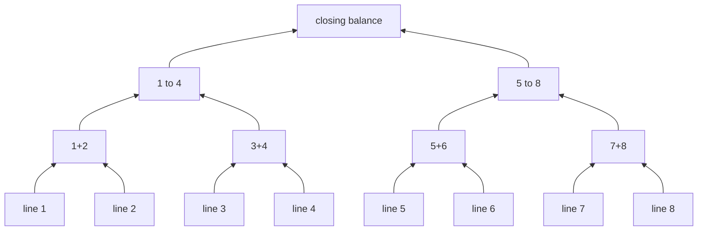

# NC and P-completeness: what parallel machines do fast, and what seems stubbornly sequential

[Syllabus](../../../SYLLABUS.md) → [Computability and complexity](../README.md) → [Algebraic, Interactive and Quantum](../README.md#s05) → NC and P-completeness

---

## General Overview

A bank statement has 1,024 lines, each a payment in or out of at most £100.00. The bank wants two things: the closing balance, and the running balance printed beside every line. One clerk adding line by line needs 1,023 additions, one after another.

Give the job to a team. In round one, each clerk adds a pair of neighbouring lines, halving the count. In round two, clerks add pairs of those subtotals. After 10 rounds one number is left: the closing balance, −£47.23. The work is still 1,023 additions, but the waiting time is 10 rounds, because $`\log_2 1024 = 10`$. The running balances take a little longer, 19 rounds, by a scheme that sends the subtotals back down the same tree.

Some jobs refuse this treatment. Take a wiring diagram of gates and ask what its output wire carries. Each gate waits for the gates before it, and no one knows how to cut that wait to a few rounds for every diagram. A way to do it would give every polynomial-time problem a fast parallel method.

**NC is the class of problems whose circuits have polynomial size and depth a power of log2 n, so many processors finish them in a few rounds; circuit evaluation is P-complete, as hard to run in parallel as anything in P, so a fast parallel method for it would put all of P in NC.**

**What kind of fact this is:** NC, AC, TC and P-complete are definitions. Two theorems are proved on this card in Why it works, with their key steps: circuit value is P-complete (Ladner, 1975), and Barrington's theorem (1989). NC ≠ P is a conjecture, unproved as of 2026-11-24.

### The picture: a balanced tree of additions



Schematic. Each level is one round, and every addition on a level runs at the same time. The 1,024 lines need ten levels.

---

## The formula

A reminder from [Boolean circuits](01-boolean-circuits-and-formulas.md): a circuit's **size** is its number of gates, and its **depth** is the longest chain of gates from an input to the output. **Fan-in** is how many wires a gate reads. A circuit family has one circuit for each input length $`n`$.

Depth is time on a parallel machine. Give every gate its own processor, and the answer is ready after as many rounds as the depth.

```math
\mathrm{NC}^k = \{\text{problems with fan-in-2 circuits of size } n^{O(1)} \text{ and depth } O((\log n)^k)\}, \qquad \mathrm{NC} = \mathrm{NC}^1 \cup \mathrm{NC}^2 \cup \cdots
```

**Read it aloud:** NC-k holds the problems solved by circuits of two-input gates whose size is at most a fixed power of n and whose depth is at most a fixed multiple of log n to the power k; NC is all of them together.

The closing balance is in $`\mathrm{NC}^1`$: depth a fixed multiple of $`\log_2 n`$. Two relatives change the gates:

- $`\mathrm{AC}^k`$ allows AND and OR gates of any fan-in. One OR gate reads all 1,024 bits at depth 1; with two-input gates the same OR needs depth 10. [Circuit lower bounds](../04-Beyond%20Worst%20Case/07-circuit-complexity-and-lower-bounds.md) met $`\mathrm{AC}^0`$, the constant-depth case.
- $`\mathrm{TC}^0`$ adds **majority gates**, which output 1 when more than half their inputs are 1, at constant depth.

The classes sit in one chain:

```math
\mathrm{NC}^0 \subsetneq \mathrm{AC}^0 \subsetneq \mathrm{TC}^0 \subseteq \mathrm{NC}^1 \subseteq \mathrm{L} \subseteq \mathrm{NL} \subseteq \mathrm{AC}^1 \subseteq \mathrm{NC}^2 \subseteq \cdots \subseteq \mathrm{NC} \subseteq \mathrm{P}
```

**Read it aloud:** each class is inside the next; only the first two steps are proved strict.

Here L and NL are the problems solved with memory a fixed multiple of $`\log_2 n`$ bits, without and with guessing ([Logarithmic space](../03-Time%20Complexity/10-logarithmic-space-l-and-nl.md)).

The other end of the chain is P. **Circuit value**, CVP, asks: given a circuit's wiring and its inputs, is the output 1? A **log-space reduction** $`A \le_L B`$ turns each question about A into one about B with the same answer, using a machine whose work memory is a fixed multiple of $`\log_2 n`$ bits. A problem in P is **P-complete** when every problem in P reduces to it that way.

```math
\mathrm{CVP} \text{ is P-complete}, \qquad\text{so}\qquad \mathrm{CVP} \in \mathrm{NC} \iff \mathrm{NC} = \mathrm{P}
```

**Read it aloud:** circuit value is P-complete, so it has fast parallel circuits exactly when every problem in P does.

Barrington's theorem pins $`\mathrm{NC}^1`$ to a machine with five places of memory. A **width-5 branching program** is a list of instructions; each reads one input bit and applies one of two shuffles of five places, depending on the bit.

```math
\text{formula of depth } d \;\Longrightarrow\; \text{width-5 program of length } m \le 4^{d}, \qquad \mathrm{NC}^1 = \{\text{problems with width-5 programs of length } n^{O(1)}\}
```

**Read it aloud:** a formula whose AND gates nest d deep becomes a width-5 program at most four to the d long, and the problems with polynomial-length width-5 programs are exactly NC-1.

| Symbol | Plain meaning | In our example | Push it up and the answer… |
| --- | --- | --- | --- |
| $`n`$, $`\log_2 n`$ | input length, here the statement's lines; rounds of a balanced tree | 1,024; 10 | more rounds, slowly |
| $`k`$ | the power of the log in $`\mathrm{NC}^k`$ | 1 for the closing balance | a bigger, slower class |
| $`d`$ | depth: gates on the longest path, or AND gates nested in a formula | 10 rounds; 3 for the carry | longer wait |
| $`\mathrm{NC}^k`$, $`\mathrm{AC}^k`$, $`\mathrm{TC}^0`$ | circuit classes: two-input gates; any fan-in; with majority gates | closing balance in $`\mathrm{NC}^1`$ | — |
| $`\mathrm{L}`$, $`\mathrm{NL}`$ | log-space classes, without and with guessing | — | — |
| $`A \le_L B`$ | a log-space reduction from A to B | any P problem to CVP | — |
| $`M`$, $`t`$, $`c`$, $`r`$ | a machine deciding a problem in P; the steps it runs, $`t = n^c`$ for a fixed power $`c`$; a row of its tableau, the tape at step $`r`$ | 5 steps for a 4-bit input | tableau of $`t`$ rows |
| $`f`$, $`g`$, $`e`$ | yes-or-no functions of the input bits that a program computes; do-nothing, the shuffle that moves no place | f is the carry; $`e`$ is the program's output for 0 | — |
| $`\sigma`$, $`\alpha`$, $`\beta`$ | 5-cycles: shuffles moving all five places round one loop | $`(1\ 2\ 3\ 4\ 5)`$, $`(1\ 2\ 4\ 5\ 3)`$ | — |
| $`[\alpha, \beta]`$ | commutator: do $`\alpha`$, then $`\beta`$, then undo $`\alpha`$, then undo $`\beta`$ | $`(1\ 5\ 3\ 2\ 4)`$ | — |
| $`S_w`$, $`A_5`$, C, N | all shuffles of $`w`$ places; the even shuffles of five places; in the fold, a class of look-alike shuffles and the subgroup it generates | $`S_5`$ has 120 | — |
| $`m`$ | branching program length | 40 for the carry | grows at most 4 times per AND level |

### When it holds

- **The family must be uniform.** A log-space machine must be able to write out the circuit for each $`n`$. Without that rule, one circuit per length can hide an undecidable answer, as [P/poly](08-non-uniform-complexity-p-poly-and-karp-lipton.md) shows.
- **Fan-in changes the depth.** With unbounded fan-in the 1,024-bit OR has depth 1, with two-input gates depth 10. This gap is why $`\mathrm{AC}^k \subseteq \mathrm{NC}^{k+1}`$: each wide gate becomes a tree of depth $`\log_2 n`$.
- **The reduction must be weak.** With polynomial-time reductions, every problem in P except the two trivial ones would be "P-complete": the reduction solves the question itself and writes down a fixed yes or no instance. Log-space reductions are themselves in NC, so they keep the meaning.
- **Depth counts rounds, not work.** A method in NC can do far more total work than the sequential one. Polynomial size caps it, but does not make it small.
- **Barrington needs five places.** With three or four places there is no pair of shuffles for the AND step, and the proof fails.

---

## Why it works

### Step 0: depth is waiting time, and trees cut it to log2 n

A gate cannot fire until its inputs are ready. Everything that can run at once is one round. A chain of 1,023 additions has depth 1,023. A balanced tree does the same 1,023 additions in $`\log_2 1024 = 10`$ rounds, because each round halves the numbers left.

So the question for any problem is whether its work can be arranged as a shallow tree. NC collects the problems where it can. P-completeness marks a problem where every known arrangement is deep.

### Step 1: running balances by sweeping up and down the tree

Each running balance is the sum of a prefix, the lines from 1 up to that line. The **Brent–Kung** scan computes all of them.

1. **Up-sweep, 10 rounds.** Build the tree of the picture, but keep each subtotal in place: position 2 holds lines 1–2, position 4 holds lines 1–4, and so on. That is 1,023 additions.
2. **Down-sweep, 9 rounds.** Each position still missing a prefix adds the finished subtotal just to its left. Position 6 adds lines 1–4 to lines 5–6. That is 1,013 additions.

The total is 19 rounds and 2,036 additions, about twice the closing balance alone. The **Kogge–Stone** scan instead has every position add the value 1, 2, 4, … places back. It needs only 10 rounds but 9,217 additions. The [Boolean circuits](01-boolean-circuits-and-formulas.md) card used Kogge–Stone on carries: a carry-lookahead adder is a prefix computation.

### Step 2: in bits, a carry-save tree keeps the depth logarithmic

Rounds of additions are not yet gates. Adding two 32-bit numbers with a lookahead adder has depth 13, so ten levels of adders cost ten times 13. In general that is $`\log_2 n`$ times the depth of one adder, which itself grows with the width.

The fix is the **carry-save** step: turn three numbers into two with the same total. The first is the bitwise XOR of the three; the second is the bitwise majority, shifted one place left. Every bit position works alone, so the step has depth 6 whatever the width.

Each step shrinks the count by a third: 1,024 numbers, then 683, 456, 304 and on to 2 after 16 layers. One lookahead addition finishes. The depth is 16 × 6 + 13 = 109, and in general a fixed multiple of $`\log_2 n`$. So the closing balance and every running balance are in $`\mathrm{NC}^1`$.

### Step 3: the chain of inclusions

Each link has a short reason.

- **$`\mathrm{NC}^0 \subsetneq \mathrm{AC}^0`$.** A constant-depth two-input circuit reads only a fixed number of inputs, so it cannot compute the OR of all $`n`$.
- **$`\mathrm{AC}^0 \subsetneq \mathrm{TC}^0 \subseteq \mathrm{NC}^1`$.** Parity is not in $`\mathrm{AC}^0`$, by the random-restriction proof of [Circuit lower bounds](../04-Beyond%20Worst%20Case/07-circuit-complexity-and-lower-bounds.md), yet a constant number of layers of majority gates computes it. A majority gate is a count and a comparison, which Step 2's tree does at log depth.
- **$`\mathrm{NC}^1 \subseteq \mathrm{L}`$.** Evaluate the log-depth formula by walking it depth first. The walk remembers only the path from the top, one bit per level: $`O(\log n)`$ bits.
- **$`\mathrm{NL} \subseteq \mathrm{AC}^1`$.** A guessing log-space machine accepts when a path joins its start to its accept configuration in a graph of polynomially many nodes. Square the graph's yes-or-no adjacency matrix $`\log_2`$ of its size times; each squaring is an OR of ANDs, depth 2 with unbounded fan-in.
- **$`\mathrm{NC} \subseteq \mathrm{P}`$.** A polynomial-size circuit, written out by a log-space machine, is evaluated gate by gate in polynomial time.

Whether $`\mathrm{NC}^1 = \mathrm{L}`$, $`\mathrm{L} = \mathrm{NL}`$, or $`\mathrm{NC} = \mathrm{P}`$ is unproved as of 2026-11-24.


Schematic. An arrow means "is inside"; its label says whether the inclusion is known to be strict.

### Step 4: circuit value is P-complete

CVP is in P: evaluate the gates in order. To show every problem in P reduces to it, take any machine M that decides a problem in $`t = n^c`$ steps, for a fixed number $`c`$. Ladner's 1975 proof writes M's run as a circuit.

1. **The tableau.** Row $`r`$ is the tape at step $`r`$: each cell holds a symbol, and the cell under the head also holds the state. That is a grid of $`t`$ rows.
2. **A local rule.** A cell in row $`r + 1`$ depends only on the cells just above it and beside them, because the head moves one place per step. That rule is a fixed table, so it is a fixed small circuit.
3. **Copy the small circuit** into every cell of every row. Code each cell as one wire per possible value. The size is a constant times $`t^2`$, polynomial in $`n`$.
4. **The output gate** asks whether the accept state appears in the last row.
5. **Log space suffices** to write this circuit. Each gate's wiring depends only on its row and column numbers, which take $`O(\log n)`$ bits.

The code runs this on a small machine that walks right over its input bits, tracking odd or even, and halts at the blank. It only moves right, so each cell reads the cell above and the one above-left: 15 possible values, 225 AND gates and 15 OR gates per cell. For a 4-bit input, 5 steps and 5 cells give $`240 \times 5^2 + 1 = 6{,}001`$ gates, depth 11, right on all 16 inputs.

The depth grows with $`t`$, two layers per step. That is the heart of the matter. The tableau is as deep as the run is long, and nobody knows how to flatten an arbitrary run.

Why the corollary holds: log-space functions are computable in $`\mathrm{NC}^2`$, and stacking two NC circuits gives an NC circuit. So if CVP had NC circuits, every problem in P would get them too, through its reduction.

<details>
<summary>Other P-complete problems, and why the label matters</summary>

The same method shows many more problems are P-complete: linear programming feasibility, the value of a maximum flow, Horn-clause satisfiability, and the first maximal independent set found by the greedy method in a fixed vertex order. The compendium of Greenlaw, Hoover and Ruzzo lists hundreds.

The label is practical: for a P-complete problem, look for a parallel method for an easier variant, such as an approximate answer or inputs of a special shape.

</details>

### Step 5: Barrington's theorem, a 5-cycle that switches on and off

A width-5 program **computes f via σ** when its product is σ on inputs where f is 1, and do-nothing $`e`$ where f is 0. Build such a program by following the formula.

1. **A variable.** One instruction: read the bit; apply σ if it is 1, $`e`$ if it is 0.
2. **Renaming.** Any 5-cycle is any other with the places renamed. Rename every instruction and a program for σ becomes one for any other 5-cycle, at the same length.
3. **NOT.** Take a program for f via $`\sigma^{-1}`$, then apply σ at the end. The product is $`e`$ when f is 1, and σ when f is 0.
4. **AND.** Take programs for f via α and g via β, then for f via $`\alpha^{-1}`$ and g via $`\beta^{-1}`$, and run all four in order. If both are 1, the product is $`[\alpha, \beta]`$. If f is 0, the α parts vanish and β is undone by $`\beta^{-1}`$; if g is 0, the same happens to α. Either way the product is $`e`$.
5. **The key fact.** The AND step works only if $`[\alpha, \beta]`$ is itself a 5-cycle, so the next level can rename it. In $`S_5`$, the 120 shuffles of five places, such pairs exist: 240 of the 576 pairs of 5-cycles qualify. One is $`(1\ 2\ 3\ 4\ 5)`$ and $`(1\ 2\ 4\ 5\ 3)`$, with commutator $`(1\ 5\ 3\ 2\ 4)`$.

Each AND level at most quadruples the length, so depth $`d`$ gives length at most $`4^d`$. An $`\mathrm{NC}^1`$ formula has $`d`$ a fixed multiple of $`\log_2 n`$, so $`4^d`$ is a fixed power of $`n`$: polynomial.

The converse is Step 0 again. Multiply the program's shuffles in a balanced tree. Each product of two shuffles of five places is a fixed-size circuit, and there are $`\log_2 m`$ levels. So a width-5 program of polynomial length is an $`\mathrm{NC}^1`$ circuit.

Why five? A shuffle group with such a pair cannot be **solvable**, that is, broken down by commutators to do-nothing in finitely many stages. $`S_3`$ and $`S_4`$ are solvable, and the code finds no usable pair in them. $`S_5`$ contains the even shuffles $`A_5`$, which [A_n is simple for n at least 5](../../03-Algebra/08-Groups/13-simplicity-of-alternating-groups.md) shows cannot be broken down at all.

<details>
<summary>Detailed proof: no usable pair in a solvable group</summary>

Suppose α, β and $`[\alpha, \beta]`$ all lie in one class C of look-alike shuffles, with C not $`\{e\}`$. Let N be the subgroup that all of C generates. It is normal, since C is a whole class.

Every member of C is a renamed copy of $`[\alpha, \beta]`$, and renaming a commutator gives a commutator of renamed members of C. So every member of C is a commutator of two members of N.

So N equals its own commutator subgroup. In a solvable group, the chain of commutator subgroups reaches do-nothing, so N would have to be $`\{e\}`$. That contradicts C not being $`\{e\}`$.

</details>

---

## Worked numbers, by hand

The statement first, then the adder's carry from [Boolean circuits](01-boolean-circuits-and-formulas.md): the carry out of adding two 2-bit numbers, 1 exactly when the sum is 4 or more.

| Step | Arithmetic | Value |
| --- | --- | --- |
| closing balance, balanced tree | halve the count each round | 10 rounds, 1,023 adds |
| the balance itself | sum of the 1,024 lines | −4,723 pence, **−£47.23** |
| running balances, Brent–Kung | 1,023 adds in 10 rounds up, 1,013 in 9 down | 19 rounds, 2,036 adds |
| running balances, Kogge–Stone | look back 1, 2, 4, … places | 10 rounds, 9,217 adds |
| carry-save layers | 1,024 → 683 → 456 → … → 2 | 16 layers |
| gate depth of the total | 16 × 6 + 13 | 109 |
| tableau, 4-bit input | 240 × 5² + 1 gates; 2 × 5 + 1 layers | 6,001 gates, depth 11 |
| commutator, place 1 | 1 →α 2 →β 4 →α⁻¹ 3 →β⁻¹ 5 | 1 goes to 5 |
| carry program length | each AND: both sides' lengths, added, then doubled | **40**, within $`4^3 = 64`$ |
| program on 16 inputs | product is $`(1\ 2\ 3\ 4\ 5)`$ or $`e`$ | right on 16 of 16 |
| program multiplied as a tree | 40 shuffles | 6 rounds |

The statement's lowest running balance is −£252.81 and its highest £231.35. A width-5 program of 40 instructions computes the carry bit correctly on all 16 inputs, and multiplying its shuffles in a tree takes 6 rounds.

### What breaks if you drop a piece

| Mistake | Comes out at | What went wrong |
| --- | --- | --- |
| Add the lines one at a time | 1,023 rounds | Depth grows like $`n`$, not like $`\log_2 n`$ |
| Take the fewest rounds to be the least work | Kogge–Stone 9,217 adds against Brent–Kung's 2,036 | Rounds and work are different costs |
| Use width 3 or 4 | 0 usable pairs | $`S_3`$ and $`S_4`$ are solvable, so the AND step has nothing to use |
| Use a commuting pair in the AND step | right on 6 of 16 | Every AND gives $`e`$, so the top OR always says 1 |
| Count an unbounded gate as one step | OR of 1,024 bits: depth 1, against 10 with two-input gates | That is $`\mathrm{AC}`$, not $`\mathrm{NC}`$; the two differ by a factor of $`\log_2 n`$ in depth |

---

## Code, from first principles, and it actually runs

The code builds each object and counts what it built. Four roads cross-check the answers:

1. **Sequential against parallel.** The line-by-line total and running balances are checked against the balanced tree, both scans, and the carry-save tree in 32-bit arithmetic. Each parallel round reads only the values the last round left.
2. **Circuit against counting.** The tableau circuit is evaluated gate by gate, for every input of 4, 5 and 8 bits and four of 16 bits, with both odd and even counts of 1s. The odd length 5 matters: a machine that tracks the wrong parity can still agree on every even length. Each answer is checked against counting the 1s. Its size and depth are checked against $`240(n+1)^2 + 1`$ and $`2(n+1) + 1`$.
3. **Program against arithmetic.** The width-5 program for the carry is run on all 16 inputs and checked against "the sum is 4 or more". Its tree product is checked against the product in order.
4. **Exhaustive search.** Every pair of shuffles of 3, 4 and 5 places is tested for the AND step.

### Python

```python
# NC and P-completeness -- the check behind the card.  Standard library only.
# Part 1: 1,024 transactions totalled and running-totalled in parallel rounds.  Part 2:
# a machine's run as a circuit (circuit value).  Part 3: Barrington's width-5 programs.
N, M32 = 1024, (1 << 32) - 1
amounts = [(i * 7919) % 20001 - 10000 for i in range(N)]       # pence, -100.00 to +100.00
def tree(xs, op):                        # each round combines neighbouring pairs at once
    rounds = ops = 0
    while len(xs) > 1:
        nxt = [op(xs[j], xs[j + 1]) for j in range(0, len(xs) - 1, 2)]
        xs, rounds, ops = nxt + xs[len(xs) - len(xs) % 2:], rounds + 1, ops + len(nxt)
    return xs[0], rounds, ops
def scan(xs, plan):                      # prefix sums: each round does x[j] += x[j - s]
    x, adds = xs[:], 0
    for s, starts in plan:               # the new list is built from the old one, all at once
        st, adds = set(starts), adds + len(starts)
        x = [v + x[j - s] if j in st else v for j, v in enumerate(x)]
    return x, sum(len(st) > 0 for _, st in plan), adds      # rounds that do work
L = (N - 1).bit_length()                 # 10 levels for 1,024
brent_kung = [(1 << d, range(2 * (1 << d) - 1, N, 2 << d)) for d in range(L)] + \
             [(1 << d, range(3 * (1 << d) - 1, N, 2 << d)) for d in range(L - 2, -1, -1)]
kogge_stone = [(1 << d, range(1 << d, N)) for d in range(L)]
def fa(a, b, c): return [a ^ b ^ c, (((a & b) | (a & c) | (b & c)) << 1) & M32]
def carry_save(xs):                      # three numbers in, two out: one fixed-depth layer
    xs, sizes = [x & M32 for x in xs], [len(xs)]
    while len(xs) > 2:
        xs = [v for j in range(0, len(xs) - 2, 3) for v in fa(*xs[j:j + 3])] + xs[len(xs) - len(xs) % 3:]
        sizes.append(len(xs))
    t = (xs[0] + xs[1]) & M32
    return (t - (1 << 32) if t >> 31 else t), sizes
# Part 2.  The machine walks right tracking odd (O) or even (E); at the blank it
# halts in A (odd) or R (even).  A cell is (symbol, state or -): 3 x 5 = 15 values.
SYMS, STATES = "01_", "-EOAR"
def flip(q, s): return "O" if (q == "O") != (s == "1") else "E"
def rule(l, m):                          # the new cell, from the cells above-left and above
    (ls, lq), (ms, mq) = divmod(l, 5), divmod(m, 5)
    if mq in (1, 2): return m - mq + (5 - mq if ms == 2 else 0)   # halt at blank, else leave
    if mq in (3, 4): return m
    if lq in (1, 2) and ls != 2: return m + STATES.index(flip(STATES[lq], SYMS[ls]))
    return m
def build_tableau(n):                    # the circuit a log-space machine writes
    gates, depth = [], []                # a gate is (op, inputs); inputs are gate numbers
    def gate(op, ins):
        gates.append((op, ins))
        depth.append(1 + max(depth[i] for i in ins) if ins else 0)
        return len(gates) - 1
    row = [[gate("IN", []) for _ in range(15)] for _ in range(n + 2)]   # cells 0..n, wall
    for _ in range(n + 1):               # one row per step, n + 1 steps
        new = []
        for i in range(n + 1):
            feeds = [[] for _ in range(15)]
            for u in range(15):
                for v in range(15):
                    feeds[rule(u, v)].append(gate("AND", [row[i - 1][u], row[i][v]]))
            new.append([gate("OR", f) for f in feeds])
        row = new + [row[-1]]            # row[-1], the blank wall, stays left of cell 0
    out = gate("OR", [c[s * 5 + 3] for c in row[:-1] for s in range(3)])
    return gates, depth[out], out
def evaluate(gates, w, out):             # circuit value: one gate after another, in order
    cells = [SYMS.index(s) * 5 + (i == 0) for i, s in enumerate(w + "_")] + [10]
    val = [int(c == v) for c in cells for v in range(15)]
    for op, ins in gates[len(val):]:
        val.append(int(any(val[i] for i in ins)) if op == "OR" else int(all(val[i] for i in ins)))
    return val[out]
# Part 3.  Permutations of 0..4 as tuples; compose(p, q) does p first, then q.
def compose(p, q): return tuple(q[i] for i in p)
def inv(p): return tuple(sorted(range(len(p)), key=lambda i: p[i]))
def comm(a, b): return compose(compose(compose(a, b), inv(a)), inv(b))
def conj(t, p): return compose(compose(inv(t), p), t)
def perms(w): return [(i,) + tuple(x + (x >= i) for x in p) for i in range(w) for p in perms(w - 1)] if w else [()]
def cycles(p):
    seen, out = set(), []
    for i in range(len(p)):
        c = []
        while i not in seen: seen.add(i); c.append(i + 1); i = p[i]
        if c: out.append(c)
    return out
def ctype(p): return sorted(len(c) for c in cycles(p))
def show(p): return "".join("(" + " ".join(map(str, c)) + ")" for c in cycles(p) if len(c) > 1) or "e"
S5, E5, A0 = perms(5), tuple(range(5)), (1, 2, 3, 4, 0)       # A0 is (1 2 3 4 5)
B0 = next(b for b in S5 if ctype(b) == [5] and ctype(comm(A0, b)) == [5])
def build(f, s, commute=False):          # a program computing f "via s": s when 1, e when 0
    if f[0] == "x": return [(f[1], E5, s)]
    if f[0] == "not":                    # compute f via s^-1, then do s once more at the end
        p = build(f[1], inv(s), commute)
        return p[:-1] + [(p[-1][0], compose(p[-1][1], s), compose(p[-1][2], s))]
    t = next(t for t in S5 if conj(t, comm(A0, B0)) == s)
    a, b = (s, s) if commute else (conj(t, A0), conj(t, B0))   # commute: the broken AND
    return sum((build(g, h, commute) for g, h in ((f[1], a), (f[2], b), (f[1], inv(a)), (f[2], inv(b)))), [])
def run_program(prog, bits):
    r = E5
    for i, p0, p1 in prog: r = compose(r, p1 if bits[i] else p0)
    return r
def OR(f, g): return ("not", ("and", ("not", f), ("not", g)))
a0, a1, b0, b1 = (("x", i) for i in range(4))
CARRY = OR(("and", a1, b1), ("and", OR(a1, b1), ("and", a0, b0)))
running, total = [], 0
for a in amounts:                        # road one for Part 1: one add at a time
    total += a; running.append(total)
t_sum, t_rounds, t_adds = tree(amounts, lambda x, y: x + y)
(bk, bk_rounds, bk_adds), (ks, ks_rounds, ks_adds) = scan(amounts, brent_kung), scan(amounts, kogge_stone)
cs_total, cs_sizes = carry_save(amounts)
yn = lambda c: "yes" if c else "no"
print(f"statement: {N} lines, from {min(amounts)} to {max(amounts)} pence; closing balance {total} pence")
print(f"one at a time: {N - 1} adds in {N - 1} rounds; balanced tree: {t_adds} adds in {t_rounds} rounds, total {t_sum}")
up = [len(st) for _, st in brent_kung[:L] if st]       # up-sweep rounds that do work, and their adds
print(f"running balances, Brent-Kung: {bk_adds} adds in {bk_rounds} rounds ({sum(up)} in {len(up)} up, "
      f"{bk_adds - sum(up)} in {bk_rounds - len(up)} down); all {N} match: {yn(bk == running)}")
print(f"running balances, Kogge-Stone: {ks_adds} adds in {ks_rounds} rounds; all {N} match: {yn(ks == running)}")
print(f"balances after lines 1, 2, 3: {running[0]}, {running[1]}, {running[2]}; lowest {min(running)}, highest {max(running)}")
print(f"carry-save: numbers left {' '.join(map(str, cs_sizes))}; total {cs_total}")
print(f"carry-save gate depth: {len(cs_sizes) - 1} layers x 6 + 13 for the last add = {(len(cs_sizes) - 1) * 6 + 13}")
print(f"OR of {N} bits: depth 1 with one unbounded gate; depth {L} with {N - 1} two-input gates")
for n, words in ((4, 16), (5, 32), (8, 256), (16, 4)):
    gates, dep, out = build_tableau(n)
    size = sum(op != "IN" for op, _ in gates)
    ws = [format(v * 4369 + 1 if n == 16 else v, f"0{n}b") for v in range(words)]   # n=16: 1, 4, 5, 7 ones
    right = sum(evaluate(gates, w, out) == w.count("1") % 2 for w in ws)   # against counting
    print(f"tableau n={n}: {size} gates, 240(n+1)^2+1 = {240 * (n + 1) ** 2 + 1}; depth {dep}, 2(n+1)+1 = {2 * n + 3}; right on {right} of {words}")
    assert size == 240 * (n + 1) ** 2 + 1 and dep == 2 * n + 3 and right == words
fives = [p for p in S5 if ctype(p) == [5]]
good = sum(ctype(comm(a, b)) == [5] for a in fives for b in fives)
print(f"S5: {len(S5)} permutations, {len(fives)} five-cycles; pairs whose commutator is a five-cycle: {good} of {len(fives) ** 2}")
print(f"chosen pair: a = {show(A0)}, b = {show(B0)}; a then b then a^-1 then b^-1 = {show(comm(A0, B0))}")
U = {w: sum(ctype(a) == ctype(b) == ctype(comm(a, b)) != [1] * w for a in perms(w) for b in perms(w)) for w in (3, 4, 5)}
for w in U: print(f"width {w}: pairs a, b in one class other than e, commutator in that class too: {U[w]}")
inputs = [(a & 1, a >> 1, b & 1, b >> 1) for a in range(4) for b in range(4)]
carry = [int(x[0] + 2 * x[1] + x[2] + 2 * x[3] >= 4) for x in inputs]
prog, bad = build(CARRY, A0), build(CARRY, A0, commute=True)
outs = [run_program(prog, x) for x in inputs]
ok = sum(o == (A0 if c else E5) for o, c in zip(outs, carry))
print(f"carry-out program: length {len(prog)}, bound 4^3 = 64; right on {ok} of 16, carry 1 on {sum(carry)}")
top, rounds, _ = tree([p1 for _, _, p1 in prog], compose)
print(f"its {len(prog)} permutations multiplied in a balanced tree: {rounds} rounds; same product: {yn(top == run_program(prog, (1, 1, 1, 1)))}")
wrong = sum((run_program(bad, x) == A0) == c for x, c in zip(inputs, carry))
print(f"what breaks, a commuting pair in the AND step: right on {wrong} of 16")
assert t_sum == total == cs_total == sum(amounts) and t_rounds == L
assert bk == running and ks == running and (bk_rounds, bk_adds, ks_adds) == (2 * L - 1, 2 * N - L - 2, L * N - N + 1)
assert U[3] == U[4] == 0 < good <= U[5] and good == len(fives) * sum(ctype(comm(A0, b)) == [5] for b in fives)   # by symmetry
assert top == run_program(prog, (1, 1, 1, 1)) and ok == 16 and rounds == 6 and wrong < 16
print("ALL CHECKS PASS")
```

**Ran 2026-11-24 on macOS, Python 3.14.10, standard library only. All checks passed. Output, pasted from the run:**

```
statement: 1024 lines, from -10000 to 9989 pence; closing balance -4723 pence
one at a time: 1023 adds in 1023 rounds; balanced tree: 1023 adds in 10 rounds, total -4723
running balances, Brent-Kung: 2036 adds in 19 rounds (1023 in 10 up, 1013 in 9 down); all 1024 match: yes
running balances, Kogge-Stone: 9217 adds in 10 rounds; all 1024 match: yes
balances after lines 1, 2, 3: -10000, -12081, -6243; lowest -25281, highest 23135
carry-save: numbers left 1024 683 456 304 203 136 91 61 41 28 19 13 9 6 4 3 2; total -4723
carry-save gate depth: 16 layers x 6 + 13 for the last add = 109
OR of 1024 bits: depth 1 with one unbounded gate; depth 10 with 1023 two-input gates
tableau n=4: 6001 gates, 240(n+1)^2+1 = 6001; depth 11, 2(n+1)+1 = 11; right on 16 of 16
tableau n=5: 8641 gates, 240(n+1)^2+1 = 8641; depth 13, 2(n+1)+1 = 13; right on 32 of 32
tableau n=8: 19441 gates, 240(n+1)^2+1 = 19441; depth 19, 2(n+1)+1 = 19; right on 256 of 256
tableau n=16: 69361 gates, 240(n+1)^2+1 = 69361; depth 35, 2(n+1)+1 = 35; right on 4 of 4
S5: 120 permutations, 24 five-cycles; pairs whose commutator is a five-cycle: 240 of 576
chosen pair: a = (1 2 3 4 5), b = (1 2 4 5 3); a then b then a^-1 then b^-1 = (1 5 3 2 4)
width 3: pairs a, b in one class other than e, commutator in that class too: 0
width 4: pairs a, b in one class other than e, commutator in that class too: 0
width 5: pairs a, b in one class other than e, commutator in that class too: 360
carry-out program: length 40, bound 4^3 = 64; right on 16 of 16, carry 1 on 6
its 40 permutations multiplied in a balanced tree: 6 rounds; same product: yes
what breaks, a commuting pair in the AND step: right on 6 of 16
ALL CHECKS PASS
```

### Rust

Same numbers, same labels, built with `rustc --edition 2021 -O`. No crates.

```rust
// NC and P-completeness -- the same check as the Python, in Rust.  No crates.
// Part 1: 1,024 transactions totalled and running-totalled in parallel rounds.  Part 2:
// a machine's run as a circuit (circuit value).  Part 3: Barrington's width-5 programs.
const N: usize = 1024;
const M32: u64 = (1 << 32) - 1;
type P = Vec<usize>;
fn tree<T: Clone>(mut xs: Vec<T>, op: &dyn Fn(&T, &T) -> T) -> (T, usize, usize) {
    let (mut rounds, mut ops) = (0, 0);           // each round combines neighbouring pairs at once
    while xs.len() > 1 {
        let nxt: Vec<T> = (0..xs.len() / 2).map(|j| op(&xs[2 * j], &xs[2 * j + 1])).collect();
        (ops, rounds) = (ops + nxt.len(), rounds + 1);
        xs = [nxt, xs[xs.len() - xs.len() % 2..].to_vec()].concat();
    }
    (xs[0].clone(), rounds, ops)
}
fn scan(xs: &[i64], plan: &[(usize, Vec<usize>)]) -> (Vec<i64>, usize, usize) {
    let (mut x, mut adds) = (xs.to_vec(), 0);     // each round does x[j] += x[j - s], all at once
    for (s, starts) in plan { let old = x.clone(); for &j in starts { x[j] = old[j] + old[j - s]; adds += 1 } }
    (x, plan.iter().filter(|p| !p.1.is_empty()).count(), adds)   // rounds that do work
}
fn carry_save(xs: &[i64]) -> (i64, Vec<usize>) {  // three numbers in, two out: one fixed-depth layer
    let (mut v, mut sizes): (Vec<u64>, Vec<usize>) = (xs.iter().map(|&x| (x as u64) & M32).collect(), vec![xs.len()]);
    while v.len() > 2 {
        let fa = |j: usize| { let (a, b, c) = (v[j], v[j + 1], v[j + 2]); [a ^ b ^ c, (((a & b) | (a & c) | (b & c)) << 1) & M32] };
        v = [(0..v.len() / 3).flat_map(|j| fa(3 * j)).collect::<Vec<u64>>(), v[v.len() - v.len() % 3..].to_vec()].concat();
        sizes.push(v.len());
    }
    let t = (v[0] + v[1]) & M32;
    (if t >> 31 == 1 { t as i64 - (1i64 << 32) } else { t as i64 }, sizes)
}

// Part 2.  Cell = symbol * 5 + state; symbols 0, 1, blank; states -, E, O, A, R.
fn flip(q: usize, s: usize) -> usize { if (q == 2) != (s == 1) { 2 } else { 1 } }
fn rule(l: usize, m: usize) -> usize {           // the new cell, from the cells above-left and above
    let (ls, lq, ms, mq) = (l / 5, l % 5, m / 5, m % 5);
    if mq == 1 || mq == 2 { return m - mq + if ms == 2 { 5 - mq } else { 0 } }
    if mq >= 3 { return m }
    if (lq == 1 || lq == 2) && ls != 2 { return m + flip(lq, ls) }
    m
}
fn build_tableau(n: usize) -> (Vec<(u8, Vec<usize>)>, usize, usize) {
    let (mut gates, mut depth): (Vec<(u8, Vec<usize>)>, Vec<usize>) = (vec![], vec![]);
    let mut gate = |op: u8, ins: Vec<usize>, g: &mut Vec<(u8, Vec<usize>)>| -> usize {
        depth.push(if ins.is_empty() { 0 } else { 1 + ins.iter().map(|&i| depth[i]).max().unwrap() });
        g.push((op, ins));
        g.len() - 1
    };                                            // op 0 input, 1 AND, 2 OR
    let mut row: Vec<Vec<usize>> = (0..n + 2).map(|_| (0..15).map(|_| gate(0, vec![], &mut gates)).collect()).collect();
    for _ in 0..n + 1 {                           // one row per step, n + 1 steps
        let mut new: Vec<Vec<usize>> = vec![];
        for i in 0..n + 1 {
            let left = if i == 0 { row[n + 1].clone() } else { row[i - 1].clone() };
            let mut feeds: Vec<Vec<usize>> = vec![vec![]; 15];
            for u in 0..15 { for v in 0..15 { feeds[rule(u, v)].push(gate(1, vec![left[u], row[i][v]], &mut gates)) } }
            new.push(feeds.into_iter().map(|f| gate(2, f, &mut gates)).collect());
        }
        new.push(row[n + 1].clone()); row = new;  // the blank wall stays left of cell 0
    }
    let acc: Vec<usize> = (0..n + 1).flat_map(|i| (0..3).map(move |s| (i, s * 5 + 3))).map(|(i, k)| row[i][k]).collect();
    let out = gate(2, acc, &mut gates);
    (gates, depth[out], out)
}
fn evaluate(gates: &[(u8, Vec<usize>)], w: &[usize], out: usize) -> usize {
    let mut cells: Vec<usize> = w.iter().enumerate().map(|(i, &s)| s * 5 + (i == 0) as usize).collect();
    cells.extend([10, 10]);                       // the blank after the input, then the wall
    let mut val: Vec<bool> = cells.iter().flat_map(|&c| (0..15).map(move |v| c == v)).collect();
    for (op, ins) in &gates[val.len()..] {        // circuit value: one gate after another
        let x = if *op == 2 { ins.iter().any(|&i| val[i]) } else { ins.iter().all(|&i| val[i]) }; val.push(x) }
    val[out] as usize
}

// Part 3.  Permutations of 0..4; compose(p, q) does p first, then q.
fn compose(p: &P, q: &P) -> P { p.iter().map(|&i| q[i]).collect() }
fn inv(p: &P) -> P { let mut r = vec![0; p.len()]; for (i, &x) in p.iter().enumerate() { r[x] = i } r }
fn comm(a: &P, b: &P) -> P { compose(&compose(&compose(a, b), &inv(a)), &inv(b)) }
fn conj(t: &P, p: &P) -> P { compose(&compose(&inv(t), p), t) }
fn perms(w: usize) -> Vec<P> {
    if w == 0 { return vec![vec![]] } (0..w).flat_map(|i| perms(w - 1).into_iter().map(move |p| [vec![i], p.iter().map(|&x| x + (x >= i) as usize).collect()].concat())).collect()
}
fn cycles(p: &P) -> Vec<Vec<usize>> {
    let mut seen = vec![false; p.len()];
    (0..p.len()).map(|s| { let (mut c, mut i) = (vec![], s); while !seen[i] { seen[i] = true; c.push(i + 1); i = p[i] } c })
        .filter(|c| !c.is_empty()).collect()
}
fn ctype(p: &P) -> Vec<usize> { let mut t: Vec<usize> = cycles(p).iter().map(|c| c.len()).collect(); t.sort(); t }
fn show(p: &P) -> String {
    let s: String = cycles(p).iter().filter(|c| c.len() > 1).map(|c| format!("({})", join(c))).collect();
    if s.is_empty() { "e".to_string() } else { s }
}
enum F { X(usize), Not(Box<F>), And(Box<F>, Box<F>) }
fn or(f: F, g: F) -> F { F::Not(Box::new(F::And(Box::new(F::Not(Box::new(f))), Box::new(F::Not(Box::new(g)))))) }
fn and(f: F, g: F) -> F { F::And(Box::new(f), Box::new(g)) }
fn build(f: &F, s: &P, k: &(Vec<P>, P, P), commute: bool) -> Vec<(usize, P, P)> {
    let e: P = (0..5).collect();                  // a program computing f "via s": s when 1, e when 0
    match f {
        F::X(i) => vec![(*i, e, s.clone())],
        F::Not(g) => {                            // compute g via s^-1, then do s once more at the end
            let mut p = build(g, &inv(s), k, commute);
            let (i, p0, p1) = p.pop().unwrap();
            p.push((i, compose(&p0, s), compose(&p1, s))); p
        }
        F::And(g, h) => {
            let t = k.0.iter().find(|t| conj(t, &comm(&k.1, &k.2)) == *s).unwrap();
            let (a, b) = if commute { (s.clone(), s.clone()) } else { (conj(t, &k.1), conj(t, &k.2)) };
            [build(g, &a, k, commute), build(h, &b, k, commute), build(g, &inv(&a), k, commute), build(h, &inv(&b), k, commute)].concat()
        }
    }
}
fn run_program(prog: &[(usize, P, P)], bits: &[usize]) -> P {
    let mut r: P = (0..5).collect();
    for (i, p0, p1) in prog { r = compose(&r, if bits[*i] == 1 { p1 } else { p0 }) } r
}
fn yn(c: bool) -> &'static str { if c { "yes" } else { "no" } }
fn join(v: &[usize]) -> String { v.iter().map(|x| x.to_string()).collect::<Vec<_>>().join(" ") }
fn main() {
    let amounts: Vec<i64> = (0..N as i64).map(|i| (i * 7919) % 20001 - 10000).collect();
    let l = (usize::BITS - (N - 1).leading_zeros()) as usize;   // 10 levels for 1,024
    let mut bkp: Vec<(usize, Vec<usize>)> = (0..l).map(|d| (1 << d, (2 * (1 << d) - 1..N).step_by(2 << d).collect())).collect();
    bkp.extend((0..l - 1).rev().map(|d| (1 << d, (3 * (1 << d) - 1..N).step_by(2 << d).collect())));
    let ksp: Vec<(usize, Vec<usize>)> = (0..l).map(|d| (1 << d, (1 << d..N).collect())).collect();
    let (mut running, mut total) = (vec![], 0i64);
    for a in &amounts { total += a; running.push(total) }     // road one: one add at a time
    let (t_sum, t_rounds, t_adds) = tree(amounts.clone(), &|x: &i64, y: &i64| x + y);
    let ((bk, bk_rounds, bk_adds), (ks, ks_rounds, ks_adds)) = (scan(&amounts, &bkp), scan(&amounts, &ksp));
    let (cs_total, cs_sizes) = carry_save(&amounts);
    println!("statement: {} lines, from {} to {} pence; closing balance {} pence", N, amounts.iter().min().unwrap(), amounts.iter().max().unwrap(), total);
    println!("one at a time: {} adds in {} rounds; balanced tree: {} adds in {} rounds, total {}", N - 1, N - 1, t_adds, t_rounds, t_sum);
    let up: Vec<usize> = bkp[..l].iter().map(|p| p.1.len()).filter(|&a| a > 0).collect();   // up-sweep rounds that do work
    println!("running balances, Brent-Kung: {} adds in {} rounds ({} in {} up, {} in {} down); all {} match: {}", bk_adds, bk_rounds,
             up.iter().sum::<usize>(), up.len(), bk_adds - up.iter().sum::<usize>(), bk_rounds - up.len(), N, yn(bk == running));
    println!("running balances, Kogge-Stone: {} adds in {} rounds; all {} match: {}", ks_adds, ks_rounds, N, yn(ks == running));
    println!("balances after lines 1, 2, 3: {}, {}, {}; lowest {}, highest {}", running[0], running[1], running[2], running.iter().min().unwrap(), running.iter().max().unwrap());
    println!("carry-save: numbers left {}; total {}", join(&cs_sizes), cs_total);
    println!("carry-save gate depth: {} layers x 6 + 13 for the last add = {}", cs_sizes.len() - 1, (cs_sizes.len() - 1) * 6 + 13);
    println!("OR of {} bits: depth 1 with one unbounded gate; depth {} with {} two-input gates", N, l, N - 1);
    for (n, words) in [(4usize, 16usize), (5, 32), (8, 256), (16, 4)] {
        let (gates, dep, out) = build_tableau(n);
        let size = gates.iter().filter(|g| g.0 != 0).count();
        let ws: Vec<Vec<usize>> = (0..words).map(|v| (0..n).rev().map(|b| ((if n == 16 { v * 4369 + 1 } else { v }) >> b) & 1).collect()).collect();
        let right = ws.iter().filter(|w| evaluate(&gates, w, out) == w.iter().sum::<usize>() % 2).count();   // against counting
        println!("tableau n={}: {} gates, 240(n+1)^2+1 = {}; depth {}, 2(n+1)+1 = {}; right on {} of {}", n, size, 240 * (n + 1) * (n + 1) + 1, dep, 2 * n + 3, right, words);
        assert!(size == 240 * (n + 1) * (n + 1) + 1 && dep == 2 * n + 3 && right == words);
    }
    let (s5, a0): (Vec<P>, P) = (perms(5), vec![1, 2, 3, 4, 0]);   // a0 is the cycle (1 2 3 4 5)
    let b0 = s5.iter().find(|b| ctype(b) == vec![5] && ctype(&comm(&a0, b)) == vec![5]).unwrap().clone();
    let fives: Vec<&P> = s5.iter().filter(|p| ctype(p) == vec![5]).collect();
    let good = fives.iter().flat_map(|a| fives.iter().map(move |b| (*a, *b))).filter(|(a, b)| ctype(&comm(a, b)) == vec![5]).count();
    println!("S5: {} permutations, {} five-cycles; pairs whose commutator is a five-cycle: {} of {}", s5.len(), fives.len(), good, fives.len() * fives.len());
    println!("chosen pair: a = {}, b = {}; a then b then a^-1 then b^-1 = {}", show(&a0), show(&b0), show(&comm(&a0, &b0)));
    let us: Vec<usize> = [3usize, 4, 5].iter().map(|&w| { let g = perms(w);
        g.iter().flat_map(|a| g.iter().map(move |b| (a, b))).filter(|(a, b)| ctype(a) == ctype(b) && ctype(b) == ctype(&comm(a, b)) && ctype(a) != vec![1; w]).count() }).collect();
    for (w, u) in [3, 4, 5].iter().zip(&us) { println!("width {}: pairs a, b in one class other than e, commutator in that class too: {}", w, u) }
    let x = |i: usize| F::X(i);                   // a0, a1, b0, b1
    let carry_f = or(and(x(1), x(3)), and(or(x(1), x(3)), and(x(0), x(2))));
    let inputs: Vec<Vec<usize>> = (0..4).flat_map(|a| (0..4).map(move |b| vec![a & 1, a >> 1, b & 1, b >> 1])).collect();
    let carry: Vec<bool> = inputs.iter().map(|x| x[0] + 2 * x[1] + x[2] + 2 * x[3] >= 4).collect();
    let kit = (s5.clone(), a0.clone(), b0.clone());
    let (prog, bad) = (build(&carry_f, &a0, &kit, false), build(&carry_f, &a0, &kit, true));
    let ok = inputs.iter().zip(&carry).filter(|(x, &c)| run_program(&prog, x) == if c { a0.clone() } else { (0..5).collect() }).count();
    println!("carry-out program: length {}, bound 4^3 = 64; right on {} of 16, carry 1 on {}", prog.len(), ok, carry.iter().filter(|&&c| c).count());
    let (top, rounds, _) = tree(prog.iter().map(|t| t.2.clone()).collect(), &|p: &P, q: &P| compose(p, q));
    println!("its {} permutations multiplied in a balanced tree: {} rounds; same product: {}", prog.len(), rounds, yn(top == run_program(&prog, &[1, 1, 1, 1])));
    let wrong = inputs.iter().zip(&carry).filter(|(x, &c)| (run_program(&bad, x) == a0) == c).count();
    println!("what breaks, a commuting pair in the AND step: right on {} of 16", wrong);
    assert!(t_sum == total && cs_total == total && total == amounts.iter().sum::<i64>() && t_rounds == l);
    assert!(bk == running && ks == running && (bk_rounds, bk_adds, ks_adds) == (2 * l - 1, 2 * N - l - 2, l * N - N + 1));
    assert!(us[0] == 0 && us[1] == 0 && 0 < good && good <= us[2] && good == fives.len() * fives.iter().filter(|b| ctype(&comm(&a0, b)) == vec![5]).count());   // by symmetry
    assert!(top == run_program(&prog, &[1, 1, 1, 1]) && ok == 16 && rounds == 6 && wrong < 16);
    println!("ALL CHECKS PASS");
}
```

**Ran 2026-11-24 on macOS, rustc 1.98.1, no crates. All checks passed. Output, pasted from the run:**

```
statement: 1024 lines, from -10000 to 9989 pence; closing balance -4723 pence
one at a time: 1023 adds in 1023 rounds; balanced tree: 1023 adds in 10 rounds, total -4723
running balances, Brent-Kung: 2036 adds in 19 rounds (1023 in 10 up, 1013 in 9 down); all 1024 match: yes
running balances, Kogge-Stone: 9217 adds in 10 rounds; all 1024 match: yes
balances after lines 1, 2, 3: -10000, -12081, -6243; lowest -25281, highest 23135
carry-save: numbers left 1024 683 456 304 203 136 91 61 41 28 19 13 9 6 4 3 2; total -4723
carry-save gate depth: 16 layers x 6 + 13 for the last add = 109
OR of 1024 bits: depth 1 with one unbounded gate; depth 10 with 1023 two-input gates
tableau n=4: 6001 gates, 240(n+1)^2+1 = 6001; depth 11, 2(n+1)+1 = 11; right on 16 of 16
tableau n=5: 8641 gates, 240(n+1)^2+1 = 8641; depth 13, 2(n+1)+1 = 13; right on 32 of 32
tableau n=8: 19441 gates, 240(n+1)^2+1 = 19441; depth 19, 2(n+1)+1 = 19; right on 256 of 256
tableau n=16: 69361 gates, 240(n+1)^2+1 = 69361; depth 35, 2(n+1)+1 = 35; right on 4 of 4
S5: 120 permutations, 24 five-cycles; pairs whose commutator is a five-cycle: 240 of 576
chosen pair: a = (1 2 3 4 5), b = (1 2 4 5 3); a then b then a^-1 then b^-1 = (1 5 3 2 4)
width 3: pairs a, b in one class other than e, commutator in that class too: 0
width 4: pairs a, b in one class other than e, commutator in that class too: 0
width 5: pairs a, b in one class other than e, commutator in that class too: 360
carry-out program: length 40, bound 4^3 = 64; right on 16 of 16, carry 1 on 6
its 40 permutations multiplied in a balanced tree: 6 rounds; same product: yes
what breaks, a commuting pair in the AND step: right on 6 of 16
ALL CHECKS PASS
```

The two outputs match line for line.

### Lean

Lean proves the tree depth fact for every n and the two shuffle facts behind Barrington, and checks the card's hand numbers.

- Take $`n`$ inputs, with $`n \ge 1`$, combined by a tree of two-input gates. Then its depth is at least the smallest $`d`$ with $`2^d \ge n`$.
- Take the same $`n`$. Then some such tree has exactly that depth.
- For 1,024 lines, that smallest depth is 10 rounds.
- $`S_5`$ has two 5-cycles whose commutator is again a 5-cycle, the key fact of the AND step.
- Take the card's pair $`\alpha`$ and $`\beta`$. Then $`\alpha`$, $`\beta`$ and $`[\alpha, \beta]`$ are all 5-cycles, and $`[\alpha, \beta]`$ is $`(1\ 5\ 3\ 2\ 4)`$.
- Take a solvable group, with $`\alpha`$, $`\beta`$ and $`[\alpha, \beta]`$ all in one class of look-alike elements. Then that class is $`\{e\}`$, so no usable pair exists.
- Brent–Kung's counts add up: 1,023 + 1,013 = 2,036 adds, and 10 + 9 = 19 rounds.
- Kogge–Stone's adds over its 10 rounds total 9,217.
- Sixteen carry-save layers take 1,024 numbers down to 2, and 16 × 6 + 13 = 109.
- The tableau counts are right: 240 × 5² + 1 = 6,001 gates and 2 × 5 + 1 = 11 layers.
- The carry program's length, 40, is within $`4^3 = 64`$.

The running balances, the tableau circuit's answers, Barrington's construction and the width 3 and 4 searches are left to the Python and Rust checks.

```lean
-- NC and P-completeness: a fan-in-2 tree over n inputs needs and reaches depth ⌈log2 n⌉, S5 has two 5-cycles whose commutator is a 5-cycle, and no solvable group has such a pair.
import Mathlib.Data.Tree.Basic
import Mathlib.Data.Nat.Log
import Mathlib.GroupTheory.Perm.Cycle.Concrete
import Mathlib.GroupTheory.Perm.Cycle.Type
import Mathlib.GroupTheory.Solvable
import Mathlib.Algebra.BigOperators.Group.Finset.Basic

open Equiv

/-- A binary tree has at most `2 ^ height` leaves. -/
theorem binaryTree_numLeaves_le_two_pow_height :
    ∀ t : BinaryTree Unit, t.numLeaves ≤ 2 ^ t.height
  | .nil => by simp [BinaryTree.numLeaves, BinaryTree.height]
  | .node _ a b => by
    have ha := binaryTree_numLeaves_le_two_pow_height a
    have hb := binaryTree_numLeaves_le_two_pow_height b
    simp only [BinaryTree.numLeaves, BinaryTree.height, pow_succ]
    have h1 : 2 ^ a.height ≤ 2 ^ max a.height b.height :=
      Nat.pow_le_pow_right (by norm_num) (le_max_left _ _)
    have h2 : 2 ^ b.height ≤ 2 ^ max a.height b.height :=
      Nat.pow_le_pow_right (by norm_num) (le_max_right _ _)
    omega

/-- Every `n` with `1 ≤ n ≤ 2 ^ k` is the leaf count of a tree of height at most `k`. -/
theorem binaryTree_exists_of_le_two_pow :
    ∀ k n : ℕ, 1 ≤ n → n ≤ 2 ^ k → ∃ t : BinaryTree Unit, t.numLeaves = n ∧ t.height ≤ k
  | 0, n, h1, h2 => ⟨.nil, by simp [BinaryTree.numLeaves] at *; omega, by simp [BinaryTree.height]⟩
  | k + 1, n, h1, h2 => by
    rcases Nat.eq_or_lt_of_le h1 with h | h
    · exact ⟨.nil, by simp [BinaryTree.numLeaves, ← h], by simp [BinaryTree.height]⟩
    · rw [pow_succ] at h2
      obtain ⟨a, ha, ha'⟩ := binaryTree_exists_of_le_two_pow k (n / 2) (by omega) (by omega)
      obtain ⟨b, hb, hb'⟩ := binaryTree_exists_of_le_two_pow k (n - n / 2) (by omega) (by omega)
      refine ⟨.node () a b, ?_, ?_⟩
      · simp only [BinaryTree.numLeaves, ha, hb]; omega
      · simp only [BinaryTree.height]; omega

/-- A term of the derived series that contains `α` also contains `α`'s next term. -/
theorem mem_derivedSeries_succ_of_usable {G : Type*} [Group G] (α β : G)
    (hβ : IsConj α β) (hc : IsConj α (β⁻¹ * α⁻¹ * β * α)) (n : ℕ)
    (hα : α ∈ Subgroup.derivedSeries G n) : α ∈ Subgroup.derivedSeries G (n + 1) := by
  have hN := Subgroup.derivedSeries_normal G n
  have hβmem : β ∈ Subgroup.derivedSeries G n := by
    obtain ⟨c, hc'⟩ := isConj_iff.mp hβ
    rw [← hc']
    exact hN.conj_mem α hα c
  have hcomm : β⁻¹ * α⁻¹ * β * α ∈ Subgroup.derivedSeries G (n + 1) := by
    rw [Subgroup.derivedSeries_succ]
    have := Subgroup.commutator_mem_commutator (inv_mem hβmem) (inv_mem hα)
    simpa [commutatorElement_def] using this
  obtain ⟨c, hc'⟩ := isConj_iff.mp hc.symm
  rw [← hc']
  exact (Subgroup.derivedSeries_normal G (n + 1)).conj_mem _ hcomm c

/-- Step 0, depth is waiting time: a balanced tree of two-input additions
combines `n ≥ 1` numbers. A tree of two-input gates (a `BinaryTree Unit`, whose
leaves are the inputs and whose nodes are the gates) with `n` leaves always has
depth at least `⌈log2 n⌉`, and some such tree has depth exactly `⌈log2 n⌉`. -/
theorem binary_tree_min_depth_eq_clog (n : ℕ) (hn : 1 ≤ n) :
    (∀ t : BinaryTree Unit, t.numLeaves = n → Nat.clog 2 n ≤ t.height) ∧
      ∃ t : BinaryTree Unit, t.numLeaves = n ∧ t.height = Nat.clog 2 n := by
  refine ⟨fun t ht => ?_, ?_⟩
  · rw [Nat.clog_le_iff_le_pow (by norm_num), ← ht]
    exact binaryTree_numLeaves_le_two_pow_height t
  · obtain ⟨t, ht, ht'⟩ := binaryTree_exists_of_le_two_pow (Nat.clog 2 n) n hn
      ((Nat.clog_le_iff_le_pow (by norm_num)).mp le_rfl)
    refine ⟨t, ht, le_antisymm ht' ?_⟩
    rw [Nat.clog_le_iff_le_pow (by norm_num), ← ht]
    exact binaryTree_numLeaves_le_two_pow_height t

/-- Barrington's key fact (Step 5): in `S5`, the shuffles of five places, there
are two 5-cycles `α` and `β` whose commutator "do `α`, then `β`, then undo `α`,
then undo `β`" is again a 5-cycle. Mathlib multiplies permutations right to
left, so that commutator is `β⁻¹ * α⁻¹ * β * α`. -/
theorem exists_five_cycles_with_five_cycle_commutator :
    ∃ α β : Perm (Fin 5), α.cycleType = {5} ∧ β.cycleType = {5} ∧
      (β⁻¹ * α⁻¹ * β * α).cycleType = {5} := by
  refine ⟨c[0, 1, 2, 3, 4], c[0, 1, 3, 4, 2], ?_⟩
  decide

/-- Why five (the folded proof): in a solvable group there is no usable pair.
If `α`, `β` and the commutator "do `α`, then `β`, then undo `α`, then undo `β`"
all lie in one class of look-alike (conjugate) elements, that class is `{e}`. -/
theorem no_usable_pair_of_isSolvable {G : Type*} [Group G] [Group.IsSolvable G] (α β : G)
    (hβ : IsConj α β) (hc : IsConj α (β⁻¹ * α⁻¹ * β * α)) : α = 1 := by
  obtain ⟨k, hk⟩ := (Group.isSolvable_def (G := G)).mp ‹_›
  have key : ∀ n, α ∈ Subgroup.derivedSeries G n := by
    intro n
    induction n with
    | zero => rw [Subgroup.derivedSeries_zero]; exact Subgroup.mem_top α
    | succ n ih => exact mem_derivedSeries_succ_of_usable α β hβ hc n ih
  have := key k
  rw [hk] at this
  exact (Subgroup.mem_bot).mp this

-- The closing balance: 1,024 lines need ⌈log2 1024⌉ = 10 rounds.
example : Nat.clog 2 1024 = 10 := by decide

-- The OR of 1,024 bits with two-input gates: 1,023 gates.
example : 1024 - 1 = 1023 := by norm_num

-- The card's pair: α = (1 2 3 4 5), β = (1 2 4 5 3) (places 1..5 written 0..4);
-- do α, then β, then undo α, then undo β, gives (1 5 3 2 4).
example :
    let α : Perm (Fin 5) := c[0, 1, 2, 3, 4]
    let β : Perm (Fin 5) := c[0, 1, 3, 4, 2]
    β⁻¹ * α⁻¹ * β * α = c[0, 4, 2, 1, 3] := by decide

-- All three of them are 5-cycles.
example : (c[0, 1, 2, 3, 4] : Perm (Fin 5)).cycleType = {5} ∧
    (c[0, 1, 3, 4, 2] : Perm (Fin 5)).cycleType = {5} ∧
    (c[0, 4, 2, 1, 3] : Perm (Fin 5)).cycleType = {5} := by decide

-- Brent-Kung: 1,023 adds in 10 rounds up, 1,013 in 9 down: 19 rounds, 2,036 adds.
example : 1023 + 1013 = 2036 ∧ 10 + 9 = 19 := by norm_num

-- Kogge-Stone: round j adds at 1,024 - 2^j positions, 10 rounds, 9,217 adds.
example : ∑ j ∈ Finset.range 10, (1024 - 2 ^ j) = 9217 := by decide

-- Carry-save: three numbers become two, so n becomes n - n/3;
-- 16 layers take 1,024 numbers down to 2 (1,024 → 683 → 456 → 304 → …).
example : (fun n : ℕ => n - n / 3)^[16] 1024 = 2 := by decide

-- Gate depth of the total: 16 × 6 + 13 = 109.
example : 16 * 6 + 13 = 109 := by norm_num

-- Tableau for a 4-bit input: 240 × 5² + 1 = 6,001 gates, depth 2 × 5 + 1 = 11.
example : 240 * 5 ^ 2 + 1 = 6001 ∧ 2 * 5 + 1 = 11 := by norm_num

-- Carry program: 40 instructions, within 4³ = 64.
example : 40 ≤ 4 ^ 3 := by norm_num

#print axioms binaryTree_numLeaves_le_two_pow_height
#print axioms binaryTree_exists_of_le_two_pow
#print axioms mem_derivedSeries_succ_of_usable
#print axioms binary_tree_min_depth_eq_clog
#print axioms exists_five_cycles_with_five_cycle_commutator
#print axioms no_usable_pair_of_isSolvable
```

**Checked 2026-11-24 on macOS, Lean 4.36.0-rc2, Mathlib v4.36.0-rc2. Every proof is complete and uses only Lean's standard axioms. Output, pasted from the run:**

```
'binaryTree_numLeaves_le_two_pow_height' depends on axioms: [propext, Classical.choice, Quot.sound]
'binaryTree_exists_of_le_two_pow' depends on axioms: [propext, Classical.choice, Quot.sound]
'mem_derivedSeries_succ_of_usable' depends on axioms: [propext, Classical.choice, Quot.sound]
'binary_tree_min_depth_eq_clog' depends on axioms: [propext, Classical.choice, Quot.sound]
'exists_five_cycles_with_five_cycle_commutator' depends on axioms: [propext, Classical.choice, Quot.sound]
'no_usable_pair_of_isSolvable' depends on axioms: [propext, Classical.choice, Quot.sound]
```

> [!TIP]
> **Try changing**
> Guess first, then run the Python. An assert stops the program when a number no longer matches.
> - **A statement of 1,000 lines.** Change `N, M32 = 1024,` to `N, M32 = 1000,`. Guess: how many rounds for the total? Still 10, since $`2^{10} = 1024 \ge 1000`$. Brent–Kung now needs 1,984 adds in 18 rounds, because the top up-sweep round has nothing left to add, and the assert pinned to 1,024 lines stops the run.
> - **A longer run.** Change `(16, 4)` to `(32, 2)` in the tableau loop. Guess the gates: $`240 \times 33^2 + 1 = 261{,}361`$, at depth 67. The depth doubles with the input; the size quadruples.
> - **Six places.** Change `(3, 4, 5)` to `(3, 4, 5, 6)` in the line that sets `U`. Guess: are there usable pairs for six places? Yes, 9,000, since $`S_6`$ is not solvable either.
> - **Break the AND step.** Change `build(CARRY, A0)` to `build(CARRY, A0, commute=True)`. The program is right on only 6 of 16 inputs, and the last assert stops it.

---

## The usual mistake

> [!warning]
> **Reading P-complete as "proved impossible to parallelise".** It is a conditional statement. CVP has no NC circuits only if NC ≠ P, which is unproved as of 2026-11-24. The label says that a fast parallel method for CVP would give one for every problem in P, which most researchers doubt.
>
> - **Counting rounds as work.** Kogge–Stone finishes the running balances in 10 rounds but spends 9,217 additions; Brent–Kung spends 2,036 in 19 rounds. A method in NC may do much more total work than the sequential one.
> - **Counting word additions as depth.** Ten rounds of 32-bit additions is not depth 10 in gates: each lookahead adder has depth 13. The carry-save tree keeps the bit-level depth at 109, a multiple of $`\log_2 n`$.
> - **Using polynomial-time reductions.** They make every non-trivial problem in P "P-complete", so the label would say nothing. P-completeness uses log-space or NC reductions.
> - **Expecting Barrington with fewer places.** Widths 3 and 4 give 0 usable pairs. The five places matter because $`A_5`$ is not solvable.

---

## Where you meet it in real life

- **Graphics processors.** Scans like Brent–Kung and Kogge–Stone are standard building blocks on GPUs, used to sort, to pack data and to total columns, because they turn a loop into $`\log_2 n`$ rounds.
- **Multiplier chips.** A hardware multiplier adds many shifted copies of a number. It uses a tree of carry-save adders, called a Wallace tree, and one fast adder at the end, as in Step 2.
- **Logic simulation.** Simulating a chip design is circuit evaluation. Simulators parallelise across many independent inputs, but one deep circuit on one input stays a chain of waits, as P-completeness suggests: a general fast method would put all of P in NC.
- **Linear programming and maximum flow.** Both are P-complete. Parallel solvers speed up the arithmetic inside each step, but no known method cuts the number of steps to a power of $`\log_2 n`$.

> **Say it back**
> NC is the class of problems with polynomial-size circuits whose depth is a power of log2 n, so many processors solve them in a few rounds. Totals and running totals are in NC1: 1,024 lines take 10 rounds, running balances 19, and a carry-save tree keeps the bit-level depth logarithmic. Circuit value is P-complete, because any polynomial-time run can be laid out as a tableau circuit by a log-space machine; so it is in NC only if NC = P, which is unproved. Barrington's theorem says NC1 is exactly what width-5 programs of polynomial length compute, because two 5-cycles can have a 5-cycle as their commutator; with 3 or 4 places no such pair exists.

---

## What this builds on

- [Boolean circuits](01-boolean-circuits-and-formulas.md): size, depth, formulas, and the lookahead adder whose depth Step 2 reuses.
- [P/poly](08-non-uniform-complexity-p-poly-and-karp-lipton.md): circuit families without uniformity, which is why NC demands a log-space machine to write the circuits.
- [Time and space classes](../03-Time%20Complexity/01-time-and-space-classes.md): the class P, the far end of the NC chain.
- [Reductions](../03-Time%20Complexity/03-polynomial-reductions-and-np-completeness.md): reductions $`A \le_p B`$ and completeness, which log-space reductions and P-completeness copy with less memory.
- [Logarithmic space](../03-Time%20Complexity/10-logarithmic-space-l-and-nl.md): the classes L and NL, which sit inside the NC chain, and the log-space machines that perform reductions.
- [Circuit lower bounds](../04-Beyond%20Worst%20Case/07-circuit-complexity-and-lower-bounds.md): AC0 and the proof that parity is not in it, the one strict step in the chain.
- [A_n is simple for n at least 5](../../03-Algebra/08-Groups/13-simplicity-of-alternating-groups.md): the commutator of shuffles, and why $`A_5`$ cannot be broken down, which is why Barrington needs five places.

## Where this goes next

- [Quantum error correction](12-quantum-error-correction-and-fault-tolerance.md): quantum circuits also pay for depth, because noise builds up with every layer, and error correction is how long computations survive it.

This card leaves open whether NC = P: whether every problem a computer solves in polynomial time can also be solved in a few rounds by many processors.

---

## Sources

Verified 2026-11-24: every link below resolves to the publisher's page.

- Ladner, Richard E. "The Circuit Value Problem Is Log Space Complete for P." *ACM SIGACT News* 7, no. 1 (1975): 18–20. [doi:10.1145/990518.990519](https://doi.org/10.1145/990518.990519). The tableau reduction of Step 4.
- Ladner, Richard E., and Michael J. Fischer. "Parallel Prefix Computation." *Journal of the ACM* 27, no. 4 (1980): 831–838. [doi:10.1145/322217.322232](https://doi.org/10.1145/322217.322232). Prefix sums in logarithmic depth with linear work, the problem of Step 1.
- Barrington, David A. "Bounded-Width Polynomial-Size Branching Programs Recognize Exactly Those Languages in NC1." *Journal of Computer and System Sciences* 38, no. 1 (1989): 150–164. [doi:10.1016/0022-0000(89)90037-8](https://doi.org/10.1016/0022-0000%2889%2990037-8). The commutator construction of Step 5.
- Greenlaw, Raymond, H. James Hoover, and Walter L. Ruzzo. *Limits to Parallel Computation: P-Completeness Theory*. Oxford University Press, 1995. [doi:10.1093/oso/9780195085914.001.0001](https://doi.org/10.1093/oso/9780195085914.001.0001). The theory of P-completeness and its compendium of P-complete problems.
- Arora, Sanjeev, and Boaz Barak. *Computational Complexity: A Modern Approach*. Cambridge University Press, 2009. [doi:10.1017/CBO9780511804090](https://doi.org/10.1017/CBO9780511804090). Chapter 6: the classes NC and AC, and P-completeness.
