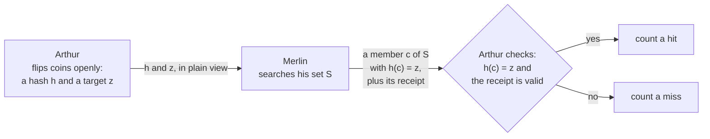
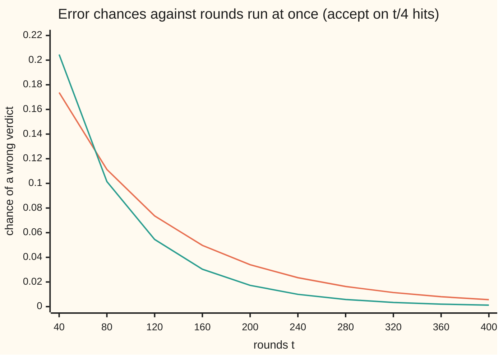

# Arthur-Merlin and two provers: public coins, separate questioning, and MIP = NEXP

[Syllabus](../../../SYLLABUS.md) → [Computability and complexity](../README.md) → [Algebraic, Interactive and Quantum](../README.md#s05) → Arthur-Merlin and two provers

---

## General Overview

Two tiny rail networks have four stations each, numbered 0 to 3. The **path** runs in a line: 0-1, 1-2, 2-3. The **star** joins a hub, station 0, to the other three. A prover, **Merlin** (all-powerful, possibly lying), claims they are different networks. A verifier, **Arthur** (a fast program that flips coins), must be convinced.

On [Interactive proofs](04-interactive-proofs-ip-pspace-and-the-pcp-theorem.md) the verifier won this kind of argument by keeping a coin secret. Here Arthur shows every coin he flips. That looks fatal, but it is not, because the true claim makes a set **bigger**. The path has 12 labelled drawings and the star has 4, so together there are 16 drawings. If the claim were false and both networks were the path, there would be only 12. Merlin proves "my set is big" by hitting random targets that Arthur picks in the open.

A second way to question provers is to keep two of them in separate rooms. Picture two suspects, each asked one yes-or-no question. They win if their answers agree, unless both were asked question 1, when the answers must differ. Without help they win at most 75% of the time. Sharing a pair of entangled qubits (from [Qubits](05-qubits-superposition-and-measurement.md)) lifts that to 85.4%. Separation is what lets a verifier check answers against each other, and it raises the power of conversation from PSPACE to NEXP.

**A verifier whose coins are public can still test a prover, by asking him to show that a set is big; and a verifier who questions two provers who cannot talk can pin down their answers like a written proof, which is why two provers prove exactly NEXP.**

**What kind of fact this is:** four kinds, said separately.

- The size bounds for the hashing test and the 75% limit for separated suspects are theorems proved on this card in Why it works.
- Private coins becoming public (Goldwasser and Sipser), AM inside the second level of the polynomial hierarchy, and MIP = NEXP are theorems stated with key steps and named sources.
- "Graph isomorphism is not NP-complete" is a theorem only in conditional form: it holds unless the polynomial hierarchy collapses. That the hierarchy does not collapse is a conjecture, unproved as of 2026-11-24.
- The 85.4% for entangled suspects rests on a model, quantum mechanics, simulated here as four amplitudes. That no quantum strategy beats it is Tsirelson's 1980 theorem, stated without proof.

### The picture: one round with public coins



Schematic. Nothing is hidden from Merlin; he wins a round only if his set really has a member on the target.

---

## The formula

The input $`w`$ is the claim's data, here the two networks $`G_0`$ (path) and $`G_1`$ (star). Arthur's **public coins** $`r`$ are random bits he sends to Merlin in plain view. Merlin's reply is $`m`$. Arthur's decision $`V(w, r, m)`$ is 1 (accept) or 0 (reject), and he computes it in polynomial time with no further coins.

A language $`L`$ (the set of inputs where the claim is true) is in **AM** (Arthur-Merlin) when Arthur speaks first, Merlin answers, and:

```math
w \in L \;\Rightarrow\; \Pr_r[\exists m: V(w, r, m) = 1] \ge \tfrac23, \qquad w \notin L \;\Rightarrow\; \Pr_r[\exists m: V(w, r, m) = 1] \le \tfrac13
```

**Read it aloud:** if the claim is true, for at least two coin results in three Merlin has a reply that Arthur accepts; if it is false, for at most one in three does any reply work.

In **MA** (Merlin-Arthur) the order flips. Merlin sends one message first, and Arthur then checks it with coins. Merlin cannot adapt to coins he has not seen.

The engine of the network protocol is a size test. Merlin holds a set $`S`$ of items he can back with a receipt, a proof of membership defined in Step 1. Arthur picks a random **hash** $`h`$ (a rule that scrambles each item's code into a $`k`$-bit number) and a random target $`z`$ among the $`2^{k}`$ possible outputs. Merlin wins if some item lands on the target:

```math
\frac{\lvert S\rvert}{2^{k}} - \binom{\lvert S\rvert}{2}\frac{1}{2^{2k}} \;\le\; \Pr[\text{some } c \in S \text{ has } h(c) = z] \;\le\; \frac{\lvert S\rvert}{2^{k}}
```

**Read it aloud:** the chance of a hit is at most the set's size over the number of targets, and at least that, minus a correction for pairs of items that land together.

With 128 targets, the true claim's 48 pairs hit with chance at least 0.306152, and the false claim's 24 at most 0.1875.

The card's class results:

```math
\mathrm{NP} \cup \mathrm{BPP} \subseteq \mathrm{MA} \subseteq \mathrm{AM} \subseteq \Pi_2^{\mathrm{p}}, \qquad \mathrm{MIP} = \mathrm{NEXP}
```

**Read it aloud:** Merlin-Arthur proofs cover NP and BPP, Arthur-Merlin proofs cover those, all of it sits on the second rung of the hierarchy, and two separated provers prove exactly NEXP.

**NEXP** is the class of claims with a certificate of exponential length, $`2^{n^{d}}`$ symbols, checked in exponential time. **MIP** is the class of claims a polynomial-time verifier can check by questioning two or more provers who cannot talk to each other.

| Symbol | Plain meaning | In our example | Push it up and the answer… |
| --- | --- | --- | --- |
| $`w`$, $`G_0`$, $`G_1`$; $`L`$ | the input: two networks; the set of inputs where the claim holds | path and star on stations 0 to 3; pairs of different networks | — |
| $`r`$, $`m`$, $`V(w, r, m)`$ | Arthur's public coins; Merlin's reply; Arthur's decision, 1 or 0 | a hash and a target; one item with its receipt; 1 when the item hits and the receipt checks | — |
| $`S`$ | Merlin's set: every (copy, symmetry) pair, a symmetry being a renaming that leaves a drawing unchanged | 48 if different, 24 if the same; path 2 symmetries, star 6 | hit chance rises |
| $`c`$, $`c'`$, $`\rho`$ | items of $`S`$ as 11-bit codes; one of the hash's 7 random rows | code 1365 in round 1 | — |
| $`h`$, $`k`$, $`z`$ | the hash; its output length in bits, giving $`2^{k}`$ targets; the target output | 11-bit codes scrambled to 7 bits: 128 targets; target 45 in round 1 | rarer hits for both sets |
| $`t`$ | rounds run at once | 100, accept on 25 or more hits | both error chances fall |
| $`\Sigma_2^{\mathrm{p}}`$, $`\Pi_2^{\mathrm{p}}`$; $`y`$, $`u`$ | rung 2 of the hierarchy: there-exists then for-all, or for-all then there-exists; in Step 5, the strings they range over | AM sits in $`\Pi_2^{\mathrm{p}}`$ | — |
| $`n`$, $`\ell`$, $`s_i`$, $`B`$ | in Step 4's fold: input length; length of the amplified coin string; the shifts; the bad coin strings | — | — |
| $`x`$, $`y`$, $`a`$, $`b`$ (CHSH) | the two suspects' questions and answers, each one bit | win when $`a \oplus b = x \wedge y`$ | — |
| $`\alpha`$, $`\beta`$ | the angles at which each suspect reads his qubit | 0 or $`\pi/4`$; $`\pi/8`$ or $`-\pi/8`$ | changes the win chance |
| MIP, NEXP, $`d`$ | claims checked by separated provers; claims with certificates of $`2^{n^{d}}`$ symbols, for a fixed power $`d`$ | — | — |
| $`q`$ | length of each prover's question, in bits | 1 to 4 | tables to guess: $`2^{2^{q+1}}`$ |

### When it holds

- **Arthur's coins are his own, even though public.** If Merlin picks the target, a false claim always passes.
- **The set counts symmetries.** Copies alone give 16 against 12 or 4: no fixed line separates them.
- **The target range fits the set.** With 16 targets both sets usually hit, so the gap shrinks: 0.9495 against 0.7776.
- **The suspects cannot talk after hearing the questions.** If they can, they always win.
- **For classical soundness, the provers share no entanglement.** Entangled suspects win 85.4%, past the 75% bound.

---

## Why it works

### Step 0: a true claim makes a set large, and size can be tested in the open

The private-coin protocol on [Interactive proofs](04-interactive-proofs-ip-pspace-and-the-pcp-theorem.md) worked because a liar could not tell which network the verifier had redrawn. Goldwasser and Sipser (1986) saw the same fact as a count. List every way the verifier's secret coins could produce each redrawn copy. When the claim is true, the coin shows through and the list is twice as long. A public-coin protocol proves "this list is long", and a random target hit measures length without reading the list.

### Step 1: from drawings to (copy, symmetry) pairs

A **renaming** relabels the four stations: $`4 \times 3 \times 2 \times 1 = 24`$ of them. A **symmetry** is a renaming that leaves a drawing unchanged. The path has 2 (keep it, or reverse it). The star has 6 (fix the hub, shuffle the three leaves).

Every renaming of a network gives a labelled copy, and each copy arises from exactly as many renamings as the network has symmetries. So copies times symmetries is 24:

- path: 12 copies, since $`24/2 = 12`$;
- star: 4 copies, since $`24/6 = 4`$;
- shared between them: 0, because a copy of the path is never a copy of the star.

A naive set "all copies of either network" has 16 members when the claim is true. When it is false it has 12 (two paths) or 4 (two stars). Arthur does not know which: no fast method is known for counting a large network's symmetries.

The fix is to put pairs in the set: a copy together with one of its symmetries. Each network then contributes copies times symmetries $`= 24`$ pairs, whatever its shape. So:

- claim true: $`12 \times 2 + 4 \times 6 = 48`$ pairs;
- claim false: $`12 \times 2 = 24`$ pairs.

A pair's **receipt** is the network, 0 or 1, that the copy comes from, and the renaming that turns that network into the copy. Arthur checks it in a few steps: the renaming must give the copy, and the symmetry must leave the copy unchanged. A pair outside $`S`$ has no receipt.

The count matches the private-coin verifier's coins: (which network, which renaming), $`2 \times 24 = 48`$ outcomes.

### Step 2: a hash measures the set's size

Each pair gets an 11-bit code: 6 bits saying which of the 6 possible lines are drawn, then 5 bits for the symmetry's number from 0 to 23. Arthur's hash is 7 rows of 11 random bits. Each output bit is the **parity** (1 if odd, 0 if even) of the code bits that its row picks out. His target $`z`$ is 7 more random bits, one of 128 values.

This hash is **pairwise independent**: for any two different nonzero codes, the pair of outputs is uniform over all $`128 \times 128`$ combinations. Two bounds follow.

- **Upper, for any Merlin.** Each item hits with chance $`1/128`$. Merlin can only send items in $`S`$, because Arthur checks the receipt. So the chance some item hits is at most $`\lvert S\rvert / 128`$: $`24/128 = 0.1875`$ when the claim is false.
- **Lower, for the honest Merlin.** He searches all of $`S`$, so he finds a hit whenever one exists. Inclusion-exclusion (add the single chances, subtract the chances for pairs) gives at least $`48/128 - 1{,}128/16{,}384 = 0.306152`$ when the claim is true. There are $`1{,}128`$ pairs among 48 items.

Over 20,000 simulated rounds each, the true claim hit 0.3155 of the time and the false claim 0.1733, each within its bounds.

<details>
<summary>Detailed proof: the hash is pairwise independent, and the two bounds</summary>

Write codes $`c, c'`$ as vectors of 11 bits, with arithmetic mod 2. A row $`\rho`$ gives the output bit $`\rho \cdot c`$, the parity of the bits where both are 1.

If $`c \ne c'`$ and neither is zero, then $`c`$, $`c'`$ and $`c \oplus c'`$ are all nonzero. For a random row, $`\rho \cdot v`$ is 0 or 1 with chance one half each, for any nonzero $`v`$. Applying this to $`c`$, $`c'`$ and $`c \oplus c'`$ shows that the pair $`(\rho \cdot c, \rho \cdot c')`$ takes each of its four values with chance one quarter. The 7 rows are independent, so $`(h(c), h(c'))`$ is uniform over $`128^2`$ pairs.

With the target $`z`$ uniform and independent of the rows, each item hits with chance $`1/128`$, and two different items both hit with chance $`1/128^2`$.

The union bound gives the upper bound:

$`\displaystyle \Pr\Big[\bigcup_{c \in S} \{h(c) = z\}\Big] \le \sum_{c \in S} \Pr[h(c) = z] = \frac{\lvert S\rvert}{2^{k}}`$

The first two terms of inclusion-exclusion give the lower bound, since the chance of a union is at least the sum of single chances minus the sum over pairs:

$`\displaystyle \Pr\Big[\bigcup_{c \in S} \{h(c) = z\}\Big] \ge \frac{\lvert S\rvert}{2^{k}} - \binom{\lvert S\rvert}{2}\frac{1}{2^{2k}}`$

</details>

### Step 3: run many rounds at once

One round separates 0.306 from 0.1875, a gap, not a verdict. Arthur sends $`t`$ independent hashes and targets in one message. Merlin answers all of them in one reply. Arthur accepts if at least $`t/4`$ rounds hit, a line between 0.1875 and 0.306. It still has two messages, so it is still AM.

The code ran the 20,000 rounds as 200 runs of 100. The true claim passed 189 runs. The false claim passed 10.

### The picture: both errors fall as rounds are added

Exact binomial sums, both printed by the checks. The true-claim line uses the lower bound 0.306152 for each round, so it is a ceiling on the honest Merlin's failure.



Orange: a true claim rejected. Green: a false claim accepted. At 400 rounds both are under 1%: 0.005665 and 0.001196.

### Step 4: where AM and MA sit

| Result | Why, in one line | Source |
| --- | --- | --- |
| NP ⊆ MA | Merlin sends the certificate; Arthur checks it and ignores his coins | definition |
| BPP ⊆ MA | Arthur ignores Merlin and runs his own coin-flipping program ([BPP](../04-Beyond%20Worst%20Case/03-randomised-complexity-and-bpp.md)) | definition |
| MA ⊆ AM | amplify, then let Arthur's coins come first | Babai, 1985 |
| AM with any fixed number of rounds = AM | extra rounds can be folded back, at polynomial cost | Babai and Moran, 1988 |
| private coins over $`k`$ rounds become public coins over $`k + 2`$ | Step 1's count and Step 2's hash, every round | Goldwasser and Sipser, 1986 |
| AM ⊆ $`\Pi_2^{\mathrm{p}}`$ | the fold below | Babai and Moran, 1988 |
| public coins with polynomially many rounds = IP = PSPACE | the row above, applied to IP, with IP = PSPACE | Goldwasser and Sipser, 1986; Shamir, 1990, on [Interactive proofs](04-interactive-proofs-ip-pspace-and-the-pcp-theorem.md) |

So graph non-isomorphism, "these two networks differ", is in AM. It is not known to be in NP: no short certificate of difference is known.

<details>
<summary>Detailed proof sketch: AM sits inside the second rung, for-all then there-exists</summary>

Amplify first, by Step 3, so that for an input of length $`n`$ the coin strings $`r`$ have length $`\ell`$ and the error is below $`1/(2\ell)`$ both ways. Call $`r`$ **good** when some reply $`m`$ makes Arthur accept. Deciding "good" is an NP question: there exists $`m`$.

Lautemann's 1983 shifting trick, whose result [BPP](../04-Beyond%20Worst%20Case/03-randomised-complexity-and-bpp.md) states without proof, says: if almost all strings lie in a set $`B`$, a few shifts $`s_1, \dots, s_\ell`$ make the copies $`B \oplus s_i`$ cover every string. It handles a false claim, and a counting bound handles a true one:

$`\displaystyle w \in L \iff \forall s_1, \dots, s_\ell\ \exists r:\ r \oplus s_1, \dots, r \oplus s_\ell \text{ are all good}`$

If the claim is true, fewer than a fraction $`1/(2\ell)`$ of strings are bad, so for fixed shifts a random $`r`$ fails with chance at most $`\ell \times 1/(2\ell) = \tfrac12`$: some $`r`$ works. If it is false, fewer than a fraction $`1/(2\ell)`$ of strings are good; the rest form $`B`$. Pick the shifts at random. For a fixed $`r`$, the strings $`r \oplus s_i`$ are independent and random, so all are good with chance below $`(2\ell)^{-\ell}`$. Over all $`2^{\ell}`$ choices of $`r`$, some $`r`$ escapes with chance below $`2^{\ell} (2\ell)^{-\ell} = \ell^{-\ell} < 1`$. So some shifts give every $`r`$ a bad $`r \oplus s_i`$: the copies $`B \oplus s_i`$ cover everything, and no $`r`$ works.

"All good" is itself "there exist $`m_1, \dots, m_\ell`$", which merges with $`\exists r`$. The sentence is for-all then there-exists: $`\Pi_2^{\mathrm{p}}`$.

</details>

### Step 5: why graph isomorphism is unlikely to be NP-complete

Suppose graph isomorphism were NP-complete. Then its complement, non-isomorphism, would be coNP-complete. Non-isomorphism is in AM, so all of coNP would be in AM.

Now take a $`\Sigma_2^{\mathrm{p}}`$ claim: there exists $`y`$ such that for all $`u`$, something checkable holds. The for-all part is a coNP question, so it has an AM protocol. Merlin sends $`y`$ first, then they run that protocol, and Step 4's collapse folds the result back into AM, inside $`\Pi_2^{\mathrm{p}}`$. So $`\Sigma_2^{\mathrm{p}} \subseteq \Pi_2^{\mathrm{p}}`$, and by Stockmeyer's result on [Above NP](../03-Time%20Complexity/08-conp-pspace-and-the-polynomial-hierarchy.md) the whole hierarchy collapses to its second rung.

This is the theorem of Boppana, Håstad and Zachos (1987). The hierarchy is believed not to collapse, so graph isomorphism is believed not to be NP-complete.

### Step 6: two suspects in separate rooms

The **CHSH game** (from Clauser, Horne, Shimony and Holt, 1969) has a referee and two players. The referee sends a random bit $`x`$ to the first suspect and $`y`$ to the second. They answer bits $`a`$ and $`b`$ and win when

```math
a \oplus b = x \wedge y
```

**Read it aloud:** the answers must agree, unless both questions were 1, when they must differ.

**Separated suspects win at most 3 of the 4 question pairs.** A fixed strategy is four bits: $`a_0, a_1`$ (first suspect's answer to 0 and 1) and $`b_0, b_1`$. The four winning conditions are $`a_0 \oplus b_0 = 0`$, $`a_0 \oplus b_1 = 0`$, $`a_1 \oplus b_0 = 0`$ and $`a_1 \oplus b_1 = 1`$. XOR the four left sides: each answer bit appears twice, so they XOR to 0. The right sides XOR to 1. So an odd number of conditions fail: 1 or 3. The code lists all 16 strategies: 8 win 3 of 4, 8 win 1 of 4.

Shared random coins do not help: they only mix fixed strategies, and a mixture cannot beat its best part. Suspects who hear both questions win every time: answer $`a = 0`$ and $`b = x \wedge y`$.

**Entangled suspects win 85.4%.** They share the two-qubit state $`(\lvert 00\rangle + \lvert 11\rangle)/\sqrt2`$. Each reads his own qubit along an angle: the first at $`\alpha = 0`$ or $`\pi/4`$, the second at $`\beta = \pi/8`$ or $`-\pi/8`$, depending on the question. Reading along an angle means turning the qubit by it, then measuring. On this state, turning both qubits acts like turning one by $`\alpha - \beta`$, so the answers agree with chance $`\cos^2(\alpha - \beta)`$. Three question pairs want agreement at angle gap $`\pi/8`$. The pair (1, 1) wants disagreement at gap $`3\pi/8`$, with chance $`\sin^2(3\pi/8) = \cos^2(\pi/8)`$. Every pair wins with the same chance:

```math
\cos^2\frac{\pi}{8} = \frac{2 + \sqrt2}{4} = 0.853553390593
```

**Read it aloud:** the win chance is the cosine of pi over 8, squared, which equals two plus the square root of two, all over four.

Neither suspect learns the other's question. Each one's answer alone is a fair coin. Tsirelson proved in 1980 that no quantum strategy does better. The code's search over 65,536 angle settings in steps of $`\pi/16`$ also tops out at 0.853553390593, a check on this family of strategies, not a proof of the ceiling.

### The picture: win chances in the CHSH game

Each `#` is 2.5 percentage points. Both checks print these bars.

```
random answers      ####################                     0.5000
best fixed strategy ##############################           0.7500
entangled pair      ##################################       0.8536
suspects who talk   ######################################## 1.0000
```

### Step 7: why two provers prove more than one

One prover hears the whole conversation and can tailor each answer to it. That limits one prover to IP = PSPACE.

Two provers who cannot talk lose that freedom. The verifier asks prover 1 a full question and prover 2 one piece of it, then checks that the answers agree. Prover 2 does not know what prover 1 was asked, so each must answer from a fixed table: question in, answer out. CHSH shows the cost: separated, they lose a game that talking suspects always win.

A fixed table is a written proof. Its questions are polynomially long, so the table has exponentially many entries. That is exactly the size of a NEXP certificate, and the verifier spot-checks it, the way [Interactive proofs](04-interactive-proofs-ip-pspace-and-the-pcp-theorem.md) spot-checks a PCP.

- **MIP ⊆ NEXP.** Guess both tables, then work out the acceptance chance over all of the verifier's coins, in exponential time. The guess is large: with $`q`$-bit questions and 1-bit answers there are $`2^{2^{q+1}}`$ pairs of tables, 16 at $`q = 1`$ and 4,294,967,296 at $`q = 4`$.
- **NEXP ⊆ MIP.** Babai, Fortnow and Lund (1991) turned an exponential-time check into polynomial arithmetic on an exponentially large table. A **multilinearity test** checks that the table is a polynomial of power at most 1 in each variable, using a few random entries. Sum-check then verifies the computation. The second prover is there to pin the first to a fixed table.

**With entanglement the story changes.** Entangled provers can break a classical MIP protocol, as CHSH shows, yet the verifier can exploit entanglement too. In 2020 Ji, Natarajan, Vidick, Wright and Yuen announced MIP* = RE: with entangled provers, a verifier can check every semidecidable claim, including that a program halts. Stated here, not proved.

---

## Worked numbers, by hand

The network claim with public coins, then the two suspects.

| Step | Arithmetic | Value |
| --- | --- | --- |
| renamings of 4 stations | $`4 \times 3 \times 2 \times 1`$ | 24 |
| path copies | 24 / 2 symmetries | 12 |
| star copies | 24 / 6 symmetries | 4 |
| (copy, symmetry) pairs, claim true | $`12 \times 2 + 4 \times 6`$ | 48 |
| (copy, symmetry) pairs, claim false | $`12 \times 2`$ | 24 |
| hit chance, true claim, at least | $`48/128 - 1{,}128/16{,}384`$ | 0.306152 |
| hit chance, false claim, at most | $`24/128`$ | 0.1875 |
| 20,000 simulated rounds | hits counted | 0.3155 against 0.1733 |
| 100 rounds, accept on 25 hits | 200 simulated runs each | 189 of 200 against 10 of 200 |
| 400 rounds, exact | binomial sums | 0.005665 and 0.001196 |
| CHSH, separated | best of 16 strategies | 3 of 4: 75% |
| CHSH, entangled | $`\cos^2(\pi/8) = (2 + \sqrt2)/4`$ | **0.853553390593** |

**Arthur, showing every coin, accepts the true claim 189 runs in 200 and the false one 10 in 200; and two separated suspects cannot beat 75% without entanglement, nor 85.4% with it.**

### What breaks if you drop a piece

| Mistake | Comes out at | What went wrong |
| --- | --- | --- |
| Counting copies, not (copy, symmetry) pairs | true 16; false 12 or 4 | The size depends on symmetries Arthur cannot count, so no fixed line separates true from false |
| Merlin chooses the target | false claim accepted 20 of 20 | Public coins must still be Arthur's coins |
| Only 16 targets | true 0.9495, false 0.7776 per round | The range is too small: both sets usually hit, so the gap shrinks |
| Suspects hear both questions | win 4 of 4 | The 75% bound needs separation |

The code prints every row.

---

## Code, from first principles, and it actually runs

The script runs the public-coin protocol and the CHSH game, reaching each answer by more than one road:

- **Copy counts:** the copies are listed from all 24 renamings and checked against 24 divided by the symmetries.
- **Hit chances:** 20,000 simulated rounds land between the two bounds, and the average number of hits matches $`\lvert S\rvert/128`$.
- **Many rounds:** exact binomial sums for the error chances, against 200 simulated runs of 100 rounds.
- **CHSH:** all 16 fixed strategies are listed, against the parity argument; the entangled win chance comes from a state-vector run, from $`\cos^2(\pi/8)`$ and from $`(2 + \sqrt2)/4`$, and 100,000 sampled games agree with both.

Randomness is SplitMix64, written out, seed 2026 for the protocol and 7 for the games, so Python and Rust print the same.

### Python

```python
# Arthur-Merlin and two provers -- the check behind the card.  Standard library only.
# Part 1: the Goldwasser-Sipser protocol, with public coins, on the claim "a 4-station
# path and a 4-station star are different networks".  Part 2: the CHSH game, two
# suspects in separate rooms: fixed strategies against a two-qubit state vector.
from math import cos, sin, sqrt, pi
M64 = (1 << 64) - 1
class Rng:                                   # SplitMix64, as on the Interactive proofs card
    def __init__(s, seed): s.x = seed
    def next(s):
        s.x = (s.x + 0x9E3779B97F4A7C15) & M64
        z = ((s.x ^ (s.x >> 30)) * 0xBF58476D1CE4E5B9) & M64
        z = ((z ^ (z >> 27)) * 0x94D049BB133111EB) & M64
        return z ^ (z >> 31)
    def below(s, n): return s.next() % n
    def unit(s): return (s.next() >> 11) / 9007199254740992.0
def perms(items):                            # all 24 renamings of 4 stations
    if not items: return [()]
    return [(x,) + r for i, x in enumerate(items) for r in perms(items[:i] + items[i + 1:])]
ALL = perms((0, 1, 2, 3))
PAIRS = [(a, b) for a in range(4) for b in range(a + 1, 4)]          # the 6 possible lines
def mask(edges, pi):                         # a renamed network as 6 bits, one per line
    return sum(1 << PAIRS.index((min(pi[a], pi[b]), max(pi[a], pi[b]))) for a, b in edges)
def lines(h): return [PAIRS[i] for i in range(6) if h >> i & 1]
PATH, STAR, PATH2 = [(0, 1), (1, 2), (2, 3)], [(0, 1), (0, 2), (0, 3)], [(2, 0), (0, 3), (3, 1)]
def copies(g): return {mask(g, p) for p in ALL}
def syms(h): return [k for k, p in enumerate(ALL) if mask(lines(h), p) == h]
def pairset(g0, g1):                         # Merlin's set: (copy, symmetry) as 11-bit codes
    return sorted(h * 32 + k for h in copies(g0) | copies(g1) for k in syms(h))
def parity(v): return bin(v).count("1") & 1
def hsh(rows, x): return sum(parity(r & x) << j for j, r in enumerate(rows))
def play(rng, S, k, n, show=False):          # n rounds: Arthur's public coins, Merlin's search
    acc, hits = [], 0
    for _ in range(n):
        rows, y = [rng.below(2048) for _ in range(k)], rng.below(1 << k)
        found = [x for x in S if hsh(rows, x) == y]
        if show and found and not any(acc):
            x = found[0]; h = x >> 5
            print(f"round {len(acc) + 1}: target {y}; Merlin sends code {x}: lines {lines(h)}, a copy of the "
                  f"{'path' if h in copies(PATH) else 'star'}, symmetry {ALL[x & 31]}")
        acc.append(len(found) > 0); hits += len(found)
    return acc, hits
def tail(t, q, lo):                          # Pr[at least lo hits in t rounds, each with chance q]
    term, tot = 1.0, 0.0
    for _ in range(t): term *= 1 - q
    for k in range(t + 1):
        if k >= lo: tot += term
        term = term * (t - k) / (k + 1) * q / (1 - q)
    return tot
# ---- part 1: public coins prove "the set is big"
cP, cS, sP, sS = copies(PATH), copies(STAR), syms(mask(PATH, ALL[0])), syms(mask(STAR, ALL[0]))
print(f"renamings of 4 stations: {len(ALL)}; symmetries: path {len(sP)}, star {len(sS)}")
print(f"labelled copies: path {len(cP)} = 24 / {len(sP)}, star {len(cS)} = 24 / {len(sS)}, shared {len(cP & cS)}")
print(f"copies only: path+star {len(cP | cS)}, path+path {len(cP | copies(PATH2))}, star+star {len(cS)}")
YES, NO = pairset(PATH, STAR), pairset(PATH, PATH2)
print(f"(copy, symmetry) pairs: path {len(pairset(PATH, PATH))}, star {len(pairset(STAR, STAR))}; "
      f"claim true {len(YES)}, claim false {len(NO)}")
K = 7; T = 1 << K; pY, pN = len(YES) / T, len(NO) / T
lo = pY - len(YES) * (len(YES) - 1) / 2 / T ** 2
print(f"hash 11 bits to {K}: {T} targets; true claim hits with chance at least {pY:.6f} - "
      f"{len(YES) * (len(YES) - 1) // 2}/{T * T} = {lo:.6f}")
print(f"false claim hits with chance at most {len(NO)}/{T} = {pN:.6f}, whatever Merlin does")
rng = Rng(2026)
aY, hY = play(rng, YES, K, 20000, True); aN, hN = play(rng, NO, K, 20000)
rY, rN = sum(aY) / 20000, sum(aN) / 20000
print(f"20000 rounds each: true claim accepted {sum(aY)} ({rY:.4f}), false claim {sum(aN)} ({rN:.4f})")
print(f"mean hits per round: true {hY / 20000:.4f} (exact {pY:.4f}), false {hN / 20000:.4f} (exact {pN:.4f})")
bY = sum(sum(aY[i:i + 100]) >= 25 for i in range(0, 20000, 100))
bN = sum(sum(aN[i:i + 100]) >= 25 for i in range(0, 20000, 100))
print(f"100 rounds at once, accept if 25 or more hit: true claim {bY} of 200 runs, false claim {bN} of 200")
print("chart,rounds,true claim rejected,false claim accepted")
errs = [(t, 1 - tail(t, lo, t // 4), tail(t, pN, t // 4)) for t in range(40, 401, 40)]
for t, e1, e2 in errs: print(f"chart,{t},{e1:.6f},{e2:.6f}")
cheat = 0
for _ in range(20):
    rows = [rng.below(2048) for _ in range(K)]
    cheat += any(hsh(rows, x) == hsh(rows, NO[0]) for x in NO)    # Merlin picks the target
print(f"Merlin chooses the target himself: false claim accepted {cheat} of 20")
a4, _ = play(rng, YES, 4, 20000); n4, _ = play(rng, NO, 4, 20000)
print(f"only 16 targets: true claim {sum(a4) / 20000:.4f}, false claim {sum(n4) / 20000:.4f}")
assert len(cP) * len(sP) == len(cS) * len(sS) == len(ALL) == 24 and not (cP & cS)
assert len(YES) == 2 * len(NO) == 48 and len(cP | copies(PATH2)) == 12
se = (0.25 / 20000) ** 0.5
assert lo - 4 * se < rY < pY + 4 * se and rN < pN + 4 * se and rN < lo
assert abs(hY / 20000 - pY) < 0.02 and abs(hN / 20000 - pN) < 0.02
assert bY > 150 and bN < 50 and errs[-1][1] < 0.01 and errs[-1][2] < 0.01 and cheat == 20
# ---- part 2: two suspects in separate rooms, the CHSH game
def win(x, y, a, b): return (a ^ b) == (x & y)
Q = [(x, y) for x in (0, 1) for y in (0, 1)]
det = [sum(win(x, y, s >> x & 1, s >> (2 + y) & 1) for x, y in Q) for s in range(16)]
print(f"CHSH, 16 fixed strategy pairs: {det.count(3)} win 3 of 4, {det.count(1)} win 1 of 4, "
      f"best {max(det) / 4:.4f}, average {sum(det) / 64:.4f}")
talk = sum(win(x, y, 0, x & y) for x, y in Q)
print(f"suspects who hear both questions: win {talk} of 4")
S2 = 1 / sqrt(2)
def chances(al, be):                         # read A at angle al, B at be, on (|00> + |11>)/sqrt 2
    v = [S2, 0.0, 0.0, S2]                   # state vector as on the Qubits card; index 2a + b
    for bit, th in ((2, al), (1, be)):
        c, s = cos(th), sin(th)
        for i in range(4):
            if i & bit == 0:
                j = i | bit
                v[i], v[j] = c * v[i] + s * v[j], -s * v[i] + c * v[j]
    return [a * a for a in v]
AL, BE = [0.0, pi / 4], [pi / 8, -pi / 8]
def qwin(al, be):
    return sum(p for x, y in Q for i, p in enumerate(chances(al[x], be[y])) if win(x, y, i >> 1, i & 1)) / 4
qw, cf = qwin(AL, BE), cos(pi / 8) * cos(pi / 8)
print(f"entangled pair, A at 0 or pi/4, B at pi/8 or -pi/8: win {qw:.12f}; cos^2(pi/8) = {cf:.12f}")
same = [[sum(chances(i * pi / 16, j * pi / 16)[k] for k in (0, 3)) for j in range(16)] for i in range(16)]
best = max((same[a][c] + same[a][d] + same[b][c] + 1 - same[b][d]) / 4
           for a in range(16) for b in range(16) for c in range(16) for d in range(16))
print(f"best over 65536 angle settings in steps of pi/16: {best:.12f}")
rng, cw, qn = Rng(7), 0, 0
for _ in range(100000):
    x, y = rng.below(2), rng.below(2)
    cw += win(x, y, 0, 0)
    p, u, i = chances(AL[x], BE[y]), rng.unit(), 0
    while i < 3 and u >= p[i]: u -= p[i]; i += 1
    qn += win(x, y, i >> 1, i & 1)
print(f"100000 sampled games: best fixed strategy wins {cw / 100000:.4f}, entangled pair {qn / 100000:.4f}")
for name, r in (("random answers", sum(det) / 64), ("best fixed strategy", max(det) / 4),
                ("entangled pair", qw), ("suspects who talk", talk / 4)):
    print(f"{name:<20}{'#' * round(r * 40):<41}{r:.4f}")
print("strategy pairs to try, q-bit questions, 1-bit answers: "
      + ", ".join(f"q = {q}: {2 ** (2 ** (q + 1))}" for q in (1, 2, 3, 4)))
assert max(det) == 3 and det.count(3) == 8 and talk == 4 and abs(qw - (2 + sqrt(2)) / 4) < 1e-12
assert abs(best - cf) < 1e-12 and abs(cw / 100000 - 0.75) < 4 * (0.1875 / 100000) ** 0.5
assert abs(qn / 100000 - qw) < 4 * (0.125 / 100000) ** 0.5 and qn / 100000 > 0.8
print("ALL CHECKS PASS")
```

**Ran 2026-11-24 on macOS, Python 3.14.10, standard library only. All checks passed. Output, pasted from the run:**

```text
renamings of 4 stations: 24; symmetries: path 2, star 6
labelled copies: path 12 = 24 / 2, star 4 = 24 / 6, shared 0
copies only: path+star 16, path+path 12, star+star 4
(copy, symmetry) pairs: path 24, star 24; claim true 48, claim false 24
hash 11 bits to 7: 128 targets; true claim hits with chance at least 0.375000 - 1128/16384 = 0.306152
false claim hits with chance at most 24/128 = 0.187500, whatever Merlin does
round 1: target 45; Merlin sends code 1365: lines [(0, 2), (1, 2), (2, 3)], a copy of the star, symmetry (3, 1, 2, 0)
20000 rounds each: true claim accepted 6309 (0.3155), false claim 3466 (0.1733)
mean hits per round: true 0.3790 (exact 0.3750), false 0.1892 (exact 0.1875)
100 rounds at once, accept if 25 or more hit: true claim 189 of 200 runs, false claim 10 of 200
chart,rounds,true claim rejected,false claim accepted
chart,40,0.173703,0.204568
chart,80,0.111276,0.101466
chart,120,0.073617,0.054506
chart,160,0.049689,0.030359
chart,200,0.033990,0.017271
chart,240,0.023476,0.009965
chart,280,0.016331,0.005808
chart,320,0.011426,0.003411
chart,360,0.008030,0.002015
chart,400,0.005665,0.001196
Merlin chooses the target himself: false claim accepted 20 of 20
only 16 targets: true claim 0.9495, false claim 0.7776
CHSH, 16 fixed strategy pairs: 8 win 3 of 4, 8 win 1 of 4, best 0.7500, average 0.5000
suspects who hear both questions: win 4 of 4
entangled pair, A at 0 or pi/4, B at pi/8 or -pi/8: win 0.853553390593; cos^2(pi/8) = 0.853553390593
best over 65536 angle settings in steps of pi/16: 0.853553390593
100000 sampled games: best fixed strategy wins 0.7489, entangled pair 0.8543
random answers      ####################                     0.5000
best fixed strategy ##############################           0.7500
entangled pair      ##################################       0.8536
suspects who talk   ######################################## 1.0000
strategy pairs to try, q-bit questions, 1-bit answers: q = 1: 16, q = 2: 256, q = 3: 65536, q = 4: 4294967296
ALL CHECKS PASS
```

### Rust

```rust
// Arthur-Merlin and two provers -- the same check as the Python, in Rust.  No crates.
// Part 1: the Goldwasser-Sipser protocol, with public coins, on the claim "a 4-station
// path and a 4-station star are different networks".  Part 2: the CHSH game, two
// suspects in separate rooms: fixed strategies against a two-qubit state vector.
use std::collections::BTreeSet;
use std::f64::consts::PI;
type G = [(usize, usize); 3];
const PATH: G = [(0, 1), (1, 2), (2, 3)];
const STAR: G = [(0, 1), (0, 2), (0, 3)];
const PATH2: G = [(2, 0), (0, 3), (3, 1)];
struct Rng(u64); // SplitMix64, as on the Interactive proofs card
impl Rng {
    fn next(&mut self) -> u64 {
        self.0 = self.0.wrapping_add(0x9E3779B97F4A7C15);
        let mut z = (self.0 ^ (self.0 >> 30)).wrapping_mul(0xBF58476D1CE4E5B9);
        z = (z ^ (z >> 27)).wrapping_mul(0x94D049BB133111EB);
        z ^ (z >> 31)
    }
    fn below(&mut self, n: u64) -> u64 { self.next() % n }
    fn unit(&mut self) -> f64 { (self.next() >> 11) as f64 / 9007199254740992.0 }
}
fn perms(items: &[usize]) -> Vec<Vec<usize>> { // all 24 renamings of 4 stations
    if items.is_empty() { return vec![vec![]]; }
    let mut out = vec![];
    for i in 0..items.len() {
        let mut rest = items.to_vec(); let x = rest.remove(i);
        for r in perms(&rest) { let mut v = vec![x]; v.extend(r); out.push(v); }
    }
    out
}
struct Kit { all: Vec<Vec<usize>>, pairs: Vec<(usize, usize)> }
impl Kit {
    fn mask(&self, e: &[(usize, usize)], p: &[usize]) -> u64 { // a renamed network as 6 bits
        e.iter().map(|&(a, b)| { let q = (p[a].min(p[b]), p[a].max(p[b]));
            1u64 << self.pairs.iter().position(|&z| z == q).unwrap() }).sum()
    }
    fn lines(&self, h: u64) -> Vec<(usize, usize)> { (0..6).filter(|i| h >> i & 1 == 1).map(|i| self.pairs[i]).collect() }
    fn copies(&self, g: &G) -> BTreeSet<u64> { self.all.iter().map(|p| self.mask(g, p)).collect() }
    fn syms(&self, h: u64) -> Vec<usize> { (0..24).filter(|&k| self.mask(&self.lines(h), &self.all[k]) == h).collect() }
    fn pairset(&self, g0: &G, g1: &G) -> Vec<u64> { // Merlin's set: (copy, symmetry) as 11-bit codes
        let u: BTreeSet<u64> = self.copies(g0).union(&self.copies(g1)).cloned().collect();
        u.iter().flat_map(|&h| self.syms(h).into_iter().map(move |k| h * 32 + k as u64)).collect()
    }
}
fn hsh(rows: &[u64], x: u64) -> u64 { rows.iter().enumerate().map(|(j, r)| (((r & x).count_ones() & 1) as u64) << j).sum() }
fn play(kit: &Kit, rng: &mut Rng, s: &[u64], k: usize, n: usize, show: bool) -> (Vec<bool>, usize) {
    let (mut acc, mut hits) = (vec![], 0);
    for _ in 0..n {
        let rows: Vec<u64> = (0..k).map(|_| rng.below(2048)).collect();
        let y = rng.below(1 << k);
        let found: Vec<u64> = s.iter().cloned().filter(|&x| hsh(&rows, x) == y).collect();
        if show && !found.is_empty() && !acc.iter().any(|&b| b) {
            let (x, h) = (found[0], found[0] >> 5); let p = &kit.all[(x & 31) as usize];
            println!("round {}: target {}; Merlin sends code {}: lines {:?}, a copy of the {}, symmetry ({}, {}, {}, {})", acc.len() + 1, y, x,
                kit.lines(h), if kit.copies(&PATH).contains(&h) { "path" } else { "star" }, p[0], p[1], p[2], p[3]);
        }
        acc.push(!found.is_empty()); hits += found.len();
    }
    (acc, hits)
}
fn tail(t: usize, q: f64, lo: usize) -> f64 { // Pr[at least lo hits in t rounds, each with chance q]
    let (mut term, mut tot) = (1.0f64, 0.0f64);
    for _ in 0..t { term *= 1.0 - q; }
    for k in 0..=t {
        if k >= lo { tot += term; }
        term = term * (t - k) as f64 / (k + 1) as f64 * q / (1.0 - q);
    }
    tot
}
fn win(x: usize, y: usize, a: usize, b: usize) -> bool { (a ^ b) == (x & y) }
fn chances(al: f64, be: f64) -> [f64; 4] { // read A at angle al, B at be, on (|00> + |11>)/sqrt 2
    let s2 = 1.0 / 2f64.sqrt();
    let mut v = [s2, 0.0, 0.0, s2]; // state vector as on the Qubits card; index 2a + b
    for &(bit, th) in [(2usize, al), (1, be)].iter() {
        let (c, s) = (th.cos(), th.sin());
        for i in 0..4 {
            if i & bit == 0 { let j = i | bit; let (vi, vj) = (v[i], v[j]); v[i] = c * vi + s * vj; v[j] = -s * vi + c * vj; }
        }
    }
    [v[0] * v[0], v[1] * v[1], v[2] * v[2], v[3] * v[3]]
}
const Q: [(usize, usize); 4] = [(0, 0), (0, 1), (1, 0), (1, 1)];
fn qwin(al: &[f64; 2], be: &[f64; 2]) -> f64 {
    Q.iter().map(|&(x, y)| { let p = chances(al[x], be[y]); (0..4).filter(|&i| win(x, y, i >> 1, i & 1)).map(|i| p[i]).sum::<f64>() }).sum::<f64>() / 4.0
}
fn main() {
    // ---- part 1: public coins prove "the set is big"
    let pairs: Vec<(usize, usize)> = (0..4).flat_map(|a| (a + 1..4).map(move |b| (a, b))).collect();
    let kit = Kit { all: perms(&[0, 1, 2, 3]), pairs };
    let (c_p, c_s) = (kit.copies(&PATH), kit.copies(&STAR));
    let (s_p, s_s) = (kit.syms(kit.mask(&PATH, &kit.all[0])), kit.syms(kit.mask(&STAR, &kit.all[0])));
    let shared = c_p.intersection(&c_s).count();
    let pp = c_p.union(&kit.copies(&PATH2)).count();
    println!("renamings of 4 stations: {}; symmetries: path {}, star {}", kit.all.len(), s_p.len(), s_s.len());
    println!("labelled copies: path {} = 24 / {}, star {} = 24 / {}, shared {}", c_p.len(), s_p.len(), c_s.len(), s_s.len(), shared);
    println!("copies only: path+star {}, path+path {}, star+star {}", c_p.union(&c_s).count(), pp, c_s.len());
    let (yes, no) = (kit.pairset(&PATH, &STAR), kit.pairset(&PATH, &PATH2));
    println!("(copy, symmetry) pairs: path {}, star {}; claim true {}, claim false {}",
        kit.pairset(&PATH, &PATH).len(), kit.pairset(&STAR, &STAR).len(), yes.len(), no.len());
    let k = 7usize; let t = 1usize << k; let (py, pn) = (yes.len() as f64 / t as f64, no.len() as f64 / t as f64);
    let lo = py - (yes.len() * (yes.len() - 1)) as f64 / 2.0 / (t * t) as f64;
    println!("hash 11 bits to {}: {} targets; true claim hits with chance at least {:.6} - {}/{} = {:.6}",
        k, t, py, yes.len() * (yes.len() - 1) / 2, t * t, lo);
    println!("false claim hits with chance at most {}/{} = {:.6}, whatever Merlin does", no.len(), t, pn);
    let mut rng = Rng(2026);
    let (a_y, h_y) = play(&kit, &mut rng, &yes, k, 20000, true);
    let (a_n, h_n) = play(&kit, &mut rng, &no, k, 20000, false);
    let cnt = |a: &[bool]| a.iter().filter(|&&b| b).count();
    let (r_y, r_n) = (cnt(&a_y) as f64 / 20000.0, cnt(&a_n) as f64 / 20000.0);
    println!("20000 rounds each: true claim accepted {} ({:.4}), false claim {} ({:.4})", cnt(&a_y), r_y, cnt(&a_n), r_n);
    println!("mean hits per round: true {:.4} (exact {:.4}), false {:.4} (exact {:.4})", h_y as f64 / 20000.0, py, h_n as f64 / 20000.0, pn);
    let blocks = |a: &[bool]| a.chunks(100).filter(|c| cnt(c) >= 25).count();
    let (b_y, b_n) = (blocks(&a_y), blocks(&a_n));
    println!("100 rounds at once, accept if 25 or more hit: true claim {} of 200 runs, false claim {} of 200", b_y, b_n);
    println!("chart,rounds,true claim rejected,false claim accepted");
    let errs: Vec<(usize, f64, f64)> = (1..=10).map(|i| 40 * i).map(|n| (n, 1.0 - tail(n, lo, n / 4), tail(n, pn, n / 4))).collect();
    for &(n, e1, e2) in &errs { println!("chart,{},{:.6},{:.6}", n, e1, e2); }
    let mut cheat = 0;
    for _ in 0..20 {
        let rows: Vec<u64> = (0..k).map(|_| rng.below(2048)).collect();
        if no.iter().any(|&x| hsh(&rows, x) == hsh(&rows, no[0])) { cheat += 1; } // Merlin picks the target
    }
    println!("Merlin chooses the target himself: false claim accepted {} of 20", cheat);
    let (a4, _) = play(&kit, &mut rng, &yes, 4, 20000, false);
    let (n4, _) = play(&kit, &mut rng, &no, 4, 20000, false);
    println!("only 16 targets: true claim {:.4}, false claim {:.4}", cnt(&a4) as f64 / 20000.0, cnt(&n4) as f64 / 20000.0);
    assert!(c_p.len() * s_p.len() == 24 && c_s.len() * s_s.len() == 24 && kit.all.len() == 24 && shared == 0);
    assert!(yes.len() == 2 * no.len() && yes.len() == 48 && pp == 12);
    let se = (0.25f64 / 20000.0).sqrt();
    assert!(lo - 4.0 * se < r_y && r_y < py + 4.0 * se && r_n < pn + 4.0 * se && r_n < lo);
    assert!((h_y as f64 / 20000.0 - py).abs() < 0.02 && (h_n as f64 / 20000.0 - pn).abs() < 0.02);
    assert!(b_y > 150 && b_n < 50 && errs[9].1 < 0.01 && errs[9].2 < 0.01 && cheat == 20);
    // ---- part 2: two suspects in separate rooms, the CHSH game
    let det: Vec<usize> = (0..16).map(|s| Q.iter().filter(|&&(x, y)| win(x, y, s >> x & 1, s >> (2 + y) & 1)).count()).collect();
    let (n3, n1, mx, sm) = (det.iter().filter(|&&d| d == 3).count(), det.iter().filter(|&&d| d == 1).count(),
        *det.iter().max().unwrap(), det.iter().sum::<usize>());
    println!("CHSH, 16 fixed strategy pairs: {} win 3 of 4, {} win 1 of 4, best {:.4}, average {:.4}", n3, n1, mx as f64 / 4.0, sm as f64 / 64.0);
    let talk = Q.iter().filter(|&&(x, y)| win(x, y, 0, x & y)).count();
    println!("suspects who hear both questions: win {} of 4", talk);
    let (al, be) = ([0.0, PI / 4.0], [PI / 8.0, -PI / 8.0]);
    let (qw, cf) = (qwin(&al, &be), (PI / 8.0).cos() * (PI / 8.0).cos());
    println!("entangled pair, A at 0 or pi/4, B at pi/8 or -pi/8: win {:.12}; cos^2(pi/8) = {:.12}", qw, cf);
    let mut same = [[0.0f64; 16]; 16];
    for i in 0..16 { for j in 0..16 { let p = chances(i as f64 * PI / 16.0, j as f64 * PI / 16.0); same[i][j] = p[0] + p[3]; } }
    let mut best = f64::MIN;
    for a in 0..16 { for b in 0..16 { for c in 0..16 { for d in 0..16 {
        best = best.max((same[a][c] + same[a][d] + same[b][c] + 1.0 - same[b][d]) / 4.0);
    } } } }
    println!("best over 65536 angle settings in steps of pi/16: {:.12}", best);
    let (mut rng, mut cw, mut qn) = (Rng(7), 0usize, 0usize);
    for _ in 0..100000 {
        let (x, y) = (rng.below(2) as usize, rng.below(2) as usize);
        if win(x, y, 0, 0) { cw += 1; }
        let (p, mut u, mut i) = (chances(al[x], be[y]), rng.unit(), 0usize);
        while i < 3 && u >= p[i] { u -= p[i]; i += 1; }
        if win(x, y, i >> 1, i & 1) { qn += 1; }
    }
    println!("100000 sampled games: best fixed strategy wins {:.4}, entangled pair {:.4}", cw as f64 / 100000.0, qn as f64 / 100000.0);
    for &(name, r) in [("random answers", sm as f64 / 64.0), ("best fixed strategy", mx as f64 / 4.0),
                       ("entangled pair", qw), ("suspects who talk", talk as f64 / 4.0)].iter() {
        println!("{:<20}{:<41}{:.4}", name, "#".repeat((r * 40.0).round() as usize), r);
    }
    let sizes: Vec<String> = [1u32, 2, 3, 4].iter().map(|&q| format!("q = {}: {}", q, 1u64 << (1u64 << (q + 1)))).collect();
    println!("strategy pairs to try, q-bit questions, 1-bit answers: {}", sizes.join(", "));
    assert!(mx == 3 && n3 == 8 && talk == 4 && (qw - (2.0 + 2f64.sqrt()) / 4.0).abs() < 1e-12);
    assert!((best - cf).abs() < 1e-12 && (cw as f64 / 100000.0 - 0.75).abs() < 4.0 * (0.1875f64 / 100000.0).sqrt());
    assert!((qn as f64 / 100000.0 - qw).abs() < 4.0 * (0.125f64 / 100000.0).sqrt() && qn as f64 / 100000.0 > 0.8);
    println!("ALL CHECKS PASS");
}
```

**Ran 2026-11-24 on macOS, rustc 1.98.1, no crates. All checks passed. Output, pasted from the run:**

```text
renamings of 4 stations: 24; symmetries: path 2, star 6
labelled copies: path 12 = 24 / 2, star 4 = 24 / 6, shared 0
copies only: path+star 16, path+path 12, star+star 4
(copy, symmetry) pairs: path 24, star 24; claim true 48, claim false 24
hash 11 bits to 7: 128 targets; true claim hits with chance at least 0.375000 - 1128/16384 = 0.306152
false claim hits with chance at most 24/128 = 0.187500, whatever Merlin does
round 1: target 45; Merlin sends code 1365: lines [(0, 2), (1, 2), (2, 3)], a copy of the star, symmetry (3, 1, 2, 0)
20000 rounds each: true claim accepted 6309 (0.3155), false claim 3466 (0.1733)
mean hits per round: true 0.3790 (exact 0.3750), false 0.1892 (exact 0.1875)
100 rounds at once, accept if 25 or more hit: true claim 189 of 200 runs, false claim 10 of 200
chart,rounds,true claim rejected,false claim accepted
chart,40,0.173703,0.204568
chart,80,0.111276,0.101466
chart,120,0.073617,0.054506
chart,160,0.049689,0.030359
chart,200,0.033990,0.017271
chart,240,0.023476,0.009965
chart,280,0.016331,0.005808
chart,320,0.011426,0.003411
chart,360,0.008030,0.002015
chart,400,0.005665,0.001196
Merlin chooses the target himself: false claim accepted 20 of 20
only 16 targets: true claim 0.9495, false claim 0.7776
CHSH, 16 fixed strategy pairs: 8 win 3 of 4, 8 win 1 of 4, best 0.7500, average 0.5000
suspects who hear both questions: win 4 of 4
entangled pair, A at 0 or pi/4, B at pi/8 or -pi/8: win 0.853553390593; cos^2(pi/8) = 0.853553390593
best over 65536 angle settings in steps of pi/16: 0.853553390593
100000 sampled games: best fixed strategy wins 0.7489, entangled pair 0.8543
random answers      ####################                     0.5000
best fixed strategy ##############################           0.7500
entangled pair      ##################################       0.8536
suspects who talk   ######################################## 1.0000
strategy pairs to try, q-bit questions, 1-bit answers: q = 1: 16, q = 2: 256, q = 3: 65536, q = 4: 4294967296
ALL CHECKS PASS
```

### Lean

Lean proves the CHSH limit, the copy count and the hash's pairwise independence for every size, and checks the card's worked numbers.

- Take two separated suspects, each answering from his own question only. Then a fixed strategy wins at most 3 of the 4 question pairs.
- Take any network, on any number of stations. Then its number of labelled copies times its number of symmetries is the number of renamings.
- Take a hash of $`k`$ random rows and two different nonzero codes of any length. Then their pair of outputs is uniform over all $`2^{k} \times 2^{k}`$ combinations.
- For the path and the star: 24 renamings, 2 and 6 symmetries, 12 and 4 copies, none shared, 16 copies in all.
- The pair counts 48 and 24 are right, and so is the arithmetic behind the bounds 0.306152 and 0.1875.
- Of the 16 fixed strategies, 8 win 3 of 4 and 8 win 1 of 4. Suspects who hear both questions win all 4.
- The table counts 16 at $`q = 1`$ and 4,294,967,296 at $`q = 4`$ are right.

The hit-chance bounds, the simulated rounds and the entangled 85.4% are left to the Python and Rust checks.

```lean
-- Arthur-Merlin and two provers: separated suspects win the CHSH game on at most 3 of the 4 question pairs, a network's labelled copies times its symmetries is the number of renamings, and Arthur's parity hash sends two different nonzero codes to a uniform pair of outputs.
import Mathlib.Combinatorics.SimpleGraph.Maps
import Mathlib.Combinatorics.SimpleGraph.Finite
import Mathlib.GroupTheory.Perm.Fin
import Mathlib.Data.Matrix.Basic
import Mathlib.Data.Matrix.Mul
import Mathlib.Data.ZMod.Defs
import Mathlib.Data.Nat.Choose.Basic
import Mathlib.Tactic.NormNum

/-- The CHSH winning rule: with questions `x`, `y` and answers `a`, `b`, the suspects win
when `a ⊕ b = x ∧ y`. -/
def chshWin (x y a b : Bool) : Bool := (a ^^ b) == (x && y)

/-- The question pairs `(x, y)` that a fixed strategy wins: the first suspect answers
`a x`, the second answers `b y`. -/
def chshWins (a b : Bool → Bool) : Finset (Bool × Bool) :=
  Finset.univ.filter fun q => chshWin q.1 q.2 (a q.1) (b q.2) = true

/-- Separated suspects win at most 3 of the 4 question pairs: when the two suspects cannot
talk after hearing their questions and share no entanglement, each answers from a fixed
rule, the first's answer depending only on his own question `x` and the second's only on
`y`, and such a strategy wins `a ⊕ b = x ∧ y` on at most 3 of the 4 pairs `(x, y)`. -/
theorem chsh_separated_win_at_most_three (a b : Bool → Bool) :
    (chshWins a b).card ≤ 3 := by
  revert a b; decide

/-- The labelled copies of a network: every drawing obtained from it by renaming its
stations, each drawing recorded as its set of lines. -/
def labelledCopies {V : Type*} [Fintype V] [DecidableEq V] (G : SimpleGraph V)
    [DecidableRel G.Adj] : Finset (Finset (Sym2 V)) :=
  Finset.univ.image fun σ : Equiv.Perm V => (G.map σ.toEmbedding).edgeFinset

/-- The symmetries of a network: the renamings of its stations that leave its drawing
unchanged. -/
def symmetries {V : Type*} [Fintype V] [DecidableEq V] (G : SimpleGraph V)
    [DecidableRel G.Adj] : Finset (Equiv.Perm V) :=
  Finset.univ.filter fun σ => (G.map σ.toEmbedding).edgeFinset = G.edgeFinset

/-- Renaming by `τ * ρ` gives the same drawing as renaming by `τ` exactly when `ρ` is a
symmetry. -/
theorem map_perm_mul_eq_iff {V : Type*} [Fintype V] [DecidableEq V] (G : SimpleGraph V)
    [DecidableRel G.Adj] (τ ρ : Equiv.Perm V) :
    (G.map (τ * ρ).toEmbedding).edgeFinset = (G.map τ.toEmbedding).edgeFinset ↔
      (G.map ρ.toEmbedding).edgeFinset = G.edgeFinset := by
  rw [SimpleGraph.edgeFinset_inj, SimpleGraph.edgeFinset_inj]
  have h : G.map (τ * ρ).toEmbedding = (G.map ρ.toEmbedding).map τ.toEmbedding := by
    rw [SimpleGraph.map_map]; rfl
  rw [h]
  exact (SimpleGraph.map_injective τ.toEmbedding).eq_iff

/-- Copies times symmetries is the number of renamings: each labelled copy of a network
arises from exactly as many renamings as the network has symmetries, so for a network on
`N` stations the number of copies times the number of symmetries is `N!` (24 for 4
stations). -/
theorem labelled_copies_mul_symmetries {V : Type*} [Fintype V] [DecidableEq V]
    (G : SimpleGraph V) [DecidableRel G.Adj] :
    (labelledCopies G).card * (symmetries G).card = (Fintype.card V).factorial := by
  rw [← Fintype.card_perm, ← Finset.card_univ,
    Finset.card_eq_sum_card_image (fun σ : Equiv.Perm V => (G.map σ.toEmbedding).edgeFinset)
      Finset.univ]
  rw [labelledCopies, Finset.sum_const_nat]
  intro y hy
  obtain ⟨τ, -, rfl⟩ := Finset.mem_image.mp hy
  refine Finset.card_nbij' (fun σ => τ⁻¹ * σ) (fun ρ => τ * ρ) ?_ ?_ ?_ ?_
  · intro σ hσ
    simp only [symmetries, Finset.coe_filter, Finset.mem_univ, true_and] at hσ ⊢
    change _ = _ at hσ
    change _ = _
    rw [← map_perm_mul_eq_iff G τ, mul_inv_cancel_left]
    exact hσ
  · intro ρ hρ
    simp only [symmetries, Finset.coe_filter, Finset.mem_univ, true_and] at hρ ⊢
    change _ = _ at hρ
    change _ = _
    exact (map_perm_mul_eq_iff G τ ρ).mpr hρ
  · intro σ _
    simp
  · intro ρ _
    simp

theorem parity_row_exists_aux {n : ℕ} (c c' : Fin n → ZMod 2) (i j : Fin n)
    (hi : c i = 1) (hi' : c' i = 0) (hj : c' j = 1) (a b : ZMod 2) :
    ∃ r : Fin n → ZMod 2, r ⬝ᵥ c = a ∧ r ⬝ᵥ c' = b := by
  refine ⟨Pi.single i (a - b * c j) + Pi.single j b, ?_, ?_⟩
  · rw [add_dotProduct, single_dotProduct, single_dotProduct, hi]; ring
  · rw [add_dotProduct, single_dotProduct, single_dotProduct, hi', hj]; ring

theorem zmod_two_eq_one_of_ne_zero {x : ZMod 2} (h : x ≠ 0) : x = 1 := by
  revert x; decide

theorem parity_row_exists {n : ℕ} (c c' : Fin n → ZMod 2)
    (hc : c ≠ 0) (hc' : c' ≠ 0) (hne : c ≠ c') (a b : ZMod 2) :
    ∃ r : Fin n → ZMod 2, r ⬝ᵥ c = a ∧ r ⬝ᵥ c' = b := by
  obtain ⟨l, hl⟩ : ∃ l, c l ≠ c' l := by
    by_contra h; push Not at h; exact hne (funext h)
  have key : (c l = 1 ∧ c' l = 0) ∨ (c l = 0 ∧ c' l = 1) := by
    revert hl; generalize c l = x; generalize c' l = y; revert x y; decide
  rcases key with ⟨h1, h2⟩ | ⟨h1, h2⟩
  · obtain ⟨j, hj⟩ : ∃ j, c' j ≠ 0 := by
      by_contra h; push Not at h; exact hc' (funext h)
    exact parity_row_exists_aux c c' l j h1 h2 (zmod_two_eq_one_of_ne_zero hj) a b
  · obtain ⟨j, hj⟩ : ∃ j, c j ≠ 0 := by
      by_contra h; push Not at h; exact hc (funext h)
    obtain ⟨r, hr, hr'⟩ :=
      parity_row_exists_aux c' c l j h2 h1 (zmod_two_eq_one_of_ne_zero hj) b a
    exact ⟨r, hr', hr⟩

theorem parity_hash_exists {k n : ℕ} (c c' : Fin n → ZMod 2)
    (hc : c ≠ 0) (hc' : c' ≠ 0) (hne : c ≠ c') (u u' : Fin k → ZMod 2) :
    ∃ h : Matrix (Fin k) (Fin n) (ZMod 2), h.mulVec c = u ∧ h.mulVec c' = u' := by
  choose r hr hr' using fun i => parity_row_exists c c' hc hc' hne (u i) (u' i)
  exact ⟨Matrix.of r, funext hr, funext hr'⟩

theorem parity_hash_fiber_card {k n : ℕ} (c c' : Fin n → ZMod 2)
    (hc : c ≠ 0) (hc' : c' ≠ 0) (hne : c ≠ c') (u u' v v' : Fin k → ZMod 2) :
    (Finset.univ.filter fun h : Matrix (Fin k) (Fin n) (ZMod 2) =>
        h.mulVec c = u ∧ h.mulVec c' = u').card =
    (Finset.univ.filter fun h : Matrix (Fin k) (Fin n) (ZMod 2) =>
        h.mulVec c = v ∧ h.mulVec c' = v').card := by
  obtain ⟨h0, h0c, h0c'⟩ := parity_hash_exists c c' hc hc' hne (v - u) (v' - u')
  refine Finset.card_nbij' (fun h => h + h0) (fun h => h - h0) ?_ ?_ ?_ ?_
  · intro h hh
    simp only [Finset.coe_filter, Finset.mem_univ, true_and] at hh ⊢
    obtain ⟨h1, h2⟩ := hh
    refine ⟨?_, ?_⟩
    · rw [Matrix.add_mulVec, h1, h0c]; abel
    · rw [Matrix.add_mulVec, h2, h0c']; abel
  · intro h hh
    simp only [Finset.coe_filter, Finset.mem_univ, true_and] at hh ⊢
    obtain ⟨h1, h2⟩ := hh
    refine ⟨?_, ?_⟩
    · rw [Matrix.sub_mulVec, h1, h0c]; abel
    · rw [Matrix.sub_mulVec, h2, h0c']; abel
  · intro h _; simp
  · intro h _; simp

/-- Arthur's parity hash is pairwise independent: a hash with `k` rows of `n` random bits
sends each `n`-bit code `c` to the `k` parities `h *ᵥ c` (arithmetic mod 2). For two
different nonzero codes `c ≠ c'`, the pair of outputs `(h c, h c')` takes every value
`(u, u')` for the same number of hashes, one in `4 ^ k` of the `2 ^ (k n)` hashes, so the
pair is uniform over all `2 ^ k × 2 ^ k` combinations. -/
theorem parity_hash_pairwise_independent (k n : ℕ) (c c' : Fin n → ZMod 2)
    (hc : c ≠ 0) (hc' : c' ≠ 0) (hne : c ≠ c') (u u' : Fin k → ZMod 2) :
    4 ^ k * (Finset.univ.filter fun h : Matrix (Fin k) (Fin n) (ZMod 2) =>
        h.mulVec c = u ∧ h.mulVec c' = u').card = 2 ^ (k * n) := by
  have hsum := Finset.card_eq_sum_card_fiberwise
    (f := fun h : Matrix (Fin k) (Fin n) (ZMod 2) => (h.mulVec c, h.mulVec c'))
    (s := Finset.univ) (t := (Finset.univ : Finset ((Fin k → ZMod 2) × (Fin k → ZMod 2))))
    (fun _ _ => Finset.mem_coe.mpr (Finset.mem_univ _))
  have hconst : ∀ p ∈ (Finset.univ : Finset ((Fin k → ZMod 2) × (Fin k → ZMod 2))),
      (Finset.univ.filter fun h : Matrix (Fin k) (Fin n) (ZMod 2) =>
        (h.mulVec c, h.mulVec c') = p).card =
      (Finset.univ.filter fun h : Matrix (Fin k) (Fin n) (ZMod 2) =>
        h.mulVec c = u ∧ h.mulVec c' = u').card := by
    rintro ⟨v, v'⟩ -
    simp only [Prod.mk.injEq]
    exact parity_hash_fiber_card c c' hc hc' hne v v' u u'
  rw [Finset.sum_const_nat hconst, Finset.card_univ, Finset.card_univ] at hsum
  have hM : Fintype.card (Matrix (Fin k) (Fin n) (ZMod 2)) = 2 ^ (k * n) := by
    change Fintype.card (Fin k → Fin n → ZMod 2) = _
    rw [Fintype.card_fun, Fintype.card_fun, Fintype.card_fin, Fintype.card_fin,
      ZMod.card, ← pow_mul, mul_comm]
  have hP : Fintype.card ((Fin k → ZMod 2) × (Fin k → ZMod 2)) = 4 ^ k := by
    rw [Fintype.card_prod, Fintype.card_fun, Fintype.card_fin, ZMod.card, ← mul_pow]
    norm_num
  rw [hM, hP] at hsum
  exact hsum.symm

/-! ### The card's worked numbers -/

/-- The path 0-1, 1-2, 2-3. -/
def pathNet : SimpleGraph (Fin 4) := SimpleGraph.fromRel fun a b => b.val = a.val + 1
instance : DecidableRel pathNet.Adj := by unfold pathNet; infer_instance

/-- The star: hub 0 joined to 1, 2 and 3. -/
def starNet : SimpleGraph (Fin 4) := SimpleGraph.fromRel fun a b => a = 0 ∧ b ≠ 0
instance : DecidableRel starNet.Adj := by unfold starNet; infer_instance

-- 24 renamings of 4 stations
example : Fintype.card (Equiv.Perm (Fin 4)) = 24 := by decide
example : Nat.factorial 4 = 4 * 3 * 2 * 1 := by decide
-- path: 2 symmetries and 12 = 24 / 2 copies; star: 6 symmetries and 4 = 24 / 6 copies
example : (symmetries pathNet).card = 2 := by decide
example : (labelledCopies pathNet).card = 12 := by decide
example : (symmetries starNet).card = 6 := by decide
example : (labelledCopies starNet).card = 4 := by decide
example : 24 / 2 = 12 ∧ 24 / 6 = 4 := by decide
-- no copy of the path is a copy of the star; copies alone: 16 when the claim is true
example : Disjoint (labelledCopies pathNet) (labelledCopies starNet) := by decide
example : (labelledCopies pathNet ∪ labelledCopies starNet).card = 16 := by decide
-- (copy, symmetry) pairs: 48 when the claim is true, 24 when it is false
example : 12 * 2 + 4 * 6 = 48 ∧ 12 * 2 = 24 := by decide
-- hash bounds with 128 targets: 1,128 pairs among 48 items; 48/128 - 1128/16384 and 24/128
example : Nat.choose 48 2 = 1128 ∧ 128 * 128 = 16384 ∧ 2 ^ 7 = 128 := by decide
example : (48 : ℚ) / 128 - 1128 / 16384 = 627 / 2048 := by norm_num
example : (24 : ℚ) / 128 = 3 / 16 := by norm_num
-- CHSH: of the 16 fixed strategies, 8 win 3 of 4 and 8 win 1 of 4
example : (Finset.univ.filter fun s : (Bool → Bool) × (Bool → Bool) =>
    (chshWins s.1 s.2).card = 3).card = 8 := by decide
example : (Finset.univ.filter fun s : (Bool → Bool) × (Bool → Bool) =>
    (chshWins s.1 s.2).card = 1).card = 8 := by decide
-- suspects who hear both questions win all 4: a = 0 and b = x ∧ y
example : (Finset.univ.filter fun q : Bool × Bool =>
    chshWin q.1 q.2 false (q.1 && q.2) = true).card = 4 := by decide
-- pairs of 1-bit answer tables for q-bit questions: 2^(2^(q+1)), 16 at q = 1, 4,294,967,296 at q = 4
example : 2 ^ (2 ^ (1 + 1)) = 16 ∧ 2 ^ (2 ^ (4 + 1)) = 4294967296 := by norm_num

#print axioms chsh_separated_win_at_most_three
#print axioms labelled_copies_mul_symmetries
#print axioms parity_hash_pairwise_independent
#print axioms map_perm_mul_eq_iff
#print axioms parity_row_exists_aux
#print axioms zmod_two_eq_one_of_ne_zero
#print axioms parity_row_exists
#print axioms parity_hash_exists
#print axioms parity_hash_fiber_card
```

**Checked 2026-11-24 on macOS, Lean 4.36.0-rc2, Mathlib v4.36.0-rc2. Every proof is complete and uses only Lean's standard axioms. Output, pasted from the run:**

```
'chsh_separated_win_at_most_three' depends on axioms: [propext, Classical.choice, Quot.sound]
'labelled_copies_mul_symmetries' depends on axioms: [propext, Classical.choice, Quot.sound]
'parity_hash_pairwise_independent' depends on axioms: [propext, Classical.choice, Quot.sound]
'map_perm_mul_eq_iff' depends on axioms: [propext, Classical.choice, Quot.sound]
'parity_row_exists_aux' depends on axioms: [propext, Classical.choice, Quot.sound]
'zmod_two_eq_one_of_ne_zero' depends on axioms: [propext, Classical.choice, Quot.sound]
'parity_row_exists' depends on axioms: [propext, Classical.choice, Quot.sound]
'parity_hash_exists' depends on axioms: [propext, Classical.choice, Quot.sound]
'parity_hash_fiber_card' depends on axioms: [propext, Classical.choice, Quot.sound]
```

> [!TIP]
> **Try changing**
> Guess first, then run it.
> - **Guess first: does a narrower target range help Arthur?** Change `K = 7` to `K = 6`, so 64 targets. Per round the true claim hits 0.5312 and the false one 0.3140, but with the line still at 25 of 100 the false claim passes 189 of 200 runs. The line must move with the range, and the asserts fail.
> - **Guess first: what if the second suspect uses one angle for both questions?** Change `[pi / 8, -pi / 8]` to `[pi / 8, pi / 8]`. The entangled pair now wins 0.6768, worse than the 75% of a fixed strategy.
> - **Guess first: how does an honest Merlin fare on a false claim?** Change `pairset(PATH, STAR)` to `pairset(PATH, PATH2)` in the line that builds `YES`. His set shrinks to 24, he hits 0.1692 of rounds, and he passes 3 of 200 runs.

---

## The usual mistake

> [!warning]
> **Thinking a test needs secret coins.** Arthur shows his hash and target, and still the true claim passes 189 runs in 200 while the false one passes 10. A false claim's set is too small to hit enough random targets, whatever Merlin knows. Goldwasser and Sipser showed that size can always replace secrecy, at the cost of two extra rounds.
>
> - **Counting copies without symmetries.** 16 copies against 12 or 4 leaves no fixed line; pairs give 48 against 24.
> - **Letting Merlin pick the target.** A false claim then passes 20 rounds of 20.
> - **Reading 0.306 as the honest rate.** It is a lower bound. The simulated rate is 0.3155.
> - **Thinking entangled suspects send messages.** They do not. Each answer alone is a fair coin; only the pattern across both rooms reaches 85.4%.

---

## Where you meet it in real life

- **Proofs with no conversation.** Fiat-Shamir, on [Zero-knowledge](../../14-Applied%20and%20computational/04-Cryptography/10-zero-knowledge-proofs-in-outline.md), replaces the verifier's coins with a hash of the conversation so far. That needs public coins, so practical proof systems are public-coin protocols.
- **Counting solutions by hashing.** Approximate counters for a formula's solutions ([Counting](02-counting-solutions-and-sharp-p.md)) add random parity constraints and test whether any solution survives: Step 2's size test.
- **Bell tests and certified randomness.** Labs play CHSH with entangled particles far apart. A win rate above 75% certifies outcomes not fixed in advance, the basis of random-number generators that need not trust their own hardware.

> **Say it back**
> In AM, Arthur flips public coins and Merlin answers; in MA, Merlin speaks first. Public coins work because a true claim makes a set bigger, 48 (copy, symmetry) pairs against 24, and a bigger set hits a random hash target more often. Running 400 rounds at once drives both errors under 1%, and AM sits inside the second rung of the hierarchy, so graph isomorphism is NP-complete only if the hierarchy collapses. Two provers in separate rooms must answer from fixed tables, which caps them at 75% in the CHSH game and lets a fast verifier check exponentially long proofs: MIP = NEXP. Entangled provers reach 85.4%.

---

## What this builds on

- [Interactive proofs](04-interactive-proofs-ip-pspace-and-the-pcp-theorem.md): the private-coin protocol for different networks, IP = PSPACE, sum-check and the PCP spot checks that MIP scales up.
- [BPP](../04-Beyond%20Worst%20Case/03-randomised-complexity-and-bpp.md): verifiers with coins, error shrunk by repetition, and BPP inside the second rung, stated there; Step 4's fold proves the shifting trick behind it.
- [Above NP](../03-Time%20Complexity/08-conp-pspace-and-the-polynomial-hierarchy.md): the rungs $`\Sigma_2^{\mathrm{p}}`$ and $`\Pi_2^{\mathrm{p}}`$, and Stockmeyer's collapse used in Step 5.
- [Qubits](05-qubits-superposition-and-measurement.md): the two-qubit state vector and the entangled state the suspects share.
- [Hashing for size](../../14-Applied%20and%20computational/02-Randomised%20and%20Approximate%20Algorithms/04-hashing-bloom-filters-and-sketches.md): hashes that scatter items like random darts, so a few values tell the size of a set.

## Where this goes next

- [Quantum limits](11-quantum-lower-bounds-and-qma.md): QMA, Merlin-Arthur with a quantum proof and a quantum verifier.
- [Graph isomorphism](../../25-Frontier/06-Algebra%2C%20Logic%20and%20Computation/04-graph-isomorphism.md): where sameness of networks stands now, including Babai's quasipolynomial algorithm.
- [The unique games conjecture](../../25-Frontier/06-Algebra%2C%20Logic%20and%20Computation/03-unique-games-conjecture.md): a conjecture about two-prover games with one round, and what it would mean for approximation.
- [MIP* = RE](../../25-Frontier/06-Algebra%2C%20Logic%20and%20Computation/09-mip-star-equals-re-and-connes-embedding.md): entangled provers can certify any halting question, and Connes' embedding problem falls.

The question this card leaves open: is graph non-isomorphism in NP, with a short written certificate of difference instead of a conversation?

---

## Sources

Verified 2026-11-24: every link below resolves to the publisher's page.

- Goldwasser, Shafi, and Michael Sipser. "Private Coins versus Public Coins in Interactive Proof Systems." *Proceedings of the 18th Annual ACM Symposium on Theory of Computing* (1986): 59–68. [doi:10.1145/12130.12137](https://doi.org/10.1145/12130.12137). The set-size protocol and private coins made public.
- Babai, László, and Shlomo Moran. "Arthur-Merlin Games: A Randomized Proof System, and a Hierarchy of Complexity Classes." *Journal of Computer and System Sciences* 36, no. 2 (1988): 254–276. [doi:10.1016/0022-0000(88)90028-1](https://doi.org/10.1016/0022-0000%2888%2990028-1). AM and MA, the collapse of fixed rounds, and AM inside the second rung.
- Babai, László, Lance Fortnow, and Carsten Lund. "Non-Deterministic Exponential Time Has Two-Prover Interactive Protocols." *Computational Complexity* 1 (1991): 3–40. [doi:10.1007/BF01200056](https://doi.org/10.1007/BF01200056). MIP = NEXP and the multilinearity test.
- Cirel'son (Tsirelson), Boris S. "Quantum Generalizations of Bell's Inequality." *Letters in Mathematical Physics* 4, no. 2 (1980): 93–100. [doi:10.1007/BF00417500](https://doi.org/10.1007/BF00417500). The quantum ceiling of Step 6: no strategy wins the CHSH game more often than $`\cos^2(\pi/8)`$.
- Ji, Zhengfeng, Anand Natarajan, Thomas Vidick, John Wright, and Henry Yuen. "MIP* = RE." *Communications of the ACM* 64, no. 11 (2021): 131–138. [doi:10.1145/3485628](https://doi.org/10.1145/3485628). The entangled-prover result stated in Step 7.
