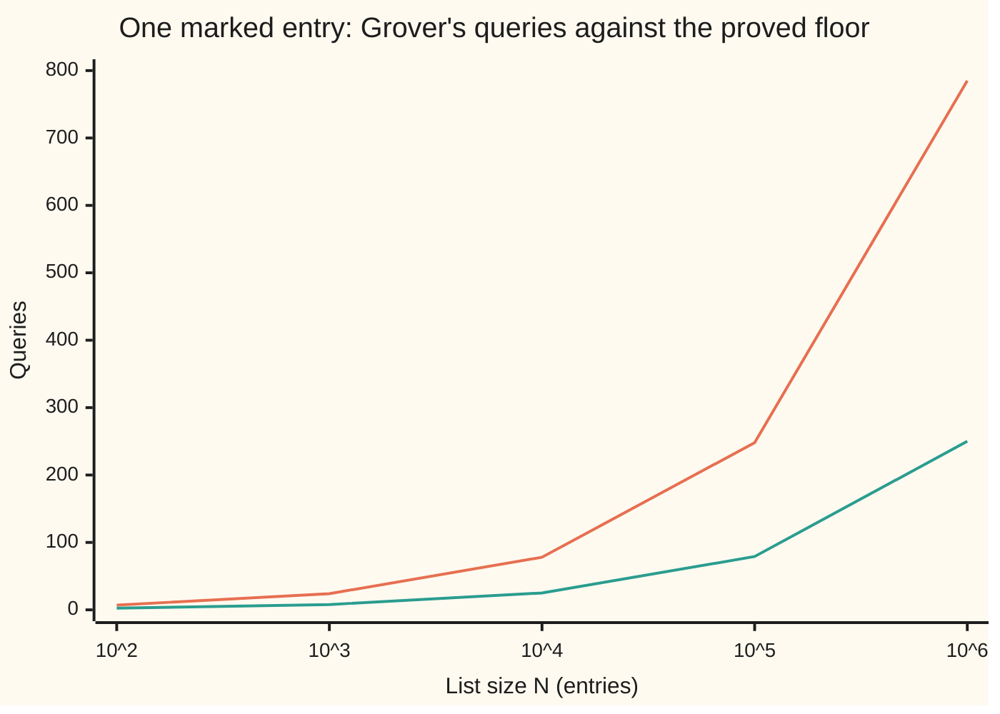
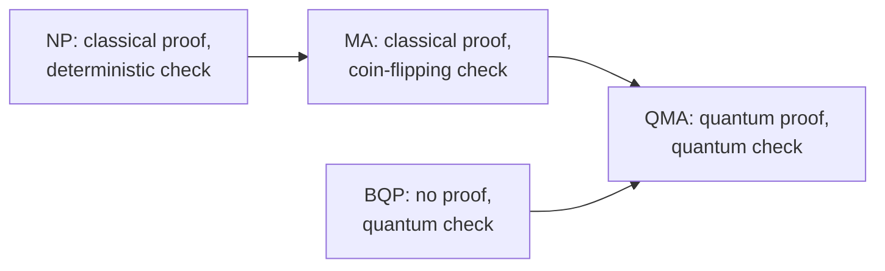

# Quantum limits: why Grover cannot be beaten, and QMA, the quantum NP

[Syllabus](../../../SYLLABUS.md) → [Computability and complexity](../README.md) → [Algebraic, Interactive and Quantum](../README.md#s05) → Quantum limits

---

## General Overview

A list holds 1,000,000 entries in no useful order. Exactly one entry is marked, and a sealed box answers one question per use: "is entry i marked?" Each use is a **query** (one call to the box), and queries are the cost.

An ordinary program looks one entry at a time. To see the mark with probability 2/3 it must look at 666,667 entries. Grover's algorithm ([Shor and Grover](07-shors-and-grovers-algorithms.md)) finds it almost surely in 785 rounds, one query each. Answering "is there a mark?" right with probability 2/3 takes 478 rounds plus one checking query: 479 queries.

Could a cleverer quantum program do better? Not by more than a constant factor. Bennett, Bernstein, Brassard and Vazirani (BBBV) proved in 1997 that any quantum method needs a constant times √1,000,000 = 1,000 queries. This card proves **at least 250** for probability 2/3.

The proof is the **polynomial method**. After T queries, the chance of "yes" is a polynomial of degree at most 2T in the list's bits. A low-degree polynomial is smooth, so it cannot jump from "no mark" to "one mark" and stay between 0 and 1 all the way to a million marks.

The second half turns from limits to a class. **QMA** is NP with a quantum proof: a prover sends a quantum state and a quantum circuit checks it. Its first complete problem, found by Alexei Kitaev in 1999, asks whether a system of interacting qubits has an energy below a given number. In the toy case two magnets want to point opposite ways, with energy matrix Z ⊗ Z. The lowest energy is −1, at |01⟩ and |10⟩.

**After T queries the yes-probability is a polynomial of degree at most 2T, and telling no mark from one mark forces degree √N/2, so search needs √N/4 queries; QMA checks quantum proofs, and deciding a local Hamiltonian's lowest energy is complete for it.**

**What kind of fact this is:** theorems. The degree lemma and the √N/4 bound are proved in Why it works, with Markov's inequality for polynomials stated with a named source. The exact optimality of Grover's count and Kitaev's theorem are stated with key steps and named sources. "QMA is larger than NP" and "NP-complete problems are not in BQP" are conjectures, unproved as of 2026-11-11.

### The picture: what search costs, and what it must cost



Orange: Grover's best round count. Green: the proved floor √N/4. Both grow as √N. Ordinary search needs 666,667 looks to see the mark with probability 2/3 at N = 10^6, far off the chart.

---

## The formula

Notation first, in words.

- The list is N bits $`x_1, \dots, x_N`$: bit $`x_i`$ is 1 when entry i is marked. k is the number of marked entries.
- A **T-query algorithm** applies fixed gates $`U_0`$, then a query $`O_x`$, then $`U_1`$, and so on, ending with $`U_T`$, then measures. The query $`O_x`$ sends $`\lvert i, b \rangle`$ to $`\lvert i, b \oplus x_i \rangle`$: it flips an answer bit b when entry i is marked.
- p(x) is the probability that the algorithm says "yes" on list x. The list 0 has no marks; the list $`e_i`$ has only entry i marked.

The **degree lemma**, then the **search bound**:

```math
p(x) = \text{a polynomial in } x_1, \dots, x_N \text{ of degree at most } 2T, \qquad p(0) \le \tfrac13 \text{ and } p(e_i) \ge \tfrac23 \;\Longrightarrow\; T \ge \frac{\sqrt N}{4}
```

**Read it aloud:** the yes-probability is a polynomial of degree at most twice the number of queries; if it says "yes" at most 1 time in 3 on the empty list and at least 2 times in 3 on every list with one mark $`e_i`$, then the queries number at least a quarter of the square root of N.

For N = 1,000,000 that is T ≥ 250.

The second half needs a **Hamiltonian**: the energy matrix of a quantum system. Its eigenvalues are the possible energies, and the smallest, $`E_0`$, is the **ground energy**. Here H means a Hamiltonian, not the Hadamard gate. A Hamiltonian on n qubits is **local** when it is a sum of terms $`H_j`$, each acting on at most a fixed small number of qubits.

```math
H = \sum_j H_j, \qquad \text{yes: } E_0(H) \le a, \qquad \text{no: } E_0(H) \ge b, \qquad b - a \ge \frac{1}{\mathrm{poly}(n)}
```

**Read it aloud:** given a sum of small terms and two thresholds at least one over a polynomial apart, decide which side the lowest energy is on, when one side is promised.

For Z ⊗ Z the matrix is diagonal, 1, −1, −1, 1 on |00⟩, |01⟩, |10⟩, |11⟩, so $`E_0 = -1`$.

| Symbol | Plain meaning | In our example | Push it up and the answer… |
| --- | --- | --- | --- |
| $`N`$, $`n`$ | entries in the list; qubits in the Hamiltonian | 1,000,000; 2 qubits | the floor √N/4 rises |
| $`x`$, $`x_i`$, $`e_i`$, $`k`$ | the list as bits; bit i; the list with only entry i marked; how many entries are marked | one 1 among 1,000,000 bits; k = 0 or 1 | — |
| $`T`$ | queries the algorithm makes | 479 for probability 2/3; near certainty takes 785 rounds | the degree allowed, 2T, rises |
| $`U_t`$, $`O_x`$, $`b`$ | the fixed gates between queries; one query; the answer bit a query flips | random rotations, with 6 list bits, in the check | — |
| $`p(x)`$, $`q(k)`$ | the yes-probability on list x; its average over all lists with k marks | q(0) = 0, q(1) = 0.9613 for Grover on 16 entries | — |
| $`d`$, $`c`$, $`c'`$, $`h`$, $`M`$, $`m`$ | the degree of q; the slope q must reach between k = 0 and k = 1; its largest slope; how far q strays outside [0, 1]; a height bound in Markov's inequality; the whole number nearest the point where q strays furthest | d ≥ 500; c = 1/3 | a steeper c needs a higher d |
| $`\theta`$, $`r`$ | Grover's angle, sin θ = 1/√N; Grover rounds | 0.0010000002 radians; r = 478 | θ: fewer rounds |
| $`\psi_t`$, $`\psi_t^i`$, $`\alpha_{i,b}`$ | the state after t queries on the empty list; on the list $`e_i`$; one amplitude, on $`\lvert i, b \rangle`$ | 16 entries: distances sum to 22.0000 | — |
| $`H`$, $`H_j`$, $`Z`$, $`X`$ | a Hamiltonian; its local terms; the Pauli matrices diag(1, −1) and the bit flip | Z ⊗ Z; Z ⊗ Z + X ⊗ X | — |
| $`E_0`$, $`a`$, $`b`$ | the ground energy; the yes and no thresholds | −1 for Z ⊗ Z | — |
| $`\xi`$, $`w`$, $`\eta`$ | the quantum proof, the **witness** state the prover sends; a one-qubit witness; the history state | $`\lvert 01 \rangle`$; w = 1 | — |
| $`L`$, $`A`$, $`\varepsilon`$, $`\varphi`$, $`\gamma`$ | gates in a checked circuit; the best acceptance probability; an allowed error; the gate's turning angle; the angle between the work-qubit states preferred at the clock's two ticks; e₊, e₋ are the two directions halfway between them | L = 1; A = 0.75 at φ = 60° | A: E₀ falls |

### When it holds

- **The list is a black box.** The bound counts queries to an unknown list. A list sorted by the searched key breaks this: binary search needs 20 ordinary looks for 1,000,000 entries.
- **The answer has a gap.** The proof needs "yes" at most 1/3 on the empty list and at least 2/3 with one mark. With no gap the slope c is 0 and the bound says nothing.
- **Probabilities stay between 0 and 1.** That is what keeps q smooth. The degree-1 line q(k) = (1 + k)/3 passes 1/3 and 2/3, but q(1,000,000) = 333,333.67, which no probability can be.
- **Every query counts, including the last check.** Grover's 478 rounds plus one query to confirm the found entry make 479. The degree is 2 × 479, not 2 × 478.
- **The Hamiltonian problem has a promise gap.** Deciding $`E_0`$ exactly, with no gap of 1/poly(n), is a different question, not known to lie in QMA.

---

## Why it works

### Step 0: a query moves amplitudes only linearly in one bit

A quantum state is a list of amplitudes ([Qubits](05-qubits-superposition-and-measurement.md)). Fixed gates mix them with fixed numbers. Only a query sees the list, one bit at a time, so each query raises the degree in x by at most one. Probabilities square amplitudes, doubling the degree.

A low-degree polynomial cannot change fast and stay bounded. Search needs a fast change from k = 0 to k = 1, and that costs degree.

### Step 1: after t queries every amplitude has degree at most t

Before any query the amplitudes are fixed numbers: degree 0. A gate $`U_t`$ forms fixed combinations of amplitudes, so it keeps the degree.

A query sends the amplitude of $`\lvert i, b \rangle`$ to the old amplitude of $`\lvert i, b \oplus x_i \rangle`$. As a formula in $`x_i`$, the new amplitude is

```math
\alpha'_{i,b} = (1 - x_i)\, \alpha_{i,b} + x_i\, \alpha_{i,1-b}
```

**Read it aloud:** when $`x_i = 0`$ the amplitude stays; when $`x_i = 1`$ it swaps with its partner; either way it is the old amplitudes times a factor of degree 1.

So after T queries each amplitude has degree at most T, and the yes-probability, a sum of squares, has degree at most 2T. Since $`x_i^2 = x_i`$ for bits, each variable appears at most once per term: a **multilinear** polynomial.

The check reads the coefficients of random 6-bit algorithms by Möbius inversion (subtracting, bit by bit, what smaller subsets explain). With T = 1, degrees 3 to 6 are below 1e-12 and degree 2 reaches 0.138693. With T = 2, degrees 5 and 6 vanish and degree 4 reaches 0.146961.

### Step 2: averaging over the entries leaves one variable

Search does not care which entry is marked. So average p over all lists with exactly k marks. The result q(k) is a polynomial in the single number k, of degree at most 2T. This is **symmetrisation** (Minsky and Papert, used by Beals and others). A symmetric multilinear polynomial is a sum of counts of marked j-sets, and that count, $`\binom{k}{j}`$, has degree j in k.

A polynomial of degree d has a zero (d + 1)-th finite difference (subtract neighbours d + 1 times). The check finds a zero third difference for T = 1 and a zero fifth difference for T = 2.

Grover shows it too. On 16 entries, 3 rounds plus a check (4 queries) give q(k) = sin²(7 arcsin √(k/16)): 0.0000, 0.9613, 0.3301 and 0.2500 at k = 0, 1, 2, 4. Its eighth difference is already zero, so its degree is at most 7, inside the 2 × 4 = 8 the lemma allows.

### Step 3: a bounded polynomial that climbs fast has high degree

Now q has three properties on the whole numbers 0 to N:

1. $`0 \le q(k) \le 1`$ for every k, because q(k) is a probability.
2. q(0) ≤ 1/3 and q(1) ≥ 2/3.
3. So somewhere between 0 and 1 its slope is at least c = 1/3, by the mean value theorem.

The tool is **Markov's inequality for polynomials** (not the probability inequality of the same name), stated in Nisan and Szegedy (1994): on an interval of width N, a degree-d polynomial that stays within M of one fixed level has slope at most 2d²M/N. High slope with small height needs high degree.

```math
d \ge \sqrt{\frac{c\,N}{c + 1}} = \sqrt{\frac{N/3}{4/3}} = \frac{\sqrt N}{2}
```

**Read it aloud:** the degree is at least the square root of c times N over c plus 1, which for c = 1/3 is half the square root of N.

<details>
<summary>Detailed proof: slope c on [0, N] and values in [0, 1] at whole numbers force d² ≥ cN/(c + 1)</summary>

Let c′ be the largest slope of q on the real interval [0, N], so c′ ≥ c. Let h be how far q strays outside [0, 1] anywhere on the interval.

The point where q strays furthest lies within 1/2 of a whole number m, and 0 ≤ q(m) ≤ 1. Over that distance q changes by at most c′/2. So h ≤ c′/2.

The values of q on [0, N] lie in [−h, 1 + h]. So q − 1/2 stays within 1/2 + h of zero. Markov's inequality on the interval of width N gives

$`\displaystyle c' \le \frac{2 d^2}{N} \left(\frac12 + h\right) = \frac{d^2 (1 + 2h)}{N} \le \frac{d^2 (1 + c')}{N}`$

Rearranged, $`d^2 \ge c' N / (1 + c')`$. The right side grows with c′, and c′ ≥ c, so $`d^2 \ge c N / (1 + c)`$. With c = 1/3 that is N/4.

</details>

In the language of [Boolean functions](../04-Beyond%20Worst%20Case/12-boolean-functions-fourier-and-sensitivity.md), telling 0 from $`e_i`$ is the **OR** function (is any bit 1?). Matching OR exactly takes degree N; staying within 1/3 of it, and inside [0, 1], takes at least √N/2 by the bound above. The least degree within 1/3 is OR's **approximate degree**, of order √N (Nisan and Szegedy).

### Step 4: put the pieces together

The degree is at most 2T, and it must be at least √N/2. So T ≥ √N/4. For N = 1,000,000 that is **T ≥ 250**.

Grover meets this up to a constant. Its angle is θ = 0.0010000002 radians and its success after r rounds is sin²((2r + 1)θ). It first passes 2/3 at 478 rounds, plus one checking query: 479 queries. For near certainty, 785 rounds give 0.99999996.

Zalka (1999) proved Grover optimal even in its constant: near certainty needs about (π/4)√N queries. The polynomial method's constant, 1/4, is weaker, but the method works for any black-box yes-or-no question.

### Step 5: the other door, the hybrid argument

BBBV's proof follows the state, not the probability. Runs on the empty list and on $`e_i`$ differ only where a query touches entry i, by at most twice the amplitude on entry i. The squared amplitudes over all entries add to 1, so by the Cauchy–Schwarz inequality the amplitudes add to at most √N. Over T queries:

```math
\sum_{i=1}^{N} \lVert \psi_T - \psi_T^i \rVert \le 2T\sqrt N
```

**Read it aloud:** the distances between the final state on the empty list and on each one-mark list add to at most twice T times the square root of N.

A measurement can pull two states' acceptance chances at most $`\sqrt{1 - \text{overlap}^2}`$ apart, where the overlap is the size of their inner product. Telling them apart with error 1/3 needs a gap of 1/3, so overlap² ≤ 8/9, and the squared distance, at least 2 − 2 × overlap, is at least $`2 - 2\sqrt{8/9}`$. The distance must be at least $`\sqrt{2 - 4\sqrt{2/9}}`$ = 0.3382. So T ≥ 0.1691 √N: 169.1 for a million entries, a weaker constant by an independent road. On Grover with 16 entries and 3 rounds the sum is 22.0000, exactly 16 × 2 sin 3θ with sin θ = 1/4, under 2 × 3 × √16 = 24.

BBBV also conclude that relative to a random oracle, NP is not inside BQP.

### Step 6: QMA, NP with a quantum proof

[Cook-Levin](../03-Time%20Complexity/04-cook-levin-theorem.md) built NP on a verifier V(x, c) that checks a certificate c. QMA keeps the shape and makes both parts quantum.

A language L is in **QMA** when a polynomial-size quantum circuit, given x and a witness state ξ on polynomially many qubits, does this:

- if x is in L, some witness ξ makes it accept with probability at least 2/3;
- if x is not in L, every witness makes it accept with probability at most 1/3.

So NP ⊆ QMA, since a classical certificate is a witness of 0s and 1s. BQP ⊆ QMA, since the circuit may ignore the witness ([BQP](06-quantum-computation-and-bqp.md)). MA, the one-message class of [Arthur-Merlin and two provers](10-arthur-merlin-and-multi-prover-interactive-proofs.md), sits inside QMA, since coin flips are quantum gates too.



Schematic. Each arrow means "is contained in". None of the arrows is proved strict.

**The local Hamiltonian problem is in QMA.** The witness is a low-energy state. The verifier measures one random term. For Z ⊗ Z it asks "do the two qubits differ?", and says yes with chance (1 − energy)/2.

| Witness | Energy | Verifier accepts |
| --- | ---: | ---: |
| $`\lvert 01 \rangle`$ | −1.0000 | 1.0000 |
| $`\lvert 00 \rangle`$ | 1.0000 | 0.0000 |
| $`\lvert ++ \rangle`$ (an even mix of all four) | 0.0000 | 0.5000 |

Lower energy means higher acceptance, so a gap between a and b becomes a gap in acceptance.

**Why the witness is a quantum state.** For H = Z ⊗ Z + X ⊗ X the ground state is $`(\lvert 01 \rangle - \lvert 10 \rangle)/\sqrt2`$, with energy −2.0000. It is **entangled**: not a pair of separate qubit states. The best product state, one separate state per qubit, reaches only −1.0000: its energy is ⟨Z⟩⟨Z⟩ + ⟨X⟩⟨X⟩, a product of two averages per qubit, and each qubit's two averages have squares adding to at most 1, so the sum is at least −1.

### Step 7: Kitaev's construction, the quantum Cook-Levin

Cook-Levin writes a verifier's run as a grid of local facts. Kitaev writes a quantum circuit's run as a **history state**: the computation at every tick of a clock, all in superposition.

```math
\lvert \eta \rangle = \frac{1}{\sqrt{L+1}} \sum_{t=0}^{L} U_t \cdots U_1 \lvert \xi, 0 \rangle \otimes \lvert t \rangle
```

**Read it aloud:** the history state is an even mix, over every clock tick t from 0 to L, of the circuit's state after t gates, tagged with the tick.

Three kinds of local term check the history, as clauses checked the grid:

1. **Input:** a penalty if a work qubit is 1 at tick 0.
2. **Propagation:** for each gate, a penalty unless tick t holds $`U_t`$ applied to tick t − 1.
3. **Output:** a penalty if the answer qubit reads "reject" at tick L.

Kitaev's theorem (Kitaev, Shen and Vyalyi, chapter 14, where QMA is called BQNP): if some witness is accepted with probability at least 1 − ε, then $`E_0 \le \varepsilon/(L+1)`$; if every witness is accepted with probability at most ε, then $`E_0`$ is at least a constant times $`(1 - \sqrt\varepsilon)/L^3`$. A clock written in unary keeps every term on at most 5 qubits, so the 5-local Hamiltonian problem is QMA-complete.

The check runs the smallest case: a witness qubit w, a work qubit starting at 0, and L = 1 gate, "if w = 1, turn the work qubit by φ". It accepts when the work qubit reads 1, so the best witness, w = 1, is accepted with A = sin²φ. With one clock qubit, H is 8 by 8.

| Gate angle φ | Best acceptance A | Ground energy $`E_0`$ | History-state energy (1 − A)/2 |
| ---: | ---: | ---: | ---: |
| 0° | 0.0000 | 0.292893 | 0.500000 |
| 30° | 0.2500 | 0.133975 | 0.375000 |
| 60° | 0.7500 | 0.034074 | 0.125000 |
| 90° | 1.0000 | 0.000000 | 0.000000 |

The energy is zero exactly when some witness is always accepted, and rises as the best acceptance falls. The best history state sits at (1 − A)/2, Kitaev's ε/(L + 1) with ε = 1 − A.

<details>
<summary>Detailed proof: for this one-gate circuit, E₀ = 1 − cos(γ/2) with cos γ = √A</summary>

For w = 1, undo the gate on the tick-1 half of the space. The propagation term becomes one half of the 2 by 2 matrix `[[1, -1], [-1, 1]]` on the clock alone. At tick 0 the work qubit should be the state 0. At tick 1, in the undone frame, it should be the state that the gate sends to 1. The overlap of those two preferred states is sin φ = √A. Call the angle between them γ, so cos γ = √A.

Use the two directions halfway between the preferred states, e₊ and e₋. The preferred states are cos(γ/2) e₊ ± sin(γ/2) e₋. Take the pair of states (tick 0 + tick 1) on e₊ and (tick 0 − tick 1) on e₋. On that pair the Hamiltonian is

$`\displaystyle \begin{pmatrix} \sin^2(\gamma/2) & -\sin(\gamma/2)\cos(\gamma/2) \\ -\sin(\gamma/2)\cos(\gamma/2) & 1 + \cos^2(\gamma/2) \end{pmatrix}`$

Its trace is 2 and its determinant is sin²(γ/2). So its smaller eigenvalue is $`1 - \sqrt{1 - \sin^2(\gamma/2)} = 1 - \cos(\gamma/2)`$. The other pair gives 1 − sin(γ/2), which is no smaller because γ is at most 90°, and the w = 0 half is the case φ = 0. With $`\cos(\gamma/2) = \sqrt{(1 + \sqrt A)/2}`$, this is the formula the check compares with bisection at each angle.

</details>

---

## Worked numbers, by hand

| Step | Arithmetic | Value |
| --- | --- | --- |
| Grover's angle | arcsin(1/√1,000,000) | θ = 0.0010000002 |
| Grover's best rounds | floor(π/(4θ)) | 785, success 0.99999996 |
| rounds for 2/3 | first r with sin²((2r + 1)θ) ≥ 2/3 | 478, plus 1 check = 479 queries |
| ordinary looks that see the mark with probability 2/3 | 2N/3, rounded up | 666,667 looks |
| degree needed | √(cN/(c + 1)) with c = 1/3 | √N/2 = 500 |
| query floor | half the degree | **T ≥ 250** |
| hybrid floor | 0.3382 × √N / 2 | T ≥ 169.1 |
| Z ⊗ Z ground energy | diagonal 1, −1, −1, 1 | **−1, at \|01⟩ and \|10⟩** |
| Z ⊗ Z + X ⊗ X | entangled ground state against best product state | −2 against −1 |

No quantum search of 1,000,000 entries succeeds 2 times in 3 with fewer than 250 queries; Grover uses 479. The toy Hamiltonian's lowest energy is −1, and the verifier always accepts |01⟩.

### What breaks if you drop a piece

| Mistake | Comes out at | What went wrong |
| --- | --- | --- |
| Counting degree T, not 2T | floor √N/2 = 500, above the 479 queries Grover uses | probabilities square amplitudes; the "floor" contradicts a working algorithm |
| Letting q leave [0, 1] | q(k) = (1 + k)/3 has degree 1, but q(1,000,000) = 333,333.67 | the boundedness at every k is what forces the degree |
| Searching a sorted list | binary search: 20 ordinary looks | the list is no longer a black box, so the bound does not apply |
| A classical witness for Z ⊗ Z + X ⊗ X | best product state −1.0000, not −2.0000 | the ground state is entangled, so no list of separate qubit states reaches it |

The code prints all four.

---

## Code, from first principles, and it actually runs

The code simulates quantum states classically, as lists of real amplitudes, and takes two or more roads to each answer. Grover's count comes from reflections iterated in the plane and from the angle formula. The degree lemma is tested on random algorithms built by Gram–Schmidt (making random vectors perpendicular one at a time), read by Möbius inversion and by finite differences. The floor comes from the polynomial method and from the hybrid sum. Ground energies come from bisection on eigenvalue counts (pivot signs in Gaussian elimination), against named eigenvectors and a closed form. The best product state comes from a grid search over product states, against −1 from Step 6. Randomness is SplitMix64, seed 0x2026.

### Python

```python
# Quantum limits -- the check behind the card.  Standard library only.  Amplitudes are a
# classical simulation (the Qubits card explains the state vector); every matrix is real.
from math import asin, ceil, cos, floor, log2, pi, sin, sqrt

S = [0x2026]                                # SplitMix64, seed 0x2026
def rnd():                                  # a float in [-1, 1)
    z = S[0] = (S[0] + 0x9E3779B97F4A7C15) & (2**64 - 1)
    z = (z ^ z >> 30) * 0xBF58476D1CE4E5B9 & (2**64 - 1)
    z = (z ^ z >> 27) * 0x94D049BB133111EB & (2**64 - 1)
    return ((z ^ z >> 31) >> 11) / 2**52 - 1
def fmt(v): return "below 1e-12" if abs(v) < 1e-12 else f"{v:.6f}"
def diffs(q, k):                            # k-th finite difference of a list
    for _ in range(k):
        q = [b - a for a, b in zip(q, q[1:])]
    return max(map(abs, q))
# ---- 1. the example: one marked entry in N = 1,000,000 ----
N = 1_000_000
th = asin(1 / sqrt(N))
kb = floor(pi / (4 * th))
s, c = sin(th), cos(th)                     # road one: two reflections in the plane
for _ in range(kb):
    s = -s                                  # oracle: flip the key's sign
    d = 2 * (s * sin(th) + c * cos(th))     # diffusion: reflect across the start
    s, c = d * sin(th) - s, d * cos(th) - c
pk = sin((2 * kb + 1) * th) ** 2            # road two: the angle formula
assert abs(s * s - pk) < 1e-9
print(f"N = {N}, sqrt N = {sqrt(N):.0f}: theta = {th:.10f}, Grover rounds floor(pi/(4 theta)) = {kb}, success {pk:.8f}")
t23 = next(t for t in range(kb) if sin((2 * t + 1) * th) ** 2 >= 2 / 3)   # first round past 2/3
print(f"error 1/3: {t23} rounds + 1 checking query = {t23 + 1} queries; classical: {ceil(2 * N / 3)} looks")
poly = sqrt(N) / 4                          # polynomial method: 2T >= sqrt(N/4)
dist = sqrt(2 - 4 * sqrt(2 / 9)); hyb = dist / 2 * sqrt(N)   # hybrid argument
print(f"lower bounds: polynomial method T >= {poly:.1f}; hybrid: distance {dist:.4f}, T >= {dist / 2:.4f} sqrt N = {hyb:.1f}")
assert poly <= t23 + 1
for e in range(2, 7):                       # chart points
    print(f"chart N = 10^{e}: Grover {floor(pi / (4 * asin(10 ** (-e / 2))))}, "
          f"bound {10 ** (e / 2) / 4:.1f}, classical {ceil(2 * 10 ** e / 3)}")
# ---- 2. any T-query algorithm: acceptance is a polynomial of degree <= 2T ----
n, W = 6, 2                                 # 6 input bits; registers (i, b, w)
D = n * 2 * W
wt = [bin(x).count("1") for x in range(2 ** n)]
def orth():                                 # a random rotation, by Gram-Schmidt
    rows = []
    while len(rows) < D:
        v = [rnd() for _ in range(D)]
        for r in rows:
            p = sum(a * b for a, b in zip(v, r))
            v = [a - p * b for a, b in zip(v, r)]
        rows.append([a / sqrt(sum(b * b for b in v)) for a in v])
    return rows
def run(U, x):                              # U0, query, U1, query, ..., UT
    v = [1.0] + [0.0] * (D - 1)
    for t, M in enumerate(U):
        if t:                               # query: |i, b, w> -> |i, b xor x_i, w>
            v = [v[j ^ ((x >> (j // (2 * W)) & 1) * W)] for j in range(D)]
        v = [sum(a * b for a, b in zip(r, v)) for r in M]
    return sum(v[j] ** 2 for j in range(D) if j % W == 1)   # accept: w reads 1
for T in (1, 2):
    U = [orth() for _ in range(T + 1)]
    p = [run(U, x) for x in range(2 ** n)]
    co = p[:]                               # Moebius inversion: multilinear coefficients
    for i in range(n):
        for x in [x for x in range(2 ** n) if x >> i & 1]:
            co[x] -= co[x ^ 1 << i]
    big = [max(abs(co[x]) for x in range(2 ** n) if wt[x] == k) for k in range(n + 1)]
    print(f"T = {T}: largest coefficient by degree 0..6: " + ", ".join(fmt(b) for b in big))
    assert max(big[2 * T + 1:]) < 1e-9 and big[2 * T] > 1e-3
    q = [sum(p[x] for x in range(2 ** n) if wt[x] == k) / wt.count(k) for k in range(n + 1)]
    print(f"T = {T}: symmetrised q(k), difference of order {2 * T + 1}: largest {fmt(diffs(q, 2 * T + 1))}")
    assert diffs(q, 2 * T + 1) < 1e-9
# ---- 3. Grover on 16 entries: its polynomial, and the hybrid sum ----
G, T = 16, 3
def grover(marked):                         # T rounds; returns the 16 amplitudes
    v = [1 / 4] * G
    for _ in range(T):
        v = [-a if j in marked else a for j, a in enumerate(v)]
        v = [2 * sum(v) / G - a for a in v]  # diffusion: twice the mean minus each
    return v
q = [sum(grover(range(k))[j] ** 2 for j in range(k)) for k in range(G + 1)]
assert max(abs(q[k] - sin(7 * asin(sqrt(k / G))) ** 2) for k in range(G + 1)) < 1e-12
print(f"Grover, 16 entries, 3 rounds + check: q(0) = {q[0]:.4f}, q(1) = {q[1]:.4f}, q(2) = {q[2]:.4f}, "
      f"q(4) = {q[4]:.4f}; difference of order 8: largest {fmt(diffs(q, 8))}")
assert diffs(q, 8) < 1e-9 and diffs(q, 7) > 1e-3
hs = sum(sqrt(sum((a - 1 / 4) ** 2 for a in grover({i}))) for i in range(G))
print(f"hybrid sum of distances: {hs:.4f} <= 2 T sqrt(16) = {2 * T * 4}")
assert abs(hs - 32 * sin(3 * asin(1 / 4))) < 1e-9; assert hs <= 2 * T * 4   # 16 x 2 sin(3 theta)
# ---- 4. local Hamiltonians on 2 qubits: basis 00, 01, 10, 11 ----
def kron(A, B):
    k = len(B)
    return [[A[i // k][j // k] * B[i % k][j % k] for j in range(len(A) * k)] for i in range(len(A) * k)]
def below(A, lam):                          # eigenvalues below lam, from pivot signs
    B = [[A[i][j] - (lam if i == j else 0) for j in range(len(A))] for i in range(len(A))]
    neg = 0
    for i in range(len(B)):
        piv = B[i][i] if abs(B[i][i]) > 1e-300 else 1e-300
        neg += piv < 0
        for r in range(i + 1, len(B)):
            B[r] = [a - B[r][i] / piv * b for a, b in zip(B[r], B[i])]
    return neg
def lowest(A):                              # bisection on that count
    lo, hi = -10.0, 10.0
    for _ in range(60):
        lo, hi = (lo, (lo + hi) / 2) if below(A, (lo + hi) / 2) >= 1 else ((lo + hi) / 2, hi)
    return (lo + hi) / 2
def energy(A, v): return sum(v[i] * A[i][j] * v[j] for i in range(len(v)) for j in range(len(v)))
Z, X = [[1, 0], [0, -1]], [[0, 1], [1, 0]]
ZZ = kron(Z, Z)
print("H = Z x Z: diagonal " + ", ".join(f"{ZZ[i][i]}" for i in range(4)) + f"; lowest by bisection "
      f"{lowest(ZZ):.4f}; eigenvalues below -0.5: {below(ZZ, -0.5)}, below 0.5: {below(ZZ, 0.5)}")
assert abs(lowest(ZZ) + 1) < 1e-9 and below(ZZ, -0.5) == 2
for name, v in (("|01>", [0, 1, 0, 0]), ("|00>", [1, 0, 0, 0]), ("|++>", [0.5] * 4)):
    e = energy(ZZ, v)
    print(f"witness {name}: energy {e:.4f}, verifier accepts with probability (1 - energy)/2 = {(1 - e) / 2:.4f}")
H2 = [[a + b for a, b in zip(r, s)] for r, s in zip(ZZ, kron(X, X))]
u = lambda a: (cos(pi * a / 72), sin(pi * a / 72))  # real one-qubit states, 2.5 degree steps
best = min(energy(H2, [r * s for r in u(a) for s in u(b)]) for a in range(72) for b in range(72))   # product states
sing = energy(H2, [0, sqrt(0.5), -sqrt(0.5), 0])
print(f"H = ZxZ + XxX: lowest by bisection {lowest(H2):.4f}; (|01> - |10>)/sqrt 2 has energy {sing:.4f}; best product state {best:.4f}")
assert abs(lowest(H2) + 2) < 1e-9 and abs(sing + 2) < 1e-12
assert abs(best + 1) < 1e-9; assert best > lowest(H2) + 0.5   # no product state gets near the ground energy
# ---- 5. Kitaev's construction on a one-gate circuit: witness w, work q, clock c ----
for deg in (0, 30, 60, 90):                 # gate: if w = 1, turn q by deg degrees
    f = deg * pi / 180
    U = [[1, 0, 0, 0], [0, 1, 0, 0], [0, 0, cos(f), -sin(f)], [0, 0, sin(f), cos(f)]]
    H = [[0.0] * 8 for _ in range(8)]       # index 2 (2w + q) + c
    for a in range(4):
        H[2 * a][2 * a] += 0.5; H[2 * a + 1][2 * a + 1] += 0.5   # propagation term
        for b in range(4):
            H[2 * a + 1][2 * b] -= 0.5 * U[a][b]; H[2 * b][2 * a + 1] -= 0.5 * U[a][b]
        H[2 * a + 1 - a % 2][2 * a + 1 - a % 2] += 1   # q = 1 at c = 0, or q = 0 at c = 1
    acc = sin(f) ** 2                       # best witness w = 1
    e0, e1 = lowest(H), 1 - sqrt((1 + sqrt(acc)) / 2)   # bisection; closed form
    print(f"gate {deg:2d} deg: best acceptance {acc:.4f}; ground energy {abs(e0):.6f} "
          f"(formula {e1:.6f}); history state (1 - acceptance)/2 = {(1 - acc) / 2:.6f}")
    assert abs(e0 - e1) < 1e-9 and e0 <= (1 - acc) / 2 + 1e-12
# ---- 6. what breaks ----
print(f"mistake 1, degree T not 2T: bound sqrt(N)/2 = {sqrt(N) / 2:.0f} > {t23 + 1} queries Grover uses")
print(f"mistake 2, q(k) = (1 + k)/3 has degree 1 but q(N) = {(1 + N) / 3:.2f}, not a probability")
print(f"mistake 3, a sorted list: binary search needs {ceil(log2(N))} classical looks")
print(f"mistake 4, classical witness for ZxZ + XxX: energy {best:.4f}, not {sing:.4f}")
print("ALL CHECKS PASS")
```

**Ran 2026-11-24 on macOS, Python 3.14.10, standard library only. All checks passed. Output, pasted from the run:**

```
N = 1000000, sqrt N = 1000: theta = 0.0010000002, Grover rounds floor(pi/(4 theta)) = 785, success 0.99999996
error 1/3: 478 rounds + 1 checking query = 479 queries; classical: 666667 looks
lower bounds: polynomial method T >= 250.0; hybrid: distance 0.3382, T >= 0.1691 sqrt N = 169.1
chart N = 10^2: Grover 7, bound 2.5, classical 67
chart N = 10^3: Grover 24, bound 7.9, classical 667
chart N = 10^4: Grover 78, bound 25.0, classical 6667
chart N = 10^5: Grover 248, bound 79.1, classical 66667
chart N = 10^6: Grover 785, bound 250.0, classical 666667
T = 1: largest coefficient by degree 0..6: 0.358036, 0.172802, 0.138693, below 1e-12, below 1e-12, below 1e-12, below 1e-12
T = 1: symmetrised q(k), difference of order 3: largest below 1e-12
T = 2: largest coefficient by degree 0..6: 0.764009, 0.214581, 0.338699, 0.373840, 0.146961, below 1e-12, below 1e-12
T = 2: symmetrised q(k), difference of order 5: largest below 1e-12
Grover, 16 entries, 3 rounds + check: q(0) = 0.0000, q(1) = 0.9613, q(2) = 0.3301, q(4) = 0.2500; difference of order 8: largest below 1e-12
hybrid sum of distances: 22.0000 <= 2 T sqrt(16) = 24
H = Z x Z: diagonal 1, -1, -1, 1; lowest by bisection -1.0000; eigenvalues below -0.5: 2, below 0.5: 2
witness |01>: energy -1.0000, verifier accepts with probability (1 - energy)/2 = 1.0000
witness |00>: energy 1.0000, verifier accepts with probability (1 - energy)/2 = 0.0000
witness |++>: energy 0.0000, verifier accepts with probability (1 - energy)/2 = 0.5000
H = ZxZ + XxX: lowest by bisection -2.0000; (|01> - |10>)/sqrt 2 has energy -2.0000; best product state -1.0000
gate  0 deg: best acceptance 0.0000; ground energy 0.292893 (formula 0.292893); history state (1 - acceptance)/2 = 0.500000
gate 30 deg: best acceptance 0.2500; ground energy 0.133975 (formula 0.133975); history state (1 - acceptance)/2 = 0.375000
gate 60 deg: best acceptance 0.7500; ground energy 0.034074 (formula 0.034074); history state (1 - acceptance)/2 = 0.125000
gate 90 deg: best acceptance 1.0000; ground energy 0.000000 (formula 0.000000); history state (1 - acceptance)/2 = 0.000000
mistake 1, degree T not 2T: bound sqrt(N)/2 = 500 > 479 queries Grover uses
mistake 2, q(k) = (1 + k)/3 has degree 1 but q(N) = 333333.67, not a probability
mistake 3, a sorted list: binary search needs 20 classical looks
mistake 4, classical witness for ZxZ + XxX: energy -1.0000, not -2.0000
ALL CHECKS PASS
```

### Rust

Same numbers, same labels, built with `rustc --edition 2021 -O`.

```rust
// Quantum limits -- the same check as the Python, in Rust.  No crates.  Amplitudes are a
// classical simulation (the Qubits card explains the state vector); every matrix is real.
use std::f64::consts::PI;
type Mat = Vec<Vec<f64>>;
fn rnd(s: &mut u64) -> f64 { // SplitMix64: a float in [-1, 1)
    *s = s.wrapping_add(0x9E3779B97F4A7C15);
    let z = (*s ^ (*s >> 30)).wrapping_mul(0xBF58476D1CE4E5B9);
    let z = (z ^ (z >> 27)).wrapping_mul(0x94D049BB133111EB);
    ((z ^ (z >> 31)) >> 11) as f64 / 2f64.powi(52) - 1.0
}
fn fmt(v: f64) -> String { if v.abs() < 1e-12 { "below 1e-12".to_string() } else { format!("{:.6}", v) } }
fn diffs(q: &[f64], k: usize) -> f64 { // k-th finite difference of a list
    let mut q = q.to_vec();
    for _ in 0..k { q = q.windows(2).map(|w| w[1] - w[0]).collect(); }
    q.iter().fold(0.0, |m: f64, a| m.max(a.abs()))
}
const N_BITS: usize = 6; const W: usize = 2; const D: usize = N_BITS * 2 * W; // registers (i, b, w)
fn orth(rng: &mut u64) -> Mat { // a random rotation, by Gram-Schmidt
    let mut rows: Mat = Vec::new();
    while rows.len() < D {
        let mut v: Vec<f64> = (0..D).map(|_| rnd(rng)).collect();
        for r in &rows {
            let p: f64 = v.iter().zip(r).map(|(a, b)| a * b).sum();
            v = v.iter().zip(r).map(|(a, b)| a - p * b).collect();
        }
        let l = v.iter().map(|b| b * b).sum::<f64>().sqrt();
        rows.push(v.iter().map(|a| a / l).collect());
    }
    rows
}
fn run(u: &[Mat], x: usize) -> f64 { // U0, query, U1, query, ..., UT
    let mut v = vec![0.0; D]; v[0] = 1.0;
    for (t, m) in u.iter().enumerate() {
        if t > 0 { v = (0..D).map(|j| v[j ^ (((x >> (j / (2 * W))) & 1) * W)]).collect(); } // query: b xor x_i
        v = m.iter().map(|r| r.iter().zip(&v).map(|(a, b)| a * b).sum()).collect();
    }
    (0..D).filter(|j| j % W == 1).map(|j| v[j] * v[j]).sum() // accept: w reads 1
}
fn grover(marked: &[usize], g: usize, t: usize) -> Vec<f64> { // T rounds
    let mut v = vec![0.25; g];
    for _ in 0..t {
        for &j in marked { v[j] = -v[j]; }
        let s: f64 = v.iter().sum();
        v = v.iter().map(|a| 2.0 * s / g as f64 - a).collect(); // twice the mean minus each
    }
    v
}
fn kron(a: &Mat, b: &Mat) -> Mat {
    let (k, n) = (b.len(), a.len() * b.len());
    (0..n).map(|i| (0..n).map(|j| a[i / k][j / k] * b[i % k][j % k]).collect()).collect()
}
fn below(a: &Mat, lam: f64) -> usize { // eigenvalues below lam, from pivot signs
    let n = a.len();
    let mut b: Mat = (0..n).map(|i| (0..n).map(|j| a[i][j] - if i == j { lam } else { 0.0 }).collect()).collect();
    let mut neg = 0;
    for i in 0..n {
        let piv = if b[i][i].abs() > 1e-300 { b[i][i] } else { 1e-300 };
        if piv < 0.0 { neg += 1; }
        for r in i + 1..n { let f = b[r][i] / piv; for c in 0..n { b[r][c] -= f * b[i][c]; } }
    }
    neg
}
fn lowest(a: &Mat) -> f64 { // bisection on that count
    let (mut lo, mut hi) = (-10.0, 10.0);
    for _ in 0..60 { let mid = (lo + hi) / 2.0; if below(a, mid) >= 1 { hi = mid } else { lo = mid } }
    (lo + hi) / 2.0
}
fn energy(a: &Mat, v: &[f64]) -> f64 { (0..v.len()).map(|i| (0..v.len()).map(|j| v[i] * a[i][j] * v[j]).sum::<f64>()).sum() }
fn main() {
    // ---- 1. the example: one marked entry in N = 1,000,000 ----
    let n = 1_000_000f64;
    let th = (1.0 / n.sqrt()).asin();
    let kb = (PI / (4.0 * th)).floor() as usize;
    let (mut s, mut c) = (th.sin(), th.cos()); // road one: two reflections in the plane
    for _ in 0..kb {
        s = -s; // oracle: flip the key's sign
        let d = 2.0 * (s * th.sin() + c * th.cos()); // diffusion: reflect across the start
        (s, c) = (d * th.sin() - s, d * th.cos() - c);
    }
    let pk = ((2 * kb + 1) as f64 * th).sin().powi(2); // road two: the angle formula
    assert!((s * s - pk).abs() < 1e-9);
    println!("N = {}, sqrt N = {:.0}: theta = {:.10}, Grover rounds floor(pi/(4 theta)) = {}, success {:.8}", n as u64, n.sqrt(), th, kb, pk);
    let t23 = (0..kb).find(|&t| ((2 * t + 1) as f64 * th).sin().powi(2) >= 2.0 / 3.0).unwrap();
    println!("error 1/3: {} rounds + 1 checking query = {} queries; classical: {} looks", t23, t23 + 1, (2.0 * n / 3.0).ceil());
    let poly = n.sqrt() / 4.0; // polynomial method: 2T >= sqrt(N/4)
    let dist = (2.0 - 4.0 * (2.0f64 / 9.0).sqrt()).sqrt();
    let hyb = dist / 2.0 * n.sqrt(); // hybrid argument
    println!("lower bounds: polynomial method T >= {:.1}; hybrid: distance {:.4}, T >= {:.4} sqrt N = {:.1}", poly, dist, dist / 2.0, hyb);
    assert!(poly <= (t23 + 1) as f64);
    for e in 2..7 { // chart points
        let e = e as f64;
        println!("chart N = 10^{}: Grover {}, bound {:.1}, classical {}", e,
                 (PI / (4.0 * 10f64.powf(-e / 2.0).asin())).floor(), 10f64.powf(e / 2.0) / 4.0, (2.0 * 10f64.powf(e) / 3.0).ceil());
    }
    // ---- 2. any T-query algorithm: acceptance is a polynomial of degree <= 2T ----
    let mut rng = 0x2026u64; // SplitMix64 seed
    let wt: Vec<usize> = (0..1usize << N_BITS).map(|x| x.count_ones() as usize).collect();
    for t in [1usize, 2] {
        let u: Vec<Mat> = (0..t + 1).map(|_| orth(&mut rng)).collect();
        let p: Vec<f64> = (0..1 << N_BITS).map(|x| run(&u, x)).collect();
        let mut co = p.clone(); // Moebius inversion: multilinear coefficients
        for i in 0..N_BITS { for x in (0..1usize << N_BITS).filter(|x| (x >> i) & 1 == 1) { co[x] -= co[x ^ (1 << i)]; } }
        let big: Vec<f64> = (0..=N_BITS).map(|k| (0..1 << N_BITS).filter(|&x| wt[x] == k)
            .fold(0.0, |m: f64, x| m.max(co[x].abs()))).collect();
        println!("T = {}: largest coefficient by degree 0..6: {}", t,
                 big.iter().map(|&b| fmt(b)).collect::<Vec<_>>().join(", "));
        assert!(big[2 * t + 1..].iter().all(|&b| b < 1e-9) && big[2 * t] > 1e-3);
        let q: Vec<f64> = (0..=N_BITS).map(|k| {
            let xs: Vec<usize> = (0..1 << N_BITS).filter(|&x| wt[x] == k).collect();
            xs.iter().map(|&x| p[x]).sum::<f64>() / xs.len() as f64
        }).collect();
        println!("T = {}: symmetrised q(k), difference of order {}: largest {}", t, 2 * t + 1, fmt(diffs(&q, 2 * t + 1)));
        assert!(diffs(&q, 2 * t + 1) < 1e-9);
    }
    // ---- 3. Grover on 16 entries: its polynomial, and the hybrid sum ----
    let (g, t) = (16usize, 3usize);
    let q: Vec<f64> = (0..=g).map(|k| {
        let v = grover(&(0..k).collect::<Vec<_>>(), g, t);
        (0..k).fold(0.0, |s, j| s + v[j] * v[j])
    }).collect();
    assert!((0..=g).all(|k| (q[k] - (7.0 * (k as f64 / g as f64).sqrt().asin()).sin().powi(2)).abs() < 1e-12));
    println!("Grover, 16 entries, 3 rounds + check: q(0) = {:.4}, q(1) = {:.4}, q(2) = {:.4}, q(4) = {:.4}; difference of order 8: largest {}",
             q[0], q[1], q[2], q[4], fmt(diffs(&q, 8)));
    assert!(diffs(&q, 8) < 1e-9 && diffs(&q, 7) > 1e-3);
    let hs: f64 = (0..g).map(|i| grover(&[i], g, t).iter().map(|a| (a - 0.25).powi(2)).sum::<f64>().sqrt()).sum();
    println!("hybrid sum of distances: {:.4} <= 2 T sqrt(16) = {}", hs, 2 * t * 4);
    assert!((hs - 32.0 * (3.0 * 0.25f64.asin()).sin()).abs() < 1e-9); assert!(hs <= (2 * t * 4) as f64); // 16 x 2 sin(3 theta)
    // ---- 4. local Hamiltonians on 2 qubits: basis 00, 01, 10, 11 ----
    let (z, x): (Mat, Mat) = (vec![vec![1.0, 0.0], vec![0.0, -1.0]], vec![vec![0.0, 1.0], vec![1.0, 0.0]]);
    let zz = kron(&z, &z);
    println!("H = Z x Z: diagonal {}; lowest by bisection {:.4}; eigenvalues below -0.5: {}, below 0.5: {}",
             (0..4).map(|i| format!("{}", zz[i][i] as i64)).collect::<Vec<_>>().join(", "),
             lowest(&zz), below(&zz, -0.5), below(&zz, 0.5));
    assert!((lowest(&zz) + 1.0).abs() < 1e-9 && below(&zz, -0.5) == 2);
    for (name, v) in [("|01>", [0.0, 1.0, 0.0, 0.0]), ("|00>", [1.0, 0.0, 0.0, 0.0]), ("|++>", [0.5; 4])] {
        let e = energy(&zz, &v);
        println!("witness {}: energy {:.4}, verifier accepts with probability (1 - energy)/2 = {:.4}", name, e, (1.0 - e) / 2.0);
    }
    let xx = kron(&x, &x);
    let h2: Mat = (0..4).map(|i| (0..4).map(|j| zz[i][j] + xx[i][j]).collect()).collect();
    let mut best = f64::INFINITY; // product states (cos a, sin a) x (cos b, sin b), 2.5 degree steps
    for k in 0..72 * 72 { let (a, b) = (PI * (k / 72) as f64 / 72.0, PI * (k % 72) as f64 / 72.0);
        best = best.min(energy(&h2, &[a.cos() * b.cos(), a.cos() * b.sin(), a.sin() * b.cos(), a.sin() * b.sin()])); }
    let sing = energy(&h2, &[0.0, 0.5f64.sqrt(), -(0.5f64.sqrt()), 0.0]);
    println!("H = ZxZ + XxX: lowest by bisection {:.4}; (|01> - |10>)/sqrt 2 has energy {:.4}; best product state {:.4}", lowest(&h2), sing, best);
    assert!((lowest(&h2) + 2.0).abs() < 1e-9 && (sing + 2.0).abs() < 1e-12);
    assert!((best + 1.0).abs() < 1e-9); assert!(best > lowest(&h2) + 0.5); // no product state gets near the ground energy
    // ---- 5. Kitaev's construction on a one-gate circuit: witness w, work q, clock c ----
    for deg in [0, 30, 60, 90] { // gate: if w = 1, turn q by deg degrees
        let f = deg as f64 * PI / 180.0;
        let u = [[1.0, 0.0, 0.0, 0.0], [0.0, 1.0, 0.0, 0.0], [0.0, 0.0, f.cos(), -f.sin()], [0.0, 0.0, f.sin(), f.cos()]];
        let mut h: Mat = vec![vec![0.0; 8]; 8]; // index 2 (2w + q) + c
        for a in 0..4 {
            h[2 * a][2 * a] += 0.5; h[2 * a + 1][2 * a + 1] += 0.5; // propagation term
            for b in 0..4 { h[2 * a + 1][2 * b] -= 0.5 * u[a][b]; h[2 * b][2 * a + 1] -= 0.5 * u[a][b]; }
            h[2 * a + 1 - a % 2][2 * a + 1 - a % 2] += 1.0; // q = 1 at c = 0, or q = 0 at c = 1
        }
        let acc = f.sin().powi(2); // best witness w = 1
        let (e0, e1) = (lowest(&h), 1.0 - ((1.0 + acc.sqrt()) / 2.0).sqrt()); // bisection; closed form
        println!("gate {:2} deg: best acceptance {:.4}; ground energy {:.6} (formula {:.6}); history state (1 - acceptance)/2 = {:.6}",
                 deg, acc, e0.abs(), e1, (1.0 - acc) / 2.0);
        assert!((e0 - e1).abs() < 1e-9 && e0 <= (1.0 - acc) / 2.0 + 1e-12);
    }
    // ---- 6. what breaks ----
    println!("mistake 1, degree T not 2T: bound sqrt(N)/2 = {:.0} > {} queries Grover uses", n.sqrt() / 2.0, t23 + 1);
    println!("mistake 2, q(k) = (1 + k)/3 has degree 1 but q(N) = {:.2}, not a probability", (1.0 + n) / 3.0);
    println!("mistake 3, a sorted list: binary search needs {} classical looks", n.log2().ceil());
    println!("mistake 4, classical witness for ZxZ + XxX: energy {:.4}, not {:.4}", best, sing);
    println!("ALL CHECKS PASS");
}
```

**Ran 2026-11-24 on macOS, rustc 1.98.1, no crates. All checks passed. Output, pasted from the run:**

```
N = 1000000, sqrt N = 1000: theta = 0.0010000002, Grover rounds floor(pi/(4 theta)) = 785, success 0.99999996
error 1/3: 478 rounds + 1 checking query = 479 queries; classical: 666667 looks
lower bounds: polynomial method T >= 250.0; hybrid: distance 0.3382, T >= 0.1691 sqrt N = 169.1
chart N = 10^2: Grover 7, bound 2.5, classical 67
chart N = 10^3: Grover 24, bound 7.9, classical 667
chart N = 10^4: Grover 78, bound 25.0, classical 6667
chart N = 10^5: Grover 248, bound 79.1, classical 66667
chart N = 10^6: Grover 785, bound 250.0, classical 666667
T = 1: largest coefficient by degree 0..6: 0.358036, 0.172802, 0.138693, below 1e-12, below 1e-12, below 1e-12, below 1e-12
T = 1: symmetrised q(k), difference of order 3: largest below 1e-12
T = 2: largest coefficient by degree 0..6: 0.764009, 0.214581, 0.338699, 0.373840, 0.146961, below 1e-12, below 1e-12
T = 2: symmetrised q(k), difference of order 5: largest below 1e-12
Grover, 16 entries, 3 rounds + check: q(0) = 0.0000, q(1) = 0.9613, q(2) = 0.3301, q(4) = 0.2500; difference of order 8: largest below 1e-12
hybrid sum of distances: 22.0000 <= 2 T sqrt(16) = 24
H = Z x Z: diagonal 1, -1, -1, 1; lowest by bisection -1.0000; eigenvalues below -0.5: 2, below 0.5: 2
witness |01>: energy -1.0000, verifier accepts with probability (1 - energy)/2 = 1.0000
witness |00>: energy 1.0000, verifier accepts with probability (1 - energy)/2 = 0.0000
witness |++>: energy 0.0000, verifier accepts with probability (1 - energy)/2 = 0.5000
H = ZxZ + XxX: lowest by bisection -2.0000; (|01> - |10>)/sqrt 2 has energy -2.0000; best product state -1.0000
gate  0 deg: best acceptance 0.0000; ground energy 0.292893 (formula 0.292893); history state (1 - acceptance)/2 = 0.500000
gate 30 deg: best acceptance 0.2500; ground energy 0.133975 (formula 0.133975); history state (1 - acceptance)/2 = 0.375000
gate 60 deg: best acceptance 0.7500; ground energy 0.034074 (formula 0.034074); history state (1 - acceptance)/2 = 0.125000
gate 90 deg: best acceptance 1.0000; ground energy 0.000000 (formula 0.000000); history state (1 - acceptance)/2 = 0.000000
mistake 1, degree T not 2T: bound sqrt(N)/2 = 500 > 479 queries Grover uses
mistake 2, q(k) = (1 + k)/3 has degree 1 but q(N) = 333333.67, not a probability
mistake 3, a sorted list: binary search needs 20 classical looks
mistake 4, classical witness for ZxZ + XxX: energy -1.0000, not -2.0000
ALL CHECKS PASS
```

The two outputs match line for line.

### Lean

Lean proves the search floor of Steps 3 and 4 for every N, the ground energy of Z ⊗ Z, and the worked numbers.

- Suppose q has degree d, $`0 \le q(k) \le 1`$ for whole numbers k from 0 to N, and $`q(1) - q(0) \ge c \ge 0`$. Then $`d^2 \ge cN/(c + 1)`$.
- Suppose q stays in [0, 1] as above, has degree at most 2T, $`q(0) \le 1/3`$ and $`q(1) \ge 2/3`$. Then $`T \ge \sqrt N/4`$.
- The ground energy of Z ⊗ Z is $`E_0 = -1`$, reached at |01⟩ and at |10⟩.
- The worked numbers hold: the floor of 250, Grover's 479 queries, 666,667 ordinary looks and 20 binary-search looks.

Lean has no quantum query model, so Steps 1, 2, 5 and 7 are left to the Python and Rust checks.

```lean
-- Quantum limits: a yes-probability polynomial of degree at most 2T that stays in [0, 1] on the whole numbers 0 to N and climbs from at most 1/3 at k = 0 to at least 2/3 at k = 1 forces T ≥ √N/4, and the toy Hamiltonian Z ⊗ Z has lowest energy −1, at |01⟩ and |10⟩.
import Mathlib.Algebra.Polynomial.Degree.Defs
import Mathlib.Algebra.Polynomial.Eval.Defs
import Mathlib.Analysis.SpecialFunctions.Sqrt
import Mathlib.Algebra.Algebra.Spectrum.Basic
import Mathlib.LinearAlgebra.Matrix.Kronecker
import Mathlib.Data.Matrix.Mul
import Mathlib.Tactic.NormNum
import Mathlib.Analysis.SpecialFunctions.Trigonometric.Chebyshev.Extremal
import Mathlib.Analysis.SpecialFunctions.Trigonometric.Chebyshev.RootsExtrema
import Mathlib.Analysis.Calculus.Taylor
import Mathlib.Analysis.Calculus.ContDiff.Polynomial
import Mathlib.Analysis.Calculus.Deriv.Polynomial
import Mathlib.Analysis.Calculus.LocalExtr.Basic
import Mathlib.LinearAlgebra.Eigenspace.Matrix

open Polynomial
open scoped Kronecker Matrix

lemma iterate_derivative_comp_affine (p : ℝ[X]) (α β : ℝ) (k : ℕ) :
    derivative^[k] (p.comp (C α * X + C β)) =
      C (α ^ k) * (derivative^[k] p).comp (C α * X + C β) := by
  induction k with
  | zero => simp
  | succ k ih =>
    rw [Function.iterate_succ_apply', ih, derivative_C_mul, derivative_comp,
      Function.iterate_succ_apply']
    simp [pow_succ]
    ring

lemma poly_taylor2 (p : ℝ[X]) (a b : ℝ) : ∃ η ∈ Set.uIcc a b,
    p.eval b = p.eval a + (derivative p).eval a * (b - a) +
      (derivative^[2] p).eval η * (b - a) ^ 2 / 2 := by
  rcases eq_or_ne a b with rfl | hab
  · exact ⟨a, Set.left_mem_uIcc, by ring⟩
  have hcd : ContDiff ℝ (1 + 1) (fun x => p.eval x) := by
    simpa [Polynomial.aeval_def] using p.contDiff_aeval (𝕜 := ℝ) (1 + 1)
  obtain ⟨η, hη, h⟩ :=
    taylor_mean_remainder_lagrange_iteratedDeriv (f := fun x => p.eval x) (n := 1) hab
      hcd.contDiffOn
  refine ⟨η, Set.uIoo_subset_uIcc_self hη, ?_⟩
  have hder : derivWithin (fun x => p.eval x) (Set.uIcc a b) a = (derivative p).eval a := by
    rw [p.differentiableAt.derivWithin (uniqueDiffOn_uIcc hab a Set.left_mem_uIcc),
      Polynomial.deriv]
  have h2 : iteratedDeriv 2 (fun x => p.eval x) η = (derivative^[2] p).eval η := by
    have e1 : deriv (fun x => p.eval x) = fun x => (derivative p).eval x := by
      funext x; exact Polynomial.deriv _
    rw [iteratedDeriv_succ, iteratedDeriv_one, e1, Polynomial.deriv]
    simp
  rw [taylorWithinEval_succ, taylor_within_zero_eval, iteratedDerivWithin_one, hder, h2] at h
  simp at h
  have e : (⇑derivative)^[2] p = derivative (derivative p) := rfl
  rw [e]
  linarith

lemma markov_affine (q : ℝ[X]) (d k : ℕ) (hd : q.natDegree ≤ d) (α β m H : ℝ) (hα : α ≠ 0)
    (hk : 1 ≤ k) (hb : ∀ y ∈ Set.Icc (-1 : ℝ) 1, |q.eval (α * y + β) - m| ≤ H) :
    |α| ^ k * |(derivative^[k] q).eval (α + β)| ≤
      (derivative^[k] (Chebyshev.T ℝ d)).eval 1 * H := by
  set L : ℝ[X] := C α * X + C β with hL
  set P0 : ℝ[X] := (q - C m).comp L with hP0
  have hkey : (derivative^[k] P0).eval 1 = α ^ k * (derivative^[k] q).eval (α + β) := by
    rw [hP0, iterate_derivative_comp_affine, iterate_derivative_sub,
      iterate_derivative_C (by omega)]
    simp
  have hP0deg : P0.natDegree ≤ d := by
    calc P0.natDegree ≤ (q - C m).natDegree * L.natDegree := natDegree_comp_le
      _ ≤ d * 1 := by
          gcongr
          · rw [natDegree_sub_C]; exact hd
          · exact natDegree_linear_le
      _ = d := mul_one d
  have hP0b : ∀ y ∈ Set.Icc (-1 : ℝ) 1, |P0.eval y| ≤ H := by
    intro y hy
    simpa [P0, L, eval_comp] using hb y hy
  have hH0 : 0 ≤ H := le_trans (abs_nonneg _) (hP0b 1 (by norm_num))
  have hT0 : 0 ≤ (derivative^[k] (Chebyshev.T ℝ d)).eval 1 := by
    have := Chebyshev.abs_iterate_derivative_T_real_le (d : ℤ) k (x := 1) (by norm_num)
    exact le_trans (abs_nonneg _) this
  rcases hH0.lt_or_eq with hH | hH
  · set P : ℝ[X] := C H⁻¹ * P0 with hP
    have hPdeg : P.degree ≤ d := by
      apply degree_le_of_natDegree_le
      exact (natDegree_C_mul_le _ _).trans hP0deg
    have hPb : ∀ y ∈ Set.Icc (-1 : ℝ) 1, |P.eval y| ≤ 1 := by
      intro y hy
      rw [hP, eval_mul, eval_C, abs_mul, abs_inv, abs_of_pos hH, inv_mul_le_iff₀ hH, mul_one]
      exact hP0b y hy
    have hPneg : ∀ y ∈ Set.Icc (-1 : ℝ) 1, |(-P).eval y| ≤ 1 := by
      intro y hy; rw [eval_neg, abs_neg]; exact hPb y hy
    have h1 := Chebyshev.eval_iterate_derivative_le_of_forall_abs_le_one (k := k)
      (le_refl (1 : ℝ)) hPdeg hPb
    have h2 := Chebyshev.eval_iterate_derivative_le_of_forall_abs_le_one (k := k)
      (le_refl (1 : ℝ)) (by rwa [degree_neg]) hPneg
    rw [iterate_derivative_neg, eval_neg] at h2
    have hPv : (derivative^[k] P).eval 1 = H⁻¹ * (α ^ k * (derivative^[k] q).eval (α + β)) := by
      rw [hP, iterate_derivative_C_mul, eval_mul, eval_C, hkey]
    have habs : |(derivative^[k] P).eval 1| ≤ (derivative^[k] (Chebyshev.T ℝ d)).eval 1 :=
      abs_le.2 ⟨by linarith, h1⟩
    rw [hPv, abs_mul, abs_mul, abs_inv, abs_of_pos hH, abs_pow, inv_mul_le_iff₀ hH] at habs
    linarith [mul_comm H ((derivative^[k] (Chebyshev.T ℝ d)).eval 1)]
  · have hz : P0 = 0 := by
      apply Polynomial.eq_of_infinite_eval_eq P0 0
      apply (Set.Icc_infinite (by norm_num : (-1 : ℝ) < 1)).mono
      intro y hy
      have := hP0b y hy
      rw [← hH] at this
      simpa using this
    rw [hz] at hkey
    simp only [iterate_derivative_zero, eval_zero] at hkey
    have : (derivative^[k] q).eval (α + β) = 0 := by
      rcases mul_eq_zero.1 hkey.symm with h | h
      · exact absurd (pow_eq_zero_iff (by omega) |>.1 h) hα
      · exact h
    rw [this, abs_zero, mul_zero]
    exact mul_nonneg hT0 hH0

lemma markov_left (q : ℝ[X]) (d k : ℕ) (hd : q.natDegree ≤ d) (a b m H : ℝ) (hab : a < b)
    (hk : 1 ≤ k) (hb : ∀ x ∈ Set.Icc a b, |q.eval x - m| ≤ H) :
    ((b - a) / 2) ^ k * |(derivative^[k] q).eval a| ≤
      (derivative^[k] (Chebyshev.T ℝ d)).eval 1 * H := by
  have h := markov_affine q d k hd ((a - b) / 2) ((a + b) / 2) m H (by intro h; linarith) hk
    (fun y hy => hb _ ⟨by nlinarith [hy.1, hy.2], by nlinarith [hy.1, hy.2]⟩)
  have e1 : |(a - b) / 2| = (b - a) / 2 := by
    rw [abs_of_neg (by linarith)]; ring
  have e2 : (a - b) / 2 + (a + b) / 2 = a := by ring
  rwa [e1, e2] at h

lemma markov_right (q : ℝ[X]) (d k : ℕ) (hd : q.natDegree ≤ d) (a b m H : ℝ) (hab : a < b)
    (hk : 1 ≤ k) (hb : ∀ x ∈ Set.Icc a b, |q.eval x - m| ≤ H) :
    ((b - a) / 2) ^ k * |(derivative^[k] q).eval b| ≤
      (derivative^[k] (Chebyshev.T ℝ d)).eval 1 * H := by
  have h := markov_affine q d k hd ((b - a) / 2) ((a + b) / 2) m H (by intro h; linarith) hk
    (fun y hy => hb _ ⟨by nlinarith [hy.1, hy.2], by nlinarith [hy.1, hy.2]⟩)
  have e1 : |(b - a) / 2| = (b - a) / 2 := abs_of_pos (by linarith)
  have e2 : (b - a) / 2 + (a + b) / 2 = b := by ring
  rwa [e1, e2] at h


lemma T_deriv_one_eval (d : ℕ) :
    (derivative^[1] (Chebyshev.T ℝ d)).eval 1 = (d : ℝ) ^ 2 := by
  simpa using Chebyshev.derivative_T_eval_one (R := ℝ) (d : ℤ)

lemma T_deriv_two_eval (d : ℕ) :
    3 * (derivative^[2] (Chebyshev.T ℝ d)).eval 1 = ((d : ℝ) ^ 2 - 1) * (d : ℝ) ^ 2 := by
  have h := Chebyshev.iterate_derivative_T_eval_one_recurrence (R := ℝ) (d : ℤ) 1
  have h1 := T_deriv_one_eval d
  norm_num at h h1 ⊢
  rw [h, h1]

lemma second_deriv_interior (q : ℝ[X]) (N H η : ℝ) (hN : 0 < N) (hη : η ∈ Set.Icc 0 N)
    (hH : ∀ x ∈ Set.Icc 0 N, |q.eval x - 1 / 2| ≤ H) :
    N ^ 2 * |(derivative^[2] q).eval η| ≤
      16 * (derivative^[2] (Chebyshev.T ℝ q.natDegree)).eval 1 * H := by
  have hB := abs_nonneg ((derivative^[2] q).eval η)
  by_cases h : η ≤ N / 2
  · have hm := markov_left q q.natDegree 2 le_rfl η N (1 / 2) H (by linarith) (by norm_num)
      (fun x hx => hH x ⟨by linarith [hx.1, hη.1], hx.2⟩)
    have hsq : (N / 4) ^ 2 ≤ ((N - η) / 2) ^ 2 := by
      apply pow_le_pow_left₀ (by linarith) (by linarith)
    nlinarith [mul_le_mul_of_nonneg_right hsq hB]
  · push Not at h
    have hm := markov_right q q.natDegree 2 le_rfl 0 η (1 / 2) H (by linarith) (by norm_num)
      (fun x hx => hH x ⟨hx.1, by linarith [hx.2, hη.2]⟩)
    have hsq : (N / 4) ^ 2 ≤ ((η - 0) / 2) ^ 2 := by
      apply pow_le_pow_left₀ (by linarith) (by linarith)
    nlinarith [mul_le_mul_of_nonneg_right hsq hB]

lemma climb_algebra (c N D T2 H A B : ℝ) (hN : 2 ≤ N) (hD1 : 1 ≤ D)
    (hDN : D < N) (hT2 : 3 * T2 = (D - 1) * D) (hcl : c ≤ A + B / 2)
    (hA : N * A ≤ 2 * D * H) (hB : (N - 1) ^ 2 * B ≤ 4 * T2 * H)
    (hstep : N ^ 2 * H ≤ N ^ 2 / 2 + 2 * T2 * H) : c * N ≤ D * (c + 1) := by
  set p := N - 1 with hp
  have hp1 : 1 ≤ p := by linarith
  have hT2n : 0 ≤ T2 := by nlinarith
  have hS3 : 0 < N ^ 2 - 2 * T2 := by nlinarith
  have hS1 : c * (N * p ^ 2) ≤ 2 * H * (D * p ^ 2 + T2 * N) := by
    have h1 : c * (N * p ^ 2) ≤ (A + B / 2) * (N * p ^ 2) :=
      mul_le_mul_of_nonneg_right hcl (by positivity)
    nlinarith
  have hS2 : H * (N ^ 2 - 2 * T2) ≤ N ^ 2 / 2 := by linarith
  have hQ0 : 0 ≤ D * p ^ 2 + T2 * N := by positivity
  have hND : 0 < N - D := by linarith
  -- key polynomial inequality
  have hg : N ^ 2 * (N - D) ≤ p ^ 2 * (3 * N - 2 * D + 2) := by
    have e : p * (p ^ 2 * (3 * N - 2 * D + 2) - N ^ 2 * (N - D)) =
        (N - D) * ((N - 1) * N * (2 * N - 3)) + (D - 1) * ((N - 1) ^ 2 * (N + 2)) := by
      rw [hp]; ring
    have hr : 0 ≤ (N - D) * ((N - 1) * N * (2 * N - 3)) + (D - 1) * ((N - 1) ^ 2 * (N + 2)) := by
      have : 0 ≤ (N - 1) * N * (2 * N - 3) := by
        apply mul_nonneg (mul_nonneg (by linarith) (by linarith)) (by linarith)
      have : 0 ≤ (N - 1) ^ 2 * (N + 2) := by positivity
      positivity
    rw [← e] at hr
    have := nonneg_of_mul_nonneg_right (by linarith : 0 ≤ p * (p ^ 2 * (3 * N - 2 * D + 2) - N ^ 2 * (N - D))) (by linarith : (0:ℝ) < p)
    nlinarith [mul_pos (by linarith : (0:ℝ) < p) (by linarith : (0:ℝ) < p)]
  have hkey : N * (D * p ^ 2 + T2 * N) * (N - D) ≤ D * p ^ 2 * (N ^ 2 - 2 * T2) := by
    -- reduces to T2 N^2 (N - D) ≤ D p^2 (D N - 2 T2)
    have h3 : 3 * (T2 * N ^ 2 * (N - D)) ≤ 3 * (D * p ^ 2 * (D * N - 2 * T2)) := by
      have hl : 3 * (T2 * N ^ 2 * (N - D)) = D * ((D - 1) * (N ^ 2 * (N - D))) := by
        rw [show 3 * (T2 * N ^ 2 * (N - D)) = (3 * T2) * (N ^ 2 * (N - D)) by ring, hT2]; ring
      have hr : 3 * (D * p ^ 2 * (D * N - 2 * T2)) = D * (p ^ 2 * D * (3 * N - 2 * D + 2)) := by
        rw [show 3 * (D * p ^ 2 * (D * N - 2 * T2)) = D * p ^ 2 * (3 * D * N - 2 * (3 * T2)) by ring,
          hT2]; ring
      rw [hl, hr]
      apply mul_le_mul_of_nonneg_left _ (by linarith)
      have hN0 : 0 ≤ N ^ 2 * (N - D) := by positivity
      calc (D - 1) * (N ^ 2 * (N - D)) ≤ D * (N ^ 2 * (N - D)) := by nlinarith
        _ ≤ D * (p ^ 2 * (3 * N - 2 * D + 2)) := mul_le_mul_of_nonneg_left hg (by linarith)
        _ = p ^ 2 * D * (3 * N - 2 * D + 2) := by ring
    nlinarith
  -- combine
  have hpos : 0 < N * p ^ 2 * (N ^ 2 - 2 * T2) := by positivity
  have hc1 : c * (N - D) * (N * p ^ 2 * (N ^ 2 - 2 * T2)) ≤ D * (N * p ^ 2 * (N ^ 2 - 2 * T2)) := by
    calc c * (N - D) * (N * p ^ 2 * (N ^ 2 - 2 * T2))
        = (c * (N * p ^ 2)) * ((N - D) * (N ^ 2 - 2 * T2)) := by ring
      _ ≤ (2 * H * (D * p ^ 2 + T2 * N)) * ((N - D) * (N ^ 2 - 2 * T2)) :=
          mul_le_mul_of_nonneg_right hS1 (by positivity)
      _ = 2 * (H * (N ^ 2 - 2 * T2)) * ((D * p ^ 2 + T2 * N) * (N - D)) := by ring
      _ ≤ 2 * (N ^ 2 / 2) * ((D * p ^ 2 + T2 * N) * (N - D)) := by
          apply mul_le_mul_of_nonneg_right _ (by positivity)
          linarith
      _ = N * (N * (D * p ^ 2 + T2 * N) * (N - D)) := by ring
      _ ≤ N * (D * p ^ 2 * (N ^ 2 - 2 * T2)) := mul_le_mul_of_nonneg_left hkey (by linarith)
      _ = D * (N * p ^ 2 * (N ^ 2 - 2 * T2)) := by ring
  have := le_of_mul_le_mul_right hc1 hpos
  linarith


lemma climb_degree_bound (N : ℕ) (c : ℝ) (q : ℝ[X]) (hc : 0 ≤ c)
    (hprob : ∀ k : ℕ, k ≤ N → 0 ≤ q.eval (k : ℝ) ∧ q.eval (k : ℝ) ≤ 1)
    (hclimb : c ≤ q.eval 1 - q.eval 0) :
    c * N / (c + 1) ≤ (q.natDegree : ℝ) ^ 2 := by
  set d := q.natDegree with hd
  rw [div_le_iff₀ (by linarith)]
  by_cases hDN : (N : ℝ) ≤ (d : ℝ) ^ 2
  · nlinarith
  push Not at hDN
  rcases Nat.eq_zero_or_pos d with hd0 | hd0
  · have hq : q = C (q.coeff 0) := eq_C_of_natDegree_eq_zero (by rw [← hd, hd0])
    rw [hq] at hclimb
    simp only [eval_C, sub_self] at hclimb
    have : c = 0 := le_antisymm hclimb hc
    rw [this]; simp
  have hD1 : (1 : ℝ) ≤ (d : ℝ) ^ 2 := by
    have : (1 : ℝ) ≤ d := by exact_mod_cast hd0
    nlinarith
  have hN2 : (2 : ℝ) ≤ N := by
    have h1 : (1 : ℝ) < N := lt_of_le_of_lt hD1 hDN
    have : 1 < N := by exact_mod_cast h1
    exact_mod_cast this
  have hNpos : (0 : ℝ) < N := by linarith
  obtain ⟨x0, hx0, hmax⟩ := (isCompact_Icc (a := (0 : ℝ)) (b := N)).exists_isMaxOn
    (Set.nonempty_Icc.2 hNpos.le)
    ((q.differentiable.continuous.sub continuous_const).abs.continuousOn :
      ContinuousOn (fun x => |q.eval x - 1 / 2|) (Set.Icc 0 N))
  set H := |q.eval x0 - 1 / 2| with hHdef
  have hH : ∀ x ∈ Set.Icc (0 : ℝ) N, |q.eval x - 1 / 2| ≤ H := fun x hx => hmax hx
  have hH0 : 0 ≤ H := abs_nonneg _
  set T2 := (derivative^[2] (Chebyshev.T ℝ d)).eval 1 with hT2def
  have hT2 : 3 * T2 = ((d : ℝ) ^ 2 - 1) * (d : ℝ) ^ 2 := T_deriv_two_eval d
  -- Step A: control between whole numbers
  have hA : (N : ℝ) ^ 2 * H ≤ (N : ℝ) ^ 2 / 2 + 2 * T2 * H := by
    set r := round x0 with hr
    have hr0 : 0 ≤ r := by
      rw [hr, round_eq]; exact Int.floor_nonneg.2 (by linarith [hx0.1])
    have hrN : r ≤ N := by
      have h1 := round_le_add_half x0
      have h' : ((r : ℤ) : ℝ) < ((N : ℤ) : ℝ) + 1 := by push_cast; linarith [hx0.2]
      have : r < (N : ℤ) + 1 := by exact_mod_cast h'
      omega
    have hrd : |x0 - r| ≤ 1 / 2 := abs_sub_round x0
    set i := r.toNat with hi_def
    have hi : ((i : ℕ) : ℝ) = (r : ℝ) := by
      rw [hi_def]
      exact_mod_cast Int.toNat_of_nonneg hr0
    have hiN : i ≤ N := by omega
    obtain ⟨η, hη, htay⟩ := poly_taylor2 q x0 i
    have hzero : (derivative q).eval x0 * ((i : ℝ) - x0) = 0 := by
      by_cases hin : x0 ∈ Set.Ioo (0 : ℝ) N
      · have hnhds : Set.Icc (0 : ℝ) N ∈ nhds x0 := Icc_mem_nhds hin.1 hin.2
        have hd0' : deriv (fun x => q.eval x) x0 = 0 := by
          by_cases hs : 1 / 2 ≤ q.eval x0
          · have hlm : IsLocalMax (fun x => q.eval x) x0 :=
              Filter.mem_of_superset hnhds (fun x hx => by
                have h1 := hH x hx
                have h2 : H = q.eval x0 - 1 / 2 := abs_of_nonneg (by linarith)
                show q.eval x ≤ q.eval x0
                linarith [(abs_le.1 h1).2])
            exact hlm.deriv_eq_zero
          · push Not at hs
            have hlm : IsLocalMin (fun x => q.eval x) x0 :=
              Filter.mem_of_superset hnhds (fun x hx => by
                have h1 := hH x hx
                have h2 : H = -(q.eval x0 - 1 / 2) := abs_of_neg (by linarith)
                show q.eval x0 ≤ q.eval x
                linarith [(abs_le.1 h1).1])
            exact hlm.deriv_eq_zero
        rw [Polynomial.deriv] at hd0'
        rw [hd0', zero_mul]
      · have hx : x0 = 0 ∨ x0 = N := by
          by_contra hne
          push Not at hne
          exact hin ⟨lt_of_le_of_ne hx0.1 (Ne.symm hne.1), lt_of_le_of_ne hx0.2 hne.2⟩
        have : (i : ℝ) = x0 := by
          rw [hi, hr]
          rcases hx with h | h
          · rw [h]; simp
          · rw [h, round_natCast]; simp
        rw [this, sub_self, mul_zero]
    have hηI : η ∈ Set.Icc (0 : ℝ) N := by
      have hiI : (i : ℝ) ∈ Set.Icc (0 : ℝ) N :=
        ⟨by positivity, by exact_mod_cast hiN⟩
      exact Set.uIcc_subset_Icc hx0 hiI hη
    have hint := second_deriv_interior q N H η hNpos hηI hH
    rw [← hd, ← hT2def] at hint
    have hqi := hprob i hiN
    have hqi' : |q.eval (i : ℝ) - 1 / 2| ≤ 1 / 2 := abs_le.2 ⟨by linarith [hqi.1], by linarith [hqi.2]⟩
    have hsq : ((i : ℝ) - x0) ^ 2 ≤ 1 / 4 := by
      rw [hi]
      have := abs_le.1 hrd
      nlinarith [this.1, this.2]
    set B := (derivative^[2] q).eval η
    have hdiff : q.eval x0 - 1 / 2 = (q.eval (i : ℝ) - 1 / 2) - B * ((i : ℝ) - x0) ^ 2 / 2 := by
      linarith
    have hH' : H ≤ 1 / 2 + |B| / 8 := by
      rw [hHdef, hdiff]
      calc |(q.eval (i : ℝ) - 1 / 2) - B * ((i : ℝ) - x0) ^ 2 / 2|
          ≤ |q.eval (i : ℝ) - 1 / 2| + |B * ((i : ℝ) - x0) ^ 2 / 2| := abs_sub _ _
        _ ≤ 1 / 2 + |B| / 8 := by
          gcongr
          rw [abs_div, abs_mul, abs_of_nonneg (sq_nonneg ((i : ℝ) - x0))]
          have hB0 := abs_nonneg B
          norm_num
          nlinarith [mul_le_mul_of_nonneg_left hsq hB0]
    nlinarith [hint, hH', sq_nonneg (N : ℝ)]
  -- Step B: the climb from 0 to 1
  obtain ⟨η1, hη1, htay1⟩ := poly_taylor2 q 0 1
  rw [Set.uIcc_of_le zero_le_one] at hη1
  have hM1 := markov_left q d 1 le_rfl 0 N (1 / 2) H hNpos le_rfl hH
  rw [T_deriv_one_eval] at hM1
  have hM2 := markov_left q d 2 le_rfl η1 N (1 / 2) H (by linarith [hη1.2]) (by norm_num)
    (fun x hx => hH x ⟨by linarith [hx.1, hη1.1], hx.2⟩)
  rw [← hT2def] at hM2
  set A := (derivative q).eval 0
  set B := (derivative^[2] q).eval η1
  have hA' : (N : ℝ) * A ≤ 2 * (d : ℝ) ^ 2 * H := by
    simp only [Function.iterate_one, sub_zero, pow_one] at hM1
    nlinarith [le_abs_self A]
  have hB' : ((N : ℝ) - 1) ^ 2 * B ≤ 4 * T2 * H := by
    have hsq : ((N : ℝ) - 1) ^ 2 ≤ ((N : ℝ) - η1) ^ 2 :=
      pow_le_pow_left₀ (by linarith) (by linarith [hη1.2]) 2
    nlinarith [le_abs_self B, abs_nonneg B, mul_le_mul_of_nonneg_right hsq (abs_nonneg B)]
  have hcl : c ≤ A + B / 2 := by
    have : q.eval 1 - q.eval 0 = A + B / 2 := by rw [htay1]; ring
    linarith
  exact climb_algebra c N ((d : ℝ) ^ 2) T2 H A B hN2 hD1 hDN hT2 hcl hA' hB' hA

#print axioms iterate_derivative_comp_affine
#print axioms poly_taylor2
#print axioms markov_affine
#print axioms markov_left
#print axioms markov_right
#print axioms T_deriv_one_eval
#print axioms T_deriv_two_eval
#print axioms second_deriv_interior
#print axioms climb_algebra
#print axioms climb_degree_bound

/-! The quantum query model itself is not in Mathlib. The statements below start from the
symmetrised yes-probability q(k), which the card's Steps 1 and 2 show is a real polynomial of
degree at most 2T in the number k of marked entries; the card's bound is then a fact about
such polynomials. -/

/-- The polynomial-method search bound (card, Steps 3 and 4). Let q be the yes-probability of a
T-query algorithm, averaged over all lists of N entries with k marked, so q is a real
polynomial of degree at most 2T. If q(k) is a probability (between 0 and 1) at every whole
number k from 0 to N, says "yes" at most 1 time in 3 on the empty list (q(0) ≤ 1/3) and at
least 2 times in 3 with one mark (q(1) ≥ 2/3), then the queries number at least a quarter of
the square root of N: T ≥ √N/4. -/
theorem search_needs_quarter_sqrt_queries (N T : ℕ) (q : ℝ[X])
    (hdeg : q.natDegree ≤ 2 * T)
    (hprob : ∀ k : ℕ, k ≤ N → 0 ≤ q.eval (k : ℝ) ∧ q.eval (k : ℝ) ≤ 1)
    (hzero : q.eval 0 ≤ 1 / 3) (hone : 2 / 3 ≤ q.eval 1) :
    Real.sqrt N / 4 ≤ T := by
  have h := climb_degree_bound N (1 / 3) q (by norm_num) hprob (by linarith)
  have hd : (q.natDegree : ℝ) ≤ 2 * T := by exact_mod_cast hdeg
  have hd0 : (0 : ℝ) ≤ q.natDegree := Nat.cast_nonneg _
  have hN : (N : ℝ) ≤ (4 * T) ^ 2 := by
    have : (N : ℝ) / 4 ≤ (q.natDegree : ℝ) ^ 2 := by
      have e : (1 / 3 : ℝ) * N / (1 / 3 + 1) = N / 4 := by ring
      rwa [e] at h
    nlinarith
  have hT : (0 : ℝ) ≤ 4 * T := by positivity
  have := Real.sqrt_le_sqrt hN
  rw [Real.sqrt_sq hT] at this
  linarith

/-- The degree bound behind it (card, Step 3 and its detailed proof). A real polynomial q of
degree d whose values at the whole numbers 0, 1, …, N all lie in [0, 1], and which climbs by
at least c ≥ 0 from k = 0 to k = 1, has d² ≥ cN/(c + 1). With c = 1/3 this is d ≥ √N/2. -/
theorem bounded_polynomial_climb_forces_degree (N : ℕ) (c : ℝ) (q : ℝ[X]) (hc : 0 ≤ c)
    (hprob : ∀ k : ℕ, k ≤ N → 0 ≤ q.eval (k : ℝ) ∧ q.eval (k : ℝ) ≤ 1)
    (hclimb : c ≤ q.eval 1 - q.eval 0) :
    c * N / (c + 1) ≤ (q.natDegree : ℝ) ^ 2 := by
  exact climb_degree_bound N c q hc hprob hclimb

/-- The Pauli matrix Z = diag(1, −1), in the basis |0⟩, |1⟩. -/
def pauliZ : Matrix (Fin 2) (Fin 2) ℝ := !![1, 0; 0, -1]

/-- The basis state |ab⟩ on two qubits, indexed by the pair (a, b). -/
def ket (a b : Fin 2) : Fin 2 × Fin 2 → ℝ := Pi.single (a, b) 1

/-- The toy local Hamiltonian H = Z ⊗ Z on two qubits (card, Step 6 and worked numbers): its
lowest energy, the least eigenvalue, is −1, and it is reached at |01⟩ and at |10⟩. -/
theorem pauliZ_kron_pauliZ_ground_energy :
    IsLeast (spectrum ℝ (pauliZ ⊗ₖ pauliZ)) (-1) ∧
      (pauliZ ⊗ₖ pauliZ) *ᵥ ket 0 1 = (-1 : ℝ) • ket 0 1 ∧
      (pauliZ ⊗ₖ pauliZ) *ᵥ ket 1 0 = (-1 : ℝ) • ket 1 0 := by
  have hZ : pauliZ = Matrix.diagonal ![1, -1] := by
    ext i j; fin_cases i <;> fin_cases j <;> simp [pauliZ]
  rw [hZ, Matrix.diagonal_kronecker_diagonal, spectrum_diagonal]
  refine ⟨⟨⟨(0, 1), by simp⟩, ?_⟩, ?_, ?_⟩
  · rintro r ⟨⟨a, b⟩, rfl⟩
    fin_cases a <;> fin_cases b <;> norm_num
  · ext ⟨a, b⟩
    simp only [Matrix.mulVec_diagonal, ket, Pi.smul_apply, smul_eq_mul]
    fin_cases a <;> fin_cases b <;> simp
  · ext ⟨a, b⟩
    simp only [Matrix.mulVec_diagonal, ket, Pi.smul_apply, smul_eq_mul]
    fin_cases a <;> fin_cases b <;> simp

-- Z ⊗ Z is diagonal 1, −1, −1, 1 on |00⟩, |01⟩, |10⟩, |11⟩.
example : (pauliZ ⊗ₖ pauliZ) (0, 0) (0, 0) = 1 ∧ (pauliZ ⊗ₖ pauliZ) (0, 1) (0, 1) = -1 ∧
    (pauliZ ⊗ₖ pauliZ) (1, 0) (1, 0) = -1 ∧ (pauliZ ⊗ₖ pauliZ) (1, 1) (1, 1) = 1 := by
  norm_num [pauliZ, Matrix.kroneckerMap_apply]

-- The query floor for N = 1,000,000: √N = 1,000, so √N/4 = 250 queries and √N/2 = 500 degree.
example : 1000 * 1000 = 1000000 ∧ 4 * 250 = 1000 ∧ 2 * 250 = 500 := by norm_num

-- Grover's 478 rounds plus 1 checking query make 479 queries, so degree at most 2 × 479 = 958,
-- at least the 500 the bound needs; counting degree T instead would give a "floor" of 500,
-- above the 479 queries Grover uses.
example : 478 + 1 = 479 ∧ 2 * 479 = 958 ∧ 500 ≤ 958 ∧ 479 < 500 := by norm_num

-- Ordinary looks that see the mark with probability 2/3: 2N/3 rounded up is 666,667.
example : (2 * 1000000 + 2) / 3 = 666667 := by norm_num

-- Binary search on a sorted list of 1,000,000 entries: 20 looks, since 2^19 < 1,000,000 ≤ 2^20.
example : 2 ^ 19 < 1000000 ∧ 1000000 ≤ 2 ^ 20 := by norm_num

-- The degree-1 line q(k) = (1 + k)/3 passes 1/3 and 2/3 but is far above 1 at k = 1,000,000.
example : ((1 : ℚ) + 0) / 3 = 1 / 3 ∧ ((1 : ℚ) + 1) / 3 = 2 / 3 ∧
    ((1 : ℚ) + 1000000) / 3 = 1000001 / 3 ∧ (1 : ℚ) < 1000001 / 3 := by norm_num

-- Hybrid sum on Grover with 16 entries and 3 rounds is bounded by 2 × T × √16 = 2 × 3 × 4 = 24.
example : 4 * 4 = 16 ∧ 2 * 3 * 4 = 24 := by norm_num

#print axioms search_needs_quarter_sqrt_queries
#print axioms bounded_polynomial_climb_forces_degree
#print axioms pauliZ_kron_pauliZ_ground_energy
```

**Checked 2026-11-24 on macOS, Lean 4.36.0-rc2, Mathlib v4.36.0-rc2. Every proof is complete and uses only Lean's standard axioms. Output, pasted from the run:**

```
'iterate_derivative_comp_affine' depends on axioms: [propext, Classical.choice, Quot.sound]
'poly_taylor2' depends on axioms: [propext, Classical.choice, Quot.sound]
'markov_affine' depends on axioms: [propext, Classical.choice, Quot.sound]
'markov_left' depends on axioms: [propext, Classical.choice, Quot.sound]
'markov_right' depends on axioms: [propext, Classical.choice, Quot.sound]
'T_deriv_one_eval' depends on axioms: [propext, Classical.choice, Quot.sound]
'T_deriv_two_eval' depends on axioms: [propext, Classical.choice, Quot.sound]
'second_deriv_interior' depends on axioms: [propext, Classical.choice, Quot.sound]
'climb_algebra' depends on axioms: [propext, Classical.choice, Quot.sound]
'climb_degree_bound' depends on axioms: [propext, Classical.choice, Quot.sound]
'search_needs_quarter_sqrt_queries' depends on axioms: [propext, Classical.choice, Quot.sound]
'bounded_polynomial_climb_forces_degree' depends on axioms: [propext, Classical.choice, Quot.sound]
'pauliZ_kron_pauliZ_ground_energy' depends on axioms: [propext, Classical.choice, Quot.sound]
```

> [!TIP]
> **Try changing**
> - Guess first: how do the counts grow for 100,000,000 entries? Set `N = 100_000_000`. Grover's best count becomes 7,853 rounds, the 2/3 count 4,778 queries, the floor 2,500 and the hybrid floor 1,691.0. Every count grows tenfold for a hundredfold list; binary search on a sorted list needs 27 looks.
> - Guess first: what ground energy does a 45° gate give? Add 45 to the tuple of angles. The best acceptance is 0.5000 and the ground energy is 0.076120, between the 30° and 60° rows.
> - Guess first: is the plus combination also a ground state? Change `-sqrt(0.5)` to `sqrt(0.5)` in `sing`. The state (|01⟩ + |10⟩)/√2 has energy 0.0000, not −2, and the assert stops the run.

---

## The usual mistake

> [!warning]
> **Reading the √N floor as "quantum computers cannot solve NP-complete problems fast".** The floor is about black-box search: a program that learns about the list only through queries. A real SAT formula is not a black box; its clauses can be read. Nobody has proved that BQP misses NP-complete problems. That is a conjecture, unproved as of 2026-11-11. The proved statement is narrower: brute-force search gains a square root and no more.
>
> - **Forgetting the square.** Amplitudes have degree T, probabilities 2T. Using T gives a floor of 500 queries, above the 479 Grover actually uses.
> - **Reading the constant as Grover's.** The polynomial method gives 250 for N = 1,000,000; Grover uses 479 at the same error. The tight count for near certainty, about (π/4)√N = 785 rounds, needs Zalka's sharper proof.
> - **Trusting a classical witness.** For Z ⊗ Z + X ⊗ X the best product state reaches −1, not −2.
> - **Dropping the promise gap.** QMA asks whether $`E_0`$ is below a or above b, with b − a at least 1/poly(n). Finding $`E_0`$ to every digit is a different, harder task.

---

## Where you meet it in real life

- **Key lengths.** Grover square-roots a brute-force key search, and the floor says no quantum method does much better. A 128-bit key falls in about 2^64 rounds, so long-term data uses 256-bit keys, which leave about 2^128.
- **Quantum chemistry.** A molecule's ground energy is a main hoped-for use of quantum computers. Kitaev's theorem says the general local Hamiltonian is as hard as all of QMA, so practical methods start from a good guess of the ground state.
- **Magnets and materials.** Spins that cannot all be satisfied, like three magnets each wanting to oppose the other two, form local Hamiltonians, some with no known fast method.
- **Algorithm design.** Query lower bounds are where quantum limits are proved, not conjectured. They tell a designer when to stop looking for a faster black-box method.

> **Say it back**
> A query changes amplitudes by a degree-1 factor in one bit, so after T queries the yes-probability is a polynomial of degree at most 2T. Averaging over which entry is marked leaves a polynomial in the count k that must climb from at most 1/3 to at least 2/3 between k = 0 and k = 1 while staying between 0 and 1 up to k = N. Markov's inequality then forces degree √N/2, so at least √N/4 queries: 250 for a million entries, where Grover uses 479. QMA is NP with a quantum witness and a quantum check. Finding whether a local Hamiltonian's lowest energy is low is QMA-complete, by Kitaev's history-state version of Cook-Levin; for Z ⊗ Z that lowest energy is −1, at |01⟩ and |10⟩.

---

## What this builds on

- [Shor and Grover](07-shors-and-grovers-algorithms.md): Grover's algorithm and its angle law sin²((2r + 1)θ), whose round count this card proves optimal.
- [BQP](06-quantum-computation-and-bqp.md): the query model, the oracle gate and the class of fast quantum computations that sits inside QMA.
- [Boolean functions](../04-Beyond%20Worst%20Case/12-boolean-functions-fourier-and-sensitivity.md): Boolean functions written as multilinear polynomials, and their degree as a measure of complexity.
- [Cook-Levin](../03-Time%20Complexity/04-cook-levin-theorem.md): the run of a verifier written as local clauses, which Kitaev's history state copies for quantum circuits.
- [Spin one-half](../../13-Engineering%20mathematics/09-Quantum%20Mechanics%20in%20Outline/06-spin-and-two-state-systems.md): the Pauli matrices Z and X and energy as the eigenvalue of a Hamiltonian.

## Where this goes next

- [Quantum error correction](12-quantum-error-correction-and-fault-tolerance.md): the next card, on how a quantum computer protects its amplitudes from noise; its codes are also described by local terms like Z ⊗ Z.
- [Quantum advantage](../../25-Frontier/07-Physics%2C%20Finance%20and%20Machines/01-quantum-supremacy-and-bqp.md): where quantum machines have outrun ordinary ones in practice, and what the claims rest on.

This card leaves open whether a quantum proof is ever stronger than a classical one: whether QMA is larger than NP, or than MA, is unproved as of 2026-11-11.

---

## Sources

Verified 2026-11-24: every link below resolves to the publisher's page.

- Bennett, Charles H., Ethan Bernstein, Gilles Brassard and Umesh Vazirani. "Strengths and Weaknesses of Quantum Computing." *SIAM Journal on Computing* 26 (5), 1997, 1510–1523. [doi:10.1137/S0097539796300933](https://doi.org/10.1137/S0097539796300933). The hybrid argument, the first proof that search needs a constant times √N queries, and the oracle separating NP from BQP.
- Beals, Robert, Harry Buhrman, Richard Cleve, Michele Mosca and Ronald de Wolf. "Quantum lower bounds by polynomials." *Journal of the ACM* 48 (4), 2001, 778–797. [doi:10.1145/502090.502097](https://doi.org/10.1145/502090.502097). The degree lemma, symmetrisation and the polynomial method's bounds for OR and parity.
- Nisan, Noam, and Mario Szegedy. "On the degree of Boolean functions as real polynomials." *Computational Complexity* 4, 1994, 301–313. [doi:10.1007/BF01263419](https://doi.org/10.1007/BF01263419). The bound d² ≥ cN/(c + 1) for a polynomial that stays in [0, 1] at whole numbers, from Markov's inequality.
- Zalka, Christof. "Grover's quantum searching algorithm is optimal." *Physical Review A* 60, 1999, 2746–2751. [doi:10.1103/PhysRevA.60.2746](https://doi.org/10.1103/PhysRevA.60.2746). The exact constant π/4 in the optimal query count.
- Kitaev, A. Yu., A. H. Shen and M. N. Vyalyi. *Classical and Quantum Computation*. Graduate Studies in Mathematics 47, American Mathematical Society, 2002. [doi:10.1090/gsm/047](https://doi.org/10.1090/gsm/047). The definition of QMA (called BQNP there) and, in chapter 14, the proof that the 5-local Hamiltonian problem is QMA-complete.
