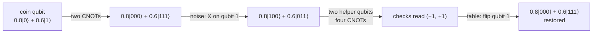
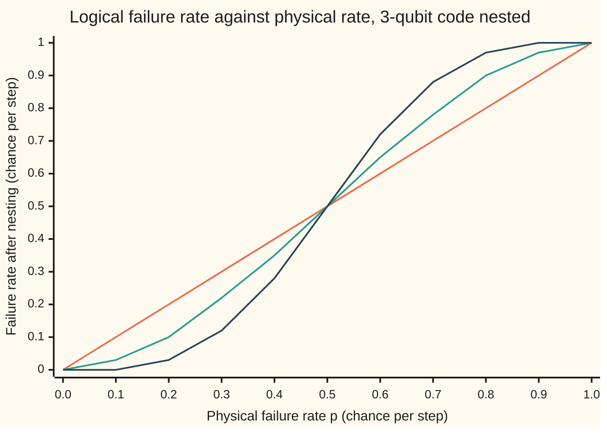

# Quantum error correction: protect a qubit by spreading it out, and the threshold that makes large machines possible

[Syllabus](../../../SYLLABUS.md) → [Computability and complexity](../README.md) → [Algebraic, Interactive and Quantum](../README.md#s05) → Quantum error correction

---

## General Overview

Take the coin qubit from [Qubits](05-qubits-superposition-and-measurement.md): amplitude 0.8 on 0 and 0.6 on 1, so it reads 0 with chance 64% and 1 with chance 36%. Store it on a real chip for one time step. Say each physical qubit gets flipped, 0 to 1 or 1 to 0, with chance **p = 1%** per step.

Then a long circuit, such as the period finding in [Shor and Grover](07-shors-and-grovers-algorithms.md), almost never finishes right. An ordinary computer would keep three copies and take a majority vote. A qubit seems to rule that out: it cannot be copied, reading it destroys the amplitudes, and its errors are not only flips.

The fix is to **spread** the qubit, not copy it. Two gates turn 0.8|0⟩ + 0.6|1⟩ into 0.8|000⟩ + 0.6|111⟩: three qubits that always agree. Then ask only questions that every codeword answers the same way: "do qubits 1 and 2 agree?" and "do qubits 2 and 3 agree?" A flip of qubit 1 makes the answers read (−1, +1), meaning "1 and 2 disagree, 2 and 3 agree". That points at qubit 1, and the 0.8 and the 0.6 are never read. The block now fails only when two or more qubits flip, which happens with chance **0.0298%**, not 1%.

Apply the same trick to the protected qubits, and again, and the failure rate falls doubly exponentially, as long as the physical rate sits below a fixed **threshold**. That theorem is why a large quantum computer is possible at all.

**Quantum error correction stores one qubit across several, measures only checks that every codeword passes, and reads the error's address from which checks fail; nesting codes inside codes drives the failure rate toward zero whenever each part fails less often than a fixed threshold.**

**What kind of fact this is:** theorems, inside a model. The model is independent errors, each part failing with chance p. Proved on this card in Why it works: the checks locate any single flip without reading the data, the 3-qubit code fails with chance 3p² − 2p³, the 9-qubit Shor code repairs every error on one qubit, and nesting the 3-qubit code has threshold 1/2 when the checks are perfect. The threshold theorem for noisy gates is stated with its key steps and a named source. The surface code's 0.57% threshold is a numerical estimate from simulation, not a theorem.

### The picture: one round of protection



The helper qubits are read; the three data qubits never are.

---

## The formula

Notation first, in words. $`X_j`$ and $`Z_j`$ are the [Qubits](05-qubits-superposition-and-measurement.md) gates X (flip) and Z (sign change) applied to qubit $`j`$ only. A product such as $`Z_1Z_2`$ applies both. A **check** (also called a **stabilizer**) is such a product whose reading is +1 on every codeword. The **syndrome** is the list of check readings. $`|0_L\rangle`$ and $`|1_L\rangle`$ are the **logical** basis states: the codewords standing in for |0⟩ and |1⟩.

```math
c_0|0\rangle + c_1|1\rangle \;\longmapsto\; c_0|000\rangle + c_1|111\rangle, \qquad \text{checks } Z_1Z_2,\ Z_2Z_3, \qquad p_L = 3p^2(1-p) + p^3 = 3p^2 - 2p^3
```

**Read it aloud:** the qubit with amplitudes c-zero and c-one becomes three qubits that all agree; the two checks ask whether neighbours agree; the block fails with chance three p squared times one minus p, plus p cubed, which is three p squared minus two p cubed.

The threshold theorem, for $`k`$ levels of codes nested inside codes:

```math
p < p_{\mathrm{th}} \;\Longrightarrow\; p_k \le p_{\mathrm{th}} \left(\frac{p}{p_{\mathrm{th}}}\right)^{2^k}
```

**Read it aloud:** if the physical failure rate p is below the threshold, then after k levels of nesting the failure rate is at most the threshold times p over the threshold, raised to the power two to the k.

On the coin with p = 1%: $`p_L = 3(0.0001) - 2(0.000001) = 0.000298`$, or 0.0298%.

| Symbol | Plain meaning | In our example | Push it up and the answer… |
| --- | --- | --- | --- |
| $`c_0`$, $`c_1`$ | the protected qubit's two amplitudes | 0.8 and 0.6 | no effect: the code works for any pair |
| $`\lvert 0_L\rangle`$, $`\lvert 1_L\rangle`$ | logical basis states: the codewords for 0 and 1 | $`\lvert 000\rangle`$ and $`\lvert 111\rangle`$ | — |
| $`X_j`$, $`Z_j`$, $`X_jZ_j`$, $`I`$ | flip, sign change, or both, on qubit $`j`$ only; $`I`$ does nothing | $`X_1`$ turns $`\lvert 000\rangle`$ into $`\lvert 100\rangle`$ | — |
| $`Z_1Z_2`$, $`Z_2Z_3`$, syndrome | the checks: +1 when the two qubits agree, −1 when not; the list of readings is the syndrome, the error's address | (+1, +1) on the code; (−1, +1) after $`X_1`$ | — |
| $`p`$ | chance that one physical qubit fails in one step | 0.01 | $`p_L`$ rises, roughly as $`3p^2`$ |
| $`p_L`$ | chance the repaired block holds the wrong logical state | 0.000298 | — |
| $`f`$ | one level's map from p to $`p_L`$: $`f(p) = 3p^2 - 2p^3`$ | f(0.01) = 0.000298 | — |
| $`k`$, $`p_k`$ | levels of nesting; failure rate after $`k`$ levels | level 3: $`2.128 \times 10^{-13}`$ | below threshold, falls doubly exponentially |
| $`p_{\mathrm{th}}`$, $`m`$ | the threshold: the largest p at which nesting still helps; $`m`$, the number of fault pairs that can sink a block, gives $`p_{\mathrm{th}} = 1/m`$ | 1/2 exactly for the nested 3-qubit code with perfect checks (the bound's safe value is 1/3); 0.57% for the surface code | — |
| $`N`$, $`\varepsilon`$ | gates in the circuit to protect; allowed final error (not the empty string here) | $`10^9`$ steps; 1% | more overhead, but only polylogarithmically |
| $`n`$, $`d`$ | qubits in a code; its distance: the fewest single-qubit errors that can turn one codeword into another undetected | Shor $`n = 9`$, Steane $`n = 7`$; surface code $`d = 3, 5, 7`$ | larger $`d`$ repairs more errors, at the cost of more qubits |
| $`F`$ | fidelity: $`\lvert\langle\psi\vert\phi\rangle\rvert^2`$, 1 when two states agree, 0 when they are orthogonal (perpendicular) | 1.0000 after every single repair | — |

### When it holds

- **Errors are independent.** The formula counts two flips at chance p² each. A single event that flips two neighbours at once, such as $`X_1X_2`$, is mis-repaired every time: the coin comes back as 36% and 64%.
- **At most one error per block between check rounds.** Two flips in one block beat the 3-qubit code. Checks must run often enough that p stays small per round.
- **p is below the threshold.** At p = 0.6 one level makes things worse: 0.6480, then 0.7155, then 0.8033.
- **The code matches the errors.** The 3-qubit code sees only flips. A sign error $`Z_1`$ passes every check and leaves fidelity 0.0784. Shor's 9-qubit code fixes this.
- **The checks are reliable, or the circuit is built to tolerate their faults.** Steps 1 to 9 assume perfect checks. Step 10 shows what changes when the checks themselves fail.

---

## Why it works

### Step 0: three obstacles, one way round

Three facts seem to forbid quantum error correction:

1. **No copying.** No circuit turns any unknown qubit into two copies of itself (the fold below proves it).
2. **Reading destroys.** Reading the coin gives 0 or 1 and loses 0.8 and 0.6 ([Qubits](05-qubits-superposition-and-measurement.md), Step 6).
3. **Errors are continuous.** A qubit can drift by a small angle, not only flip.

The way round all three is one idea. Spread the information over several qubits so that no single qubit holds it. Then read only **checks**: questions every codeword answers the same way. A check reading says nothing about $`c_0`$ and $`c_1`$, so it disturbs nothing, yet it changes when an error hits.

<details>
<summary>Detailed proof: no circuit copies an unknown qubit</summary>

Suppose one gate U copied every qubit: $`U(|\psi\rangle|0\rangle) = |\psi\rangle|\psi\rangle`$. Then it copies the basis states: $`U|00\rangle = |00\rangle`$ and $`U|10\rangle = |11\rangle`$.

Gates are linear, so on the coin

$`\displaystyle U\big((0.8|0\rangle + 0.6|1\rangle)|0\rangle\big) = 0.8\,U|00\rangle + 0.6\,U|10\rangle = 0.8|00\rangle + 0.6|11\rangle.`$

Two true copies would be $`(0.8|0\rangle + 0.6|1\rangle) \otimes (0.8|0\rangle + 0.6|1\rangle)`$, with amplitudes 0.64, 0.48, 0.48 and 0.36. The two lists differ, so no such U exists. The linear answer, 0.8 and 0.6 on |00⟩ and |11⟩, is exactly the spreading this card uses.

</details>

### Step 1: spread the qubit with two CNOTs

Start with the coin on qubit 1 and two fresh qubits at |0⟩. A CNOT from qubit 1 to qubit 2, then one from qubit 1 to qubit 3, gives

```math
(0.8|0\rangle + 0.6|1\rangle)|00\rangle \;\longmapsto\; 0.8|000\rangle + 0.6|111\rangle.
```

This is not three copies: only two outcomes have amplitude, and they keep 0.8 and 0.6 exactly.

### Step 2: a check reads agreement, not the data

$`Z_1Z_2`$ multiplies each basis state by +1 if qubits 1 and 2 agree and by −1 if they differ. On the code, both |000⟩ and |111⟩ agree, so both get +1. The whole state is unchanged, and the check reads +1.

After a flip of qubit 1 the state is 0.8|100⟩ + 0.6|011⟩. Now both terms disagree in qubits 1 and 2, so $`Z_1Z_2`$ reads −1 on both. Both terms agree in qubits 2 and 3, so $`Z_2Z_3`$ reads +1.

The key point: each check gives the **same** answer on both terms. A reading with one certain answer does not collapse anything ([Qubits](05-qubits-superposition-and-measurement.md), Step 6). The amplitudes 0.8 and 0.6 survive.

In hardware each check uses a **helper qubit** (an ancilla): a spare qubit set to |0⟩. CNOTs from qubits 1 and 2 onto it leave it at 1 exactly when they disagree. Simulated on 5 qubits, the two helpers read 1 then 0 with chance 1.0000, and the data amplitudes stay 0.8000 on |100⟩ and 0.6000 on |011⟩.

### Step 3: the syndrome is the address

Each single flip gives its own syndrome:

| Error | $`Z_1Z_2`$ | $`Z_2Z_3`$ | Repair |
| --- | --- | --- | --- |
| none | +1 | +1 | nothing |
| $`X_1`$ | −1 | +1 | $`X_1`$ |
| $`X_2`$ | −1 | −1 | $`X_2`$ |
| $`X_3`$ | +1 | −1 | $`X_3`$ |

Applying X again undoes X, so the repair restores the codeword. The checks find fidelity 1.0000 in all three cases. This is the same idea as the syndrome of [Hamming and Reed-Solomon](../../14-Applied%20and%20computational/03-Information%20Theory/08-error-correcting-codes-hamming-and-reed-solomon.md): the checks see only the damage, never the message.

### Step 4: the block fails only on two or more flips

With independent flips at chance p, the eight flip patterns split into two groups.

- **No flip or one flip:** the table repairs it. Chance $`(1-p)^3 + 3p(1-p)^2`$.
- **Two or three flips:** the patterns 011, 101, 110 and 111. Two flips give the syndrome of the third qubit, and the repair completes $`X_1X_2X_3`$, which swaps |000⟩ and |111⟩. Three flips give the syndrome "none". Either way the logical qubit is flipped.

So $`p_L = 3p^2(1-p) + p^3 = 3p^2 - 2p^3`$. The check runs all 8 patterns through the quantum simulation and gets the same 0.00029800.

Below p = 1/2 this is less than p, because $`3p^2 - 2p^3 < p`$ rearranges to $`(2p - 1)(p - 1) > 0`$.

### Step 5: phase errors, and Shor's 9-qubit code

The 3-qubit code is blind to a sign error. $`Z_1`$ turns 0.8|000⟩ + 0.6|111⟩ into 0.8|000⟩ − 0.6|111⟩. Both checks still read +1. Yet the state is badly wrong: fidelity $`F = (0.64 - 0.36)^2 = 0.0784`$.

A sign error is a flip seen through Hadamard gates, since $`HZH = X`$. So a **phase-flip code** guards signs: encode in |+++⟩ and |−−−⟩ (with $`|+\rangle = H|0\rangle`$ and $`|-\rangle = H|1\rangle`$) and check $`X_1X_2`$ and $`X_2X_3`$.

Shor's 1995 code nests one inside the other. Each of three blocks is a 3-qubit flip code, and the three blocks form a phase-flip code:

```math
|0_L\rangle = \tfrac{1}{2\sqrt2}\big(|000\rangle + |111\rangle\big)^{\otimes 3}, \qquad |1_L\rangle = \tfrac{1}{2\sqrt2}\big(|000\rangle - |111\rangle\big)^{\otimes 3}
```

**Read it aloud:** logical zero is three blocks, each "all zeros plus all ones"; logical one is the same with minus signs; the factor one over two root two keeps length 1.

It has 8 checks. Six are $`Z`$ pairs inside blocks: $`Z_1Z_2, Z_2Z_3, Z_4Z_5, Z_5Z_6, Z_7Z_8, Z_8Z_9`$. Two compare the signs of neighbouring blocks: $`X_1X_2 \cdots X_6`$ and $`X_4X_5 \cdots X_9`$.

| Error | Syndrome (6 Z checks, then 2 X checks) | Repair chosen |
| --- | --- | --- |
| $`X_1`$ | `-+++++++` | $`X_1`$ |
| $`Z_1`$ | `++++++-+` | $`Z_1`$ |
| $`Z_5`$ | `++++++--` | $`Z_4`$ |
| $`X_5Z_5`$ | `++--++--` | $`X_5Z_5`$ |

The repair for $`Z_5`$ is $`Z_4`$, and it works: $`Z_4Z_5`$ is itself a check, so it does nothing to a codeword. A code where different errors need no telling apart is called **degenerate**. The check simulates all 512 amplitudes and repairs all 27 single-qubit errors (X, Z or both, on each of 9 qubits) with fidelity 1.0000.

### Step 6: any error on one qubit becomes one of four

A real error is rarely a clean X or Z. But any 2 × 2 matrix is a mix of four: $`I`$, $`X`$, $`Z`$ and $`XZ`$, with some weights. So any error on qubit 5 turns the codeword into a mix of four states, each a clean error on the code.

Measuring the checks picks one of the four. Take the messy error $`E = 0.9\,I + 0.3\,X_5 + 0.3\,Z_5 + 0.1\,X_5Z_5`$:

| Branch | Syndrome | Chance | Repair | Fidelity after |
| --- | --- | --- | --- | --- |
| no error | `++++++++` | 0.8100 | none | 1.0000 |
| $`Z_5`$ | `++++++--` | 0.0900 | $`Z_4`$ | 1.0000 |
| $`X_5`$ | `++--++++` | 0.0900 | $`X_5`$ | 1.0000 |
| $`X_5Z_5`$ | `++--++--` | 0.0100 | $`X_5Z_5`$ | 1.0000 |

The chances are 0.9², 0.3², 0.3² and 0.1², and they add to 1.0000. They add up this way because the four parts have different syndromes, so they land in perpendicular spaces. On a bare qubit this E stretches some states, so it is not a physical error by itself; on the code it keeps length 1. Every branch is repaired. So a code that fixes X, Z and XZ on a qubit fixes **every** error on that qubit. The continuous problem of Step 0 becomes a discrete one.

### Step 7: the stabilizer view

Each code above is the set of states on which every check reads +1. The checks are **Pauli products**: products of X's and Z's on chosen qubits.

- **The checks commute.** Two Pauli products commute when the places where one has X and the other has Z number an even count. Then all checks can read +1 at once.
- **Each independent check halves the room.** With n qubits and $`n - 1`$ independent checks, a space of dimension 2 remains: one logical qubit. So the 3-qubit code has 2 checks, Shor's 8, Steane's 6.

An error is found because it **anticommutes** with some checks (flips their reading to −1) and commutes with the rest. The check programs build each repair table from this rule alone, then confirm it on the simulated state.

### Step 8: Steane's code, built from Hamming's

Hamming's [7, 4] code has a 3 × 7 check matrix whose column j is j in binary ([Hamming and Reed-Solomon](../../14-Applied%20and%20computational/03-Information%20Theory/08-error-correcting-codes-hamming-and-reed-solomon.md)):

```
row 1: 1 0 1 0 1 0 1
row 2: 0 1 1 0 0 1 1
row 3: 0 0 0 1 1 1 1
```

Steane's 1996 code uses each row twice: once as a Z check (Z on every position with a 1) and once as an X check. That gives 6 checks on 7 qubits.

They commute because every row has weight 4 and every pair of rows overlaps in 2 places: all even. The general recipe, a **CSS code** (after Calderbank, Shor and Steane), takes two classical codes this way. It needs the second code's checks to be codewords of the first.

| Error on qubit j | 1 | 2 | 3 | 4 | 5 | 6 | 7 |
| --- | --- | --- | --- | --- | --- | --- | --- |
| $`X_j`$: Z checks spell | 1 | 2 | 3 | 4 | 5 | 6 | 7 |
| $`Z_j`$: X checks spell | 1 | 2 | 3 | 4 | 5 | 6 | 7 |

A flip on qubit j makes the Z checks spell j in binary, exactly Hamming's syndrome. A sign error does the same on the X checks. The logical zero is an even spread over 8 words, the rows' combinations:

```
0000000 0001111 0110011 0111100 1010101 1011010 1100110 1101001
```

Logical one flips every bit. The check simulates 128 amplitudes and repairs all 21 single-qubit errors. Steane's code does with 7 qubits what Shor's does with 9.

### Step 9: nesting, and the threshold

Treat each protected block as one qubit with failure rate $`p_1 = f(p) = 3p^2 - 2p^3`$. Encode three such blocks into a bigger block. Its rate is $`p_2 = f(p_1)`$. Each level triples the qubits.

| Level | Qubits | p = 0.01 | p = 0.6 |
| --- | --- | --- | --- |
| 0 | 1 | 1.000e-2 | 0.6000 |
| 1 | 3 | 2.980e-4 | 0.6480 |
| 2 | 9 | 2.664e-7 | 0.7155 |
| 3 | 27 | 2.128e-13 | 0.8033 |

Below 1/2 the rate collapses; above it, nesting makes things worse. The threshold is the point where $`f(p) = p`$: 1/2 by Step 4's algebra, 0.500000 by bisection in the check.

Why does it fall so fast? Since $`f(p) \le 3p^2`$, multiply by 3: $`3p_{k+1} \le (3p_k)^2`$. Squaring k times gives

```math
p_k \le \tfrac13 (3p)^{2^k}
```

**Read it aloud:** after k levels the rate is at most one third of three p, raised to two to the k. That is the threshold theorem's form with $`p_{\mathrm{th}} = 1/3`$. The bound's 1/3 is a safe value below the true 1/2: it guarantees the collapse for every p under 1/3. At p = 0.01 the bound gives 3.000e-4, 2.700e-7 and 2.187e-13, just above the exact values.



Orange: no code, the rate stays p. Green: one level. Dark blue: two levels. All three cross at p = 0.5, the threshold. Left of it each level pulls the curve down; right of it each level pushes it up.

### Step 10: when the checks fail too

Steps 1 to 9 assumed perfect checks. Real check circuits are made of the same faulty gates. **Fault tolerance** means building every step, encoding, checking and computing, so that one fault spreads to at most one qubit per block. Then a block still fails only when at least two faults hit it.

If a block has at most $`m`$ pairs of places where two faults can sink it, the rate obeys $`p_{k+1} \le m\,p_k^2`$. The squaring argument above gives a threshold $`p_{\mathrm{th}} = 1/m`$. That is the whole shape of the theorem:

> **Threshold theorem** (proved independently by several groups in 1996 and 1997). There is a constant $`p_{\mathrm{th}} > 0`$ such that any quantum circuit of $`N`$ gates can be run on gates that each fail independently with chance $`p < p_{\mathrm{th}}`$, with final error at most $`\varepsilon`$, using a number of gates larger by a factor polynomial in $`\log(N/\varepsilon)`$.

It is stated here with its key steps, not proved in full. The hard part is showing that every gadget keeps one fault to one qubit per block. Aharonov and Ben-Or's paper (in Sources) gives a full proof.

The counting matches Step 9. To run $`10^9`$ steps with 1% total failure, each step needs $`10^{-11}`$. From p = 1% the 3-qubit ladder needs level 3: $`3^3 = 27`$ qubits per protected qubit in this memory model. Steane's code, which also guards signs, costs 7 qubits per level, so three levels would use $`7^3 = 343`$; how many levels it needs depends on its own failure map. Polylogarithmic overhead (a cost growing like a power of $`\log N`$) means [BQP](06-quantum-computation-and-bqp.md), defined with perfect gates, describes what noisy hardware can compute too.

### Step 11: the surface code, in outline

Nesting codes needs gates between distant qubits. The **surface code** needs only neighbours on a flat grid. Data qubits and helper qubits alternate on a square grid, and every check is a product of X's or Z's on four neighbouring data qubits. The distance d is the length of the shortest chain of errors that crosses the patch from edge to edge without tripping a check.

In the layout of Fowler and coauthors (2012), a distance-d patch uses $`(2d-1)^2`$ physical qubits, data and helper together: 25 for d = 3, 81 for d = 5, 169 for d = 7. Below threshold the logical rate falls like $`(p/p_{\mathrm{th}})^{(d+1)/2}`$: powers 2, 3 and 4 for those distances. Their simulations put the threshold near 0.57% per gate step. That figure is a numerical estimate under a stated noise model, not a theorem.

---

## Worked numbers, by hand

The coin in the 3-qubit code, p = 1% per qubit per step.

| Step | Arithmetic | Value |
| --- | --- | --- |
| no flip | $`0.99^3`$ | 0.970299 |
| exactly one flip | $`3 \times 0.01 \times 0.99^2`$ | 0.029403 |
| exactly two flips | $`3 \times 0.01^2 \times 0.99`$ | 0.000297 |
| three flips | $`0.01^3`$ | 0.000001 |
| check: total | 0.970299 + 0.029403 + 0.000297 + 0.000001 | 1 |
| block fails: two or three | 0.000297 + 0.000001 | 0.000298 |
| same, by formula | $`3(0.0001) - 2(0.000001)`$ | 0.000298 |
| one level more | $`3(0.000298)^2 - 2(0.000298)^3`$ | 2.664e-7 |
| **failure per step, protected** | | **0.0298%** |

So the protected coin fails about 3 times in 10,000 steps instead of 100 times. A million random runs in the check give 279 failures, against 298 expected with standard error 17.3.

### What breaks if you drop a piece

| Mistake | Comes out at | What went wrong |
| --- | --- | --- |
| Read the three data qubits to see which disagrees | average fidelity 0.5392 | Reading collapses $`0.8\lvert 000\rangle + 0.6\lvert 111\rangle`$ to $`\lvert 000\rangle`$ or $`\lvert 111\rangle`$; the amplitudes are gone |
| One event flips qubits 1 and 2 together | chances 0.3600 and 0.6400, fidelity 0.9216 | Two flips give qubit 3's syndrome; the "repair" completes a logical flip |
| Trust the 3-qubit code against a sign error $`Z_1`$ | checks (+1, +1), fidelity 0.0784 | Its checks see only flips; it needs Shor's or Steane's code |
| Encode at p = 0.6 | 0.6480 after one level, 0.8033 after three | Above threshold, a block's chance of two or more flips, 0.6480, beats a bare qubit's 0.6 |

The average fidelity in the first row is 0.64 × 0.64 + 0.36 × 0.36: each outcome's chance times how well it matches the coin.

---

## Code, from first principles, and it actually runs

Both programs simulate the codes as lists of real amplitudes, as on the Qubits card. They reach the 3-qubit failure rate by **three independent roads**: the formula $`3p^2 - 2p^3`$; all 8 flip patterns run through the simulated code and repair; and 1,000,000 random runs from a SplitMix64 generator written out in both languages. Syndromes take two roads: the repair table comes from anticommuting alone, and the simulated readings must land on its entries. The threshold is found by bisection and compared with 1/2 from algebra.

### Python

```python
# Quantum error correction -- the check behind the card.  Standard library only.
# State vectors as on the Qubits card: n qubits are 2^n amplitudes, qubit 1 is the
# leftmost bit, and every amplitude here is real.  An error or a check is a pair of
# bit masks (x, z): Z on the z-qubits first, then X on the x-qubits.
import math
def mask(n, qs): return sum(1 << (n - q) for q in qs)       # qubits 1..n -> bit mask
def pop(v): return bin(v).count("1")
def pauli(s, x, z): return [(-1) ** pop((i ^ x) & z) * s[i ^ x] for i in range(len(s))]   # X^x Z^z
def dot(s, t): return sum(a * b for a, b in zip(s, t))
def ket(n, bits): return [float(i == int(bits, 2)) for i in range(1 << n)]
def mix(pairs): return [sum(c * v[i] for c, v in pairs) for i in range(len(pairs[0][1]))]
def kron(a, b): return [x * y for x in a for y in b]
def fid(s, t): return dot(s, t) ** 2 / (dot(s, s) * dot(t, t))
def syn(s, checks): return tuple(round(dot(s, pauli(s, x, z)) / dot(s, s)) for x, z in checks)
def anti(e, c): return (pop(e[0] & c[1]) + pop(e[1] & c[0])) % 2   # 1: error and check anticommute
def singles(n): return [(f"{k}{q}", (mask(n, [q]) * (k != "Z"), mask(n, [q]) * (k != "X")))
                        for q in range(1, n + 1) for k in ("X", "Z", "XZ")]
def table(n, checks):        # syndrome -> repair, from anticommuting alone (no state needed)
    t = {tuple(1 for _ in checks): ("none", (0, 0))}
    for name, e in singles(n): t.setdefault(tuple(1 - 2 * anti(e, c) for c in checks), (name, e))
    return t
def repair(s, checks, t): name, e = t[syn(s, checks)]; return name, pauli(s, *e)
def signs(sy): return "".join("+" if v > 0 else "-" for v in sy)
def pm(sy): return "(" + ", ".join(f"{v:+d}" for v in sy) + ")"
def sci(x): m, e = f"{x:.3e}".split("e"); return f"{m}e{int(e)}"
def all_singles(n, code, checks, t):
    return sum(fid(repair(pauli(code, *e), checks, t)[1], code) > 1 - 1e-12 for _, e in singles(n))
c0, c1 = 0.8, 0.6                                           # the coin qubit from the Qubits card
L3 = mix([(c0, ket(3, "000")), (c1, ket(3, "111"))])
bc = [(0, mask(3, [1, 2])), (0, mask(3, [2, 3]))]           # checks Z1 Z2 and Z2 Z3
bt = table(3, bc)
print("two copies of the coin: " + " ".join(f"{a:.4f}" for a in kron([c0, c1], [c0, c1])) + "; coin then CNOT: "
      + " ".join(f"{a:.4f}" for a in mix([(c0, ket(2, "00")), (c1, ket(2, "11"))])))
print(f"bit-flip code: 0.8|000> + 0.6|111>; checks Z1Z2, Z2Z3 read {pm(syn(L3, bc))}")
for q in (1, 2, 3):
    bad = pauli(L3, mask(3, [q]), 0)
    name, back = repair(bad, bc, bt)
    print(f"X on qubit {q}: checks read {pm(syn(bad, bc))}, repair {name}, fidelity {fid(back, L3):.4f}")
s5 = kron(pauli(L3, mask(3, [1]), 0), ket(2, "00"))         # road two: two helper qubits, four CNOTs
for c, t in ((1, 4), (2, 4), (2, 5), (3, 5)):
    s5 = [s5[i ^ (1 << (5 - t))] if i & (1 << (5 - c)) else a for i, a in enumerate(s5)]
p10 = sum(a * a for i, a in enumerate(s5) if i & 3 == 2)
print(f"helper qubits after four CNOTs read 1 0 with chance {p10:.4f}; data amplitudes "
      f"{s5[int('10010', 2)]:.4f} on |100>, {s5[int('01110', 2)]:.4f} on |011>")
p = 0.01
fails, pl_enum = [], 0.0
for pat in range(8):                                        # road two: all 8 flip patterns, run quantum
    after = repair(pauli(L3, pat, 0), bc, bt)[1]
    if fid(after, L3) < 0.999: fails.append(f"{pat:03b}"); pl_enum += p ** pop(pat) * (1 - p) ** (3 - pop(pat))
f = lambda p: 3 * p * p - 2 * p ** 3
print(f"patterns that fail: {', '.join(fails)}")
print(f"p = 0.01: logical error 3p^2 - 2p^3 = {f(p):.8f}; over all 8 patterns = {pl_enum:.8f}")
print("chance of 0, 1, 2, 3 flips: " + ", ".join(f"{math.comb(3, k) * p ** k * (1 - p) ** (3 - k):.6f}" for k in range(4)))
M64 = (1 << 64) - 1
def splitmix64(s):                                          # SplitMix64, written out in both languages
    while True:
        s = (s + 0x9E3779B97F4A7C15) & M64
        z = ((s ^ (s >> 30)) * 0xBF58476D1CE4E5B9) & M64
        z = ((z ^ (z >> 27)) * 0x94D049BB133111EB) & M64
        yield z ^ (z >> 31)
RUNS, gen, mc = 1000000, splitmix64(2026), 0
for _ in range(RUNS):                                       # road three: random flips, same decoder
    pat = sum(1 << b for b in range(3) if (next(gen) >> 11) / 2.0 ** 53 < p)
    fix = bt[tuple(1 - 2 * anti((pat, 0), c) for c in bc)][1][0]
    mc += (pat ^ fix) == 7
se = math.sqrt(RUNS * f(p) * (1 - f(p)))
print(f"{RUNS} random runs, seed 2026: {mc} logical errors; expected {RUNS * f(p):.1f}, standard error {se:.1f}")
print(f"try: p = 0.001 gives {f(0.001):.8f}; p = 0.1 gives {f(0.1):.8f}")
lv, hv = [p], [0.6]
for _ in range(3): lv.append(f(lv[-1])); hv.append(f(hv[-1]))
print("levels 0-3 from p = 0.01: " + ", ".join(sci(v) for v in lv))
print("  bound (3p)^(2^k)/3:     " + ", ".join(sci((3 * p) ** (2 ** k) / 3) for k in range(4)))
print("levels 0-3 from p = 0.6:  " + ", ".join(f"{v:.4f}" for v in hv))
lo, hi = 0.01, 0.99
for _ in range(60):                                         # threshold: where f(p) = p, by bisection
    mid = (lo + hi) / 2
    lo, hi = (mid, hi) if f(mid) < mid else (lo, mid)
print(f"threshold of the level map, by bisection: {lo:.6f}")
xs = [k / 10 for k in range(11)]
print("chart p:      " + " ".join(f"{x:.2f}" for x in xs))
print("chart level 1 " + " ".join(f"{f(x):.2f}" for x in xs))
print("chart level 2 " + " ".join(f"{f(f(x)):.2f}" for x in xs))
k, q = 0, p
while q > 1e-11: q, k = f(q), k + 1
print(f"need 1e-11 per step (1% over 1e9 steps) from p = 0.01: level {k}; qubits per logical qubit 3^{k} = {3 ** k}, Steane 7^{k} = {7 ** k}")
plus, minus = mix([(1, ket(3, "000")), (1, ket(3, "111"))]), mix([(1, ket(3, "000")), (-1, ket(3, "111"))])
L9 = mix([(c0, kron(kron(plus, plus), plus)), (c1, kron(kron(minus, minus), minus))])
L9 = [a / math.sqrt(dot(L9, L9)) for a in L9]
sc = [(0, mask(9, pr)) for pr in ([1, 2], [2, 3], [4, 5], [5, 6], [7, 8], [8, 9])]
sc += [(mask(9, range(1, 7)), 0), (mask(9, range(4, 10)), 0)]
st = table(9, sc)
print(f"Shor code: 9 qubits ({len(L9)} amplitudes), 8 checks, all read {signs(syn(L9, sc))} on the coin")
for name in ("X1", "Z1", "Z5", "XZ5"):
    e = dict(singles(9))[name]
    print(f"  {name:<3} -> checks {signs(syn(pauli(L9, *e), sc))}, repair {repair(pauli(L9, *e), sc, st)[0]}")
print(f"Shor code repairs {all_singles(9, L9, sc, st)} of 27 single-qubit errors")
m5 = mask(9, [5])
mess = mix([(0.9, L9), (0.3, pauli(L9, m5, 0)), (0.3, pauli(L9, 0, m5)), (0.1, pauli(L9, m5, m5))])
tot, bf = 0.0, []                                           # measuring the checks picks one branch
for sy, (name, _) in st.items():
    br = mess
    for (x, z), sg in zip(sc, sy): br = [(a + sg * b) / 2 for a, b in zip(br, pauli(br, x, z))]
    pr = dot(br, br)
    if pr > 1e-12:
        tot += pr; bf.append(fid(repair(br, sc, st)[1], L9))
        print(f"  messy error on qubit 5, branch {signs(sy)}: chance {pr:.4f}, repair {name}, fidelity {bf[-1]:.4f}")
print(f"  branch chances add to {tot:.4f}")
rows = [mask(7, [j for j in range(1, 8) if j >> r & 1]) for r in range(3)]   # Hamming check matrix
print("Steane: row overlaps " + ", ".join(str(pop(rows[a] & rows[b])) for a, b in ((0, 1), (0, 2), (1, 2)))
      + "; row weights " + ", ".join(str(pop(r)) for r in rows))
words = sorted({(rows[0] if a else 0) ^ (rows[1] if b else 0) ^ (rows[2] if c else 0) for a in (0, 1) for b in (0, 1) for c in (0, 1)})
print("Steane |0_L> words: " + " ".join(f"{w:07b}" for w in words))
z0 = [(i in words) / math.sqrt(8) for i in range(128)]
L7 = mix([(c0, z0), (c1, pauli(z0, 127, 0))])
tc = [(0, r) for r in rows] + [(r, 0) for r in rows]
tt = table(7, tc)
num = lambda sy: sum(1 << i for i, v in enumerate(sy) if v < 0)
print("Steane, X on qubit 1-7, Z-checks spell: " + " ".join(str(num(syn(pauli(L7, mask(7, [j]), 0), tc)[:3])) for j in range(1, 8)))
print("Steane, Z on qubit 1-7, X-checks spell: " + " ".join(str(num(syn(pauli(L7, 0, mask(7, [j])), tc)[3:])) for j in range(1, 8)))
print(f"Steane code ({len(L7)} amplitudes): checks on the coin {signs(syn(L7, tc))}; repairs {all_singles(7, L7, tc, tt)} of 21 single-qubit errors")
ph = pauli(L3, 0, mask(3, [1]))
two = repair(pauli(L3, mask(3, [1, 2]), 0), bc, bt)
print(f"mistake 1, read the data: fidelity on average {sum(L3[i] ** 2 * fid(ket(3, f'{i:03b}'), L3) for i in (0, 7)):.4f}")
print(f"mistake 2, X1 X2: repair {two[0]}, chances now {two[1][0] ** 2:.4f} and {two[1][7] ** 2:.4f}, fidelity {fid(two[1], L3):.4f}")
print(f"mistake 3, Z1 on the bit-flip code: checks {pm(syn(ph, bc))}, fidelity {fid(ph, L3):.4f}")
print("surface code, distance 3 5 7: qubits (2d-1)^2 = " + " ".join(str((2 * d - 1) ** 2) for d in (3, 5, 7))
      + "; error powers (d+1)/2 = " + " ".join(str((d + 1) // 2) for d in (3, 5, 7)) + "; cited threshold 0.57% per step")
assert abs(f(p) - pl_enum) < 1e-15 and fails == ["011", "101", "110", "111"]          # formula = all patterns
assert abs(mc - RUNS * f(p)) < 4 * se                                                  # simulation agrees
assert abs(p10 - 1) < 1e-12 and abs(f(p) - 0.000298) < 1e-12                           # 3(0.0001) - 2(0.000001)
assert abs(lo - 0.5) < 1e-9 and f(0.6) > 0.6 and f(0.4) < 0.4                         # threshold 1/2
assert all_singles(9, L9, sc, st) == 27 and all_singles(7, L7, tc, tt) == 21
assert abs(tot - 1) < 1e-12 and len(bf) == 4 and min(bf) > 1 - 1e-12                 # every branch repaired
assert all(pop(a & b) % 2 == 0 for a in rows for b in rows)                            # X and Z checks commute
assert [num(syn(pauli(L7, mask(7, [j]), 0), tc)[:3]) for j in range(1, 8)] == list(range(1, 8))
assert abs(fid(ph, L3) - (c0 * c0 - c1 * c1) ** 2) < 1e-12                             # (0.64 - 0.36)^2
print("ALL CHECKS PASS")
```

**Ran 2026-11-24 on macOS, Python 3.14.10, standard library only. All checks passed. Output, pasted from the run:**

```
two copies of the coin: 0.6400 0.4800 0.4800 0.3600; coin then CNOT: 0.8000 0.0000 0.0000 0.6000
bit-flip code: 0.8|000> + 0.6|111>; checks Z1Z2, Z2Z3 read (+1, +1)
X on qubit 1: checks read (-1, +1), repair X1, fidelity 1.0000
X on qubit 2: checks read (-1, -1), repair X2, fidelity 1.0000
X on qubit 3: checks read (+1, -1), repair X3, fidelity 1.0000
helper qubits after four CNOTs read 1 0 with chance 1.0000; data amplitudes 0.8000 on |100>, 0.6000 on |011>
patterns that fail: 011, 101, 110, 111
p = 0.01: logical error 3p^2 - 2p^3 = 0.00029800; over all 8 patterns = 0.00029800
chance of 0, 1, 2, 3 flips: 0.970299, 0.029403, 0.000297, 0.000001
1000000 random runs, seed 2026: 279 logical errors; expected 298.0, standard error 17.3
try: p = 0.001 gives 0.00000300; p = 0.1 gives 0.02800000
levels 0-3 from p = 0.01: 1.000e-2, 2.980e-4, 2.664e-7, 2.128e-13
  bound (3p)^(2^k)/3:     1.000e-2, 3.000e-4, 2.700e-7, 2.187e-13
levels 0-3 from p = 0.6:  0.6000, 0.6480, 0.7155, 0.8033
threshold of the level map, by bisection: 0.500000
chart p:      0.00 0.10 0.20 0.30 0.40 0.50 0.60 0.70 0.80 0.90 1.00
chart level 1 0.00 0.03 0.10 0.22 0.35 0.50 0.65 0.78 0.90 0.97 1.00
chart level 2 0.00 0.00 0.03 0.12 0.28 0.50 0.72 0.88 0.97 1.00 1.00
need 1e-11 per step (1% over 1e9 steps) from p = 0.01: level 3; qubits per logical qubit 3^3 = 27, Steane 7^3 = 343
Shor code: 9 qubits (512 amplitudes), 8 checks, all read ++++++++ on the coin
  X1  -> checks -+++++++, repair X1
  Z1  -> checks ++++++-+, repair Z1
  Z5  -> checks ++++++--, repair Z4
  XZ5 -> checks ++--++--, repair XZ5
Shor code repairs 27 of 27 single-qubit errors
  messy error on qubit 5, branch ++++++++: chance 0.8100, repair none, fidelity 1.0000
  messy error on qubit 5, branch ++++++--: chance 0.0900, repair Z4, fidelity 1.0000
  messy error on qubit 5, branch ++--++++: chance 0.0900, repair X5, fidelity 1.0000
  messy error on qubit 5, branch ++--++--: chance 0.0100, repair XZ5, fidelity 1.0000
  branch chances add to 1.0000
Steane: row overlaps 2, 2, 2; row weights 4, 4, 4
Steane |0_L> words: 0000000 0001111 0110011 0111100 1010101 1011010 1100110 1101001
Steane, X on qubit 1-7, Z-checks spell: 1 2 3 4 5 6 7
Steane, Z on qubit 1-7, X-checks spell: 1 2 3 4 5 6 7
Steane code (128 amplitudes): checks on the coin ++++++; repairs 21 of 21 single-qubit errors
mistake 1, read the data: fidelity on average 0.5392
mistake 2, X1 X2: repair X3, chances now 0.3600 and 0.6400, fidelity 0.9216
mistake 3, Z1 on the bit-flip code: checks (+1, +1), fidelity 0.0784
surface code, distance 3 5 7: qubits (2d-1)^2 = 25 81 169; error powers (d+1)/2 = 2 3 4; cited threshold 0.57% per step
ALL CHECKS PASS
```

### Rust

```rust
// Quantum error correction -- the check behind the card.  Rust std only, no crates.
// State vectors as on the Qubits card: n qubits are 2^n amplitudes, qubit 1 is the
// leftmost bit, and every amplitude here is real.  An error or a check is a pair of
// bit masks (x, z): Z on the z-qubits first, then X on the x-qubits.
type V = Vec<f64>;
type P = (usize, usize);
type Table = Vec<(Vec<i32>, String, P)>;

fn mask(n: usize, qs: &[usize]) -> usize { qs.iter().map(|q| 1 << (n - q)).sum() }
fn pop(v: usize) -> u32 { v.count_ones() }
fn pauli(s: &V, x: usize, z: usize) -> V {                 // apply X^x Z^z
    (0..s.len()).map(|i| if pop((i ^ x) & z) % 2 == 1 { -s[i ^ x] } else { s[i ^ x] }).collect()
}
fn dot(s: &V, t: &V) -> f64 { s.iter().zip(t).map(|(a, b)| a * b).sum() }
fn ket(n: usize, bits: &str) -> V { (0..1 << n).map(|i| if i == usize::from_str_radix(bits, 2).unwrap() { 1.0 } else { 0.0 }).collect() }
fn mix(pairs: &[(f64, &V)]) -> V { (0..pairs[0].1.len()).map(|i| pairs.iter().map(|(c, v)| c * v[i]).sum()).collect() }
fn kron(a: &V, b: &V) -> V { a.iter().flat_map(|x| b.iter().map(move |y| x * y)).collect() }
fn fid(s: &V, t: &V) -> f64 { dot(s, t).powi(2) / (dot(s, s) * dot(t, t)) }
fn syn(s: &V, checks: &[P]) -> Vec<i32> {
    checks.iter().map(|&(x, z)| (dot(s, &pauli(s, x, z)) / dot(s, s)).round() as i32).collect()
}
fn anti(e: P, c: P) -> i32 { ((pop(e.0 & c.1) + pop(e.1 & c.0)) % 2) as i32 }  // 1: anticommute
fn singles(n: usize) -> Vec<(String, P)> {
    (1..=n).flat_map(|q| { let m = mask(n, &[q]); [("X", (m, 0)), ("Z", (0, m)), ("XZ", (m, m))].map(|(k, e)| (format!("{}{}", k, q), e)) }).collect()
}
fn table(n: usize, checks: &[P]) -> Table {   // syndrome -> repair, from anticommuting alone
    let mut t: Table = vec![(vec![1; checks.len()], "none".to_string(), (0, 0))];
    for (name, e) in singles(n) {
        let sy: Vec<i32> = checks.iter().map(|&c| 1 - 2 * anti(e, c)).collect();
        if !t.iter().any(|r| r.0 == sy) { t.push((sy, name, e)); }
    }
    t
}
fn repair(s: &V, checks: &[P], t: &Table) -> (String, V) {
    let r = t.iter().find(|r| r.0 == syn(s, checks)).unwrap();
    (r.1.clone(), pauli(s, r.2 .0, r.2 .1))
}
fn signs(sy: &[i32]) -> String { sy.iter().map(|&v| if v > 0 { '+' } else { '-' }).collect() }
fn pm(sy: &[i32]) -> String { format!("({})", sy.iter().map(|v| format!("{:+}", v)).collect::<Vec<_>>().join(", ")) }
fn all_singles(n: usize, code: &V, checks: &[P], t: &Table) -> usize {
    singles(n).iter().filter(|(_, e)| fid(&repair(&pauli(code, e.0, e.1), checks, t).1, code) > 1.0 - 1e-12).count()
}
fn f(p: f64) -> f64 { 3.0 * p * p - 2.0 * p.powi(3) }
fn join(v: Vec<String>, sep: &str) -> String { v.join(sep) }
fn splitmix64(s: &mut u64) -> u64 {                          // SplitMix64, as in the Python
    *s = s.wrapping_add(0x9E3779B97F4A7C15);
    let z = (*s ^ (*s >> 30)).wrapping_mul(0xBF58476D1CE4E5B9);
    let z = (z ^ (z >> 27)).wrapping_mul(0x94D049BB133111EB);
    z ^ (z >> 31)
}
fn main() {
    let (c0, c1): (f64, f64) = (0.8, 0.6);                                // the coin qubit from the Qubits card
    let l3 = mix(&[(c0, &ket(3, "000")), (c1, &ket(3, "111"))]);
    let bc = vec![(0, mask(3, &[1, 2])), (0, mask(3, &[2, 3]))];
    let bt = table(3, &bc);
    println!("two copies of the coin: {}; coin then CNOT: {}", join(kron(&vec![c0, c1], &vec![c0, c1]).iter().map(|a| format!("{:.4}", a)).collect(), " "),
             join(mix(&[(c0, &ket(2, "00")), (c1, &ket(2, "11"))]).iter().map(|a| format!("{:.4}", a)).collect(), " "));
    println!("bit-flip code: 0.8|000> + 0.6|111>; checks Z1Z2, Z2Z3 read {}", pm(&syn(&l3, &bc)));
    for q in 1..=3 {
        let bad = pauli(&l3, mask(3, &[q]), 0); let (name, back) = repair(&bad, &bc, &bt);
        println!("X on qubit {}: checks read {}, repair {}, fidelity {:.4}", q, pm(&syn(&bad, &bc)), name, fid(&back, &l3));
    }
    let mut s5 = kron(&pauli(&l3, mask(3, &[1]), 0), &ket(2, "00"));   // road two: helpers and CNOTs
    for (c, t) in [(1, 4), (2, 4), (2, 5), (3, 5)] {
        s5 = (0..32).map(|i: usize| if i & (1 << (5 - c)) != 0 { s5[i ^ (1 << (5 - t))] } else { s5[i] }).collect();
    }
    let p10: f64 = (0..32).filter(|i| i & 3 == 2).map(|i| s5[i] * s5[i]).sum();
    println!("helper qubits after four CNOTs read 1 0 with chance {:.4}; data amplitudes {:.4} on |100>, {:.4} on |011>",
             p10, s5[0b10010], s5[0b01110]);
    let p: f64 = 0.01;
    let (mut fails, mut pl_enum) = (vec![], 0.0);
    for pat in 0..8usize {                                    // road two: all 8 flip patterns
        let after = repair(&pauli(&l3, pat, 0), &bc, &bt).1;
        if fid(&after, &l3) < 0.999 { fails.push(format!("{:03b}", pat)); pl_enum += p.powi(pop(pat) as i32) * (1.0 - p).powi(3 - pop(pat) as i32); }
    }
    println!("patterns that fail: {}", fails.join(", "));
    println!("p = 0.01: logical error 3p^2 - 2p^3 = {:.8}; over all 8 patterns = {:.8}", f(p), pl_enum);
    let comb = [1.0, 3.0, 3.0, 1.0];
    println!("chance of 0, 1, 2, 3 flips: {}", join((0..4).map(|k| format!("{:.6}", comb[k] * p.powi(k as i32) * (1.0 - p).powi(3 - k as i32))).collect(), ", "));
    let (runs, mut gen, mut mc) = (1000000u64, 2026u64, 0u64);
    for _ in 0..runs {                                        // road three: random flips, same decoder
        let mut pat = 0usize;
        for b in 0..3 { if ((splitmix64(&mut gen) >> 11) as f64) / 9007199254740992.0 < p { pat |= 1 << b; } }
        let sy: Vec<i32> = bc.iter().map(|&c| 1 - 2 * anti((pat, 0), c)).collect();
        let fix = bt.iter().find(|r| r.0 == sy).unwrap().2 .0;
        if pat ^ fix == 7 { mc += 1; }
    }
    let se = (runs as f64 * f(p) * (1.0 - f(p))).sqrt();
    println!("{} random runs, seed 2026: {} logical errors; expected {:.1}, standard error {:.1}", runs, mc, runs as f64 * f(p), se);
    println!("try: p = 0.001 gives {:.8}; p = 0.1 gives {:.8}", f(0.001), f(0.1));
    let (mut lv, mut hv) = (vec![p], vec![0.6]);
    for _ in 0..3 { lv.push(f(*lv.last().unwrap())); hv.push(f(*hv.last().unwrap())); }
    println!("levels 0-3 from p = 0.01: {}", join(lv.iter().map(|v| format!("{:.3e}", v)).collect(), ", "));
    println!("  bound (3p)^(2^k)/3:     {}", join((0..4).map(|k| format!("{:.3e}", (3.0 * p).powi(1 << k) / 3.0)).collect(), ", "));
    println!("levels 0-3 from p = 0.6:  {}", join(hv.iter().map(|v| format!("{:.4}", v)).collect(), ", "));
    let (mut lo, mut hi): (f64, f64) = (0.01, 0.99);         // threshold: where f(p) = p, by bisection
    for _ in 0..60 { let mid = (lo + hi) / 2.0; if f(mid) < mid { lo = mid } else { hi = mid } }
    println!("threshold of the level map, by bisection: {:.6}", lo);
    let xs: Vec<f64> = (0..11).map(|k| k as f64 / 10.0).collect();
    println!("chart p:      {}", join(xs.iter().map(|x| format!("{:.2}", x)).collect(), " "));
    println!("chart level 1 {}", join(xs.iter().map(|&x| format!("{:.2}", f(x))).collect(), " "));
    println!("chart level 2 {}", join(xs.iter().map(|&x| format!("{:.2}", f(f(x)))).collect(), " "));
    let (mut k, mut q) = (0u32, p);
    while q > 1e-11 { q = f(q); k += 1; }
    println!("need 1e-11 per step (1% over 1e9 steps) from p = 0.01: level {}; qubits per logical qubit 3^{} = {}, Steane 7^{} = {}", k, k, 3u32.pow(k), k, 7u32.pow(k));
    let plus = mix(&[(1.0, &ket(3, "000")), (1.0, &ket(3, "111"))]);
    let minus = mix(&[(1.0, &ket(3, "000")), (-1.0, &ket(3, "111"))]);
    let mut l9 = mix(&[(c0, &kron(&kron(&plus, &plus), &plus)), (c1, &kron(&kron(&minus, &minus), &minus))]);
    let nrm = dot(&l9, &l9).sqrt(); l9 = l9.iter().map(|a| a / nrm).collect();
    let mut sc: Vec<P> = [[1, 2], [2, 3], [4, 5], [5, 6], [7, 8], [8, 9]].iter().map(|pr| (0, mask(9, pr))).collect();
    sc.extend([(mask(9, &[1, 2, 3, 4, 5, 6]), 0), (mask(9, &[4, 5, 6, 7, 8, 9]), 0)]);
    let st = table(9, &sc);
    println!("Shor code: 9 qubits ({} amplitudes), 8 checks, all read {} on the coin", l9.len(), signs(&syn(&l9, &sc)));
    for name in ["X1", "Z1", "Z5", "XZ5"] {
        let e = singles(9).into_iter().find(|r| r.0 == name).unwrap().1;
        let bad = pauli(&l9, e.0, e.1);
        println!("  {:<3} -> checks {}, repair {}", name, signs(&syn(&bad, &sc)), repair(&bad, &sc, &st).0);
    }
    println!("Shor code repairs {} of 27 single-qubit errors", all_singles(9, &l9, &sc, &st));
    let m5 = mask(9, &[5]);
    let mess = mix(&[(0.9, &l9), (0.3, &pauli(&l9, m5, 0)), (0.3, &pauli(&l9, 0, m5)), (0.1, &pauli(&l9, m5, m5))]);
    let (mut tot, mut bf) = (0.0, vec![]);                    // measuring the checks picks one branch
    for (sy, name, _) in &st {
        let mut br = mess.clone();
        for (&(x, z), &sg) in sc.iter().zip(sy) { br = br.iter().zip(&pauli(&br, x, z)).map(|(a, b)| (a + sg as f64 * b) / 2.0).collect(); }
        let pr = dot(&br, &br);
        if pr > 1e-12 {
            tot += pr; bf.push(fid(&repair(&br, &sc, &st).1, &l9));
            println!("  messy error on qubit 5, branch {}: chance {:.4}, repair {}, fidelity {:.4}", signs(sy), pr, name, bf[bf.len() - 1]);
        }
    }
    println!("  branch chances add to {:.4}", tot);
    let rows: Vec<usize> = (0..3).map(|r| mask(7, &(1..8).filter(|j| j >> r & 1 == 1).collect::<Vec<_>>())).collect();
    println!("Steane: row overlaps {}, {}, {}; row weights {}, {}, {}", pop(rows[0] & rows[1]), pop(rows[0] & rows[2]),
             pop(rows[1] & rows[2]), pop(rows[0]), pop(rows[1]), pop(rows[2]));
    let mut words: Vec<usize> = (0..8).map(|b: usize| (0..3).filter(|r| b >> r & 1 == 1).fold(0, |w, r| w ^ rows[r])).collect(); words.sort();
    println!("Steane |0_L> words: {}", join(words.iter().map(|w| format!("{:07b}", w)).collect(), " "));
    let z0: V = (0..128).map(|i| if words.contains(&i) { 1.0 / 8f64.sqrt() } else { 0.0 }).collect();
    let l7 = mix(&[(c0, &z0), (c1, &pauli(&z0, 127, 0))]);
    let mut tc: Vec<P> = rows.iter().map(|&r| (0, r)).collect();
    tc.extend(rows.iter().map(|&r| (r, 0)));
    let tt = table(7, &tc);
    let num = |sy: &[i32]| -> usize { sy.iter().enumerate().filter(|(_, &v)| v < 0).map(|(i, _)| 1 << i).sum() };
    let xs7: Vec<usize> = (1..8).map(|j| num(&syn(&pauli(&l7, mask(7, &[j]), 0), &tc)[..3])).collect();
    let zs7: Vec<usize> = (1..8).map(|j| num(&syn(&pauli(&l7, 0, mask(7, &[j])), &tc)[3..])).collect();
    println!("Steane, X on qubit 1-7, Z-checks spell: {}", join(xs7.iter().map(|v| v.to_string()).collect(), " "));
    println!("Steane, Z on qubit 1-7, X-checks spell: {}", join(zs7.iter().map(|v| v.to_string()).collect(), " "));
    println!("Steane code ({} amplitudes): checks on the coin {}; repairs {} of 21 single-qubit errors", l7.len(), signs(&syn(&l7, &tc)), all_singles(7, &l7, &tc, &tt));
    let ph = pauli(&l3, 0, mask(3, &[1]));
    let two = repair(&pauli(&l3, mask(3, &[1, 2]), 0), &bc, &bt);
    let read: f64 = [0usize, 7].iter().map(|&i| l3[i] * l3[i] * fid(&ket(3, &format!("{:03b}", i)), &l3)).sum();
    println!("mistake 1, read the data: fidelity on average {:.4}", read);
    println!("mistake 2, X1 X2: repair {}, chances now {:.4} and {:.4}, fidelity {:.4}", two.0, two.1[0].powi(2), two.1[7].powi(2), fid(&two.1, &l3));
    println!("mistake 3, Z1 on the bit-flip code: checks {}, fidelity {:.4}", pm(&syn(&ph, &bc)), fid(&ph, &l3));
    println!("surface code, distance 3 5 7: qubits (2d-1)^2 = {}; error powers (d+1)/2 = {}; cited threshold 0.57% per step",
             join([3, 5, 7].iter().map(|d| ((2 * d - 1) * (2 * d - 1)).to_string()).collect(), " "),
             join([3, 5, 7].iter().map(|d| ((d + 1) / 2).to_string()).collect(), " "));
    assert!((f(p) - pl_enum).abs() < 1e-15 && fails == ["011", "101", "110", "111"]);   // formula = all patterns
    assert!((mc as f64 - runs as f64 * f(p)).abs() < 4.0 * se);                       // simulation agrees
    assert!((p10 - 1.0).abs() < 1e-12 && (f(p) - 0.000298).abs() < 1e-12);            // 3(0.0001) - 2(0.000001)
    assert!((lo - 0.5).abs() < 1e-9 && f(0.6) > 0.6 && f(0.4) < 0.4);                  // threshold 1/2
    assert!(all_singles(9, &l9, &sc, &st) == 27 && all_singles(7, &l7, &tc, &tt) == 21);
    assert!((tot - 1.0).abs() < 1e-12 && bf.len() == 4 && bf.iter().all(|&v| v > 1.0 - 1e-12));
    assert!(rows.iter().all(|&a| rows.iter().all(|&b| pop(a & b) % 2 == 0)));         // X and Z checks commute
    assert!(xs7 == (1..8).collect::<Vec<usize>>());
    assert!((fid(&ph, &l3) - (c0 * c0 - c1 * c1).powi(2)).abs() < 1e-12);              // (0.64 - 0.36)^2
    println!("ALL CHECKS PASS");
}
```

**Ran 2026-11-24 on macOS, rustc 1.98.1, no crates. All checks passed. Output, pasted from the run:**

```
two copies of the coin: 0.6400 0.4800 0.4800 0.3600; coin then CNOT: 0.8000 0.0000 0.0000 0.6000
bit-flip code: 0.8|000> + 0.6|111>; checks Z1Z2, Z2Z3 read (+1, +1)
X on qubit 1: checks read (-1, +1), repair X1, fidelity 1.0000
X on qubit 2: checks read (-1, -1), repair X2, fidelity 1.0000
X on qubit 3: checks read (+1, -1), repair X3, fidelity 1.0000
helper qubits after four CNOTs read 1 0 with chance 1.0000; data amplitudes 0.8000 on |100>, 0.6000 on |011>
patterns that fail: 011, 101, 110, 111
p = 0.01: logical error 3p^2 - 2p^3 = 0.00029800; over all 8 patterns = 0.00029800
chance of 0, 1, 2, 3 flips: 0.970299, 0.029403, 0.000297, 0.000001
1000000 random runs, seed 2026: 279 logical errors; expected 298.0, standard error 17.3
try: p = 0.001 gives 0.00000300; p = 0.1 gives 0.02800000
levels 0-3 from p = 0.01: 1.000e-2, 2.980e-4, 2.664e-7, 2.128e-13
  bound (3p)^(2^k)/3:     1.000e-2, 3.000e-4, 2.700e-7, 2.187e-13
levels 0-3 from p = 0.6:  0.6000, 0.6480, 0.7155, 0.8033
threshold of the level map, by bisection: 0.500000
chart p:      0.00 0.10 0.20 0.30 0.40 0.50 0.60 0.70 0.80 0.90 1.00
chart level 1 0.00 0.03 0.10 0.22 0.35 0.50 0.65 0.78 0.90 0.97 1.00
chart level 2 0.00 0.00 0.03 0.12 0.28 0.50 0.72 0.88 0.97 1.00 1.00
need 1e-11 per step (1% over 1e9 steps) from p = 0.01: level 3; qubits per logical qubit 3^3 = 27, Steane 7^3 = 343
Shor code: 9 qubits (512 amplitudes), 8 checks, all read ++++++++ on the coin
  X1  -> checks -+++++++, repair X1
  Z1  -> checks ++++++-+, repair Z1
  Z5  -> checks ++++++--, repair Z4
  XZ5 -> checks ++--++--, repair XZ5
Shor code repairs 27 of 27 single-qubit errors
  messy error on qubit 5, branch ++++++++: chance 0.8100, repair none, fidelity 1.0000
  messy error on qubit 5, branch ++++++--: chance 0.0900, repair Z4, fidelity 1.0000
  messy error on qubit 5, branch ++--++++: chance 0.0900, repair X5, fidelity 1.0000
  messy error on qubit 5, branch ++--++--: chance 0.0100, repair XZ5, fidelity 1.0000
  branch chances add to 1.0000
Steane: row overlaps 2, 2, 2; row weights 4, 4, 4
Steane |0_L> words: 0000000 0001111 0110011 0111100 1010101 1011010 1100110 1101001
Steane, X on qubit 1-7, Z-checks spell: 1 2 3 4 5 6 7
Steane, Z on qubit 1-7, X-checks spell: 1 2 3 4 5 6 7
Steane code (128 amplitudes): checks on the coin ++++++; repairs 21 of 21 single-qubit errors
mistake 1, read the data: fidelity on average 0.5392
mistake 2, X1 X2: repair X3, chances now 0.3600 and 0.6400, fidelity 0.9216
mistake 3, Z1 on the bit-flip code: checks (+1, +1), fidelity 0.0784
surface code, distance 3 5 7: qubits (2d-1)^2 = 25 81 169; error powers (d+1)/2 = 2 3 4; cited threshold 0.57% per step
ALL CHECKS PASS
```

### Lean

Lean proves the 3-qubit code's repair table and failure chance for every p, its threshold of 1/2, and the squaring bound.

- Take any pattern of flips on the three data qubits. Then the checks and the Step 3 table repair it exactly when at most one qubit flipped.
- Suppose each qubit flips independently with chance p. Then the block fails with chance $`3p^2(1-p) + p^3`$, which equals $`3p^2 - 2p^3`$.
- Take p between 0 and 1, and nest the 3-qubit code with perfect checks. Then the rate tends to 0 as levels grow exactly when $`p < 1/2`$.
- Suppose $`m > 0`$, every rate is at least 0, and $`p_{k+1} \le m\,p_k^2`$ at every level. Then $`p_k \le (mp)^{2^k}/m`$, the threshold form with $`p_{\mathrm{th}} = 1/m`$.
- The syndrome table checks. The pair $`X_1X_2`$ gets qubit 3's syndrome, and its repair completes a logical flip.
- The chances of 0 to 3 flips at p = 1% check, with $`p_L = 0.000298`$. So do one level at p = 0.1 and p = 0.6, the fidelity 0.0784 and the messy error's chances.
- Hamming's three check rows have weight 4 and overlap in 2 places, and column j spells j in binary.
- The overheads check: 27 and 343 qubits for three levels, and 25, 81 and 169 for surface-code patches.

The simulated states, the Shor and Steane repairs, the random runs and the bisection are left to the Python and Rust checks.

```lean
-- Quantum error correction: the 3-qubit bit-flip code's checks repair every single flip and fail exactly on two or more, so a block fails with chance 3p² − 2p³, and nesting the code drives the failure rate to 0 exactly when p < 1/2, with the squaring bound pₖ ≤ (m p)^(2^k)/m behind the threshold.
import Mathlib.Analysis.SpecificLimits.Basic
import Mathlib.Algebra.BigOperators.Fin
import Mathlib.Data.Fintype.Pi
import Mathlib.Tactic

open Filter Topology

/-- A flip pattern on the three data qubits: `e i = true` when qubit `i` was flipped (an X error). -/
abbrev FlipPattern := Fin 3 → Bool

/-- The flip of one qubit `j` only. -/
def single (j : Fin 3) : FlipPattern := fun i => decide (i = j)

/-- The two checks Z₁Z₂ and Z₂Z₃: each entry is `true` when that check reads −1, that is, when
its two qubits disagree. -/
def syndrome (e : FlipPattern) : Bool × Bool := (xor (e 0) (e 1), xor (e 1) (e 2))

/-- The repair table of Step 3: (+1, +1) repairs nothing, (−1, +1) flips qubit 1 back,
(−1, −1) flips qubit 2 back, (+1, −1) flips qubit 3 back. -/
def repairOf : Bool × Bool → FlipPattern
  | (false, false) => fun _ => false
  | (true, false) => single 0
  | (true, true) => single 1
  | (false, true) => single 2

/-- The flips left after the repair: the error and the repair together. -/
def leftover (e : FlipPattern) : FlipPattern := fun i => xor (e i) (repairOf (syndrome e) i)

/-- The repaired block holds the wrong logical state: the leftover flips are X₁X₂X₃, which swaps
|000⟩ and |111⟩. (The only other possible leftover is no flip at all, a correct repair.) -/
def logicalFailure (e : FlipPattern) : Bool := decide (∀ i, leftover e i = true)

/-- The number of flipped qubits in a pattern. -/
def flips (e : FlipPattern) : ℕ := (Finset.univ.filter fun i => e i = true).card

/-- One level of the 3-qubit code: a block of three parts, each failing with chance p, fails with
chance f(p) = 3p² − 2p³. -/
def levelMap (p : ℝ) : ℝ := 3 * p ^ 2 - 2 * p ^ 3

/-- The threshold of the nested 3-qubit code is exactly 1/2. Let each physical qubit fail with
chance p, between 0 and 1, and nest the code k levels deep, so the failure rate after k levels is
f applied k times to p, with f(p) = 3p² − 2p³. Then the failure rate falls to 0 as the number of
levels grows exactly when p is below the threshold 1/2. -/
theorem nested_bit_flip_code_threshold (p : ℝ) (hp0 : 0 ≤ p) (hp1 : p ≤ 1) :
    Tendsto (fun k : ℕ => levelMap^[k] p) atTop (𝓝 0) ↔ p < 1 / 2 := by
  constructor
  · intro h
    by_contra hlt
    rw [not_lt] at hlt
    have hinv : ∀ k : ℕ, 1 / 2 ≤ levelMap^[k] p ∧ levelMap^[k] p ≤ 1 := by
      intro k
      induction k with
      | zero => exact ⟨hlt, hp1⟩
      | succ n ih =>
        rw [Function.iterate_succ_apply']
        obtain ⟨h1, h2⟩ := ih
        set x := levelMap^[n] p
        unfold levelMap
        constructor
        · nlinarith [mul_nonneg (sub_nonneg.2 h1) (sub_nonneg.2 h2),
            mul_nonneg (mul_nonneg (sub_nonneg.2 h1) (sub_nonneg.2 h2)) (sub_nonneg.2 h1)]
        · nlinarith [mul_nonneg (sub_nonneg.2 h2) (sub_nonneg.2 h2),
            mul_nonneg (mul_nonneg (sub_nonneg.2 h2) (sub_nonneg.2 h2)) (sub_nonneg.2 h1)]
    have := ge_of_tendsto' h (fun k => (hinv k).1)
    linarith
  · intro hlt
    set r := 3 * p - 2 * p ^ 2 with hr
    have hr0 : 0 ≤ r := by nlinarith
    have hr1 : r < 1 := by nlinarith
    have hinv : ∀ k : ℕ, 0 ≤ levelMap^[k] p ∧ levelMap^[k] p ≤ r ^ k * p := by
      intro k
      induction k with
      | zero => simpa using hp0
      | succ n ih =>
        rw [Function.iterate_succ_apply']
        obtain ⟨h1, h2⟩ := ih
        set x := levelMap^[n] p
        have hrk : r ^ n ≤ 1 := pow_le_one₀ hr0 hr1.le
        have hxp : x ≤ p := le_trans h2 (by nlinarith [pow_nonneg hr0 n])
        unfold levelMap
        constructor
        · nlinarith [mul_nonneg (mul_nonneg h1 h1) (by linarith : (0:ℝ) ≤ 3 - 2 * x)]
        · have : 3 * x ^ 2 - 2 * x ^ 3 ≤ r * x := by
            have := mul_nonneg (mul_nonneg h1 (sub_nonneg.2 hxp))
              (by linarith : (0:ℝ) ≤ 3 - 2 * (p + x))
            nlinarith
          calc 3 * x ^ 2 - 2 * x ^ 3 ≤ r * x := this
            _ ≤ r * (r ^ n * p) := mul_le_mul_of_nonneg_left h2 hr0
            _ = r ^ (n + 1) * p := by ring
    have hlim : Tendsto (fun k : ℕ => r ^ k * p) atTop (𝓝 0) := by
      simpa using (tendsto_pow_atTop_nhds_zero_of_lt_one hr0 hr1).mul_const p
    exact tendsto_of_tendsto_of_tendsto_of_le_of_le tendsto_const_nhds hlim
      (fun k => (hinv k).1) (fun k => (hinv k).2)

/-- The checks Z₁Z₂ and Z₂Z₃ and the repair table fix every pattern of at most one flip and fail
on every pattern of two or more flips. So, with each qubit flipped independently with chance p,
the block fails with chance 3p²(1 − p) + p³ = 3p² − 2p³. -/
theorem bit_flip_code_logical_error (p : ℝ) :
    (∀ e : FlipPattern, logicalFailure e = true ↔ 2 ≤ flips e) ∧
      ∑ e ∈ Finset.univ.filter (fun e : FlipPattern => logicalFailure e = true),
          p ^ flips e * (1 - p) ^ (3 - flips e)
        = 3 * p ^ 2 * (1 - p) + p ^ 3 ∧
      3 * p ^ 2 * (1 - p) + p ^ 3 = 3 * p ^ 2 - 2 * p ^ 3 := by
  refine ⟨by decide, ?_, by ring⟩
  have hset : Finset.univ.filter (fun e : FlipPattern => logicalFailure e = true)
      = {![true, true, false], ![true, false, true], ![false, true, true], ![true, true, true]} := by
    decide
  rw [hset]
  rw [Finset.sum_insert (by decide), Finset.sum_insert (by decide), Finset.sum_insert (by decide),
    Finset.sum_singleton]
  have h1 : flips ![true, true, false] = 2 := by decide
  have h2 : flips ![true, false, true] = 2 := by decide
  have h3 : flips ![false, true, true] = 2 := by decide
  have h4 : flips ![true, true, true] = 3 := by decide
  rw [h1, h2, h3, h4]
  norm_num
  ring

/-- The shape of the threshold theorem. If at each level a block fails only when two faults hit
it, and there are at most m pairs of places for them, then p_{k+1} ≤ m pₖ². Squaring k times gives
pₖ ≤ (m p₀)^(2^k) / m, which is p_th (p₀ / p_th)^(2^k) with threshold p_th = 1/m. -/
theorem threshold_squaring_bound (m : ℝ) (hm : 0 < m) (q : ℕ → ℝ) (hq : ∀ k, 0 ≤ q k)
    (hstep : ∀ k, q (k + 1) ≤ m * q k ^ 2) (k : ℕ) :
    q k ≤ (m * q 0) ^ (2 ^ k) / m := by
  induction k with
  | zero => rw [pow_zero, pow_one, mul_div_cancel_left₀ _ hm.ne']
  | succ n ih =>
    calc q (n + 1) ≤ m * q n ^ 2 := hstep n
      _ ≤ m * ((m * q 0) ^ (2 ^ n) / m) ^ 2 := by
        gcongr
        exact hq n
      _ = (m * q 0) ^ (2 ^ (n + 1)) / m := by
        rw [pow_succ 2 n, pow_mul]
        field_simp

-- Step 3's syndrome table: no flip reads (+1, +1); X₁ reads (−1, +1); X₂ reads (−1, −1); X₃ reads (+1, −1).
example : syndrome (fun _ => false) = (false, false) := by decide
example : syndrome (single 0) = (true, false) := by decide
example : syndrome (single 1) = (true, true) := by decide
example : syndrome (single 2) = (false, true) := by decide
-- Each single flip is repaired: nothing is left over.
example : ∀ j, leftover (single j) = fun _ => false := by decide
-- Two flips, X₁X₂, give qubit 3's syndrome, and the "repair" completes the logical flip X₁X₂X₃.
example : syndrome (fun i => decide (i ≠ 2)) = (false, true) := by decide
example : logicalFailure (fun i => decide (i ≠ 2)) = true := by decide

-- Worked numbers at p = 1/100: chances of 0, 1, 2, 3 flips, which add to 1.
example : ((99 : ℚ) / 100) ^ 3 = 970299 / 1000000 := by norm_num
example : 3 * ((1 : ℚ) / 100) * (99 / 100) ^ 2 = 29403 / 1000000 := by norm_num
example : 3 * ((1 : ℚ) / 100) ^ 2 * (99 / 100) = 297 / 1000000 := by norm_num
example : ((1 : ℚ) / 100) ^ 3 = 1 / 1000000 := by norm_num
example : (970299 : ℚ) / 1000000 + 29403 / 1000000 + 297 / 1000000 + 1 / 1000000 = 1 := by norm_num
-- The block fails with chance 3p² − 2p³ = 298/1,000,000 (0.0298%) at p = 1/100.
example : levelMap (1 / 100) = 298 / 1000000 := by norm_num [levelMap]
-- Try: p = 1/10 gives 7/250 (0.028); p = 3/5 gives 81/125 (0.648), worse than 3/5.
example : levelMap (1 / 10) = 7 / 250 := by norm_num [levelMap]
example : levelMap (3 / 5) = 81 / 125 := by norm_num [levelMap]
-- The bound (3p)^(2^k)/3 at p = 1/100, level 1: 3/10,000.
example : (3 * ((1 : ℚ) / 100)) ^ 2 / 3 = 3 / 10000 := by norm_num
-- The sign error Z₁ on 0.8|000⟩ + 0.6|111⟩ leaves fidelity (0.64 − 0.36)² = 49/625 (0.0784).
example : ((16 : ℚ) / 25 - 9 / 25) ^ 2 = 49 / 625 := by norm_num
-- The messy error's branch chances 0.9², 0.3², 0.3², 0.1² add to 1.
example : ((9 : ℚ) / 10) ^ 2 + (3 / 10) ^ 2 + (3 / 10) ^ 2 + (1 / 10) ^ 2 = 1 := by norm_num

-- Steane's code from Hamming's [7, 4] check matrix: each row has weight 4, each pair of rows
-- overlaps in 2 places (all even, so the X and Z checks commute), and column j spells j in binary.
example : ([[1,0,1,0,1,0,1], [0,1,1,0,0,1,1], [0,0,0,1,1,1,1]] : List (List ℕ)).map List.sum
    = [4, 4, 4] := by decide
example : (List.zipWith (· * ·) [1,0,1,0,1,0,1] [0,1,1,0,0,1,1] : List ℕ).sum = 2 ∧
    (List.zipWith (· * ·) [1,0,1,0,1,0,1] [0,0,0,1,1,1,1] : List ℕ).sum = 2 ∧
    (List.zipWith (· * ·) [0,1,1,0,0,1,1] [0,0,0,1,1,1,1] : List ℕ).sum = 2 := by decide
example : (List.range 7).map (fun j =>
      [1,0,1,0,1,0,1].getD j 0 + 2 * [0,1,1,0,0,1,1].getD j 0 + 4 * [0,0,0,1,1,1,1].getD j 0)
    = [1, 2, 3, 4, 5, 6, 7] := by decide

-- Overheads: three levels cost 3³ = 27 qubits (Steane 7³ = 343); a surface-code patch of
-- distance 3, 5, 7 uses (2d − 1)² = 25, 81, 169 qubits, with error powers (d + 1)/2 = 2, 3, 4.
example : 3 ^ 3 = 27 ∧ 7 ^ 3 = 343 := by norm_num
example : [3, 5, 7].map (fun d => (2 * d - 1) ^ 2) = [25, 81, 169] := by decide
example : [3, 5, 7].map (fun d => (d + 1) / 2) = [2, 3, 4] := by decide

#print axioms nested_bit_flip_code_threshold
#print axioms bit_flip_code_logical_error
#print axioms threshold_squaring_bound
```

**Checked 2026-11-24 on macOS, Lean 4.36.0-rc2, Mathlib v4.36.0-rc2. Every proof is complete and uses only Lean's standard axioms. Output, pasted from the run:**

```
'nested_bit_flip_code_threshold' depends on axioms: [propext, Classical.choice, Quot.sound]
'bit_flip_code_logical_error' depends on axioms: [propext, Classical.choice, Quot.sound]
'threshold_squaring_bound' depends on axioms: [propext, Classical.choice, Quot.sound]
```

> [!TIP]
> **Try changing**
> - Guess first: p ten times smaller, how much smaller is $`p_L`$? Set p = 0.001 and the block fails with chance **0.00000300**, a hundred times less. The square in $`3p^2`$ does this.
> - Guess first: is the code still worth it at p = 0.1? Yes: one level gives **0.028**, below 0.1. Still below the threshold of 1/2.
> - Guess first: three levels at p = 0.6? Each level makes it worse: **0.6480, 0.7155, 0.8033**. Above threshold, nesting backfires.
> - Guess first: in Steane's code, what do the Z checks spell for a flip on qubit 6? **6**, in binary 110, exactly as in Hamming's code.

---

## The usual mistake

> [!warning]
> **Thinking error correction copies or reads the qubit.** It does neither. Copying an unknown qubit is impossible, and reading it destroys the amplitudes: reading the data gives average fidelity 0.5392. The checks read only agreement between qubits, which is the same for every codeword, so 0.8 and 0.6 survive untouched.
>
> Smaller traps:
> - **Trusting a code against errors it was not built for.** The 3-qubit code passes a sign error with checks (+1, +1) and fidelity 0.0784.
> - **Assuming two errors are at least noticed.** Two flips give a single flip's syndrome. The repair finishes the damage: the coin comes back as 36% and 64%.
> - **Thinking encoding always helps.** Above threshold it hurts: p = 0.6 becomes 0.6480 after one level.
> - **Thinking small drifts need small repairs.** Measuring the checks turns a messy error into one of four clean ones, with chances 0.81, 0.09, 0.09 and 0.01, each repaired exactly.

---

## Where you meet it in real life

- **Resource estimates for breaking RSA.** Estimates of how many qubits [Shor and Grover](07-shors-and-grovers-algorithms.md) needs count physical qubits per logical qubit in a surface code. The count depends on the layout: $`(2d-1)^2`$ in Fowler's (Step 11), $`2(d+1)^2`$ with the spacing between patches in Gidney and Ekerå's 2021 estimate. Both let logical errors fall by a fixed factor each time d grows by 2, as in Step 11's $`(p/p_{\mathrm{th}})^{(d+1)/2}`$.
- **The meaning of BQP.** The threshold theorem is why [BQP](06-quantum-computation-and-bqp.md), defined with perfect gates, is a statement about buildable machines and not only ideal ones.
- **Classical memory.** Server memory runs Hamming-style checks on every word ([Hamming and Reed-Solomon](../../14-Applied%20and%20computational/03-Information%20Theory/08-error-correcting-codes-hamming-and-reed-solomon.md)). Steane's code is that same check matrix, used twice.

> **Say it back**
> A qubit cannot be copied or read without loss, so it is spread over several qubits instead: 0.8|0⟩ + 0.6|1⟩ becomes 0.8|000⟩ + 0.6|111⟩. Checks such as $`Z_1Z_2`$ ask only whether qubits agree, which every codeword answers the same way, so they locate an error without touching the amplitudes. At p = 1% the 3-qubit block fails with chance 3p² − 2p³ = 0.0298%, and Shor's and Steane's codes extend the repair to every error on one qubit. Nesting codes squares the failure rate at each level, so below a fixed threshold it falls doubly exponentially. That threshold theorem is why a large quantum computer is possible in principle.

---

## What this builds on

- [Qubits](05-qubits-superposition-and-measurement.md): amplitudes, the gates X, Z, H and CNOT, and reading as collapse, which is the obstacle this card works around.
- [BQP](06-quantum-computation-and-bqp.md): circuits of perfect gates; the threshold theorem says noisy gates can stand in for them.
- [Shor and Grover](07-shors-and-grovers-algorithms.md): the long circuits that would fail without protection.
- [Hamming and Reed-Solomon](../../14-Applied%20and%20computational/03-Information%20Theory/08-error-correcting-codes-hamming-and-reed-solomon.md): distance, check matrices and syndromes; Steane's code is Hamming's check matrix used for flips and for signs.

## Where this goes next

- [Quantum advantage](../../25-Frontier/07-Physics%2C%20Finance%20and%20Machines/01-quantum-supremacy-and-bqp.md): what real devices have done so far, and how far they are from the fault-tolerant machines this card describes.

The question this card leaves open: how low can the overhead go, in physical qubits per logical qubit, at a physical error rate real hardware can reach?

---

## Sources

Verified 2026-11-24: every link below resolves to the publisher's page.

- Shor, Peter W. "Scheme for reducing decoherence in quantum computer memory." *Physical Review A* 52 (1995): R2493–R2496. [doi:10.1103/PhysRevA.52.R2493](https://doi.org/10.1103/PhysRevA.52.R2493). The 9-qubit code: the first quantum error-correcting code.
- Steane, Andrew M. "Error Correcting Codes in Quantum Theory." *Physical Review Letters* 77 (1996): 793–797. [doi:10.1103/PhysRevLett.77.793](https://doi.org/10.1103/PhysRevLett.77.793). The 7-qubit code built from Hamming's code.
- Aharonov, Dorit, and Michael Ben-Or. "Fault-Tolerant Quantum Computation with Constant Error Rate." *SIAM Journal on Computing* 38 (2008): 1207–1282. [doi:10.1137/S0097539799359385](https://doi.org/10.1137/S0097539799359385). A full proof of the threshold theorem.
- Fowler, Austin G., Matteo Mariantoni, John M. Martinis and Andrew N. Cleland. "Surface codes: Towards practical large-scale quantum computation." *Physical Review A* 86 (2012): 032324. [doi:10.1103/PhysRevA.86.032324](https://doi.org/10.1103/PhysRevA.86.032324). The surface code layout, the 0.57% threshold estimate and the qubit counts.
- Nielsen, Michael A., and Isaac L. Chuang. *Quantum Computation and Quantum Information*, 10th anniversary ed. Cambridge University Press, 2010. [doi:10.1017/CBO9780511976667](https://doi.org/10.1017/CBO9780511976667). Chapter 10: the 3-qubit and Shor codes, stabilizers, CSS codes and the threshold argument.
