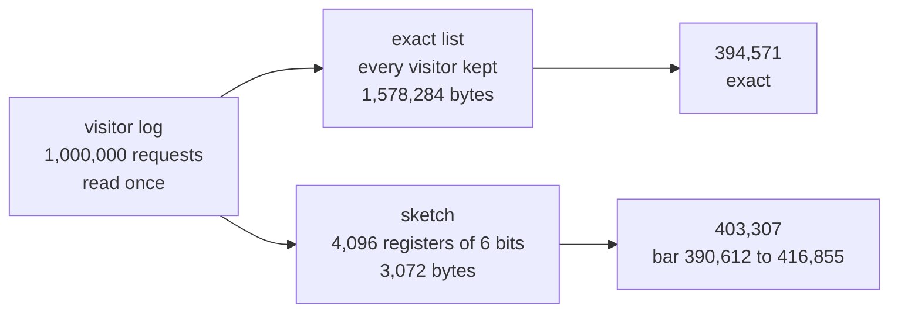
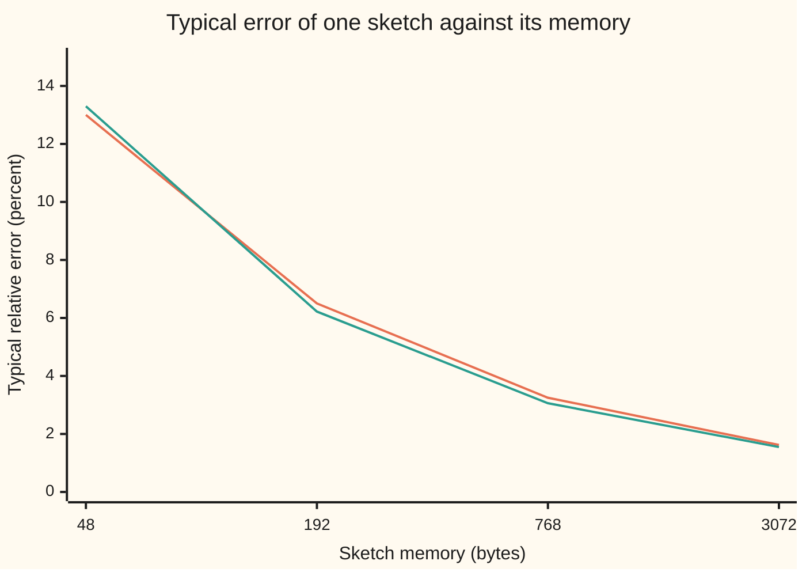

# Streaming: one pass, tiny memory, an answer with error bars

[Syllabus](../../../SYLLABUS.md) → [Computability and complexity](../README.md) → [Data, Learning and Fine-Grained Complexity](../README.md#s06) → Streaming

---

## General Overview

A website writes one line to its log for every request. One day brings 1,000,000 requests. At midnight the owner wants one number: how many different visitors came today?

The log goes past once and is not kept. That is a **stream**: data that arrives in order, is read once, and is gone. Whatever a program keeps in memory along the way is all it has at midnight.

The obvious answer keeps a list of every visitor seen so far. On this day there are 394,571 different visitors. The list of their 4-byte addresses takes 1,578,284 bytes, and Why it works proves that no exact, deterministic method can go below 732,554 bytes.

A **sketch** is a small summary built during the pass. The one on this card, HyperLogLog, keeps 4,096 numbers of 6 bits each: 3,072 bytes. It reports 403,307 visitors, 2.21% high, inside its error bar of 390,612 to 416,855. The bar is two typical errors each way, which catches the true count 95% of the time if the error is bell-shaped (Step 5).

**One pass with tiny memory can count distinct visitors only by giving up exactness: an exact count needs memory that grows with the number of visitors, while a randomised sketch of a few kilobytes gets within a typical error of 1.04 divided by the square root of its register count, and four times the memory halves that error.**

**What kind of fact this is:** two theorems proved on this card in Why it works, the memory floor for exact counting and the median trick for confidence, plus theorems stated with their sources: the 1.04 constant, which assumes an ideal random hash and which the code checks by simulation, and the lower and upper bounds of Steps 2 and 6. That the written-out hash behaves like the ideal one is a model. The day's log is synthetic, made by a rule the code states.

### The picture: two ways through the same log



Both boxes read the same log in one pass. The exact list is far larger than the sketch; the sketch pays with a 2.21% error, and it announces the size of that error in advance.

---

## The formula

Notation first, in words. The stream has $`N`$ requests. Each visitor is one of $`U`$ possible addresses. $`D`$ is the number of different visitors in the stream. A one-pass program keeps $`s`$ bits of memory.

The binomial coefficient $`\binom{U}{D}`$, read "U choose D", counts the ways to pick $`D`$ visitors out of $`U`$ possible ones.

**The exact floor.** Any deterministic one-pass program that always reports the exact distinct count, on every stream whose visitor set can be any $`D`$ of the $`U`$ addresses, keeps at least

```math
s \;\ge\; \log_2 \binom{U}{D} \;\approx\; D\left(\log_2 \frac{U}{D} + \log_2 e\right) \text{ bits.}
```

**Read it aloud:** the memory must have at least as many settings as there are possible sets of visitors, and that costs about log2 of U over D, plus 1.44, bits per visitor.

**The sketch.** A **hash** $`h(x)`$ is a fixed scrambling rule that turns visitor $`x`$ into 64 bits that look random ([Hashing for size](../../14-Applied%20and%20computational/02-Randomised%20and%20Approximate%20Algorithms/04-hashing-bloom-filters-and-sketches.md)). The first $`b`$ bits choose one of $`m = 2^b`$ **registers** (small memory cells). The **rank** $`\rho(x)`$ is 1 plus the number of zeros at the start of the remaining bits. Register $`M_j`$ starts at 0 and keeps the largest rank sent to it. A rank is at most $`64 - b + 1`$, so 6 bits hold it. At midnight,

```math
\hat D = \frac{\alpha_m \, m^2}{\sum_{j=1}^{m} 2^{-M_j}}, \qquad \sigma \approx \frac{1.04}{\sqrt{m}}
```

**Read it aloud:** the estimate is a correction constant times m squared, divided by the sum over all registers of one half raised to that register's value; its typical relative error is 1.04 over the square root of m.

**The guarantee.** One sketch is within $`2\sigma`$ most of the time. To be within $`\varepsilon = 2\sigma`$ except with a chosen small failure chance $`\delta`$, take the median of $`k`$ independent sketches:

```math
k = \left\lceil 8 \ln \frac{1}{\delta} \right\rceil, \qquad \text{memory} \approx \left(\frac{2.08}{\varepsilon}\right)^{2} \times 6 \times k \text{ bits}
```

**Read it aloud:** the number of copies grows with the logarithm of one over the failure chance; the memory grows with one over the error squared.

Two clashes, said once. Here $`\varepsilon`$ is an error allowance, as in wing 14, not the empty string of shelf 01. And $`\delta`$ is a failure chance, not a machine's rule.

| Symbol | Plain meaning | In our example | Push it up and the answer… |
| --- | --- | --- | --- |
| $`N`$ | requests in the stream | 1,000,000 | the exact list does not grow; only new visitors add to it |
| $`U`$ | possible visitor addresses | $`2^{32}`$, every 32-bit address | the exact floor rises, slowly |
| $`D`$ | different visitors in the stream | 394,571 | the exact floor rises in step; the sketch stays 3,072 bytes |
| $`s`$ | bits a one-pass program keeps | at least 732,554 × 8 bits if exact | — |
| $`h(x)`$ | the hash: visitor in, 64 random-looking bits out | SplitMix64's scrambler, salt 2026 | — |
| $`b`$, $`m`$ | bits that pick a register; registers, $`m = 2^b`$ | 12; 4,096 | error falls like $`1/\sqrt{m}`$, memory grows like $`m`$ |
| $`\rho(x)`$ | rank: 1 plus the leading zeros of the hash after the first $`b`$ bits | 1 for half of all visitors | — |
| $`M_j`$ | register $`j`$: the largest rank it has seen | mean 7.97 | $`\hat D`$ rises |
| $`\alpha_m`$ | a fixed correction constant from the analysis | $`0.7213/(1 + 1.079/m)`$ | — |
| $`\hat D`$ | the sketch's estimate of $`D`$ | 403,307 | — |
| $`\sigma`$ | typical relative error of one sketch | 1.62% | — |
| $`\varepsilon`$, $`\delta`$, $`k`$ | error allowed; failure chance allowed; copies for the median | 3.25%; 0.01; 37 | smaller $`\varepsilon`$ costs memory like $`1/\varepsilon^2`$; smaller $`\delta`$ only like $`\ln(1/\delta)`$ |

### When it holds

- **One pass, in order.** The floor is about programs that never look back. A program allowed to store the log on disk and sort it can count exactly, but then its memory is the disk.
- **The exact floor needs a deterministic program and an exact answer.** Allow both coins and a small error, and the floor collapses to a few kilobytes. Allow only one of the two, and it does not collapse (Step 2).
- **The hash behaves like an ideal random one.** The 1.04 constant assumes each visitor's 64 bits are independent fair coins. A weak hash on similar addresses piles them into the same registers and the error grows. An attacker who knows the hash can send addresses crafted to land in one register.
- **The count is not tiny.** The 1.04 rule holds once $`D`$ is well above $`m`$. At 1,000 visitors with 4,096 registers the raw formula says 3,469. A small-count correction, built into the code, brings it to 1,021: while the raw estimate is at most $`2.5\,m`$ and some registers are still 0, it reports $`m`$ times the natural log of $`m`$ over the number of zero registers.
- **Repeats hash the same way all day.** The same visitor must always reach the same register with the same rank. Change the salt at noon and visitors seen in both halves are counted twice.

---

## Why it works

### Step 0: memory is the only thing that survives the pass

A one-pass program reads request 1, updates its memory, reads request 2, updates again, and so on. At midnight its answer depends only on its memory. Two different days that leave the same memory get the same answer.

If two days with different true counts leave the same memory, the program is wrong on one of them. So an exact program needs enough memory to keep apart every pair of days that need different answers.

### Step 1: an exact count needs memory for every possible visitor set

Suppose a deterministic program reports the exact distinct count on every stream. Take its memory at midnight and make a copy. Feed the copy one more request, from visitor $`x`$, and read the count.

If the count did not change, $`x`$ was already in the log. If it went up by 1, $`x`$ was new. Do that for every possible address $`x`$, each time on a fresh copy, and the memory gives back the whole visitor set.

So two different visitor sets can never leave the same memory: if they did, the probes would return the same set for both. The memory needs at least as many settings as there are visitor sets, $`\binom{U}{D}`$, and $`s`$ bits give only $`2^s`$ settings.

For the log, $`\log_2(2^{32}/D) = 13.41`$, plus $`\log_2 e = 1.44`$, gives 14.85 bits per visitor. That is 732,554 bytes, 238 times the sketch.

The code runs this on a toy with 10 possible visitors, so 1,024 possible visitor sets.

- An exact 10-bit bitmap (one bit per visitor) is decoded by the probes back to its own set in 1,024 cases out of 1,024.
- A 9-bit summary has only 512 memory settings for 1,024 sets. It sets bit "v mod 9" for visitor v, so visitors 0 and 9 share a bit.
- The visitor sets `[0]` and `[9]` leave the same memory. Add visitor 0 to both. The true counts are 1 and 2, and the summary answers 1 for both.

<details>
<summary>Detailed proof: the exact floor</summary>

Let $`A`$ be a deterministic one-pass program with $`s`$ bits of memory that outputs the exact distinct count of every stream. Write $`\mathrm{mem}(w)`$ for its memory after reading stream $`w`$, and $`\mathrm{out}(\mathrm{mem})`$ for its output from that memory.

Take two streams $`w_1`$ and $`w_2`$ whose visitor sets $`S_1 \ne S_2`$ have the same size $`D`$. Some address $`x`$ lies in one set and not the other, say $`x \in S_1`$ and $`x \notin S_2`$.

Suppose $`\mathrm{mem}(w_1) = \mathrm{mem}(w_2)`$. The program is deterministic, so reading $`x`$ next gives $`\mathrm{mem}(w_1 x) = \mathrm{mem}(w_2 x)`$, and the two outputs agree. The true counts are $`|S_1 \cup \{x\}| = D`$ and $`|S_2 \cup \{x\}| = D + 1`$. One output is wrong, a contradiction.

So the map from visitor sets of size $`D`$ to memory settings is one-to-one, and

$`\displaystyle 2^s \ge \binom{U}{D}, \qquad s \ge \log_2 \binom{U}{D}.`$

For the size, $`\binom{U}{D} = \prod_{i=0}^{D-1} \frac{U-i}{D-i}`$; the code adds up $`\log_2`$ of these $`D`$ factors.

</details>

### Step 2: coins alone, or error alone, do not help

The proof used determinism (the copy behaves like the original) and exactness (a change of 1 matters). Drop either one and the floor survives, by harder theorems stated here with their sources.

- **Deterministic but approximate.** Alon, Matias and Szegedy proved that any deterministic one-pass program whose answer is always within 10% of the distinct count needs memory that grows in step with the number of possible visitors.
- **Randomised but exact.** The same paper proved that a program with coins that must give the exact count with high probability also needs memory growing with the number of possible visitors. The proof reduces from set disjointness, the two-player problem of [Communication complexity](03-communication-complexity-in-outline.md).

The sketch drops both. It flips coins, in the form of a randomly salted hash, and it accepts a small error. Then a few kilobytes are enough.

### Step 3: a long run of zeros is a rare event, so it measures the crowd

Each visitor's hash is 64 fair coin flips under the ideal-hash model. A high rank needs a long run of zeros at the start, and each extra zero halves the chance. Half of all visitors have rank 1, a quarter rank 2, an eighth rank 3, and each extra zero halves the share again.

So the largest rank seen tells the size of the crowd. Among $`D`$ different visitors the largest rank sits near $`\log_2 D`$, a little above it. Repeat visits change nothing: the same visitor gives the same hash and the same rank. That is why the sketch counts visitors, not requests.

One register alone is a poor ruler. Its value is a whole number, so it can only say "about 64" or "about 128". And one lucky visitor with a long run of zeros doubles the answer.

### Step 4: many registers, averaged the right way

The first 12 bits of the hash split the visitors into 4,096 groups of about $`D/m`$ each. On this day each register sees about 96.3 visitors. Its largest rank sits a steady amount above $`\log_2 96.3 = 6.59`$: the mean register value is 7.97. So $`2^{M_j}`$ overshoots its group's size, and the constant $`\alpha_m`$ scales the final estimate back so it is right on average.

Each register gives a rough estimate of its own group, about $`2^{M_j}`$. Averaging $`m`$ nearly independent rough estimates shrinks the spread by a factor of $`\sqrt{m}`$, as in [Concentration](../../09-Probability%20and%20statistics/06-Limit%20Theorems%20in%20Practice/06-concentration-inequalities-hoeffding-and-chernoff.md): the average of many independent readings stays close to its mean.

The average is the **harmonic mean**: $`m`$ divided by the sum of the $`2^{-M_j}`$. Times $`m`$ registers and $`\alpha_m`$, it is the formula for $`\hat D`$. A register with an unusually large value adds a tiny $`2^{-M_j}`$ to that sum, so one lucky visitor cannot drag the estimate up. A plain average of the $`2^{M_j}`$ is ruled by the luckiest registers: on this day it gives 6,647,181.

Flajolet, Fusy, Gandouet and Meunier worked out the exact average and spread of this estimate under the ideal-hash model. For large $`D`$ its average is off only by a tiny bias, which wobbles with $`D`$ and never quite vanishes but stays far below the spread. Its relative standard error is about $`1.04/\sqrt{m}`$. The derivation uses complex analysis and is not repeated here. The code checks the result instead: 100 simulated days of 40,000 fresh visitors at four sketch sizes.



Orange: the promise $`1.04/\sqrt{m}`$. Green: the root-mean-square error measured over the 100 simulated days. Each step to the right is four times the memory, and the error halves each time.

### Step 5: from a typical error to a guarantee

A typical error is not a promise about one particular day. Turn it into one in two moves, both from [Concentration](../../09-Probability%20and%20statistics/06-Limit%20Theorems%20in%20Practice/06-concentration-inequalities-hoeffding-and-chernoff.md).

1. **One sketch.** Chebyshev's inequality says a reading misses its mean by two standard deviations or more with chance at most $`1/4`$. So one sketch is outside $`\pm 2\sigma`$ on at most a quarter of days.
2. **The median of $`k`$ sketches.** Run $`k`$ sketches with independent salts and report the middle estimate. The median is outside $`\pm 2\sigma`$ only if at least half the copies are. Each copy fails with chance at most $`1/4`$, so Hoeffding's inequality bounds that chance by $`e^{-2k(1/2 - 1/4)^2} = e^{-k/8}`$.

Setting $`e^{-k/8} = \delta`$ gives $`k = \lceil 8 \ln(1/\delta) \rceil`$. With the 3,072-byte sketch:

| Failure chance $`\delta`$ | Copies $`k`$ | Memory |
| --- | ---: | ---: |
| 0.05 | 24 | 73,728 bytes |
| 0.01 | 37 | 113,664 bytes |
| 0.001 | 56 | 172,032 bytes |

These are guarantees from two general inequalities, so they are loose. The simulated days show the real spread is close to a bell curve: past $`2\sigma`$ on 3 to 6 days in 100, near the 1 in 20 a bell curve predicts, not Chebyshev's 1 in 4. In practice one sketch and a $`\pm 2\sigma`$ bar are what people report.

The median trick works for any estimator with a known variance: error costs memory like $`1/\varepsilon^2`$, confidence only like $`\ln(1/\delta)`$.

### Step 6: the trade is tight

Could a cleverer sketch beat $`1/\varepsilon^2`$? No. Indyk and Woodruff proved that any one-pass randomised program that estimates the distinct count within a factor $`1 \pm \varepsilon`$ needs on the order of $`1/\varepsilon^2`$ bits, again through communication complexity. Kane, Nelson and Woodruff gave an algorithm that matches it, $`O(1/\varepsilon^2 + \log U)`$ bits, using hashes with short seeds and limited independence.

So both ends are known. Exact counting costs memory growing with the visitors. A $`1 \pm \varepsilon`$ answer costs about $`1/\varepsilon^2`$ bits, plus a term growing like $`\log U`$, whatever the length of the log.

---

## Worked numbers, by hand

The day's log: 1,000,000 requests, 394,571 different visitors.

| Step | Arithmetic | Value |
| --- | --- | --- |
| registers | $`2^{12}`$ | 4,096 |
| sketch memory | 4,096 × 6 bits / 8 | 3,072 bytes |
| promised typical error | 1.04 / $`\sqrt{4{,}096}`$ = 1.04 / 64 | 1.62% |
| visitors per register | 394,571 / 4,096 | 96.3 |
| sketch estimate | read from the 4,096 registers | 403,307 |
| its error | (403,307 − 394,571) / 394,571 | +2.21% |
| 95% error bar | 403,307 / (1 + 0.0325) to 403,307 / (1 − 0.0325) | **390,612 to 416,855** |
| exact floor, per visitor | $`\log_2(2^{32}/394{,}571)`$ + $`\log_2 e`$ = 13.41 + 1.44 | 14.85 bits |
| exact floor, whole day | summed over all 394,571 factors | **732,554 bytes** |
| floor over sketch | 732,554 / 3,072 | 238 |

A 3,072-byte sketch reads the day once and brackets the true count, while any exact method needs at least 238 times that memory.

### What breaks if you drop a piece

| Mistake | Comes out at | What went wrong |
| --- | --- | --- |
| Counting requests, not visitors | 1,000,000 | a plain counter adds every repeat; the rank of a repeat visitor changes nothing |
| An "exact" counter with 9 bits for 10 possible visitors | answers 1 for a day with 2 visitors | 512 memory settings cannot keep 1,024 visitor sets apart (Step 1) |
| Dropping the small-count correction, at 1,000 visitors | 3,469, not 1,021 | most registers are still 0, and the formula assumes every register has seen many visitors |
| A plain average of $`2^{M_j}`$ instead of the harmonic mean | 6,647,181 | the luckiest registers dominate a plain average |

The code prints all four.

---

## Code, from first principles, and it actually runs

The code reads the day's log once and takes four independent roads.

- **The count.** An exact set of every visitor against the sketch, whose error bar must contain the exact count.
- **The floor.** A sum of $`D`$ logarithms against log-gamma (Python) or Stirling's estimate $`D(\log_2(U/D) + \log_2 e)`$ (Rust).
- **The proof, run.** On the 10-visitor toy, probes decode all 1,024 sets from an exact bitmap, and brute force finds the collision that breaks a 9-bit summary.
- **The error.** Four sketch sizes over 100 simulated days, measured against $`1.04/\sqrt{m}`$.

Random numbers and the hash are SplitMix64, written out in both languages.

### Python

```python
# Streaming and sketching -- the check behind the card.  Standard library only.
# One day's visitor log is read once.  An exact count keeps every visitor; a
# HyperLogLog sketch keeps 4,096 small registers.  Random numbers and the hash
# are SplitMix64, written out, so the Rust program prints the same lines.
import math
M64 = (1 << 64) - 1

def mix64(z):                          # SplitMix64's scrambler: the hash
    z = (z + 0x9E3779B97F4A7C15) & M64
    z = ((z ^ (z >> 30)) * 0xBF58476D1CE4E5B9) & M64
    z = ((z ^ (z >> 27)) * 0x94D049BB133111EB) & M64
    return z ^ (z >> 31)

class Gen:                             # SplitMix64 generator, seed stated
    def __init__(self, seed): self.s = seed
    def next(self):
        z, self.s = self.s, (self.s + 0x9E3779B97F4A7C15) & M64
        return mix64(z)

def alpha(m): return {16: 0.673, 32: 0.697, 64: 0.709}.get(m, 0.7213 / (1 + 1.079 / m))

def new_sketch(b): return [0] * (1 << b)

def add(reg, b, h):                    # first b bits pick a register; the rest give a rank
    rest = h & ((1 << (64 - b)) - 1)
    rank = (64 - b) - rest.bit_length() + 1   # leading zeros of the rest, plus 1
    j = h >> (64 - b)
    if rank > reg[j]: reg[j] = rank

def estimate(reg, correct=True):       # harmonic mean of 2^rank, scaled by alpha m^2
    m = len(reg)
    raw = alpha(m) * m * m / sum(2.0 ** -r for r in reg)
    zeros = reg.count(0)
    if correct and raw <= 2.5 * m and zeros > 0: return m * math.log(m / zeros)
    return raw

# ---- the day: 1,000,000 requests; half from 1,000 regulars, half from 999,000 others ----
N, SALT, B = 1_000_000, 2026, 12
g, seen, reg = Gen(2026), set(), new_sketch(B)
for _ in range(N):
    r = g.next()
    v = (r >> 1) % 1000 if r & 1 else 1000 + (r >> 1) % 999_000
    seen.add(v)                        # road 1: the exact count keeps every visitor
    add(reg, B, mix64(v ^ SALT))       # road 2: the sketch keeps 4,096 registers
D, m = len(seen), 1 << B
est = estimate(reg)
se = 1.04 / math.sqrt(m)
print("requests read once", N)
print("distinct visitors, exact", D)
print(f"sketch: {m} registers of 6 bits = {m * 6 // 8} bytes")
print(f"sketch estimate {est:.0f}, error {100 * (est - D) / D:+.2f}%")
print(f"promised typical error 1.04/sqrt({m}) = {100 * se:.2f}%")
print(f"one register sees about D/{m} = {D / m:.1f} visitors; log2 of that {math.log2(D / m):.2f}, "
      f"mean rank {sum(reg) / m:.2f}")
lo, hi = est / (1 + 2 * se), est / (1 - 2 * se)
print(f"95% error bar: {lo:.0f} to {hi:.0f}")
assert abs(est - D) / D < 3 * se and lo <= D <= hi   # inside the promised bar
assert 390_000 < D < 400_000           # 1,000 + 999,000 (1 - e^-0.5005), about 394,000

# ---- what exact counting costs: the visitor set itself must fit in memory ----
U = 1 << 32                            # every visitor is a 32-bit address
floor_bits = 0.0
for i in range(D): floor_bits += math.log2((U - i) / (D - i))
lg = (math.lgamma(U + 1) - math.lgamma(D + 1) - math.lgamma(U - D + 1)) / math.log(2)
print(f"exact count, floor log2 C(2^32, D) = {floor_bits / 8:.0f} bytes, {floor_bits / D:.2f} bits each")
print(f"per visitor: log2(2^32 / D) = {math.log2(U / D):.2f}, plus log2 e = {1 / math.log(2):.2f}")
print(f"exact count, plain list of 4-byte addresses = {4 * D} bytes")
print(f"floor over sketch: {floor_bits / 8 / (m * 6 // 8):.0f} times the memory")
assert abs(lg - floor_bits) < 1e-6 * floor_bits   # two roads to the same floor

# ---- the proof run on a toy: 10 possible visitors, a summary of 9 bits ----
def toy(stream): # a 9-bit bitmap: visitor v sets bit v mod 9; answers the number of 1s
    state = 0
    for v in stream: state |= 1 << (v % 9)
    return state
first, pair = {}, None
for mask in range(1 << 10):            # all 1,024 sets of the 10 visitors
    s = [v for v in range(10) if mask >> v & 1]
    st = toy(s)
    if st in first and pair is None: pair = (first[st], s)
    first.setdefault(st, s)
S, T = pair
x = next(v for v in S + T if (v in S) != (v in T))   # the probe: in one set only
ans = bin(toy(S + [x])).count("1")
print(f"toy: {len(first)} memory states for 1024 visitor sets")
print(f"toy: sets {S} and {T} leave the same memory")
print(f"toy: add visitor {x}; true counts {len(set(S + [x]))} and {len(set(T + [x]))}, "
      f"summary answers {ans} for both")
assert len(first) == 512 and toy(S + [x]) == toy(T + [x]) and len(set(S + [x])) != len(set(T + [x]))
dec = 0                                # an exact 10-bit bitmap: probing recovers every set
for mask in range(1 << 10):
    cnt = bin(mask).count("1")         # feed each visitor to a copy; count unchanged means seen
    got = sum(1 << v for v in range(10) if bin(mask | 1 << v).count("1") == cnt)
    dec += got == mask
print(f"toy: a 10-bit exact counter is decoded back to its set {dec} times in 1024")
assert dec == 1024

# ---- accuracy bought by memory: 100 days of 40,000 fresh visitors each ----
TRIALS, DD, BS = 100, 40_000, [6, 8, 10, 12]
sq, out2 = {b: 0.0 for b in BS}, {b: 0 for b in BS}
for t in range(TRIALS):
    sks, salt = {b: new_sketch(b) for b in BS}, Gen(7 + t).next()
    for i in range(DD):
        h = mix64((t * 1_000_000 + i) ^ salt)
        for b in BS: add(sks[b], b, h)
    for b in BS:
        e = (estimate(sks[b]) - DD) / DD
        sq[b] += e * e
        out2[b] += abs(e) > 2 * 1.04 / math.sqrt(1 << b)
print("registers  bytes  promised  measured  misses past 2x promise")
for b in BS:
    mm, rms = 1 << b, math.sqrt(sq[b] / TRIALS)
    print(f"{mm:9}{mm * 6 // 8:7}{100 * 1.04 / math.sqrt(mm):9.2f}%{100 * rms:9.2f}%"
          f"{out2[b]:8} of {TRIALS}")
    assert abs(rms / (1.04 / math.sqrt(mm)) - 1) < 0.3   # within a few standard errors
    assert out2[b] <= 12               # about 5% expected, 5 of 100

# ---- turning a typical error into a guarantee: the median of k sketches ----
for delta in [0.05, 0.01, 0.001]:
    k = math.ceil(8 * math.log(1 / delta))
    print(f"fail chance {delta}: median of {k} sketches, {k * m * 6 // 8} bytes")

# ---- what breaks ----
small = new_sketch(B)
for i in range(1000): add(small, B, mix64(i ^ SALT))
arith = alpha(m) * m * sum(2.0 ** r for r in reg) / m
print(f"break: count requests, not visitors: {N}")
print(f"break: 1000 visitors, no small-count correction: {estimate(small, False):.0f}"
      f" (with it {estimate(small):.0f})")
print(f"break: plain average of 2^rank, not harmonic: {arith:.0f}")
assert abs(estimate(small) - 1000) < 50 and estimate(small, False) > 2000 and arith > 2 * D
print("ALL CHECKS PASS")
```

**Ran 2026-11-19 on macOS, Python 3.14.10, standard library only. All checks passed. Output, pasted from the run:**

```
requests read once 1000000
distinct visitors, exact 394571
sketch: 4096 registers of 6 bits = 3072 bytes
sketch estimate 403307, error +2.21%
promised typical error 1.04/sqrt(4096) = 1.62%
one register sees about D/4096 = 96.3 visitors; log2 of that 6.59, mean rank 7.97
95% error bar: 390612 to 416855
exact count, floor log2 C(2^32, D) = 732554 bytes, 14.85 bits each
per visitor: log2(2^32 / D) = 13.41, plus log2 e = 1.44
exact count, plain list of 4-byte addresses = 1578284 bytes
floor over sketch: 238 times the memory
toy: 512 memory states for 1024 visitor sets
toy: sets [0] and [9] leave the same memory
toy: add visitor 0; true counts 1 and 2, summary answers 1 for both
toy: a 10-bit exact counter is decoded back to its set 1024 times in 1024
registers  bytes  promised  measured  misses past 2x promise
       64     48    13.00%    13.30%       5 of 100
      256    192     6.50%     6.22%       6 of 100
     1024    768     3.25%     3.06%       5 of 100
     4096   3072     1.62%     1.55%       3 of 100
fail chance 0.05: median of 24 sketches, 73728 bytes
fail chance 0.01: median of 37 sketches, 113664 bytes
fail chance 0.001: median of 56 sketches, 172032 bytes
break: count requests, not visitors: 1000000
break: 1000 visitors, no small-count correction: 3469 (with it 1021)
break: plain average of 2^rank, not harmonic: 6647181
ALL CHECKS PASS
```

### Rust

Same numbers, same labels, built with `rustc --edition 2021 -O`.

```rust
// Streaming and sketching -- the same check as the Python, in Rust.  No crates.
// One day's visitor log is read once.  An exact count keeps every visitor; a
// HyperLogLog sketch keeps 4,096 small registers.  Random numbers and the hash
// are SplitMix64, written out, so both programs print the same lines.
use std::collections::{HashMap, HashSet};

fn mix64(z: u64) -> u64 { // SplitMix64's scrambler: the hash
    let mut z = z.wrapping_add(0x9E3779B97F4A7C15);
    z = (z ^ (z >> 30)).wrapping_mul(0xBF58476D1CE4E5B9);
    z = (z ^ (z >> 27)).wrapping_mul(0x94D049BB133111EB);
    z ^ (z >> 31)
}
struct Gen { s: u64 } // SplitMix64 generator, seed stated
impl Gen {
    fn next(&mut self) -> u64 { let z = self.s; self.s = self.s.wrapping_add(0x9E3779B97F4A7C15); mix64(z) }
}
fn alpha(m: usize) -> f64 {
    match m { 16 => 0.673, 32 => 0.697, 64 => 0.709, _ => 0.7213 / (1.0 + 1.079 / m as f64) }
}
fn add(reg: &mut [u32], b: u32, h: u64) { // first b bits pick a register; the rest give a rank
    let rest = h & ((1u64 << (64 - b)) - 1);
    let rank = (64 - b) - (64 - rest.leading_zeros()) + 1; // leading zeros of the rest, plus 1
    let j = (h >> (64 - b)) as usize;
    if rank > reg[j] { reg[j] = rank; }
}
fn estimate(reg: &[u32], correct: bool) -> f64 { // harmonic mean of 2^rank, scaled by alpha m^2
    let m = reg.len() as f64;
    let mut s = 0.0;
    for &r in reg { s += 2f64.powi(-(r as i32)); }
    let raw = alpha(reg.len()) * m * m / s;
    let zeros = reg.iter().filter(|&&r| r == 0).count();
    if correct && raw <= 2.5 * m && zeros > 0 { return m * (m / zeros as f64).ln(); }
    raw
}
fn toy(stream: &[u64]) -> u32 { // a 9-bit bitmap: visitor v sets bit v mod 9
    let mut state = 0u32;
    for &v in stream { state |= 1 << (v % 9); }
    state
}
fn distinct(s: &[u64]) -> usize { s.iter().collect::<HashSet<_>>().len() }

fn main() {
    // ---- the day: 1,000,000 requests; half from 1,000 regulars, half from 999,000 others ----
    let (n, salt, b) = (1_000_000u64, 2026u64, 12u32);
    let (mut g, mut seen, mut reg) = (Gen { s: 2026 }, HashSet::new(), vec![0u32; 1 << b]);
    for _ in 0..n {
        let r = g.next();
        let v = if r & 1 == 1 { (r >> 1) % 1000 } else { 1000 + (r >> 1) % 999_000 };
        seen.insert(v);                    // road 1: the exact count keeps every visitor
        add(&mut reg, b, mix64(v ^ salt)); // road 2: the sketch keeps 4,096 registers
    }
    let (d, m) = (seen.len(), 1usize << b);
    let df = d as f64;
    let est = estimate(&reg, true);
    let se = 1.04 / (m as f64).sqrt();
    println!("requests read once {}", n);
    println!("distinct visitors, exact {}", d);
    println!("sketch: {} registers of 6 bits = {} bytes", m, m * 6 / 8);
    println!("sketch estimate {:.0}, error {:+.2}%", est, 100.0 * (est - df) / df);
    println!("promised typical error 1.04/sqrt({}) = {:.2}%", m, 100.0 * se);
    let mean_rank = reg.iter().map(|&r| r as f64).sum::<f64>() / m as f64;
    println!("one register sees about D/{} = {:.1} visitors; log2 of that {:.2}, mean rank {:.2}",
             m, df / m as f64, (df / m as f64).log2(), mean_rank);
    let (lo, hi) = (est / (1.0 + 2.0 * se), est / (1.0 - 2.0 * se));
    println!("95% error bar: {:.0} to {:.0}", lo, hi);
    assert!((est - df).abs() / df < 3.0 * se && lo <= df && df <= hi);
    assert!(390_000 < d && d < 400_000);

    // ---- what exact counting costs: the visitor set itself must fit in memory ----
    let u = 1u64 << 32;
    let mut floor_bits = 0.0;
    for i in 0..d as u64 { floor_bits += ((u - i) as f64 / (d as u64 - i) as f64).log2(); }
    println!("exact count, floor log2 C(2^32, D) = {:.0} bytes, {:.2} bits each", floor_bits / 8.0, floor_bits / df);
    println!("per visitor: log2(2^32 / D) = {:.2}, plus log2 e = {:.2}", (u as f64 / df).log2(), 1.0 / 2f64.ln());
    println!("exact count, plain list of 4-byte addresses = {} bytes", 4 * d);
    println!("floor over sketch: {:.0} times the memory", floor_bits / 8.0 / (m * 6 / 8) as f64);
    let approx = df * ((u as f64 / df).log2() + 1.0 / 2f64.ln()); // D (log2(U/D) + log2 e)
    assert!((approx - floor_bits).abs() < 1e-3 * floor_bits);

    // ---- the proof run on a toy: 10 possible visitors, a summary of 9 bits ----
    let mut first: HashMap<u32, Vec<u64>> = HashMap::new();
    let mut pair: Option<(Vec<u64>, Vec<u64>)> = None;
    for mask in 0u32..1 << 10 {            // all 1,024 sets of the 10 visitors
        let s: Vec<u64> = (0..10).filter(|v| mask >> v & 1 == 1).collect();
        let st = toy(&s);
        if pair.is_none() { if let Some(f) = first.get(&st) { pair = Some((f.clone(), s.clone())); } }
        first.entry(st).or_insert(s);
    }
    let (s1, t1) = pair.unwrap();
    let x = *s1.iter().chain(t1.iter()).find(|v| s1.contains(v) != t1.contains(v)).unwrap();
    let (mut sx, mut tx) = (s1.clone(), t1.clone());
    sx.push(x); tx.push(x);
    println!("toy: {} memory states for 1024 visitor sets", first.len());
    println!("toy: sets {:?} and {:?} leave the same memory", s1, t1);
    println!("toy: add visitor {}; true counts {} and {}, summary answers {} for both",
             x, distinct(&sx), distinct(&tx), toy(&sx).count_ones());
    assert!(first.len() == 512 && toy(&sx) == toy(&tx) && distinct(&sx) != distinct(&tx));
    let mut dec = 0;                       // an exact 10-bit bitmap: probing recovers every set
    for mask in 0u32..1 << 10 {
        let cnt = mask.count_ones();       // feed each visitor to a copy; count unchanged means seen
        let got: u32 = (0..10).filter(|v| (mask | 1 << v).count_ones() == cnt).map(|v| 1 << v).sum();
        if got == mask { dec += 1; }
    }
    println!("toy: a 10-bit exact counter is decoded back to its set {} times in 1024", dec);
    assert!(dec == 1024);

    // ---- accuracy bought by memory: 100 days of 40,000 fresh visitors each ----
    let (trials, dd, bs) = (100u64, 40_000u64, [6u32, 8, 10, 12]);
    let (mut sq, mut out2) = ([0.0f64; 4], [0u32; 4]);
    for t in 0..trials {
        let mut sks: Vec<Vec<u32>> = bs.iter().map(|&b| vec![0u32; 1 << b]).collect();
        let salt = Gen { s: 7 + t }.next();
        for i in 0..dd {
            let h = mix64((t * 1_000_000 + i) ^ salt);
            for k in 0..4 { add(&mut sks[k], bs[k], h); }
        }
        for k in 0..4 {
            let e = (estimate(&sks[k], true) - dd as f64) / dd as f64;
            sq[k] += e * e;
            if e.abs() > 2.0 * 1.04 / ((1u64 << bs[k]) as f64).sqrt() { out2[k] += 1; }
        }
    }
    println!("registers  bytes  promised  measured  misses past 2x promise");
    for k in 0..4 {
        let mm = 1usize << bs[k];
        let rms = (sq[k] / trials as f64).sqrt();
        let p = 1.04 / (mm as f64).sqrt();
        println!("{:9}{:7}{:9.2}%{:9.2}%{:8} of {}", mm, mm * 6 / 8, 100.0 * p, 100.0 * rms, out2[k], trials);
        assert!((rms / p - 1.0).abs() < 0.3);
        assert!(out2[k] <= 12);
    }

    // ---- turning a typical error into a guarantee: the median of k sketches ----
    for delta in [0.05f64, 0.01, 0.001] {
        let k = (8.0 * (1.0 / delta).ln()).ceil() as usize;
        println!("fail chance {}: median of {} sketches, {} bytes", delta, k, k * m * 6 / 8);
    }

    // ---- what breaks ----
    let mut small = vec![0u32; 1 << b];
    for i in 0..1000u64 { add(&mut small, b, mix64(i ^ salt)); }
    let mut a = 0.0;
    for &r in &reg { a += 2f64.powi(r as i32); }
    let arith = alpha(m) * m as f64 * a / m as f64;
    println!("break: count requests, not visitors: {}", n);
    println!("break: 1000 visitors, no small-count correction: {:.0} (with it {:.0})",
             estimate(&small, false), estimate(&small, true));
    println!("break: plain average of 2^rank, not harmonic: {:.0}", arith);
    assert!((estimate(&small, true) - 1000.0).abs() < 50.0 && estimate(&small, false) > 2000.0 && arith > 2.0 * df);
    println!("ALL CHECKS PASS");
}
```

**Ran 2026-11-19 on macOS, rustc 1.98.1, no crates. All checks passed. Output, pasted from the run:**

```
requests read once 1000000
distinct visitors, exact 394571
sketch: 4096 registers of 6 bits = 3072 bytes
sketch estimate 403307, error +2.21%
promised typical error 1.04/sqrt(4096) = 1.62%
one register sees about D/4096 = 96.3 visitors; log2 of that 6.59, mean rank 7.97
95% error bar: 390612 to 416855
exact count, floor log2 C(2^32, D) = 732554 bytes, 14.85 bits each
per visitor: log2(2^32 / D) = 13.41, plus log2 e = 1.44
exact count, plain list of 4-byte addresses = 1578284 bytes
floor over sketch: 238 times the memory
toy: 512 memory states for 1024 visitor sets
toy: sets [0] and [9] leave the same memory
toy: add visitor 0; true counts 1 and 2, summary answers 1 for both
toy: a 10-bit exact counter is decoded back to its set 1024 times in 1024
registers  bytes  promised  measured  misses past 2x promise
       64     48    13.00%    13.30%       5 of 100
      256    192     6.50%     6.22%       6 of 100
     1024    768     3.25%     3.06%       5 of 100
     4096   3072     1.62%     1.55%       3 of 100
fail chance 0.05: median of 24 sketches, 73728 bytes
fail chance 0.01: median of 37 sketches, 113664 bytes
fail chance 0.001: median of 56 sketches, 172032 bytes
break: count requests, not visitors: 1000000
break: 1000 visitors, no small-count correction: 3469 (with it 1021)
break: plain average of 2^rank, not harmonic: 6647181
ALL CHECKS PASS
```

The two outputs match line for line.

### Lean

Lean proves the exact floor, the median-trick bound and the number of copies for every size, and checks the whole-number worked numbers.

- Suppose a deterministic one-pass program with $`s`$ bits reports the exact distinct count on every stream. Then $`2^s \ge \binom{U}{D}`$ and $`s \ge \log_2 \binom{U}{D}`$, for every $`D`$.
- Suppose $`k`$ copies fail independently, each with chance at most $`1/4`$. Then at least half of them fail with chance at most $`e^{-k/8}`$.
- Take any failure chance $`\delta > 0`$ and $`k = \lceil 8 \ln(1/\delta) \rceil`$ copies. Then $`e^{-k/8} \le \delta`$.
- The 4,096 registers, the 3,072-byte sketch, the 1,578,284-byte list, the ratio 238 and the three median-trick memories check.
- On the toy, the 9-bit summary leaves the same memory for `[0]` and `[9]`, and again once visitor 0 is added. Their true counts are then 1 and 2.

The sketch, its 1.04 error, the 732,554-byte floor and the simulated days are left to the Python and Rust checks.

```lean
-- Streaming: an exact one-pass distinct counter with s bits needs 2^s ≥ C(U, D), and the median of k independent sketches fails with chance at most e^(-k/8).
import Mathlib.Probability.Moments.SubGaussian
import Mathlib.Probability.Independence.Basic
import Mathlib.Analysis.SpecialFunctions.Log.Base
import Mathlib.Data.Nat.Choose.Basic
import Mathlib.Data.Fintype.Pi
import Mathlib.Data.Nat.Sqrt

open MeasureTheory ProbabilityTheory

/-- **The exact floor.** A deterministic one-pass program reads a stream of visitors from a
set `α` of `U` possible addresses. Its memory is `s` bits (`Fin s → Bool`); it starts at
`init`, updates with `step` on each request, and answers `out` of its final memory. If it
reports the exact number of different visitors on every stream, then for every `D` the memory
has at least as many settings as there are sets of `D` visitors: `C(U, D) ≤ 2^s`, that is,
`s ≥ log₂ C(U, D)`. -/
theorem exact_distinct_count_needs_log_choose_bits
    {α : Type*} [Fintype α] [DecidableEq α] (s : ℕ)
    (init : Fin s → Bool) (step : (Fin s → Bool) → α → (Fin s → Bool))
    (out : (Fin s → Bool) → ℕ)
    (hexact : ∀ w : List α, out (w.foldl step init) = w.toFinset.card)
    (D : ℕ) :
    (Fintype.card α).choose D ≤ 2 ^ s ∧
      Real.logb 2 ((Fintype.card α).choose D) ≤ s := by
  have hle : (Fintype.card α).choose D ≤ 2 ^ s := by
    rw [← Finset.card_univ, ← Finset.card_powersetCard]
    have hinj : Set.InjOn (fun S : Finset α => S.toList.foldl step init)
        (Finset.powersetCard D (Finset.univ : Finset α) : Set (Finset α)) := by
      intro S hS T hT hST
      simp only [Finset.mem_coe, Finset.mem_powersetCard] at hS hT
      by_contra hne
      have h1 := hexact (S.toList ++ T.toList)
      have h2 := hexact (T.toList ++ T.toList)
      rw [List.foldl_append] at h1 h2
      simp only at hST
      rw [hST, h2] at h1
      simp only [List.toFinset_append, Finset.toList_toFinset, Finset.union_idempotent] at h1
      have hsub : T ⊆ S ∪ T := Finset.subset_union_right
      have hss : T ⊂ S ∪ T := by
        refine Finset.ssubset_iff_subset_ne.2 ⟨hsub, ?_⟩
        intro heq
        have : S ⊆ T := heq ▸ Finset.subset_union_left
        exact hne (Finset.eq_of_subset_of_card_le this (by rw [hS.2, hT.2]))
      have := Finset.card_lt_card hss
      omega
    have := Finset.card_le_card_of_injOn _ (fun _ _ => Finset.mem_coe.2 (Finset.mem_univ _)) hinj
    simpa [Fintype.card_fun, Fintype.card_bool, Fintype.card_fin] using this
  refine ⟨hle, ?_⟩
  rcases Nat.eq_zero_or_pos ((Fintype.card α).choose D) with h0 | hpos
  · rw [h0]; simp
  · have : ((Fintype.card α).choose D : ℝ) ≤ (2 : ℝ) ^ (s : ℝ) := by
      rw [Real.rpow_natCast]; exact_mod_cast hle
    calc Real.logb 2 ((Fintype.card α).choose D) ≤ Real.logb 2 ((2 : ℝ) ^ (s : ℝ)) :=
          Real.logb_le_logb_of_le (by norm_num) (by exact_mod_cast hpos) this
      _ = s := by rw [Real.logb_rpow (by norm_num) (by norm_num)]

/-- **The median trick.** Run `k` independent sketches; copy `i` fails (misses by more than
the allowed error) on the event `F i`, each with chance at most `1/4`. The median can fail
only if at least half the copies fail (the number of failing copies at `ω` is the sum of the
indicators of the `F i`), and by Hoeffding's inequality the chance of that is at
most `e^(-k/8)`. -/
theorem median_trick_half_fail_le_exp
    {Ω : Type*} [MeasurableSpace Ω] (μ : Measure Ω) [IsProbabilityMeasure μ]
    (k : ℕ) (F : Fin k → Set Ω) (hmeas : ∀ i, MeasurableSet (F i))
    (hind : iIndepSet F μ) (hp : ∀ i, μ.real (F i) ≤ 1 / 4) :
    μ.real {ω | (k : ℝ) / 2 ≤ ∑ i, (F i).indicator (fun _ => (1 : ℝ)) ω}
      ≤ Real.exp (-(k : ℝ) / 8) := by
  set I : Fin k → Ω → ℝ := fun i => (F i).indicator (fun _ => (1 : ℝ)) with hI
  have hIind : iIndepFun I μ := hind.iIndepFun_indicator
  have hImeas : ∀ i, Measurable (I i) := fun i => measurable_const.indicator (hmeas i)
  have hint : ∀ i, μ[I i] = μ.real (F i) := fun i => by
    simp [hI, integral_indicator (hmeas i)]
  set X : Fin k → Ω → ℝ := fun i ω => I i ω - μ[I i] with hX
  have hXind : iIndepFun X μ := by
    have := hIind.comp (fun i (x : ℝ) => x - μ[I i]) (fun i => measurable_id.sub_const _)
    exact this
  have hsub : ∀ i ∈ (Finset.univ : Finset (Fin k)),
      HasSubgaussianMGF (X i) ((‖(1 : ℝ) - 0‖₊ / 2) ^ 2) μ := by
    intro i _
    refine hasSubgaussianMGF_of_mem_Icc (hImeas i).aemeasurable (ae_of_all _ fun ω => ?_)
    simp only [hI, Set.indicator, Set.mem_Icc]
    split_ifs <;> norm_num
  have hc : ((‖(1 : ℝ) - 0‖₊ / 2) ^ 2 : NNReal) = 1 / 4 := by
    simp; norm_num
  have hH := HasSubgaussianMGF.measure_sum_ge_le_of_iIndepFun hXind hsub (ε := (k : ℝ) / 4) (by positivity)
  have hsum : ∑ i, μ[I i] ≤ (k : ℝ) / 4 := by
    calc ∑ i, μ[I i] ≤ ∑ _i : Fin k, (1 / 4 : ℝ) := Finset.sum_le_sum fun i _ => (hint i) ▸ hp i
      _ = (k : ℝ) / 4 := by simp; ring
  calc μ.real {ω | (k : ℝ) / 2 ≤ ∑ i, (F i).indicator (fun _ => (1 : ℝ)) ω}
      ≤ μ.real {ω | (k : ℝ) / 4 ≤ ∑ i ∈ Finset.univ, X i ω} := by
        apply measureReal_mono _ (measure_ne_top _ _)
        intro ω hω
        simp only [Set.mem_ofPred_eq, hX, Finset.sum_sub_distrib] at hω ⊢
        change (k : ℝ) / 2 ≤ ∑ i, I i ω at hω
        linarith
    _ ≤ Real.exp (-((k : ℝ) / 4) ^ 2 / (2 * ∑ i ∈ Finset.univ, ((‖(1 : ℝ) - 0‖₊ / 2) ^ 2 : NNReal))) := hH
    _ = Real.exp (-(k : ℝ) / 8) := by
        congr 1
        rw [hc]
        simp
        rcases Nat.eq_zero_or_pos k with h | h
        · subst h; simp
        · have : (k : ℝ) ≠ 0 := by positivity
          field_simp
          ring

/-- **How many copies.** For any failure chance `δ > 0`, taking `k = ⌈8 ln(1/δ)⌉` copies makes
the median trick's bound `e^(-k/8)` at most `δ`. -/
theorem median_copies_for_failure_chance (δ : ℝ) (hδ : 0 < δ) :
    Real.exp (-((⌈8 * Real.log (1 / δ)⌉₊ : ℕ) : ℝ) / 8) ≤ δ := by
  have h := Nat.le_ceil (8 * Real.log (1 / δ))
  rw [one_div, Real.log_inv] at h
  calc Real.exp (-((⌈8 * Real.log (1 / δ)⌉₊ : ℕ) : ℝ) / 8) ≤ Real.exp (Real.log δ) := by
        apply Real.exp_le_exp.2
        rw [one_div, Real.log_inv]
        linarith
    _ = δ := Real.exp_log hδ

-- The card's whole-number worked examples.
-- 12 bits pick one of 4,096 registers; 4,096 registers of 6 bits are 3,072 bytes.
example : 2 ^ 12 = 4096 := by norm_num
example : 4096 * 6 / 8 = 3072 := by norm_num
-- The promised error 1.04 / sqrt 4,096 uses sqrt 4,096 = 64; four times the memory halves the error.
example : 64 ^ 2 = 4096 ∧ 32 ^ 2 = 1024 ∧ 4 * 1024 = 4096 := by norm_num
-- The plain list of 394,571 four-byte addresses.
example : 4 * 394571 = 1578284 := by norm_num
-- The exact floor over the sketch: 732,554 bytes against 3,072 bytes, 238 times.
example : 732554 / 3072 = 238 := by norm_num
-- The median-trick memory table: 24, 37 and 56 copies of the 3,072-byte sketch.
example : 24 * 3072 = 73728 := by norm_num
example : 37 * 3072 = 113664 := by norm_num
example : 56 * 3072 = 172032 := by norm_num
-- The toy: 10 possible visitors give 1,024 visitor sets; a 9-bit summary has only 512 settings.
example : 2 ^ 9 = 512 ∧ 2 ^ 10 = 1024 ∧ 2 ^ 9 < 2 ^ 10 := by norm_num
-- The 9-bit summary sets bit (v mod 9): the streams [0] and [9] leave the same memory,
-- and so do [0, 0] and [9, 0], whose true distinct counts are 1 and 2.
example : ([0] : List ℕ).foldl (fun st v => st ||| 1 <<< (v % 9)) 0
    = ([9] : List ℕ).foldl (fun st v => st ||| 1 <<< (v % 9)) 0 := by decide
example : ([0, 0] : List ℕ).foldl (fun st v => st ||| 1 <<< (v % 9)) 0
    = ([9, 0] : List ℕ).foldl (fun st v => st ||| 1 <<< (v % 9)) 0 := by decide
example : ([0, 0] : List ℕ).toFinset.card = 1 ∧ ([9, 0] : List ℕ).toFinset.card = 2 := by
  decide

#print axioms exact_distinct_count_needs_log_choose_bits
#print axioms median_trick_half_fail_le_exp
#print axioms median_copies_for_failure_chance
```

**Checked 2026-11-19 on macOS, Lean 4.36.0-rc2, Mathlib v4.36.0-rc2. Every proof is complete and uses only Lean's standard axioms. Output, pasted from the run:**

```
'exact_distinct_count_needs_log_choose_bits' depends on axioms: [propext, Classical.choice, Quot.sound]
'median_trick_half_fail_le_exp' depends on axioms: [propext, Classical.choice, Quot.sound]
'median_copies_for_failure_chance' depends on axioms: [propext, Classical.choice, Quot.sound]
```

> [!TIP]
> **Try changing**
> Guess first, then run it. An assert is a line that stops the program if a number comes out wrong.
> - **A quarter of the memory.** In the Python, set `B = 10`. Guess the promised error. Answer: 3.25% from 768 bytes. This day's estimate is 380,821, 3.48% low, inside its wider bar of 357,578 to 407,295. The run stops at the last assert instead: with 1,024 registers, 1,000 visitors leave the raw formula at only 1,333, so that test, built for 4,096 registers, no longer applies.
> - **Another salt.** Set `SALT = 0x5EED`. Guess whether the bar still holds. Answer: the estimate is 409,803, 3.86% high. Its bar, 396,904 to 423,569, misses the true 394,571, and the first assert stops the run.
> - **A 10-bit toy summary.** Change `v % 9` to `v % 10`. Guess whether two visitor sets still collide. Answer: no. The summary is now the exact bitmap, the search finds no pair, and the run stops at `S, T = pair`.

---

## The usual mistake

> [!warning]
> **Thinking a cleverer exact method would fit in a few kilobytes.** No exact, deterministic one-pass method can. Probing its memory with one more visitor at a time recovers the whole visitor set, so it needs at least 732,554 bytes for this day. The sketch fits in 3,072 bytes only because it flips coins and accepts an error.
>
> - **Counting requests.** A plain counter gives 1,000,000 for 394,571 visitors.
> - **Reading the typical error as a maximum.** 1.62% is one standard error. The estimate missed by 2.21% on this day, and that is normal.
> - **Expecting twice the memory to halve the error.** Going from 768 to 3,072 bytes, four times the memory, takes the error from 3.25% to 1.62%.

---

## Where you meet it in real life

- **Web analytics.** Daily unique visitors on large sites are counted with sketches of this kind, because exact sets for every page and every day would not fit.
- **Databases.** Query planners estimate how many distinct values a column holds, to choose a join order, from a sketch built in one scan.
- **Network monitoring.** Routers track how many distinct sources send traffic, a sign of a scan or an attack, at line speed in fixed memory.
- **Merging counts.** Two sketches with the same hash merge by taking the larger value in each register. Per-server sketches combine into one site-wide count with no double counting.

> **Say it back**
> A stream is read once, and memory is all a program keeps. An exact distinct count needs memory for every possible set of visitors, because probing the memory with one more visitor recovers the set; for this day that is at least 732,554 bytes. Coins alone or error alone do not escape that floor. With both, a HyperLogLog sketch of 4,096 six-bit registers, 3,072 bytes, estimates 403,307 against the true 394,571, with a typical error of 1.04 over the square root of the register count. Four times the memory halves the error, the median of a few copies turns it into a guarantee, and no method does better than about one over the error squared.

---

## What this builds on

- [Hashing for size](../../14-Applied%20and%20computational/02-Randomised%20and%20Approximate%20Algorithms/04-hashing-bloom-filters-and-sketches.md): already estimates a distinct count from the 1,024 smallest hash values and sizes a Bloom filter; this card adds the one-pass model, the exact floor and a sketch with 6-bit registers in place of 64-bit values.
- [Fair choices from a list you cannot hold](../../14-Applied%20and%20computational/02-Randomised%20and%20Approximate%20Algorithms/03-shuffling-and-reservoir-sampling.md): keeps a uniform sample of an endless stream in fixed memory; a sample of requests shows the common visitors but cannot say how many rare ones it missed, so counting needs a sketch instead.
- [Concentration](../../09-Probability%20and%20statistics/06-Limit%20Theorems%20in%20Practice/06-concentration-inequalities-hoeffding-and-chernoff.md): Chebyshev's and Hoeffding's inequalities, which turn one sketch's typical error into the median trick's guarantee.
- [Pseudorandomness](../04-Beyond%20Worst%20Case/04-derandomisation-and-pseudorandomness.md): short seeds that fool a class of tests; the optimal sketches of Step 6 replace the ideal random hash with such short-seed hashes.

## Where this goes next

- [Random projection](02-dimension-reduction-and-random-projection.md): the next card, another small random summary, this time of long vectors, with a $`1 \pm \varepsilon`$ distortion and the same $`1/\varepsilon^2`$ price.
- [Communication complexity](03-communication-complexity-in-outline.md): the bits two players must exchange. It turns bit counts into memory floors, the method behind the lower bounds of Steps 2 and 6, and states the DISJOINTNESS bound that Step 2 uses.

Related on this shelf: [Learning with a guarantee](04-pac-learning-and-vc-dimension.md), [Regret](05-online-learning-and-regret.md) and [Fine-grained complexity](06-fine-grained-complexity-and-seth.md).

The question this card leaves open: which other questions about a stream, such as the most frequent visitor or the median request time, can a few kilobytes answer, and which need memory that grows with the stream?

---

## Sources

Verified 2026-11-19: every link below resolves to the publisher's page.

- Alon, Noga, Yossi Matias, and Mario Szegedy. "The space complexity of approximating the frequency moments." *Journal of Computer and System Sciences* 58 (1999). [DOI 10.1006/jcss.1997.1545](https://doi.org/10.1006/jcss.1997.1545). The streaming model with its memory measure, and both floors of Step 2.
- Flajolet, Philippe, Éric Fusy, Olivier Gandouet, and Frédéric Meunier. "HyperLogLog: the analysis of a near-optimal cardinality estimation algorithm." *Discrete Mathematics and Theoretical Computer Science*, Proceedings AofA 2007. [DOI 10.46298/dmtcs.3545](https://doi.org/10.46298/dmtcs.3545). The sketch, the constant $`\alpha_m`$, the small-count correction and the $`1.04/\sqrt{m}`$ error of Step 4.
- Indyk, Piotr, and David Woodruff. "Tight lower bounds for the distinct elements problem." FOCS 2003. [DOI 10.1109/SFCS.2003.1238202](https://doi.org/10.1109/SFCS.2003.1238202). The $`1/\varepsilon^2`$ lower bound of Step 6.
- Kane, Daniel M., Jelani Nelson, and David P. Woodruff. "An optimal algorithm for the distinct elements problem." PODS 2010. [DOI 10.1145/1807085.1807094](https://doi.org/10.1145/1807085.1807094). The matching upper bound of Step 6, with short-seed hashes.
- Muthukrishnan, S. "Data streams: algorithms and applications." *Foundations and Trends in Theoretical Computer Science* 1 (2005). [DOI 10.1561/0400000002](https://doi.org/10.1561/0400000002). A survey of the one-pass model, sketches, and lower bounds through communication complexity.
