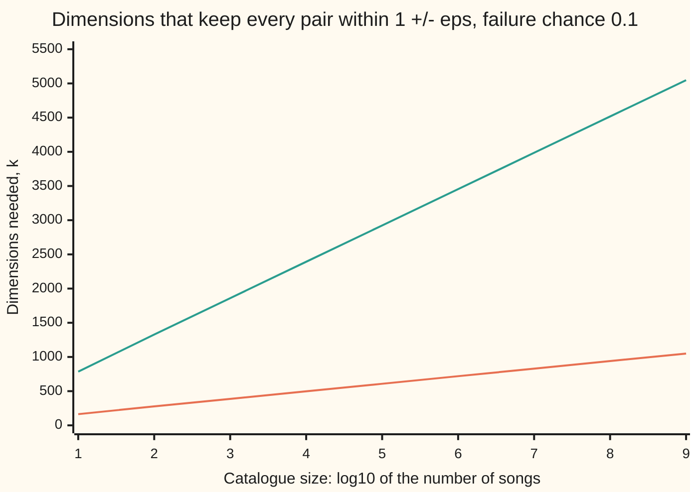

# Random projection: squash the data, keep the distances

[Syllabus](../../../SYLLABUS.md) → [Computability and complexity](../README.md) → [Data, Learning and Fine-Grained Complexity](../README.md#s06) → Random projection

---

## General Overview

A music service describes each song by 10,000 numbers: how strongly each of 10,000 sound features shows up in it. To suggest "songs like this one", it compares songs by distance. Two songs are close when their 10,000 numbers are close.

Each distance costs 10,000 subtractions, and a catalogue has millions of songs. So the service wants each song described by 100 numbers instead, with distances kept about the same.

Random projection does this without looking at the songs. Fill a table of 100 rows and 10,000 columns with independent bell-curve draws. Multiply each song's 10,000 numbers by the table and divide by 10. Each song comes out as 100 numbers.

On this card's 30 songs, folk song 1 and folk song 2 sit 141.40 apart before, and 125.31 apart after. Folk song 1 and rock song 11 sit 199.99 apart, and 195.49 after. Over all 435 pairs, the projected distance stays between 0.7644 and 1.2930 times the true one. Every song's nearest neighbour is still in its own genre.

The Johnson–Lindenstrauss lemma says how many numbers are enough. The count depends on how many songs there are, and only through a logarithm. It does not depend on the 10,000 at all. To keep every squared distance among a million songs within 1 ± 0.5, failing with chance at most 0.1, it asks for 719 numbers, not 100.

**A table of independent normal draws squashes any n points into about 8 ln(n) / ε² dimensions, and with high probability keeps every squared distance within a factor 1 ± ε, whatever the starting dimension.**

**What kind of fact this is:** a theorem, the Johnson–Lindenstrauss lemma in a counted form, proved on this card in Why it works. A matching lower bound, that no method can use many fewer dimensions on some point sets, is stated with its source. The songs are synthetic, made by a stated rule.

### The picture: dimensions needed against catalogue size



Orange, bottom: squared distances kept within 1 ± 0.5. Green, top: within 1 ± 0.2. Both are straight lines against the log of the catalogue size. Going from 10 songs to a billion songs moves the orange count from 164 to 1,050. The songs' own dimension, 10,000 here, appears nowhere in the count.

---

## The formula

Notation first, in words.

- A song is a list of $`d`$ numbers, a **vector**. Here $`d`$ = 10,000. Songs are written $`u`$ and $`v`$.
- The **length** $`\lVert x\rVert`$ of a vector $`x`$ is the square root of the sum of its squared entries. The distance between two songs is $`\lVert u - v\rVert`$.
- $`R`$ is a table with $`k`$ rows and $`d`$ columns, every entry an independent standard normal draw: a bell curve with mean 0 and variance 1. Here $`k`$ = 100.
- The **projection** $`f`$ multiplies a song by $`R`$ and divides by $`\sqrt{k}`$.
- **1 ± ε distortion** means every squared distance after the projection lies between $`1 - \varepsilon`$ and $`1 + \varepsilon`$ times the squared distance before. This card introduces the phrase; later cards on this shelf use it freely.
- $`\Pr[\cdot]`$ is the probability of the event in the brackets, over the random table only. $`\delta`$ is the failure chance allowed. Here $`\varepsilon`$ is a distortion, not the empty string of shelf 01, and $`\delta`$ is a failure chance, not a machine's rule.

```math
f(x) = \frac{1}{\sqrt{k}}\, R\, x, \qquad (1-\varepsilon)\,\lVert u - v\rVert^2 \;\le\; \lVert f(u) - f(v)\rVert^2 \;\le\; (1+\varepsilon)\,\lVert u - v\rVert^2
```

**Read it aloud:** multiply by the random table, then divide by the square root of the new dimension. Every squared distance then lands between one minus epsilon and one plus epsilon times what it was.

The count of dimensions that makes this hold for all pairs of $`n`$ points at once, except with chance $`\delta`$:

```math
k \;\ge\; \frac{2 \ln\!\big(n(n-1)/\delta\big)}{c(\varepsilon)}, \qquad c(\varepsilon) = \frac{\varepsilon^2}{2} - \frac{\varepsilon^3}{3}
```

**Read it aloud:** the dimensions needed are twice the natural log of (ordered pairs over the failure chance), divided by a rate close to half of epsilon squared.

For small $`\varepsilon`$, $`c(\varepsilon)`$ is close to $`\varepsilon^2/2`$, so the count is close to $`4 \ln\!\big(n^2/\delta\big)/\varepsilon^2 = 8 \ln(n)/\varepsilon^2 + 4\ln(1/\delta)/\varepsilon^2`$. The first term is the bold sentence's rule. Its 8 comes from $`\ln(n^2) = 2\ln n`$: the union bound runs over about $`n^2`$ ordered pairs.

For 30 songs at $`\varepsilon`$ = 0.5 and $`\delta`$ = 0.1, the count is 218. The card's 100 dimensions are fewer, so they do not carry the all-pairs promise at $`\varepsilon`$ = 0.5. Worked numbers shows what they do promise.

| Symbol | Plain meaning | In our example | Push it up and the answer… |
| --- | --- | --- | --- |
| $`d`$ | dimensions each song starts in | 10,000 features | the count $`k`$ does not change; only the one-off projection cost grows |
| $`k`$ | dimensions kept after the projection | 100 | distortion shrinks, like $`\sqrt{2/k}`$ typically |
| $`n`$ | number of songs | 30; pairs $`n(n-1)/2`$ = 435 | $`k`$ needed grows like $`\ln n`$ |
| $`u`$, $`v`$, $`x`$ | songs, and any vector | songs 1 and 2; $`x = u - v`$ | — |
| $`\lVert x\rVert`$ | length: square root of the sum of squares | distance 141.40 between songs 1 and 2 | — |
| $`R`$, $`f`$ | the $`k`$ by $`d`$ table of independent normal draws, and the projection $`Rx/\sqrt{k}`$ | 100 by 10,000, seed 2026; song 1 becomes 100 numbers | — |
| $`Y`$ | squared ratio: $`\lVert f(x)\rVert^2 / \lVert x\rVert^2`$ | 0.7855 for songs 1 and 2 | — |
| $`g_i`$, $`S`$ | the $`i`$-th entry of $`Rx`$ divided by $`\lVert x\rVert`$, one standard normal draw; and $`S = g_1^2 + \dots + g_k^2`$ | 100 draws per pair; $`S = kY`$ | — |
| $`t`$, $`j`$ | working letters: the tilt in Markov's inequality (proof only), and the counter in the chi-square sum | best $`t = \varepsilon/(2(1+\varepsilon))`$ | — |
| $`\varepsilon`$ | distortion allowed in squared distances | 0.2 and 0.5 | fewer dimensions needed, like $`1/\varepsilon^2`$ |
| $`\delta`$ | chance the promise fails for some pair | 0.1 | fewer dimensions needed, like $`\ln(1/\delta)`$ |
| $`c(\varepsilon)`$ | the rate in the count: $`\varepsilon^2/2 - \varepsilon^3/3`$ | 0.083333 at $`\varepsilon`$ = 0.5 | fewer dimensions needed |

### When it holds

- **The table is drawn after the points are fixed.** A pair chosen after looking at $`R`$ can sit where the table sends it to zero: the check finds a pair 6.06 apart that projects to a distance below $`10^{-9}`$.
- **The table is random.** A fixed rule such as "keep the first 100 features" has a blind spot. Two versions of one song that differ by 10 in feature 7,000 only come out 0.00 apart; the random table keeps 9.87.
- **The scale $`1/\sqrt{k}`$ is applied.** Without it, every squared distance grows about $`k`$-fold: the mean squared ratio is 103.06, not 1.0306.
- **The promise is about distances, not about rankings.** Distances that differ by less than the distortion can swap order. At 100 dimensions only 5 of the 30 songs keep the same nearest song, though all 30 keep a nearest song in their genre.
- **$`k`$ is large enough for $`n`$, $`\varepsilon`$ and $`\delta`$.** At $`k`$ = 4 the squared ratio runs from 0.0228 to 3.7349, and only 18 of 30 songs keep a nearest neighbour in their genre.

---

## Why it works

### Step 0: the idea

One random direction gives a noisy reading of a vector's length. A hundred independent random directions give a hundred readings, and their average is close to the truth. The table $`R`$ takes those readings for every song at once.

The surprise is that the noise in the average does not depend on the starting dimension or on the vector. It depends only on $`k`$. So the same 100 readings work for 10,000 features or for 10 million.

### Step 1: one entry of the projection is one normal draw

Entry $`i`$ of $`Rx`$ is $`R_{i1}x_1 + \dots + R_{id}x_d`$: a fixed mix of independent normal draws. The [Multivariate normal](../../09-Probability%20and%20statistics/05-Transformations%20and%20Joint%20Laws/06-multivariate-normal.md) card proves that such a mix is normal again. Its mean is 0, and its variance is the sum of the squared weights, $`x_1^2 + \dots + x_d^2 = \lVert x\rVert^2`$.

Different rows of $`R`$ use different draws, so the $`k`$ entries are independent. Write entry $`i`$ as $`\lVert x\rVert\, g_i`$, with $`g_i`$ a standard normal draw. Then

```math
Y = \frac{\lVert f(x)\rVert^2}{\lVert x\rVert^2} = \frac{1}{k}\big(g_1^2 + g_2^2 + \dots + g_k^2\big)
```

**Read it aloud:** the squared ratio for any vector is the average of $`k`$ squared standard normal draws.

The vector $`x`$ has dropped out. So has $`d`$. Every vector, in every dimension, gets the same law for its squared ratio.

### Step 2: the average is right, with spread $`\sqrt{2/k}`$

A squared standard normal has mean 1 and variance 2. An average of $`k`$ independent ones has mean 1 and variance $`2/k`$. That is why the scale is $`1/\sqrt{k}`$: it makes the average exactly right.

At $`k`$ = 100 the spread is $`\sqrt{2/100}`$ = 0.1414. The sum $`g_1^2 + \dots + g_k^2`$ has a named law, the chi-square law with $`k`$ degrees of freedom. For even $`k`$ its chance of lying below $`x`$ is a finite sum, which the check uses as its exact road:

```math
\Pr\big[g_1^2 + \dots + g_k^2 \le x\big] = 1 - e^{-x/2}\sum_{j=0}^{k/2-1} \frac{(x/2)^j}{j!}
```

At $`k`$ = 100, the exact chance that $`Y`$ leaves $`1 \pm 0.2`$ is 0.154742. A seeded simulation of 20,000 values of $`Y`$ gives 0.15280. For $`1 \pm 0.5`$ the exact chance is 0.000911, and the simulation gives 0.00095.

### Step 3: Chernoff's bound makes each pair's failure exponentially rare

Markov's inequality (a quantity that is never negative exceeds a level $`a`$ with chance at most its mean divided by $`a`$), applied to $`e^{tS}`$ with $`S = g_1^2 + \dots + g_k^2`$, gives a bound for each side. The [Concentration](../../09-Probability%20and%20statistics/06-Limit%20Theorems%20in%20Practice/06-concentration-inequalities-hoeffding-and-chernoff.md) card does this for coin flips; here the same steps run on squared normals.

```math
\Pr[Y \ge 1+\varepsilon] \le \big((1+\varepsilon)e^{-\varepsilon}\big)^{k/2}, \qquad \Pr[Y \le 1-\varepsilon] \le \big((1-\varepsilon)e^{\varepsilon}\big)^{k/2}
```

**Read it aloud:** each tail is at most a number below one, raised to the power half of $`k`$.

Both numbers in brackets are at most $`e^{-c(\varepsilon)}`$. So one pair fails with chance at most $`2e^{-k\,c(\varepsilon)/2}`$, which falls exponentially in $`k`$.

<details>
<summary>Detailed proof: the two tail bounds and the step to c(ε)</summary>

One squared normal has the moment generating function below (the mean of $`e^{t g^2}`$, as a function of $`t`$), for $`t < \tfrac12`$. It is the bell-curve integral with its width rescaled:

$`\displaystyle \mathrm{E}\big[e^{t g^2}\big] = \int_{-\infty}^{\infty} \frac{1}{\sqrt{2\pi}}\, e^{-(1-2t)x^2/2}\, dx = (1-2t)^{-1/2}.`$

The $`k`$ draws are independent, so $`\mathrm{E}[e^{tS}] = (1-2t)^{-k/2}`$. Markov's inequality gives, for $`0 < t < \tfrac12`$:

$`\displaystyle \Pr[S \ge k(1+\varepsilon)] \le \frac{\mathrm{E}[e^{tS}]}{e^{tk(1+\varepsilon)}} = (1-2t)^{-k/2}\, e^{-tk(1+\varepsilon)}.`$

The best $`t`$ is $`\varepsilon/(2(1+\varepsilon))`$, which makes $`1 - 2t = 1/(1+\varepsilon)`$. The bound becomes $`(1+\varepsilon)^{k/2}e^{-k\varepsilon/2}`$, the upper bound above.

For the lower side, apply Markov to $`e^{-tS}`$ with $`t > 0`$:

$`\displaystyle \Pr[S \le k(1-\varepsilon)] \le (1+2t)^{-k/2}\, e^{tk(1-\varepsilon)}.`$

The best $`t`$ is $`\varepsilon/(2(1-\varepsilon))`$, and the bound becomes $`(1-\varepsilon)^{k/2}e^{k\varepsilon/2}`$.

Now the step to $`c(\varepsilon)`$. For $`0 < \varepsilon < 1`$, the series for the logarithm gives $`\ln(1+\varepsilon) \le \varepsilon - \varepsilon^2/2 + \varepsilon^3/3`$ and $`\ln(1-\varepsilon) \le -\varepsilon - \varepsilon^2/2`$. So

$`\displaystyle (1+\varepsilon)e^{-\varepsilon} \le e^{-\varepsilon^2/2 + \varepsilon^3/3} = e^{-c(\varepsilon)}, \qquad (1-\varepsilon)e^{\varepsilon} \le e^{-\varepsilon^2/2} \le e^{-c(\varepsilon)}.`$

Raising both to the power $`k/2`$ and adding gives the per-pair bound $`2e^{-k\,c(\varepsilon)/2}`$.

</details>

### Step 4: from one pair to every pair, by a union bound

The projection is linear: $`f(u) - f(v) = f(u - v)`$. The check confirms this to within $`10^{-9}`$. So each pair's squared ratio is $`Y`$ for the single vector $`u - v`$, and Step 3 bounds its failure.

There are $`n(n-1)/2`$ pairs. The chance that at least one fails is at most the sum of their chances. This is the union bound, and it needs no independence between pairs:

```math
\Pr[\text{some pair leaves } 1 \pm \varepsilon] \;\le\; \frac{n(n-1)}{2} \cdot 2e^{-k\,c(\varepsilon)/2} = n(n-1)\, e^{-k\,c(\varepsilon)/2}
```

Set the right side to at most $`\delta`$ and solve for $`k`$. That gives the count in The formula. The $`\ln n`$ comes from the union bound: squaring the number of pairs only doubles the log.

The 435 pairs on this card are not independent. They share one table, and the 100 rock–dance pairs share the same gap between genre centres, so the ratios move in clumps. The rock–dance pairs average 1.1404, while the folk–rock pairs average 0.9103. Sharing cannot widen the spread on average, since each pair alone still has spread 0.1414. It makes one run's spread a noisy reading, which can land on either side of 0.1414. This table's is 0.1714, a wide one. The union bound still holds, because it never assumed independence.

### Step 5: what the count cannot do

The count is close to the best possible. Larsen and Nelson proved in 2017 that some sets of $`n`$ points need about $`\ln(n)/\varepsilon^2`$ dimensions, up to a constant. This holds for any map, linear or not, when $`\varepsilon`$ is not tiny. This card states that result with its source and does not prove it.

A fixed table cannot do the job either. A table with 100 rows and 10,000 columns sends a whole family of directions to zero, because 10,000 inputs cannot all survive in 100 outputs. A pair that differs along one of those directions collapses. The guarantee survives only because the table is drawn after the songs are fixed, so no song can aim for its blind spots.

[Principal components](../../14-Applied%20and%20computational/06-Machine%20Learning%20Mathematics/07-principal-components-and-dimension-reduction.md) is the contrast. It reads the data and keeps the directions of largest spread, which keeps the most variance any $`k`$ directions can. It needs the data first and a table of 10,000 by 10,000 covariances. Random projection reads nothing, so it works on data not seen yet, in one pass.

### Step 6: what it costs

Projecting one song costs $`k \times d`$ multiply-adds, once. After that, each distance costs $`k`$ instead of $`d`$. Counted for every pair's distance:

| Songs $`n`$ | All pairs directly | Project, then compare |
| ---: | ---: | ---: |
| 30 | 4,350,000 | 30,043,500 |
| 1,000 | 4,995,000,000 | 1,049,950,000 |
| 1,000,000 | 4,999,995,000,000,000 | 50,999,950,000,000 |

At 30 songs the projection costs more than it saves. At 1,000 songs it already wins, and at a million songs the projected route needs under a fiftieth of the work. Squashing pays at scale.

That speed is not the all-pairs promise. The table prices every row at 100 dimensions, but at $`\varepsilon`$ = 0.5 the count asks for 387 at 1,000 songs and 719 at a million. At 100, each pair keeps only its typical spread of 0.1414, so a search uses the short form for a shortlist and re-checks it (The usual mistake).

---

## Worked numbers, by hand

What does $`k`$ = 100 promise for 30 songs? First, try $`\varepsilon`$ = 0.5 with the exact Chernoff bound.

| Step | Arithmetic | Value |
| --- | --- | --- |
| pairs | $`30 \times 29 / 2`$ | 435 |
| upper base | $`1.5 \times e^{-0.5}`$ | 0.909796 |
| upper tail | $`0.909796^{50}`$ | 0.008855 |
| lower base | $`0.5 \times e^{0.5}`$ | 0.824361 |
| lower tail | $`0.824361^{50}`$ | 0.000064 |
| one pair fails | 0.008855 + 0.000064 | 0.008919 |
| some pair fails | $`435 \times 0.008919`$ | 3.8799: more than 1, no promise |
| $`k`$ needed at $`\varepsilon`$ = 0.5 | $`\ln(870/0.1)`$ = 9.0711; $`c(0.5) = 0.5^2/2 - 0.5^3/3`$ = 0.083333; $`2 \times 9.0711 / 0.083333`$ | 218 |
| best $`\varepsilon`$ at $`k`$ = 100 | smallest $`\varepsilon`$ with $`435 \times`$ bound $`\le 0.1`$, by halving | **0.6956** |

So 100 dimensions promise, with chance at least 0.9, that every squared distance among the 30 songs stays within 1 ± 0.6956. The run's worst pair moved by 0.6718, inside the promise. A typical pair moves far less, about 0.1414.

### The picture: where the 435 squared ratios fell

Each `#` is about 4 pairs. "Expected" is the exact chi-square count for 435 independent pairs.

```
bin 0.0-0.6:                           observed   1 expected    0.2
bin 0.6-0.7: ##                        observed   8 expected    4.1
bin 0.7-0.8: ########                  observed  32 expected   26.3
bin 0.8-0.9: ##############            observed  54 expected   76.8
bin 0.9-1.0: ######################### observed  99 expected  118.3
bin 1.0-1.1: ######################### observed  98 expected  108.3
bin 1.1-1.2: #####################     observed  82 expected   64.3
bin 1.2-1.3: ########                  observed  33 expected   26.5
bin 1.3-1.4: ###                       observed  13 expected    8.0
bin 1.4-1.5: ###                       observed  12 expected    1.8
bin 1.5-9.0: #                         observed   3 expected    0.4
```

The pile sits on 1, as Step 2 says. It is lumpier than the expected column because the pairs share one table and share genre gaps (Step 4). The 100 rock–dance pairs average 1.1404, so they lean right together.

### What breaks if you drop a piece

| Mistake | Comes out at | What went wrong |
| --- | --- | --- |
| Drop the $`1/\sqrt{k}`$ scale | mean squared ratio 103.06, not 1.0306 | each of the $`k`$ squared draws adds about 1; dividing by $`k`$ is what turns the sum into an average |
| Keep only $`k`$ = 4 dimensions | squared ratios from 0.0228 to 3.7349; own-genre nearest neighbour for 18 of 30 songs | the spread $`\sqrt{2/k}`$ grows as $`k`$ falls, and at $`k`$ = 4 it swamps the gap between genres |
| Keep the first 100 features instead of a random table | a pair 10 apart in feature 7,000 only comes out 0.00 apart; the random table gives 9.87 | a fixed rule has a blind spot, and a pair can sit in it |
| Choose the pair after seeing the table | a pair 6.06 apart projects to below $`10^{-9}`$ | the table sends a whole family of directions to zero; the guarantee is only for points fixed before the draw |

---

## Code, from first principles, and it actually runs

The script builds the 30 songs, draws the 100 by 10,000 table row by row, and projects every song. It takes **four independent roads** to the law of the squared ratio. The real projection gives 435 measured ratios. The chi-square sum gives exact tail chances. A separate seeded simulation draws 20,000 averages of 100 squared normals, which must land within four standard errors of the exact chances on each side. Chernoff's bound must sit above the exact chances. Then the script counts dimensions, costs, and the four failures in What breaks. SplitMix64, a small random-number generator written out in both languages, makes Python and Rust print the same output; Box–Muller turns two of its uniform draws into one normal draw.

### Python

```python
# Random projection card check: 30 songs with 10,000 features squashed to 100 by a
# matrix of normal draws. Roads: the real projection, the exact chi-square law of one
# squared length, Chernoff's bound above it, and a seeded simulation. Standard library.
from math import sqrt, log, cos, pi, exp, ceil
from operator import mul

MASK = (1 << 64) - 1
class SplitMix64:  # small seeded generator, explained on wing 09's simulation cards
    def __init__(self, seed): self.s = seed
    def next(self):
        self.s = (self.s + 0x9E3779B97F4A7C15) & MASK
        z = self.s
        z = ((z ^ (z >> 30)) * 0xBF58476D1CE4E5B9) & MASK
        z = ((z ^ (z >> 27)) * 0x94D049BB133111EB) & MASK
        return z ^ (z >> 31)
    def unif(self): return ((self.next() >> 11) + 0.5) / 9007199254740992.0
    def normal(self):  # Box-Muller: two uniforms make one standard normal draw
        u1 = self.unif(); u2 = self.unif()
        return sqrt(-2.0 * log(u1)) * cos(2.0 * pi * u2)

def dot(a, b): return sum(map(mul, a, b))
def sqdist(a, b): return sum((x - y) * (x - y) for x, y in zip(a, b))

def chi2_cdf(x, k):  # Pr[sum of k squared normals <= x], k even: a Poisson sum
    term, total = exp(-x / 2.0), 0.0
    for j in range(k // 2):
        total += term
        term *= (x / 2.0) / (j + 1)
    return 1.0 - total

def tail_exact(eps, k): return chi2_cdf(k * (1 - eps), k) + 1.0 - chi2_cdf(k * (1 + eps), k)
def tail_chernoff(eps, k):
    return ((1 + eps) * exp(-eps)) ** (k / 2) + ((1 - eps) * exp(eps)) ** (k / 2)

D, K, N, G = 10000, 100, 30, ("folk", "rock", "dance")
rng = SplitMix64(2026)
centres = [[rng.normal() for _ in range(D)] for _ in G]
songs = [[c + rng.normal() for c in centres[s // 10]] for s in range(N)]
genre = [s // 10 for s in range(N)]
pairs = [(a, b) for a in range(N) for b in range(a + 1, N)]
true2 = {p: sqdist(songs[p[0]], songs[p[1]]) for p in pairs}
diff01 = [x - y for x, y in zip(songs[0], songs[1])]
proj = [[0.0] * K for _ in range(N)]; pdiff = [0.0] * K
col7000 = []; first101 = []
for i in range(K):
    row = [rng.normal() for _ in range(D)]
    for s in range(N): proj[s][i] = dot(row, songs[s]) / sqrt(K)
    pdiff[i] = dot(row, diff01) / sqrt(K)
    col7000.append(row[6999]); first101.append(row[:101])
print(f"songs {N} in 3 genres, features d = {D}, kept k = {K}, pairs {len(pairs)}, seed 2026")
lin = max(abs(proj[0][i] - proj[1][i] - pdiff[i]) for i in range(K))
print(f"linearity: f(u) - f(v) against f(u - v), largest gap below 1e-9: {lin < 1e-9}")
assert lin < 1e-9
ratio = {p: sqdist(proj[p[0]], proj[p[1]]) / true2[p] for p in pairs}
for a, b in [(0, 1), (0, 10), (10, 20)]:
    t, q = sqrt(true2[(a, b)]), sqrt(sqdist(proj[a], proj[b]))
    print(f"song {a+1} ({G[genre[a]]}) to song {b+1} ({G[genre[b]]}): distance {t:.2f}, "
          f"projected {q:.2f}, squared ratio {q*q/(t*t):.4f}")
ys = list(ratio.values()); m = sum(ys) / len(ys)
sd = sqrt(sum((y - m) ** 2 for y in ys) / (len(ys) - 1))
print(f"squared ratio over {len(ys)} pairs: mean {m:.4f} sd {sd:.4f} min {min(ys):.4f} max {max(ys):.4f}")
print(f"distance ratio over {len(ys)} pairs: min {sqrt(min(ys)):.4f} max {sqrt(max(ys)):.4f}")
print(f"theory: mean 1, sd sqrt(2/k) = {sqrt(2 / K):.4f}")
groups = {}
for (a, b), y in ratio.items(): groups.setdefault((genre[a], genre[b]), []).append(y)
print("mean squared ratio by genre pair: " + ", ".join(f"{G[g]}-{G[h]} {sum(v) / len(v):.4f}" for (g, h), v in sorted(groups.items())))
assert abs(m - 1) < 0.05 and abs(sd - sqrt(2 / K)) < 0.25 * sqrt(2 / K)
edges = [0.0] + [0.6 + 0.1 * j for j in range(10)] + [99.0]
for lo, hi in zip(edges, edges[1:]):
    obs = sum(1 for y in ys if lo <= y < hi)
    exp_n = len(ys) * (chi2_cdf(K * hi, K) - chi2_cdf(K * lo, K))
    print(f"bin {lo:.1f}-{min(hi, 9):.1f}: {'#' * ((obs + 2) // 4):25} observed {obs:3d} expected {exp_n:6.1f}")
sim, T = SplitMix64(7), 20000
simy = [sum(sim.normal() ** 2 for _ in range(K)) / K for _ in range(T)]
for eps in (0.2, 0.5):
    ex, ch = tail_exact(eps, K), tail_chernoff(eps, K)
    obs = sum(1 for y in ys if abs(y - 1) > eps) / len(ys)
    sf = sum(1 for y in simy if abs(y - 1) > eps) / T
    print(f"outside 1 +/- {eps}: pairs {obs:.4f}, exact {ex:.6f}, Chernoff bound {ch:.6f}, "
          f"simulated {T} {sf:.5f}")
    assert ex <= ch, "the bound must sit above the exact tail"
    assert abs(sf - ex) <= 4 * sqrt(ex * (1 - ex) / T) + 1e-4
    lw, lf = chi2_cdf(K * (1 - eps), K), sum(1 for y in simy if y < 1 - eps) / T  # lower side alone
    assert abs(lf - lw) <= 4 * sqrt(lw * (1 - lw) / T) + 1e-4
lo_e, hi_e = 0.01, 0.99  # smallest eps whose union bound over 435 pairs is <= 0.1
for _ in range(60):
    mid = (lo_e + hi_e) / 2
    if len(pairs) * tail_chernoff(mid, K) <= 0.1: hi_e = mid
    else: lo_e = mid
worst = max(abs(y - 1) for y in ys)
ub, lb = 1.5 * exp(-0.5), 0.5 * exp(0.5)
print(f"hand, eps 0.5: upper base {ub:.6f}, to the 50th {ub ** 50:.6f}; lower base {lb:.6f}, to the 50th "
      f"{lb ** 50:.6f}; {len(pairs)} pairs x {tail_chernoff(0.5, K):.6f} = {len(pairs) * tail_chernoff(0.5, K):.4f}")
L, c5 = log(30 * 29 / 0.1), 0.5 ** 2 / 2 - 0.5 ** 3 / 3
print(f"hand, n = 30: ln(870/0.1) = {L:.4f}, c(0.5) = {c5:.6f}, k = {ceil(2 * L / c5)}")
print(f"union bound, k = {K}, {len(pairs)} pairs, failure 0.1: eps {hi_e:.4f}; run's worst {worst:.4f}")
assert worst <= hi_e

def nearest(vecs, s):
    return min((t for t in range(N) if t != s), key=lambda t: sqdist(vecs[s], vecs[t]))
p4 = [[proj[s][i] * sqrt(K) / 2.0 for i in range(4)] for s in range(N)]
nn0 = [nearest(songs, s) for s in range(N)]
print(f"before: nearest song in own genre {sum(1 for s in range(N) if genre[nn0[s]] == genre[s])}/{N}")
for name, vecs in (("k = 100", proj), ("k = 4", p4)):
    nn = [nearest(vecs, s) for s in range(N)]
    same_g = sum(1 for s in range(N) if genre[nn[s]] == genre[s])
    same_s = sum(1 for s in range(N) if nn[s] == nn0[s])
    print(f"{name}: nearest song in own genre {same_g}/{N}, same nearest song as before {same_s}/{N}")
    if name == "k = 100": assert same_g == N
r4 = [sqdist(p4[a], p4[b]) / true2[(a, b)] for a, b in pairs]
print(f"k = 4: squared ratio min {min(r4):.4f} max {max(r4):.4f}")
print(f"no 1/sqrt(k) scale: mean squared ratio {m * K:.2f}")
e = [0.0] * D; e[6999] = 10.0  # two versions of one song, 10 apart in feature 7000 only
keep100 = sqrt(sum((sqrt(D / K) * x) ** 2 for x in e[:K]))
jump = sqrt(sum((10.0 * c / sqrt(K)) ** 2 for c in col7000))
print(f"pair 10 apart in feature 7000 only: first 100 features keep {keep100:.2f}, random keeps {jump:.2f}")
for n in (30, 1000, 10**6):  # counted multiply-adds for every pair's distance
    direct, viaproj = n * (n - 1) // 2 * D, n * K * D + n * (n - 1) // 2 * K
    print(f"cost, n = {n}: all pairs directly {direct}, project then compare {viaproj}")
print("dims needed, failure 0.1: n eps=0.5 eps=0.2")
for e10 in range(1, 10):
    n = 10.0 ** e10
    ks = [ceil(2 * log(n * (n - 1) / 0.1) / (e * e / 2 - e ** 3 / 3)) for e in (0.5, 0.2)]
    print(f"n=1e{e10} {ks[0]} {ks[1]}")
A = [r[:100] for r in first101]; bvec = [-r[100] for r in first101]
for c in range(100):  # Gaussian elimination: a pair chosen after seeing the matrix
    piv = max(range(c, 100), key=lambda r: abs(A[r][c]))
    A[c], A[piv] = A[piv], A[c]; bvec[c], bvec[piv] = bvec[piv], bvec[c]
    for r in range(c + 1, 100):
        f = A[r][c] / A[c][c]
        for j in range(c, 100): A[r][j] -= f * A[c][j]
        bvec[r] -= f * bvec[c]
z = [0.0] * 101; z[100] = 1.0
for c in range(99, -1, -1):
    z[c] = (bvec[c] - sum(A[c][j] * z[j] for j in range(c + 1, 100))) / A[c][c]
fz = sqrt(sum(dot(first101[i], z) ** 2 for i in range(K)) / K)
nz = sqrt(sum(v * v for v in z))
print(f"pair chosen after the matrix: distance {nz:.2f}, projected below 1e-9: {fz < 1e-9}")
assert fz < 1e-9
print("ALL CHECKS PASS")
```

**Ran 2026-11-19 on macOS, Python 3.14.10, standard library only. All checks passed. Output, pasted from the run:**

```
songs 30 in 3 genres, features d = 10000, kept k = 100, pairs 435, seed 2026
linearity: f(u) - f(v) against f(u - v), largest gap below 1e-9: True
song 1 (folk) to song 2 (folk): distance 141.40, projected 125.31, squared ratio 0.7855
song 1 (folk) to song 11 (rock): distance 199.99, projected 195.49, squared ratio 0.9555
song 11 (rock) to song 21 (dance): distance 198.43, projected 209.88, squared ratio 1.1188
squared ratio over 435 pairs: mean 1.0306 sd 0.1714 min 0.5842 max 1.6718
distance ratio over 435 pairs: min 0.7644 max 1.2930
theory: mean 1, sd sqrt(2/k) = 0.1414
mean squared ratio by genre pair: folk-folk 1.0137, folk-rock 0.9103, folk-dance 1.0837, rock-rock 0.9896, rock-dance 1.1404, dance-dance 0.9939
bin 0.0-0.6:                           observed   1 expected    0.2
bin 0.6-0.7: ##                        observed   8 expected    4.1
bin 0.7-0.8: ########                  observed  32 expected   26.3
bin 0.8-0.9: ##############            observed  54 expected   76.8
bin 0.9-1.0: ######################### observed  99 expected  118.3
bin 1.0-1.1: ######################### observed  98 expected  108.3
bin 1.1-1.2: #####################     observed  82 expected   64.3
bin 1.2-1.3: ########                  observed  33 expected   26.5
bin 1.3-1.4: ###                       observed  13 expected    8.0
bin 1.4-1.5: ###                       observed  12 expected    1.8
bin 1.5-9.0: #                         observed   3 expected    0.4
outside 1 +/- 0.2: pairs 0.2345, exact 0.154742, Chernoff bound 0.727531, simulated 20000 0.15280
outside 1 +/- 0.5: pairs 0.0069, exact 0.000911, Chernoff bound 0.008919, simulated 20000 0.00095
hand, eps 0.5: upper base 0.909796, to the 50th 0.008855; lower base 0.824361, to the 50th 0.000064; 435 pairs x 0.008919 = 3.8799
hand, n = 30: ln(870/0.1) = 9.0711, c(0.5) = 0.083333, k = 218
union bound, k = 100, 435 pairs, failure 0.1: eps 0.6956; run's worst 0.6718
before: nearest song in own genre 30/30
k = 100: nearest song in own genre 30/30, same nearest song as before 5/30
k = 4: nearest song in own genre 18/30, same nearest song as before 2/30
k = 4: squared ratio min 0.0228 max 3.7349
no 1/sqrt(k) scale: mean squared ratio 103.06
pair 10 apart in feature 7000 only: first 100 features keep 0.00, random keeps 9.87
cost, n = 30: all pairs directly 4350000, project then compare 30043500
cost, n = 1000: all pairs directly 4995000000, project then compare 1049950000
cost, n = 1000000: all pairs directly 4999995000000000, project then compare 50999950000000
dims needed, failure 0.1: n eps=0.5 eps=0.2
n=1e1 164 785
n=1e2 277 1328
n=1e3 387 1860
n=1e4 498 2392
n=1e5 608 2923
n=1e6 719 3454
n=1e7 829 3986
n=1e8 940 4517
n=1e9 1050 5048
pair chosen after the matrix: distance 6.06, projected below 1e-9: True
ALL CHECKS PASS
```

### Rust

```rust
// Random projection card check: 30 songs with 10,000 features squashed to 100 by a
// matrix of normal draws. Roads: the real projection, the exact chi-square law of one
// squared length, Chernoff's bound above it, and a seeded simulation. std only.
use std::f64::consts::PI;

struct SplitMix64 { s: u64 } // small seeded generator, explained on wing 09's simulation cards
impl SplitMix64 {
    fn next(&mut self) -> u64 {
        self.s = self.s.wrapping_add(0x9E3779B97F4A7C15);
        let mut z = self.s;
        z = (z ^ (z >> 30)).wrapping_mul(0xBF58476D1CE4E5B9);
        z = (z ^ (z >> 27)).wrapping_mul(0x94D049BB133111EB);
        z ^ (z >> 31)
    }
    fn unif(&mut self) -> f64 { ((self.next() >> 11) as f64 + 0.5) / 9007199254740992.0 }
    fn normal(&mut self) -> f64 { // Box-Muller: two uniforms make one standard normal draw
        let (u1, u2) = (self.unif(), self.unif());
        (-2.0 * u1.ln()).sqrt() * (2.0 * PI * u2).cos()
    }
}

fn dot(a: &[f64], b: &[f64]) -> f64 { a.iter().zip(b).map(|(x, y)| x * y).sum() }
fn sqdist(a: &[f64], b: &[f64]) -> f64 { a.iter().zip(b).map(|(x, y)| (x - y) * (x - y)).sum() }

fn chi2_cdf(x: f64, k: usize) -> f64 { // Pr[sum of k squared normals <= x], k even: a Poisson sum
    let (mut term, mut total) = ((-x / 2.0).exp(), 0.0);
    for j in 0..k / 2 {
        total += term;
        term *= (x / 2.0) / (j as f64 + 1.0);
    }
    1.0 - total
}
fn tail_exact(e: f64, k: usize) -> f64 { chi2_cdf(k as f64 * (1.0 - e), k) + 1.0 - chi2_cdf(k as f64 * (1.0 + e), k) }
fn tail_chernoff(e: f64, k: usize) -> f64 {
    let h = k as f64 / 2.0;
    ((1.0 + e) * (-e).exp()).powf(h) + ((1.0 - e) * e.exp()).powf(h)
}
fn nearest(v: &[Vec<f64>], s: usize) -> usize { // first song at the smallest distance
    (0..v.len()).filter(|&t| t != s).fold(usize::MAX, |b, t| if b == usize::MAX || sqdist(&v[s], &v[t]) < sqdist(&v[s], &v[b]) { t } else { b })
}

fn main() {
    let (d, k, n) = (10000usize, 100usize, 30usize);
    let (g, sk) = (["folk", "rock", "dance"], (k as f64).sqrt());
    let mut rng = SplitMix64 { s: 2026 };
    let centres: Vec<Vec<f64>> = (0..3).map(|_| (0..d).map(|_| rng.normal()).collect()).collect();
    let songs: Vec<Vec<f64>> = (0..n).map(|s| centres[s / 10].iter().map(|c| c + rng.normal()).collect()).collect();
    let genre: Vec<usize> = (0..n).map(|s| s / 10).collect();
    let mut pairs = vec![];
    for a in 0..n { for b in a + 1..n { pairs.push((a, b)); } }
    let true2: Vec<f64> = pairs.iter().map(|&(a, b)| sqdist(&songs[a], &songs[b])).collect();
    let diff01: Vec<f64> = songs[0].iter().zip(&songs[1]).map(|(x, y)| x - y).collect();
    let (mut proj, mut pdiff) = (vec![vec![0.0; k]; n], vec![0.0; k]);
    let (mut col7000, mut first101) = (vec![], vec![]);
    for i in 0..k {
        let row: Vec<f64> = (0..d).map(|_| rng.normal()).collect();
        for s in 0..n { proj[s][i] = dot(&row, &songs[s]) / sk; }
        pdiff[i] = dot(&row, &diff01) / sk;
        col7000.push(row[6999]);
        first101.push(row[..101].to_vec());
    }
    println!("songs {} in 3 genres, features d = {}, kept k = {}, pairs {}, seed 2026", n, d, k, pairs.len());
    let lin = (0..k).map(|i| (proj[0][i] - proj[1][i] - pdiff[i]).abs()).fold(0.0, f64::max);
    println!("linearity: f(u) - f(v) against f(u - v), largest gap below 1e-9: {}", if lin < 1e-9 { "True" } else { "False" });
    assert!(lin < 1e-9);
    let ys: Vec<f64> = pairs.iter().enumerate().map(|(p, &(a, b))| sqdist(&proj[a], &proj[b]) / true2[p]).collect();
    for &(a, b) in &[(0usize, 1usize), (0, 10), (10, 20)] {
        let p = pairs.iter().position(|&q| q == (a, b)).unwrap();
        let (t, q) = (true2[p].sqrt(), sqdist(&proj[a], &proj[b]).sqrt());
        println!("song {} ({}) to song {} ({}): distance {:.2}, projected {:.2}, squared ratio {:.4}",
            a + 1, g[genre[a]], b + 1, g[genre[b]], t, q, q * q / (t * t));
    }
    let np = ys.len() as f64;
    let m = ys.iter().sum::<f64>() / np;
    let sd = (ys.iter().map(|y| (y - m) * (y - m)).sum::<f64>() / (np - 1.0)).sqrt();
    let (ymin, ymax) = (ys.iter().cloned().fold(f64::MAX, f64::min), ys.iter().cloned().fold(0.0, f64::max));
    println!("squared ratio over {} pairs: mean {:.4} sd {:.4} min {:.4} max {:.4}", ys.len(), m, sd, ymin, ymax);
    println!("distance ratio over {} pairs: min {:.4} max {:.4}", ys.len(), ymin.sqrt(), ymax.sqrt());
    let th = (2.0 / k as f64).sqrt();
    println!("theory: mean 1, sd sqrt(2/k) = {:.4}", th);
    let mut parts = vec![];
    for (gg, hh) in [(0, 0), (0, 1), (0, 2), (1, 1), (1, 2), (2, 2)] {
        let v: Vec<f64> = (0..pairs.len()).filter(|&p| (genre[pairs[p].0], genre[pairs[p].1]) == (gg, hh)).map(|p| ys[p]).collect();
        parts.push(format!("{}-{} {:.4}", g[gg], g[hh], v.iter().sum::<f64>() / v.len() as f64));
    }
    println!("mean squared ratio by genre pair: {}", parts.join(", "));
    assert!((m - 1.0).abs() < 0.05 && (sd - th).abs() < 0.25 * th);
    let mut edges = vec![0.0]; for j in 0..10 { edges.push(0.6 + 0.1 * j as f64); } edges.push(99.0);
    for w in edges.windows(2) {
        let (lo, hi) = (w[0], w[1]);
        let obs = ys.iter().filter(|&&y| lo <= y && y < hi).count();
        let en = np * (chi2_cdf(k as f64 * hi, k) - chi2_cdf(k as f64 * lo, k));
        println!("bin {:.1}-{:.1}: {:25} observed {:3} expected {:6.1}", lo, hi.min(9.0), "#".repeat((obs + 2) / 4), obs, en);
    }
    let (mut sim, tt) = (SplitMix64 { s: 7 }, 20000usize);
    let simy: Vec<f64> = (0..tt).map(|_| (0..k).map(|_| { let z = sim.normal(); z * z }).sum::<f64>() / k as f64).collect();
    for &e in &[0.2f64, 0.5] {
        let (ex, ch) = (tail_exact(e, k), tail_chernoff(e, k));
        let obs = ys.iter().filter(|&&y| (y - 1.0).abs() > e).count() as f64 / np;
        let sf = simy.iter().filter(|&&y| (y - 1.0).abs() > e).count() as f64 / tt as f64;
        println!("outside 1 +/- {}: pairs {:.4}, exact {:.6}, Chernoff bound {:.6}, simulated {} {:.5}", e, obs, ex, ch, tt, sf);
        assert!(ex <= ch, "the bound must sit above the exact tail");
        assert!((sf - ex).abs() <= 4.0 * (ex * (1.0 - ex) / tt as f64).sqrt() + 1e-4);
        let (lw, lf) = (chi2_cdf(k as f64 * (1.0 - e), k), simy.iter().filter(|&&y| y < 1.0 - e).count() as f64 / tt as f64); // lower side alone
        assert!((lf - lw).abs() <= 4.0 * (lw * (1.0 - lw) / tt as f64).sqrt() + 1e-4);
    }
    let (mut lo_e, mut hi_e) = (0.01f64, 0.99f64); // smallest eps whose union bound over 435 pairs is <= 0.1
    for _ in 0..60 {
        let mid = (lo_e + hi_e) / 2.0;
        if np * tail_chernoff(mid, k) <= 0.1 { hi_e = mid; } else { lo_e = mid; }
    }
    let worst = ys.iter().map(|y| (y - 1.0).abs()).fold(0.0, f64::max);
    let (ub, lb) = (1.5 * (-0.5f64).exp(), 0.5 * 0.5f64.exp());
    println!("hand, eps 0.5: upper base {:.6}, to the 50th {:.6}; lower base {:.6}, to the 50th {:.6}; {} pairs x {:.6} = {:.4}",
        ub, ub.powf(50.0), lb, lb.powf(50.0), pairs.len(), tail_chernoff(0.5, k), np * tail_chernoff(0.5, k));
    let (l30, c5) = ((30.0 * 29.0 / 0.1f64).ln(), 0.5f64.powi(2) / 2.0 - 0.5f64.powi(3) / 3.0);
    println!("hand, n = 30: ln(870/0.1) = {:.4}, c(0.5) = {:.6}, k = {}", l30, c5, (2.0 * l30 / c5).ceil());
    println!("union bound, k = {}, {} pairs, failure 0.1: eps {:.4}; run's worst {:.4}", k, pairs.len(), hi_e, worst);
    assert!(worst <= hi_e);
    let p4: Vec<Vec<f64>> = (0..n).map(|s| (0..4).map(|i| proj[s][i] * sk / 2.0).collect()).collect();
    let nn0: Vec<usize> = (0..n).map(|s| nearest(&songs, s)).collect();
    println!("before: nearest song in own genre {}/{}", (0..n).filter(|&s| genre[nn0[s]] == genre[s]).count(), n);
    for (name, vecs) in [("k = 100", &proj), ("k = 4", &p4)] {
        let nn: Vec<usize> = (0..n).map(|s| nearest(vecs, s)).collect();
        let same_g = (0..n).filter(|&s| genre[nn[s]] == genre[s]).count();
        let same_s = (0..n).filter(|&s| nn[s] == nn0[s]).count();
        println!("{}: nearest song in own genre {}/{}, same nearest song as before {}/{}", name, same_g, n, same_s, n);
        if name == "k = 100" { assert!(same_g == n); }
    }
    let r4: Vec<f64> = pairs.iter().enumerate().map(|(p, &(a, b))| sqdist(&p4[a], &p4[b]) / true2[p]).collect();
    println!("k = 4: squared ratio min {:.4} max {:.4}", r4.iter().cloned().fold(f64::MAX, f64::min), r4.iter().cloned().fold(0.0, f64::max));
    println!("no 1/sqrt(k) scale: mean squared ratio {:.2}", m * k as f64);
    let mut e = vec![0.0f64; d]; e[6999] = 10.0; // two versions of one song, 10 apart in feature 7000 only
    let keep100 = e[..k].iter().map(|x| ((d as f64 / k as f64).sqrt() * x).powi(2)).sum::<f64>().sqrt();
    let jump = col7000.iter().map(|c| (10.0 * c / sk).powi(2)).sum::<f64>().sqrt();
    println!("pair 10 apart in feature 7000 only: first 100 features keep {:.2}, random keeps {:.2}", keep100, jump);
    for &nn in &[30u64, 1000, 1000000] { // counted multiply-adds for every pair's distance
        let (direct, viaproj) = (nn * (nn - 1) / 2 * d as u64, nn * (k * d) as u64 + nn * (nn - 1) / 2 * k as u64);
        println!("cost, n = {}: all pairs directly {}, project then compare {}", nn, direct, viaproj);
    }
    println!("dims needed, failure 0.1: n eps=0.5 eps=0.2");
    for e10 in 1..10 {
        let nf = 10f64.powi(e10);
        let ks: Vec<f64> = [0.5f64, 0.2].iter().map(|&e| (2.0 * (nf * (nf - 1.0) / 0.1).ln() / (e * e / 2.0 - e.powi(3) / 3.0)).ceil()).collect();
        println!("n=1e{} {} {}", e10, ks[0], ks[1]);
    }
    let mut a: Vec<Vec<f64>> = first101.iter().map(|r| r[..100].to_vec()).collect();
    let mut bv: Vec<f64> = first101.iter().map(|r| -r[100]).collect();
    for c in 0..100 { // Gaussian elimination: a pair chosen after seeing the matrix
        let mut piv = c;
        for r in c + 1..100 { if a[r][c].abs() > a[piv][c].abs() { piv = r; } }
        a.swap(c, piv);
        bv.swap(c, piv);
        for r in c + 1..100 {
            let f = a[r][c] / a[c][c];
            for j in c..100 { a[r][j] -= f * a[c][j]; }
            bv[r] -= f * bv[c];
        }
    }
    let mut z = vec![0.0f64; 101]; z[100] = 1.0;
    for c in (0..100).rev() {
        z[c] = (bv[c] - (c + 1..100).map(|j| a[c][j] * z[j]).sum::<f64>()) / a[c][c];
    }
    let fz = ((0..k).map(|i| dot(&first101[i], &z).powi(2)).sum::<f64>() / k as f64).sqrt();
    let nz = z.iter().map(|v| v * v).sum::<f64>().sqrt();
    println!("pair chosen after the matrix: distance {:.2}, projected below 1e-9: {}", nz, if fz < 1e-9 { "True" } else { "False" });
    assert!(fz < 1e-9);
    println!("ALL CHECKS PASS");
}
```

**Ran 2026-11-19 on macOS, rustc 1.98.1, no crates. All checks passed. Output, pasted from the run:**

```
songs 30 in 3 genres, features d = 10000, kept k = 100, pairs 435, seed 2026
linearity: f(u) - f(v) against f(u - v), largest gap below 1e-9: True
song 1 (folk) to song 2 (folk): distance 141.40, projected 125.31, squared ratio 0.7855
song 1 (folk) to song 11 (rock): distance 199.99, projected 195.49, squared ratio 0.9555
song 11 (rock) to song 21 (dance): distance 198.43, projected 209.88, squared ratio 1.1188
squared ratio over 435 pairs: mean 1.0306 sd 0.1714 min 0.5842 max 1.6718
distance ratio over 435 pairs: min 0.7644 max 1.2930
theory: mean 1, sd sqrt(2/k) = 0.1414
mean squared ratio by genre pair: folk-folk 1.0137, folk-rock 0.9103, folk-dance 1.0837, rock-rock 0.9896, rock-dance 1.1404, dance-dance 0.9939
bin 0.0-0.6:                           observed   1 expected    0.2
bin 0.6-0.7: ##                        observed   8 expected    4.1
bin 0.7-0.8: ########                  observed  32 expected   26.3
bin 0.8-0.9: ##############            observed  54 expected   76.8
bin 0.9-1.0: ######################### observed  99 expected  118.3
bin 1.0-1.1: ######################### observed  98 expected  108.3
bin 1.1-1.2: #####################     observed  82 expected   64.3
bin 1.2-1.3: ########                  observed  33 expected   26.5
bin 1.3-1.4: ###                       observed  13 expected    8.0
bin 1.4-1.5: ###                       observed  12 expected    1.8
bin 1.5-9.0: #                         observed   3 expected    0.4
outside 1 +/- 0.2: pairs 0.2345, exact 0.154742, Chernoff bound 0.727531, simulated 20000 0.15280
outside 1 +/- 0.5: pairs 0.0069, exact 0.000911, Chernoff bound 0.008919, simulated 20000 0.00095
hand, eps 0.5: upper base 0.909796, to the 50th 0.008855; lower base 0.824361, to the 50th 0.000064; 435 pairs x 0.008919 = 3.8799
hand, n = 30: ln(870/0.1) = 9.0711, c(0.5) = 0.083333, k = 218
union bound, k = 100, 435 pairs, failure 0.1: eps 0.6956; run's worst 0.6718
before: nearest song in own genre 30/30
k = 100: nearest song in own genre 30/30, same nearest song as before 5/30
k = 4: nearest song in own genre 18/30, same nearest song as before 2/30
k = 4: squared ratio min 0.0228 max 3.7349
no 1/sqrt(k) scale: mean squared ratio 103.06
pair 10 apart in feature 7000 only: first 100 features keep 0.00, random keeps 9.87
cost, n = 30: all pairs directly 4350000, project then compare 30043500
cost, n = 1000: all pairs directly 4995000000, project then compare 1049950000
cost, n = 1000000: all pairs directly 4999995000000000, project then compare 50999950000000
dims needed, failure 0.1: n eps=0.5 eps=0.2
n=1e1 164 785
n=1e2 277 1328
n=1e3 387 1860
n=1e4 498 2392
n=1e5 608 2923
n=1e6 719 3454
n=1e7 829 3986
n=1e8 940 4517
n=1e9 1050 5048
pair chosen after the matrix: distance 6.06, projected below 1e-9: True
ALL CHECKS PASS
```

### Lean

Lean proves the card's three main facts for any $`k`$, $`d`$ and $`n`$, and checks its whole-number examples.

- Suppose $`0 < \varepsilon < 1`$, $`\delta > 0`$ and $`k \ge 2\ln(n(n-1)/\delta)/c(\varepsilon)`$. Then, whatever $`d`$ is, every squared distance among the $`n`$ points stays within $`1 \pm \varepsilon`$, except with chance at most $`\delta`$.
- Take one fixed vector $`x`$, not zero, and $`0 < \varepsilon < 1`$. Then $`\Pr[Y \ge 1+\varepsilon] \le \big((1+\varepsilon)e^{-\varepsilon}\big)^{k/2}`$.
- Take the same $`x`$ and $`\varepsilon`$. Then $`\Pr[Y \le 1-\varepsilon] \le \big((1-\varepsilon)e^{\varepsilon}\big)^{k/2}`$.
- Take any vector $`x`$ and a table with at least one row. Then the mean of $`\lVert f(x)\rVert^2`$ is exactly $`\lVert x\rVert^2`$.
- The hand numbers are right: 435 pairs, $`c(0.5) = 1/12`$ (the card's 0.083333), and the six counts in the cost table.

The songs, the chi-square chances, the simulation, the dimension table and What breaks are left to the Python and Rust checks.

```lean
-- Random projection: a k by d table of independent standard normal draws, scaled by 1/√k, keeps every squared distance among n fixed points within 1 ± ε except with chance at most δ once k ≥ 2 ln(n(n-1)/δ) / (ε²/2 - ε³/3), whatever d is.
import Mathlib.Probability.Distributions.Gaussian.Real
import Mathlib.Probability.Independence.Basic
import Mathlib.Analysis.InnerProductSpace.PiL2
import Mathlib.Analysis.SpecialFunctions.Pow.Real
import Mathlib.Probability.Distributions.Gaussian.HasGaussianLaw.Independence
import Mathlib.Probability.Moments.Basic
import Mathlib.Probability.Moments.Covariance
import Mathlib.Analysis.SpecialFunctions.Gaussian.GaussianIntegral

/-! The card's objects. A point is a vector in `EuclideanSpace ℝ (Fin d)`, whose norm is the
square root of the sum of squared entries. The table `R` has `k` rows and `d` columns, entry
`R (i, j)`. Its entries are random: functions on a probability space `Ω`, independent, each with
law `gaussianReal 0 1`. The points are fixed numbers, chosen before the table is drawn. -/

open MeasureTheory ProbabilityTheory

namespace RandomProjection

/-- The projection `f(x) = R x / √k` for one fixed table `R`: entry `i` is
`(1/√k) (R (i,1) x_1 + … + R (i,d) x_d)`. -/
noncomputable def proj {k d : ℕ} (R : Fin k × Fin d → ℝ) (x : EuclideanSpace ℝ (Fin d)) :
    EuclideanSpace ℝ (Fin k) :=
  WithLp.toLp 2 (fun i => (1 / Real.sqrt k) * ∑ j, R (i, j) * x j)

variable {Ω : Type*} [MeasurableSpace Ω]


lemma integral_exp_mul_sq_gaussianReal {v : NNReal} (hv : v ≠ 0) {t : ℝ}
    (ht : 2 * t * v < 1) :
    ∫ w, Real.exp (t * w ^ 2) ∂gaussianReal 0 v = 1 / Real.sqrt (1 - 2 * t * v) := by
  have hvpos : (0 : ℝ) < v := by positivity
  rw [integral_gaussianReal_eq_integral_smul hv]
  have hb : 0 < 1 / (2 * (v : ℝ)) - t := by
    rw [sub_pos, lt_div_iff₀ (by positivity)]; linarith
  have h1 : ∀ w : ℝ, gaussianPDFReal 0 v w • Real.exp (t * w ^ 2) =
      (Real.sqrt (2 * Real.pi * v))⁻¹ * Real.exp (-(1 / (2 * (v : ℝ)) - t) * w ^ 2) := by
    intro w
    rw [gaussianPDFReal, smul_eq_mul, mul_assoc, ← Real.exp_add]
    congr 2
    field_simp
    ring
  simp_rw [h1]
  rw [integral_const_mul, integral_gaussian]
  have h2 : 1 - 2 * t * v = (2 * v) * (1 / (2 * (v : ℝ)) - t) := by field_simp
  rw [h2, Real.sqrt_div' _ hb.le, Real.sqrt_mul (by positivity), Real.sqrt_mul (by positivity)]
  have : (0 : ℝ) < Real.sqrt (1 / (2 * (v : ℝ)) - t) := Real.sqrt_pos.2 hb
  have : (0 : ℝ) < Real.sqrt v := Real.sqrt_pos.2 hvpos
  have : (0 : ℝ) < Real.sqrt Real.pi := Real.sqrt_pos.2 Real.pi_pos
  rw [Real.sqrt_mul (by positivity)]
  field_simp
  rw [Real.sqrt_mul (by norm_num : (0:ℝ) ≤ 2)]

#print axioms integral_exp_mul_sq_gaussianReal

lemma norm_proj_sq {k d : ℕ} (R : Fin k × Fin d → ℝ) (x : EuclideanSpace ℝ (Fin d)) :
    ‖proj R x‖ ^ 2 = (1 / (k : ℝ)) * ∑ i, (∑ j, R (i, j) * x j) ^ 2 := by
  rw [EuclideanSpace.real_norm_sq_eq, Finset.mul_sum]
  refine Finset.sum_congr rfl fun i _ => ?_
  simp only [proj, PiLp.toLp_apply, mul_pow, div_pow, one_pow, Real.sq_sqrt (Nat.cast_nonneg k)]

#print axioms norm_proj_sq

lemma proj_sub {k d : ℕ} (R : Fin k × Fin d → ℝ) (x y : EuclideanSpace ℝ (Fin d)) :
    proj R x - proj R y = proj R (x - y) := by
  ext i
  simp [proj, mul_sub, Finset.sum_sub_distrib]

#print axioms proj_sub

lemma aemeasurable_of_map_eq {P : Measure Ω} {X : Ω → ℝ} (h : P.map X = gaussianReal 0 1) :
    AEMeasurable X P := by
  by_contra hX
  have hP : P ≠ 0 := by
    rintro rfl
    rw [Measure.map_zero] at h
    have h1 : (gaussianReal 0 1) Set.univ = 1 := measure_univ
    rw [← h] at h1
    simp at h1
  rw [Measure.map_of_not_aemeasurable_of_ne_zero hX hP] at h
  have := nullSingletonClass_gaussianReal (μ := 0) (v := 1) one_ne_zero
  have h1 := congrArg (fun m : Measure ℝ => m {Classical.ofNonempty}) h
  simp at h1

#print axioms aemeasurable_of_map_eq


section Gauss

variable {k d : ℕ} {P : Measure Ω} [IsProbabilityMeasure P] {R : Fin k × Fin d → Ω → ℝ}

omit [IsProbabilityMeasure P] in
lemma hasGaussianLaw_entry (hlaw : ∀ ij, P.map (R ij) = gaussianReal 0 1)
    (ij : Fin k × Fin d) : HasGaussianLaw (R ij) P where
  aemeasurable := aemeasurable_of_map_eq (hlaw ij)
  isGaussian_map := by rw [hlaw ij]; infer_instance

#print axioms hasGaussianLaw_entry

omit [IsProbabilityMeasure P] in
lemma entry_moments (hlaw : ∀ ij, P.map (R ij) = gaussianReal 0 1) (ij : Fin k × Fin d) :
    P[R ij] = 0 ∧ Var[R ij; P] = 1 := by
  have h := (hasGaussianLaw_entry hlaw ij).map_eq_gaussianReal
  rw [hlaw ij, gaussianReal_ext_iff] at h
  obtain ⟨h1, h2⟩ := h
  refine ⟨h1.symm, ?_⟩
  have h0 := variance_nonneg (R ij) P
  have h3 := congrArg (fun v : NNReal => (v : ℝ)) h2
  simp only [NNReal.coe_one, Real.coe_toNNReal _ h0] at h3
  linarith

#print axioms entry_moments

omit [IsProbabilityMeasure P] in
lemma cov_entry (hind : iIndepFun R P) (hlaw : ∀ ij, P.map (R ij) = gaussianReal 0 1)
    (a b : Fin k × Fin d) : cov[R a, R b; P] = if a = b then 1 else 0 := by
  split_ifs with hab
  · subst hab
    rw [covariance_self (aemeasurable_of_map_eq (hlaw a))]
    exact (entry_moments hlaw a).2
  · exact (hind.indepFun hab).covariance_eq_zero (hasGaussianLaw_entry hlaw a).memLp_two
      (hasGaussianLaw_entry hlaw b).memLp_two

#print axioms cov_entry

lemma cov_row (hind : iIndepFun R P) (hlaw : ∀ ij, P.map (R ij) = gaussianReal 0 1)
    (c c' : Fin d → ℝ) (i i' : Fin k) :
    cov[fun ω => ∑ j, R (i, j) ω * c j, fun ω => ∑ j, R (i', j) ω * c' j; P] =
      if i = i' then ∑ j, c j * c' j else 0 := by
  have hm : ∀ ij (a : ℝ), MemLp (fun ω => R ij ω * a) 2 P := fun ij a =>
    (hasGaussianLaw_entry hlaw ij).memLp_two.mul_const a
  rw [covariance_fun_sum_fun_sum (X := fun j ω => R (i, j) ω * c j)
    (Y := fun j ω => R (i', j) ω * c' j) (fun j => hm _ _) (fun j => hm _ _)]
  simp_rw [covariance_mul_const_left, covariance_mul_const_right, cov_entry hind hlaw]
  split_ifs with h
  · subst h
    simp only [Prod.mk.injEq, true_and, ite_mul, one_mul, zero_mul, Finset.sum_ite_eq,
      Finset.mem_univ, ite_true]
    exact Finset.sum_congr rfl fun j _ => mul_comm _ _
  · simp [h]

#print axioms cov_row

omit [IsProbabilityMeasure P] in
lemma integral_row (hlaw : ∀ ij, P.map (R ij) = gaussianReal 0 1) (c : Fin d → ℝ) (i : Fin k) :
    ∫ ω, ∑ j, R (i, j) ω * c j ∂P = 0 := by
  rw [integral_finsetSum _ (fun j _ => ((hasGaussianLaw_entry hlaw (i, j)).integrable).mul_const _)]
  simp [integral_mul_const, (entry_moments hlaw _).1]

#print axioms integral_row

omit [IsProbabilityMeasure P] in
lemma hasGaussianLaw_rows (hind : iIndepFun R P) (hlaw : ∀ ij, P.map (R ij) = gaussianReal 0 1)
    (c : Fin d → ℝ) : HasGaussianLaw (fun ω (i : Fin k) => ∑ j, R (i, j) ω * c j) P := by
  have hJ : HasGaussianLaw (fun ω ij => R ij ω) P := hind.hasGaussianLaw (hasGaussianLaw_entry hlaw)
  let L : (Fin k × Fin d → ℝ) →L[ℝ] (Fin k → ℝ) :=
    ContinuousLinearMap.pi fun i => ∑ j, c j • ContinuousLinearMap.proj (R := ℝ)
      (φ := fun _ : Fin k × Fin d => ℝ) (i, j)
  convert hJ.map L using 1
  ext ω i
  simp [L, mul_comm]

#print axioms hasGaussianLaw_rows

omit [IsProbabilityMeasure P] in
lemma hasGaussianLaw_row (hind : iIndepFun R P) (hlaw : ∀ ij, P.map (R ij) = gaussianReal 0 1)
    (c : Fin d → ℝ) (i : Fin k) : HasGaussianLaw (fun ω => ∑ j, R (i, j) ω * c j) P :=
  (hasGaussianLaw_rows hind hlaw c).eval (X := fun i ω => ∑ j, R (i, j) ω * c j) i

#print axioms hasGaussianLaw_row

lemma map_row (hind : iIndepFun R P) (hlaw : ∀ ij, P.map (R ij) = gaussianReal 0 1)
    (c : Fin d → ℝ) (i : Fin k) :
    P.map (fun ω => ∑ j, R (i, j) ω * c j) = gaussianReal 0 (∑ j, c j ^ 2).toNNReal := by
  rw [(hasGaussianLaw_row hind hlaw c i).map_eq_gaussianReal, integral_row hlaw c i,
    ← covariance_self (hasGaussianLaw_row hind hlaw c i).aemeasurable, cov_row hind hlaw c c i i]
  simp [sq]

#print axioms map_row

lemma iIndepFun_rows (hind : iIndepFun R P) (hlaw : ∀ ij, P.map (R ij) = gaussianReal 0 1)
    (c : Fin d → ℝ) : iIndepFun (fun i ω => ∑ j, R (i, j) ω * c j) P :=
  (hasGaussianLaw_rows hind hlaw c).iIndepFun_of_covariance_eq_zero
    (X := fun i ω => ∑ j, R (i, j) ω * c j) fun i i' h => by rw [cov_row hind hlaw]; simp [h]

#print axioms iIndepFun_rows


lemma mgf_sum_sq (hind : iIndepFun R P) (hlaw : ∀ ij, P.map (R ij) = gaussianReal 0 1)
    (c : Fin d → ℝ) (hc : 0 < ∑ j, c j ^ 2) {t : ℝ} (ht : 2 * t * ∑ j, c j ^ 2 < 1) :
    mgf (fun ω => ∑ i, (∑ j, R (i, j) ω * c j) ^ 2) P t =
        (1 / Real.sqrt (1 - 2 * t * ∑ j, c j ^ 2)) ^ k ∧
      Integrable (fun ω => Real.exp (t * ∑ i, (∑ j, R (i, j) ω * c j) ^ 2)) P := by
  set s := ∑ j, c j ^ 2 with hs
  have hv : s.toNNReal ≠ 0 := by simpa using hc
  have hvs : ((s.toNNReal : NNReal) : ℝ) = s := Real.coe_toNNReal _ hc.le
  have hind2 : iIndepFun (fun i ω => (∑ j, R (i, j) ω * c j) ^ 2) P :=
    (iIndepFun_rows hind hlaw c).comp (fun _ w => w ^ 2) (fun _ => by fun_prop)
  have hsum : (fun ω => ∑ i, (∑ j, R (i, j) ω * c j) ^ 2) =
      ∑ i ∈ Finset.univ, (fun ω => (∑ j, R (i, j) ω * c j) ^ 2) := by
    ext ω; simp
  have hone : ∀ i : Fin k, mgf (fun ω => (∑ j, R (i, j) ω * c j) ^ 2) P t =
      1 / Real.sqrt (1 - 2 * t * s) := by
    intro i
    have hm := (hasGaussianLaw_row hind hlaw c i).aemeasurable
    calc mgf (fun ω => (∑ j, R (i, j) ω * c j) ^ 2) P t
        = ∫ w, Real.exp (t * w ^ 2) ∂(P.map (fun ω => ∑ j, R (i, j) ω * c j)) := by
          rw [integral_map hm (by fun_prop)]; rfl
      _ = 1 / Real.sqrt (1 - 2 * t * s) := by
          rw [map_row hind hlaw c i, integral_exp_mul_sq_gaussianReal hv (by rwa [hvs]), hvs]
  have hmgf : mgf (fun ω => ∑ i, (∑ j, R (i, j) ω * c j) ^ 2) P t =
      (1 / Real.sqrt (1 - 2 * t * s)) ^ k := by
    rw [hsum, hind2.mgf_sum₀ (fun i => by
      have := (hasGaussianLaw_row hind hlaw c i).aemeasurable; fun_prop) Finset.univ]
    simp_rw [hone]
    rw [Finset.prod_const, Finset.card_univ, Fintype.card_fin]
  refine ⟨hmgf, ?_⟩
  by_contra hint
  have h0 : mgf (fun ω => ∑ i, (∑ j, R (i, j) ω * c j) ^ 2) P t = 0 := integral_undef hint
  rw [hmgf] at h0
  have hpos : 0 < 1 - 2 * t * s := by linarith
  have : 0 < (1 / Real.sqrt (1 - 2 * t * s)) ^ k := by
    have := Real.sqrt_pos.2 hpos
    positivity
  linarith

#print axioms mgf_sum_sq

end Gauss

lemma rpow_half_eq {a : ℝ} (ha : 0 ≤ a) (b : ℝ) (k : ℕ) :
    (a * Real.exp b) ^ ((k : ℝ) / 2) = Real.sqrt a ^ k * Real.exp (b * k / 2) := by
  rw [Real.mul_rpow ha (Real.exp_pos b).le, ← Real.exp_mul, Real.sqrt_eq_rpow,
    ← Real.rpow_natCast, ← Real.rpow_mul ha]
  congr 2 <;> ring

#print axioms rpow_half_eq

/-- `1 + ε ≤ exp (ε - ε²/2 + ε³/3)` on `0 < ε < 1`. -/
lemma one_add_le_exp {ε : ℝ} (hε0 : 0 < ε) (hε1 : ε < 1) :
    1 + ε ≤ Real.exp (ε - ε ^ 2 / 2 + ε ^ 3 / 3) := by
  set u := ε - ε ^ 2 / 2 + ε ^ 3 / 3 with hu
  have hu0 : 0 ≤ u := by nlinarith
  have h := Real.sum_le_exp_of_nonneg hu0 4
  simp only [Finset.sum_range_succ, Finset.sum_range_zero, Nat.factorial] at h
  norm_num at h
  refine le_trans ?_ h
  have e2 : ε ^ 2 ≤ 1 := by nlinarith
  have e4 : ε ^ 4 ≤ 1 := by nlinarith
  have hh : 0 ≤ 5 / 24 + ε / 8 - 19 * ε ^ 2 / 144 + 7 * ε ^ 3 / 72 - ε ^ 4 / 36 + ε ^ 5 / 162 := by
    have : 0 ≤ ε ^ 3 := by positivity
    have : 0 ≤ ε ^ 5 := by positivity
    nlinarith
  have key : 1 + u + u ^ 2 / 2 + u ^ 3 / 6 - (1 + ε) =
      ε ^ 4 * (5 / 24 + ε / 8 - 19 * ε ^ 2 / 144 + 7 * ε ^ 3 / 72 - ε ^ 4 / 36 + ε ^ 5 / 162) := by
    rw [hu]; ring
  have : 0 ≤ ε ^ 4 * (5 / 24 + ε / 8 - 19 * ε ^ 2 / 144 + 7 * ε ^ 3 / 72 - ε ^ 4 / 36 +
      ε ^ 5 / 162) := mul_nonneg (by positivity) hh
  nlinarith

#print axioms one_add_le_exp

/-- `1 - ε ≤ exp (-(ε + ε²/2))` on `0 < ε < 1`. -/
lemma one_sub_le_exp {ε : ℝ} (hε0 : 0 < ε) (hε1 : ε < 1) :
    1 - ε ≤ Real.exp (-(ε + ε ^ 2 / 2)) := by
  have habs : |ε| < 1 := by rw [abs_of_pos hε0]; exact hε1
  have h := sum_le_hasSum (Finset.range 2) (fun n _ => by positivity)
    (Real.hasSum_pow_div_log_of_abs_lt_one habs)
  simp only [Finset.sum_range_succ, Finset.sum_range_zero] at h
  norm_num at h
  have hlog : Real.log (1 - ε) ≤ -(ε + ε ^ 2 / 2) := by linarith
  calc 1 - ε = Real.exp (Real.log (1 - ε)) := (Real.exp_log (by linarith)).symm
    _ ≤ _ := Real.exp_le_exp.2 hlog

#print axioms one_sub_le_exp

/-- The two Chernoff tails, proved here so the counted form can use them. -/
lemma one_pair_chernoff_tails_aux {k d : ℕ} (P : Measure Ω) [IsProbabilityMeasure P]
    (R : Fin k × Fin d → Ω → ℝ) (hind : iIndepFun R P)
    (hlaw : ∀ ij, P.map (R ij) = gaussianReal 0 1)
    (x : EuclideanSpace ℝ (Fin d)) (hx : x ≠ 0) {ε : ℝ} (hε0 : 0 < ε) (hε1 : ε < 1) :
    P {ω | (1 + ε) * ‖x‖ ^ 2 ≤ ‖proj (fun ij => R ij ω) x‖ ^ 2} ≤
        ENNReal.ofReal (((1 + ε) * Real.exp (-ε)) ^ ((k : ℝ) / 2)) ∧
      P {ω | ‖proj (fun ij => R ij ω) x‖ ^ 2 ≤ (1 - ε) * ‖x‖ ^ 2} ≤
        ENNReal.ofReal (((1 - ε) * Real.exp ε) ^ ((k : ℝ) / 2)) := by
  rcases Nat.eq_zero_or_pos k with hk | hk
  · subst hk
    simp only [CharP.cast_eq_zero, zero_div, Real.rpow_zero, ENNReal.ofReal_one]
    exact ⟨prob_le_one, prob_le_one⟩
  have hx2 : ‖x‖ ^ 2 = ∑ j, x j ^ 2 := EuclideanSpace.real_norm_sq_eq x
  have hs : 0 < ‖x‖ ^ 2 := by have := norm_pos_iff.2 hx; positivity
  have hkpos : (0 : ℝ) < k := Nat.cast_pos.2 hk
  have hcs : 0 < ∑ j, x j ^ 2 := hx2 ▸ hs
  constructor
  · set t := ε / (2 * ‖x‖ ^ 2 * (1 + ε)) with ht_def
    have ht0 : 0 ≤ t := by positivity
    have h2t : 2 * t * ‖x‖ ^ 2 = ε / (1 + ε) := by rw [ht_def]; field_simp
    have ht : 2 * t * ∑ j, x j ^ 2 < 1 := by
      rw [← hx2, h2t, div_lt_one (by linarith)]; linarith
    obtain ⟨hmgf, hint⟩ := mgf_sum_sq hind hlaw (fun j => x j) hcs ht
    have hset : {ω | (1 + ε) * ‖x‖ ^ 2 ≤ ‖proj (fun ij => R ij ω) x‖ ^ 2} =
        {ω | (1 + ε) * ‖x‖ ^ 2 * k ≤ ∑ i, (∑ j, R (i, j) ω * x j) ^ 2} := by
      ext ω
      simp only [Set.mem_ofPred_eq, norm_proj_sq, one_div_mul_eq_div]
      rw [le_div_iff₀ hkpos]
    rw [hset, ← ofReal_measureReal]
    apply ENNReal.ofReal_le_ofReal
    refine (measure_ge_le_exp_mul_mgf _ ht0 hint).trans (le_of_eq ?_)
    rw [hmgf, ← hx2, rpow_half_eq (by linarith) (-ε) k]
    have h1 : 1 / Real.sqrt (1 - 2 * t * ‖x‖ ^ 2) = Real.sqrt (1 + ε) := by
      have : 1 - 2 * t * ‖x‖ ^ 2 = (1 + ε)⁻¹ := by
        rw [h2t]; field_simp; ring
      rw [this, Real.sqrt_inv, one_div, inv_inv]
    have h3 : -t * ((1 + ε) * ‖x‖ ^ 2 * k) = -ε * k / 2 := by
      rw [ht_def]; field_simp
    rw [h1, h3, mul_comm]
  · set t := -(ε / (2 * ‖x‖ ^ 2 * (1 - ε))) with ht_def
    have h1ε : 0 < 1 - ε := by linarith
    have ht0 : t ≤ 0 := by rw [ht_def]; exact neg_nonpos.2 (by positivity)
    have h2t : 2 * t * ‖x‖ ^ 2 = -(ε / (1 - ε)) := by rw [ht_def]; field_simp
    have ht : 2 * t * ∑ j, x j ^ 2 < 1 := by
      rw [← hx2, h2t]; have : 0 ≤ ε / (1 - ε) := by positivity
      linarith
    obtain ⟨hmgf, hint⟩ := mgf_sum_sq hind hlaw (fun j => x j) hcs ht
    have hset : {ω | ‖proj (fun ij => R ij ω) x‖ ^ 2 ≤ (1 - ε) * ‖x‖ ^ 2} =
        {ω | ∑ i, (∑ j, R (i, j) ω * x j) ^ 2 ≤ (1 - ε) * ‖x‖ ^ 2 * k} := by
      ext ω
      simp only [Set.mem_ofPred_eq, norm_proj_sq, one_div_mul_eq_div]
      rw [div_le_iff₀ hkpos]
    rw [hset, ← ofReal_measureReal]
    apply ENNReal.ofReal_le_ofReal
    refine (measure_le_le_exp_mul_mgf _ ht0 hint).trans (le_of_eq ?_)
    rw [hmgf, ← hx2, rpow_half_eq h1ε.le ε k]
    have h1 : 1 / Real.sqrt (1 - 2 * t * ‖x‖ ^ 2) = Real.sqrt (1 - ε) := by
      have : 1 - 2 * t * ‖x‖ ^ 2 = (1 - ε)⁻¹ := by
        rw [h2t]; field_simp; ring
      rw [this, Real.sqrt_inv, one_div, inv_inv]
    have h3 : -t * ((1 - ε) * ‖x‖ ^ 2 * k) = ε * k / 2 := by
      rw [ht_def]; field_simp
    rw [h1, h3, mul_comm]

#print axioms one_pair_chernoff_tails_aux

/-- The per-pair bound used by the counted form. -/
lemma pair_fail_le {k d : ℕ} (P : Measure Ω) [IsProbabilityMeasure P]
    (R : Fin k × Fin d → Ω → ℝ) (hind : iIndepFun R P)
    (hlaw : ∀ ij, P.map (R ij) = gaussianReal 0 1)
    (u v : EuclideanSpace ℝ (Fin d)) {ε q : ℝ} (hε0 : 0 < ε) (hε1 : ε < 1)
    (hq : Real.exp (-((ε ^ 2 / 2 - ε ^ 3 / 3) * k / 2)) ≤ q) :
    P {ω | ¬ ((1 - ε) * ‖u - v‖ ^ 2 ≤
              ‖proj (fun ij => R ij ω) u - proj (fun ij => R ij ω) v‖ ^ 2 ∧
            ‖proj (fun ij => R ij ω) u - proj (fun ij => R ij ω) v‖ ^ 2 ≤
              (1 + ε) * ‖u - v‖ ^ 2)} ≤ ENNReal.ofReal (2 * q) := by
  by_cases huv : u - v = 0
  · have : u = v := sub_eq_zero.1 huv
    subst this
    simp
  obtain ⟨h1, h2⟩ := one_pair_chernoff_tails_aux P R hind hlaw (u - v) huv hε0 hε1
  set c := ε ^ 2 / 2 - ε ^ 3 / 3 with hc
  have hk2 : (0 : ℝ) ≤ (k : ℝ) / 2 := by positivity
  have hb1 : ((1 + ε) * Real.exp (-ε)) ^ ((k : ℝ) / 2) ≤ q := by
    refine le_trans ?_ hq
    have hbase : (1 + ε) * Real.exp (-ε) ≤ Real.exp (-c) := by
      have := one_add_le_exp hε0 hε1
      calc (1 + ε) * Real.exp (-ε) ≤ Real.exp (ε - ε ^ 2 / 2 + ε ^ 3 / 3) * Real.exp (-ε) :=
            mul_le_mul_of_nonneg_right this (Real.exp_pos _).le
        _ = Real.exp (-c) := by rw [← Real.exp_add, hc]; ring_nf
    calc ((1 + ε) * Real.exp (-ε)) ^ ((k : ℝ) / 2) ≤ Real.exp (-c) ^ ((k : ℝ) / 2) :=
          Real.rpow_le_rpow (by have := Real.exp_pos (-ε); positivity) hbase hk2
      _ = Real.exp (-(c * k / 2)) := by rw [← Real.exp_mul]; ring_nf
  have hb2 : ((1 - ε) * Real.exp ε) ^ ((k : ℝ) / 2) ≤ q := by
    refine le_trans ?_ hq
    have hbase : (1 - ε) * Real.exp ε ≤ Real.exp (-c) := by
      have := one_sub_le_exp hε0 hε1
      calc (1 - ε) * Real.exp ε ≤ Real.exp (-(ε + ε ^ 2 / 2)) * Real.exp ε :=
            mul_le_mul_of_nonneg_right this (Real.exp_pos _).le
        _ = Real.exp (-(ε ^ 2 / 2)) := by rw [← Real.exp_add]; ring_nf
        _ ≤ Real.exp (-c) := Real.exp_le_exp.2 (by rw [hc]; nlinarith [pow_pos hε0 3])
    calc ((1 - ε) * Real.exp ε) ^ ((k : ℝ) / 2) ≤ Real.exp (-c) ^ ((k : ℝ) / 2) :=
          Real.rpow_le_rpow (mul_nonneg (by linarith) (Real.exp_pos ε).le) hbase hk2
      _ = Real.exp (-(c * k / 2)) := by rw [← Real.exp_mul]; ring_nf
  have hsub : {ω | ¬ ((1 - ε) * ‖u - v‖ ^ 2 ≤
              ‖proj (fun ij => R ij ω) u - proj (fun ij => R ij ω) v‖ ^ 2 ∧
            ‖proj (fun ij => R ij ω) u - proj (fun ij => R ij ω) v‖ ^ 2 ≤
              (1 + ε) * ‖u - v‖ ^ 2)} ⊆
      {ω | (1 + ε) * ‖u - v‖ ^ 2 ≤ ‖proj (fun ij => R ij ω) (u - v)‖ ^ 2} ∪
      {ω | ‖proj (fun ij => R ij ω) (u - v)‖ ^ 2 ≤ (1 - ε) * ‖u - v‖ ^ 2} := by
    intro ω hω
    simp only [Set.mem_ofPred_eq, proj_sub, not_and_or, not_le] at hω
    rcases hω with h | h
    · exact Or.inr h.le
    · exact Or.inl h.le
  have hq0 : 0 ≤ q := le_trans (Real.exp_pos _).le hq
  calc _ ≤ _ := measure_mono hsub
    _ ≤ _ := measure_union_le _ _
    _ ≤ ENNReal.ofReal q + ENNReal.ofReal q :=
        add_le_add (h1.trans (ENNReal.ofReal_le_ofReal hb1)) (h2.trans (ENNReal.ofReal_le_ofReal hb2))
    _ = ENNReal.ofReal (2 * q) := by rw [← ENNReal.ofReal_add hq0 hq0, two_mul]

#print axioms pair_fail_le

/-- **The Johnson–Lindenstrauss lemma, counted form.** Fix `n` points in `d` dimensions. Draw a
`k` by `d` table of independent standard normal entries and project by `f(x) = R x / √k`. Let
`0 < ε < 1` and `0 < δ`. If `k ≥ 2 ln(n(n-1)/δ) / c(ε)` with `c(ε) = ε²/2 - ε³/3`, then the chance
that some pair's squared distance leaves `1 ± ε` times its true value is at most `δ`. The count
never reads `d`. -/
theorem johnson_lindenstrauss {k d n : ℕ} (P : Measure Ω) [IsProbabilityMeasure P]
    (R : Fin k × Fin d → Ω → ℝ) (hind : iIndepFun R P)
    (hlaw : ∀ ij, P.map (R ij) = gaussianReal 0 1)
    (x : Fin n → EuclideanSpace ℝ (Fin d)) {ε δ : ℝ} (hε0 : 0 < ε) (hε1 : ε < 1) (hδ : 0 < δ)
    (hk : 2 * Real.log ((n : ℝ) * ((n : ℝ) - 1) / δ) / (ε ^ 2 / 2 - ε ^ 3 / 3) ≤ (k : ℝ)) :
    P {ω | ∃ a b : Fin n,
        ¬ ((1 - ε) * ‖x a - x b‖ ^ 2 ≤
              ‖proj (fun ij => R ij ω) (x a) - proj (fun ij => R ij ω) (x b)‖ ^ 2 ∧
            ‖proj (fun ij => R ij ω) (x a) - proj (fun ij => R ij ω) (x b)‖ ^ 2 ≤
              (1 + ε) * ‖x a - x b‖ ^ 2)} ≤ ENNReal.ofReal δ := by
  classical
  set c := ε ^ 2 / 2 - ε ^ 3 / 3 with hc
  have hcpos : 0 < c := by
    rw [hc]; have : 0 < ε ^ 2 := by positivity
    nlinarith
  set N : ℝ := (n : ℝ) * ((n : ℝ) - 1) with hN
  let F : Fin n × Fin n → Set Ω := fun p => {ω |
      ¬ ((1 - ε) * ‖x p.1 - x p.2‖ ^ 2 ≤
              ‖proj (fun ij => R ij ω) (x p.1) - proj (fun ij => R ij ω) (x p.2)‖ ^ 2 ∧
            ‖proj (fun ij => R ij ω) (x p.1) - proj (fun ij => R ij ω) (x p.2)‖ ^ 2 ≤
              (1 + ε) * ‖x p.1 - x p.2‖ ^ 2)}
  have hFsymm : ∀ a b, F (a, b) = F (b, a) := by
    intro a b
    ext ω
    simp only [F, Set.mem_ofPred_eq]
    rw [norm_sub_rev (x a), norm_sub_rev (proj (fun ij => R ij ω) (x a))]
  have hFdiag : ∀ a, F (a, a) = ∅ := by
    intro a
    ext ω
    simp [F]
  -- every failing outcome lies in some `F (a, b)` with `a ≠ b`, in either order
  have hcover : ∀ (S : Finset (Fin n × Fin n)),
      (∀ a b, a ≠ b → (a, b) ∈ S ∨ (b, a) ∈ S) →
      {ω | ∃ a b : Fin n,
        ¬ ((1 - ε) * ‖x a - x b‖ ^ 2 ≤
              ‖proj (fun ij => R ij ω) (x a) - proj (fun ij => R ij ω) (x b)‖ ^ 2 ∧
            ‖proj (fun ij => R ij ω) (x a) - proj (fun ij => R ij ω) (x b)‖ ^ 2 ≤
              (1 + ε) * ‖x a - x b‖ ^ 2)} ⊆ ⋃ p ∈ S, F p := by
    intro S hS ω ⟨a, b, h⟩
    have hω : ω ∈ F (a, b) := h
    have hab : a ≠ b := by
      rintro rfl
      rw [hFdiag] at hω
      exact hω
    simp only [Set.mem_iUnion]
    rcases hS a b hab with hm | hm
    · exact ⟨(a, b), hm, hω⟩
    · exact ⟨(b, a), hm, by rw [← hFsymm]; exact hω⟩
  set S := (Finset.univ : Finset (Fin n)).offDiag with hS
  set S1 := S.filter (fun p => p.1 < p.2) with hS1
  set S2 := S.filter (fun p => ¬ p.1 < p.2) with hS2
  have hc1 := hcover S1 (fun a b hab => by
    rcases lt_or_gt_of_ne hab with h | h
    · left; simp [hS1, hS, h, hab]
    · right; simp [hS1, hS, h, hab.symm])
  have hc2 := hcover S2 (fun a b hab => by
    rcases lt_or_gt_of_ne hab with h | h
    · right; simp [hS2, hS, h.le, hab.symm]
    · left; simp [hS2, hS, h.le, hab])
  set E := {ω | ∃ a b : Fin n,
        ¬ ((1 - ε) * ‖x a - x b‖ ^ 2 ≤
              ‖proj (fun ij => R ij ω) (x a) - proj (fun ij => R ij ω) (x b)‖ ^ 2 ∧
            ‖proj (fun ij => R ij ω) (x a) - proj (fun ij => R ij ω) (x b)‖ ^ 2 ≤
              (1 + ε) * ‖x a - x b‖ ^ 2)} with hE
  have htwo : P E + P E ≤ ∑ p ∈ S, P (F p) := by
    rw [← Finset.sum_filter_add_sum_filter_not S (fun p => p.1 < p.2)]
    exact add_le_add ((measure_mono hc1).trans (measure_biUnion_finset_le _ _))
      ((measure_mono hc2).trans (measure_biUnion_finset_le _ _))
  -- the case of fewer than two points
  rcases lt_or_ge n 2 with hn | hn
  · have hS0 : S = ∅ := by
      apply Finset.card_eq_zero.1
      rw [hS, Finset.offDiag_card, Finset.card_univ, Fintype.card_fin]
      have h1 := Nat.mul_le_mul_right n (show n ≤ 1 by omega)
      rw [one_mul] at h1
      exact Nat.sub_eq_zero_of_le h1
    rw [hS0, Finset.sum_empty] at htwo
    have : P E = 0 := by
      have := add_eq_zero.1 (le_antisymm htwo zero_le)
      exact this.1
    rw [this]
    exact zero_le
  have hn2 : (2 : ℝ) ≤ n := by exact_mod_cast hn
  have hNpos : 0 < N := by rw [hN]; nlinarith
  have hq : Real.exp (-(c * k / 2)) ≤ δ / N := by
    have hlog : Real.log (N / δ) ≤ c * k / 2 := by
      have := (div_le_iff₀ hcpos).1 hk
      linarith
    calc Real.exp (-(c * k / 2)) ≤ Real.exp (-Real.log (N / δ)) := Real.exp_le_exp.2 (by linarith)
      _ = δ / N := by
        rw [Real.exp_neg, Real.exp_log (by positivity), inv_div]
  have hsum : ∑ p ∈ S, P (F p) ≤ ∑ p ∈ S, ENNReal.ofReal (2 * (δ / N)) := by
    refine Finset.sum_le_sum fun p _ => ?_
    exact pair_fail_le P R hind hlaw (x p.1) (x p.2) hε0 hε1 hq
  rw [Finset.sum_const, nsmul_eq_mul, hS, Finset.offDiag_card, Finset.card_univ,
    Fintype.card_fin] at hsum
  have hcard : (((n * n - n : ℕ) : ENNReal)) * ENNReal.ofReal (2 * (δ / N)) =
      ENNReal.ofReal δ + ENNReal.ofReal δ := by
    rw [← ENNReal.ofReal_natCast, ← ENNReal.ofReal_mul (by positivity),
      ← ENNReal.ofReal_add hδ.le hδ.le]
    congr 1
    have : ((n * n - n : ℕ) : ℝ) = N := by
      rw [hN, Nat.cast_sub (Nat.le_mul_self n)]
      push_cast
      ring
    rw [this]
    field_simp
    ring
  rw [hcard] at hsum
  have h := htwo.trans hsum
  by_contra hlt
  rw [not_le] at hlt
  exact absurd h (not_le.2 (ENNReal.add_lt_add hlt hlt))

/-- **One pair: the two Chernoff tails.** For one fixed nonzero vector `x` (a pair's difference
`u - v`) and `0 < ε < 1`, the squared ratio `Y = ‖f(x)‖² / ‖x‖²` satisfies
`Pr[Y ≥ 1 + ε] ≤ ((1 + ε) e^(-ε))^(k/2)` and `Pr[Y ≤ 1 - ε] ≤ ((1 - ε) e^ε)^(k/2)`. -/
theorem one_pair_chernoff_tails {k d : ℕ} (P : Measure Ω) [IsProbabilityMeasure P]
    (R : Fin k × Fin d → Ω → ℝ) (hind : iIndepFun R P)
    (hlaw : ∀ ij, P.map (R ij) = gaussianReal 0 1)
    (x : EuclideanSpace ℝ (Fin d)) (hx : x ≠ 0) {ε : ℝ} (hε0 : 0 < ε) (hε1 : ε < 1) :
    P {ω | (1 + ε) * ‖x‖ ^ 2 ≤ ‖proj (fun ij => R ij ω) x‖ ^ 2} ≤
        ENNReal.ofReal (((1 + ε) * Real.exp (-ε)) ^ ((k : ℝ) / 2)) ∧
      P {ω | ‖proj (fun ij => R ij ω) x‖ ^ 2 ≤ (1 - ε) * ‖x‖ ^ 2} ≤
        ENNReal.ofReal (((1 - ε) * Real.exp ε) ^ ((k : ℝ) / 2)) := by
  exact one_pair_chernoff_tails_aux P R hind hlaw x hx hε0 hε1

/-- **The scale makes the average exactly right.** With at least one row, the mean of the
projected squared length `‖f(x)‖²` is the true squared length `‖x‖²`, for every vector `x`. -/
theorem mean_projected_sq_length {k d : ℕ} (P : Measure Ω) [IsProbabilityMeasure P]
    (R : Fin k × Fin d → Ω → ℝ) (hind : iIndepFun R P)
    (hlaw : ∀ ij, P.map (R ij) = gaussianReal 0 1) (hk : 0 < k)
    (x : EuclideanSpace ℝ (Fin d)) :
    ∫ ω, ‖proj (fun ij => R ij ω) x‖ ^ 2 ∂P = ‖x‖ ^ 2 := by
  have hx2 : ‖x‖ ^ 2 = ∑ j, x j ^ 2 := EuclideanSpace.real_norm_sq_eq x
  have hkpos : (0 : ℝ) < k := Nat.cast_pos.2 hk
  simp_rw [norm_proj_sq]
  rw [integral_const_mul, integral_finsetSum _ (fun i _ =>
    (hasGaussianLaw_row hind hlaw (fun j => x j) i).memLp_two.integrable_sq)]
  have hi : ∀ i, ∫ ω, (∑ j, R (i, j) ω * x j) ^ 2 ∂P = ‖x‖ ^ 2 := by
    intro i
    have hm := (hasGaussianLaw_row hind hlaw (fun j => x j) i).aemeasurable
    rw [← variance_of_integral_eq_zero hm (integral_row hlaw _ i), ← covariance_self hm,
      cov_row hind hlaw, hx2]
    simp [sq]
  simp_rw [hi]
  simp only [Finset.sum_const, Finset.card_univ, Fintype.card_fin, nsmul_eq_mul]
  field_simp

/-! ### The card's whole-number worked examples -/

-- 30 songs make 30 · 29 / 2 = 435 pairs.
example : 30 * 29 / 2 = 435 := by decide

-- The rate at ε = 1/2: c(1/2) = 1/8 - 1/24 = 1/12 (the card's 0.083333).
example : ((1 : ℚ) / 2) ^ 2 / 2 - ((1 : ℚ) / 2) ^ 3 / 3 = 1 / 12 := by norm_num

-- The cost table, counted multiply-adds with d = 10,000 and k = 100:
-- all pairs directly n(n-1)/2 · d, against project then compare n·k·d + n(n-1)/2 · k.
example : 30 * 29 / 2 * 10000 = 4350000 ∧ 30 * 100 * 10000 + 30 * 29 / 2 * 100 = 30043500 := by
  norm_num
example : 1000 * 999 / 2 * 10000 = 4995000000 ∧
    1000 * 100 * 10000 + 1000 * 999 / 2 * 100 = 1049950000 := by norm_num
example : 1000000 * 999999 / 2 * 10000 = 4999995000000000 ∧
    1000000 * 100 * 10000 + 1000000 * 999999 / 2 * 100 = 50999950000000 := by norm_num

#print axioms johnson_lindenstrauss
#print axioms one_pair_chernoff_tails
#print axioms mean_projected_sq_length

end RandomProjection
```

**Checked 2026-11-19 on macOS, Lean 4.36.0-rc2, Mathlib v4.36.0-rc2. Every proof is complete and uses only Lean's standard axioms. Output, pasted from the run:**

```
'RandomProjection.integral_exp_mul_sq_gaussianReal' depends on axioms: [propext, Classical.choice, Quot.sound]
'RandomProjection.norm_proj_sq' depends on axioms: [propext, Classical.choice, Quot.sound]
'RandomProjection.proj_sub' depends on axioms: [propext, Classical.choice, Quot.sound]
'RandomProjection.aemeasurable_of_map_eq' depends on axioms: [propext, Classical.choice, Quot.sound]
'RandomProjection.hasGaussianLaw_entry' depends on axioms: [propext, Classical.choice, Quot.sound]
'RandomProjection.entry_moments' depends on axioms: [propext, Classical.choice, Quot.sound]
'RandomProjection.cov_entry' depends on axioms: [propext, Classical.choice, Quot.sound]
'RandomProjection.cov_row' depends on axioms: [propext, Classical.choice, Quot.sound]
'RandomProjection.integral_row' depends on axioms: [propext, Classical.choice, Quot.sound]
'RandomProjection.hasGaussianLaw_rows' depends on axioms: [propext, Classical.choice, Quot.sound]
'RandomProjection.hasGaussianLaw_row' depends on axioms: [propext, Classical.choice, Quot.sound]
'RandomProjection.map_row' depends on axioms: [propext, Classical.choice, Quot.sound]
'RandomProjection.iIndepFun_rows' depends on axioms: [propext, Classical.choice, Quot.sound]
'RandomProjection.mgf_sum_sq' depends on axioms: [propext, Classical.choice, Quot.sound]
'RandomProjection.rpow_half_eq' depends on axioms: [propext, Classical.choice, Quot.sound]
'RandomProjection.one_add_le_exp' depends on axioms: [propext, Classical.choice, Quot.sound]
'RandomProjection.one_sub_le_exp' depends on axioms: [propext, Classical.choice, Quot.sound]
'RandomProjection.one_pair_chernoff_tails_aux' depends on axioms: [propext, Classical.choice, Quot.sound]
'RandomProjection.pair_fail_le' depends on axioms: [propext, Classical.choice, Quot.sound]
'RandomProjection.johnson_lindenstrauss' depends on axioms: [propext, Classical.choice, Quot.sound]
'RandomProjection.one_pair_chernoff_tails' depends on axioms: [propext, Classical.choice, Quot.sound]
'RandomProjection.mean_projected_sq_length' depends on axioms: [propext, Classical.choice, Quot.sound]
```

> [!TIP]
> **Try changing**
> Guess first, then run it.
> - **Fewer dimensions.** The `p4` line keeps the first 4 rows of the table: the 4 in `range(4)`, with `2.0` its square root. Guess first: with 4 dimensions, how many of the 30 songs keep a nearest neighbour in their own genre, and how many keep the very same nearest song? The `k = 4` line says 18 and 2, against 30 and 5 at 100 dimensions.
> - **A bigger catalogue.** Guess first: at $`\varepsilon`$ = 0.5, how many dimensions does a billion songs need? 1,050, from the last row of the dimension table. Change `D` and that table does not move, because it never reads `D`.
> - **A tighter promise.** Guess first: at a million songs, how much does going from $`\varepsilon`$ = 0.5 to 0.2 cost? From 719 to 3,454 dimensions. The factor is well below $`(0.5/0.2)^2`$, because the cube term in $`c(\varepsilon)`$ shrinks the rate, and so raises the count, far more at 0.5 than at 0.2.
> - **A different seed.** In the Python, change `SplitMix64(2026)` to `SplitMix64(2027)`. The one generator draws the songs as well as the table, so both change. Guess first: do all 30 songs still find a nearest neighbour in their own genre at 100 dimensions? Yes, 30 of 30, and with seed 1 too. The spread of the squared ratios lands at 0.1488 and 0.1355, either side of 0.1414.

---

## The usual mistake

> [!warning]
> **Reading "distances are kept" as "nearest neighbours are kept".** The promise is that each squared distance moves by at most a factor $`1 \pm \varepsilon`$. Songs in one genre sit within a few percent of each other, so their order shuffles: at 100 dimensions only 5 of 30 songs keep the same nearest song. Real search systems use the projection to make a shortlist, then re-check the true distances on it.
>
> - **Forgetting the scale.** Without $`1/\sqrt{k}`$ the mean squared ratio is 103.06, not 1.0306.
> - **Thinking $`k`$ must grow with $`d`$.** The count never reads $`d`$; at $`\varepsilon`$ = 0.5 a billion songs need 1,050 dimensions whether they start in 10,000 or 10 million.
> - **Reusing the table against chosen inputs.** A pair picked after seeing $`R`$ can collapse: 6.06 apart becomes below $`10^{-9}`$.
> - **Expecting the all-pairs promise at small $`k`$.** For 30 songs, $`\varepsilon`$ = 0.5 needs 218 dimensions; at 100 the union bound is 3.8799, which promises nothing.

---

## Where you meet it in real life

- **Song, image and text search.** Services that find similar items squash long feature vectors to a few hundred numbers, shortlist the nearest by the short form, and re-rank the shortlist by the full vectors.
- **A website's visitor log read once.** Describe each visitor by visits to each of 10,000 pages. Each log line adds one column of $`R`$ to that visitor's 100 numbers, because the projection is linear. The [Streaming](01-streaming-and-sketching.md) card builds such one-pass summaries.
- **Databases.** Achlioptas showed in 2003 that a table of random +1 and −1 entries, with many zeros, keeps the same guarantee and is cheaper to store and multiply.
- **Locality-sensitive hashing.** Indyk and Motwani introduced locality-sensitive hashing (hashes that send close points to the same bucket), and paired it with random projection for fast approximate nearest-neighbour search. Keeping only the sign of each projected number is one such hash: songs at a small angle share most bits of the short string.
- **Large least-squares fits.** Multiplying a tall data table by a random table gives a much shorter table whose best fit is close to the original's, a step used inside fast numerical solvers.

> **Say it back**
> Random projection multiplies each point by a table of independent normal draws and divides by the square root of the new dimension. For any one pair, the squared ratio of new to old distance is an average of $`k`$ squared normal draws, with mean 1 and spread $`\sqrt{2/k}`$, whatever the starting dimension. Chernoff's bound makes a large miss exponentially rare in $`k`$, and a union bound over all pairs gives the count: about $`8\ln(n)/\varepsilon^2`$ dimensions. The table must be random and drawn after the points are fixed. Distances are kept within $`1 \pm \varepsilon`$, but close rankings can still swap.

---

## What this builds on

- [Streaming](01-streaming-and-sketching.md): the one-pass summaries of a visitor log; random projection is a linear summary of the same kind, updated one line at a time.
- [Projection](../../03-Algebra/06-Dot%20Products%20and%20Best%20Fits/02-orthogonal-projection.md): lengths, dot products and projection onto chosen directions; this card projects onto random directions instead.
- [Multivariate normal](../../09-Probability%20and%20statistics/05-Transformations%20and%20Joint%20Laws/06-multivariate-normal.md): proves that a fixed mix of independent normal draws is normal again, the fact behind Step 1.
- [Principal components](../../14-Applied%20and%20computational/06-Machine%20Learning%20Mathematics/07-principal-components-and-dimension-reduction.md): reduces dimension by reading the data and keeping the top-variance directions, the contrast to a projection that reads nothing.

## Where this goes next

- [Learning with a guarantee](04-pac-learning-and-vc-dimension.md): counts how many examples are enough to learn a rule, with the same pattern of a per-item tail bound and a union bound turned into a logarithmic count.
- [Fine-grained complexity](06-fine-grained-complexity-and-seth.md): asks why orthogonal vectors, a search for one special pair among high-dimensional vectors, is believed to need about $`n^2`$ comparisons, a belief resting on SETH, a conjecture unproved as of 2026-11-19; that is why approximate answers like this card's matter.

Left open: for a given set of points, what is the fewest dimensions that keeps every distance within $`1 \pm \varepsilon`$, and can it be found fast?

---

## Sources

Verified 2026-11-19: every link below resolves to the publisher's page.

- Johnson, William B., and Joram Lindenstrauss. "Extensions of Lipschitz mappings into a Hilbert space." *Contemporary Mathematics* 26 (1984): 189–206. [doi:10.1090/conm/026/737400](https://doi.org/10.1090/conm/026/737400). The original lemma: $`n`$ points fit into about $`\ln(n)/\varepsilon^2`$ dimensions with small distortion.
- Dasgupta, Sanjoy, and Anupam Gupta. "An elementary proof of a theorem of Johnson and Lindenstrauss." *Random Structures & Algorithms* 22, no. 1 (2003): 60–65. [doi:10.1002/rsa.10073](https://doi.org/10.1002/rsa.10073). The short Gaussian proof by tail bounds and a union bound that this card follows, with the rate $`\varepsilon^2/2 - \varepsilon^3/3`$.
- Achlioptas, Dimitris. "Database-friendly random projections: Johnson-Lindenstrauss with binary coins." *Journal of Computer and System Sciences* 66, no. 4 (2003): 671–687. [doi:10.1016/S0022-0000(03)00025-4](https://doi.org/10.1016/S0022-0000(03)00025-4). Tables of +1, −1 and 0 entries keep the same guarantee.
- Indyk, Piotr, and Rajeev Motwani. "Approximate nearest neighbors." *Proceedings of the 30th ACM Symposium on Theory of Computing* (1998): 604–613. [doi:10.1145/276698.276876](https://doi.org/10.1145/276698.276876). Random projection and locality-sensitive hashing for approximate nearest-neighbour search.
- Larsen, Kasper Green, and Jelani Nelson. "Optimality of the Johnson-Lindenstrauss Lemma." *2017 IEEE 58th Annual Symposium on Foundations of Computer Science* (2017): 633–638. [doi:10.1109/FOCS.2017.64](https://doi.org/10.1109/FOCS.2017.64). Some point sets need about $`\ln(n)/\varepsilon^2`$ dimensions under any map, so the count cannot be cut by more than a constant.
