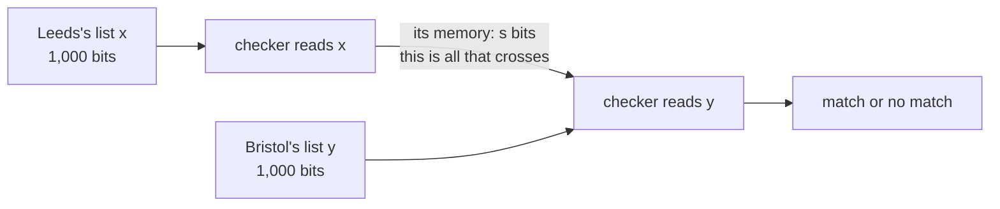

# Communication complexity: how many bits must cross the gap

[Syllabus](../../../SYLLABUS.md) → [Computability and complexity](../README.md) → [Data, Learning and Fine-Grained Complexity](../README.md#s06) → Communication complexity

---

## General Overview

A retailer has two warehouses, one in Leeds and one in Bristol. Its catalogue has 1,000 product codes. Each warehouse keeps a stock list: for each code, 1 if the product is in stock there, 0 if not. Each list is a string of 1,000 bits.

Every night the two sites ask one question: do the two lists match? The link between them is slow and costly, so only the bits that cross it count. Local work is free.

The plain answer is to send the whole list. Leeds sends 1,000 bits, Bristol compares and sends back 1 bit with the answer: 1,001 bits.

This card proves two things about that number:

- **No exact method does better.** Every protocol (a fixed rule for who sends which bit next) that is always right needs 1,001 bits in the worst case. The proof is the pigeonhole principle.
- **A method that may err, with a known small chance, gets by with 41 bits.** Leeds picks a random prime below a million and sends the prime and its list's remainder on division by that prime. Two different lists fool this check at most 1.27 percent of the time.

The same argument then answers a memory question. A program that reads Leeds's list and then Bristol's list in one pass, and keeps only a few bits in between, is a protocol in disguise. Whatever it remembers at the join must cross the gap. So an exact one-pass checker needs at least 1,000 bits of memory.

**Communication complexity counts the bits two parties must exchange to compute a function of their two inputs, and since any one-pass program can be cut in two at any point, with its memory carried across, every lower bound on bits is also a lower bound on memory.**

**What kind of fact this is:** a model (two parties, free local work, bits counted) and three theorems proved on this card in Why it works: the exact cost of EQUALITY is n + 1 bits, the prime fingerprint errs with chance at most n over the number of primes used, and memory is at least one-way communication. The linear lower bound for DISJOINTNESS with randomness is a theorem stated with its source, not proved here.

### The picture: a one-pass checker, cut at the join



Run the checker on Leeds's side, send its memory to Bristol, and finish there. That is a protocol that sends s bits, so s can be no smaller than the bits the question needs.

---

## The formula

Some words first. Two parties, called Leeds and Bristol here, hold inputs $`x`$ and $`y`$, each a string of $`n`$ bits. They want $`f(x, y)`$, the value of a yes-or-no function of both. The function on this card is EQUALITY: $`\mathrm{EQ}(x, y) = 1`$ when $`x = y`$, else 0.

A **protocol** says, at each turn, who speaks and which bit, from that party's own input and the bits sent so far. It ends when both know the answer. Its **cost** is the number of bits sent on the worst input pair. The **transcript** is the list of bits sent on one run.

- $`D(f)`$, read "D of f", is the deterministic communication complexity: the least cost of a protocol that is always right.
- $`R(f)`$ is the randomised communication complexity: the least cost when each party may also flip coins, and the answer must be right with chance at least 2/3 on every input pair.

Two clashes with [Streaming](01-streaming-and-sketching.md), said once: $`D(f)`$ is a cost, not its visitor count $`D`$, and $`N`$ below is the top of a prime range, not its count of requests.

The exact cost of EQUALITY:

```math
D(\mathrm{EQ}_n) = n + 1
```

**Read it aloud:** to settle for sure whether two n-bit lists match, n + 1 bits must cross, and sending the whole list plus a one-bit reply achieves it.

The prime fingerprint, where $`\pi(N)`$ counts the primes below $`N`$ and $`\lceil z \rceil`$ rounds $`z`$ up to a whole number:

```math
R(\mathrm{EQ}_n) \le 2\lceil \log_2 n^2 \rceil + 1, \qquad \Pr[\text{two different lists pass}] \le \frac{n}{\pi(n^2)} \le \frac{\ln n^2}{n}
```

This holds for $`n \ge 20`$, where the error bound is below 1/3.

**Read it aloud:** pick a prime below n squared, send it and the remainder, and reply with one bit. The cost grows like the log of n. A mismatch slips through with chance at most n over the number of primes, and that is at most the natural log of n squared, over n.

For the warehouses, $`n = 1000`$ and $`n^2`$ is a million. A prime below a million needs 20 bits, so does its remainder, and the reply is 1 bit: 41 bits. There are 78,498 primes below a million, so the error is at most 1,000 / 78,498 = 0.012739, about 1.27 percent.

The memory bound, for a program that reads $`x`$ and then $`y`$ in one pass:

```math
s \ \ge\ \text{bits Leeds must send in one message} \ \ge\ n \quad \text{for exact EQUALITY}
```

**Read it aloud:** the memory a one-pass program keeps is at least the length of the one message a one-way protocol needs, and for an exact match check that is all n bits.

| Symbol | Plain meaning | In our example | Push it up and the answer… |
| --- | --- | --- | --- |
| $`x`$, $`y`$, $`x'`$ | the inputs: Leeds's list, Bristol's list, and a second list for Leeds | 1,000-bit stock lists | — |
| $`n`$ | the length of each list in bits | 1,000 | the exact cost rises one for one |
| $`f`$, $`\mathrm{EQ}_n`$ | the function both want; EQUALITY on n bits | do the lists match? | — |
| $`D(f)`$ | fewest bits for an always-right protocol, worst case | 1,001 | — |
| $`R(f)`$, $`\Pr[\cdot]`$ | fewest bits when coins are allowed and error is at most 1/3; the chance of an event over the coins | at most 41; error at most 0.012739 | — |
| $`c`$ | the cost of one protocol: bits sent on the worst pair | 1,001 or 41 | $`2^c`$ transcripts are possible |
| $`p`$ | the prime Leeds picks at random | one of 78,498 below a million | fewer primes fool the check |
| $`N`$, $`\pi(N)`$ | the top of the prime range, and how many primes lie below it | a million; 78,498 | the error bound falls |
| $`x - y`$ | the gap between the two lists, read as whole numbers | below $`2^{1000}`$ | more possible prime factors |
| $`k`$, $`q_1, \ldots, q_k`$ | how many distinct primes divide the gap, and those primes | 129 primes, 2 to 727, for the worst lists | the error rises |
| $`S`$ | a fooling set: input pairs no two of which may share a transcript | the 4 pairs $`(x, x)`$ when $`n = 2`$ | the lower bound rises as $`\log_2`$ of its size |
| $`s`$, $`r`$, $`b`$ | a one-pass program's memory in bits; the running remainder; the next bit read | at least 1,000 for an exact check; $`r`$ and $`b`$ below $`p`$ and 2 | — |

### When it holds

- **Free local work.** The model counts bits only. A protocol may do any amount of computing at each end; if local time matters, the model says nothing about it.
- **Worst case, every input pair.** $`D`$ and $`R`$ are judged on the hardest pair. Many pairs are much easier: lists that differ in one product differ by a power of 2, so at most the prime 2 fools the fingerprint.
- **Leeds's coins are private.** Leeds chooses the prime and sends it, which is why the prime's 20 bits count. With a shared random string known to both in advance (public coins), EQUALITY costs a constant number of bits, but that string must be agreed beforehand.
- **Random primes, not a fixed one.** The error bound is over Leeds's choice. With one prime fixed in advance, an adversary picks lists that differ by a multiple of it, and the check fails every time.
- **A one-pass program cut between x and y.** The memory bound needs the program to finish reading $`x`$ before it reads any of $`y`$. A program that may read the input twice, or in any order, is not covered.

---

## Why it works

### Step 0: the idea

A protocol that sends $`c`$ bits has at most $`2^c`$ possible transcripts. Each transcript is a hole, each input pair a pigeon ([Pigeonhole](../../01-Foundations/08-Relations%20and%20Functions/08-pigeonhole-principle.md)). If two pairs that need different answers are forced into one hole, the protocol must get one wrong. Count the pairs that must be kept apart, and the bits follow.

### Step 1: each transcript is a rectangle

Lay out every answer in a table: rows are Leeds's possible lists, columns are Bristol's. The set of input pairs sharing one transcript is always a **rectangle**: a set of rows times a set of columns.

The reason is that every bit is chosen by one side alone. Leeds's next bit depends on $`x`$ and the bits so far, so it splits the rows still possible and leaves the columns alone. Bristol's bit splits the columns. After every bit, the pairs still consistent with the transcript are still some rows times some columns.

For $`n = 2`$ the table has 4 rows and 4 columns. Under the send-the-list protocol, Leeds sends its 2 bits and Bristol replies with 1. Each cell below shows Leeds's two bits, a bar, then the reply:

| Leeds $`x`$ | Bristol 00 | Bristol 01 | Bristol 10 | Bristol 11 |
| --- | --- | --- | --- | --- |
| 00 | 00\|1 | 00\|0 | 00\|0 | 00\|0 |
| 01 | 01\|0 | 01\|1 | 01\|0 | 01\|0 |
| 10 | 10\|0 | 10\|0 | 10\|1 | 10\|0 |
| 11 | 11\|0 | 11\|0 | 11\|0 | 11\|1 |

The four "match" cells sit on the diagonal, each with a transcript of its own.

### Step 2: the diagonal is a fooling set, so EQUALITY needs n + 1 bits

Take two diagonal pairs, $`(x, x)`$ and $`(x', x')`$ with $`x \ne x'`$. Suppose they share a transcript. That transcript is a rectangle containing rows $`x`$ and $`x'`$ and columns $`x`$ and $`x'`$, so it also contains $`(x, x')`$. The protocol then answers "match" on $`(x, x')`$, which is wrong.

So the $`2^n`$ diagonal pairs need $`2^n`$ different transcripts, all ending "match". At least one more transcript ends "no match". So $`2^c \ge 2^n + 1`$, which forces $`c \ge n + 1`$.

Sending the list and replying achieves $`n + 1`$, so $`D(\mathrm{EQ}_n) = n + 1`$ exactly.

A set of pairs kept apart in this way is a **fooling set** $`S`$. In general $`D(f) \ge \lceil \log_2 (\lvert S \rvert + 1) \rceil`$, where $`\lvert S \rvert`$ is the number of pairs in $`S`$, when $`f`$ also takes the other value somewhere.

The code checks this a second way. For $`n = 1, 2, 3`$ it searches every protocol: at each rectangle not yet settled, it tries every way for Leeds to split its rows and every way for Bristol to split its columns. The best costs are 2, 3 and 4 bits, matching $`n + 1`$.

### Step 3: a remainder is a short fingerprint

Read each list as a whole number below $`2^n`$. Leeds picks a prime $`p`$ at random from the primes below $`n^2`$, and sends $`p`$ and $`x \bmod p`$, the remainder of $`x`$ on division by $`p`$. Bristol answers "match" if $`y \bmod p`$ is the same.

Equal lists always pass. Different lists pass only when $`p`$ divides $`x - y`$. Now count the primes that can do that. The gap $`x - y`$ is not zero and is below $`2^n`$. Each distinct prime factor is at least 2, so a number below $`2^n`$ has fewer than $`n`$ of them. Fewer than $`n`$ of the $`\pi(n^2)`$ primes fool the check, whatever the lists.

<details>
<summary>Detailed proof: the error bound, and why the cost is a few dozen bits</summary>

If $`x \bmod p = y \bmod p`$ then $`p`$ divides $`x - y`$. Let $`q_1, \ldots, q_k`$ be the distinct primes dividing $`\lvert x - y \rvert`$. Each is at least 2, so

$`\displaystyle 2^k \le q_1 q_2 \cdots q_k \le \lvert x - y \rvert < 2^n,`$

and $`k < n`$. The prime is drawn evenly from $`\pi(n^2)`$ choices, so the chance of drawing one of the $`k`$ is $`k / \pi(n^2) < n / \pi(n^2)`$.

For the second inequality, Rosser and Schoenfeld proved $`\pi(N) > N / \ln N`$ for every $`N \ge 17`$. With $`N = n^2`$:

$`\displaystyle \frac{n}{\pi(n^2)} < \frac{n \ln n^2}{n^2} = \frac{\ln n^2}{n}.`$

The prime and the remainder are each below $`n^2`$, so each fits in $`\lceil \log_2 n^2 \rceil`$ bits, and the reply is 1 bit.

</details>

The worst lists for the warehouses differ by the product of the first 129 primes, 2 up to 727, which fits below $`2^{1000}`$. No gap has more distinct prime factors: a number with one more is at least that product times the next prime, 733, which passes $`2^{1000}`$. Then 129 of the 78,498 primes fool the check: an error of 0.001643, about 0.16 percent, well inside the 1.27 percent bound. Repeating the check with fresh primes multiplies the error down, as on the [BPP](../04-Beyond%20Worst%20Case/03-randomised-complexity-and-bpp.md) card.

### Step 4: memory is communication

Take any program that reads $`x`$ and then $`y`$ in one pass and keeps $`s`$ bits of memory. Leeds runs it on $`x`$ and sends the $`s`$ memory bits. Bristol loads them and runs the rest on $`y`$. That is a one-way protocol costing $`s`$ bits, plus the reply. So no one-pass program can use less memory than the shortest one-way message.

For exact EQUALITY the direct count is the same pigeonhole. An $`s`$-bit memory has $`2^s`$ states. If $`s < n`$, two different lists $`x`$ and $`x'`$ leave the same state. Feed $`x`$ as Bristol's list after each: the program sees "$`x`$ then $`x`$" and "$`x'`$ then $`x`$" identically, and must call both a match. One answer is wrong, so $`s \ge n`$.

The fingerprint is also a one-pass program. Reading bits one at a time, it keeps $`r \to (2r + b) \bmod p`$, where $`b`$ is the next bit. For the warehouses it keeps three 20-bit numbers: the prime, the remainder of $`x`$, and the running remainder of $`y`$. That is a few dozen bits, against at least 1,000 bits for an exact check.

### Step 5: what the method proves elsewhere

EQUALITY gets cheap with coins. DISJOINTNESS does not. Leeds and Bristol each hold a set of product codes and ask whether the sets share any code. Kalyanasundaram and Schnitger, and then Razborov with a shorter proof, showed that even with coins and error 1/3 it needs a number of bits proportional to $`n`$. This is stated here, not proved.

By Step 4 that becomes a memory bound for one-pass programs. Alon, Matias and Szegedy used it to show that some summaries of a data stream need linear memory, even approximately and with randomness.

---

## Worked numbers, by hand

| Step | Arithmetic | Value |
| --- | --- | --- |
| exact protocol | send 1,000 bits, reply 1 | **1,001 bits** |
| lower bound | $`2^c \ge 2^{1000} + 1`$ forces $`c \ge 1001`$ | 1,001 bits |
| primes below a million | counted by a sieve | 78,498 |
| bits for a prime or a remainder | $`2^{19} < 10^6 \le 2^{20}`$ | 20 |
| fingerprint cost | 20 + 20 + 1 | **41 bits** |
| error bound | 1,000 / 78,498 | 0.012739 |
| worst real lists | 129 fooling primes / 78,498 | 0.001643 |
| one product differs | the gap is a power of 2, so only the prime 2 can fool it | 1 prime |
| exact one-pass memory | $`2^s \ge 2^{1000}`$ states | at least 1,000 bits |

The exact check sends 1,001 bits against the fingerprint's 41, and the fingerprint lets a mismatch through less than 1.3 percent of the time on any pair of lists.

The gap grows with the catalogue:

| Catalogue size $`n`$ | Exact bits | Fingerprint bits | Error at most |
| --- | ---: | ---: | --- |
| 1,000 | 1,001 | 41 | 1 in 72 |
| 1,000,000 | 1,000,001 | 81 | 1 in 36,191 |
| 1,000,000,000 | 1,000,000,001 | 121 | 1 in 24,127,471 |

The error column uses the Rosser–Schoenfeld form $`\ln n^2 / n`$, a little looser than the exact count at 1,000.

### What breaks if you drop a piece

| Mistake | Comes out at | What went wrong |
| --- | --- | --- |
| A fixed prime, 999,983 | lists 999,983 apart both leave remainder 354,087: fooled every run | the bound comes from the random choice |
| Primes below 100 only | all 25 primes divide the product of all 25: error 1 | too few primes to outnumber the factors |
| A 9-bit memory on 10-bit lists | 0000000000 and 1000000000 share a state: a false match | 1,024 lists, 512 states |
| Counting only Leeds's message | 2 bits for $`n = 2`$, but the search finds 3 | the reply bit is part of the cost |

The code prints all four.

---

## Code, from first principles, and it actually runs

The code takes three independent roads. For tiny lists it searches every protocol and compares the best cost with the fooling-set bound and the send-the-list protocol. For the warehouses it counts the fooling primes one by one, checks that count against the worst lists' construction, simulates 200,000 runs with a SplitMix64 generator (seed 2026), and compares all three with the bound. It also builds the pigeonhole collision for a too-small memory. Python uses its own whole numbers; Rust carries each list as 16 words of 64 bits.

### Python

```python
# Communication complexity -- the check behind the card.  Standard library only.
# Two warehouses, Leeds (list x) and Bristol (list y), each mark 1,000 product
# codes in stock (1) or out (0), and ask whether the two lists match: EQUALITY.
# Roads: an exhaustive search for the best protocol against the fooling-set
# bound; a fingerprint's error counted prime by prime, simulated, and bounded.
import math

def ceil_log2(m):                    # fewest bits to give m outcomes distinct names
    return (m - 1).bit_length()

def popcount(v):
    return bin(v).count("1")

def best_protocol_bits(n):           # exhaustive search over every protocol for EQUALITY on n bits
    size = 1 << (1 << n)             # rectangles: a set of Leeds rows times a set of Bristol columns
    D = [0] * (size * size)
    for r in range(size):
        for c in range(size):
            ones, cells = popcount(r & c), popcount(r) * popcount(c)
            if ones == 0 or ones == cells:
                continue                       # one answer fills it: no more bits needed
            best = 99
            s = (r - 1) & r                    # Leeds splits its rows in two: one bit sent
            while s:
                best = min(best, 1 + max(D[s * size + c], D[(r ^ s) * size + c]))
                s = (s - 1) & r
            s = (c - 1) & c                    # or Bristol splits its columns in two
            while s:
                best = min(best, 1 + max(D[r * size + s], D[r * size + (c ^ s)]))
                s = (s - 1) & c
            D[r * size + c] = best
    return D[size * size - 1]

def sieve(limit):
    flag = bytearray([1]) * limit
    flag[0:2] = b"\x00\x00"
    for i in range(2, int(limit ** 0.5) + 1):
        if flag[i]:
            flag[i * i::i] = bytearray(len(range(i * i, limit, i)))
    return [i for i in range(limit) if flag[i]]

def stream_mod(bits, p):             # one pass over the list, keeping only a remainder
    r = 0
    for b in bits:
        r = (2 * r + b) % p
    return r

class SplitMix64:
    def __init__(self, seed): self.s = seed
    def next(self):
        self.s = (self.s + 0x9E3779B97F4A7C15) & (2**64 - 1)
        z = self.s
        z = ((z ^ (z >> 30)) * 0xBF58476D1CE4E5B9) & (2**64 - 1)
        z = ((z ^ (z >> 27)) * 0x94D049BB133111EB) & (2**64 - 1)
        return z ^ (z >> 31)

print("== deterministic: exhaustive search against the fooling-set bound ==")
for n in (1, 2, 3):
    found, bound = best_protocol_bits(n), ceil_log2(2**n + 1)
    print(f"n = {n}: best protocol {found} bits; fooling-set bound {bound}; send-the-list protocol {n + 1}")
    assert found == bound == n + 1
print("n = 2 send-the-list transcripts (row x = Leeds, column y = Bristol):")
for x in range(4):
    print(f"  x = {x:02b}: " + "  ".join(f"{x:02b}|{int(x == y)}" for y in range(4)))

print("== the warehouses: n = 1000 product codes ==")
n, LIMIT, TRIALS = 1000, 10**6, 200000
primes = sieve(LIMIT)
pbits = ceil_log2(LIMIT)
print(f"send the whole list, plus the answer: {n + 1} bits")
print(f"primes below {LIMIT}: {len(primes)}; bits to name one: {pbits}")
print(f"fingerprint: prime {pbits} + remainder {pbits} + answer 1 = {2 * pbits + 1} bits")
d, k = 1, 0
while d * primes[k] < 2**n:          # the worst difference: as many small primes as fit below 2^n
    d, k = d * primes[k], k + 1
g = SplitMix64(2026)
y = sum(g.next() << (64 * i) for i in range(16)) % 2**998   # so x = y + d stays below 2^1000
x = y + d
xb = [(x >> (n - 1 - i)) & 1 for i in range(n)]
fool = sum(1 for p in primes if (x - y) % p == 0)
print(f"worst lists: x - y = product of the first {k} primes, largest {primes[k - 1]}; times the next, {primes[k]}, it passes 2^{n}")
print(f"primes that fool the check, counted one by one: {fool}")
assert fool == k                                     # construction against count
assert sum(math.log2(p) for p in primes[:k]) < n <= sum(math.log2(p) for p in primes[:k + 1])  # and no gap has more
assert all(stream_mod(xb, p) == x % p for p in primes[-3:])  # one-pass remainder against division
hits = 0
for _ in range(TRIALS):
    p = primes[g.next() % len(primes)]
    hits += x % p == y % p
exact, bound = fool / len(primes), n / len(primes)
sd = math.sqrt(exact * (1 - exact) / TRIALS)
print(f"error: exact {exact:.6f}; simulated {hits / TRIALS:.6f} over {TRIALS} runs; bound n/pi {bound:.6f}")
assert abs(hits / TRIALS - exact) < 4 * sd and exact <= bound
assert len(primes) == 78498                          # the published count of primes below a million
one = y ^ (1 << 500)                 # an easy case: one product's line flipped
print(f"one line differs: primes that fool the check {sum(1 for p in primes if (one - y) % p == 0)}")
print("== growth: bits to settle EQUALITY ==")
for e in (3, 6, 9):
    m = 10**e
    b = ceil_log2(m * m)
    print(f"n = 10^{e}: whole list {m + 1}; fingerprint {2 * b + 1}; error at most 1 in {round(m / math.log(m * m))}")

print("== memory: a one-pass checker needs n bits ==")
small, keep = 10, 9                  # a checker that keeps only the low 9 bits of Leeds's list
seen = {}
for lst in range(2**small):
    st = lst % 2**keep
    if st in seen:
        a, b = seen[st], lst
        break
    seen[st] = lst
print(f"{keep}-bit memory, {small}-bit lists: {2**small} lists, {2**keep} states; "
      f"{a:0{small}b} and {b:0{small}b} share state {a % 2**keep}")
bits = lambda v: [(v >> (small - 1 - i)) & 1 for i in range(small)]
said = stream_mod(bits(b), 2**keep) == stream_mod(bits(a), 2**keep)   # the 9-bit checker, run bit by bit
print(f"stream {b:0{small}b} then {a:0{small}b}: checker says {'match' if said else 'no match'}, lists differ")
assert said

print("== what breaks ==")
print(f"counting only Leeds's message, n = 2: {ceil_log2(2**2)} bits, but the search finds {best_protocol_bits(2)}")
q = primes[-1]
print(f"fixed prime {q}, lists differing by {q}: remainders {x % q} and {(x - q) % q}: fooled every run")
d25 = 1
for p in primes[:25]:
    d25 *= p
print(f"primes below 100 only: {sum(1 for p in primes[:25] if d25 % p == 0)} of 25 fool the check, error 1")
print("ALL CHECKS PASS")
```

**Ran 2026-11-19 on macOS, Python 3.14.10, standard library only. All checks passed. Output, pasted from the run:**

```
== deterministic: exhaustive search against the fooling-set bound ==
n = 1: best protocol 2 bits; fooling-set bound 2; send-the-list protocol 2
n = 2: best protocol 3 bits; fooling-set bound 3; send-the-list protocol 3
n = 3: best protocol 4 bits; fooling-set bound 4; send-the-list protocol 4
n = 2 send-the-list transcripts (row x = Leeds, column y = Bristol):
  x = 00: 00|1  00|0  00|0  00|0
  x = 01: 01|0  01|1  01|0  01|0
  x = 10: 10|0  10|0  10|1  10|0
  x = 11: 11|0  11|0  11|0  11|1
== the warehouses: n = 1000 product codes ==
send the whole list, plus the answer: 1001 bits
primes below 1000000: 78498; bits to name one: 20
fingerprint: prime 20 + remainder 20 + answer 1 = 41 bits
worst lists: x - y = product of the first 129 primes, largest 727; times the next, 733, it passes 2^1000
primes that fool the check, counted one by one: 129
error: exact 0.001643; simulated 0.001730 over 200000 runs; bound n/pi 0.012739
one line differs: primes that fool the check 1
== growth: bits to settle EQUALITY ==
n = 10^3: whole list 1001; fingerprint 41; error at most 1 in 72
n = 10^6: whole list 1000001; fingerprint 81; error at most 1 in 36191
n = 10^9: whole list 1000000001; fingerprint 121; error at most 1 in 24127471
== memory: a one-pass checker needs n bits ==
9-bit memory, 10-bit lists: 1024 lists, 512 states; 0000000000 and 1000000000 share state 0
stream 1000000000 then 0000000000: checker says match, lists differ
== what breaks ==
counting only Leeds's message, n = 2: 2 bits, but the search finds 3
fixed prime 999983, lists differing by 999983: remainders 354087 and 354087: fooled every run
primes below 100 only: 25 of 25 fool the check, error 1
ALL CHECKS PASS
```

### Rust

Same numbers, same labels, built with `rustc --edition 2021 -O`.

```rust
// Communication complexity -- the same check as the Python, in Rust.  No crates.
// Two warehouses, Leeds (list x) and Bristol (list y), each mark 1,000 product
// codes in stock (1) or out (0), and ask whether the two lists match: EQUALITY.
// Roads: an exhaustive search for the best protocol against the fooling-set
// bound; a fingerprint's error counted prime by prime, simulated, and bounded.
// Lists of 1,000 bits are 16 limbs of 64 bits, lowest limb first.
type Big = Vec<u64>;

fn ceil_log2(m: u64) -> u32 { 64 - (m - 1).leading_zeros() } // fewest bits naming m outcomes

fn best_protocol_bits(n: u32) -> u32 {        // exhaustive search over every protocol
    let size = 1usize << (1 << n);            // rectangles: Leeds rows times Bristol columns
    let mut d = vec![0u32; size * size];
    for r in 0..size {
        for c in 0..size {
            let ones = (r & c).count_ones();
            let cells = r.count_ones() * c.count_ones();
            if ones == 0 || ones == cells { continue }   // one answer fills it
            let mut best = 99;
            let mut s = (r.wrapping_sub(1)) & r;          // Leeds splits its rows: one bit
            while s != 0 {
                best = best.min(1 + d[s * size + c].max(d[(r ^ s) * size + c]));
                s = (s - 1) & r;
            }
            s = (c.wrapping_sub(1)) & c;                  // or Bristol splits its columns
            while s != 0 {
                best = best.min(1 + d[r * size + s].max(d[r * size + (c ^ s)]));
                s = (s - 1) & c;
            }
            d[r * size + c] = best;
        }
    }
    d[size * size - 1]
}

fn sieve(limit: usize) -> Vec<u64> {
    let mut flag = vec![true; limit];
    flag[0] = false; flag[1] = false;
    let mut i = 2;
    while i * i < limit {
        if flag[i] { let mut j = i * i; while j < limit { flag[j] = false; j += i } }
        i += 1;
    }
    (0..limit).filter(|&i| flag[i]).map(|i| i as u64).collect()
}

fn rem(a: &Big, p: u64) -> u64 {               // a mod p, limb by limb from the top
    let mut r: u128 = 0;
    for &l in a.iter().rev() { r = ((r << 64) | l as u128) % p as u128 }
    r as u64
}

fn mul_small(a: &Big, m: u64) -> Big {
    let mut carry: u128 = 0;
    a.iter().map(|&l| { let t = l as u128 * m as u128 + carry; carry = t >> 64; t as u64 }).collect()
}

fn add(a: &Big, b: &Big) -> Big {
    let mut carry = 0u128;
    (0..16).map(|i| { let t = a[i] as u128 + b[i] as u128 + carry; carry = t >> 64; t as u64 }).collect()
}

fn sub_small(a: &Big, m: u64) -> Big {
    let mut out = a.clone();
    let mut borrow = m;
    for l in out.iter_mut() {
        let (v, o) = l.overflowing_sub(borrow);
        *l = v;
        borrow = o as u64;
        if borrow == 0 { break }
    }
    out
}

fn stream_mod(bits: &[u64], p: u64) -> u64 {   // one pass over the list, keeping a remainder
    bits.iter().fold(0, |r, &b| (2 * r + b) % p)
}

struct SplitMix64 { s: u64 }
impl SplitMix64 {
    fn next(&mut self) -> u64 {
        self.s = self.s.wrapping_add(0x9E3779B97F4A7C15);
        let mut z = self.s;
        z = (z ^ (z >> 30)).wrapping_mul(0xBF58476D1CE4E5B9);
        z = (z ^ (z >> 27)).wrapping_mul(0x94D049BB133111EB);
        z ^ (z >> 31)
    }
}

fn main() {
    println!("== deterministic: exhaustive search against the fooling-set bound ==");
    for n in 1..=3u32 {
        let (found, bound) = (best_protocol_bits(n), ceil_log2((1u64 << n) + 1));
        println!("n = {}: best protocol {} bits; fooling-set bound {}; send-the-list protocol {}", n, found, bound, n + 1);
        assert!(found == bound && bound == n + 1);
    }
    println!("n = 2 send-the-list transcripts (row x = Leeds, column y = Bristol):");
    for x in 0..4 {
        let cells: Vec<String> = (0..4).map(|y| format!("{:02b}|{}", x, (x == y) as u8)).collect();
        println!("  x = {:02b}: {}", x, cells.join("  "));
    }

    println!("== the warehouses: n = 1000 product codes ==");
    let (n, limit, trials) = (1000usize, 1_000_000u64, 200_000u64);
    let primes = sieve(limit as usize);
    let pbits = ceil_log2(limit);
    println!("send the whole list, plus the answer: {} bits", n + 1);
    println!("primes below {}: {}; bits to name one: {}", limit, primes.len(), pbits);
    println!("fingerprint: prime {} + remainder {} + answer 1 = {} bits", pbits, pbits, 2 * pbits + 1);
    let below1000 = |a: &Big| a[15] >> 40 == 0;               // limb 15 holds bits 960 to 1023
    let (mut d, mut k): (Big, usize) = (vec![0; 16], 0); d[0] = 1;
    while below1000(&mul_small(&d, primes[k])) { d = mul_small(&d, primes[k]); k += 1 }
    let mut g = SplitMix64 { s: 2026 };
    let mut y: Big = (0..16).map(|_| g.next()).collect();
    y[15] &= (1u64 << 38) - 1;                                    // so x = y + d stays below 2^1000
    let x = add(&y, &d);
    let xb: Vec<u64> = (0..n).map(|i| { let j = n - 1 - i; (x[j / 64] >> (j % 64)) & 1 }).collect();
    let fool = primes.iter().filter(|&&p| rem(&x, p) == rem(&y, p)).count();
    println!("worst lists: x - y = product of the first {} primes, largest {}; times the next, {}, it passes 2^{}", k, primes[k - 1], primes[k], n);
    println!("primes that fool the check, counted one by one: {}", fool);
    assert!(fool == k);                                           // construction against count
    assert!(primes[..k].iter().map(|&p| (p as f64).log2()).sum::<f64>() < n as f64 && n as f64 <= primes[..=k].iter().map(|&p| (p as f64).log2()).sum::<f64>()); // and no gap has more
    assert!(primes[primes.len() - 3..].iter().all(|&p| stream_mod(&xb, p) == rem(&x, p)));
    let mut hits = 0u64;
    for _ in 0..trials {
        let p = primes[(g.next() % primes.len() as u64) as usize];
        if rem(&x, p) == rem(&y, p) { hits += 1 }
    }
    let (exact, bound) = (fool as f64 / primes.len() as f64, n as f64 / primes.len() as f64);
    let sim = hits as f64 / trials as f64;
    let sd = (exact * (1.0 - exact) / trials as f64).sqrt();
    println!("error: exact {:.6}; simulated {:.6} over {} runs; bound n/pi {:.6}", exact, sim, trials, bound);
    assert!((sim - exact).abs() < 4.0 * sd && exact <= bound);
    assert!(primes.len() == 78498);                               // the published count below a million
    let mut one = y.clone();
    one[500 / 64] ^= 1u64 << (500 % 64);                          // one product's line flipped
    println!("one line differs: primes that fool the check {}", primes.iter().filter(|&&p| rem(&one, p) == rem(&y, p)).count());
    println!("== growth: bits to settle EQUALITY ==");
    for e in [3u32, 6, 9] {
        let m = 10u64.pow(e);
        let b = ceil_log2(m * m);
        println!("n = 10^{}: whole list {}; fingerprint {}; error at most 1 in {}", e, m + 1, 2 * b + 1, (m as f64 / ((m * m) as f64).ln()).round() as u64);
    }

    println!("== memory: a one-pass checker needs n bits ==");
    let (small, keep) = (10u32, 9u32);                            // keeps the low 9 bits only
    let mut seen = vec![u32::MAX; 1 << keep];
    let (mut a, mut b) = (0u32, 0u32);
    for lst in 0..(1u32 << small) {
        let st = (lst % (1 << keep)) as usize;
        if seen[st] != u32::MAX { a = seen[st]; b = lst; break }
        seen[st] = lst;
    }
    println!("{}-bit memory, {}-bit lists: {} lists, {} states; {:010b} and {:010b} share state {}",
             keep, small, 1u32 << small, 1u32 << keep, a, b, a % (1 << keep));
    let bits = |v: u32| -> Vec<u64> { (0..small).map(|i| ((v >> (small - 1 - i)) & 1) as u64).collect() };
    let said = stream_mod(&bits(b), 1 << keep) == stream_mod(&bits(a), 1 << keep); // the 9-bit checker, run bit by bit
    println!("stream {:010b} then {:010b}: checker says {}, lists differ", b, a, if said { "match" } else { "no match" });
    assert!(said);

    println!("== what breaks ==");
    println!("counting only Leeds's message, n = 2: {} bits, but the search finds {}", ceil_log2(1u64 << 2), best_protocol_bits(2));
    let q = primes[primes.len() - 1];
    println!("fixed prime {}, lists differing by {}: remainders {} and {}: fooled every run",
             q, q, rem(&x, q), rem(&sub_small(&x, q), q));
    let mut d25: Big = vec![0; 16]; d25[0] = 1;
    for &p in &primes[..25] { d25 = mul_small(&d25, p) }
    println!("primes below 100 only: {} of 25 fool the check, error 1", primes[..25].iter().filter(|&&p| rem(&d25, p) == 0).count());
    println!("ALL CHECKS PASS");
}
```

**Ran 2026-11-19 on macOS, rustc 1.98.1, no crates. All checks passed. Output, pasted from the run:**

```
== deterministic: exhaustive search against the fooling-set bound ==
n = 1: best protocol 2 bits; fooling-set bound 2; send-the-list protocol 2
n = 2: best protocol 3 bits; fooling-set bound 3; send-the-list protocol 3
n = 3: best protocol 4 bits; fooling-set bound 4; send-the-list protocol 4
n = 2 send-the-list transcripts (row x = Leeds, column y = Bristol):
  x = 00: 00|1  00|0  00|0  00|0
  x = 01: 01|0  01|1  01|0  01|0
  x = 10: 10|0  10|0  10|1  10|0
  x = 11: 11|0  11|0  11|0  11|1
== the warehouses: n = 1000 product codes ==
send the whole list, plus the answer: 1001 bits
primes below 1000000: 78498; bits to name one: 20
fingerprint: prime 20 + remainder 20 + answer 1 = 41 bits
worst lists: x - y = product of the first 129 primes, largest 727; times the next, 733, it passes 2^1000
primes that fool the check, counted one by one: 129
error: exact 0.001643; simulated 0.001730 over 200000 runs; bound n/pi 0.012739
one line differs: primes that fool the check 1
== growth: bits to settle EQUALITY ==
n = 10^3: whole list 1001; fingerprint 41; error at most 1 in 72
n = 10^6: whole list 1000001; fingerprint 81; error at most 1 in 36191
n = 10^9: whole list 1000000001; fingerprint 121; error at most 1 in 24127471
== memory: a one-pass checker needs n bits ==
9-bit memory, 10-bit lists: 1024 lists, 512 states; 0000000000 and 1000000000 share state 0
stream 1000000000 then 0000000000: checker says match, lists differ
== what breaks ==
counting only Leeds's message, n = 2: 2 bits, but the search finds 3
fixed prime 999983, lists differing by 999983: remainders 354087 and 354087: fooled every run
primes below 100 only: 25 of 25 fool the check, error 1
ALL CHECKS PASS
```

The two outputs match line for line.

### Lean

Lean proves the card's three bounds on EQUALITY for lists of any length, and checks the worked numbers.

- Take lists of $`n \ge 1`$ bits. Then $`D(\mathrm{EQ}_n) = n + 1`$: no always-right protocol sends fewer bits, and sending the list plus a reply achieves it.
- Suppose two different lists are read as whole numbers below $`2^n`$. Then fewer than $`n`$ of the primes below $`n^2`$ fool the check. So a mismatch passes with chance at most $`n / \pi(n^2)`$.
- Suppose a one-pass program keeps $`s`$ bits of memory at the join and decides EQUALITY exactly. Then $`s \ge n`$.
- The worked numbers check: 20-bit primes below a million, the 41-bit, 81-bit and 121-bit fingerprints, and the 129 primes from 2 to 727.
- The product of those 129 primes stays below $`2^{1000}`$. Times the next prime, 733, it passes. A gap that is a power of 2 has only the prime factor 2.
- The arithmetic of three What breaks rows checks: the fixed prime 999,983, the 25 primes below 100, and 512 states against 1,024 lists.

The protocol search for tiny lists, the count of 78,498 primes and the 200,000-run simulation are left to the Python and Rust checks.

```lean
-- Communication complexity: deciding for sure whether two n-bit lists match takes exactly n + 1 bits, a random prime fingerprint is fooled by fewer than n primes, and an exact one-pass match checker needs at least n bits of memory.
import Mathlib.NumberTheory.PrimeCounting
import Mathlib.NumberTheory.Primorial
import Mathlib.Tactic.NormNum.Prime

/-! ## The model

Leeds holds `x : X`, Bristol holds `y : Y`. A deterministic protocol is a tree. At a leaf
both parties know the answer. At an `alice` node Leeds sends one bit computed from `x` alone;
at a `bob` node Bristol sends one bit computed from `y` alone. The bit picks the subtree:
`false` the first, `true` the second. Local work is free; only bits sent are counted. -/

/-- A deterministic two-party protocol with Leeds's inputs `X` and Bristol's inputs `Y`. -/
inductive Protocol (X Y : Type) where
  | leaf : Bool → Protocol X Y
  | alice : (X → Bool) → Protocol X Y → Protocol X Y → Protocol X Y
  | bob : (Y → Bool) → Protocol X Y → Protocol X Y → Protocol X Y

namespace Protocol

variable {X Y : Type}

/-- The answer the protocol gives on the input pair `(x, y)`. -/
def eval : Protocol X Y → X → Y → Bool
  | leaf b, _, _ => b
  | alice f p q, x, y => if f x then q.eval x y else p.eval x y
  | bob g p q, x, y => if g y then q.eval x y else p.eval x y

/-- The cost of a protocol: the number of bits sent on the worst input pair, that is, the
depth of its tree. -/
def cost : Protocol X Y → ℕ
  | leaf _ => 0
  | alice _ p q => max p.cost q.cost + 1
  | bob _ p q => max p.cost q.cost + 1

end Protocol

/-- `D(f)`: the deterministic communication complexity of `f`, the least cost of a protocol
that is right on every input pair. -/
noncomputable def detCC {X Y : Type} (f : X → Y → Bool) : ℕ :=
  sInf {c | ∃ P : Protocol X Y, (∀ x y, P.eval x y = f x y) ∧ P.cost = c}

/-- EQUALITY on `n`-bit lists: `EQ(x, y) = 1` when `x = y`, else 0. -/
def eqFun (n : ℕ) (x y : Fin n → Bool) : Bool := decide (x = y)


/-! ## Helper definitions and lemmas for the proofs -/

namespace Protocol

variable {X Y : Type}

/-- A number below `2 ^ cost` naming the leaf that the input pair `(x, y)` reaches. -/
def code : Protocol X Y → X → Y → ℕ
  | leaf _, _, _ => 0
  | alice f p q, x, y => if f x then 2 ^ max p.cost q.cost + q.code x y else p.code x y
  | bob g p q, x, y => if g y then 2 ^ max p.cost q.cost + q.code x y else p.code x y

end Protocol

theorem Protocol.code_lt {X Y : Type} (P : Protocol X Y) (x : X) (y : Y) : P.code x y < 2 ^ P.cost := by
  induction P with
  | leaf b => simp [code, cost]
  | alice f p q ihp ihq =>
    have hp : 2 ^ p.cost ≤ 2 ^ max p.cost q.cost := Nat.pow_le_pow_right (by norm_num) (le_max_left _ _)
    have hq : 2 ^ q.cost ≤ 2 ^ max p.cost q.cost := Nat.pow_le_pow_right (by norm_num) (le_max_right _ _)
    simp only [code, cost, pow_succ]
    split_ifs <;> omega
  | bob g p q ihp ihq =>
    have hp : 2 ^ p.cost ≤ 2 ^ max p.cost q.cost := Nat.pow_le_pow_right (by norm_num) (le_max_left _ _)
    have hq : 2 ^ q.cost ≤ 2 ^ max p.cost q.cost := Nat.pow_le_pow_right (by norm_num) (le_max_right _ _)
    simp only [code, cost, pow_succ]
    split_ifs <;> omega

/-- Two input pairs that reach the same leaf get the same answer, and the crossed pair
reaches that leaf too. -/
theorem Protocol.code_rect {X Y : Type} (P : Protocol X Y) (a a' : X) (b b' : Y) (h : P.code a b = P.code a' b') :
    P.eval a b = P.eval a' b' ∧ P.code a b' = P.code a b := by
  induction P with
  | leaf c => simp [eval, code]
  | alice f p q ihp ihq =>
    have hp := p.code_lt
    have hq := q.code_lt
    have hp' : 2 ^ p.cost ≤ 2 ^ max p.cost q.cost := Nat.pow_le_pow_right (by norm_num) (le_max_left _ _)
    simp only [code] at h
    simp only [eval, code]
    by_cases ha : f a = true <;> by_cases ha' : f a' = true <;> simp only [ha, ha', ite_true, ite_false, Bool.false_eq_true] at h ⊢
    · have e := ihq (by omega); exact ⟨e.1, by rw [e.2]⟩
    · have := hp a' b'; omega
    · have := hp a b; omega
    · exact ihp h
  | bob g p q ihp ihq =>
    have hp := p.code_lt
    have hq := q.code_lt
    have hp' : 2 ^ p.cost ≤ 2 ^ max p.cost q.cost := Nat.pow_le_pow_right (by norm_num) (le_max_left _ _)
    simp only [code] at h
    simp only [eval, code]
    by_cases hb : g b = true <;> by_cases hb' : g b' = true <;> simp only [hb, hb', ite_true, ite_false, Bool.false_eq_true] at h ⊢
    · have e := ihq (by omega); exact ⟨e.1, by rw [e.2]⟩
    · have := hp a' b'; omega
    · have := hp a b; omega
    · exact ihp h


/-- Leeds sends the bits of `x` at positions below `m` one at a time; then Bristol, who now
knows all of `x` (the guess `acc` is right at every position from `m` on), replies with one
bit saying whether `y = x`. -/
def sendAll (n : ℕ) : ℕ → (Fin n → Bool) → Protocol (Fin n → Bool) (Fin n → Bool)
  | 0, acc => .bob (fun y => decide (y = acc)) (.leaf false) (.leaf true)
  | m + 1, acc =>
    .alice (fun x => if h : m < n then x ⟨m, h⟩ else false)
      (sendAll n m (fun i => if i.val = m then false else acc i))
      (sendAll n m (fun i => if i.val = m then true else acc i))

theorem sendAll_cost (n m : ℕ) (acc : Fin n → Bool) : (sendAll n m acc).cost = m + 1 := by
  induction m generalizing acc with
  | zero => simp [sendAll, Protocol.cost]
  | succ m ih => simp [sendAll, Protocol.cost, ih]

theorem sendAll_eval (n m : ℕ) (hm : m ≤ n) (acc : Fin n → Bool) (x y : Fin n → Bool)
    (hacc : ∀ i : Fin n, m ≤ i.val → acc i = x i) : (sendAll n m acc).eval x y = eqFun n x y := by
  induction m generalizing acc with
  | zero =>
    have : acc = x := funext fun i => hacc i (Nat.zero_le _)
    subst this
    by_cases h : y = acc <;> simp [sendAll, Protocol.eval, eqFun, h, eq_comm]
  | succ m ih =>
    have hmn : m < n := hm
    simp only [sendAll, Protocol.eval, hmn, dite_true]
    split_ifs with hx
    · apply ih (by omega)
      intro i hi
      by_cases him : i.val = m
      · have : i = ⟨m, hmn⟩ := Fin.ext him
        subst this; simp [hx]
      · simp only [him, ite_false]; exact hacc i (by omega)
    · apply ih (by omega)
      intro i hi
      by_cases him : i.val = m
      · have : i = ⟨m, hmn⟩ := Fin.ext him
        subst this; simp at hx; simp [hx]
      · simp only [him, ite_false]; exact hacc i (by omega)

theorem eq_protocol_cost_ge (n : ℕ) (hn : 0 < n) (P : Protocol (Fin n → Bool) (Fin n → Bool))
    (hP : ∀ x y, P.eval x y = eqFun n x y) : n + 1 ≤ P.cost := by
  let x0 : Fin n → Bool := fun _ => false
  let y0 : Fin n → Bool := fun _ => true
  have hne : x0 ≠ y0 := by
    intro h
    have := congrFun h ⟨0, hn⟩
    simp [x0, y0] at this
  let g : Option (Fin n → Bool) → Fin (2 ^ P.cost) := fun o =>
    match o with
    | none => ⟨P.code x0 y0, P.code_lt _ _⟩
    | some x => ⟨P.code x x, P.code_lt _ _⟩
  have hdiag : ∀ x x', P.code x x = P.code x' x' → x = x' := by
    intro x x' h
    have h2 := (P.code_rect x x' x x' h).2
    have h4 := (P.code_rect x x x x' h2.symm).1
    rw [hP, hP] at h4
    simpa [eqFun] using h4.symm
  have hoff : ∀ z, P.code x0 y0 ≠ P.code z z := by
    intro z h
    have h1 := (P.code_rect x0 z y0 z h).1
    have hz : P.code x0 z = P.code z z := (P.code_rect x0 z y0 z h).2.trans h
    have hz' := (P.code_rect x0 z z z hz).1
    rw [hP, hP] at hz' h1
    have hx0z : x0 = z := by simpa [eqFun] using hz'
    subst hx0z
    simp [eqFun, hne] at h1
  have hinj : Function.Injective g := by
    intro o o' h
    cases o with
    | none =>
      cases o' with
      | none => rfl
      | some z => exact absurd (Fin.mk.inj_iff.mp h) (hoff z)
    | some x =>
      cases o' with
      | none => exact absurd (Fin.mk.inj_iff.mp h).symm (hoff x)
      | some z => exact congrArg some (hdiag x z (Fin.mk.inj_iff.mp h))
  have hcard := Fintype.card_le_of_injective g hinj
  simp only [Fintype.card_option, Fintype.card_fun, Fintype.card_bool, Fintype.card_fin] at hcard
  have : 2 ^ n < 2 ^ P.cost := by omega
  have := (Nat.pow_lt_pow_iff_right (by norm_num : 1 < 2)).mp this
  omega

/-! ## The card's three theorems -/

/-- The exact cost of EQUALITY: to settle for sure whether two `n`-bit lists match,
`n + 1` bits must cross, and sending the whole list plus a one-bit reply achieves it:
`D(EQ_n) = n + 1`. The lists have at least one bit (`0 < n`); with empty lists every pair
matches and no bit need cross. -/
theorem detCC_equality_eq_succ (n : ℕ) (hn : 0 < n) : detCC (eqFun n) = n + 1 := by
  have hmem : n + 1 ∈ {c | ∃ P : Protocol (Fin n → Bool) (Fin n → Bool),
      (∀ x y, P.eval x y = eqFun n x y) ∧ P.cost = c} :=
    ⟨sendAll n n (fun _ => false), fun x y => sendAll_eval n n le_rfl _ x y
      (fun i hi => absurd i.isLt (by omega)), sendAll_cost n n _⟩
  unfold detCC
  apply le_antisymm (Nat.sInf_le hmem)
  apply le_csInf ⟨_, hmem⟩
  rintro c ⟨P, hP, rfl⟩
  exact eq_protocol_cost_ge n hn P hP

/-- The prime fingerprint's error. Read two different lists as whole numbers `x ≠ y` below
`2^n`. Leeds picks a prime `p` below `n^2` and the check passes when `x mod p = y mod p`.
Fewer than `n` primes fool the check, so with the prime drawn evenly from the `π(n^2)`
primes below `n^2`, two different lists pass with chance at most `n / π(n^2)`. -/
theorem fingerprint_fooled_by_fewer_than_n_primes (n x y : ℕ)
    (hx : x < 2 ^ n) (hy : y < 2 ^ n) (hxy : x ≠ y) :
    ((Finset.range (n ^ 2)).filter (fun p => p.Prime ∧ x % p = y % p)).card < n ∧
      (((Finset.range (n ^ 2)).filter (fun p => p.Prime ∧ x % p = y % p)).card : ℚ) /
          Nat.primeCounting' (n ^ 2) ≤ (n : ℚ) / Nat.primeCounting' (n ^ 2) := by
  set S := (Finset.range (n ^ 2)).filter (fun p => p.Prime ∧ x % p = y % p) with hS
  set d := ((y : ℤ) - x).natAbs with hd
  have hd0 : 0 < d := by omega
  have hdlt : d < 2 ^ n := by omega
  have hdvd : ∀ p ∈ S, p ∣ d := by
    intro p hp
    rw [hS, Finset.mem_filter] at hp
    have : (p : ℤ) ∣ (y : ℤ) - x := Nat.ModEq.dvd hp.2.2
    exact Int.natCast_dvd.mp this
  have hprod : (∏ p ∈ S, p) ∣ d :=
    Finset.prod_primes_dvd d (fun p hp => (Finset.mem_filter.mp hp).2.1.prime) hdvd
  have hle : 2 ^ S.card ≤ ∏ p ∈ S, p :=
    Finset.pow_card_le_prod _ _ _ (fun p hp => (Finset.mem_filter.mp hp).2.1.two_le)
  have hlt : 2 ^ S.card < 2 ^ n := lt_of_le_of_lt (hle.trans (Nat.le_of_dvd hd0 hprod)) hdlt
  have hc : S.card < n := (Nat.pow_lt_pow_iff_right (by norm_num : 1 < 2)).mp hlt
  refine ⟨hc, ?_⟩
  apply div_le_div_of_nonneg_right _ (by positivity)
  exact_mod_cast hc.le

/-- Memory is communication. A program that reads Leeds's list `x` and then Bristol's list
`y` in one pass keeps `s` bits of memory at the join: a state `mem x` that depends on `x`
alone, after which its answer depends only on that state and `y`. If it decides EQUALITY
exactly, then `s ≥ n`. -/
theorem one_pass_equality_memory_ge (n s : ℕ) (mem : (Fin n → Bool) → (Fin s → Bool))
    (finish : (Fin s → Bool) → (Fin n → Bool) → Bool)
    (h : ∀ x y, finish (mem x) y = eqFun n x y) : n ≤ s := by
  have hinj : Function.Injective mem := by
    intro x x' hx
    have h1 := h x x'
    rw [hx, h x' x'] at h1
    simpa [eqFun] using h1.symm
  have hcard := Fintype.card_le_of_injective mem hinj
  simp only [Fintype.card_fun, Fintype.card_bool, Fintype.card_fin] at hcard
  exact (Nat.pow_le_pow_iff_right (by norm_num : 1 < 2)).mp hcard

/-! ## The card's worked numbers -/

-- Warehouses, n = 1,000: the exact protocol sends 1,000 bits plus a 1-bit reply.
example : 1000 + 1 = 1001 := by norm_num

-- A prime or a remainder below a million needs 20 bits: 2^19 < 10^6 ≤ 2^20.
example : 2 ^ 19 < 10 ^ 6 ∧ 10 ^ 6 ≤ 2 ^ 20 := by norm_num

-- The fingerprint costs 20 + 20 + 1 = 41 bits.
example : 20 + 20 + 1 = 41 := by norm_num

-- Larger catalogues: 2^39 < 10^12 ≤ 2^40 gives 81 bits; 2^59 < 10^18 ≤ 2^60 gives 121 bits.
example : 2 ^ 39 < 10 ^ 12 ∧ 10 ^ 12 ≤ 2 ^ 40 ∧ 2 * 40 + 1 = 81 := by norm_num
example : 2 ^ 59 < 10 ^ 18 ∧ 10 ^ 18 ≤ 2 ^ 60 ∧ 2 * 60 + 1 = 121 := by norm_num

-- The worst lists: the product of the primes up to 727 fits below 2^1000, and one more
-- prime factor, 733, passes 2^1000.
example : primorial 727 < 2 ^ 1000 := by decide +kernel
example : Nat.Prime 733 ∧ 2 ^ 1000 ≤ 733 * primorial 727 := by
  refine ⟨by norm_num, by decide +kernel⟩

-- There are 129 primes from 2 to 727.
example : Nat.primeCounting' 728 = 129 := by decide +kernel

-- Lists that differ in one product differ by a power of 2, so only the prime 2 divides the gap.
example (k : ℕ) (hk : k ≠ 0) : Nat.primeFactors (2 ^ k) = {2} :=
  Nat.primeFactors_prime_pow hk Nat.prime_two

-- What breaks: a fixed prime, 999,983. Lists 999,983 apart leave the same remainder.
example : Nat.Prime 999983 := by norm_num
example (y : ℕ) : (y + 999983) % 999983 = y % 999983 := Nat.add_mod_right y 999983

-- What breaks: primes below 100 only. There are 25 of them.
example : Nat.primeCounting' 100 = 25 := by decide +kernel

-- What breaks: a 9-bit memory on 10-bit lists: 1,024 lists against 512 states.
example : 2 ^ 10 = 1024 ∧ 2 ^ 9 = 512 ∧ 2 ^ 9 < 2 ^ 10 := by norm_num

#print axioms Protocol.code_lt
#print axioms Protocol.code_rect
#print axioms sendAll_cost
#print axioms sendAll_eval
#print axioms eq_protocol_cost_ge
#print axioms detCC_equality_eq_succ
#print axioms fingerprint_fooled_by_fewer_than_n_primes
#print axioms one_pass_equality_memory_ge
```

**Checked 2026-11-19 on macOS, Lean 4.36.0-rc2, Mathlib v4.36.0-rc2. Every proof is complete and uses only Lean's standard axioms. Output, pasted from the run:**

```
'Protocol.code_lt' depends on axioms: [propext, Classical.choice, Quot.sound]
'Protocol.code_rect' depends on axioms: [propext, Classical.choice, Quot.sound]
'sendAll_cost' depends on axioms: [propext, Classical.choice, Quot.sound]
'sendAll_eval' depends on axioms: [propext, Classical.choice, Quot.sound]
'eq_protocol_cost_ge' depends on axioms: [propext, Classical.choice, Quot.sound]
'detCC_equality_eq_succ' depends on axioms: [propext, Classical.choice, Quot.sound]
'fingerprint_fooled_by_fewer_than_n_primes' depends on axioms: [propext, Classical.choice, Quot.sound]
'one_pass_equality_memory_ge' depends on axioms: [propext, Classical.choice, Quot.sound]
```

> [!TIP]
> **Try changing**
> Guess first, then run it.
> - **Fewer primes.** Set `LIMIT` to `10**4`. Guess first: cheaper or riskier? It prints 1,229 primes and a 29-bit fingerprint, 12 bits cheaper. It is riskier: the worst lists now fool 129 of 1,229 primes, an error of 0.104963, and the bound $`n/\pi(N)`$ rises to 0.813670. Then the prime-count assert stops it, since 78,498 is the count below a million.
> - **Enough memory.** Set `keep` to `10`. Guess first: does a collision remain? No: 1,024 states hold 1,024 lists, the search finds no shared state, and the program stops with an error at the print.
> - **Fewer runs.** Set `TRIALS` to `2000`. Guess first: how close is the simulation? It reads 0.002500, against the exact 0.001643; still inside four standard errors, so it passes.

---

## The usual mistake

> [!warning]
> **Reading a randomised bound as a promise about one fixed method.** The 1.27 percent is a chance over Leeds's random prime, for every pair of lists. Fix the prime in advance and an adversary picks lists 999,983 apart: both leave remainder 354,087, and the check fails every time.
>
> - **Counting local work as cost.** The model counts bits across the gap only. Sorting, hashing or dividing at each end is free, so a low bit count says nothing about running time.
> - **Dropping the reply bit.** The cost ends when both sides know the answer. For two-bit lists that is 3 bits, not 2; the exhaustive search confirms 3.
> - **Too few primes.** With the 25 primes below 100, lists whose gap is the product of all 25 fool every one of them: error 1.
> - **Treating one bit short as nearly right.** A 9-bit memory on 10-bit lists already fails: the pair 0000000000 and 1000000000 gives a false match. Below n bits, some pair always fails.

---

## Where you meet it in real life

- **File synchronisation.** Tools that keep two copies of a large file in step send short checksums of blocks, not the blocks, and send data only where the checksums differ. The fingerprint above is the clean version of that idea.
- **Streaming lower bounds.** A website's visitor log read once is the setting of [Streaming](01-streaming-and-sketching.md). Exact counts of distinct visitors, or whether the morning and afternoon logs share a visitor, need memory proportional to the number of possible visitors, by the DISJOINTNESS bound and Step 4.
- **Circuit depth.** Karchmer and Wigderson turned the depth of a Boolean formula into the cost of a communication game, so bit-counting arguments give depth lower bounds.

> **Say it back**
> Two parties each hold a string and count only the bits they send to compute a function of both. Every transcript of a protocol covers a rectangle of input pairs, so pairs that must be kept apart need their own transcripts, and the pigeonhole principle turns their number into a bit count: n + 1 bits for exact EQUALITY. With a random prime, a remainder of about 2 log2 n bits does the same job with a small, bounded error. A one-pass program can be cut in two with its memory sent across, so every bit bound is also a memory bound. For the warehouses: 1,001 bits for certainty, 41 bits for a 1.27 percent worst-case risk.

---

## What this builds on

- [Streaming](01-streaming-and-sketching.md): the one-pass model and the visitor log, whose memory limits this card explains.
- [Pigeonhole](../../01-Foundations/08-Relations%20and%20Functions/08-pigeonhole-principle.md): more input pairs than transcripts forces a share, the heart of every lower bound here.
- [BPP](../04-Beyond%20Worst%20Case/03-randomised-complexity-and-bpp.md): one-sided error, and how repeats shrink it.
- [Hashing for size](../../14-Applied%20and%20computational/02-Randomised%20and%20Approximate%20Algorithms/04-hashing-bloom-filters-and-sketches.md): short random summaries of large data, of which the remainder is one.

## Where this goes next

- [Learning with a guarantee](04-pac-learning-and-vc-dimension.md): the next card counts examples instead of bits: how many samples are enough to learn a rule.
- [Fine-grained complexity](06-fine-grained-complexity-and-seth.md): hardness inside P, where conditional bounds take over from bit-counting proofs.
- [Random projection](02-dimension-reduction-and-random-projection.md): another short random summary, this time of distances.
- [Regret](05-online-learning-and-regret.md): a learner that sees the data once, in order, as a one-pass program does, measured by its loss instead of its memory.

The card leaves open which functions sit between EQUALITY and DISJOINTNESS: for many natural problems the exact randomised cost is still unknown.

---

## Sources

Verified 2026-11-19: every link below resolves to the publisher's page.

- Yao, Andrew Chi-Chih. "Some Complexity Questions Related to Distributive Computing." *Proceedings of the 11th ACM Symposium on Theory of Computing* (1979): 209–213. [doi:10.1145/800135.804414](https://doi.org/10.1145/800135.804414). Defines the two-party model and the bit count.
- Kushilevitz, Eyal, and Noam Nisan. *Communication Complexity*. Cambridge University Press, 1997. [doi:10.1017/CBO9780511574948](https://doi.org/10.1017/CBO9780511574948). Rectangles, fooling sets, the cost of EQUALITY, public and private coins.
- Razborov, Alexander A. "On the Distributional Complexity of Disjointness." *Theoretical Computer Science* 106, no. 2 (1992): 385–390. [doi:10.1016/0304-3975(92)90260-M](https://doi.org/10.1016/0304-3975(92)90260-M). The short proof that DISJOINTNESS needs linear bits even with coins.
- Alon, Noga, Yossi Matias, and Mario Szegedy. "The Space Complexity of Approximating the Frequency Moments." *Journal of Computer and System Sciences* 58, no. 1 (1999): 137–147. [doi:10.1006/jcss.1997.1545](https://doi.org/10.1006/jcss.1997.1545). Turns communication bounds into memory bounds for data streams.
- Rosser, J. Barkley, and Lowell Schoenfeld. "Approximate Formulas for Some Functions of Prime Numbers." *Illinois Journal of Mathematics* 6, no. 1 (1962): 64–94. [doi:10.1215/ijm/1255631807](https://doi.org/10.1215/ijm/1255631807). The bound $`\pi(N) > N / \ln N`$ for $`N \ge 17`$ used in the error formula.
