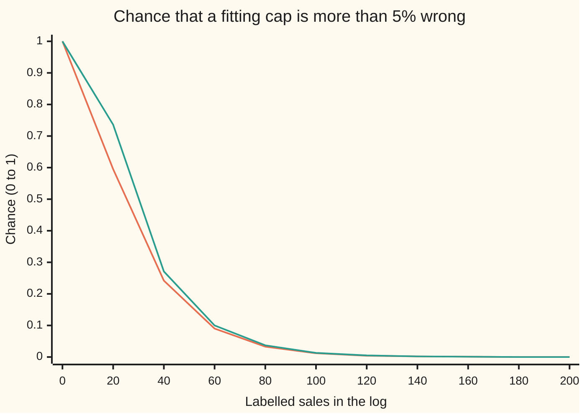

# Learning with a guarantee: how many examples are enough

[Syllabus](../../../SYLLABUS.md) → [Computability and complexity](../README.md) → [Data, Learning and Fine-Grained Complexity](../README.md#s06) → Learning with a guarantee

---

## General Overview

A supplier sells boxes of printer paper to a council through the council's ordering website. The council's system approves any quote at or below a fixed price per box and refuses any quote above it. That price, the **cap**, is not published. It is £31.50, but the supplier does not know that.

The supplier's website keeps a log of every quote, from £20.00 to £40.00, and whether it was approved. These are **labelled sales**: each one is a price with a yes or no attached. The supplier wants to learn the cap from the log, so that future quotes are not refused.

The obvious learner reads the log once and keeps one number: the highest approved price. On ten sales it gives £30.85. That guess misjudges every future quote between £30.85 and £31.50: 3.25% of all quotes, if quotes are spread evenly from £20 to £40.

How long must the log be before the learned cap can be trusted? There is a candidate cap for every price, infinitely many, yet a finite log is enough. With 104 sales, the chance that some cap that fits the whole log still misjudges more than 5% of future quotes is below 1%. A general theorem promises the same with 726 sales, and it works for any family of rules with the same "VC dimension", a number this card defines.

This guarantee is called **PAC learning**, for "probably approximately correct": approximately, because the error is at most a stated allowance; probably, because a stated small chance of an unlucky log remains.

**The number of examples a family of rules needs depends on how many different ways its rules can label a sample, and that count is controlled by one number, the VC dimension: the largest set of examples the family can label in every possible way.**

**What kind of fact this is:** theorems. The bound for a finite family, the exact bound for caps, the counting lemma (Sauer–Shelah) and the general VC bound are proved on this card in Why it works. That finite VC dimension is also necessary, with a lower bound that matches up to a logarithm, is stated with sources. Under all of it sits one modelling assumption: the logged sales are drawn independently from the same mix of quotes as future sales.

### The picture: the chance of an untrustworthy log

The orange line is the exact chance that some cap fitting all $`m`$ logged sales misjudges more than 5% of quotes. The green line is the simple bound $`2e^{-0.05m}`$ that Step 3 proves, capped at 1. Both checks print these points.



Orange: exact chance. Green: the bound. The chance falls by roughly the same factor with every 20 sales, which is why a log of a hundred or so is enough.

---

## The formula

Notation first. Each sale is a price $`x`$, a **quote**. Quotes arrive at random from a mix $`D`$, a probability distribution that nobody needs to know. A **rule** $`h`$ maps a quote to "approve" or "refuse". The true rule is the council's: approve when $`x \le t`$, where $`t`$ is the cap. A **hypothesis family** $`\mathcal H`$ (a script H) is the set of rules the learner may pick from; here, every rule "approve when $`x \le c`$", one for each real number $`c`$.

A rule's **error** is the chance that it disagrees with the true rule on a fresh quote:

```math
\mathrm{err}(h) = \Pr_{x \sim D}\big[h(x) \ne \text{the council's answer on } x\big]
```

$`\Pr[\cdot]`$ is the probability of the event in the brackets; it is written Pr because P is a class. A rule **fits** the log when it gets every logged sale right. The log has $`m`$ sales. The error allowance is $`\varepsilon`$ and the allowed chance of failure is $`\delta`$. Here $`\varepsilon`$ is an allowance, as in wing 14, not the empty string of shelf 01, and $`\delta`$ is a chance, not a machine's rule.

The family **shatters** a set of quotes when its rules can give that set every one of its approve-or-refuse labellings. The **VC dimension** $`\mathrm{VC}(\mathcal H)`$, written $`d`$, is the size of the largest set it shatters (VC for Vapnik and Chervonenkis, who introduced it in 1971). The **growth function** $`\Pi_{\mathcal H}(n)`$ is the largest number of different labellings the family gives any $`n`$ quotes.

The VC bound, with the counting lemma that feeds it:

```math
\Pr\big[\text{some } h \in \mathcal H \text{ fits all } m \text{ sales and } \mathrm{err}(h) > \varepsilon\big] \;\le\; 2\,\Pi_{\mathcal H}(2m)\,2^{-\varepsilon m/2}, \qquad \Pi_{\mathcal H}(n) \;\le\; \sum_{i=0}^{d}\binom{n}{i}
```

**Read it aloud:** the chance that a log of $`m`$ sales lets a bad rule through is at most twice the number of labellings the family can give $`2m`$ quotes, times a half raised to $`\varepsilon m/2`$; and that number of labellings is at most the number of ways to choose up to $`d`$ of the quotes.

The bound holds once $`m \ge 8/\varepsilon`$. The **sample size** is the smallest $`m`$ that pushes the right side down to $`\delta`$. Because the labellings grow only like $`n^d`$ while the factor $`2^{-\varepsilon m/2}`$ shrinks exponentially, such an $`m`$ always exists when $`d`$ is finite.

For a family with finitely many rules, counting rules is enough:

```math
m \;\ge\; \frac{1}{\varepsilon}\Big(\ln\lvert\mathcal H\rvert + \ln\frac{1}{\delta}\Big)
```

**Read it aloud:** the sales needed grow with the log of the number of rules and the log of one over the failure chance, divided by the error allowance.

| Symbol | Plain meaning | In our example | Push it up and the answer… |
| --- | --- | --- | --- |
| $`x`$, $`D`$ | a quote's price; the mix quotes are drawn from | £20.00 to £40.00, spread evenly | — (the bounds hold for every mix) |
| $`t`$, $`c`$ | the true cap; a candidate cap | £31.50; any price, such as the learned cap, £30.85 on ten sales | — |
| $`h`$, $`\mathcal H`$, $`\lvert\mathcal H\rvert`$ | a rule; the family of rules; how many rules it has | "approve up to $`c`$"; all caps; 2,001 for whole-penny caps | larger families need more sales |
| $`\mathrm{err}(h)`$ | share of future quotes the rule gets wrong | 3.25% for £30.85 | — |
| $`m`$ | labelled sales in the log | 104 | the failure chance falls exponentially |
| $`\varepsilon`$ | the error allowance | 5%, so £1.00 of price either side of the cap | fewer sales needed, roughly as $`1/\varepsilon`$ |
| $`\delta`$ | the allowed chance of an unlucky log | 1% | fewer sales, but only through $`\ln(1/\delta)`$ |
| $`\Pi_{\mathcal H}(n)`$, $`n`$ | most labellings the family gives $`n`$ quotes; a number of quotes | 11 for ten quotes, of 1,024 possible | more sales needed |
| $`d = \mathrm{VC}(\mathcal H)`$ | largest set the family labels every way | 1 for caps; 2 for price bands | more sales needed, roughly in proportion |
| $`\binom{n}{i}`$ | ways to choose $`i`$ of $`n`$ quotes | $`\binom{10}{1} = 10`$ | — |
| $`e`$, $`\ln`$ | Euler's number, the base of natural powers; the natural logarithm | $`\ln 2001 = 7.6014`$ | — |
| $`a`$, $`b`$; $`S`$, $`S'`$, $`B`$, $`B'`$, $`K`$, $`p`$, $`r`$, $`s`$; $`F`$, $`F'`$, $`G`$ | a price band's two ends; names used only inside the proofs of Steps 4 and 5 (logs, events, counts, chances, sets of labellings), each defined where it appears | a band: any two prices | — |

### When it holds

- **The log is a fair sample.** Sales must be drawn independently from the same mix as future quotes. If the log covers only a promotion when every quote was under £25, the learned cap is about £24.95 and misjudges 32.76% of later quotes.
- **Some rule in the family is exactly right.** This is the **realisable** case. If the labels are noisy, for example because the council sometimes refuses a cheap quote, no cap fits every sale. The bound then needs about $`1/\varepsilon^2`$ sales, not $`1/\varepsilon`$. With 2,580 sales, every whole-penny cap's error on the log is within 5 percentage points of its true error, so the cap that does best on the log is within 10 points of the best cap. Coming within 5 points of the best cap takes 10,320.
- **The learner picks a rule that fits the log.** The guarantee is about every fitting rule at once, so any fitting rule will do. A learner that ignores some sales gets no promise.
- **The VC dimension is finite.** A learner allowed to approve "exactly the prices it has seen approved" fits every log, yet misjudges 58.52% of new quotes in the check (exact 57.50%). Its family shatters every finite set.
- **$`m`$ is at least $`8/\varepsilon`$**, 160 sales here, for the general VC bound. The proof needs it in Step 5: below it, the Chebyshev step there no longer gives one half, and the bound promises nothing. The finite and cap bounds do not need it.

---

## Why it works

### Step 0: a bad rule survives only by luck

Take one rule whose error is more than $`\varepsilon`$. Each logged sale catches it with chance more than $`\varepsilon`$. For it to fit the whole log, all $`m`$ sales must miss its mistakes. That chance shrinks exponentially in $`m`$.

The difficulty is that the learner picks its rule after seeing the log. So the guarantee must cover every bad rule at once. The card's work is to count "every bad rule" so that the count stays small.

### Step 1: one bad rule

The sales are independent, and each one misses the bad rule's mistakes with chance less than $`1 - \varepsilon`$. So

```math
\Pr[\text{one bad rule fits all } m \text{ sales}] \;<\; (1 - \varepsilon)^m \;\le\; e^{-\varepsilon m}
```

The second step uses $`1 - \varepsilon \le e^{-\varepsilon}`$, true for every $`\varepsilon`$.

### Step 2: finitely many rules, by the union bound

[Stopping the sieve early](../../04-Combinatorics%20and%20graphs/04-Inclusion-Exclusion%20and%20Pigeonhole/04-union-bound-and-bonferroni.md) proves the **union bound**: the chance that at least one of several events happens is at most the sum of their chances. Apply it to the bad rules, of which there are at most $`\lvert\mathcal H\rvert`$:

```math
\Pr[\text{some bad rule fits}] \;\le\; \lvert\mathcal H\rvert\, e^{-\varepsilon m}
```

Set the right side to $`\delta`$ and solve for $`m`$: that is the finite-family formula. Restrict the caps to whole pence from £20.00 to £40.00, which gives 2,001 rules, and it asks for 245 sales.

The weakness shows on a finer grid. Caps to a tenth of a penny ask for 291 sales; to a hundredth, 337; every real cap, an infinite count, gives nothing. Yet the caps are no harder to learn. Neighbouring caps fail together, so the union bound counts one failure many times.

### Step 3: the caps, counted by hand

Suppose quotes are spread evenly from £20 to £40, so 5% of quotes is £1.00 of price. A fitting cap lies between the highest approved sale and the lowest refused sale. It is more than 5% wrong only if it is more than £1.00 from £31.50.

That can happen two ways. No sale landed in the £1.00 strip just below the cap, or none landed in the strip just above. Each has chance $`(1-\varepsilon)^m`$, and both together $`(1-2\varepsilon)^m`$. Inclusion–exclusion (add the two chances, then subtract the overlap, which was counted twice) gives the exact chance:

```math
\Pr[\text{some fitting cap has } \mathrm{err} > \varepsilon] \;=\; 2(1-\varepsilon)^m - (1-2\varepsilon)^m \;\le\; 2e^{-\varepsilon m}
```

For any other mix $`D`$ the same strips exist, measured by chance instead of pounds. The strip a sale must hit may then have to hold more than $`\varepsilon`$ of the mix, never less, and a bigger strip is harder for all $`m`$ sales to miss, so the equality becomes "at most". This chance is 0.00963 at $`m = 104`$ and 0.01013 at 103, so 104 sales is the exact answer for $`\delta = 1\%`$. The simpler bound $`2e^{-\varepsilon m} \le \delta`$ asks for 106.

So an infinite family needs fewer sales than the 2,001-rule grid. What it needs is not few rules but few *distinct behaviours* on a sample.

### Step 4: shattering and the VC dimension

On ten logged quotes, the caps produce only 11 labellings out of the 1,024 possible. Sort the quotes by price. A cap approves some number of the cheapest ones and refuses the rest, and that number runs from 0 to 10.

The caps shatter one quote: a cap above it approves it, a cap below refuses it. They cannot shatter two. No cap refuses the cheaper quote and approves the dearer one. So $`\mathrm{VC}(\text{caps}) = 1`$.

Price bands, "approve when $`a < x \le b`$", shatter two quotes but not three. No band approves the cheapest and dearest of three while refusing the middle one. So their VC dimension is 2, and they give 56 labellings of ten quotes.

The Sauer–Shelah lemma turns a finite VC dimension into a polynomial count: $`\Pi_{\mathcal H}(n) \le \sum_{i=0}^{d}\binom{n}{i}`$, which is at most $`(en/d)^d`$ once $`n \ge d`$. For caps it gives $`1 + n`$; for bands $`1 + n + \binom{n}{2}`$. Both are met exactly here, 11 and 56.

<details>
<summary>Detailed proof: the Sauer–Shelah lemma, by induction</summary>

Take a set $`F`$ of labellings of $`n`$ quotes, and suppose no set of more than $`d`$ quotes is labelled every way. Claim: $`F`$ has at most $`\sum_{i \le d} \binom{n}{i}`$ members. When $`n = 0`$ or $`d = 0`$ the claim holds, since then $`F`$ has at most one member.

Remove the last quote. Let $`F'`$ be the labellings of the first $`n - 1`$ quotes that $`F`$ still shows. Let $`G`$ be those labellings of the first $`n - 1`$ quotes that appear in $`F`$ with both labels on the last quote. Each member of $`F`$ is counted once in $`F'`$, except that each member of $`G`$ stands for two. So $`\lvert F\rvert = \lvert F'\rvert + \lvert G\rvert`$.

$`F'`$ shatters nothing bigger than $`d`$, so by induction it has at most $`\sum_{i \le d}\binom{n-1}{i}`$ members. $`G`$ shatters nothing bigger than $`d - 1`$: if it shattered a set $`S`$ of $`d`$ quotes, then $`F`$ would shatter $`S`$ plus the last quote. So $`G`$ has at most $`\sum_{i \le d-1}\binom{n-1}{i}`$ members.

Add the two sums term by term with Pascal's rule:

$`\displaystyle \binom{n-1}{i} + \binom{n-1}{i-1} = \binom{n}{i}`$

The total is $`\sum_{i \le d}\binom{n}{i}`$, as claimed.

</details>

### Step 5: the VC bound, by a second, imaginary log

The union bound needs a finite list. The trick is to make the list finite by looking only at a finite set of quotes. Imagine a second log of $`m`$ more sales, a **ghost sample**, which exists only in the proof.

The proof has three moves.

1. A bad rule that fits the real log would, with chance at least one half, also make at least $`\varepsilon m/2`$ mistakes on the ghost log. So the chance of failure is at most twice the chance that some rule fits the real log and does badly on the ghost one.
2. That second event depends only on the $`2m`$ quotes of both logs. On those quotes the whole family shows at most $`\Pi_{\mathcal H}(2m)`$ different patterns of mistakes. The infinite family has become a finite list.
3. For one pattern with $`r \ge \varepsilon m/2`$ mistakes, the event needs all $`r`$ to fall in the ghost half. Splitting the $`2m`$ quotes at random puts them all there with chance at most $`2^{-r}`$. The union bound over patterns finishes the proof.

For caps, $`\Pi(2m) = 2m + 1`$. The bound $`2(2m+1)\,2^{-\varepsilon m/2}`$ first drops to 1% at $`m = 726`$, about seven times the exact 104. The general bound is loose, but it needs nothing about caps except their VC dimension. With Sauer's $`(en/d)^d`$ in place of the exact count it asks for 789; for price bands, $`d = 2`$, it asks for 1,161.

<details>
<summary>Detailed proof: the double-sample bound</summary>

Write $`S`$ for the real log and $`S'`$ for the ghost log, each $`m`$ independent quotes from $`D`$. Let $`B`$ be the event that some rule with error more than $`\varepsilon`$ fits $`S`$. Let $`B'`$ be the event that some rule fits $`S`$ and makes at least $`\varepsilon m/2`$ mistakes on $`S'`$.

**Move 1.** Fix $`S`$ in $`B`$ and a bad rule $`h`$ that fits it, with error $`p > \varepsilon`$. Its mistakes on $`S'`$ are a count $`K`$ with mean $`pm`$ and variance $`p(1-p)m`$. Chebyshev's inequality (a count lands more than $`s`$ from its mean with chance at most its variance over $`s^2`$) gives:

$`\displaystyle \Pr\Big[K < \tfrac{pm}{2}\Big] \le \frac{p(1-p)m}{(pm/2)^2} < \frac{4}{\varepsilon m} \le \frac12 \quad \text{when } m \ge 8/\varepsilon`$

So, given $`B`$, the event $`B'`$ has chance at least one half, and $`\Pr[B] \le 2\Pr[B']`$.

**Move 2.** Draw $`2m`$ quotes first, then split them: pair quote $`i`$ with quote $`i + m`$, and swap each pair with chance one half. Because the quotes are independent and identically drawn, this gives $`S`$ and $`S'`$ the same joint chances as drawing them directly. With the $`2m`$ quotes fixed, a rule matters only through which of them it gets wrong, and there are at most $`\Pi_{\mathcal H}(2m)`$ such mistake sets.

**Move 3.** Fix one mistake set with $`r \ge \varepsilon m/2`$ members. For $`B'`$ through it, none of the $`r`$ may land in $`S`$. If some pair holds two of them, that is impossible. Otherwise each of the $`r`$ sits in its own pair and must take the ghost side, chance $`2^{-r}`$. The union bound over mistake sets gives:

$`\displaystyle \Pr[B] \;\le\; 2\Pr[B'] \;\le\; 2\,\Pi_{\mathcal H}(2m)\,2^{-\varepsilon m/2}`$

</details>

### Step 6: the VC dimension is the whole story

Two further theorems, stated here with sources and not proved, close the circle.

- **Finite VC dimension is necessary.** If $`\mathcal H`$ shatters arbitrarily large sets, then for any learner and any finite $`m`$, once $`\varepsilon`$ and $`\delta`$ are small, some mix $`D`$ and true rule defeat it. Ehrenfeucht, Haussler, Kearns and Valiant (1989) give the lower bound: any learner needs at least a fixed multiple of $`(d + \ln(1/\delta))/\varepsilon`$ sales.
- **Finite VC dimension is sufficient.** Blumer, Ehrenfeucht, Haussler and Warmuth (1989) turn Step 5 into a sample size proportional to $`(d \ln(1/\varepsilon) + \ln(1/\delta))/\varepsilon`$.

Together: a family can be learned from finitely many examples exactly when its VC dimension is finite, and $`d`$ sets the cost to within a factor of $`\ln(1/\varepsilon)`$.

Valiant's 1984 definition also counts computing time: the learner must run in time polynomial in $`1/\varepsilon`$, $`1/\delta`$ and the size of the examples. The cap learner reads the log once and keeps one number, or two if it also tracks the lowest refused price: a one-pass summary of the kind [Streaming](01-streaming-and-sketching.md) studies. For some families, though, a fitting rule exists but finding one is NP-complete (as hard as any problem in NP; Pitt and Valiant, 1988), so sales and steps are separate resources.

---

## Worked numbers, by hand

The ten-sale log, prices in pence, in the order logged: 2240, 3895, 2710, 3320, 3085, 2475, 3605, 2960, 3210, 2150. The council approves the six at or below 3150.

| Step | Arithmetic | Value |
| --- | --- | --- |
| highest approved, lowest refused | read the log once | £30.85, £32.10 |
| learned cap's error | $`(31.50 - 30.85)/20`$ | 0.0325, so 3.25% |
| error at the top of the fitting range, just under £32.10 | $`(32.10 - 31.50)/20`$ | 0.0300, so the learned cap, 0.0325, is the worst fitting cap |
| labellings of the ten quotes by caps | cut points 0 to 10 | 11 of 1,024 |
| 5% of quotes, in price | $`0.05 \times £20`$ | £1.00 |
| finite bound, 2,001 penny caps | $`(7.6014 + 4.6052)/0.05`$, rounded up | 245 |
| simple cap bound | $`\ln 200 / 0.05 = 5.2983/0.05`$, rounded up | 106 |
| exact chance at 104 sales | $`2 \times 0.00482 - 0.0000174`$, unrounded powers | 0.00963, under 1% |
| exact chance at 103 sales | the same with 103 | 0.01013, over 1% |
| VC bound at 726 sales | $`2 \times 1453 \times 2^{-18.150}`$ | 0.00999; at 725: 0.01015 |
| **sales needed** | exact, for $`\varepsilon = 5\%`$, $`\delta = 1\%`$ | **104** (VC bound: 726) |

So a log of 104 sales is enough: with chance at least 99%, every cap that fits it misjudges at most 5% of future quotes, whatever the mix of quotes.

### What breaks if you drop a piece

| Mistake | Comes out at | What went wrong |
| --- | --- | --- |
| Count rules instead of labellings | 245 sales for penny caps, 291 for tenth-penny, 337 for hundredth-penny, nothing for all real caps | the union bound counts neighbouring caps as separate failures |
| Guard only the strip below the cap: $`\ln(1/\delta)/\varepsilon`$ | 93 sales, with failure chance 0.01690 | a fitting cap can also sit too high, above £32.50 |
| Use a family of infinite VC dimension: approve only prices already seen approved | training error 0.0000, test error 0.5852 (exact 0.5750) | it fits every log, so fitting proves nothing |
| Learn from a promotion log, all quotes under £25 | learned cap about £24.95, error 0.3276 | the log is not drawn from the mix of future quotes |

---

## Code, from first principles, and it actually runs

The script takes **four independent roads** to the sample size. Closed-form bounds: the union bound, the two-strip count and the VC bound. Brute force: every labelling the caps and the price bands give the logged quotes, and every subset tested for shattering, checked against Sauer's count. Exact chances, stepped to find the first $`m`$ under 1%. A seeded simulation: SplitMix64, a small random-number generator written out in both languages, draws 20,000 logs of 106 sales, and the failure rates and mean error must land within four standard errors (four times the scatter expected from chance) of the exact values. A second simulation, 20,000 logs of only 20 sales, tests the two strips of Step 3 directly; at that length the overlap term is large enough to see.

### Python

```python
# PAC learning and VC dimension: how many labelled sales pin down a hidden price cap.
# Standard library only. Roads: closed-form bounds, brute-force labelling counts,
# exact failure chances, and a seeded simulation (SplitMix64, written out here).
import math
from itertools import combinations

M64 = (1 << 64) - 1
class SplitMix64:
    def __init__(self, seed): self.s = seed
    def next(self):
        self.s = (self.s + 0x9E3779B97F4A7C15) & M64
        z = self.s
        z = ((z ^ (z >> 30)) * 0xBF58476D1CE4E5B9) & M64
        z = ((z ^ (z >> 27)) * 0x94D049BB133111EB) & M64
        return z ^ (z >> 31)
    def unit(self): return (self.next() >> 11) / 9007199254740992.0

def pw(b, n):  # b to the power n by repeated multiplication, the same in both languages
    r = 1.0
    for _ in range(n): r *= b
    return r

LO, HI, CAP = 2000.0, 4000.0, 3150.0  # quotes in pence, uniform; the council's hidden cap
EPS, DELTA = 0.05, 0.01               # allowed error, allowed failure chance
W = HI - LO

# ---- the worked log: ten quotes, approved (1) when price <= cap
log = [2240, 3895, 2710, 3320, 3085, 2475, 3605, 2960, 3210, 2150]
lab = [1 if p <= CAP else 0 for p in log]
a10 = max(p for p, l in zip(log, lab) if l == 1)
r10 = min(p for p, l in zip(log, lab) if l == 0)
print(f"log: {sum(lab)} of {len(log)} approved; highest approved {a10}p, lowest refused {r10}p")
print(f"learned cap error {(CAP - a10) / W:.4f}; error at top of fitting range {(r10 - CAP) / W:.4f}")

# ---- brute force: every labelling the cap rules and the interval rules can give
def caps(pts):  # approve iff price <= c, one c per gap
    cs = [min(pts) - 1] + sorted(pts)
    return {tuple(1 if p <= c else 0 for p in pts) for c in cs}
def intervals(pts):  # approve iff a < price <= b
    cs = [min(pts) - 1] + sorted(pts)
    return {tuple(1 if a < p <= b else 0 for p in pts) for a in cs for b in cs}
def vc(family, pts):  # the largest k up to 4 with some k quotes labelled all 2^k ways
    return max([k for k in range(1, 5) if any(len(family(list(c))) == 2 ** k for c in combinations(pts, k))], default=0)
def sauer(n, d): return sum(math.comb(n, i) for i in range(d + 1))
vc_c, vc_i = vc(caps, log), vc(intervals, log)
print(f"VC dimension by brute force: caps {vc_c}, price bands {vc_i}")
for n in (3, 10):
    print(f"labellings of {n} quotes: caps {len(caps(log[:n]))} (Sauer {sauer(n, 1)}),"
          f" bands {len(intervals(log[:n]))} (Sauer {sauer(n, 2)}), all {2 ** n}")
assert vc_c == 1 and vc_i == 2
for n in range(1, 11):
    assert len(caps(log[:n])) == n + 1 == sauer(n, 1)
    assert len(intervals(log[:n])) == sauer(n, 2)

# ---- sample sizes for error 5%, failure chance 1%
def finite(size): return math.ceil((math.log(size) + math.log(1 / DELTA)) / EPS)
def fail_any(m): return 2 * pw(1 - EPS, m) - pw(1 - 2 * EPS, m)
def vc_m(growth):
    m = math.ceil(8 / EPS)
    while 2 * growth(2 * m) * math.exp(-EPS * m / 2 * math.log(2)) > DELTA: m += 1
    return m
m_fin, m_tenth, m_hund = finite(2001), finite(20001), finite(200001)
m_dir = math.ceil(math.log(2 / DELTA) / EPS)
m_one = math.ceil(math.log(1 / DELTA) / EPS)
m_ex = next(m for m in range(1, 1000) if fail_any(m) <= DELTA)
m_vc, m_vcs, m_vci = vc_m(lambda n: n + 1), vc_m(lambda n: math.e * n), vc_m(lambda n: sauer(n, 2))
m_ag, m_ag2 = (math.ceil(math.log(2 * 2001 / DELTA) / (2 * e * e)) for e in (EPS, EPS / 2))
print(f"union bound, 2,001 penny caps: {m_fin}; tenth-penny caps: {m_tenth}; hundredth: {m_hund}")
print(f"VC bound, d = 1, exact growth 2m + 1: {m_vc}; Sauer growth 2em: {m_vcs}; bands d = 2: {m_vci}")
print(f"direct two-sided bound: {m_dir}; exact smallest m: {m_ex}; one side only: {m_one}")
print(f"failure chance at {m_ex}: {fail_any(m_ex):.5f}; at {m_ex - 1}: {fail_any(m_ex - 1):.5f}")
print(f"failure chance at {m_one}, guarding one side: {fail_any(m_one):.5f}")
print(f"noisy labels, finite caps, 1/eps^2 bound: {m_ag} (every log error within eps, so chosen cap within 2 eps of best), {m_ag2} (chosen cap within eps of best)")
def vcv(m): return 2 * (2 * m + 1) * math.exp(-EPS * m / 2 * math.log(2))
print(f"hand: ln 2001 = {math.log(2001):.4f}, ln 100 = {math.log(100):.4f}, ln 200 = {math.log(200):.4f}, 5% = {EPS * W:.0f}p,"
      f" 8/eps = {math.ceil(8 / EPS)}")
print(f"hand: 0.95^{m_ex} = {pw(1 - EPS, m_ex):.5f}, 0.90^{m_ex} = {pw(1 - 2 * EPS, m_ex):.7f}")
print(f"hand: VC bound at {m_vc}: growth {2 * m_vc + 1}, power of 2 {-EPS * m_vc / 2:.3f},"
      f" value {vcv(m_vc):.5f}; at {m_vc - 1}: {vcv(m_vc - 1):.5f}")
for e, dl in ((0.05, 0.001), (0.01, 0.01)):
    ex = next(k for k in range(1, 10000) if 2 * pw(1 - e, k) - pw(1 - 2 * e, k) <= dl)
    print(f"try eps {e}, delta {dl}: direct {math.ceil(math.log(2 / dl) / e)}, exact {ex}")
assert m_ex <= m_dir <= m_fin < m_vc and fail_any(m_dir) <= 2 * math.exp(-EPS * m_dir)
assert fail_any(m_one) > DELTA and m_tenth > m_fin

# ---- simulation: 20,000 logs of m_dir quotes; the learner keeps two numbers in one pass
rng, N, m = SplitMix64(20261119), 20000, m_dir
bad1 = bad2 = 0; tot = sq = 0.0
for _ in range(N):
    a, r = LO, HI
    for _ in range(m):
        p = LO + W * rng.unit()
        if p <= CAP:
            if p > a: a = p
        elif p < r: r = p
    e1, e2 = (CAP - a) / W, (r - CAP) / W
    tot += e1; sq += e1 * e1
    if e1 > EPS: bad1 += 1
    if e1 > EPS or e2 > EPS: bad2 += 1
f1, f2, mean = bad1 / N, bad2 / N, tot / N; x1, x2 = pw(1 - EPS, m), fail_any(m)
xmean = (1 - pw(1 - (CAP - LO) / W, m + 1)) / (m + 1)
print(f"simulated {N} logs of {m}: learned cap bad {f1:.5f} (exact {x1:.5f}),"
      f" some consistent cap bad {f2:.5f} (exact {x2:.5f})")
print(f"mean error of learned cap {mean:.5f} (exact {xmean:.5f})")
assert abs(f1 - x1) < 4 * math.sqrt(x1 * (1 - x1) / N)
assert abs(f2 - x2) < 4 * math.sqrt(x2 * (1 - x2) / N)
assert abs(mean - xmean) < 4 * math.sqrt((sq / N - mean * mean) / N)

# ---- what breaks: a memoriser (infinite VC) and a log that is not a fair sample
train = [LO + W * rng.unit() for _ in range(m)]
seen = {p for p in train if p <= CAP}
trn = sum((p in seen) != (p <= CAP) for p in train) / m
T, wrong = 10000, 0
for _ in range(T):
    p = LO + W * rng.unit()
    if (p in seen) != (p <= CAP): wrong += 1
mem = wrong / T
print(f"memoriser: training error {trn:.4f}, test error {mem:.4f} (exact {(CAP - LO) / W:.4f})")
assert abs(mem - 0.575) < 4 * math.sqrt(0.575 * 0.425 / T)
a = LO
for _ in range(m):
    p = LO + 500.0 * rng.unit()
    if p > a: a = p
print(f"promotion log, all quotes under 2500p: learned cap {a:.0f}p, error {(CAP - a) / W:.4f}")
assert 0.325 < (CAP - a) / W < 0.33

# ---- a short log, where the overlap term is large: 20,000 logs of 20 sales, strips tested directly
bad = 0
for _ in range(N):
    xs = [LO + W * rng.unit() for _ in range(20)]
    if all(not CAP - EPS * W < p <= CAP for p in xs) or all(not CAP < p <= CAP + EPS * W for p in xs): bad += 1
print(f"simulated {N} logs of 20, strips checked directly: some consistent cap bad {bad / N:.5f} (exact {fail_any(20):.5f}, overlap term dropped {2 * pw(1 - EPS, 20):.5f})")
assert abs(bad / N - fail_any(20)) < 4 * math.sqrt(fail_any(20) * (1 - fail_any(20)) / N)

# ---- chart: failure chance of the worst consistent cap against log length
ms = list(range(0, 201, 20))
print("chart, sales", " ".join(str(k) for k in ms))
print("chart, exact", " ".join(f"{fail_any(k):.3f}" for k in ms))
print("chart, bound", " ".join(f"{min(1.0, 2 * math.exp(-EPS * k)):.3f}" for k in ms))
print("ALL CHECKS PASS")
```

**Ran 2026-11-19 on macOS, Python 3.14.10, standard library only. All checks passed. Output, pasted from the run:**

```
log: 6 of 10 approved; highest approved 3085p, lowest refused 3210p
learned cap error 0.0325; error at top of fitting range 0.0300
VC dimension by brute force: caps 1, price bands 2
labellings of 3 quotes: caps 4 (Sauer 4), bands 7 (Sauer 7), all 8
labellings of 10 quotes: caps 11 (Sauer 11), bands 56 (Sauer 56), all 1024
union bound, 2,001 penny caps: 245; tenth-penny caps: 291; hundredth: 337
VC bound, d = 1, exact growth 2m + 1: 726; Sauer growth 2em: 789; bands d = 2: 1161
direct two-sided bound: 106; exact smallest m: 104; one side only: 93
failure chance at 104: 0.00963; at 103: 0.01013
failure chance at 93, guarding one side: 0.01690
noisy labels, finite caps, 1/eps^2 bound: 2580 (every log error within eps, so chosen cap within 2 eps of best), 10320 (chosen cap within eps of best)
hand: ln 2001 = 7.6014, ln 100 = 4.6052, ln 200 = 5.2983, 5% = 100p, 8/eps = 160
hand: 0.95^104 = 0.00482, 0.90^104 = 0.0000174
hand: VC bound at 726: growth 1453, power of 2 -18.150, value 0.00999; at 725: 0.01015
try eps 0.05, delta 0.001: direct 153, exact 149
try eps 0.01, delta 0.01: direct 530, exact 527
simulated 20000 logs of 106: learned cap bad 0.00400 (exact 0.00435), some consistent cap bad 0.00835 (exact 0.00869)
mean error of learned cap 0.00928 (exact 0.00935)
memoriser: training error 0.0000, test error 0.5852 (exact 0.5750)
promotion log, all quotes under 2500p: learned cap 2495p, error 0.3276
simulated 20000 logs of 20, strips checked directly: some consistent cap bad 0.59420 (exact 0.59540, overlap term dropped 0.71697)
chart, sales 0 20 40 60 80 100 120 140 160 180 200
chart, exact 1.000 0.595 0.242 0.090 0.033 0.012 0.004 0.002 0.001 0.000 0.000
chart, bound 1.000 0.736 0.271 0.100 0.037 0.013 0.005 0.002 0.001 0.000 0.000
ALL CHECKS PASS
```

The simulated failure rate, 0.00835, sits beside the exact 0.00869. The learned cap's simulated mean error, 0.00928, sits beside the exact 0.00935: under one quote in a hundred. On logs of 20 sales the simulated rate, 0.59420, matches the exact 0.59540 and rules out the formula without its overlap term, 0.71697.

### Rust

The same checks, the same seed, no crates.

```rust
// PAC learning and VC dimension: how many labelled sales pin down a hidden price cap.
// Standard library only, no crates. The same roads as the Python check: closed-form bounds,
// brute-force labelling counts, exact failure chances, and a seeded SplitMix64 simulation.
use std::collections::{BTreeSet, HashSet};

struct SplitMix64 { s: u64 }
impl SplitMix64 {
    fn next(&mut self) -> u64 {
        self.s = self.s.wrapping_add(0x9E3779B97F4A7C15);
        let mut z = self.s;
        z = (z ^ (z >> 30)).wrapping_mul(0xBF58476D1CE4E5B9);
        z = (z ^ (z >> 27)).wrapping_mul(0x94D049BB133111EB);
        z ^ (z >> 31)
    }
    fn unit(&mut self) -> f64 { (self.next() >> 11) as f64 / 9007199254740992.0 }
}

fn pw(b: f64, n: u64) -> f64 { let mut r = 1.0; for _ in 0..n { r *= b; } r }

const LO: f64 = 2000.0; const HI: f64 = 4000.0; const CAP: f64 = 3150.0;
const EPS: f64 = 0.05; const DELTA: f64 = 0.01; const W: f64 = HI - LO;

fn cands(pts: &[i64]) -> Vec<i64> {
    let mut s = pts.to_vec(); s.sort();
    let mut c = vec![s[0] - 1]; c.extend(s); c
}
fn caps(pts: &[i64]) -> usize {
    let c = cands(pts);
    c.iter().map(|&t| pts.iter().map(|&p| (p <= t) as u8).collect::<Vec<u8>>()).collect::<BTreeSet<_>>().len()
}
fn intervals(pts: &[i64]) -> usize {
    let c = cands(pts);
    let mut out = BTreeSet::new();
    for &a in &c { for &b in &c { out.insert(pts.iter().map(|&p| (a < p && p <= b) as u8).collect::<Vec<u8>>()); } }
    out.len()
}
fn subsets(n: usize, k: usize, start: usize, cur: &mut Vec<usize>, out: &mut Vec<Vec<usize>>) {
    if cur.len() == k { out.push(cur.clone()); return; }
    for i in start..n { cur.push(i); subsets(n, k, i + 1, cur, out); cur.pop(); }
}
fn vc(family: fn(&[i64]) -> usize, pts: &[i64]) -> usize {
    let mut d = 0;
    for k in 1..5 {
        let mut all = Vec::new(); subsets(pts.len(), k, 0, &mut Vec::new(), &mut all);
        if all.iter().any(|s| family(&s.iter().map(|&i| pts[i]).collect::<Vec<i64>>()) == 1 << k) { d = k; }
    }
    d
}
fn comb(n: u64, k: u64) -> u64 { let mut r = 1u64; for i in 0..k { r = r * (n - i) / (i + 1); } r }
fn sauer(n: u64, d: u64) -> u64 { (0..=d).map(|i| comb(n, i)).sum() }
fn finite(size: f64) -> u64 { ((size.ln() + (1.0 / DELTA).ln()) / EPS).ceil() as u64 }
fn fail_any(m: u64) -> f64 { 2.0 * pw(1.0 - EPS, m) - pw(1.0 - 2.0 * EPS, m) }
fn vc_m(growth: &dyn Fn(u64) -> f64) -> u64 {
    let mut m = (8.0 / EPS).ceil() as u64;
    while 2.0 * growth(2 * m) * (-EPS * m as f64 / 2.0 * (2.0f64).ln()).exp() > DELTA { m += 1; }
    m
}

fn main() {
    let log: Vec<i64> = vec![2240, 3895, 2710, 3320, 3085, 2475, 3605, 2960, 3210, 2150];
    let lab: Vec<bool> = log.iter().map(|&p| p as f64 <= CAP).collect();
    let a10 = log.iter().zip(&lab).filter(|x| *x.1).map(|x| *x.0).max().unwrap();
    let r10 = log.iter().zip(&lab).filter(|x| !*x.1).map(|x| *x.0).min().unwrap();
    println!("log: {} of {} approved; highest approved {}p, lowest refused {}p", lab.iter().filter(|&&l| l).count(), log.len(), a10, r10);
    println!("learned cap error {:.4}; error at top of fitting range {:.4}", (CAP - a10 as f64) / W, (r10 as f64 - CAP) / W);

    let (vc_c, vc_i) = (vc(caps, &log), vc(intervals, &log));
    println!("VC dimension by brute force: caps {}, price bands {}", vc_c, vc_i);
    for n in [3usize, 10] {
        println!("labellings of {} quotes: caps {} (Sauer {}), bands {} (Sauer {}), all {}",
                 n, caps(&log[..n]), sauer(n as u64, 1), intervals(&log[..n]), sauer(n as u64, 2), 1u64 << n);
    }
    assert!(vc_c == 1 && vc_i == 2);
    for n in 1..=10usize {
        assert!(caps(&log[..n]) == n + 1 && (n + 1) as u64 == sauer(n as u64, 1));
        assert!(intervals(&log[..n]) as u64 == sauer(n as u64, 2));
    }

    let (m_fin, m_tenth, m_hund) = (finite(2001.0), finite(20001.0), finite(200001.0));
    let m_dir = ((2.0 / DELTA).ln() / EPS).ceil() as u64;
    let m_one = ((1.0 / DELTA).ln() / EPS).ceil() as u64;
    let m_ex = (1..1000u64).find(|&m| fail_any(m) <= DELTA).unwrap();
    let m_vc = vc_m(&|n| (n + 1) as f64);
    let m_vcs = vc_m(&|n| std::f64::consts::E * n as f64);
    let m_vci = vc_m(&|n| sauer(n, 2) as f64);
    let m_ag = ((2.0 * 2001.0 / DELTA).ln() / (2.0 * EPS * EPS)).ceil() as u64;
    let m_ag2 = ((2.0 * 2001.0 / DELTA).ln() / (2.0 * (EPS / 2.0) * (EPS / 2.0))).ceil() as u64;
    println!("union bound, 2,001 penny caps: {}; tenth-penny caps: {}; hundredth: {}", m_fin, m_tenth, m_hund);
    println!("VC bound, d = 1, exact growth 2m + 1: {}; Sauer growth 2em: {}; bands d = 2: {}", m_vc, m_vcs, m_vci);
    println!("direct two-sided bound: {}; exact smallest m: {}; one side only: {}", m_dir, m_ex, m_one);
    println!("failure chance at {}: {:.5}; at {}: {:.5}", m_ex, fail_any(m_ex), m_ex - 1, fail_any(m_ex - 1));
    println!("failure chance at {}, guarding one side: {:.5}", m_one, fail_any(m_one));
    println!("noisy labels, finite caps, 1/eps^2 bound: {} (every log error within eps, so chosen cap within 2 eps of best), {} (chosen cap within eps of best)", m_ag, m_ag2);
    let vcv = |m: u64| (2 * (2 * m + 1)) as f64 * (-EPS * m as f64 / 2.0 * (2.0f64).ln()).exp();
    println!("hand: ln 2001 = {:.4}, ln 100 = {:.4}, ln 200 = {:.4}, 5% = {:.0}p, 8/eps = {}", (2001.0f64).ln(), (100.0f64).ln(), (200.0f64).ln(), EPS * W, (8.0 / EPS).ceil() as u64);
    println!("hand: 0.95^{} = {:.5}, 0.90^{} = {:.7}", m_ex, pw(1.0 - EPS, m_ex), m_ex, pw(1.0 - 2.0 * EPS, m_ex));
    println!("hand: VC bound at {}: growth {}, power of 2 {:.3}, value {:.5}; at {}: {:.5}", m_vc, 2 * m_vc + 1, -EPS * m_vc as f64 / 2.0, vcv(m_vc), m_vc - 1, vcv(m_vc - 1));
    for (e, dl) in [(0.05f64, 0.001f64), (0.01, 0.01)] {
        let ex = (1..10000u64).find(|&k| 2.0 * pw(1.0 - e, k) - pw(1.0 - 2.0 * e, k) <= dl).unwrap();
        println!("try eps {}, delta {}: direct {}, exact {}", e, dl, ((2.0 / dl).ln() / e).ceil() as u64, ex);
    }
    assert!(m_ex <= m_dir && m_dir <= m_fin && m_fin < m_vc && fail_any(m_dir) <= 2.0 * (-EPS * m_dir as f64).exp());
    assert!(fail_any(m_one) > DELTA && m_tenth > m_fin);

    let mut rng = SplitMix64 { s: 20261119 };
    let (n_logs, m) = (20000u64, m_dir);
    let (mut bad1, mut bad2, mut tot, mut sq) = (0u64, 0u64, 0.0f64, 0.0f64);
    for _ in 0..n_logs {
        let (mut a, mut r) = (LO, HI);
        for _ in 0..m {
            let p = LO + W * rng.unit();
            if p <= CAP { if p > a { a = p; } } else if p < r { r = p; }
        }
        let (e1, e2) = ((CAP - a) / W, (r - CAP) / W);
        tot += e1; sq += e1 * e1;
        if e1 > EPS { bad1 += 1; }
        if e1 > EPS || e2 > EPS { bad2 += 1; }
    }
    let nf = n_logs as f64;
    let (f1, f2, mean) = (bad1 as f64 / nf, bad2 as f64 / nf, tot / nf);
    let (x1, x2) = (pw(1.0 - EPS, m), fail_any(m));
    let xmean = (1.0 - pw(1.0 - (CAP - LO) / W, m + 1)) / (m + 1) as f64;
    println!("simulated {} logs of {}: learned cap bad {:.5} (exact {:.5}), some consistent cap bad {:.5} (exact {:.5})", n_logs, m, f1, x1, f2, x2);
    println!("mean error of learned cap {:.5} (exact {:.5})", mean, xmean);
    assert!((f1 - x1).abs() < 4.0 * (x1 * (1.0 - x1) / nf).sqrt());
    assert!((f2 - x2).abs() < 4.0 * (x2 * (1.0 - x2) / nf).sqrt());
    assert!((mean - xmean).abs() < 4.0 * ((sq / nf - mean * mean) / nf).sqrt());

    let train: Vec<f64> = (0..m).map(|_| LO + W * rng.unit()).collect();
    let seen: HashSet<u64> = train.iter().filter(|&&p| p <= CAP).map(|p| p.to_bits()).collect();
    let trn = train.iter().filter(|&&p| seen.contains(&p.to_bits()) != (p <= CAP)).count() as f64 / m as f64;
    let t = 10000u64;
    let mut wrong = 0u64;
    for _ in 0..t { let p = LO + W * rng.unit(); if seen.contains(&p.to_bits()) != (p <= CAP) { wrong += 1; } }
    let mem = wrong as f64 / t as f64;
    println!("memoriser: training error {:.4}, test error {:.4} (exact {:.4})", trn, mem, (CAP - LO) / W);
    assert!((mem - 0.575).abs() < 4.0 * (0.575f64 * 0.425 / t as f64).sqrt());
    let mut a = LO;
    for _ in 0..m { let p = LO + 500.0 * rng.unit(); if p > a { a = p; } }
    println!("promotion log, all quotes under 2500p: learned cap {:.0}p, error {:.4}", a, (CAP - a) / W);
    assert!(0.325 < (CAP - a) / W && (CAP - a) / W < 0.33);

    let mut bad = 0u64;
    for _ in 0..n_logs {
        let xs: Vec<f64> = (0..20).map(|_| LO + W * rng.unit()).collect();
        if xs.iter().all(|&p| !(CAP - EPS * W < p && p <= CAP)) || xs.iter().all(|&p| !(CAP < p && p <= CAP + EPS * W)) { bad += 1; }
    }
    let (fb, x20) = (bad as f64 / nf, fail_any(20));
    println!("simulated {} logs of 20, strips checked directly: some consistent cap bad {:.5} (exact {:.5}, overlap term dropped {:.5})", n_logs, fb, x20, 2.0 * pw(1.0 - EPS, 20));
    assert!((fb - x20).abs() < 4.0 * (x20 * (1.0 - x20) / nf).sqrt());

    let ms: Vec<u64> = (0..=200).step_by(20).collect();
    println!("chart, sales {}", ms.iter().map(|k| k.to_string()).collect::<Vec<_>>().join(" "));
    println!("chart, exact {}", ms.iter().map(|&k| format!("{:.3}", fail_any(k))).collect::<Vec<_>>().join(" "));
    println!("chart, bound {}", ms.iter().map(|&k| format!("{:.3}", (2.0 * (-EPS * k as f64).exp()).min(1.0))).collect::<Vec<_>>().join(" "));
    println!("ALL CHECKS PASS");
}
```

**Ran 2026-11-19 on macOS, rustc 1.98.1, no crates. All checks passed. Output, pasted from the run:**

```
log: 6 of 10 approved; highest approved 3085p, lowest refused 3210p
learned cap error 0.0325; error at top of fitting range 0.0300
VC dimension by brute force: caps 1, price bands 2
labellings of 3 quotes: caps 4 (Sauer 4), bands 7 (Sauer 7), all 8
labellings of 10 quotes: caps 11 (Sauer 11), bands 56 (Sauer 56), all 1024
union bound, 2,001 penny caps: 245; tenth-penny caps: 291; hundredth: 337
VC bound, d = 1, exact growth 2m + 1: 726; Sauer growth 2em: 789; bands d = 2: 1161
direct two-sided bound: 106; exact smallest m: 104; one side only: 93
failure chance at 104: 0.00963; at 103: 0.01013
failure chance at 93, guarding one side: 0.01690
noisy labels, finite caps, 1/eps^2 bound: 2580 (every log error within eps, so chosen cap within 2 eps of best), 10320 (chosen cap within eps of best)
hand: ln 2001 = 7.6014, ln 100 = 4.6052, ln 200 = 5.2983, 5% = 100p, 8/eps = 160
hand: 0.95^104 = 0.00482, 0.90^104 = 0.0000174
hand: VC bound at 726: growth 1453, power of 2 -18.150, value 0.00999; at 725: 0.01015
try eps 0.05, delta 0.001: direct 153, exact 149
try eps 0.01, delta 0.01: direct 530, exact 527
simulated 20000 logs of 106: learned cap bad 0.00400 (exact 0.00435), some consistent cap bad 0.00835 (exact 0.00869)
mean error of learned cap 0.00928 (exact 0.00935)
memoriser: training error 0.0000, test error 0.5852 (exact 0.5750)
promotion log, all quotes under 2500p: learned cap 2495p, error 0.3276
simulated 20000 logs of 20, strips checked directly: some consistent cap bad 0.59420 (exact 0.59540, overlap term dropped 0.71697)
chart, sales 0 20 40 60 80 100 120 140 160 180 200
chart, exact 1.000 0.595 0.242 0.090 0.033 0.012 0.004 0.002 0.001 0.000 0.000
chart, bound 1.000 0.736 0.271 0.100 0.037 0.013 0.005 0.002 0.001 0.000 0.000
ALL CHECKS PASS
```

The two outputs agree line for line.

### Lean

Lean proves the counting lemma, the finite-family bound and the caps' count in general, and checks the worked numbers.

- Suppose the family shatters no set of more than $`d`$ quotes. Then it gives any $`n`$ quotes at most $`\sum_{i=0}^{d}\binom{n}{i}`$ labellings.
- Take a finite family $`\mathcal H`$, any mix $`D`$, any true rule and an allowance $`\varepsilon \ge 0`$. Then the chance that a bad rule fits all $`m`$ sales is at most $`\lvert\mathcal H\rvert e^{-\varepsilon m}`$.
- Take any $`n`$ different quotes. Then the caps give them exactly $`n + 1`$ labellings.
- The ten-sale log has six approved quotes, highest approved 3085p and lowest refused 3210p.
- Sauer's count gives ten quotes 11 labellings for caps and 56 for bands, of 1,024. The penny caps number 2,001.
- Take $`\varepsilon`$ = 5%. Then Step 3's exact chance is at most 1% at 104 sales, and above 1% at 103 and at 93.
- Take $`\varepsilon`$ = 5%. Then $`8/\varepsilon`$ is 160, and the caps' count $`2m + 1`$ at 726 sales is 1,453.

Step 5's VC bound, Step 3's exact formula and every simulation are left to the Python and Rust checks.

```lean
-- Learning with a guarantee: a family of rules that labels no set of more than d points in every way gives any n points at most C(n,0) + ... + C(n,d) labellings, a finite family of rules lets a bad rule fit m fair samples with chance at most |H| e^(-εm), and price caps give n points exactly n + 1 labellings.
import Mathlib.Combinatorics.SetFamily.Shatter
import Mathlib.Data.Set.Card
import Mathlib.Data.Nat.Choose.Sum
import Mathlib.MeasureTheory.Constructions.Pi
import Mathlib.MeasureTheory.Measure.Typeclasses.Probability
import Mathlib.Analysis.SpecialFunctions.Exp

open MeasureTheory
open scoped Classical

/-- The counting lemma (Sauer–Shelah), in the card's terms. A rule is the set of points it
approves. Suppose the family `H` labels no set of more than `d` points in every possible way:
whenever `H` shatters a finite set `s` (every subset `t` of `s` is exactly the part of `s`
approved by some rule), `s` has at most `d` points. Then on any `n` points `S` the family gives
at most `C(n,0) + C(n,1) + ... + C(n,d)` different labellings: `Π_H(n) ≤ ∑_{i ≤ d} C(n,i)`. -/
theorem growth_le_sum_choose_of_vc_le {X : Type*}
    (H : Set (Set X)) (d : ℕ)
    (hd : ∀ s : Finset X,
      (∀ t ⊆ s, ∃ h ∈ H, s.filter (fun x => x ∈ h) = t) → s.card ≤ d)
    (S : Finset X) :
    (Set.image (fun h : Set X => S.filter (fun x => x ∈ h)) H).ncard
      ≤ ∑ i ∈ Finset.range (d + 1), S.card.choose i := by
  set 𝒜 : Finset (Finset X) :=
    S.powerset.filter (fun t => ∃ h ∈ H, S.filter (fun x => x ∈ h) = t) with h𝒜
  have hset : Set.image (fun h : Set X => S.filter (fun x => x ∈ h)) H = (𝒜 : Set (Finset X)) := by
    ext t
    simp only [Set.mem_image, h𝒜, Finset.coe_filter, Finset.mem_powerset, Set.mem_ofPred_eq]
    constructor
    · rintro ⟨h, hh, rfl⟩
      exact ⟨Finset.filter_subset _ _, h, hh, rfl⟩
    · rintro ⟨_, h, hh, rfl⟩
      exact ⟨h, hh, rfl⟩
  rw [hset, Set.ncard_coe_finset]
  refine (Finset.card_le_card_shatterer 𝒜).trans ?_
  have hsub : 𝒜.shatterer ⊆ (Finset.range (d + 1)).biUnion (fun i => S.powersetCard i) := by
    intro s hs
    rw [Finset.mem_shatterer] at hs
    have hsS : s ⊆ S := by
      obtain ⟨u, hu, hsu⟩ := hs.exists_superset
      rw [h𝒜, Finset.mem_filter, Finset.mem_powerset] at hu
      exact hsu.trans hu.1
    have hcard : s.card ≤ d := by
      apply hd
      intro t ht
      obtain ⟨u, hu, hsu⟩ := hs ht
      rw [h𝒜, Finset.mem_filter] at hu
      obtain ⟨_, h, hh, rfl⟩ := hu
      refine ⟨h, hh, ?_⟩
      rw [← hsu]
      ext x
      simp only [Finset.mem_filter, Finset.mem_inter]
      constructor
      · rintro ⟨hx, hxh⟩; exact ⟨hx, hsS hx, hxh⟩
      · rintro ⟨hx, _, hxh⟩; exact ⟨hx, hxh⟩
    rw [Finset.mem_biUnion]
    exact ⟨s.card, Finset.mem_range.2 (Nat.lt_succ_of_le hcard),
      Finset.mem_powersetCard.2 ⟨hsS, rfl⟩⟩
  refine (Finset.card_le_card hsub).trans ?_
  refine Finset.card_biUnion_le.trans ?_
  simp [Finset.card_powersetCard]

/-- The bound for a finite family (Step 2, by the union bound). Sales are drawn independently
from a mix `μ`; the council approves the set `T`; each rule `h` in the finite family `H`
approves a set, and its error is the chance `μ (h ∆ T)` that it disagrees with the council.
Then the chance that a log of `m` sales lets through some rule that fits every sale yet has
error more than `ε` is at most `|H| e^(-εm)`. -/
theorem finite_family_bad_rule_fits_le {X : Type*} [MeasurableSpace X]
    (μ : Measure X) [IsProbabilityMeasure μ] (T : Set X) (hT : MeasurableSet T)
    (H : Finset (Set X)) (hH : ∀ h ∈ H, MeasurableSet h) (ε : ℝ) (hε : 0 ≤ ε) (m : ℕ) :
    Measure.pi (fun _ : Fin m => μ)
        {S | ∃ h ∈ H, (∀ i, S i ∈ h ↔ S i ∈ T) ∧ ENNReal.ofReal ε < μ (symmDiff h T)}
      ≤ (H.card : ENNReal) * ENNReal.ofReal (Real.exp (-(ε * m))) := by
  set f : Set X → Set (Fin m → X) := fun h =>
    {S | (∀ i, S i ∈ h ↔ S i ∈ T) ∧ ENNReal.ofReal ε < μ (symmDiff h T)} with hf
  have hset : {S : Fin m → X | ∃ h ∈ H, (∀ i, S i ∈ h ↔ S i ∈ T) ∧
      ENNReal.ofReal ε < μ (symmDiff h T)} = ⋃ h ∈ H, f h := by
    ext S
    simp only [Set.mem_ofPred_eq, Set.mem_iUnion, hf, exists_prop]
  rw [hset]
  refine (measure_biUnion_finset_le H f).trans ?_
  rw [← nsmul_eq_mul]
  refine Finset.sum_le_card_nsmul _ _ _ ?_
  intro h hh
  by_cases hbad : ENNReal.ofReal ε < μ (symmDiff h T)
  · have hfh : f h = Set.pi Set.univ (fun _ : Fin m => {x | x ∈ h ↔ x ∈ T}) := by
      ext S
      simp [hf, hbad]
    have hA : {x | x ∈ h ↔ x ∈ T} = (symmDiff h T)ᶜ := by
      ext x
      simp only [Set.mem_compl_iff, Set.mem_symmDiff]
      simp only [Set.mem_ofPred_eq]
      tauto
    have hmeas : MeasurableSet (symmDiff h T) := (hH h hh).symmDiff hT
    have hε1 : ε < 1 := by
      by_contra hc
      rw [not_lt] at hc
      have : ENNReal.ofReal ε ≥ 1 := by
        rw [ge_iff_le, ← ENNReal.ofReal_one]; exact ENNReal.ofReal_le_ofReal hc
      exact absurd (hbad.trans_le prob_le_one) (not_lt.2 this)
    have hμA : μ {x | x ∈ h ↔ x ∈ T} ≤ ENNReal.ofReal (1 - ε) := by
      rw [hA, prob_compl_eq_one_sub hmeas, ENNReal.ofReal_sub _ hε, ENNReal.ofReal_one]
      exact tsub_le_tsub_left hbad.le _
    rw [hfh, Measure.pi_pi, Finset.prod_const, Finset.card_univ, Fintype.card_fin]
    calc μ {x | x ∈ h ↔ x ∈ T} ^ m ≤ ENNReal.ofReal (1 - ε) ^ m := by gcongr
      _ = ENNReal.ofReal ((1 - ε) ^ m) := (ENNReal.ofReal_pow (by linarith) m).symm
      _ ≤ ENNReal.ofReal (Real.exp (-(ε * m))) := by
        apply ENNReal.ofReal_le_ofReal
        rw [show -(ε * m) = (m : ℝ) * (-ε) by ring, Real.exp_nat_mul]
        apply pow_le_pow_left₀ (by linarith)
        linarith [Real.add_one_le_exp (-ε)]
  · have hfh : f h = ∅ := by
      ext S
      simp [hf, hbad]
    rw [hfh, measure_empty]
    exact zero_le

/-- The caps "approve when `x ≤ c`", one for each real `c`, give any `n` distinct quotes
exactly `n + 1` labellings: a cap approves some number of the cheapest quotes, from 0 to `n`,
and refuses the rest. -/
theorem caps_labellings_eq (S : Finset ℝ) :
    (Set.image (fun h : Set ℝ => S.filter (fun x => x ∈ h)) (Set.range Set.Iic)).ncard
      = S.card + 1 := by
  have hset : Set.image (fun h : Set ℝ => S.filter (fun x => x ∈ h)) (Set.range Set.Iic)
      = ((insert ∅ (S.image (fun y => S.filter (fun x => x ≤ y))) : Finset (Finset ℝ)) :
          Set (Finset ℝ)) := by
    ext t
    simp only [Set.mem_image, Set.mem_range, Finset.coe_insert, Finset.coe_image,
      Set.mem_insert_iff, Finset.mem_coe]
    constructor
    · rintro ⟨_, ⟨c, rfl⟩, rfl⟩
      simp only [Set.mem_Iic]
      by_cases hne : (S.filter (fun x => x ≤ c)).Nonempty
      · right
        set y := (S.filter (fun x => x ≤ c)).max' hne with hy
        have hyS : y ∈ S.filter (fun x => x ≤ c) := Finset.max'_mem _ hne
        refine ⟨y, (Finset.mem_filter.1 hyS).1, ?_⟩
        ext x
        simp only [Finset.mem_filter]
        constructor
        · rintro ⟨hx, hxy⟩; exact ⟨hx, hxy.trans (Finset.mem_filter.1 hyS).2⟩
        · rintro ⟨hx, hxc⟩; exact ⟨hx, Finset.le_max' _ x (Finset.mem_filter.2 ⟨hx, hxc⟩)⟩
      · left
        exact Finset.not_nonempty_iff_eq_empty.1 hne
    · rintro (rfl | ⟨y, _, rfl⟩)
      · obtain ⟨b, hb⟩ := S.bddBelow
        refine ⟨Set.Iic (b - 1), ⟨b - 1, rfl⟩, ?_⟩
        ext x
        simp only [Finset.mem_filter, Set.mem_Iic, Finset.notMem_empty, iff_false, not_and,
          not_le]
        intro hx
        have := hb hx
        linarith
      · exact ⟨Set.Iic y, ⟨y, rfl⟩, by simp⟩
  rw [hset, Set.ncard_coe_finset]
  have hnot : (∅ : Finset ℝ) ∉ S.image (fun y => S.filter (fun x => x ≤ y)) := by
    simp only [Finset.mem_image, not_exists, not_and]
    intro y hy h
    have : y ∈ S.filter (fun x => x ≤ y) := Finset.mem_filter.2 ⟨hy, le_rfl⟩
    rw [h] at this
    exact Finset.notMem_empty _ this
  rw [Finset.card_insert_of_notMem hnot, Finset.card_image_of_injOn]
  intro y hy z hz h
  simp only [Finset.mem_coe] at hy hz
  simp only at h
  have h1 : y ∈ S.filter (fun x => x ≤ z) := by
    rw [← h]; exact Finset.mem_filter.2 ⟨hy, le_rfl⟩
  have h2 : z ∈ S.filter (fun x => x ≤ y) := by
    rw [h]; exact Finset.mem_filter.2 ⟨hz, le_rfl⟩
  exact le_antisymm (Finset.mem_filter.1 h1).2 (Finset.mem_filter.1 h2).2

-- The ten-sale log in pence: six quotes at or below the cap of 3150 are approved.
example : ([2240, 3895, 2710, 3320, 3085, 2475, 3605, 2960, 3210, 2150].filter
    (fun p : ℕ => p ≤ 3150)).length = 6 := by decide
-- Highest approved 3085p, lowest refused 3210p.
example : ([2240, 3895, 2710, 3320, 3085, 2475, 3605, 2960, 3210, 2150].filter
    (fun p : ℕ => p ≤ 3150)).max? = some 3085 := by decide
example : ([2240, 3895, 2710, 3320, 3085, 2475, 3605, 2960, 3210, 2150].filter
    (fun p : ℕ => 3150 < p)).min? = some 3210 := by decide
-- Sauer's count on ten quotes: 11 labellings for caps (d = 1), 56 for bands (d = 2), of 1,024.
example : ∑ i ∈ Finset.range 2, Nat.choose 10 i = 11 := by decide
example : ∑ i ∈ Finset.range 3, Nat.choose 10 i = 56 := by decide
example : 2 ^ 10 = 1024 := by norm_num
-- Whole-penny caps from 2000p to 4000p: 2,001 rules.
example : (Finset.Icc 2000 4000).card = 2001 := by simp
-- The general VC bound needs m ≥ 8/ε: 160 sales at ε = 1/20; at m = 726, Π(2m) = 2m + 1 = 1,453.
example : (8 : ℚ) / (1 / 20) = 160 := by norm_num
example : 2 * 726 + 1 = 1453 := by norm_num
-- Exact chance 2(1 - ε)^m - (1 - 2ε)^m at ε = 1/20: at most 1/100 at 104 sales, above it at 103.
example : 2 * (19 / 20 : ℚ) ^ 104 - (9 / 10 : ℚ) ^ 104 ≤ 1 / 100 := by norm_num
example : 1 / 100 < 2 * (19 / 20 : ℚ) ^ 103 - (9 / 10 : ℚ) ^ 103 := by norm_num
-- Guarding one strip only, ln(1/δ)/ε asks for 93 sales, where the true chance is above 1/100.
example : 1 / 100 < 2 * (19 / 20 : ℚ) ^ 93 - (9 / 10 : ℚ) ^ 93 := by norm_num

#print axioms growth_le_sum_choose_of_vc_le
#print axioms finite_family_bad_rule_fits_le
#print axioms caps_labellings_eq
```

**Checked 2026-11-19 on macOS, Lean 4.36.0-rc2, Mathlib v4.36.0-rc2. Every proof is complete and uses only Lean's standard axioms. Output, pasted from the run:**

```
'growth_le_sum_choose_of_vc_le' depends on axioms: [propext, Classical.choice, Quot.sound]
'finite_family_bad_rule_fits_le' depends on axioms: [propext, Classical.choice, Quot.sound]
'caps_labellings_eq' depends on axioms: [propext, Classical.choice, Quot.sound]
```

> [!TIP]
> **Try changing**
> - **Guess first:** how many sales for a failure chance of 0.1% instead of 1%? The check's first try line prints it: 149 exact, 153 by the simple bound, against 104 and 106. Ten times safer costs little, because $`\delta`$ enters through a logarithm.
> - **Guess first:** what does a 1% error allowance cost? The second try line prints 527 exact and 530 by the simple bound, about five times the 104: $`\varepsilon`$ enters as $`1/\varepsilon`$.
> - **Guess first:** does a bigger VC dimension cost much? Price bands, $`d = 2`$, raise the VC bound from 726 to 1,161.
> - **Guess first:** does the memoriser improve with a longer log? Change `m` before the memoriser block. Its test error stays near 57.50%, the share of quotes at or below the cap, for every length.

---

## The usual mistake

> [!warning]
> **Measuring a family's appetite for data by its number of rules or parameters.** The caps are infinitely many and need 104 sales; the 2,001 penny caps, a smaller family, get a bound of 245. What sets the cost is how many labellings the rules can produce on a sample, and the VC dimension controls that.
>
> - **Guarding one side.** A fitting cap can be too low or too high. Guarding only the low side gives 93 sales and a failure chance of 1.69%, over the promised 1%.
> - **Reading the VC bound as the sales needed.** It is a guarantee, not an estimate. For caps it says 726 where 104 is exact.
> - **Forgetting the fair-sample assumption.** A log from a promotion under £25 teaches a cap of about £24.95 that misjudges 32.76% of later quotes.
> - **Applying the $`1/\varepsilon`$ bound to noisy labels.** If no rule fits every sale, the cost becomes about $`1/\varepsilon^2`$: 10,320 sales for penny caps to come within 5 percentage points of the best cap, not 245.

---

## Where you meet it in real life

- **Medical cut-offs.** A test that flags a blood marker above a level is a cap rule with VC dimension 1. The same count says how many labelled patients pin the level down.
- **Fraud and spam filters.** Each filter is a rule picked from a family. Its VC dimension, not its number of settings, says how many labelled cases make its error on the log a fair guide to its error in service.
- **Large neural networks.** Their VC dimension grows with their number of weights, so the VC bound asks for more examples than exist. In practice they are judged on held-out data, as [Overfitting](../../09-Probability%20and%20statistics/09-Regression/08-cross-validation-and-overfitting.md) describes.

> **Say it back**
> A learner picks a rule from a family after seeing labelled examples, so a guarantee must cover every rule in the family at once. For finitely many rules the union bound gives a sample size that grows with the log of their number. For infinitely many rules, what counts is how many labellings they produce on a sample. If no set larger than $`d`$ is labelled every way, that count is polynomial, and a ghost-sample argument turns it into a finite sample size. For the council's price cap, $`d = 1`$: 104 sales give 99% confidence of at most 5% error, and the general bound promises the same with 726.

---

## What this builds on

- [Loss and empirical risk](../../14-Applied%20and%20computational/06-Machine%20Learning%20Mathematics/01-loss-functions-and-empirical-risk.md): writes learning as picking the rule with the lowest average loss on the data. This card uses the zero-one loss, one for a wrong label, and asks when that average is a fair guide.
- [Overfitting](../../09-Probability%20and%20statistics/09-Regression/08-cross-validation-and-overfitting.md): shows training error flattering a flexible fit and a held-out test catching it. This card gives a guarantee before any data are held out.
- [Stopping the sieve early](../../04-Combinatorics%20and%20graphs/04-Inclusion-Exclusion%20and%20Pigeonhole/04-union-bound-and-bonferroni.md): proves the union bound by counting. Step 2 applies it across a family of rules, Step 5 across patterns of mistakes.
- [Random projection](02-dimension-reduction-and-random-projection.md): the same pattern on point sets, an exponential tail for one pair and a union bound over all pairs, so the size needed grows only with a logarithm.

## Where this goes next

- [Regret](05-online-learning-and-regret.md): drops the fair-sample assumption. Examples may come in any order, even chosen by an opponent, and the learner is judged against the best single rule in hindsight.
- Optimal transport (planned): measures how far one mix of quotes is from another, the tool for asking how much a learned rule degrades when future quotes differ from the log.

The question this card leaves open: when the mix of future quotes drifts away from the log's, how many sales are enough then?

---

## Sources

Verified 2026-11-19: every link below resolves to the publisher's page.

- Valiant, Leslie G. "A Theory of the Learnable." *Communications of the ACM* 27, no. 11 (1984): 1134–1142. [doi:10.1145/1968.1972](https://doi.org/10.1145/1968.1972). The PAC definition, with its demand for polynomial time.
- Vapnik, Vladimir N., and Alexey Ya. Chervonenkis. "On the Uniform Convergence of Relative Frequencies of Events to Their Probabilities." *Theory of Probability and Its Applications* 16, no. 2 (1971): 264–280. [doi:10.1137/1116025](https://doi.org/10.1137/1116025). Shattering, the growth function and the double-sample argument of Step 5.
- Blumer, Anselm, Andrzej Ehrenfeucht, David Haussler, and Manfred K. Warmuth. "Learnability and the Vapnik-Chervonenkis Dimension." *Journal of the ACM* 36, no. 4 (1989): 929–965. [doi:10.1145/76359.76371](https://doi.org/10.1145/76359.76371). Finite VC dimension as the exact condition for PAC learning, with the upper bound of Step 6.
- Ehrenfeucht, Andrzej, David Haussler, Michael Kearns, and Leslie Valiant. "A General Lower Bound on the Number of Examples Needed for Learning." *Information and Computation* 82, no. 3 (1989): 247–261. [doi:10.1016/0890-5401(89)90002-3](https://doi.org/10.1016/0890-5401(89)90002-3). The lower bound of Step 6.
- Pitt, Leonard, and Leslie G. Valiant. "Computational Limitations on Learning from Examples." *Journal of the ACM* 35, no. 4 (1988): 965–984. [doi:10.1145/48014.63140](https://doi.org/10.1145/48014.63140). Families for which finding a fitting rule is NP-complete, the hardness result at the end of Step 6.
