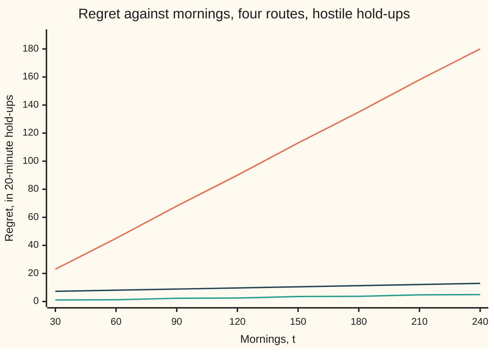

# Regret: judged against the best single choice in hindsight

[Syllabus](../../../SYLLABUS.md) → [Computability and complexity](../README.md) → [Data, Learning and Fine-Grained Complexity](../README.md#s06) → Regret

---

## General Overview

Four routes lead to the same office: bus, train, bike and car. Every working morning for a month, 20 mornings in all, one route must be chosen before the day's delays are known. In the evening the delay of every route is known, in minutes over the normal journey.

At the end of the month the totals are in. The train lost 108 minutes, even with a signal failure in week two that cost 90 of them. The bike lost 111, the bus 142 and the car 204. So the best single route, in hindsight, was the train.

Nobody knew that on morning 1. The fair question is how far behind that best route a choosing rule ends up. That gap is the **regret**: the rule's total delay minus the best single route's total delay.

The **weighted-majority rule** gives every route a weight, starting at 1. Each morning it picks a route at random, with chance in proportion to the weights. Each evening it shrinks every route's weight by a factor set by that route's delay. On this month it expects 129.40 minutes of delay in total, a regret of 21.40 minutes, about 1.07 minutes a morning.

The rule also carries a guarantee. Whatever the delays, up to 20 minutes each, even if a hostile planner picks them, its expected regret over 20 mornings is at most 74.47 minutes. Per morning, that ceiling falls as the months go by. Any rule that never tosses a coin has no such guarantee. A planner who knows the rule can put a 20-minute hold-up on its pick every morning, and its regret reaches at least 15 hold-ups in 20 mornings.

**A rule that tosses a weighted coin among N choices, and shrinks each choice's weight by a factor $`e^{-\eta \times \text{loss}}`$ after every round, with every loss between 0 and 1 and the learning rate $`\eta`$ set to $`\sqrt{8 \ln N / T}`$, ends T rounds with expected loss at most $`\sqrt{T \ln N / 2}`$ above the best single choice in hindsight, whatever the losses were.**

**What kind of fact this is:** a theorem, the regret bound, proved on this card in Why it works. The floor for two routes on fair-coin mornings is a theorem computed exactly on this card. The general floor, that no rule beats $`\sqrt{T \ln N / 2}`$ by much on its worst case, is a theorem stated with its source.

### The picture: hostile mornings, with and without the coin

The planner here sees each rule's chances before the morning and puts a 20-minute hold-up on the route the rule is most likely to take. One loss is one hold-up. The rules run for 240 mornings, about a working year.



Orange, top: follow the leader, a rule with no coin that always takes the route with the smallest total so far. It is hit every morning, while the least-hit route takes only a quarter of the hold-ups, so its regret climbs in a straight line to 180. Green, bottom: the weighted-majority rule, at 4.91 hold-ups after 240 mornings. Dark, middle: the theorem's ceiling for the green line, 12.90 at 240 mornings.

---

## The formula

Some words first. The choices are called **experts**, here the four routes. A **round** is one morning. On each round the rule sets chances, then the world reveals a **loss** for every expert, and the rule pays its expected loss.

A loss must lie between 0 and 1, so a delay is divided by a cap of 20 minutes: the train's 18-minute delay on morning 6 is a loss of 0.9. The rule's expected loss on a round is its chances times the losses, added up. That sum is an expectation, as defined in [Expectation](../../09-Probability%20and%20statistics/02-Random%20Variables/02-expectation.md).

This card introduces $`R_T`$, the regret after $`T`$ rounds:

```math
R_T = \sum_{t=1}^{T} \sum_{i=1}^{N} p_{t,i}\,\ell_{t,i} \;-\; \min_{i} \sum_{t=1}^{T} \ell_{t,i}
```

**Read it aloud:** the regret is the rule's total expected loss minus the total loss of the one expert that did best over the whole run.

The weighted-majority rule, with $`w_{1,i} = 1`$ for every expert:

```math
p_{t,i} = \frac{w_{t,i}}{W_t}, \qquad W_t = \sum_{i=1}^{N} w_{t,i}, \qquad w_{t+1,i} = w_{t,i}\, e^{-\eta\,\ell_{t,i}}
```

**Read it aloud:** choose each expert with chance equal to its share of the total weight, then multiply each weight by $`e`$ to the power minus the learning rate times that expert's loss.

The guarantee, for any losses in $`[0, 1]`$:

```math
R_T \le \frac{\ln N}{\eta} + \frac{\eta\,T}{8}, \qquad \text{and with } \eta = \sqrt{\frac{8 \ln N}{T}}: \qquad R_T \le \sqrt{\frac{T \ln N}{2}}
```

**Read it aloud:** the regret is at most the log of the number of experts over the learning rate, plus the learning rate times the rounds over 8; the best learning rate makes this the square root of the rounds times the log of the experts, halved.

For the month: $`\eta = \sqrt{8 \ln 4 / 20} = 0.7447`$, and the ceiling is $`\sqrt{20 \ln 4 / 2} = 3.7233`$ losses. One loss is 20 minutes, so the ceiling is 74.47 minutes.

| Symbol | Plain meaning | In our example | Push it up and the answer… |
| --- | --- | --- | --- |
| $`N`$ | number of experts | 4 routes | the ceiling grows only as $`\sqrt{\ln N}`$ |
| $`T`$ | number of rounds | 20 mornings | the ceiling grows as $`\sqrt{T}`$; per round it falls as $`1/\sqrt{T}`$ |
| $`t`$; $`i`$ | one round, counted from 1; one expert | morning 2; the train | — |
| $`\ell_{t,i}`$ | loss of expert $`i`$ on round $`t`$, between 0 and 1 | train on morning 6: 18/20 = 0.9 | that expert's weight falls faster |
| $`w_{t,i}`$ | weight of expert $`i`$ before round $`t`$ | train before morning 2: 0.9635 | that expert is chosen more often |
| $`W_t`$ | total weight before round $`t`$ | before morning 2: 3.3401 | — |
| $`p_{t,i}`$ | chance of choosing expert $`i`$ on round $`t`$ | train on morning 2: 0.2884 | — |
| $`\eta`$ | the learning rate: how hard one loss shrinks a weight | 0.7447 | reacts faster, but a planner can whipsaw it |
| $`L_i`$ | total loss of expert $`i`$, $`\sum_t \ell_{t,i}`$ | train: 108 minutes, 5.4 losses | — |
| $`L^*`$ | the smallest total, $`\min_i L_i`$ | 108 minutes | — |
| $`R_T`$ | regret after $`T`$ rounds | 21.40 minutes | — |
| $`H`$ | in Step 5's fair-coin mornings, the number of mornings route A is hit | — | — |

### When it holds

- **Losses lie between 0 and 1.** The proof uses this range in Step 2. With delays in raw minutes the same rule overreacts, and the ceiling must be multiplied by the range: the 3.7233 becomes 74.47 minutes only after the factor 20.
- **The coin is tossed after the losses are fixed.** The planner may see the past and even today's chances, but not today's coin. A planner who sees the pick itself can hit it every morning, and then no rule escapes a regret of $`T(1 - 1/N)`$: 15 of 20.
- **The yardstick is one fixed expert.** The best route chosen afresh each morning lost only 42 minutes. No rule is promised anything against that, and the gap here is 87.40 minutes.
- **Every expert's loss is seen after each round.** If only the chosen route's delay is seen, a different rule and a larger bound are needed (the bandit case, in [Multi-armed bandits](../../15-Optimization/07-Dynamic%20Programming%20and%20Learning/11-multi-armed-bandits-ucb-and-thompson-sampling.md)).
- **$`T`$ is known in advance, to set $`\eta`$.** Without it, $`\eta`$ can shrink as the rounds pass, for a constant factor more regret (Cesa-Bianchi and Lugosi, chapter 2).

---

## Why it works

### Step 0: the total weight is a scoreboard that cannot fall too far

Watch the total weight $`W_t`$. Two facts pin it from both sides.

- **It cannot fall below the best expert's weight.** That weight is $`e^{-\eta L^*}`$, because the best expert lost $`L^*`$ in total.
- **It falls each round by a factor tied to the rule's own expected loss.** A round where the rule expects to lose a lot is a round where heavy weights get cut.

So if the rule lost much more than the best expert, the total weight would have fallen below the best expert's weight alone. That cannot happen. Comparing the two facts gives the bound.

### Step 1: the floor

The total weight at the end is at least any one weight, the best expert's included. It started at $`W_1 = N`$, since every weight was 1. Taking logs:

```math
\ln \frac{W_{T+1}}{W_1} \;\ge\; \ln \frac{e^{-\eta L^*}}{N} \;=\; -\eta L^* - \ln N
```

For the month, $`L^* = 108/20 = 5.4`$ losses, so the floor is $`-0.7447 \times 5.4 - 1.3863 = -5.4075`$, with $`\eta`$ and $`\ln 4`$ unrounded.

### Step 2: the ceiling, one round at a time

The ratio of total weights on one round is an average of $`e^{-\eta \ell}`$, taken with the rule's own chances:

```math
\frac{W_{t+1}}{W_t} = \sum_{i} p_{t,i}\, e^{-\eta\,\ell_{t,i}}
```

That is the expectation of $`e^{-\eta X}`$, where $`X`$ is the loss of a randomly chosen expert, a number between 0 and 1. Hoeffding's lemma, proved in [Concentration](../../09-Probability%20and%20statistics/06-Limit%20Theorems%20in%20Practice/06-concentration-inequalities-hoeffding-and-chernoff.md), caps exactly this: for $`X`$ in $`[0, 1]`$ with mean $`\mu`$, the expectation of $`e^{-\eta X}`$ is at most $`e^{-\eta \mu + \eta^2/8}`$.

Here $`\mu`$ is the rule's expected loss on round $`t`$. Take logs and add up the rounds:

```math
\ln \frac{W_{T+1}}{W_1} \;\le\; -\eta \sum_{t=1}^{T} \sum_{i} p_{t,i}\,\ell_{t,i} \;+\; \frac{\eta^2 T}{8}
```

For the month the rule's expected loss is 6.4698 losses: 129.40 minutes over 20, with the minutes unrounded. So the ceiling is $`-3.4315`$. The true value, computed from the final weights, is $`-4.6170`$. It sits between the floor and the ceiling, as it must.

### Step 3: put the two together, then choose $`\eta`$

Floor at most ceiling. Move the losses to one side and divide by $`\eta`$:

```math
\sum_{t} \sum_{i} p_{t,i}\,\ell_{t,i} - L^* \;\le\; \frac{\ln N}{\eta} + \frac{\eta\,T}{8}
```

The left side is $`R_T`$. The first term on the right falls as $`\eta`$ grows; the second rises. They balance where they are equal, at $`\eta = \sqrt{8 \ln N / T}`$, and the sum there is $`\sqrt{T \ln N / 2}`$.

Nothing in Steps 1 to 3 used where the losses came from. They may be weather, timetables or a planner who reads the rule's chances. That is why the bound is a worst-case guarantee.

<details>
<summary>Detailed proof: the two details Steps 1 to 3 pass over</summary>

**The final weights.** Unrolling $`w_{t+1,i} = w_{t,i} e^{-\eta \ell_{t,i}}`$ from $`w_{1,i} = 1`$ gives $`w_{T+1,i} = e^{-\eta L_i}`$. All weights are positive, so $`W_{T+1}`$ is at least the best expert's weight, $`e^{-\eta L^*}`$. Adding the per-round inequalities of Step 2 works because the logs telescope:

$`\displaystyle \sum_{t=1}^{T} \left(\ln W_{t+1} - \ln W_t\right) = \ln W_{T+1} - \ln W_1.`$

**The best learning rate.** As a function of $`\eta`$, the right side $`\ln N/\eta + \eta T/8`$ has derivative $`-\ln N/\eta^2 + T/8`$. That is zero at $`\eta^2 = 8 \ln N / T`$. There each term equals $`\sqrt{T \ln N / 8}`$, and their sum is $`2\sqrt{T \ln N / 8} = \sqrt{T \ln N / 2}`$.

</details>

### Step 4: why the coin is essential

A rule with no coin is predictable. A planner who knows the rule knows its pick before the morning starts. It puts a full loss on that route and zero on the rest.

The rule then loses all $`T`$ rounds. The $`N`$ routes share at most $`T`$ hits, so the least-hit route took at most $`T/N`$. The regret is at least $`T(1 - 1/N)`$: 15 of 20 mornings for four routes, 300 minutes.

The weighted-majority rule faces the same planner and survives. The planner can only hit the route with the biggest chance, and that chance is shared out. Over 20 hostile mornings its regret is 1.4460 hold-ups.

Follow the leader fails even without a planner reading its mind. Take two routes: on the first morning route A loses 0.5 and route B loses 0; after that the full loss of 1 alternates, B on morning 2, A on morning 3, and so on. The leader switches every morning onto the route about to lose. Over 20 mornings it loses 19.5 against the best route's 9.5: regret 10, about $`T/2`$.

### Step 5: what no rule can buy

The bound grows as $`\sqrt{T}`$. A floor shows this growth is real, not a weakness of the proof.

Take two routes and let a fair coin decide each morning which one loses 1; the other loses 0. Whatever a rule picks, it is hit with chance 1/2, so its expected total is $`T/2`$. The better route lost $`\min(H, T - H)`$, where $`H`$ counts route A's hits. So every rule's expected regret is exactly the expected value of $`|H - T/2|`$.

For $`T = 20`$ that is 1.7620 losses, 35.24 minutes, close to $`\sqrt{T/(2\pi)} = 1.7841`$. The theorem's ceiling for two routes is $`\sqrt{20 \ln 2 / 2} = 2.6328`$ losses, 52.66 minutes. The best possible rule lies between the two.

For many experts and long runs, the worst-case regret of the best rule, divided by $`\sqrt{T \ln N / 2}`$, tends to 1 (Cesa-Bianchi and Lugosi, Theorem 3.7, stated here without proof). So the weighted-majority rule with the tuned $`\eta`$ is optimal, constant included, in that limit.

### Step 6: what changed from learning with a guarantee

[Learning with a guarantee](04-pac-learning-and-vc-dimension.md) assumes examples are drawn independently from one fixed distribution, and asks how many examples are enough. Regret drops that assumption entirely. The losses may drift, switch or fight back.

The price is the yardstick. A learning guarantee is absolute: a small error rate. Regret is relative: close to the best expert in a fixed list, however good or bad that expert is.

---

## Worked numbers, by hand

The cap is 20 minutes, so a delay in minutes is divided by 20 to give a loss.

| Step | Arithmetic | Value |
| --- | --- | --- |
| learning rate | $`\sqrt{8 \times 1.3863 / 20}`$ | 0.7447 |
| morning 1 chances | all four weights are 1 | 0.25 each |
| morning 1 expected delay | $`(6 + 1 + 4 + 9)/4`$ minutes | 5.0000 min |
| new weight, bus | $`e^{-0.7447 \times 6/20}`$ | 0.7998 |
| new weights, train, bike, car | $`e^{-0.7447 \times 1/20}`$, then 4/20, then 9/20 | 0.9635, 0.8616, 0.7153 |
| total weight | $`0.7998 + 0.9635 + 0.8616 + 0.7153`$, unrounded weights | 3.3401 |
| morning 2 chances | each weight over 3.3401, unrounded | 0.2394, 0.2884, 0.2580, 0.2141 |
| morning 2 expected delay | $`0.2394 \times 8 + 0.2884 \times 2 + 0.2580 \times 4 + 0.2141 \times 11`$, unrounded chances | 5.8799 min |
| morning 20 chances | after the whole month but one | 0.1497, 0.4246, 0.4091, 0.0166 |
| month, expected total | 20 mornings added | 129.40 min |
| best single route | train | 108 min |
| regret | $`129.40 - 108`$ | **21.40 min** |
| ceiling | $`20 \times \sqrt{20 \ln 4 / 2}`$ | 74.47 min |

The rule ended 21.40 minutes behind the train, about 1.07 minutes a morning, well inside the 74.47 minutes it promises against any month at all.

By morning 20 the car is nearly abandoned, at a chance of 0.0166, while the train and bike share most of the chance. The signal failure in week two pushed weight from the train to the bike, and the calm weeks after it pushed weight back.

### What breaks if you drop a piece

| Mistake | Comes out at | What went wrong |
| --- | --- | --- |
| No coin: follow the leader, on alternating mornings | regret 10.0 losses, 200 minutes | the leader is always the route about to lose |
| No coin, against a planner who knows the rule | regret 15.0 of 20 mornings | a predictable pick can be hit every time |
| Learning rate 0.01 on the month | regret 32.96 minutes, against 21.40 | weights barely move, so the rule stays near the average route |
| Learning rate 20 on alternating mornings | regret 9.7491 losses | the rule acts almost like the leader |
| Yardstick: best route each morning | 42 minutes, a gap of 87.40 | that route changes daily and nobody knows it in advance |

The code prints all five.

---

## Code, from first principles, and it actually runs

The script runs the month, the hostile planner, the alternating mornings and the fair-coin floor. It reaches the rule's expected total by three roads. Roads one and two are two implementations of the same product, there to catch coding slips: road one reads each weight off the running total as $`e^{-\eta L_i}`$, and road two multiplies the weights in, morning by morning. Road three is independent: it really tosses the coin, 10,000 simulated months, with SplitMix64 (a small, fully written-out random number generator) from seed 2026. The theorem is checked on every prefix of the month, of the alternating mornings and of the 240 hostile mornings, and the fair-coin floor is computed by Pascal's triangle against its closed form $`(T/2)\binom{T}{T/2}/2^T`$.

### Python

```python
# Regret -- the check behind the card.  Nothing is imported but math.  Four
# routes to work, twenty mornings, delays in minutes.  The weighted-majority
# rule (randomised form: pick a route with chance in proportion to its weight,
# shrink each weight by e^(-eta x loss)) is run and its regret is compared with
# the bound ln N / eta + eta T / 8 and with rules that fail.
import math
ROUTES, CAP = ["bus", "train", "bike", "car"], 20      # a loss is delay / 20 minutes
DELAY = [[6, 8, 5, 9, 7, 6, 10, 5, 8, 7, 6, 9, 5, 7, 8, 6, 7, 9, 6, 8],
         [1, 2, 0, 1, 2, 18, 20, 16, 19, 17, 2, 1, 0, 2, 1, 1, 2, 0, 1, 2],
         [4, 4, 5, 4, 12, 4, 5, 4, 4, 13, 4, 5, 4, 4, 14, 4, 5, 4, 4, 4],
         [9, 11, 8, 12, 10, 9, 13, 10, 11, 9, 10, 12, 8, 9, 11, 10, 9, 12, 10, 11]]
N, T = len(ROUTES), len(DELAY[0])
M64 = (1 << 64) - 1

def splitmix(state):                     # SplitMix64: next state, and a uniform in [0, 1)
    state = (state + 0x9E3779B97F4A7C15) & M64
    z = state
    z = ((z ^ (z >> 30)) * 0xBF58476D1CE4E5B9) & M64
    z = ((z ^ (z >> 27)) * 0x94D049BB133111EB) & M64
    return state, ((z ^ (z >> 31)) >> 11) / 9007199254740992.0

def play(eta, rounds, n, nature, leader=False):
    # road one: each weight read off the running total, w_i = e^(-eta L_i);
    # leader=True follows the route with the smallest total (eta -> infinity)
    tot, alg, probs, regret = [0.0] * n, 0.0, [], []
    for t in range(rounds):
        if leader:
            j = tot.index(min(tot))
            p = [1.0 if i == j else 0.0 for i in range(n)]
        else:
            low = min(tot)
            w = [math.exp(-eta * (x - low)) for x in tot]
            p = [x / sum(w) for x in w]
        loss = nature(t, p)
        alg += sum(a * b for a, b in zip(p, loss))
        tot = [a + b for a, b in zip(tot, loss)]
        probs.append(p)
        regret.append(alg - min(tot))
    return probs, alg, tot, regret

def commute(t, p):
    return [DELAY[i][t] / CAP for i in range(N)]

def alternating(t, p):                   # two routes: half a loss, then 1 and 0 in turn
    return [0.5, 0.0] if t == 0 else ([0.0, 1.0] if t % 2 == 1 else [1.0, 0.0])

def spiteful(t, p):                      # the hold-up lands on the likeliest route
    j = p.index(max(p))
    return [1.0 if i == j else 0.0 for i in range(len(p))]

def iterate(eta):                        # road two: multiply each weight in, morning by morning
    w, alg = [1.0] * N, 0.0
    for t in range(T):
        alg += sum(w[i] * DELAY[i][t] / CAP for i in range(N)) / sum(w)
        w = [w[i] * math.exp(-eta * DELAY[i][t] / CAP) for i in range(N)]
    return alg, w

def bound(eta, t, n):
    return math.log(n) / eta + eta * t / 8

eta = math.sqrt(8 * math.log(N) / T)
probs, alg, tot, regret = play(eta, T, N, commute)
alg2, w_end = iterate(eta)
best = min(range(N), key=lambda i: tot[i])
print("route totals, minutes: " + ", ".join(f"{r} {sum(d)}" for r, d in zip(ROUTES, DELAY)))
print(f"best single route in hindsight: {ROUTES[best]}, {tot[best] * CAP:.0f} minutes")
print(f"train's bad week, mornings 6 to 10: {sum(DELAY[1][5:10])} minutes; train, morning 6: loss {DELAY[1][5] / CAP:.4f}")
print(f"L* = {tot[best]:.4f} losses, rule {alg:.4f} losses, ln {N} = {math.log(N):.4f}")
print(f"eta = sqrt(8 ln {N} / {T}) = {eta:.4f}")
for t in (0, 1, 19):
    exp_delay = sum(p * DELAY[i][t] for i, p in enumerate(probs[t]))
    print(f"morning {t + 1}: chances " + " ".join(f"{p:.4f}" for p in probs[t]) + f", expected delay {exp_delay:.4f} min")
w1 = [math.exp(-eta * DELAY[i][0] / CAP) for i in range(N)]
print("weights after morning 1: " + " ".join(f"{x:.4f}" for x in w1) + f", sum {sum(w1):.4f}")
print(f"weighted majority, expected total: {alg * CAP:.2f} minutes (road two, multiplied in: {alg2 * CAP:.2f})")
print(f"regret R_T = {alg * CAP:.2f} - {tot[best] * CAP:.0f} = {regret[-1] * CAP:.2f} minutes")
print(f"bound ln {N}/eta + eta T/8 = {bound(eta, T, N):.4f} losses = {bound(eta, T, N) * CAP:.2f} minutes")
print(f"bound per morning: {bound(eta, T, N) * CAP / T:.2f} minutes; regret per morning {regret[-1] * CAP / T:.2f}")
phi = math.log(sum(w_end) / N)
print(f"potential ln(W/N) = {phi:.4f}, floor -eta L* - ln N = {-eta * tot[best] - math.log(N):.4f}, "
      f"ceiling -eta rule + eta^2 T/8 = {-eta * alg + eta * eta * T / 8:.4f}")
state, runs, sums, squares = 2026, 10000, 0.0, 0.0
for _ in range(runs):                    # road three: really toss the coin, 10,000 months
    month = 0
    for t in range(T):
        state, u = splitmix(state)
        i, acc = 0, probs[t][0]
        while u >= acc and i < N - 1:
            i += 1
            acc += probs[t][i]
        month += DELAY[i][t]
    sums, squares = sums + month, squares + month * month
mean = sums / runs
sd = math.sqrt(squares / runs - mean * mean)
se = sd / math.sqrt(runs)
print(f"simulated months: {runs}, mean total {mean:.2f} minutes, one month's spread {sd:.2f}, standard error {se:.2f}")
daily_best = sum(min(DELAY[i][t] for i in range(N)) for t in range(T))
print(f"mistake, best route each morning instead: {daily_best} minutes, gap {alg * CAP - daily_best:.2f}")
print(f"eta = 0.01 on the month: regret {play(0.01, T, N, commute)[3][-1] * CAP:.2f} minutes")
print(f"eta = 20 on alternating mornings: regret {play(20.0, T, 2, alternating)[3][-1]:.4f}")
_, fa, ft, fr = play(0, T, 2, alternating, leader=True)
eta2 = math.sqrt(8 * math.log(2) / T)
hr = play(eta2, T, 2, alternating)[3][-1]
print(f"alternating mornings: leader loses {fa:.1f}, best route {min(ft):.1f}, regret {fr[-1]:.1f} "
      f"= {fr[-1] * CAP:.0f} minutes; weighted majority regret {hr:.4f}")
_, sa, st, sr = play(0, T, N, spiteful, leader=True)
hs = play(eta, T, N, spiteful)[3][-1]
print(f"spiteful mornings: leader regret {sr[-1]:.1f} of {T} = {sr[-1] * CAP:.0f} minutes (T(1 - 1/N) = {T * (1 - 1 / N):.1f}); "
      f"weighted majority regret {hs:.4f}")
T2 = 240
eta3 = math.sqrt(8 * math.log(N) / T2)
lr, hr2 = play(0, T2, N, spiteful, leader=True)[3], play(eta3, T2, N, spiteful)[3]
for t in range(30, T2 + 1, 30):
    print(f"chart, t = {t}: leader {lr[t - 1]:.1f}, weighted majority {hr2[t - 1]:.2f}, bound {bound(eta3, t, N):.2f}")
row = [1]                                # Pascal's triangle, row 20
for _ in range(T):
    row = [1] + [row[k] + row[k + 1] for k in range(len(row) - 1)] + [1]
floor_sum = sum(c * abs(k - T / 2) for k, c in enumerate(row)) / 2 ** T
floor_closed = T / 2 * math.comb(T, T // 2) / 2 ** T
print(f"fair-coin mornings, two routes: every rule's expected regret {floor_sum:.4f} "
      f"(closed form {floor_closed:.4f}, about sqrt(T/2pi) = {math.sqrt(T / (2 * math.pi)):.4f}); "
      f"bound {math.sqrt(T * math.log(2) / 2):.4f}")
print(f"in minutes: floor {floor_sum * CAP:.2f}, bound {math.sqrt(T * math.log(2) / 2) * CAP:.2f}")
assert abs(alg - alg2) < 1e-9                                  # two roads to the weights
assert abs(mean - alg * CAP) < 4 * se                          # the coin, really tossed
assert all(r <= bound(eta, t + 1, N) for t, r in enumerate(regret))   # the theorem, every prefix
assert all(r <= bound(eta2, t + 1, 2) for t, r in enumerate(play(eta2, T, 2, alternating)[3]))  # and on the hostile runs
assert all(r <= bound(eta3, t + 1, N) for t, r in enumerate(hr2))
assert -eta * tot[best] - math.log(N) <= phi <= -eta * alg + eta * eta * T / 8
assert abs(fr[-1] - T / 2) < 1e-9 and abs(sr[-1] - T * (1 - 1 / N)) < 1e-9
assert abs(floor_sum - floor_closed) < 1e-12 and floor_sum <= math.sqrt(T * math.log(2) / 2)
print("ALL CHECKS PASS")
```

**Ran 2026-11-19 on macOS, Python 3.14.10, standard library only. All checks passed. Output, pasted from the run:**

```
route totals, minutes: bus 142, train 108, bike 111, car 204
best single route in hindsight: train, 108 minutes
train's bad week, mornings 6 to 10: 90 minutes; train, morning 6: loss 0.9000
L* = 5.4000 losses, rule 6.4698 losses, ln 4 = 1.3863
eta = sqrt(8 ln 4 / 20) = 0.7447
morning 1: chances 0.2500 0.2500 0.2500 0.2500, expected delay 5.0000 min
morning 2: chances 0.2394 0.2884 0.2580 0.2141, expected delay 5.8799 min
morning 20: chances 0.1497 0.4246 0.4091 0.0166, expected delay 3.8661 min
weights after morning 1: 0.7998 0.9635 0.8616 0.7153, sum 3.3401
weighted majority, expected total: 129.40 minutes (road two, multiplied in: 129.40)
regret R_T = 129.40 - 108 = 21.40 minutes
bound ln 4/eta + eta T/8 = 3.7233 losses = 74.47 minutes
bound per morning: 3.72 minutes; regret per morning 1.07
potential ln(W/N) = -4.6170, floor -eta L* - ln N = -5.4075, ceiling -eta rule + eta^2 T/8 = -3.4315
simulated months: 10000, mean total 129.09 minutes, one month's spread 17.21, standard error 0.17
mistake, best route each morning instead: 42 minutes, gap 87.40
eta = 0.01 on the month: regret 32.96 minutes
eta = 20 on alternating mornings: regret 9.7491
alternating mornings: leader loses 19.5, best route 9.5, regret 10.0 = 200 minutes; weighted majority regret 1.4934
spiteful mornings: leader regret 15.0 of 20 = 300 minutes (T(1 - 1/N) = 15.0); weighted majority regret 1.4460
chart, t = 30: leader 23.0, weighted majority 1.09, bound 7.26
chart, t = 60: leader 45.0, weighted majority 1.23, bound 8.06
chart, t = 90: leader 68.0, weighted majority 2.31, bound 8.87
chart, t = 120: leader 90.0, weighted majority 2.46, bound 9.67
chart, t = 150: leader 113.0, weighted majority 3.54, bound 10.48
chart, t = 180: leader 135.0, weighted majority 3.69, bound 11.29
chart, t = 210: leader 158.0, weighted majority 4.77, bound 12.09
chart, t = 240: leader 180.0, weighted majority 4.91, bound 12.90
fair-coin mornings, two routes: every rule's expected regret 1.7620 (closed form 1.7620, about sqrt(T/2pi) = 1.7841); bound 2.6328
in minutes: floor 35.24, bound 52.66
ALL CHECKS PASS
```

### Rust

Same numbers, same labels, built with `rustc --edition 2021 -O`.

```rust
// Regret -- the same check as the Python, in Rust.  No crates.  Four routes to
// work, twenty mornings, delays in minutes.  The weighted-majority rule
// (randomised form: pick a route with chance in proportion to its weight,
// shrink each weight by e^(-eta x loss)) is run and its regret is compared with
// the bound ln N / eta + eta T / 8 and with rules that fail.
const ROUTES: [&str; 4] = ["bus", "train", "bike", "car"];
const CAP: f64 = 20.0; // a loss is delay / 20 minutes
const DELAY: [[u32; 20]; 4] = [
    [6, 8, 5, 9, 7, 6, 10, 5, 8, 7, 6, 9, 5, 7, 8, 6, 7, 9, 6, 8],
    [1, 2, 0, 1, 2, 18, 20, 16, 19, 17, 2, 1, 0, 2, 1, 1, 2, 0, 1, 2],
    [4, 4, 5, 4, 12, 4, 5, 4, 4, 13, 4, 5, 4, 4, 14, 4, 5, 4, 4, 4],
    [9, 11, 8, 12, 10, 9, 13, 10, 11, 9, 10, 12, 8, 9, 11, 10, 9, 12, 10, 11]];
const N: usize = 4;
const T: usize = 20;

fn splitmix(state: &mut u64) -> f64 { // SplitMix64: a uniform in [0, 1)
    *state = state.wrapping_add(0x9E3779B97F4A7C15);
    let mut z = *state;
    z = (z ^ (z >> 30)).wrapping_mul(0xBF58476D1CE4E5B9);
    z = (z ^ (z >> 27)).wrapping_mul(0x94D049BB133111EB);
    ((z ^ (z >> 31)) >> 11) as f64 / 9007199254740992.0
}

fn first_min(v: &[f64]) -> usize { let mut j = 0; for i in 0..v.len() { if v[i] < v[j] { j = i } } j }
fn first_max(v: &[f64]) -> usize { let mut j = 0; for i in 0..v.len() { if v[i] > v[j] { j = i } } j }
fn dot(a: &[f64], b: &[f64]) -> f64 { a.iter().zip(b).map(|(x, y)| x * y).sum() }

// road one: each weight read off the running total, w_i = e^(-eta L_i);
// leader = true follows the route with the smallest total (eta -> infinity)
fn play(eta: f64, rounds: usize, n: usize, nature: &dyn Fn(usize, &[f64]) -> Vec<f64>, leader: bool)
        -> (Vec<Vec<f64>>, f64, Vec<f64>, Vec<f64>) {
    let (mut tot, mut alg, mut probs, mut regret) = (vec![0.0; n], 0.0, Vec::new(), Vec::new());
    for t in 0..rounds {
        let p: Vec<f64> = if leader {
            let j = first_min(&tot);
            (0..n).map(|i| if i == j { 1.0 } else { 0.0 }).collect()
        } else {
            let low = tot.iter().cloned().fold(f64::INFINITY, f64::min);
            let w: Vec<f64> = tot.iter().map(|x| (-eta * (x - low)).exp()).collect();
            let s: f64 = w.iter().sum();
            w.iter().map(|x| x / s).collect()
        };
        let loss = nature(t, &p);
        alg += dot(&p, &loss);
        for i in 0..n { tot[i] += loss[i] }
        probs.push(p);
        regret.push(alg - tot.iter().cloned().fold(f64::INFINITY, f64::min));
    }
    (probs, alg, tot, regret)
}

fn commute(t: usize, _p: &[f64]) -> Vec<f64> { (0..N).map(|i| DELAY[i][t] as f64 / CAP).collect() }
fn alternating(t: usize, _p: &[f64]) -> Vec<f64> { // two routes: half a loss, then 1 and 0 in turn
    if t == 0 { vec![0.5, 0.0] } else if t % 2 == 1 { vec![0.0, 1.0] } else { vec![1.0, 0.0] }
}
fn spiteful(_t: usize, p: &[f64]) -> Vec<f64> { // the hold-up lands on the likeliest route
    let j = first_max(p);
    (0..p.len()).map(|i| if i == j { 1.0 } else { 0.0 }).collect()
}

fn iterate(eta: f64) -> (f64, Vec<f64>) { // road two: multiply each weight in, morning by morning
    let (mut w, mut alg) = (vec![1.0; N], 0.0);
    for t in 0..T {
        let s: f64 = w.iter().sum();
        alg += (0..N).map(|i| w[i] * DELAY[i][t] as f64 / CAP).sum::<f64>() / s;
        for i in 0..N { w[i] *= (-eta * DELAY[i][t] as f64 / CAP).exp() }
    }
    (alg, w)
}

fn bound(eta: f64, t: usize, n: usize) -> f64 { (n as f64).ln() / eta + eta * t as f64 / 8.0 }
fn join(v: &[f64]) -> String { v.iter().map(|x| format!("{:.4}", x)).collect::<Vec<_>>().join(" ") }

fn main() {
    let ln_n = (N as f64).ln();
    let eta = (8.0 * ln_n / T as f64).sqrt();
    let (probs, alg, tot, regret) = play(eta, T, N, &commute, false);
    let (alg2, w_end) = iterate(eta);
    let best = first_min(&tot);
    let totals: Vec<String> = (0..N).map(|i| format!("{} {}", ROUTES[i], DELAY[i].iter().sum::<u32>())).collect();
    println!("route totals, minutes: {}", totals.join(", "));
    println!("best single route in hindsight: {}, {:.0} minutes", ROUTES[best], tot[best] * CAP);
    println!("train's bad week, mornings 6 to 10: {} minutes; train, morning 6: loss {:.4}",
             DELAY[1][5..10].iter().sum::<u32>(), DELAY[1][5] as f64 / CAP);
    println!("L* = {:.4} losses, rule {:.4} losses, ln {} = {:.4}", tot[best], alg, N, ln_n);
    println!("eta = sqrt(8 ln {} / {}) = {:.4}", N, T, eta);
    for t in [0usize, 1, 19] {
        let d: f64 = (0..N).map(|i| probs[t][i] * DELAY[i][t] as f64).sum();
        println!("morning {}: chances {}, expected delay {:.4} min", t + 1, join(&probs[t]), d);
    }
    let w1: Vec<f64> = (0..N).map(|i| (-eta * DELAY[i][0] as f64 / CAP).exp()).collect();
    println!("weights after morning 1: {}, sum {:.4}", join(&w1), w1.iter().sum::<f64>());
    println!("weighted majority, expected total: {:.2} minutes (road two, multiplied in: {:.2})", alg * CAP, alg2 * CAP);
    println!("regret R_T = {:.2} - {:.0} = {:.2} minutes", alg * CAP, tot[best] * CAP, regret[T - 1] * CAP);
    let b = bound(eta, T, N);
    println!("bound ln {}/eta + eta T/8 = {:.4} losses = {:.2} minutes", N, b, b * CAP);
    println!("bound per morning: {:.2} minutes; regret per morning {:.2}", b * CAP / T as f64, regret[T - 1] * CAP / T as f64);
    let phi = (w_end.iter().sum::<f64>() / N as f64).ln();
    let (floor, ceil) = (-eta * tot[best] - ln_n, -eta * alg + eta * eta * T as f64 / 8.0);
    println!("potential ln(W/N) = {:.4}, floor -eta L* - ln N = {:.4}, ceiling -eta rule + eta^2 T/8 = {:.4}", phi, floor, ceil);
    let (mut state, runs, mut sums, mut squares) = (2026u64, 10000, 0.0f64, 0.0f64);
    for _ in 0..runs { // road three: really toss the coin, 10,000 months
        let mut month = 0.0;
        for t in 0..T {
            let u = splitmix(&mut state);
            let (mut i, mut acc) = (0, probs[t][0]);
            while u >= acc && i < N - 1 { i += 1; acc += probs[t][i] }
            month += DELAY[i][t] as f64;
        }
        sums += month;
        squares += month * month;
    }
    let mean = sums / runs as f64;
    let sd = (squares / runs as f64 - mean * mean).sqrt();
    let se = sd / (runs as f64).sqrt();
    println!("simulated months: {}, mean total {:.2} minutes, one month's spread {:.2}, standard error {:.2}", runs, mean, sd, se);
    let daily_best: u32 = (0..T).map(|t| (0..N).map(|i| DELAY[i][t]).min().unwrap()).sum();
    println!("mistake, best route each morning instead: {} minutes, gap {:.2}", daily_best, alg * CAP - daily_best as f64);
    println!("eta = 0.01 on the month: regret {:.2} minutes", play(0.01, T, N, &commute, false).3[T - 1] * CAP);
    println!("eta = 20 on alternating mornings: regret {:.4}", play(20.0, T, 2, &alternating, false).3[T - 1]);
    let (_, fa, ft, fr) = play(0.0, T, 2, &alternating, true);
    let eta2 = (8.0 * 2f64.ln() / T as f64).sqrt();
    let hr = play(eta2, T, 2, &alternating, false).3[T - 1];
    println!("alternating mornings: leader loses {:.1}, best route {:.1}, regret {:.1} = {:.0} minutes; weighted majority regret {:.4}",
             fa, ft[first_min(&ft)], fr[T - 1], fr[T - 1] * CAP, hr);
    let sr = play(0.0, T, N, &spiteful, true).3;
    let hs = play(eta, T, N, &spiteful, false).3[T - 1];
    let lose = T as f64 * (1.0 - 1.0 / N as f64);
    println!("spiteful mornings: leader regret {:.1} of {} = {:.0} minutes (T(1 - 1/N) = {:.1}); weighted majority regret {:.4}",
             sr[T - 1], T, sr[T - 1] * CAP, lose, hs);
    let t2 = 240;
    let eta3 = (8.0 * ln_n / t2 as f64).sqrt();
    let (lr, hr2) = (play(0.0, t2, N, &spiteful, true).3, play(eta3, t2, N, &spiteful, false).3);
    for t in (30..=t2).step_by(30) {
        println!("chart, t = {}: leader {:.1}, weighted majority {:.2}, bound {:.2}", t, lr[t - 1], hr2[t - 1], bound(eta3, t, N));
    }
    let mut row: Vec<f64> = vec![1.0]; // Pascal's triangle, row 20
    for _ in 0..T {
        let mut next = vec![1.0];
        for k in 0..row.len() - 1 { next.push(row[k] + row[k + 1]) }
        next.push(1.0);
        row = next;
    }
    let two_t = 2f64.powi(T as i32);
    let floor_sum: f64 = row.iter().enumerate().map(|(k, c)| c * (k as f64 - T as f64 / 2.0).abs()).sum::<f64>() / two_t;
    let mut choose = 1.0; // C(20, 10) as a running product
    for k in 0..T / 2 { choose = choose * (T - k) as f64 / (k + 1) as f64 }
    let floor_closed = T as f64 / 2.0 * choose / two_t;
    let b2 = (T as f64 * 2f64.ln() / 2.0).sqrt();
    println!("fair-coin mornings, two routes: every rule's expected regret {:.4} (closed form {:.4}, about sqrt(T/2pi) = {:.4}); bound {:.4}",
             floor_sum, floor_closed, (T as f64 / (2.0 * std::f64::consts::PI)).sqrt(), b2);
    println!("in minutes: floor {:.2}, bound {:.2}", floor_sum * CAP, b2 * CAP);
    assert!((alg - alg2).abs() < 1e-9); // two roads to the weights
    assert!((mean - alg * CAP).abs() < 4.0 * se); // the coin, really tossed
    assert!(regret.iter().enumerate().all(|(t, r)| *r <= bound(eta, t + 1, N))); // the theorem, every prefix
    assert!(play(eta2, T, 2, &alternating, false).3.iter().enumerate().all(|(t, r)| *r <= bound(eta2, t + 1, 2))); // and on the hostile runs
    assert!(hr2.iter().enumerate().all(|(t, r)| *r <= bound(eta3, t + 1, N)));
    assert!(floor <= phi && phi <= ceil);
    assert!((fr[T - 1] - T as f64 / 2.0).abs() < 1e-9 && (sr[T - 1] - lose).abs() < 1e-9);
    assert!((floor_sum - floor_closed).abs() < 1e-12 && floor_sum <= b2);
    println!("ALL CHECKS PASS");
}
```

**Ran 2026-11-19 on macOS, rustc 1.98.1, no crates. All checks passed. Output, pasted from the run:**

```
route totals, minutes: bus 142, train 108, bike 111, car 204
best single route in hindsight: train, 108 minutes
train's bad week, mornings 6 to 10: 90 minutes; train, morning 6: loss 0.9000
L* = 5.4000 losses, rule 6.4698 losses, ln 4 = 1.3863
eta = sqrt(8 ln 4 / 20) = 0.7447
morning 1: chances 0.2500 0.2500 0.2500 0.2500, expected delay 5.0000 min
morning 2: chances 0.2394 0.2884 0.2580 0.2141, expected delay 5.8799 min
morning 20: chances 0.1497 0.4246 0.4091 0.0166, expected delay 3.8661 min
weights after morning 1: 0.7998 0.9635 0.8616 0.7153, sum 3.3401
weighted majority, expected total: 129.40 minutes (road two, multiplied in: 129.40)
regret R_T = 129.40 - 108 = 21.40 minutes
bound ln 4/eta + eta T/8 = 3.7233 losses = 74.47 minutes
bound per morning: 3.72 minutes; regret per morning 1.07
potential ln(W/N) = -4.6170, floor -eta L* - ln N = -5.4075, ceiling -eta rule + eta^2 T/8 = -3.4315
simulated months: 10000, mean total 129.09 minutes, one month's spread 17.21, standard error 0.17
mistake, best route each morning instead: 42 minutes, gap 87.40
eta = 0.01 on the month: regret 32.96 minutes
eta = 20 on alternating mornings: regret 9.7491
alternating mornings: leader loses 19.5, best route 9.5, regret 10.0 = 200 minutes; weighted majority regret 1.4934
spiteful mornings: leader regret 15.0 of 20 = 300 minutes (T(1 - 1/N) = 15.0); weighted majority regret 1.4460
chart, t = 30: leader 23.0, weighted majority 1.09, bound 7.26
chart, t = 60: leader 45.0, weighted majority 1.23, bound 8.06
chart, t = 90: leader 68.0, weighted majority 2.31, bound 8.87
chart, t = 120: leader 90.0, weighted majority 2.46, bound 9.67
chart, t = 150: leader 113.0, weighted majority 3.54, bound 10.48
chart, t = 180: leader 135.0, weighted majority 3.69, bound 11.29
chart, t = 210: leader 158.0, weighted majority 4.77, bound 12.09
chart, t = 240: leader 180.0, weighted majority 4.91, bound 12.90
fair-coin mornings, two routes: every rule's expected regret 1.7620 (closed form 1.7620, about sqrt(T/2pi) = 1.7841); bound 2.6328
in minutes: floor 35.24, bound 52.66
ALL CHECKS PASS
```

The two outputs match line for line.

### Lean

Lean proves the regret bound and the floor for rules with no coin, for every number of experts, rounds and losses.

- Suppose every loss lies between 0 and 1, and the learning rate $`\eta`$ is above 0. Then $`R_T \le \ln N / \eta + \eta T / 8`$, whatever the losses were.
- Suppose every loss lies between 0 and 1, and $`\eta = \sqrt{8 \ln N / T}`$. Then $`R_T \le \sqrt{T \ln N / 2}`$, for any losses, a planner's included.
- Take any rule with no coin, picking each round from the losses seen so far. Then some losses between 0 and 1 leave its regret at least $`T(1 - 1/N)`$.
- Four routes and 20 mornings make that floor 15 hold-ups, 300 minutes.
- The month's route totals are 142, 108, 111 and 204 minutes, and the train's bad week cost 90 of its 108.
- The best route chosen afresh each morning loses only 42 minutes in total.
- Take fair-coin mornings, two routes and $`T = 20`$. Then the floor's sum, before dividing by $`2^{20}`$, matches its closed form.

The month's weights, its 129.40-minute total, follow the leader and the 10,000 simulated months are left to the Python and Rust checks.

```lean
-- Regret: the weighted-majority rule, with every loss between 0 and 1 and learning rate √(8 ln N / T), ends T rounds with expected loss at most √(T ln N / 2) above the best single expert, whatever the losses, while a rule with no coin can be forced to regret T(1 - 1/N).
import Mathlib.Analysis.SpecialFunctions.Log.Basic
import Mathlib.Analysis.SpecialFunctions.Sqrt
import Mathlib.Data.Nat.Choose.Basic
import Mathlib.Data.Nat.Dist
import Mathlib.Probability.Moments.SubGaussian
import Mathlib.Probability.ProbabilityMassFunction.Integrals

open Finset

namespace Regret

variable {N : ℕ}

/-- The total loss of expert `i` over the first `t` rounds (rounds counted from 0):
`ℓ 0 i + ℓ 1 i + ⋯ + ℓ (t - 1) i`. Here `ℓ s i` is expert `i`'s loss on round `s`. -/
def cumLoss (ℓ : ℕ → Fin N → ℝ) (t : ℕ) (i : Fin N) : ℝ :=
  ∑ s ∈ range t, ℓ s i

/-- The weighted-majority weight of expert `i` before round `t`. It starts at 1 and is
multiplied by `e^(-η × loss)` after every round, so it equals `e^(-η × total loss so far)`. -/
noncomputable def weight (η : ℝ) (ℓ : ℕ → Fin N → ℝ) (t : ℕ) (i : Fin N) : ℝ :=
  Real.exp (-η * cumLoss ℓ t i)

/-- The rule's chance of choosing expert `i` on round `t`: its weight over the total weight. -/
noncomputable def chance (η : ℝ) (ℓ : ℕ → Fin N → ℝ) (t : ℕ) (i : Fin N) : ℝ :=
  weight η ℓ t i / ∑ j, weight η ℓ t j

/-- The rule's total expected loss over `T` rounds: on each round, its chances times the
losses, added up. -/
noncomputable def ruleLoss (η : ℝ) (ℓ : ℕ → Fin N → ℝ) (T : ℕ) : ℝ :=
  ∑ t ∈ range T, ∑ i, chance η ℓ t i * ℓ t i

/-- The total loss of the best single expert in hindsight, `L* = min_i L_i`. -/
noncomputable def bestLoss (ℓ : ℕ → Fin N → ℝ) (T : ℕ) : ℝ :=
  ⨅ i, cumLoss ℓ T i

/-- The regret `R_T`: the rule's total expected loss minus the best single expert's total. -/
noncomputable def regret (η : ℝ) (ℓ : ℕ → Fin N → ℝ) (T : ℕ) : ℝ :=
  ruleLoss η ℓ T - bestLoss ℓ T

end Regret

open Regret

open MeasureTheory ProbabilityTheory in
lemma hoeffding_fin {N : ℕ} (p x : Fin N → ℝ) (hp : ∀ i, 0 ≤ p i) (hs : ∑ i, p i = 1)
    (hx : ∀ i, 0 ≤ x i ∧ x i ≤ 1) (η : ℝ) :
    ∑ i, p i * Real.exp (-η * x i) ≤ Real.exp (-η * ∑ i, p i * x i + η ^ 2 / 8) := by
  have h1 : ∑ i, ENNReal.ofReal (p i) = 1 := by
    rw [← ENNReal.ofReal_sum_of_nonneg (fun i _ => hp i), hs, ENNReal.ofReal_one]
  set q := PMF.ofFintype (fun i => ENNReal.ofReal (p i)) h1
  set μ := q.toMeasure
  have hq : ∀ i, (q i).toReal = p i := fun i => by
    simp [q, PMF.ofFintype_apply, ENNReal.toReal_ofReal (hp i)]
  have hint : ∀ f : Fin N → ℝ, ∫ i, f i ∂μ = ∑ i, p i * f i := fun f => by
    rw [PMF.integral_eq_sum]; simp [hq]
  have h := hasSubgaussianMGF_of_mem_Icc (μ := μ) (X := x) (a := 0) (b := 1)
    (Measurable.aemeasurable (measurable_of_finite _)) (ae_of_all _ fun i => hx i)
  have h2 := h.mgf_le (-η)
  simp only [mgf, hint] at h2
  have e : ∀ i, p i * Real.exp (-η * (x i - ∑ j, p j * x j))
      = p i * Real.exp (-η * x i) * Real.exp (η * ∑ j, p j * x j) := fun i => by
    rw [mul_assoc, ← Real.exp_add]; ring_nf
  simp only [e, ← Finset.sum_mul] at h2
  have hc : ((‖(1:ℝ) - 0‖₊ / 2) ^ 2 : NNReal) = (1/4 : ℝ) := by
    norm_num
  rw [hc] at h2
  have hpos := Real.exp_pos (η * ∑ j, p j * x j)
  calc ∑ i, p i * Real.exp (-η * x i)
      = (∑ i, p i * Real.exp (-η * x i)) * Real.exp (η * ∑ j, p j * x j)
          * Real.exp (-η * ∑ i, p i * x i) := by
        rw [mul_assoc, ← Real.exp_add]; ring_nf; simp
    _ ≤ Real.exp (1/4 * (-η) ^ 2 / 2) * Real.exp (-η * ∑ i, p i * x i) := by gcongr
    _ = _ := by rw [← Real.exp_add]; ring_nf

#print axioms hoeffding_fin

variable {N : ℕ}

theorem regret_le_aux (hN : 0 < N) (T : ℕ) (ℓ : ℕ → Fin N → ℝ)
    (hℓ : ∀ t < T, ∀ i, 0 ≤ ℓ t i ∧ ℓ t i ≤ 1) (η : ℝ) (hη : 0 < η) :
    regret η ℓ T ≤ Real.log N / η + η * T / 8 := by
  have : Nonempty (Fin N) := ⟨⟨0, hN⟩⟩
  set W : ℕ → ℝ := fun t => ∑ j, weight η ℓ t j with hW
  have wpos : ∀ t j, 0 < weight η ℓ t j := fun t j => Real.exp_pos _
  have Wpos : ∀ t, 0 < W t := fun t => Finset.sum_pos (fun j _ => wpos t j) Finset.univ_nonempty
  have hstep : ∀ t < T, W (t + 1) ≤ W t *
      Real.exp (-η * ∑ i, chance η ℓ t i * ℓ t i + η ^ 2 / 8) := by
    intro t ht
    have e1 : W (t + 1) = W t * ∑ j, chance η ℓ t j * Real.exp (-η * ℓ t j) := by
      simp only [hW, Finset.mul_sum, chance]
      refine Finset.sum_congr rfl fun j _ => ?_
      have hWt : (∑ j, weight η ℓ t j) ≠ 0 := (Wpos t).ne'
      rw [div_mul_eq_mul_div, mul_div_assoc', mul_div_cancel_left₀ _ hWt]
      simp only [weight, cumLoss, Finset.sum_range_succ, ← Real.exp_add]
      ring_nf
    rw [e1]
    gcongr
    · exact (Wpos t).le
    · exact hoeffding_fin _ _ (fun j => div_nonneg (wpos t j).le (Wpos t).le)
        (by simp only [← Finset.sum_div]; exact div_self (Wpos t).ne')
        (fun i => hℓ t ht i) η
  have hind : ∀ t ≤ T, W t ≤ N * Real.exp (-η * ruleLoss η ℓ t + t * η ^ 2 / 8) := by
    intro t
    induction t with
    | zero => intro _; simp [hW, weight, cumLoss, ruleLoss]
    | succ t ih =>
      intro ht
      refine (hstep t (by omega)).trans ?_
      calc W t * Real.exp (-η * ∑ i, chance η ℓ t i * ℓ t i + η ^ 2 / 8)
          ≤ N * Real.exp (-η * ruleLoss η ℓ t + t * η ^ 2 / 8) *
              Real.exp (-η * ∑ i, chance η ℓ t i * ℓ t i + η ^ 2 / 8) := by
            gcongr; exact ih (by omega)
        _ = _ := by
            rw [mul_assoc, ← Real.exp_add]
            simp only [ruleLoss, Finset.sum_range_succ]
            push_cast; ring_nf
  obtain ⟨i, hi⟩ := exists_eq_ciInf_of_finite (f := fun i => cumLoss ℓ T i)
  have hle : weight η ℓ T i ≤ W T :=
    Finset.single_le_sum (f := fun j => weight η ℓ T j) (fun j _ => (wpos T j).le)
      (Finset.mem_univ i)
  have hmain := hle.trans (hind T le_rfl)
  have hNpos : (0:ℝ) < N := by exact_mod_cast hN
  have hlog := Real.log_le_log (wpos T i) hmain
  rw [Real.log_mul hNpos.ne' (Real.exp_pos _).ne', Real.log_exp, weight, Real.log_exp] at hlog
  have hb : bestLoss ℓ T = cumLoss ℓ T i := hi.symm
  simp only [regret, hb]
  rw [div_add' _ _ _ hη.ne', le_div_iff₀ hη]
  nlinarith [hlog]

#print axioms regret_le_aux

/-- The card's main claim. Take `N` experts and `T` rounds, with every loss between 0 and 1.
Run the weighted-majority rule (choose each expert with chance in proportion to its weight,
shrink each weight by `e^(-η × loss)` after every round) with the learning rate
`η = √(8 ln N / T)`. Then its expected loss is at most `√(T ln N / 2)` above the best single
expert in hindsight, whatever the losses were. The losses are an arbitrary sequence, so they
may be chosen by a planner who sees the past and the rule's chances, but not the coin. -/
theorem weighted_majority_regret_le_sqrt (hN : 0 < N) (T : ℕ) (ℓ : ℕ → Fin N → ℝ)
    (hℓ : ∀ t < T, ∀ i, 0 ≤ ℓ t i ∧ ℓ t i ≤ 1) :
    regret (Real.sqrt (8 * Real.log N / T)) ℓ T ≤ Real.sqrt (T * Real.log N / 2) := by
  have hη0 : 0 ≤ Real.sqrt (8 * Real.log N / T) := Real.sqrt_nonneg _
  rcases hη0.lt_or_eq with hη | hη
  · refine (regret_le_aux hN T ℓ hℓ _ hη).trans (le_of_eq ?_)
    have hT : (0:ℝ) < T := by
      rcases (Nat.cast_nonneg (α := ℝ) T).lt_or_eq with h | h
      · exact h
      · rw [← h] at hη; simp at hη
    have hL : 0 < Real.log N := by
      by_contra h
      replace h := not_lt.mp h
      have : 8 * Real.log N / T ≤ 0 := div_nonpos_of_nonpos_of_nonneg (by linarith) hT.le
      rw [Real.sqrt_eq_zero'.mpr this] at hη
      exact lt_irrefl _ hη
    set L := Real.log N
    have hs8 : Real.sqrt (8 * L / T) ^ 2 = 8 * L / T := Real.sq_sqrt (by positivity)
    have hs2 : Real.sqrt (T * L / 2) ^ 2 = T * L / 2 := Real.sq_sqrt (by positivity)
    have hpos2 : 0 < Real.sqrt (T * L / 2) := Real.sqrt_pos.mpr (by positivity)
    have hprod : Real.sqrt (8 * L / T) * Real.sqrt (T * L / 2) = 2 * L := by
      rw [← Real.sqrt_mul (by positivity)]
      have : 8 * L / T * (T * L / 2) = (2 * L) ^ 2 := by field_simp; ring
      rw [this, Real.sqrt_sq (by positivity)]
    rw [div_add' _ _ _ hη.ne', div_eq_iff hη.ne']
    nlinarith [hs8, hprod]
  · -- The learning rate is 0: then `T = 0` or `N = 1`.
    have hT : T = 0 ∨ Real.log N = 0 := by
      rcases Nat.eq_zero_or_pos T with h | h
      · exact Or.inl h
      · right
        have hTr : (0:ℝ) < T := by exact_mod_cast h
        have h0 : 8 * Real.log N / T ≤ 0 := Real.sqrt_eq_zero'.mp hη.symm
        have hL0 : Real.log N ≤ 0 := by
          have := (div_nonpos_iff.mp h0)
          rcases this with ⟨_, h2⟩ | ⟨h1, _⟩
          · exact absurd h2 (not_le.mpr hTr)
          · linarith
        exact le_antisymm hL0 (Real.log_nonneg (by exact_mod_cast hN))
    have hreg : regret (Real.sqrt (8 * Real.log N / T)) ℓ T ≤ 0 := by
      rcases hT with hT | hL
      · subst hT
        have : Nonempty (Fin N) := ⟨⟨0, hN⟩⟩
        simp [regret, ruleLoss, bestLoss, cumLoss]
      · have hN1 : N = 1 := by
          have := Real.eq_one_of_pos_of_log_eq_zero (by exact_mod_cast hN) hL
          exact_mod_cast this
        subst hN1
        simp [regret, ruleLoss, bestLoss, chance, cumLoss, weight]
    exact hreg.trans (Real.sqrt_nonneg _)

/-- The bound before the learning rate is tuned (the card's Step 3). For any learning rate
`η > 0` and losses between 0 and 1, the weighted-majority rule's regret after `T` rounds is
at most `ln N / η + η T / 8`. -/
theorem weighted_majority_regret_le (hN : 0 < N) (T : ℕ) (ℓ : ℕ → Fin N → ℝ)
    (hℓ : ∀ t < T, ∀ i, 0 ≤ ℓ t i ∧ ℓ t i ≤ 1) (η : ℝ) (hη : 0 < η) :
    regret η ℓ T ≤ Real.log N / η + η * T / 8 := by
  exact regret_le_aux hN T ℓ hℓ η hη

/-- Why the coin is essential (the card's Step 4). A rule with no coin picks an expert on
each round from the losses seen so far: `pick t past` is its choice on round `t` given the
losses `past s i` of rounds `s < t`. For every such rule there are losses between 0 and 1
(a full loss on its pick, none elsewhere) that leave its regret at least `T (1 - 1/N)`. -/
theorem deterministic_rule_regret_ge (hN : 0 < N) (T : ℕ)
    (pick : (t : ℕ) → (Fin t → Fin N → ℝ) → Fin N) :
    ∃ ℓ : ℕ → Fin N → ℝ, (∀ t i, 0 ≤ ℓ t i ∧ ℓ t i ≤ 1) ∧
      (T : ℝ) * (1 - 1 / N) ≤
        (∑ t ∈ range T, ℓ t (pick t (fun s => ℓ s))) - ⨅ i, cumLoss ℓ T i := by
  have : Nonempty (Fin N) := ⟨⟨0, hN⟩⟩
  let F : (n : ℕ) → ((m : ℕ) → m < n → Fin N → ℝ) → Fin N → ℝ :=
    fun t rec i => if i = pick t (fun s => rec s s.2) then 1 else 0
  let ℓ : ℕ → Fin N → ℝ := fun t => @Nat.strongRec (fun _ => Fin N → ℝ) F t
  have hℓ : ∀ t i, ℓ t i = if i = pick t (fun s => ℓ s) then 1 else 0 := by
    intro t i
    show @Nat.strongRec (fun _ => Fin N → ℝ) F t i = _
    rw [Nat.strongRec_eq]
  refine ⟨ℓ, fun t i => ?_, ?_⟩
  · rw [hℓ]; split_ifs <;> norm_num
  have hpick : ∀ t, ℓ t (pick t (fun s => ℓ s)) = 1 := fun t => by rw [hℓ]; simp
  have hrow : ∀ t, ∑ i, ℓ t i = 1 := fun t => by
    simp only [hℓ]; simp
  have hsum : ∑ i, cumLoss ℓ T i = T := by
    simp only [cumLoss]
    rw [Finset.sum_comm]
    simp [hrow]
  have hNpos : (0:ℝ) < N := by exact_mod_cast hN
  obtain ⟨i, -, hi⟩ := Finset.exists_le_of_sum_le (s := Finset.univ) Finset.univ_nonempty
    (f := fun i => cumLoss ℓ T i) (g := fun _ => (T:ℝ) / N)
    (by rw [hsum]; simp; field_simp; rfl)
  have hbdd : BddBelow (Set.range fun i => cumLoss ℓ T i) := (Set.finite_range _).bddBelow
  have hinf : (⨅ i, cumLoss ℓ T i) ≤ T / N := (ciInf_le hbdd i).trans hi
  simp only [hpick, Finset.sum_const, Finset.card_range, nsmul_eq_mul, mul_one]
  have : (T:ℝ) * (1 - 1 / N) = T - T / N := by ring
  linarith

-- The month's delays in minutes, 20 mornings: bus, train, bike, car.
-- Route totals 142, 108, 111, 204; the train is best in hindsight.
example :
    [6, 8, 5, 9, 7, 6, 10, 5, 8, 7, 6, 9, 5, 7, 8, 6, 7, 9, 6, 8].sum = 142 ∧
    [1, 2, 0, 1, 2, 18, 20, 16, 19, 17, 2, 1, 0, 2, 1, 1, 2, 0, 1, 2].sum = 108 ∧
    [4, 4, 5, 4, 12, 4, 5, 4, 4, 13, 4, 5, 4, 4, 14, 4, 5, 4, 4, 4].sum = 111 ∧
    [9, 11, 8, 12, 10, 9, 13, 10, 11, 9, 10, 12, 8, 9, 11, 10, 9, 12, 10, 11].sum = 204 := by
  decide

-- The train's signal failure, mornings 6 to 10, cost 90 of its 108 minutes.
example : [18, 20, 16, 19, 17].sum = 90 := by decide

-- The best route chosen afresh each morning loses only 42 minutes in total.
example :
    (List.zipWith min (List.zipWith min
      [6, 8, 5, 9, 7, 6, 10, 5, 8, 7, 6, 9, 5, 7, 8, 6, 7, 9, 6, 8]
      [1, 2, 0, 1, 2, 18, 20, 16, 19, 17, 2, 1, 0, 2, 1, 1, 2, 0, 1, 2])
      (List.zipWith min
      [4, 4, 5, 4, 12, 4, 5, 4, 4, 13, 4, 5, 4, 4, 14, 4, 5, 4, 4, 4]
      [9, 11, 8, 12, 10, 9, 13, 10, 11, 9, 10, 12, 8, 9, 11, 10, 9, 12, 10, 11])).sum = 42 := by
  decide

-- A rule with no coin against the planner, four routes, 20 mornings: T (1 - 1/N) = 15 hold-ups,
-- 300 minutes at 20 minutes each.
example : (20 : ℚ) * (1 - 1 / 4) = 15 ∧ 15 * 20 = 300 := by norm_num

-- Fair-coin mornings, two routes, T = 20: the sum behind every rule's expected regret,
-- Σ_k C(20, k) |k - 10|, equals the closed form (T/2) C(T, T/2) = 10 × 184,756.
example : ∑ k ∈ range 21, Nat.choose 20 k * Nat.dist k 10 = 10 * Nat.choose 20 10 ∧
    Nat.choose 20 10 = 184756 := by
  decide

#print axioms weighted_majority_regret_le_sqrt
#print axioms weighted_majority_regret_le
#print axioms deterministic_rule_regret_ge
```

**Checked 2026-11-19 on macOS, Lean 4.36.0-rc2, Mathlib v4.36.0-rc2. Every proof is complete and uses only Lean's standard axioms. Output, pasted from the run:**

```
'hoeffding_fin' depends on axioms: [propext, Classical.choice, Quot.sound]
'regret_le_aux' depends on axioms: [propext, Classical.choice, Quot.sound]
'weighted_majority_regret_le_sqrt' depends on axioms: [propext, Classical.choice, Quot.sound]
'weighted_majority_regret_le' depends on axioms: [propext, Classical.choice, Quot.sound]
'deterministic_rule_regret_ge' depends on axioms: [propext, Classical.choice, Quot.sound]
```

> [!TIP]
> **Try changing**
> Guess first, then run it.
> - **A calm month.** Replace the train's bad week, `18, 20, 16, 19, 17`, with `2, 1, 0, 2, 1`. Does the regret fall? Guess first. It rises, to 38.78 minutes: the train is now far ahead at 24 minutes, and the rule spends mornings finding it. The expected total falls to 62.78.
> - **Double the learning rate.** Put `2 *` in front of the formula for `eta`. The regret falls to 19.30 minutes on this month, but the ceiling rises to 93.08: a faster rule can do better on friendly data and is promised less on hostile data.
> - **A different seed.** Set the seed to `7`. The simulated mean moves to 129.48 minutes, still within 4 standard errors of the exact 129.40, so every assert holds.

---

## The usual mistake

> [!warning]
> **Judging the rule against the best route each morning.** That yardstick lost 42 minutes this month, and the rule's 129.40 looks 87.40 minutes bad. But the best route each morning changes daily and is known only that evening. No rule can follow it, so no rule can shrink that gap. Regret compares against one route held fixed for the whole month, 108 minutes here.
>
> - **Dropping the coin.** A rule that always takes the current leader looks sensible, but on alternating mornings it loses 19.5 against 9.5: a regret of 200 minutes.
> - **Forgetting the scale.** The bound is in losses between 0 and 1. Read 3.7233 as minutes and the promise looks like 3.72 minutes for the month; it is 74.47.
> - **Reading expected loss as what happens.** The 129.40 is an average. One real month of coin tosses spreads about it by 17.21 minutes, as 10,000 simulated months show.
> - **Reading small regret as a fast commute.** Regret is relative. If every route is slow, a rule with zero regret is still late.

---

## Where you meet it in real life

- **Blending forecasts.** Forecasts of electricity demand and of weather are often blended from several models, each an expert, with weights that shrink after each model's errors.
- **Boosting.** The AdaBoost method, which builds a strong classifier from many weak ones, came out of the same 1997 paper as this rule for losses between 0 and 1, with the training examples in the role of experts.
- **Solving games and linear programs.** Two players who each run the weighted-majority rule against each other end with average strategies close to a minimax pair (the strategy pair where neither player gains by changing alone). The same loop approximately solves linear programs and flow problems (Arora, Hazan and Kale).
- **A website's visitor log read once.** A site that tries four page layouts treats each visitor as a round, in one pass like a [Streaming](01-streaming-and-sketching.md) summary. It sees only the chosen layout's result, which is the bandit case of [Multi-armed bandits](../../15-Optimization/07-Dynamic%20Programming%20and%20Learning/11-multi-armed-bandits-ucb-and-thompson-sampling.md).

> **Say it back**
> Regret is a rule's total loss minus that of the best single choice in hindsight. The weighted-majority rule picks a choice with chance in proportion to its weight, and shrinks each weight by $`e^{-\eta \times \text{loss}}`$. The total weight can never fall below the best choice's weight, and it falls each round by about the rule's own loss, so the rule's loss cannot run far ahead of the best choice's. The result is regret at most $`\sqrt{T \ln N / 2}`$, which no rule beats by much, and only a rule that tosses a coin can get it. On the commute month the rule ended 21.40 minutes behind the train, inside a promise of 74.47.

---

## What this builds on

- [Learning with a guarantee](04-pac-learning-and-vc-dimension.md): learning from examples drawn from a fixed distribution; this card drops that assumption.
- [Expectation](../../09-Probability%20and%20statistics/02-Random%20Variables/02-expectation.md): the rule's daily loss is an expectation over its own coin, and linearity adds the mornings.
- [Concentration](../../09-Probability%20and%20statistics/06-Limit%20Theorems%20in%20Practice/06-concentration-inequalities-hoeffding-and-chernoff.md): Hoeffding's lemma, the one inequality in Step 2.

## Where this goes next

- [Fine-grained complexity](06-fine-grained-complexity-and-seth.md): the shelf's next card, which turns from learning to the exact running time of problems already in P.
- [Minimax](../../18-Functional%20analysis/06-Banach%20Algebras%20and%20Fixed%20Points/08-minimax-theorem-and-convex-duality.md): the theorem that two weighted-majority players approach, whose value their average losses close in on.
- [Saddle points](../../15-Optimization/03-Constrained%20Optimisation/06-saddle-points-and-minimax.md): the same two-player reading of an optimisation problem.
- [Stochastic gradient](../../15-Optimization/06-Conic%2C%20Quadratic%20and%20Stochastic%20Programs/08-stochastic-gradient-and-sample-average-approximation.md): many small noisy steps, which in their online form also carry regret of order $`\sqrt{T}`$.

The rule here sees every route's delay each evening; how much more regret it must pay when only the chosen route's delay is seen is the question this card leaves open.

---

## Sources

Verified 2026-11-19: every link below resolves to the publisher's page.

- Littlestone, Nick, and Manfred K. Warmuth. "The Weighted Majority Algorithm." *Information and Computation* 108, no. 2 (1994): 212–261. [doi:10.1006/inco.1994.1009](https://doi.org/10.1006/inco.1994.1009). The weighted-majority rule, its randomised form, and the first mistake bounds against the best expert.
- Freund, Yoav, and Robert E. Schapire. "A Decision-Theoretic Generalization of On-Line Learning and an Application to Boosting." *Journal of Computer and System Sciences* 55, no. 1 (1997): 119–139. [doi:10.1006/jcss.1997.1504](https://doi.org/10.1006/jcss.1997.1504). The rule for losses between 0 and 1 with multiplicative weights, its regret bound, and AdaBoost.
- Cesa-Bianchi, Nicolò, and Gábor Lugosi. *Prediction, Learning, and Games*. Cambridge University Press, 2006. [doi:10.1017/CBO9780511546921](https://doi.org/10.1017/CBO9780511546921). The bound with Hoeffding's lemma, the matching lower bound (Theorem 3.7), a learning rate that changes with time, and the bandit case.
- Arora, Sanjeev, Elad Hazan, and Satyen Kale. "The Multiplicative Weights Update Method: a Meta-Algorithm and Applications." *Theory of Computing* 8 (2012): 121–164. [doi:10.4086/toc.2012.v008a006](https://doi.org/10.4086/toc.2012.v008a006). The same loop applied to zero-sum games, linear programs and flows.
