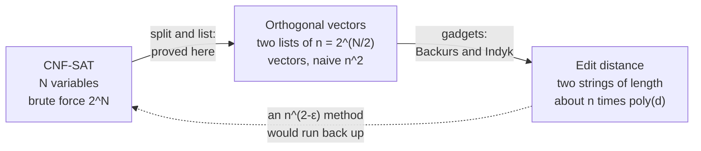
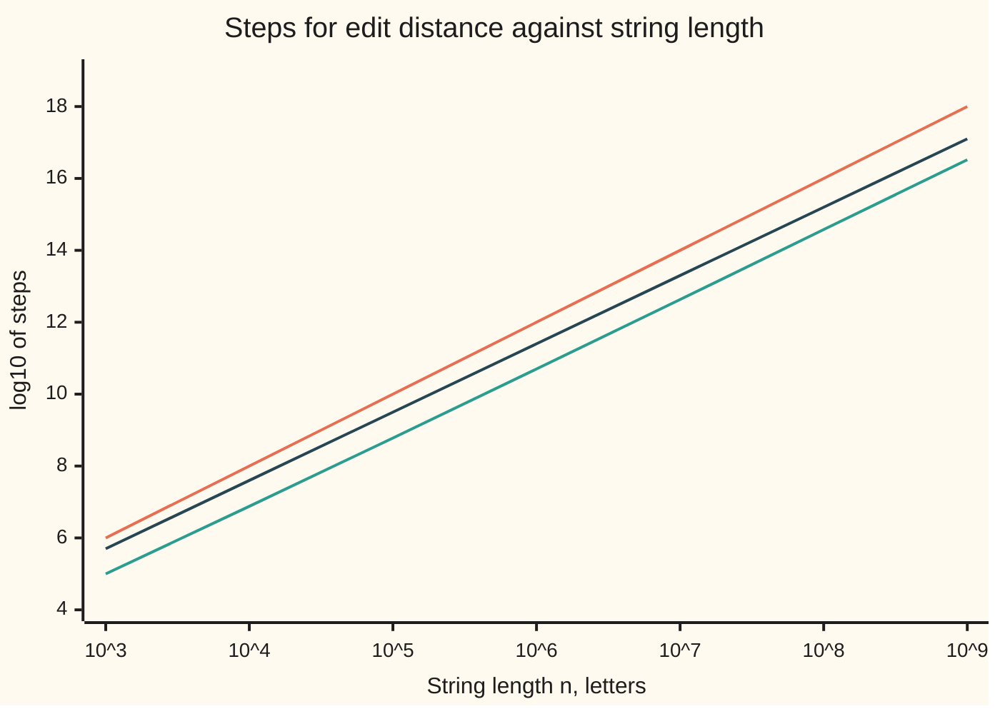

# Fine-grained complexity: why quadratic is probably the floor

[Syllabus](../../../SYLLABUS.md) → [Computability and complexity](../README.md) → [Data, Learning and Fine-Grained Complexity](../README.md#s06) → Fine-grained complexity

---

## General Overview

A lab has the genomes of two distantly related bacteria. Each genome is a DNA string of about 4,600,000 letters, each letter one of A, C, G and T. The lab wants the **edit distance**: the fewest single-letter edits that turn one string into the other. An edit inserts a letter, deletes a letter or changes one letter into another.

The standard method fills a table with one cell for each pair of positions, one position in each string. For these genomes that is 4,600,000 squared: 21,160,000,000,000 cells. For two human genomes, about 3,100,000,000 letters each, it is 9,610,000,000,000,000,000 cells. The cost grows as the square of the length, so it is **quadratic**. Genomes that differ in only a few letters, such as two strains of one bacterium or two people, are an easy case with a faster method, as When it holds shows. The square is the cost for strings that differ a lot.

The method dates from the 1970s. Since then, nobody has found an exact method that runs in $`n^{1.99}`$ steps, or in $`n^{2-\varepsilon}`$ for any fixed $`\varepsilon > 0`$. Here $`n`$ is the string length, and $`\varepsilon`$ is a small fixed number, not the empty string. The best exact speedups only divide $`n^2`$ by a logarithm.

**Fine-grained complexity** explains the wait. It sorts problems that are already solvable in polynomial time by their exact exponent. In 2015 Arturs Backurs and Piotr Indyk proved this: a method for edit distance in $`n^{2-\varepsilon}`$ steps would also solve SAT (satisfiability of a formula) faster than a hypothesis called SETH allows.

**A chain of cheap conversions turns any $`n^{2-\varepsilon}`$ method for edit distance into a SAT method that SETH (the strong exponential time hypothesis) forbids, so quadratic is the floor unless SETH is false.**

**What kind of fact this is:** a conditional theorem. The step from SAT to orthogonal vectors is proved on this card in Why it works. The step from orthogonal vectors to edit distance is a theorem of Backurs and Indyk, stated here with its key steps and their source, and its gadgets are measured on the card's vectors. SETH itself is a conjecture, unproved as of 2026-11-11, and the floor rests on it.

### The picture: the chain of conversions



Each solid arrow converts an instance of one problem into an instance of the next at small cost. The dotted arrow is the contradiction: a fast method at the right end gives a fast method at the left end.

---

## The formula

The table is the method of [Dynamic programming](../../14-Applied%20and%20computational/01-Algorithms%20and%20Growth/07-dynamic-programming.md): answer each small question once and store it. Here the small question is the distance between the first $`i`$ letters of $`u`$ and the first $`j`$ letters of $`v`$:

```math
T[i][j] = \min\big(T[i-1][j] + 1,\; T[i][j-1] + 1,\; T[i-1][j-1] + [u_i \ne v_j]\big), \qquad T[i][0] = i,\; T[0][j] = j
```

**Read it aloud:** the best way to match the first $`i`$ and first $`j`$ letters ends by deleting a letter, inserting a letter, or pairing the last two letters, which costs 1 if they differ and 0 if they agree.

The hypothesis that sets the floor is about SAT. A **CNF formula** is an "and" of **clauses**, and each clause is an "or" of a few **literals** (a variable or its negation). In **k-SAT** every clause has at most k literals.

```math
\text{SETH:}\quad \text{for every } \varepsilon > 0 \text{ there is a } k \text{ such that } k\text{-SAT on } N \text{ variables cannot be solved in } O\big(2^{(1-\varepsilon)N}\big) \text{ steps}
```

**Read it aloud:** as clauses get wider, no method can save a fixed fraction of the exponent in trying all $`2^N`$ settings.

The card's theorem joins the two:

```math
\mathrm{ED} \text{ in } O\big(n^{2-\varepsilon}\big) \;\Longrightarrow\; \mathrm{OV} \text{ in } O\big(n^{2-\varepsilon}\,\mathrm{poly}(d)\big) \;\Longrightarrow\; \text{CNF-SAT in } O\big(2^{(1-\varepsilon/2)N}\,\mathrm{poly}(m)\big)
```

**Read it aloud:** a strongly faster edit distance gives a strongly faster orthogonal-vectors method, which gives SAT in $`2^{(1-\varepsilon/2)N}`$ steps, against SETH.

The middle problem is **orthogonal vectors (OV)**: given two lists A and B of n vectors of 0s and 1s, each of length d, is there a pair $`a`$ in A, $`b`$ in B with $`a \cdot b = 0`$? The dot product $`a \cdot b`$ counts the places where both vectors have a 1, so $`a \cdot b = 0`$ means no shared 1.

| Symbol | Plain meaning | In our example | Push it up and the answer… |
| --- | --- | --- | --- |
| $`n`$ | string length in letters; in OV, the number of vectors in each list | 7 for GATTACA; 4,600,000 for a genome | the table grows as $`n^2`$ |
| $`u`$, $`v`$, $`\mathrm{ED}(u, v)`$ | the two strings, and the edit distance between them | 3 for GATTACA and GCATGCA | — |
| $`T[i][j]`$, $`u_i`$ | the table cell: distance between the first $`i`$ letters of $`u`$ and first $`j`$ of $`v`$; $`u_i`$ is letter $`i`$ of $`u`$ | $`T[2][2] = 1`$: GA against GC | — |
| $`[u_i \ne v_j]`$ | 1 if the two letters differ, else 0 | G against G: 0 | — |
| $`N`$; $`x_1, \dots, x_N`$ | number of variables in the formula; the variables themselves, true or false | 6 in the small formula; 60 in the cost count | brute force doubles per variable |
| $`k`$ | the most literals in any clause | 3 | SETH needs k to grow as $`\varepsilon`$ shrinks |
| $`m`$ | number of clauses | 8 | vectors get longer |
| $`\varepsilon`$; $`\delta`$ | the fixed saving in the exponent (not the empty string); ETH's fixed constant | 0.1, so $`n^{1.9}`$ | a bigger saving, a bigger contradiction |
| A, B; $`a`$, $`b`$, $`a \cdot b`$ | the two lists of vectors, one per half of the variables; one vector from each; their count of shared 1s | 8 vectors each; 00000100 and 11100001, dot product 0 | — |
| $`d`$ | length of each vector, here one place per clause, so $`d = m`$ | 8 | gadget strings get longer |
| $`\mathrm{poly}(d)`$ | some fixed power of $`d`$ | — | a factor that does not touch the exponent of $`n`$ |
| $`c_0`$, $`c_1`$ | distance between two vector gadgets when the vectors are orthogonal; when they are not | 103 and 105 in the check | — |

### When it holds

- **Exact answers only.** A method that may answer within a constant factor of the true distance escapes the floor: such a method running in nearly linear time was found by Alexandr Andoni and Negev Shekel Nosatzki (FOCS 2020).
- **The worst case, not every case.** For two strands with 3 changes in 1,000 letters, the diagonal method in the code touches 1,018 cells, not 1,000,000. The floor speaks only about the hardest inputs.
- **A fixed $`\varepsilon`$.** Dividing $`n^2`$ by a logarithm is allowed, and has been done. Only a saving of a fixed power of $`n`$ is forbidden.
- **Cheap conversions.** Each arrow in the chain must cost less than the time it would save. A conversion that took $`n^2`$ steps to build its strings would prove nothing.
- **SETH true.** The whole argument is conditional. If SETH fails, the floor falls with it, and the theorem says nothing.

---

## Why it works

### Step 0: a fast method downstream gives a fast method upstream

A **reduction** converts any instance of a source problem into an instance of a target problem with the same yes-or-no answer. [P versus NP](../04-Beyond%20Worst%20Case/08-p-versus-np-what-is-known.md) uses reductions that cost any polynomial time, because it only asks "polynomial or not".

Fine-grained complexity tracks the exponent. If the conversion is cheap and the new instance is not much bigger, a fast method for the target is a fast method for the source. So the source's best known exponent becomes a floor for the target.

### Step 1: the table solves edit distance in $`n^2`$ steps

Each cell needs three earlier cells, so filling the table row by row costs one step per cell: $`n \times n`$ in all. The table is correct because every set of edits ends with one of the three moves.

For GATTACA against GCATGCA the table has 49 cells, and the last cell reads 3. One set of 3 edits: insert C after the first G, change the second T to G, delete the A before the last C.

### Step 2: SETH, the hypothesis at the top of the chain

Brute force solves k-SAT in about $`2^N`$ steps: try every setting of the N variables. Clever methods beat this for each fixed k, but their saving shrinks toward 0 as k grows. SETH says that shrinking is unavoidable.

SETH was stated in 2001 by Russell Impagliazzo and Ramamohan Paturi, beside the weaker ETH (exponential time hypothesis) from [P versus NP](../04-Beyond%20Worst%20Case/08-p-versus-np-what-is-known.md). ETH says 3-SAT needs $`2^{\delta N}`$ steps for some fixed $`\delta > 0`$. SETH says the constant in the exponent tends to 1 as clauses widen. Both are unproved as of 2026-11-11.

### Step 3: split and list turns SAT into orthogonal vectors

Split the N variables into two halves. List all $`2^{N/2}`$ settings of the first half, and all $`2^{N/2}`$ of the second.

For each half-setting, write a vector with one place per clause. Put a 1 where the clause is still **open**: none of its literals in this half is true. Put a 0 where this half already makes the clause true.

A full setting satisfies the formula exactly when every clause is made true by one half or the other. That means no clause is open on both sides, so the two vectors share no 1. **Satisfying settings are exactly orthogonal pairs.**

The small formula has $`N = 6`$ variables and $`m = 8`$ clauses. The half $`x_1 x_2 x_3 = 101`$ leaves only clause 6 open, $`(\lnot x_1 \lor x_2 \lor \lnot x_5)`$: vector 00000100. The half $`x_4 x_5 x_6 = 000`$ gives 11100001, with a 0 in place 6, because $`\lnot x_5`$ is true. The dot product is 0, so 101000 satisfies the formula.

<details>
<summary>Detailed proof: a full setting satisfies the formula exactly when its two vectors are orthogonal</summary>

Write a full setting as a pair $`(\alpha, \beta)`$: $`\alpha`$ sets the first half of the variables and $`\beta`$ the second. Each literal mentions one variable, so it lies in exactly one half.

For clause $`j`$, place $`j`$ of $`a_\alpha`$ is 1 when no literal of clause $`j`$ in the first half is true under $`\alpha`$. Place $`j`$ of $`b_\beta`$ is 1 under the same rule for the second half.

Clause $`j`$ is true under $`(\alpha, \beta)`$ when some literal is true. That literal is in one half, so that half's vector has a 0 in place $`j`$, and the product at place $`j`$ is 0.

Clause $`j`$ is false when no literal is true in either half. Then both vectors have a 1 in place $`j`$, and the product at place $`j`$ is 1.

$`\displaystyle a_\alpha \cdot b_\beta = \text{the number of clauses false under } (\alpha, \beta)`$

So the formula is satisfied exactly when $`a_\alpha \cdot b_\beta = 0`$. Building the lists costs $`2^{N/2}`$ settings per side, each checked against $`m`$ clauses: about $`2^{N/2}\,m`$ steps, far below $`2^N`$. That is the cheap conversion Step 0 asks for.

</details>

The conversion gives $`n = 2^{N/2}`$ vectors per list. Checking every pair costs $`n^2 = 2^N`$: no gain over brute force. But a method for OV in $`n^{2-\varepsilon}`$ steps would cost $`2^{(N/2)(2-\varepsilon)} = 2^{(1-\varepsilon/2)N}`$, which beats SETH once k is large enough. This first link is due to Ryan Williams, 2005.

### Step 4: gadgets turn orthogonal vectors into edit distance

Backurs and Indyk build two strings from the two lists. This step is stated, not proved, on this card; the full proof is in their paper. The check builds the first two layers from the card's own vectors and measures them with the table. The shape has three layers.

1. **Coordinate gadgets.** Each place of a vector becomes a block of letters from 0, 1, 2, 3 and 4. From list A, a 0 becomes 0111 and a 1 becomes 0001. From list B, a 0 becomes 0011 and a 1 becomes 1111. A run of 2s on each side keeps the blocks lined up. Three of the four pairings are one change apart. Only a 1 against a 1, 0001 against 1111, costs 3.
2. **Vector gadgets.** Join the blocks of one vector. Joined alone, two vectors of 8 places cost 8 plus 2 for every shared 1: 8 for the orthogonal pair 00000100 and 11100001, and 10 for 00000100 against 10100110, which share place 6. A cost that keeps growing is a problem, because a few very bad pairs could outweigh a good pair. So Backurs and Indyk cap it. They put a 0 in front of every vector of A and a 1 in front of every vector of B, which changes no dot product. Beside the blocks of $`a`$ they place a second set of blocks, for the vector 100000000, which shares exactly one 1 with every $`b`$. Long runs of 3s and 4s wrap the whole. The cheapest alignment matches $`b`$ against whichever set shares fewer 1s with it. So two vector gadgets are at distance $`c_0`$ when the vectors are orthogonal, and at exactly $`c_1 = c_0 + 2`$ when they are not.
3. **Pattern gadgets.** Put the gadgets of all of A in one string. Put the gadgets of all of B, padded with dummy gadgets, in the other. The best alignment must pair each vector of A with a vector of B or a dummy. Its total cost falls below a set threshold exactly when at least one pair is orthogonal.

The paper's runs are thousands of letters long, so that its proof covers every input. The check cuts the runs of 2s to one letter and the runs of 3s and 4s to 20 letters, then measures all 64 pairs of the card's vectors with the table. The 4 orthogonal pairs come out at $`c_0 = 103`$ and the other 60 at 105, as the paper's count says. Delete one run of 4s, 20 letters, and the unused set of 9 blocks, 54 letters; change the other run of 4s into 3s, 20 changes; then pay 1 for each of the 9 places: $`2 \times 20 + 54 + 9 = 103`$.

The two strings have length about $`n`$ times a fixed power of $`d`$. So a method for edit distance in $`n^{2-\varepsilon}`$ steps solves OV in $`n^{2-\varepsilon}\,\mathrm{poly}(d)`$ steps.

### Step 5: join the links

Start from k-SAT on N variables and m clauses, for any k. Step 3 makes lists of $`n = 2^{N/2}`$ vectors of length $`d = m`$. Step 4 makes strings of length about $`2^{N/2}\,\mathrm{poly}(m)`$. A method for edit distance in $`n^{2-\varepsilon}`$ steps then decides the formula in $`2^{(1-\varepsilon/2)N}\,\mathrm{poly}(m)`$ steps.

A k-SAT formula has at most a polynomial number of clauses in N, so $`\mathrm{poly}(m)`$ is a polynomial in N. The saving $`\varepsilon/2`$ is the same for every k. The polynomial factor grows more slowly than $`2^{cN}`$ for any fixed $`c > 0`$, so it only trims the saving a little, say to $`\varepsilon/4`$. SETH says that for that saving some k cannot be solved this fast. So no such edit distance method exists, unless SETH is false.

---

## Worked numbers, by hand

The table for GATTACA (rows) against GCATGCA (columns). Row 0 and column 0 count letters: matching $`j`$ letters against nothing costs $`j`$ insertions.

| | — | G | C | A | T | G | C | A |
| --- | ---: | ---: | ---: | ---: | ---: | ---: | ---: | ---: |
| **—** | 0 | 1 | 2 | 3 | 4 | 5 | 6 | 7 |
| **G** | 1 | 0 | 1 | 2 | 3 | 4 | 5 | 6 |
| **A** | 2 | 1 | 1 | 1 | 2 | 3 | 4 | 5 |
| **T** | 3 | 2 | 2 | 2 | 1 | 2 | 3 | 4 |
| **T** | 4 | 3 | 3 | 3 | 2 | 2 | 3 | 4 |
| **A** | 5 | 4 | 4 | 3 | 3 | 3 | 3 | 3 |
| **C** | 6 | 5 | 4 | 4 | 4 | 4 | 3 | 4 |
| **A** | 7 | 6 | 5 | 4 | 5 | 5 | 4 | 3 |

| Step | Arithmetic | Value |
| --- | --- | --- |
| cell G against G | $`\min(1 + 1,\ 1 + 1,\ 0 + 0)`$ | 0 |
| cell GA against GC | $`\min(1 + 1,\ 1 + 1,\ 0 + 1)`$ | 1 |
| last cell, A against A | $`\min(4 + 1,\ 4 + 1,\ 3 + 0)`$ | **3** |
| table size for genomes | 4,600,000 × 4,600,000 | 21,160,000,000,000 cells |
| one half-setting, $`x_1 x_2 x_3 = 101`$ | open clauses: only clause 6 | 00000100 |
| one half-setting, $`x_4 x_5 x_6 = 000`$ | open clauses: 1, 2, 3 and 8 | 11100001 |
| their dot product | no place with 1 in both | 0, so 101000 satisfies |
| all 64 pairs against all 64 settings | orthogonal pairs; satisfying settings | 4 and 4 |
| N = 60: brute force | $`2^{60}`$ | 1,152,921,504,606,846,976 |
| vectors per side | $`2^{30}`$ | 1,073,741,824 |
| OV in $`n^{1.9}`$ | $`(2^{30})^{1.9} = 2^{57}`$ | **144,115,188,075,855,872, times a polynomial** |

The DNA answer: GATTACA becomes GCATGCA in 3 edits, and no fewer. The SAT answer: saving 0.1 in the exponent of edit distance would cut brute force on 60 variables by a factor of $`2^3 = 8`$, before the polynomial factor, which only large $`N`$ outgrows. That saving would hold for every clause width, which SETH rules out.

The 8 clauses are $`(x_1 \lor x_2 \lor x_4)`$, $`(\lnot x_1 \lor x_3 \lor x_5)`$, $`(x_1 \lor \lnot x_2 \lor x_6)`$, $`(x_1 \lor x_2 \lor \lnot x_4)`$, $`(x_1 \lor \lnot x_2 \lor \lnot x_6)`$, $`(\lnot x_1 \lor x_2 \lor \lnot x_5)`$, $`(\lnot x_1 \lor \lnot x_2 \lor \lnot x_5)`$ and $`(\lnot x_1 \lor \lnot x_2 \lor x_5)`$. The four satisfying settings are 101000, 101001, 101100 and 101101.

### What breaks if you drop a piece

| Mistake | Comes out at | What went wrong |
| --- | --- | --- |
| A 1 marks a clause the half makes true | 0 orthogonal pairs, not 4 | Orthogonal then means "no clause true on both sides", which says nothing about satisfaction |
| Split the 60 variables 10 and 50 | the longer list has $`2^{50}`$ vectors; $`(2^{50})^{1.9} = 2^{95}`$, worse than $`2^{60}`$ | Only a near-even split turns $`n^{2-\varepsilon}`$ into a saving |
| Read the floor as true for every input | 3 changes in 1,000 letters: 1,018 cells, 982 times fewer than 1,000,000 | The floor is for the worst case; near-identical strings are easy |

The code prints all three.

### The picture: what the floor allows and forbids



Orange, top: the table, $`n^2`$. Teal, bottom: the table divided by $`\log_2 n`$, the kind of speedup that is known and allowed. Dark, middle: $`n^{1.9}`$, forbidden under SETH. At every length shown the allowed curve is lower than the forbidden one. The forbidden curve drops below it only past $`n = 2^{58.8}`$, a string far longer than any genome.

---

## Code, from first principles, and it actually runs

The code takes two independent roads to each answer. Edit distance comes from the table and from a diagonal search that never fills the table: for cost 0, 1, 2 and so on, it records how far along each diagonal of the table that cost can reach (Ukkonen, 1985). The roads agree on the hand pair, on all 7,225 pairs of DNA strings up to 3 letters, and on two 1,000-letter strands from a SplitMix64 generator with seed 2026. The split-and-list conversion is checked against brute force over all 64 settings. Backurs and Indyk's gadgets are built from the card's 16 vectors and measured with the table on all 64 pairs, against the paper's formula for their distance.

### Python

```python
# Fine-grained complexity and SETH -- the check behind the card.  Standard
# library only.  Edit distance is computed two ways (the quadratic table and a
# diagonal search that never fills the table), and the first link of the SETH
# chain, CNF-SAT to orthogonal vectors by split and list, is built and checked
# against brute force over every assignment.  The second link's gadgets, from
# orthogonal vectors to edit distance, are built and measured on the same vectors.
import math

def ed_table(x, y):                      # road one: the quadratic table
    t = [[i + j if i == 0 or j == 0 else 0 for j in range(len(y) + 1)] for i in range(len(x) + 1)]
    for i in range(1, len(x) + 1):
        for j in range(1, len(y) + 1):
            t[i][j] = min(t[i - 1][j] + 1, t[i][j - 1] + 1, t[i - 1][j - 1] + (x[i - 1] != y[j - 1]))
    return t

def ed_diag(x, y):                       # road two: furthest reach per diagonal, cost 0, 1, 2, ...
    n, m, cells, d = len(x), len(y), 0, 0
    def slide(i, k):
        nonlocal cells
        cells += 1
        while i < n and i + k < m and x[i] == y[i + k]:
            i, cells = i + 1, cells + 1
        return i
    reach = {0: slide(0, 0)}
    while reach.get(m - n, -1) < n:
        d, new = d + 1, {}
        for k in range(-min(d, n), min(d, m) + 1):
            best = max(reach.get(k, -9) + 1, reach.get(k + 1, -9) + 1, reach.get(k - 1, -9))
            new[k] = slide(max(min(best, n, m - k), -k, 0), k)
        reach = new
    return d, cells

def splitmix(state):                     # SplitMix64, seed stated below
    state = (state + 0x9E3779B97F4A7C15) & 0xFFFFFFFFFFFFFFFF
    z = ((state ^ (state >> 30)) * 0xBF58476D1CE4E5B9) & 0xFFFFFFFFFFFFFFFF
    z = ((z ^ (z >> 27)) * 0x94D049BB133111EB) & 0xFFFFFFFFFFFFFFFF
    return state, z ^ (z >> 31)

x, y = "GATTACA", "GCATGCA"
t = ed_table(x, y)
print(f"hand pair {x} against {y}, table rows (row i = first i letters of {x}):")
for row in t:
    print("  " + " ".join(str(v) for v in row))
dd, dcells = ed_diag(x, y)
print(f"edit distance: table {t[-1][-1]}, diagonal road {dd}; cells: table {len(x) * len(y)}, diagonal {dcells}")
words = [""] + [a + b + c for a in "ACGT" for b in "ACGT" for c in "ACGT"]
words += sorted({w[:k] for w in words[1:] for k in range(1, 3)})
agree = all(ed_table(u, v)[-1][-1] == ed_diag(u, v)[0] for u in words for v in words)
print(f"every pair of DNA strings up to 3 letters ({len(words)} strings, {len(words) ** 2} pairs): roads agree {'yes' if agree else 'no'}")
for name, n in [("virus genome", 30000), ("bacterial genome", 4600000), ("human genome", 3100000000), ("visitor log", 10000000)]:
    print(f"table cells for two {name}s, n = {n}: n^2 = {n * n}")

s, a = 2026, []                          # two 1,000-base strands from seed 2026
for _ in range(2000):
    s, r = splitmix(s)
    a.append("ACGT"[r % 4])
u, v = "".join(a[:1000]), list(a[:1000])
for _ in range(3):                       # three point mutations
    s, r = splitmix(s)
    p = r % 1000
    v[p] = "ACGT"[("ACGT".index(v[p]) + 1 + (r >> 8) % 3) % 4]
v, w = "".join(v), "".join(a[1000:])
near_t, (near_d, near_c) = ed_table(u, v)[-1][-1], ed_diag(u, v)
far_t, (far_d, far_c) = ed_table(u, w)[-1][-1], ed_diag(u, w)
print(f"3 mutations in 1000 bases: distance {near_t} (table) {near_d} (diagonal); cells 1000000 against {near_c}")
print(f"two unrelated 1000-base strands: distance {far_t} (table) {far_d} (diagonal); cells 1000000 against {far_c}")

F = [(1, 2, 4), (-1, 3, 5), (1, -2, 6), (1, 2, -4), (1, -2, -6), (-1, 2, -5), (-1, -2, -5), (-1, -2, 5)]
N, H = 6, 3
def true_lit(l, bits, first):            # is literal l true under this half's bits?
    v = abs(l) - first
    return 0 <= v < len(bits) and (bits[v] == 1) == (l > 0)
def vector(bits, first, flip=False):     # coordinate j is 1 when clause j is still open
    return [int(any(true_lit(l, bits, first) for l in c) == flip) for c in F]
halves = [[(b >> 2 & 1, b >> 1 & 1, b & 1) for b in range(8)]] * 2
A = [vector(h, 1) for h in halves[0]]
B = [vector(h, 4) for h in halves[1]]
def show(bits, vec): return "".join(map(str, bits)) + ":" + "".join(map(str, vec))
print("formula: " + " & ".join("(" + " | ".join(("x" if l > 0 else "~x") + str(abs(l)) for l in c) + ")" for c in F))
print("A vectors (x1 x2 x3): " + " ".join(show(h, A[i]) for i, h in enumerate(halves[0])))
print("B vectors (x4 x5 x6): " + " ".join(show(h, B[i]) for i, h in enumerate(halves[1])))
brute = [a + b for a in halves[0] for b in halves[1]
         if all(any(true_lit(l, a + b, 1) for l in c) for c in F)]
ortho = [halves[0][i] + halves[1][j] for i in range(8) for j in range(8)
         if sum(p * q for p, q in zip(A[i], B[j])) == 0]
print(f"brute force over {2 ** N} assignments: {len(brute)} satisfy; orthogonal pairs among {len(A) * len(B)}: {len(ortho)}")
print("satisfying assignments: " + " ".join("".join(map(str, z)) for z in brute))
Af = [vector(h, 1, True) for h in halves[0]]
Bf = [vector(h, 4, True) for h in halves[1]]
flipped = sum(sum(p * q for p, q in zip(Af[i], Bf[j])) == 0 for i in range(8) for j in range(8))
print(f"mistake 1, coordinate 1 when the clause is satisfied: {flipped} orthogonal pairs, not {len(brute)}")

G1, G2 = ["201112", "200012"], ["200112", "211112"]  # Backurs-Indyk coordinate gadgets for a 0 and a 1, runs of 2s cut to 1
cg = [ed_table(G1[p], G2[q])[-1][-1] for p in (0, 1) for q in (0, 1)]
def glue(g, vec): return "".join(g[c] for c in vec)
def vg1(a): return "4" * 20 + glue(G1, [0] + a) + "3" * 20 + glue(G1, [1] + [0] * 8) + "4" * 20
def vg2(b): return "3" * 20 + glue(G2, [1] + b) + "3" * 20
pairs = [(i, j, sum(p * q for p, q in zip(A[i], B[j]))) for i in range(8) for j in range(8)]
joined = {(i, j): ed_table(glue(G1, A[i]), glue(G2, B[j]))[-1][-1] for i, j, _ in pairs}
full = {(i, j): ed_table(vg1(A[i]), vg2(B[j]))[-1][-1] for i, j, _ in pairs}
e_s, l9 = 2 * 20 + 9 * len(G1[0]) + 9, 9 * len(G1[0])  # the paper's 2 l1 + l + d, with d = 9 places
print(f"coordinate gadgets: A 0 {G1[0]}, A 1 {G1[1]}, B 0 {G2[0]}, B 1 {G2[1]}; distances 0-0 0-1 1-0 1-1: {' '.join(map(str, cg))}")
def bits(vec): return "".join(map(str, vec))
print(f"joined gadgets: {bits(A[5])} against {bits(B[0])} (dot 0) {joined[5, 0]}, against {bits(B[2])} (dot 1) {joined[5, 2]};"
      f" all 64 pairs 8 + 2 x shared 1s, from {min(joined.values())} to {max(joined.values())}")
o0, o1 = [" ".join(map(str, sorted({full[i, j] for i, j, d in pairs if (d > 0) == k}))) for k in (False, True)]
print(f"vector gadgets, runs of 20, second set for {bits([1] + [0] * 8)}, {l9} letters per 9 places: distance {o0} on all {sum(d == 0 for _, _, d in pairs)} orthogonal pairs,"
      f" {o1} on all {sum(d > 0 for _, _, d in pairs)} others; formula 2 x 20 + {l9} + 9 = {e_s}")

eps, NN = 0.1, 60
print(f"N = {NN}: brute force 2^{NN} = {2 ** NN}; split gives n = 2^{NN // 2} = {2 ** (NN // 2)} vectors per side")
print(f"edit distance in n^{2 - eps:.1f} would give SAT in 2^{(1 - eps / 2) * NN:.1f} = {2 ** 57} times a polynomial, {2 ** NN // 2 ** 57} times fewer")
print(f"mistake 2, split 10 and 50: pad to n = 2^50, so n^{2 - eps:.1f} = 2^{50 * (2 - eps):.1f}, worse than 2^{NN}")
print(f"mistake 3, near-identical strands: diagonal road {near_c} cells, {1000000 // near_c} times fewer than the table")
ns = [10 ** e for e in range(3, 10)]
print("chart n: " + ", ".join(f"10^{e}" for e in range(3, 10)))
print("chart log10 n^2: " + ", ".join(f"{2 * math.log10(n):.2f}" for n in ns))
print("chart log10 n^2/log2 n: " + ", ".join(f"{2 * math.log10(n) - math.log10(math.log2(n)):.2f}" for n in ns))
print("chart log10 n^1.9: " + ", ".join(f"{1.9 * math.log10(n):.2f}" for n in ns))
lo, hi = 10.0, 200.0                     # n = 2^s with n^0.1 = log2 n, by bisection
for _ in range(60):
    mid = (lo + hi) / 2
    lo, hi = (mid, hi) if 0.1 * mid < math.log2(mid) else (lo, mid)
print(f"n^1.9 drops below n^2/log2 n only past n = 2^{lo:.1f}")

assert t[-1][-1] == dd == 3 and agree                      # two roads, hand pair and all short pairs
assert near_t == near_d and far_t == far_d and near_t <= 3 # two roads on 1,000-base strands
assert sorted(brute) == sorted(ortho) and len(brute) == 4  # split and list matches brute force
assert flipped != len(brute) and near_c * 50 < 1000000     # the broken versions really break
assert cg == [1, 1, 1, 3] and all(joined[i, j] == 8 + 2 * d for i, j, d in pairs)  # coordinate and joined gadgets
assert all(full[i, j] == e_s + 2 * min(d, 1) for i, j, d in pairs)  # the paper's vector-gadget formula, every pair
assert 58 < lo < 60 and abs(0.1 * lo - math.log2(lo)) < 1e-6     # crossover sits where n^0.1 = log2 n
print("ALL CHECKS PASS")
```

**Ran 2026-11-19 on macOS, Python 3.14.10, standard library only. All checks passed. Output, pasted from the run:**

```
hand pair GATTACA against GCATGCA, table rows (row i = first i letters of GATTACA):
  0 1 2 3 4 5 6 7
  1 0 1 2 3 4 5 6
  2 1 1 1 2 3 4 5
  3 2 2 2 1 2 3 4
  4 3 3 3 2 2 3 4
  5 4 4 3 3 3 3 3
  6 5 4 4 4 4 3 4
  7 6 5 4 5 5 4 3
edit distance: table 3, diagonal road 3; cells: table 49, diagonal 23
every pair of DNA strings up to 3 letters (85 strings, 7225 pairs): roads agree yes
table cells for two virus genomes, n = 30000: n^2 = 900000000
table cells for two bacterial genomes, n = 4600000: n^2 = 21160000000000
table cells for two human genomes, n = 3100000000: n^2 = 9610000000000000000
table cells for two visitor logs, n = 10000000: n^2 = 100000000000000
3 mutations in 1000 bases: distance 3 (table) 3 (diagonal); cells 1000000 against 1018
two unrelated 1000-base strands: distance 525 (table) 525 (diagonal); cells 1000000 against 363002
formula: (x1 | x2 | x4) & (~x1 | x3 | x5) & (x1 | ~x2 | x6) & (x1 | x2 | ~x4) & (x1 | ~x2 | ~x6) & (~x1 | x2 | ~x5) & (~x1 | ~x2 | ~x5) & (~x1 | ~x2 | x5)
A vectors (x1 x2 x3): 000:10010000 001:10010000 010:00101000 011:00101000 100:01000100 101:00000100 110:01000011 111:00000011
B vectors (x4 x5 x6): 000:11100001 001:11001001 010:10100110 011:10001110 100:01110001 101:01011001 110:00110110 111:00011110
brute force over 64 assignments: 4 satisfy; orthogonal pairs among 64: 4
satisfying assignments: 101000 101001 101100 101101
mistake 1, coordinate 1 when the clause is satisfied: 0 orthogonal pairs, not 4
coordinate gadgets: A 0 201112, A 1 200012, B 0 200112, B 1 211112; distances 0-0 0-1 1-0 1-1: 1 1 1 3
joined gadgets: 00000100 against 11100001 (dot 0) 8, against 10100110 (dot 1) 10; all 64 pairs 8 + 2 x shared 1s, from 8 to 12
vector gadgets, runs of 20, second set for 100000000, 54 letters per 9 places: distance 103 on all 4 orthogonal pairs, 105 on all 60 others; formula 2 x 20 + 54 + 9 = 103
N = 60: brute force 2^60 = 1152921504606846976; split gives n = 2^30 = 1073741824 vectors per side
edit distance in n^1.9 would give SAT in 2^57.0 = 144115188075855872 times a polynomial, 8 times fewer
mistake 2, split 10 and 50: pad to n = 2^50, so n^1.9 = 2^95.0, worse than 2^60
mistake 3, near-identical strands: diagonal road 1018 cells, 982 times fewer than the table
chart n: 10^3, 10^4, 10^5, 10^6, 10^7, 10^8, 10^9
chart log10 n^2: 6.00, 8.00, 10.00, 12.00, 14.00, 16.00, 18.00
chart log10 n^2/log2 n: 5.00, 6.88, 8.78, 10.70, 12.63, 14.58, 16.52
chart log10 n^1.9: 5.70, 7.60, 9.50, 11.40, 13.30, 15.20, 17.10
n^1.9 drops below n^2/log2 n only past n = 2^58.8
ALL CHECKS PASS
```

### Rust

Same numbers, same labels, built with `rustc --edition 2021 -O`.

```rust
// Fine-grained complexity and SETH -- the same check as the Python, in Rust.
// No crates.  Edit distance is computed two ways (the quadratic table and a
// diagonal search that never fills the table), and the first link of the SETH
// chain, CNF-SAT to orthogonal vectors by split and list, is built and checked
// against brute force over every assignment.  The second link's gadgets, from
// orthogonal vectors to edit distance, are built and measured on the same vectors.
use std::collections::HashMap;

fn ed_table(x: &[u8], y: &[u8]) -> Vec<Vec<usize>> {          // road one: the quadratic table
    let mut t = vec![vec![0usize; y.len() + 1]; x.len() + 1];
    for i in 0..=x.len() { t[i][0] = i }
    for j in 0..=y.len() { t[0][j] = j }
    for i in 1..=x.len() {
        for j in 1..=y.len() {
            let sub = t[i - 1][j - 1] + (x[i - 1] != y[j - 1]) as usize;
            t[i][j] = (t[i - 1][j] + 1).min(t[i][j - 1] + 1).min(sub);
        }
    }
    t
}

fn ed_diag(x: &[u8], y: &[u8]) -> (i64, i64) {                // road two: furthest reach per diagonal
    let (n, m) = (x.len() as i64, y.len() as i64);
    let mut cells = 0i64;
    let slide = |mut i: i64, k: i64, cells: &mut i64| {
        *cells += 1;
        while i < n && i + k < m && x[i as usize] == y[(i + k) as usize] { i += 1; *cells += 1 }
        i
    };
    let mut reach: HashMap<i64, i64> = HashMap::new();
    reach.insert(0, slide(0, 0, &mut cells));
    let mut d = 0i64;
    while *reach.get(&(m - n)).unwrap_or(&-1) < n {
        d += 1;
        let mut new = HashMap::new();
        for k in -d.min(n)..=d.min(m) {
            let g = |q: i64| *reach.get(&q).unwrap_or(&-9);
            let best = (g(k) + 1).max(g(k + 1) + 1).max(g(k - 1));
            new.insert(k, slide(best.min(n).min(m - k).max(-k).max(0), k, &mut cells));
        }
        reach = new;
    }
    (d, cells)
}

fn splitmix(state: u64) -> (u64, u64) {                        // SplitMix64, seed stated below
    let s = state.wrapping_add(0x9E3779B97F4A7C15);
    let z = (s ^ (s >> 30)).wrapping_mul(0xBF58476D1CE4E5B9);
    let z = (z ^ (z >> 27)).wrapping_mul(0x94D049BB133111EB);
    (s, z ^ (z >> 31))
}

const F: [[i64; 3]; 8] = [[1, 2, 4], [-1, 3, 5], [1, -2, 6], [1, 2, -4], [1, -2, -6], [-1, 2, -5], [-1, -2, -5], [-1, -2, 5]];

fn true_lit(l: i64, bits: &[i64], first: i64) -> bool {        // is literal l true under these bits?
    let v = l.abs() - first;
    v >= 0 && v < bits.len() as i64 && (bits[v as usize] == 1) == (l > 0)
}
fn vector(bits: &[i64], first: i64, flip: bool) -> Vec<i64> {  // coordinate j is 1 when clause j is open
    F.iter().map(|c| ((c.iter().any(|&l| true_lit(l, bits, first))) == flip) as i64).collect()
}
fn join(v: &[i64]) -> String { v.iter().map(|b| b.to_string()).collect() }
fn dot0(p: &[i64], q: &[i64]) -> bool { p.iter().zip(q).map(|(a, b)| a * b).sum::<i64>() == 0 }

fn main() {
    let (x, y) = ("GATTACA", "GCATGCA");
    let t = ed_table(x.as_bytes(), y.as_bytes());
    println!("hand pair {} against {}, table rows (row i = first i letters of {}):", x, y, x);
    for row in &t { println!("  {}", row.iter().map(|v| v.to_string()).collect::<Vec<_>>().join(" ")) }
    let (dd, dcells) = ed_diag(x.as_bytes(), y.as_bytes());
    println!("edit distance: table {}, diagonal road {}; cells: table {}, diagonal {}", t[7][7], dd, x.len() * y.len(), dcells);
    let b4 = ["A", "C", "G", "T"];
    let mut words: Vec<String> = vec![String::new()];
    for a in b4 { for b in b4 { for c in b4 { words.push(format!("{}{}{}", a, b, c)) } } }
    let mut short: Vec<String> = words[1..].iter().flat_map(|w| vec![w[..1].to_string(), w[..2].to_string()]).collect();
    short.sort(); short.dedup(); words.extend(short);
    let agree = words.iter().all(|u| words.iter().all(|v|
        ed_table(u.as_bytes(), v.as_bytes())[u.len()][v.len()] as i64 == ed_diag(u.as_bytes(), v.as_bytes()).0));
    println!("every pair of DNA strings up to 3 letters ({} strings, {} pairs): roads agree {}", words.len(), words.len() * words.len(), if agree { "yes" } else { "no" });
    for (name, n) in [("virus genome", 30000u64), ("bacterial genome", 4600000), ("human genome", 3100000000), ("visitor log", 10000000)] {
        println!("table cells for two {}s, n = {}: n^2 = {}", name, n, n * n);
    }
    let (mut s, mut a) = (2026u64, Vec::new());                // two 1,000-base strands from seed 2026
    for _ in 0..2000 { let (s2, r) = splitmix(s); s = s2; a.push(b"ACGT"[(r % 4) as usize]) }
    let u: Vec<u8> = a[..1000].to_vec();
    let mut v = u.clone();
    for _ in 0..3 {                                            // three point mutations
        let (s2, r) = splitmix(s); s = s2;
        let p = (r % 1000) as usize;
        let old = b"ACGT".iter().position(|&c| c == v[p]).unwrap() as u64;
        v[p] = b"ACGT"[((old + 1 + (r >> 8) % 3) % 4) as usize];
    }
    let w: Vec<u8> = a[1000..].to_vec();
    let (near_t, (near_d, near_c)) = (ed_table(&u, &v)[1000][1000] as i64, ed_diag(&u, &v));
    let (far_t, (far_d, far_c)) = (ed_table(&u, &w)[1000][1000] as i64, ed_diag(&u, &w));
    println!("3 mutations in 1000 bases: distance {} (table) {} (diagonal); cells 1000000 against {}", near_t, near_d, near_c);
    println!("two unrelated 1000-base strands: distance {} (table) {} (diagonal); cells 1000000 against {}", far_t, far_d, far_c);

    let n_vars = 6u32;
    let halves: Vec<Vec<i64>> = (0..8).map(|b: i64| vec![b >> 2 & 1, b >> 1 & 1, b & 1]).collect();
    let av: Vec<Vec<i64>> = halves.iter().map(|h| vector(h, 1, false)).collect();
    let bv: Vec<Vec<i64>> = halves.iter().map(|h| vector(h, 4, false)).collect();
    let lit = |l: i64| format!("{}x{}", if l > 0 { "" } else { "~" }, l.abs());
    println!("formula: {}", F.iter().map(|c| format!("({})", c.iter().map(|&l| lit(l)).collect::<Vec<_>>().join(" | "))).collect::<Vec<_>>().join(" & "));
    let show = |vs: &Vec<Vec<i64>>| (0..8).map(|i| format!("{}:{}", join(&halves[i]), join(&vs[i]))).collect::<Vec<_>>().join(" ");
    println!("A vectors (x1 x2 x3): {}", show(&av));
    println!("B vectors (x4 x5 x6): {}", show(&bv));
    let mut brute = Vec::new();
    let mut ortho = Vec::new();
    for i in 0..8 {
        for j in 0..8 {
            let full: Vec<i64> = halves[i].iter().chain(halves[j].iter()).copied().collect();
            if F.iter().all(|c| c.iter().any(|&l| true_lit(l, &full, 1))) { brute.push(join(&full)) }
            if dot0(&av[i], &bv[j]) { ortho.push(join(&full)) }
        }
    }
    println!("brute force over {} assignments: {} satisfy; orthogonal pairs among {}: {}", 1u64 << n_vars, brute.len(), av.len() * bv.len(), ortho.len());
    println!("satisfying assignments: {}", brute.join(" "));
    let af: Vec<Vec<i64>> = halves.iter().map(|h| vector(h, 1, true)).collect();
    let bf: Vec<Vec<i64>> = halves.iter().map(|h| vector(h, 4, true)).collect();
    let flipped = (0..8).map(|i| (0..8).filter(|&j| dot0(&af[i], &bf[j])).count()).sum::<usize>();
    println!("mistake 1, coordinate 1 when the clause is satisfied: {} orthogonal pairs, not {}", flipped, brute.len());

    let (g1, g2) = (["201112", "200012"], ["200112", "211112"]); // Backurs-Indyk coordinate gadgets for a 0 and a 1, runs of 2s cut to 1
    let ed = |p: &str, q: &str| ed_table(p.as_bytes(), q.as_bytes())[p.len()][q.len()] as i64;
    let cg: Vec<i64> = (0..4).map(|k| ed(g1[k / 2], g2[k % 2])).collect();
    let glue = |g: &[&str; 2], v: &[i64]| v.iter().map(|&c| g[c as usize]).collect::<String>();
    let (r3, r4) = ("3".repeat(20), "4".repeat(20));
    let vg1 = |a: &[i64]| format!("{}{}{}{}{}", r4, glue(&g1, &[&[0i64][..], a].concat()), r3, glue(&g1, &[1, 0, 0, 0, 0, 0, 0, 0, 0]), r4);
    let vg2 = |b: &[i64]| format!("{}{}{}", r3, glue(&g2, &[&[1i64][..], b].concat()), r3);
    let mut pairs = Vec::new(); // (dot product, joined gadgets' distance, vector gadgets' distance), all 64 pairs
    for i in 0..8 { for j in 0..8 { pairs.push((av[i].iter().zip(&bv[j]).map(|(p, q)| p * q).sum::<i64>(), ed(&glue(&g1, &av[i]), &glue(&g2, &bv[j])), ed(&vg1(&av[i]), &vg2(&bv[j])))) } }
    let (l9, e_s) = (9 * g1[0].len() as i64, 2 * 20 + 9 * g1[0].len() as i64 + 9); // the paper's 2 l1 + l + d, with d = 9 places
    println!("coordinate gadgets: A 0 {}, A 1 {}, B 0 {}, B 1 {}; distances 0-0 0-1 1-0 1-1: {}", g1[0], g1[1], g2[0], g2[1], cg.iter().map(|v| v.to_string()).collect::<Vec<_>>().join(" "));
    let (lo_j, hi_j) = (pairs.iter().map(|p| p.1).min().unwrap(), pairs.iter().map(|p| p.1).max().unwrap());
    println!("joined gadgets: {} against {} (dot 0) {}, against {} (dot 1) {}; all 64 pairs 8 + 2 x shared 1s, from {} to {}", join(&av[5]), join(&bv[0]), pairs[40].1, join(&bv[2]), pairs[42].1, lo_j, hi_j);
    let set = |k: bool| { let mut v: Vec<i64> = pairs.iter().filter(|p| (p.0 > 0) == k).map(|p| p.2).collect(); v.sort(); v.dedup(); v.iter().map(|x| x.to_string()).collect::<Vec<_>>().join(" ") };
    println!("vector gadgets, runs of 20, second set for {}, {} letters per 9 places: distance {} on all {} orthogonal pairs, {} on all {} others; formula 2 x 20 + {} + 9 = {}",
             join(&[1, 0, 0, 0, 0, 0, 0, 0, 0]), l9, set(false), pairs.iter().filter(|p| p.0 == 0).count(), set(true), pairs.iter().filter(|p| p.0 > 0).count(), l9, e_s);

    let (eps, nn) = (0.1f64, 60u32);
    println!("N = {}: brute force 2^{} = {}; split gives n = 2^{} = {} vectors per side", nn, nn, 1u64 << nn, nn / 2, 1u64 << (nn / 2));
    println!("edit distance in n^{:.1} would give SAT in 2^{:.1} = {} times a polynomial, {} times fewer", 2.0 - eps, (1.0 - eps / 2.0) * nn as f64, 1u64 << 57, (1u64 << nn) / (1u64 << 57));
    println!("mistake 2, split 10 and 50: pad to n = 2^50, so n^{:.1} = 2^{:.1}, worse than 2^{}", 2.0 - eps, 50.0 * (2.0 - eps), nn);
    println!("mistake 3, near-identical strands: diagonal road {} cells, {} times fewer than the table", near_c, 1000000 / near_c);
    let ns: Vec<f64> = (3..10).map(|e| 10f64.powi(e)).collect();
    let line = |f: &dyn Fn(f64) -> f64| ns.iter().map(|&n| format!("{:.2}", f(n))).collect::<Vec<_>>().join(", ");
    println!("chart n: {}", (3..10).map(|e| format!("10^{}", e)).collect::<Vec<_>>().join(", "));
    println!("chart log10 n^2: {}", line(&|n| 2.0 * n.log10()));
    println!("chart log10 n^2/log2 n: {}", line(&|n| 2.0 * n.log10() - n.log2().log10()));
    println!("chart log10 n^1.9: {}", line(&|n| 1.9 * n.log10()));
    let (mut lo, mut hi) = (10.0f64, 200.0f64);                 // n = 2^s with n^0.1 = log2 n, by bisection
    for _ in 0..60 {
        let mid = (lo + hi) / 2.0;
        if 0.1 * mid < mid.log2() { lo = mid } else { hi = mid }
    }
    println!("n^1.9 drops below n^2/log2 n only past n = 2^{:.1}", lo);

    let mut bs = brute.clone(); bs.sort();
    let mut os = ortho.clone(); os.sort();
    assert!(t[7][7] == 3 && dd == 3 && agree);                 // two roads, hand pair and all short pairs
    assert!(near_t == near_d && far_t == far_d && near_t <= 3); // two roads on 1,000-base strands
    assert!(bs == os && brute.len() == 4);                     // split and list matches brute force
    assert!(flipped != brute.len() && near_c * 50 < 1000000);  // the broken versions really break
    assert!(cg == vec![1, 1, 1, 3] && pairs.iter().all(|p| p.1 == 8 + 2 * p.0)); // coordinate and joined gadgets
    assert!(pairs.iter().all(|p| p.2 == e_s + 2 * p.0.min(1)));  // the paper's vector-gadget formula, every pair
    assert!(58.0 < lo && lo < 60.0 && (0.1 * lo - lo.log2()).abs() < 1e-6); // crossover where n^0.1 = log2 n
    println!("ALL CHECKS PASS");
}
```

**Ran 2026-11-19 on macOS, rustc 1.98.1, no crates. All checks passed. Output, pasted from the run:**

```
hand pair GATTACA against GCATGCA, table rows (row i = first i letters of GATTACA):
  0 1 2 3 4 5 6 7
  1 0 1 2 3 4 5 6
  2 1 1 1 2 3 4 5
  3 2 2 2 1 2 3 4
  4 3 3 3 2 2 3 4
  5 4 4 3 3 3 3 3
  6 5 4 4 4 4 3 4
  7 6 5 4 5 5 4 3
edit distance: table 3, diagonal road 3; cells: table 49, diagonal 23
every pair of DNA strings up to 3 letters (85 strings, 7225 pairs): roads agree yes
table cells for two virus genomes, n = 30000: n^2 = 900000000
table cells for two bacterial genomes, n = 4600000: n^2 = 21160000000000
table cells for two human genomes, n = 3100000000: n^2 = 9610000000000000000
table cells for two visitor logs, n = 10000000: n^2 = 100000000000000
3 mutations in 1000 bases: distance 3 (table) 3 (diagonal); cells 1000000 against 1018
two unrelated 1000-base strands: distance 525 (table) 525 (diagonal); cells 1000000 against 363002
formula: (x1 | x2 | x4) & (~x1 | x3 | x5) & (x1 | ~x2 | x6) & (x1 | x2 | ~x4) & (x1 | ~x2 | ~x6) & (~x1 | x2 | ~x5) & (~x1 | ~x2 | ~x5) & (~x1 | ~x2 | x5)
A vectors (x1 x2 x3): 000:10010000 001:10010000 010:00101000 011:00101000 100:01000100 101:00000100 110:01000011 111:00000011
B vectors (x4 x5 x6): 000:11100001 001:11001001 010:10100110 011:10001110 100:01110001 101:01011001 110:00110110 111:00011110
brute force over 64 assignments: 4 satisfy; orthogonal pairs among 64: 4
satisfying assignments: 101000 101001 101100 101101
mistake 1, coordinate 1 when the clause is satisfied: 0 orthogonal pairs, not 4
coordinate gadgets: A 0 201112, A 1 200012, B 0 200112, B 1 211112; distances 0-0 0-1 1-0 1-1: 1 1 1 3
joined gadgets: 00000100 against 11100001 (dot 0) 8, against 10100110 (dot 1) 10; all 64 pairs 8 + 2 x shared 1s, from 8 to 12
vector gadgets, runs of 20, second set for 100000000, 54 letters per 9 places: distance 103 on all 4 orthogonal pairs, 105 on all 60 others; formula 2 x 20 + 54 + 9 = 103
N = 60: brute force 2^60 = 1152921504606846976; split gives n = 2^30 = 1073741824 vectors per side
edit distance in n^1.9 would give SAT in 2^57.0 = 144115188075855872 times a polynomial, 8 times fewer
mistake 2, split 10 and 50: pad to n = 2^50, so n^1.9 = 2^95.0, worse than 2^60
mistake 3, near-identical strands: diagonal road 1018 cells, 982 times fewer than the table
chart n: 10^3, 10^4, 10^5, 10^6, 10^7, 10^8, 10^9
chart log10 n^2: 6.00, 8.00, 10.00, 12.00, 14.00, 16.00, 18.00
chart log10 n^2/log2 n: 5.00, 6.88, 8.78, 10.70, 12.63, 14.58, 16.52
chart log10 n^1.9: 5.70, 7.60, 9.50, 11.40, 13.30, 15.20, 17.10
n^1.9 drops below n^2/log2 n only past n = 2^58.8
ALL CHECKS PASS
```

The two outputs match line for line.

### Lean

Lean proves Step 3, split and list, for every CNF formula, and checks the card's small examples by direct computation.

- Take any split of the variables into two halves, and any full setting. Then it satisfies the formula exactly when its two vectors are orthogonal.
- The dot product of the two vectors counts the clauses that are false under the full setting.
- Take $`n = 2^{N/2}`$ vectors per list. Then $`n^{2-\varepsilon} = 2^{(1-\varepsilon/2)N}`$ for every $`N`$ and $`\varepsilon`$.
- The table's last cell is 3 for GATTACA against GCATGCA.
- The four coordinate-gadget pairings 0-0, 0-1, 1-0 and 1-1 cost 1, 1, 1 and 3.
- Take the small formula with $`x_1 x_2 x_3 = 101`$ and $`x_4 x_5 x_6 = 000`$. Then the two vectors are 00000100 and 11100001, with dot product 0.
- Of the 64 pairs of half-settings, exactly 4 are orthogonal. The satisfying settings are exactly 101000, 101001, 101100 and 101101.
- The worked counts hold: the genome table sizes, $`2^{60}`$ against $`2^{57}`$, and $`2^{95}`$ for the 10 and 50 split.
- The vector-gadget formula holds: $`2 \times 20 + 54 + 9 = 103`$.

The vector gadgets' distances 103 and 105, and the diagonal road's cell counts, are left to the Python and Rust checks; SETH stays a conjecture.

```lean
-- Fine-grained complexity: split and list turns a CNF formula into two lists of 0-1 vectors whose orthogonal pairs are exactly its satisfying settings.
import Mathlib.Data.Matrix.Mul
import Mathlib.Data.Fintype.Pi
import Mathlib.Analysis.SpecialFunctions.Pow.Real

/-! SETH and the Backurs-Indyk gadget step are not stated here: SETH is a conjecture about
running times, and Mathlib has no model of step counts to state it in. This file states the
parts of the card that are exact: the split-and-list step, its cost arithmetic, and the
card's whole-number examples. -/

/-- A literal is a variable with the value that makes it true: `(x, true)` is `x`,
`(x, false)` is `¬x`. A clause is a list of literals, joined by "or". -/
abbrev Literal (V : Type*) := V × Bool

/-- A setting `σ` satisfies a CNF formula with clauses `F 0, …, F (m-1)` when every clause
has a literal that is true under `σ`. -/
def Satisfies {V : Type*} {m : ℕ} (F : Fin m → List (Literal V)) (σ : V → Bool) : Prop :=
  ∀ j, ∃ l ∈ F j, σ l.1 = l.2

instance {V : Type*} {m : ℕ} (F : Fin m → List (Literal V)) (σ : V → Bool) :
    Decidable (Satisfies F σ) := by
  unfold Satisfies; infer_instance

/-- A literal is made true by the first-half setting `α`: it is on a first-half variable
and `α` gives that variable the literal's value. -/
def trueOnFirst {V₁ V₂ : Type*} (α : V₁ → Bool) : Literal (V₁ ⊕ V₂) → Bool
  | (Sum.inl v, s) => α v == s
  | (Sum.inr _, _) => false

/-- A literal is made true by the second-half setting `β`. -/
def trueOnSecond {V₁ V₂ : Type*} (β : V₂ → Bool) : Literal (V₁ ⊕ V₂) → Bool
  | (Sum.inl _, _) => false
  | (Sum.inr v, s) => β v == s

/-- The list-A vector of a first-half setting `α`: one place per clause, 1 where the clause
is still open (no literal of it in the first half is true under `α`), 0 otherwise. -/
def vecA {V₁ V₂ : Type*} {m : ℕ} (F : Fin m → List (Literal (V₁ ⊕ V₂))) (α : V₁ → Bool) :
    Fin m → ℕ :=
  fun j => if (F j).any (trueOnFirst α) then 0 else 1

/-- The list-B vector of a second-half setting `β`, by the same rule. -/
def vecB {V₁ V₂ : Type*} {m : ℕ} (F : Fin m → List (Literal (V₁ ⊕ V₂))) (β : V₂ → Bool) :
    Fin m → ℕ :=
  fun j => if (F j).any (trueOnSecond β) then 0 else 1

/-- A literal is true under the full setting exactly when it is true on one of the halves. -/
theorem literal_true_iff {V₁ V₂ : Type*} (α : V₁ → Bool) (β : V₂ → Bool)
    (l : Literal (V₁ ⊕ V₂)) :
    Sum.elim α β l.1 = l.2 ↔ trueOnFirst α l = true ∨ trueOnSecond β l = true := by
  obtain ⟨v, s⟩ := l
  cases v <;> simp [trueOnFirst, trueOnSecond]

/-- The dot product counts the clauses false under the full setting (helper, stated
before the theorems that use it). -/
theorem dot_eq_false_clauses_aux {V₁ V₂ : Type*} {m : ℕ}
    (F : Fin m → List (Literal (V₁ ⊕ V₂))) (α : V₁ → Bool) (β : V₂ → Bool) :
    vecA F α ⬝ᵥ vecB F β =
      (Finset.univ.filter fun j => ¬ ∃ l ∈ F j, Sum.elim α β l.1 = l.2).card := by
  rw [Finset.card_filter, dotProduct]
  refine Finset.sum_congr rfl fun j _ => ?_
  have h : (∃ l ∈ F j, Sum.elim α β l.1 = l.2) ↔
      ((F j).any (trueOnFirst α) = true ∨ (F j).any (trueOnSecond β) = true) := by
    simp only [literal_true_iff, List.any_eq_true]
    constructor
    · rintro ⟨l, hl, h | h⟩
      · exact Or.inl ⟨l, hl, h⟩
      · exact Or.inr ⟨l, hl, h⟩
    · rintro (⟨l, hl, h⟩ | ⟨l, hl, h⟩)
      · exact ⟨l, hl, Or.inl h⟩
      · exact ⟨l, hl, Or.inr h⟩
  simp only [vecA, vecB, h]
  by_cases hA : (F j).any (trueOnFirst α) = true <;>
    by_cases hB : (F j).any (trueOnSecond β) = true <;> simp [hA, hB]

/-- Split and list (Step 3): split the variables into two halves. A full setting, made of a
first-half setting `α` and a second-half setting `β`, satisfies the formula exactly when the
two vectors are orthogonal: their dot product is 0. -/
theorem satisfies_iff_vectors_orthogonal {V₁ V₂ : Type*} {m : ℕ}
    (F : Fin m → List (Literal (V₁ ⊕ V₂))) (α : V₁ → Bool) (β : V₂ → Bool) :
    Satisfies F (Sum.elim α β) ↔ vecA F α ⬝ᵥ vecB F β = 0 := by
  rw [dot_eq_false_clauses_aux, Finset.card_eq_zero, Finset.filter_eq_empty_iff]
  simp only [Finset.mem_univ, true_implies, not_not]
  rfl

/-- The detailed proof's middle line: the dot product of the two vectors counts the clauses
that are false under the full setting. -/
theorem dot_eq_false_clauses {V₁ V₂ : Type*} {m : ℕ}
    (F : Fin m → List (Literal (V₁ ⊕ V₂))) (α : V₁ → Bool) (β : V₂ → Bool) :
    vecA F α ⬝ᵥ vecB F β =
      (Finset.univ.filter fun j => ¬ ∃ l ∈ F j, Sum.elim α β l.1 = l.2).card :=
  dot_eq_false_clauses_aux F α β

/-- The cost of the conversion's payoff: with `n = 2^(N/2)` vectors per list, a method for
orthogonal vectors in `n^(2-ε)` steps costs `2^((1-ε/2) N)`. -/
theorem split_list_cost (N ε : ℝ) :
    ((2 : ℝ) ^ (N / 2)) ^ (2 - ε) = (2 : ℝ) ^ ((1 - ε / 2) * N) := by
  rw [← Real.rpow_mul (by norm_num : (0 : ℝ) ≤ 2)]
  congr 1
  ring

/-! The card's whole-number examples. -/

/-- The edit-distance table's last cell, by the card's rule
`T[i][j] = min(T[i-1][j] + 1, T[i][j-1] + 1, T[i-1][j-1] + [u_i ≠ v_j])`,
`T[i][0] = i`, `T[0][j] = j`. The two arguments are the strings read from the last letter
back, so each step peels the last letters `u_i` and `v_j`. -/
def tableRev {α : Type*} [DecidableEq α] : List α → List α → ℕ
  | [], v => v.length
  | a :: u, v => go a u (tableRev u) v
where
  /-- One row of the table: `r` is the row above, the distances from the shorter `u`. -/
  go (a : α) (u : List α) (r : List α → ℕ) : List α → ℕ
    | [] => u.length + 1
    | b :: v => min (min (r (b :: v) + 1) (go a u r v + 1)) (r v + if a = b then 0 else 1)

/-- The edit distance table's last cell `T[|u|][|v|]` for strings `u` and `v`. -/
def editTable {α : Type*} [DecidableEq α] (u v : List α) : ℕ := tableRev u.reverse v.reverse

inductive Base | A | C | G | T
  deriving DecidableEq

open Base in
-- GATTACA against GCATGCA: the table's last cell is 3.
example : editTable [G, A, T, T, A, C, A] [G, C, A, T, G, C, A] = 3 := by decide

-- Coordinate gadgets 201112 and 200012 (list A), 200112 and 211112 (list B):
-- distances 0-0, 0-1, 1-0 are 1 and 1-1 is 3.
example : editTable [2, 0, 1, 1, 1, 2] [2, 0, 0, 1, 1, 2] = 1 := by decide
example : editTable [2, 0, 1, 1, 1, 2] [2, 1, 1, 1, 1, 2] = 1 := by decide
example : editTable [2, 0, 0, 0, 1, 2] [2, 0, 0, 1, 1, 2] = 1 := by decide
example : editTable [2, 0, 0, 0, 1, 2] [2, 1, 1, 1, 1, 2] = 3 := by decide

/-- The card's formula on x1..x6, split as x1 x2 x3 (first half, `inl 0, 1, 2`) and
x4 x5 x6 (second half, `inr 0, 1, 2`). -/
def cardFormula : Fin 8 → List (Literal (Fin 3 ⊕ Fin 3)) :=
  ![[(.inl 0, true), (.inl 1, true), (.inr 0, true)],
    [(.inl 0, false), (.inl 2, true), (.inr 1, true)],
    [(.inl 0, true), (.inl 1, false), (.inr 2, true)],
    [(.inl 0, true), (.inl 1, true), (.inr 0, false)],
    [(.inl 0, true), (.inl 1, false), (.inr 2, false)],
    [(.inl 0, false), (.inl 1, true), (.inr 1, false)],
    [(.inl 0, false), (.inl 1, false), (.inr 1, false)],
    [(.inl 0, false), (.inl 1, false), (.inr 1, true)]]

-- x1 x2 x3 = 101 leaves only clause 6 open: 00000100.
example : List.ofFn (vecA cardFormula ![true, false, true]) = [0, 0, 0, 0, 0, 1, 0, 0] := by
  decide
-- x4 x5 x6 = 000 leaves clauses 1, 2, 3 and 8 open: 11100001.
example : List.ofFn (vecB cardFormula ![false, false, false]) = [1, 1, 1, 0, 0, 0, 0, 1] := by
  decide
-- Their dot product is 0, and 101000 satisfies the formula.
example : vecA cardFormula ![true, false, true] ⬝ᵥ vecB cardFormula ![false, false, false] = 0 := by
  decide
example : Satisfies cardFormula (Sum.elim ![true, false, true] ![false, false, false]) := by
  decide
-- Of the 64 pairs of half-settings, exactly 4 are orthogonal.
example : (Finset.univ.filter fun p : (Fin 3 → Bool) × (Fin 3 → Bool) =>
    vecA cardFormula p.1 ⬝ᵥ vecB cardFormula p.2 = 0).card = 4 := by
  decide
-- The 4 satisfying settings are 101000, 101001, 101100 and 101101.
example : ∀ α β : Fin 3 → Bool, Satisfies cardFormula (Sum.elim α β) ↔
    α = ![true, false, true] ∧ β 1 = false := by
  decide

-- Table sizes: 4,600,000 squared and 3,100,000,000 squared.
example : 4600000 ^ 2 = 21160000000000 := by norm_num
example : 3100000000 ^ 2 = 9610000000000000000 := by norm_num
-- DNA strings up to 3 letters: 85 strings, 7,225 pairs.
example : 1 + 4 + 4 ^ 2 + 4 ^ 3 = 85 ∧ 85 ^ 2 = 7225 := by norm_num
-- N = 60: brute force 2^60, 2^30 vectors per side.
example : 2 ^ 60 = 1152921504606846976 ∧ 2 ^ 30 = 1073741824 := by norm_num
-- (2^30)^1.9 = 2^57, written in whole numbers as ((2^30)^19 = (2^57)^10), and 2^60 / 2^57 = 8.
example : (2 ^ 30) ^ 19 = (2 ^ 57) ^ 10 ∧ 2 ^ 57 = 144115188075855872 ∧ 2 ^ 60 / 2 ^ 57 = 8 := by
  norm_num
-- Mistake 2, split 10 and 50: (2^50)^1.9 = 2^95, and 95 > 60.
example : (2 ^ 50) ^ 19 = (2 ^ 95) ^ 10 ∧ 60 < 95 := by norm_num
-- The vector-gadget count: 2 × 20 + 9 × 6 + 9 = 103, and c1 = c0 + 2 = 105.
example : 2 * 20 + 9 * 6 + 9 = 103 ∧ 103 + 2 = 105 := by norm_num

#print axioms literal_true_iff
#print axioms dot_eq_false_clauses_aux
#print axioms satisfies_iff_vectors_orthogonal
#print axioms dot_eq_false_clauses
#print axioms split_list_cost
```

**Checked 2026-11-19 on macOS, Lean 4.36.0-rc2, Mathlib v4.36.0-rc2. Every proof is complete and uses only Lean's standard axioms. Output, pasted from the run:**

```
'literal_true_iff' depends on axioms: [propext, Classical.choice, Quot.sound]
'dot_eq_false_clauses_aux' depends on axioms: [propext, Classical.choice, Quot.sound]
'satisfies_iff_vectors_orthogonal' depends on axioms: [propext, Classical.choice, Quot.sound]
'dot_eq_false_clauses' depends on axioms: [propext, Classical.choice, Quot.sound]
'split_list_cost' depends on axioms: [propext, Classical.choice, Quot.sound]
```

> [!TIP]
> **Try changing**
> Guess first, then run it. Some asserts are pinned to the card's numbers, so expect one to stop the program.
> - **Guess first: how many cells for 30 changes?** Change `range(3)` in the mutation loop to `range(30)`. The distance becomes 29, since two changes land on one letter, and the diagonal road needs 2,213 cells: still far below 1,000,000. The assert `near_t <= 3` stops the run.
> - **Guess first: what does dropping a clause do?** Delete the last clause, `(-1, -2, 5)`, from `F`. Brute force and the orthogonal pairs now both count 8, so split and list still agrees, and the assert pinned to 4 stops the run.
> - **Guess first: what if a substitution cost 2?** Change `(x[i - 1] != y[j - 1])` to `2 * (x[i - 1] != y[j - 1])` in the table. The table now counts a change as a delete plus an insert, the diagonal road does not, and the first assert stops it.

---

## The usual mistake

> [!warning]
> **Reading "no $`n^{2-\varepsilon}`$ method" as "no faster method".** The floor forbids saving a fixed power of $`n`$. It allows dividing by logarithms, and Masek and Paterson did that in 1980, for $`n^2 / \log n`$. At every real length that is smaller than $`n^{1.9}`$, ignoring constant factors: the curves cross only past $`n = 2^{58.8}`$.
>
> - **Calling the floor proved.** It rests on SETH, unproved as of 2026-11-11. The proved part is the conversion: a fast edit distance gives a fast SAT method.
> - **Splitting the variables unevenly.** A 10 and 50 split of 60 variables gives lists of $`2^{10}`$ and $`2^{50}`$, and $`n^{1.9}`$ on the longer list is $`2^{95}`$, worse than brute force at $`2^{60}`$.
> - **Expecting every input to be hard.** Two strands with 3 changes in 1,000 letters take 1,018 cells on the diagonal road. Two unrelated strands, at distance 525, take 363,002.

---

## Where you meet it in real life

- **Genome alignment.** Fast aligners compare strands near the diagonal of the table or start from short exact matches. The floor says why: an exact method that is much faster on every input would refute SETH.
- **Comparing two files.** Text-comparison tools that list changed lines use the diagonal idea of the code: fast when two versions differ a little, slow when they differ a lot.
- **Two days of a website's visitor log.** Lining up two logs of 10,000,000 page visits by edit distance needs about $`10^{14}`$ cells. That cost is why such logs are summarised in one pass instead: [Streaming](01-streaming-and-sketching.md).
- **Other quadratic problems.** The same kind of chain from SAT gives quadratic floors for the longest common subsequence, dynamic time warping (aligning two sound or sensor recordings) and the discrete Fréchet distance between two paths.

> **Say it back**
> [Edit distance](../../14-Applied%20and%20computational/01-Algorithms%20and%20Growth/13-edit-distance-and-sequence-alignment.md) is the fewest inserts, deletes and changes between two strings, and the table computes it in $`n^2`$ steps. SETH says no method saves a fixed fraction of the exponent of brute force for k-SAT once clauses are wide enough. Splitting the variables in half turns a formula into two lists of $`2^{N/2}`$ vectors, with satisfying settings exactly the orthogonal pairs. Backurs and Indyk turn the lists into two strings of nearly the same length. So an $`n^{2-\varepsilon}`$ method for edit distance would break SETH: quadratic is the floor unless SETH is false.

---

## What this builds on

- [P versus NP](../04-Beyond%20Worst%20Case/08-p-versus-np-what-is-known.md): SAT, CNF formulas, reductions and ETH, the weaker hypothesis that SETH strengthens.
- [Dynamic programming](../../14-Applied%20and%20computational/01-Algorithms%20and%20Growth/07-dynamic-programming.md): the table method, worked on a rucksack, which here gives the quadratic algorithm.

## Where this goes next

This card closes the shelf. These cards take its question in other directions:

- [Parameterised complexity](../04-Beyond%20Worst%20Case/05-parameterised-complexity.md): ETH used the same way, to set exact floors for methods that are fast while one number stays small.
- [Communication complexity](03-communication-complexity-in-outline.md): a model where floors are proved outright, with no hypothesis, by counting bits.
- [Streaming](01-streaming-and-sketching.md): when the data is too long for any quadratic method, one pass and a small summary.
- [Circuit lower bounds](../04-Beyond%20Worst%20Case/07-circuit-complexity-and-lower-bounds.md): what it would take to prove floors like this one without a hypothesis.

The question this card leaves open: can any floor above linear time be proved for edit distance without assuming SETH?

---

## Sources

Verified 2026-11-19: every link below resolves to the publisher's page.

- Backurs, Arturs, and Piotr Indyk. "Edit Distance Cannot Be Computed in Strongly Subquadratic Time (Unless SETH is False)." *SIAM Journal on Computing* 47, no. 3 (2018). [doi:10.1137/15M1053128](https://doi.org/10.1137/15M1053128). The gadget chain of Step 4 and the theorem itself.
- Williams, Ryan. "A New Algorithm for Optimal 2-Constraint Satisfaction and Its Implications." *Theoretical Computer Science* 348, no. 2–3 (2005). [doi:10.1016/j.tcs.2005.09.023](https://doi.org/10.1016/j.tcs.2005.09.023). The split-and-list idea behind Step 3.
- Impagliazzo, Russell, and Ramamohan Paturi. "On the Complexity of k-SAT." *Journal of Computer and System Sciences* 62, no. 2 (2001). [doi:10.1006/jcss.2000.1727](https://doi.org/10.1006/jcss.2000.1727). ETH, and the limit behind SETH.
- Masek, William J., and Michael S. Paterson. "A Faster Algorithm Computing String Edit Distances." *Journal of Computer and System Sciences* 20, no. 1 (1980). [doi:10.1016/0022-0000(80)90002-1](https://doi.org/10.1016/0022-0000(80)90002-1). The logarithm speedup that the floor allows.
- Ukkonen, Esko. "Algorithms for Approximate String Matching." *Information and Control* 64 (1985). [doi:10.1016/S0019-9958(85)80046-2](https://doi.org/10.1016/S0019-9958(85)80046-2). The diagonal method used as the code's second road.
