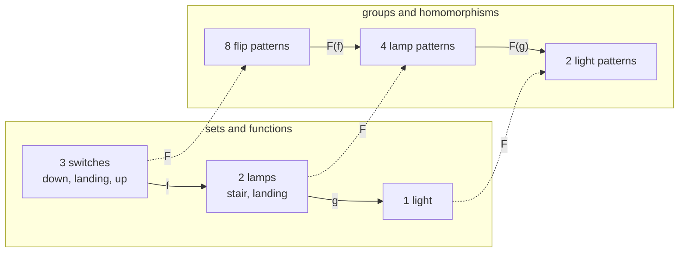

# Categories and functors: objects, arrows, and maps that respect them

[Syllabus](../../../SYLLABUS.md) → [Computability and complexity](../README.md) → [Category Theory in Outline](../README.md#s07) → Categories and functors

---

## General Overview

A staircase has a light with two switches, one downstairs and one upstairs. Flip either switch and the light changes. Flip both and the light ends where it started.

Two kinds of thing are here. The wiring is a function: it sends each switch to the light it feeds. The flip patterns form a group ([Groups](../../03-Algebra/08-Groups/01-groups.md)): flipping nothing changes nothing, and doing any pattern twice undoes it.

The wiring turns flip patterns into light changes, so each function gives a group map. Rewire twice, and the light rule for the whole job is the two light rules run one after the other.

Category theory makes that pattern its subject. A **category** is a collection of things, called objects, with arrows between them that can be chained. A **functor** is a map from one category to another that sends objects to objects and arrows to arrows, and keeps every chain.

**A category is objects joined by arrows that chain, with a do-nothing arrow on each object; a functor carries one category into another without breaking any chain.**

**What kind of fact this is:** category and functor are definitions. Three theorems are proved on this card in Why it works: sets and groups each form a category, the switch rule is a functor, and every functor carries isomorphisms to isomorphisms.

### The picture: one wiring, two worlds



Schematic. The top row is wiring. The bottom row is what happens to flip patterns. The dotted arrows are the functor F, which turns each set into its group of flip patterns and each wire map into a group map.

---

## The formula

Notation first, in words. A category is written with a curly capital, $`\mathcal{C}`$. An arrow $`f`$ from object $`A`$ to object $`B`$ is written $`f: A \to B`$. The arrow $`g \circ f`$, read "g after f", means $`f`$ first, then $`g`$, as in [Composing functions](../../01-Foundations/08-Relations%20and%20Functions/03-composition.md). The do-nothing arrow on $`A`$ is $`\mathrm{id}_A`$. All arrows from $`A`$ to $`B`$ together are $`\mathrm{Hom}(A, B)`$, the hom-set.

A category must pass two laws on every arrow it has:

```math
h \circ (g \circ f) = (h \circ g) \circ f, \qquad \mathrm{id}_B \circ f = f = f \circ \mathrm{id}_A
```

**Read it aloud:** chaining three arrows gives one answer however the brackets fall, and a do-nothing arrow at either end changes nothing.

There is also a rule of supply: whenever $`f: A \to B`$ and $`g: B \to C`$ are arrows, $`g \circ f: A \to C`$ is an arrow too.

A functor $`F`$ from $`\mathcal{C}`$ to a category $`\mathcal{D}`$ sends each object $`A`$ to an object $`F(A)`$, and each arrow $`f: A \to B`$ to an arrow $`F(f): F(A) \to F(B)`$. It must keep chains and do-nothing arrows:

```math
F(g \circ f) = F(g) \circ F(f), \qquad F(\mathrm{id}_A) = \mathrm{id}_{F(A)}
```

**Read it aloud:** chain first and then translate, or translate each arrow and then chain, for the same arrow; and the do-nothing arrow translates to the do-nothing arrow.

The functor on this card is the flip-pattern functor. It sends a finite set $`A`$ of switches to the group $`F(A)`$ of flip patterns: the subsets of $`A`$. The sets here are finite, so every pattern flips a whole number of switches, odd or even. Two patterns $`P`$ and $`Q`$ combine to $`P \triangle Q`$, the switches flipped in exactly one of them. A wire map $`f: A \to B`$ goes to

```math
F(f)(P) = \{\, t \text{ in } B : \text{an odd number of switches } s \text{ in } P \text{ have } f(s) = t \,\}
```

**Read it aloud:** a lamp changes when an odd number of its switches are flipped.

| Symbol | Plain meaning | In our example | Push it up and the answer… |
| --- | --- | --- | --- |
| $`\mathcal{C}`$, $`\mathcal{D}`$ | categories: objects plus arrows | sets with functions; groups with homomorphisms | — |
| $`A`$, $`B`$, $`C`$, $`D`$; $`\lvert A\rvert`$ | objects; the number of members of $`A`$ | the sets {0}, {0,1}, {0,1,2}; four small groups; $`\lvert\{0,1\}\rvert = 2`$ | more objects, many more chains to check |
| $`f`$, $`g`$, $`h`$, $`w`$ | arrows | functions, or group maps; $`w`$ is the stair wiring | — |
| $`f: A \to B`$ | an arrow that starts at $`A`$ and ends at $`B`$ | the stair wiring, two switches to one lamp | — |
| $`g \circ f`$ | "g after f": $`f`$ first, then $`g`$ | three switches to one light | — |
| $`\mathrm{id}_A`$ | the do-nothing arrow on $`A`$ | each switch to itself | — |
| $`\mathrm{Hom}(A, B)`$ | every arrow from $`A`$ to $`B`$; $`\lvert\mathrm{Hom}(A, B)\rvert`$ counts them | 27 functions from three switches to three | the count grows as a power for sets |
| $`F`$, $`F(A)`$, $`F(f)`$ | a functor; where it sends an object; where it sends an arrow | flip patterns; 4 patterns of 2 switches; lamp changes | — |
| $`P`$, $`Q`$ | flip patterns: sets of flipped switches | {0,1}, both stair switches | — |
| $`P \triangle Q`$ | combine: flipped in exactly one of the two | {0} with {1} gives {0,1} | — |
| $`s`$, $`t`$, $`u`$ | a switch; a lamp; a light | switch 0, downstairs; lamp 0, on the stairs; the one light | — |
| $`C_n`$, $`V`$ | the $`n`$-hour clock; flip patterns of two switches | $`C_2`$, $`C_3`$, $`C_4`$, and $`V`$ with 4 members | — |

The clock $`C_n`$ is the hours 0 to $`n - 1`$, added with wrap-round. The group $`V`$ also has four members, but each is its own undo.

$`F`$ lands in the category of all groups, not only in these four. $`F(\{0\})`$ is $`C_2`$ and $`F(\{0,1\})`$ is $`V`$, but $`F(\{0,1,2\})`$ is the group of 8 flip patterns of three switches, which the code checks on its own table.

### When it holds

- **Chaining needs matching ends.** $`g \circ f`$ exists only when $`f`$ ends where $`g`$ starts. With the landing wiring below, $`f \circ g`$ is not defined: $`g`$ ends at one light, and $`f`$ starts at three switches.
- **Arrows need not be functions.** A group is itself a category with one object, whose arrows are the group's members and whose chaining is the group operation. The laws still apply; only the reading changes.
- **The arrows are part of the category.** Groups with homomorphisms and groups with all functions are different categories. With all functions, the 4-hour clock and $`V`$ look the same; with homomorphisms, they are not.
- **A functor must pass both laws.** A rule that keeps chaining but sends do-nothing arrows elsewhere is not a functor, and the theorem in Step 5 fails for it.

---

## Why it works

### Step 0: keep only the arrows and how they chain

Functions already obey the laws ([Composing functions](../../01-Foundations/08-Relations%20and%20Functions/03-composition.md)). A category keeps those two facts and forgets what the arrows are made of. So a fact proved from the laws alone holds for functions, for group maps, and for anything else that obeys them.

### Step 1: sets and functions form a category

The objects are sets and the arrows are functions ([Functions](../../01-Foundations/08-Relations%20and%20Functions/02-functions.md)). Chaining two functions gives a function. Both sides of the bracket law send $`x`$ to $`h(g(f(x)))`$, so they are equal. The identity sends each $`x`$ to itself, so it changes nothing on either side.

The code checks this on the three sets {0}, {0,1} and {0,1,2}. Bars count members: $`\lvert A\rvert`$ is the number of members of $`A`$. There are $`\lvert B\rvert^{\lvert A\rvert}`$ functions from $`A`$ to $`B`$, so 56 arrows in all. The identity laws hold on all 56 arrows, and each of the 1,618 chainable pairs chains to an arrow already on the list. The code also runs the bracket law on all 48,340 chainable triples. With a function stored as its list of outputs, both sides build the same list by construction, so that count confirms the code, not the maths: the proof above is what carries the law.

### Step 2: groups and homomorphisms form a category

The objects are groups and the arrows are homomorphisms: maps with $`f(a * b) = f(a) * f(b)`$ ([Homomorphisms and isomorphisms](../../03-Algebra/08-Groups/05-homomorphisms-and-isomorphisms.md)). The rule of supply is the one new fact. If $`f`$ and $`g`$ are homomorphisms, then

```math
g(f(a * b)) = g(f(a) * f(b)) = g(f(a)) * g(f(b))
```

so $`g \circ f`$ is a homomorphism. The identity is one too. The two laws hold because homomorphisms are functions, and Step 1 already proved them for functions.

The code checks this on $`C_2`$, $`C_3`$, $`C_4`$ and $`V`$. It finds all 51 homomorphisms by testing every function. It counts them a second way: a map from a clock is fixed by where 1 goes, and a map from $`V`$ by where its two single-switch patterns go. The identity laws hold on all 51 arrows, and each of the 863 chainable pairs chains to a homomorphism already on the list, which checks the rule of supply. As in Step 1, the 15,690 triples confirm the code, not the maths.

### Step 3: the switch rule gives a group map

The stair wiring is $`w`$: switch 0 (downstairs) and switch 1 (upstairs) both feed lamp 0. Its four patterns go as follows.

| Flip pattern $`P`$ | Switches feeding lamp 0 | $`F(w)(P)`$ |
| --- | --- | --- |
| {} | none | {}: no change |
| {0} | one | {0}: lamp changes |
| {1} | one | {0}: lamp changes |
| {0,1} | two | {}: no change |

$`F(w)`$ is a homomorphism. Combine {0} with {1} first, giving {0,1}, which goes to {}. Or translate each first, giving {0} and {0}, which combine to {}. Same answer.

The reason is parity. A switch flipped in both $`P`$ and $`Q`$ is counted twice and drops out of $`P \triangle Q`$. Dropping two from a count leaves it odd or even as before.

<details>
<summary>Detailed proof: F(f) is a homomorphism</summary>

Fix a lamp $`t`$. Let $`p`$ count the switches in $`P`$ that feed $`t`$, let $`q`$ count those in $`Q`$, and let $`r`$ count those in both.

The switches in $`P \triangle Q`$ that feed $`t`$ number $`p + q - 2r`$. That has the same parity as $`p + q`$.

So $`t`$ is in $`F(f)(P \triangle Q)`$ exactly when exactly one of $`p`$ and $`q`$ is odd. That is exactly when $`t`$ is in $`F(f)(P) \triangle F(f)(Q)`$. The two sets have the same members, so they are equal.

</details>

### Step 4: the switch rule keeps chains, so F is a functor

Add a landing. Switches 0, 1 and 2 are downstairs, landing and upstairs. The wiring $`f`$ sends switches 0 and 2 to the stair lamp (lamp 0) and switch 1 to the landing lamp (lamp 1). A later rewiring $`g`$ puts both lamps' lines onto one light. Then $`g \circ f`$ is three-way switching: any of three switches changes one light.

Flip all three switches. $`F(f)`$ gives {1}: the stair lamp has two flips and stays, the landing lamp has one and changes. $`F(g)`$ then gives {0}: the light changes. Directly, $`F(g \circ f)`$ counts three flips on one light, odd, so the light changes.

The code compares $`F(g \circ f)`$ with $`F(g) \circ F(f)`$ on all 1,618 chainable pairs of functions, every pattern of each. All agree. $`F`$ also sends each of the 3 identity functions to the identity on patterns.

<details>
<summary>Detailed proof: F keeps chains and identities</summary>

Let $`f: A \to B`$ and $`g: B \to C`$, and fix a pattern $`P`$ and a light $`u`$ in $`C`$. Write # for "how many", $`\in`$ for "in", and $`\sum`$ for "add up over". The switches in $`P`$ that reach $`u`$ through $`g \circ f`$ split by the lamp $`t`$ they pass through:

$`\displaystyle \#\{s \in P : g(f(s)) = u\} = \sum_{t \,:\, g(t) = u} \#\{s \in P : f(s) = t\}`$

Read modulo 2, each term on the right is 1 exactly when $`t`$ is in $`F(f)(P)`$. So the sum is odd exactly when an odd number of lamps in $`F(f)(P)`$ feed $`u`$. That is the rule for $`u`$ to be in $`F(g)(F(f)(P))`$. Hence $`F(g \circ f) = F(g) \circ F(f)`$.

For the identity, each switch $`s`$ feeds only itself, once. So $`s`$ is in $`F(\mathrm{id}_A)(P)`$ exactly when $`s`$ is in $`P`$.

</details>

A second road builds the same $`F(f)`$ with no parity at all. A homomorphism from flip patterns is fixed by where it sends each single-switch pattern. For the sets of 1 and 2 switches, the code searches the brute-force list of homomorphisms for the one sending {s} to {f(s)}. It finds exactly one each time, and it equals $`F(f)`$ on all 8 arrows.

### Step 5: functors carry isomorphisms to isomorphisms

An **isomorphism** is an arrow $`f: A \to B`$ with an arrow $`g: B \to A`$ that undoes it on both sides: $`g \circ f = \mathrm{id}_A`$ and $`f \circ g = \mathrm{id}_B`$. Apply a functor to both equations:

```math
F(g) \circ F(f) = F(g \circ f) = F(\mathrm{id}_A) = \mathrm{id}_{F(A)}
```

The other side is the same, so $`F(f)`$ is an isomorphism, undone by $`F(g)`$. The proof used only the functor laws, so it holds for every functor.

Among the sets, the isomorphisms are the bijections: 1 + 2 + 6 = 9 of them. $`F`$ carries all 9 to group isomorphisms. Among the groups, the code finds 11: 1 on $`C_2`$, 2 on $`C_3`$, 2 on $`C_4`$ and 6 on $`V`$, and none between different groups.

This is what a functor is for. If $`F(A)`$ and $`F(B)`$ are not isomorphic, then $`A`$ and $`B`$ cannot be. [The fundamental group](../../17-Topology/04-Homotopy/03-the-fundamental-group.md) is a third functor, from spaces with a marked point (the basepoint) and continuous maps that send the marked point to the marked point, to groups and homomorphisms. It respects chaining, so spaces with different loop groups cannot be reshaped into each other.

---

## Worked numbers, by hand

| Step | Arithmetic | Value |
| --- | --- | --- |
| functions from 3 switches to 3 | $`3^3`$ | 27 |
| arrows among {0}, {0,1}, {0,1,2} | 1 + 2 + 3 + 1 + 4 + 9 + 1 + 8 + 27 | **56** |
| homomorphisms $`C_4 \to C_2`$ | 1 may go to 0 or to 1: four steps of either land on 0, as they must | 2 |
| homomorphisms $`V \to V`$ | each of 2 starting patterns to any of 4 | 16 |
| arrows among $`C_2`$, $`C_3`$, $`C_4`$, $`V`$ | rows 9 + 6 + 11 + 25 | **51** |
| stair wiring, both flipped | lamp 0 fed twice, even | {}: no change |
| landing, all three flipped, two steps | $`F(f)`$ gives {1}, then $`F(g)`$ gives {0} | light changes |
| landing, all three flipped, one step | three flips on one light, odd | **light changes** |

Both roads change the light: translating the chained wiring matches chaining the translations.

### What breaks if you drop a piece

| Mistake | Comes out at | What went wrong |
| --- | --- | --- |
| Lamps touched at all, instead of an odd count | not a homomorphism for 36 of 56 functions; both stair switches give {0}, not {} | Two flips cancel; "touched" forgets that |
| Every function sent to "change nothing" | composition kept on 1,618 of 1,618 pairs, identity on 0 of 3 | Keeping chains is not enough; identities are a separate law |
| Every function between groups taken as an arrow | 24 bijections from $`C_4`$ to $`V`$, against 0 group isomorphisms | The arrows forgot the operation, so different groups look alike |

The 36 failures are exactly the functions that send two switches to one lamp: flip those two together and "touched" says the lamp changes, though it does not. The other 20 send different switches to different lamps, and there "touched" and the odd count agree.

---

## Code, from first principles, and it actually runs

Nothing is imported. The code builds every function between three small sets and every homomorphism between four small groups, then tests the category laws on every arrow, pair and triple. The hom-set counts take two roads: search against a counting formula. The functor $`F`$ also takes two roads: the parity rule against a search through the homomorphism list. Isomorphisms are found by searching for an undo arrow, and checked against bijection counts.

### Python

```python
# Categories and functors -- the check behind the card.  Nothing is imported.
# Two finite categories are built and every law is tested on every arrow:
# SET, the sets {0}, {0,1}, {0,1,2} with every function between them, and GRP,
# four small groups with every homomorphism between them.  Then the flip-pattern
# functor F, from sets to groups, is built and its laws are tested on every pair.
# A function is a list: entry x is where x goes.  A group is its table: T[x][y].

def all_functions(a, b):                 # every list of a outputs, each below b
    out = [[]]
    for _ in range(a):
        out = [f + [y] for f in out for y in range(b)]
    return out

def compose(g, f):                       # g after f: do f first, then g
    return [g[x] for x in f]

def ident(n):
    return list(range(n))

def check_category(objs, size, hom):     # identity laws, closure, associativity
    pairs = triples = 0
    for a in objs:
        for b in objs:
            for f in hom[a, b]:
                assert compose(ident(size[b]), f) == f == compose(f, ident(size[a]))
                for c in objs:
                    for g in hom[b, c]:
                        gf = compose(g, f)
                        assert gf in hom[a, c]
                        pairs += 1
                        for d in objs:
                            for h in hom[c, d]:
                                assert compose(h, gf) == compose(compose(h, g), f)
                                triples += 1
    return sum(len(hom[a, b]) for a in objs for b in objs), pairs, triples

def isos(objs, size, hom):               # arrows with an arrow back undoing them
    return [(a, b) for a in objs for b in objs for f in hom[a, b]
            if any(compose(g, f) == ident(size[a]) and compose(f, g) == ident(size[b])
                   for g in hom[b, a])]

def clock(n):                            # the n-hour clock: add, wrap at n
    return [[(x + y) % n for y in range(n)] for x in range(n)]

def flips(k):                            # patterns of k switches, as bits; combining
    return [[x ^ y for y in range(2 ** k)] for x in range(2 ** k)]   # keeps a switch flipped in exactly one

def is_hom(f, A, B):
    return all(f[A[x][y]] == B[f[x]][f[y]] for x in range(len(A)) for y in range(len(A)))

def times(B, b, m):                      # b combined with itself m times
    x = 0
    for _ in range(m):
        x = B[x][b]
    return x

def formula(a, B):                       # a homomorphism is fixed by where generators go
    if a == "V":
        return sum(1 for b in range(len(B)) if B[b][b] == 0) ** 2
    return sum(1 for b in range(len(B)) if times(B, b, int(a[1])) == 0)

def F(f, b):                             # F(f): flipped switches -> lamps that toggle
    out = []
    for p in range(2 ** len(f)):
        lamps = 0
        for t in range(b):
            hits = sum(1 for s in range(len(f)) if p >> s & 1 and f[s] == t)
            if hits % 2 == 1:
                lamps |= 1 << t
        out.append(lamps)
    return out

def image(f, b):                         # the tempting wrong rule: lamps touched at all
    return [sum(1 << t for t in range(b) if any(p >> s & 1 and f[s] == t for s in range(len(f))))
            for p in range(2 ** len(f))]

def show(p, k):
    return "{" + ",".join(str(s) for s in range(k) if p >> s & 1) + "}"

def table(m, a):
    return ", ".join(show(p, a) + " -> " + show(m[p], 2) for p in range(2 ** a))

S = [1, 2, 3]
hom_s = {(a, b): all_functions(a, b) for a in S for b in S}
print("SET objects: {0}, {0,1}, {0,1,2}; arrows: every function")
print(f"Hom sizes by search {[[len(hom_s[a, b]) for b in S] for a in S]}, by |B|^|A| {[[b ** a for b in S] for a in S]}")
n_s, p_s, t_s = check_category(S, {k: k for k in S}, hom_s)
print(f"SET: {n_s} arrows, identity laws on all {n_s}, {p_s} composable pairs closed, associativity on all {t_s} triples")
iso_s = isos(S, {k: k for k in S}, hom_s)
fact = [1, 1 * 2, 1 * 2 * 3]
print(f"SET isomorphisms by search: {len(iso_s)}; bijections {' + '.join(map(str, fact))} = {sum(fact)}")
G = {"C2": clock(2), "C3": clock(3), "C4": clock(4), "V": flips(2)}
hom_g = {(a, b): [f for f in all_functions(len(G[a]), len(G[b])) if is_hom(f, G[a], G[b])] for a in G for b in G}
print("GRP objects: C2, C3, C4, V; arrows: every homomorphism")
print(f"Hom sizes by search {[[len(hom_g[a, b]) for b in G] for a in G]}, by generators {[[formula(a, G[b]) for b in G] for a in G]}")
n_g, p_g, t_g = check_category(list(G), {k: len(G[k]) for k in G}, hom_g)
print(f"GRP: {n_g} arrows (rows {[sum(len(hom_g[a, b]) for b in G) for a in G]}), identity laws on all {n_g}, {p_g} composable pairs closed, associativity on all {t_g} triples")
iso_g = isos(list(G), {k: len(G[k]) for k in G}, hom_g)
bij_g = sum(1 for (a, b), fs in hom_g.items() for f in fs if sorted(f) == ident(len(G[b])))
print(f"GRP isomorphisms by search: {len(iso_g)} ({', '.join(f'{k} {iso_g.count((k, k))}' for k in G)}); "
      f"between different groups {sum(1 for a, b in iso_g if a != b)}; bijective homomorphisms {bij_g}")
w, f, g = [0, 0], [0, 1, 0], [0, 0]
print(f"stairs: w = {w}; F(w): {table(F(w, 1), 2)}")
print(f"landing: f = {f}, g = {g}")
for label, m, a in [("F(f)", F(f, 2), 3), ("F(g)", F(g, 1), 2), ("F(g o f)", F(compose(g, f), 1), 3),
                    ("F(g) o F(f)", compose(F(g, 1), F(f, 2)), 3)]:
    print(f"{label}: {table(m, a)}")
homs = sum(1 for (a, b), fs in hom_s.items() for h in fs if is_hom(F(h, b), flips(a), flips(b)))
ids = sum(1 for k in S if F(ident(k), k) == ident(2 ** k))
comp = sum(1 for a in S for b in S for c in S for h in hom_s[a, b] for k in hom_s[b, c]
           if F(compose(k, h), c) == compose(F(k, c), F(h, b)))
print(f"functor: F(f) a homomorphism for {homs} of {n_s} functions; F(id) = id for {ids} of 3 sets; "
      f"F(g o f) = F(g) o F(f) on {comp} of {p_s} pairs")
grp = {1: "C2", 2: "V"}
road2 = 0
for a in [1, 2]:
    for b in [1, 2]:
        for h in hom_s[a, b]:                # search GRP's list; no parity counted
            found = [m for m in hom_g[grp[a], grp[b]] if all(m[1 << s] == 1 << h[s] for s in range(a))]
            road2 += found == [F(h, b)]
print(f"second road: F(f) is the only homomorphism sending each single switch to its lamp, {road2} of 8 arrows")
iso_f = sum(1 for a in S for h in hom_s[a, a] if sorted(h) == ident(a) and sorted(F(h, a)) == ident(2 ** a))
print(f"bijections carried to isomorphisms: {iso_f} of {len(iso_s)}")
bad = sum(1 for (a, b), fs in hom_s.items() for h in fs if not is_hom(image(h, b), flips(a), flips(b)))
inj = sum(1 for fs in hom_s.values() for h in fs if len(set(h)) == len(h))
print(f"mistake 1, lamps touched instead of parity: not a homomorphism for {bad} of {n_s} functions, {inj} injective; "
      f"stairs, both flipped: {show(image(w, 1)[3], 1)}, not {show(F(w, 1)[3], 1)}")
zero_c = sum(1 for a in S for b in S for c in S for h in hom_s[a, b] for k in hom_s[b, c]
             if [0] * 2 ** a == compose([0] * 2 ** b, [0] * 2 ** a))
zero_i = sum(1 for k in S if [0] * 2 ** k == ident(2 ** k))
print(f"mistake 2, every function sent to 'change nothing': composition on {zero_c} of {p_s} pairs, identity on {zero_i} of 3")
bij = sum(1 for h in all_functions(4, 4) if sorted(h) == ident(4))
print(f"mistake 3, all functions as arrows: C4 to V, {bij} bijections, {iso_g.count(('C4', 'V'))} group isomorphisms")
assert [[len(hom_s[a, b]) for b in S] for a in S] == [[b ** a for b in S] for a in S]
assert [[len(hom_g[a, b]) for b in G] for a in G] == [[formula(a, G[b]) for b in G] for a in G]
assert len(iso_s) == sum(fact) and len(iso_g) == bij_g == 11
assert homs == n_s and comp == p_s                        # F keeps every law
assert ids == 3 and road2 == 8 and iso_f == len(iso_s)
assert bad == n_s - inj and bij == 24
print("ALL CHECKS PASS")
```

**Ran 2026-11-19 on macOS, Python 3.14.10, standard library only. All checks passed. Output, pasted from the run:**

```
SET objects: {0}, {0,1}, {0,1,2}; arrows: every function
Hom sizes by search [[1, 2, 3], [1, 4, 9], [1, 8, 27]], by |B|^|A| [[1, 2, 3], [1, 4, 9], [1, 8, 27]]
SET: 56 arrows, identity laws on all 56, 1618 composable pairs closed, associativity on all 48340 triples
SET isomorphisms by search: 9; bijections 1 + 2 + 6 = 9
GRP objects: C2, C3, C4, V; arrows: every homomorphism
Hom sizes by search [[2, 1, 2, 4], [1, 3, 1, 1], [2, 1, 4, 4], [4, 1, 4, 16]], by generators [[2, 1, 2, 4], [1, 3, 1, 1], [2, 1, 4, 4], [4, 1, 4, 16]]
GRP: 51 arrows (rows [9, 6, 11, 25]), identity laws on all 51, 863 composable pairs closed, associativity on all 15690 triples
GRP isomorphisms by search: 11 (C2 1, C3 2, C4 2, V 6); between different groups 0; bijective homomorphisms 11
stairs: w = [0, 0]; F(w): {} -> {}, {0} -> {0}, {1} -> {0}, {0,1} -> {}
landing: f = [0, 1, 0], g = [0, 0]
F(f): {} -> {}, {0} -> {0}, {1} -> {1}, {0,1} -> {0,1}, {2} -> {0}, {0,2} -> {}, {1,2} -> {0,1}, {0,1,2} -> {1}
F(g): {} -> {}, {0} -> {0}, {1} -> {0}, {0,1} -> {}
F(g o f): {} -> {}, {0} -> {0}, {1} -> {0}, {0,1} -> {}, {2} -> {0}, {0,2} -> {}, {1,2} -> {}, {0,1,2} -> {0}
F(g) o F(f): {} -> {}, {0} -> {0}, {1} -> {0}, {0,1} -> {}, {2} -> {0}, {0,2} -> {}, {1,2} -> {}, {0,1,2} -> {0}
functor: F(f) a homomorphism for 56 of 56 functions; F(id) = id for 3 of 3 sets; F(g o f) = F(g) o F(f) on 1618 of 1618 pairs
second road: F(f) is the only homomorphism sending each single switch to its lamp, 8 of 8 arrows
bijections carried to isomorphisms: 9 of 9
mistake 1, lamps touched instead of parity: not a homomorphism for 36 of 56 functions, 20 injective; stairs, both flipped: {0}, not {}
mistake 2, every function sent to 'change nothing': composition on 1618 of 1618 pairs, identity on 0 of 3
mistake 3, all functions as arrows: C4 to V, 24 bijections, 0 group isomorphisms
ALL CHECKS PASS
```

### Rust

Same numbers, same labels, built with `rustc --edition 2021 -O`.

```rust
// Categories and functors -- the same check as the Python, in Rust.  No crates.
// Two finite categories are built and every law is tested on every arrow:
// SET, the sets {0}, {0,1}, {0,1,2} with every function between them, and GRP,
// four small groups with every homomorphism between them.  Then the flip-pattern
// functor F, from sets to groups, is built and its laws are tested on every pair.
// A function is a list: entry x is where x goes.  A group is its table: t[x][y].
type Fun = Vec<usize>;
type Tab = Vec<Vec<usize>>;

fn all_functions(a: usize, b: usize) -> Vec<Fun> {   // every list of a outputs, each below b
    let mut out: Vec<Fun> = vec![vec![]];
    for _ in 0..a {
        out = out.iter().flat_map(|f| (0..b).map(move |y| { let mut g = f.clone(); g.push(y); g })).collect();
    }
    out
}

fn compose(g: &Fun, f: &Fun) -> Fun { f.iter().map(|&x| g[x]).collect() }  // g after f
fn ident(n: usize) -> Fun { (0..n).collect() }

// hom[a][b] lists the arrows from object a to object b; size[a] counts a's members
fn check_category(size: &[usize], hom: &Vec<Vec<Vec<Fun>>>) -> (usize, usize, usize) {
    let (n, mut pairs, mut triples) = (size.len(), 0, 0);
    for a in 0..n { for b in 0..n { for f in &hom[a][b] {
        assert!(compose(&ident(size[b]), f) == *f && *f == compose(f, &ident(size[a])));
        for c in 0..n { for g in &hom[b][c] {
            let gf = compose(g, f);
            assert!(hom[a][c].contains(&gf));
            pairs += 1;
            for d in 0..n { for h in &hom[c][d] {
                assert!(compose(h, &gf) == compose(&compose(h, g), f));
                triples += 1;
            } }
        } }
    } } }
    let arrows = hom.iter().flatten().map(|v| v.len()).sum();
    (arrows, pairs, triples)
}

fn isos(size: &[usize], hom: &Vec<Vec<Vec<Fun>>>) -> Vec<(usize, usize)> {  // arrows undone by an arrow back
    let mut out = vec![];
    for a in 0..size.len() { for b in 0..size.len() { for f in &hom[a][b] {
        if hom[b][a].iter().any(|g| compose(g, f) == ident(size[a]) && compose(f, g) == ident(size[b])) {
            out.push((a, b));
        }
    } } }
    out
}

fn clock(n: usize) -> Tab { (0..n).map(|x| (0..n).map(|y| (x + y) % n).collect()).collect() }
// patterns of k switches, as bits; combining keeps a switch flipped in exactly one
fn flips(k: usize) -> Tab { (0..1 << k).map(|x| (0..1 << k).map(|y| x ^ y).collect()).collect() }

fn is_hom(f: &Fun, a: &Tab, b: &Tab) -> bool {
    (0..a.len()).all(|x| (0..a.len()).all(|y| f[a[x][y]] == b[f[x]][f[y]]))
}

fn times(b: &Tab, e: usize, m: usize) -> usize {      // e combined with itself m times
    let mut x = 0;
    for _ in 0..m { x = b[x][e] }
    x
}

fn formula(a: &str, b: &Tab) -> usize {              // a homomorphism is fixed by where generators go
    if a == "V" { return (0..b.len()).filter(|&e| b[e][e] == 0).count().pow(2) }
    let m: usize = a[1..].parse().unwrap();
    (0..b.len()).filter(|&e| times(b, e, m) == 0).count()
}

fn functor(f: &Fun, b: usize) -> Fun {               // F(f): flipped switches -> lamps that toggle
    (0..1usize << f.len()).map(|p| {
        let mut lamps = 0;
        for t in 0..b {
            let hits = (0..f.len()).filter(|&s| p >> s & 1 == 1 && f[s] == t).count();
            if hits % 2 == 1 { lamps |= 1 << t }
        }
        lamps
    }).collect()
}

fn image(f: &Fun, b: usize) -> Fun {                 // the tempting wrong rule: lamps touched at all
    (0..1usize << f.len()).map(|p| (0..b).filter(|&t| (0..f.len()).any(|s| p >> s & 1 == 1 && f[s] == t))
        .map(|t| 1 << t).sum()).collect()
}

fn show(p: usize, k: usize) -> String {
    let v: Vec<String> = (0..k).filter(|&s| p >> s & 1 == 1).map(|s| s.to_string()).collect();
    format!("{{{}}}", v.join(","))
}

fn table(m: &Fun, a: usize) -> String {
    (0..1 << a).map(|p| format!("{} -> {}", show(p, a), show(m[p], 2))).collect::<Vec<_>>().join(", ")
}

fn sorted(f: &Fun) -> Fun { let mut g = f.clone(); g.sort(); g }

fn main() {
    let s = [1usize, 2, 3];
    let hom_s: Vec<Vec<Vec<Fun>>> = s.iter().map(|&a| s.iter().map(|&b| all_functions(a, b)).collect()).collect();
    let sizes_s: Vec<Vec<usize>> = hom_s.iter().map(|r| r.iter().map(|v| v.len()).collect()).collect();
    let pow_s: Vec<Vec<usize>> = s.iter().map(|&a| s.iter().map(|&b| b.pow(a as u32)).collect()).collect();
    println!("SET objects: {{0}}, {{0,1}}, {{0,1,2}}; arrows: every function");
    println!("Hom sizes by search {:?}, by |B|^|A| {:?}", sizes_s, pow_s);
    let (n_s, p_s, t_s) = check_category(&s, &hom_s);
    println!("SET: {} arrows, identity laws on all {}, {} composable pairs closed, associativity on all {} triples", n_s, n_s, p_s, t_s);
    let iso_s = isos(&s, &hom_s);
    let fv = [1usize, 1 * 2, 1 * 2 * 3]; let fact: usize = fv.iter().sum();
    println!("SET isomorphisms by search: {}; bijections {} = {}", iso_s.len(), fv.map(|x| x.to_string()).join(" + "), fact);
    let names = ["C2", "C3", "C4", "V"];
    let g: Vec<Tab> = vec![clock(2), clock(3), clock(4), flips(2)];
    let size_g: Vec<usize> = g.iter().map(|t| t.len()).collect();
    let hom_g: Vec<Vec<Vec<Fun>>> = g.iter().map(|a| g.iter().map(|b|
        all_functions(a.len(), b.len()).into_iter().filter(|f| is_hom(f, a, b)).collect()).collect()).collect();
    let sizes_g: Vec<Vec<usize>> = hom_g.iter().map(|r| r.iter().map(|v| v.len()).collect()).collect();
    let form_g: Vec<Vec<usize>> = names.iter().map(|a| g.iter().map(|b| formula(a, b)).collect()).collect();
    println!("GRP objects: C2, C3, C4, V; arrows: every homomorphism");
    println!("Hom sizes by search {:?}, by generators {:?}", sizes_g, form_g);
    let (n_g, p_g, t_g) = check_category(&size_g, &hom_g);
    let rows_g: Vec<usize> = sizes_g.iter().map(|r| r.iter().sum()).collect();
    println!("GRP: {} arrows (rows {:?}), identity laws on all {}, {} composable pairs closed, associativity on all {} triples",
             n_g, rows_g, n_g, p_g, t_g);
    let iso_g = isos(&size_g, &hom_g);
    let bij_g = (0..4).flat_map(|a| (0..4).map(move |b| (a, b)))
        .map(|(a, b)| hom_g[a][b].iter().filter(|f| sorted(f) == ident(size_g[b])).count()).sum::<usize>();
    let per: Vec<String> = (0..4).map(|k| format!("{} {}", names[k], iso_g.iter().filter(|&&p| p == (k, k)).count())).collect();
    println!("GRP isomorphisms by search: {} ({}); between different groups {}; bijective homomorphisms {}",
             iso_g.len(), per.join(", "), iso_g.iter().filter(|p| p.0 != p.1).count(), bij_g);
    let (w, f, gg): (Fun, Fun, Fun) = (vec![0, 0], vec![0, 1, 0], vec![0, 0]);
    println!("stairs: w = {:?}; F(w): {}", w, table(&functor(&w, 1), 2));
    println!("landing: f = {:?}, g = {:?}", f, gg);
    let rows = [("F(f)", functor(&f, 2), 3), ("F(g)", functor(&gg, 1), 2), ("F(g o f)", functor(&compose(&gg, &f), 1), 3),
                ("F(g) o F(f)", compose(&functor(&gg, 1), &functor(&f, 2)), 3)];
    for (label, m, a) in rows.iter() { println!("{}: {}", label, table(m, *a)) }
    let (mut homs, mut comp, mut bad, mut inj, mut zero_c) = (0, 0, 0, 0, 0);
    for a in 0..3 { for b in 0..3 { for h in &hom_s[a][b] {
        if is_hom(&functor(h, s[b]), &flips(s[a]), &flips(s[b])) { homs += 1 }
        if !is_hom(&image(h, s[b]), &flips(s[a]), &flips(s[b])) { bad += 1 }
        if sorted(h).windows(2).all(|p| p[0] != p[1]) { inj += 1 }
        for c in 0..3 { for k in &hom_s[b][c] {
            if functor(&compose(k, h), s[c]) == compose(&functor(k, s[c]), &functor(h, s[b])) { comp += 1 }
            if vec![0; 1 << s[a]] == compose(&vec![0; 1 << s[b]], &vec![0; 1 << s[a]]) { zero_c += 1 }
        } }
    } } }
    let ids = s.iter().filter(|&&k| functor(&ident(k), k) == ident(1 << k)).count();
    println!("functor: F(f) a homomorphism for {} of {} functions; F(id) = id for {} of 3 sets; F(g o f) = F(g) o F(f) on {} of {} pairs",
             homs, n_s, ids, comp, p_s);
    let mut road2 = 0;
    for a in 0..2 { for b in 0..2 { for h in &hom_s[a][b] {     // search GRP's list; no parity counted
        let gi = |x: usize| if x == 0 { 0 } else { 3 };          // 1 switch -> C2, 2 switches -> V
        let found: Vec<&Fun> = hom_g[gi(a)][gi(b)].iter().filter(|m| (0..s[a]).all(|q| m[1 << q] == 1 << h[q])).collect();
        if found.len() == 1 && *found[0] == functor(h, s[b]) { road2 += 1 }
    } } }
    println!("second road: F(f) is the only homomorphism sending each single switch to its lamp, {} of 8 arrows", road2);
    let iso_f = (0..3).map(|a| hom_s[a][a].iter()
        .filter(|h| sorted(h) == ident(s[a]) && sorted(&functor(h, s[a])) == ident(1 << s[a])).count()).sum::<usize>();
    println!("bijections carried to isomorphisms: {} of {}", iso_f, iso_s.len());
    println!("mistake 1, lamps touched instead of parity: not a homomorphism for {} of {} functions, {} injective; stairs, both flipped: {}, not {}",
             bad, n_s, inj, show(image(&w, 1)[3], 1), show(functor(&w, 1)[3], 1));
    let zero_i = s.iter().filter(|&&k| vec![0; 1 << k] == ident(1 << k)).count();
    println!("mistake 2, every function sent to 'change nothing': composition on {} of {} pairs, identity on {} of 3", zero_c, p_s, zero_i);
    let bij = all_functions(4, 4).iter().filter(|h| sorted(h) == ident(4)).count();
    println!("mistake 3, all functions as arrows: C4 to V, {} bijections, {} group isomorphisms", bij,
             iso_g.iter().filter(|&&p| p == (2, 3)).count());
    assert!(sizes_s == pow_s && sizes_g == form_g);
    assert!(iso_s.len() == fact && iso_g.len() == bij_g && bij_g == 11);
    assert!(homs == n_s && comp == p_s);                        // F keeps every law
    assert!(ids == 3 && road2 == 8 && iso_f == iso_s.len());
    assert!(bad == n_s - inj && bij == 24);
    println!("ALL CHECKS PASS");
}
```

**Ran 2026-11-19 on macOS, rustc 1.98.1, no crates. All checks passed. Output, pasted from the run:**

```
SET objects: {0}, {0,1}, {0,1,2}; arrows: every function
Hom sizes by search [[1, 2, 3], [1, 4, 9], [1, 8, 27]], by |B|^|A| [[1, 2, 3], [1, 4, 9], [1, 8, 27]]
SET: 56 arrows, identity laws on all 56, 1618 composable pairs closed, associativity on all 48340 triples
SET isomorphisms by search: 9; bijections 1 + 2 + 6 = 9
GRP objects: C2, C3, C4, V; arrows: every homomorphism
Hom sizes by search [[2, 1, 2, 4], [1, 3, 1, 1], [2, 1, 4, 4], [4, 1, 4, 16]], by generators [[2, 1, 2, 4], [1, 3, 1, 1], [2, 1, 4, 4], [4, 1, 4, 16]]
GRP: 51 arrows (rows [9, 6, 11, 25]), identity laws on all 51, 863 composable pairs closed, associativity on all 15690 triples
GRP isomorphisms by search: 11 (C2 1, C3 2, C4 2, V 6); between different groups 0; bijective homomorphisms 11
stairs: w = [0, 0]; F(w): {} -> {}, {0} -> {0}, {1} -> {0}, {0,1} -> {}
landing: f = [0, 1, 0], g = [0, 0]
F(f): {} -> {}, {0} -> {0}, {1} -> {1}, {0,1} -> {0,1}, {2} -> {0}, {0,2} -> {}, {1,2} -> {0,1}, {0,1,2} -> {1}
F(g): {} -> {}, {0} -> {0}, {1} -> {0}, {0,1} -> {}
F(g o f): {} -> {}, {0} -> {0}, {1} -> {0}, {0,1} -> {}, {2} -> {0}, {0,2} -> {}, {1,2} -> {}, {0,1,2} -> {0}
F(g) o F(f): {} -> {}, {0} -> {0}, {1} -> {0}, {0,1} -> {}, {2} -> {0}, {0,2} -> {}, {1,2} -> {}, {0,1,2} -> {0}
functor: F(f) a homomorphism for 56 of 56 functions; F(id) = id for 3 of 3 sets; F(g o f) = F(g) o F(f) on 1618 of 1618 pairs
second road: F(f) is the only homomorphism sending each single switch to its lamp, 8 of 8 arrows
bijections carried to isomorphisms: 9 of 9
mistake 1, lamps touched instead of parity: not a homomorphism for 36 of 56 functions, 20 injective; stairs, both flipped: {0}, not {}
mistake 2, every function sent to 'change nothing': composition on 1618 of 1618 pairs, identity on 0 of 3
mistake 3, all functions as arrows: C4 to V, 24 bijections, 0 group isomorphisms
ALL CHECKS PASS
```

The two outputs match line for line.

### Lean

Lean proves that every functor carries isomorphisms to isomorphisms, and that the switch rule is a functor, for all finite sets.

- Take any functor $`F`$ and any arrow $`f`$ undone on both sides by an arrow $`g`$. Then $`F(f)`$ is undone on both sides by $`F(g)`$.
- Take any wire map $`f`$ and any flip patterns $`P`$ and $`Q`$. Then $`F(f)(P \triangle Q) = F(f)(P) \triangle F(f)(Q)`$, so $`F(f)`$ is a group map.
- Take wire maps $`f: A \to B`$ and $`g: B \to C`$ between finite sets. Then $`F(g \circ f) = F(g) \circ F(f)`$ and $`F(\mathrm{id}_A) = \mathrm{id}_{F(A)}`$.
- There are 27 functions from three switches to three, and 2 homomorphisms from $`C_4`$ to $`C_2`$.
- The row sums give 56 arrows among the sets and 51 among the groups.
- There are 6 bijections from three switches to three, and 24 from $`C_4`$ to $`V`$ as plain sets.
- The stair wiring $`w`$ sends {}, {0}, {1}, {0,1} to {}, {0}, {0}, {}.
- The lamps-touched rule gives {0} when both stair switches flip, not {}.
- Take the landing wiring and flip all three switches. Then $`F(f)`$ gives {1}, $`F(g)`$ turns that into {0}, and $`F(g \circ f)`$ gives {0} directly.

Lean does not build the card's two small categories, so their laws on every arrow, pair and triple are left to the Python and Rust checks.

```lean
-- Categories and functors: every functor carries isomorphisms to isomorphisms, and the flip-pattern rule (a lamp changes when an odd number of its switches are flipped) turns functions into group maps and keeps chains and do-nothing arrows.
import Mathlib.CategoryTheory.Functor.Basic
import Mathlib.Data.Fintype.Card
import Mathlib.Data.Fintype.Pi
import Mathlib.Data.Fintype.Perm
import Mathlib.Data.ZMod.Defs
import Mathlib.Algebra.Ring.Parity
import Mathlib.Data.Fin.VecNotation
import Mathlib.Tactic.NormNum.Basic
import Mathlib.Order.SymmDiff
import Mathlib.Algebra.BigOperators.Ring.Nat
import Mathlib.Algebra.BigOperators.Group.Finset.Basic

open CategoryTheory
open scoped symmDiff

/-- The card's flip-pattern rule F(f). A flip pattern P is a set of flipped switches; the wire
map f sends each switch to the lamp it feeds. F(f)(P) is the set of lamps t fed by an odd
number of switches in P. -/
def flipMap {α β : Type*} [Fintype β] [DecidableEq β] (f : α → β) (P : Finset α) : Finset β :=
  Finset.univ.filter (fun t => Odd (P.filter (fun s => f s = t)).card)


/-- Parity of a symmetric difference: |A ∆ B| + 2|A ∩ B| = |A| + |B|. -/
theorem card_symmDiff_add_two_inter {α : Type*} [DecidableEq α] (A B : Finset α) :
    (A ∆ B).card + 2 * (A ∩ B).card = A.card + B.card := by
  rw [symmDiff_eq_sup_sdiff_inf, ← Finset.card_union_add_card_inter A B]
  have hsub : A ⊓ B ⊆ A ⊔ B := fun x hx => Finset.mem_union_left _ (Finset.mem_inter.1 hx).1
  have hle := Finset.card_le_card hsub
  rw [Finset.card_sdiff_of_subset hsub]
  change (A ∪ B).card - (A ∩ B).card + 2 * (A ∩ B).card = (A ∪ B).card + (A ∩ B).card
  change (A ∩ B).card ≤ (A ∪ B).card at hle
  omega

/-- Membership in a flip map: lamp t is on exactly when an odd number of switches in P feed it. -/
theorem mem_flipMap {α β : Type*} [Fintype β] [DecidableEq β] (f : α → β) (P : Finset α)
    (t : β) : t ∈ flipMap f P ↔ Odd (P.filter (fun s => f s = t)).card := by
  simp [flipMap]

/-- Functors carry isomorphisms to isomorphisms. Let F be a functor from a category C to a
category D. If the arrow f : X → Y is undone on both sides by g : Y → X (g after f is the
do-nothing arrow on X, and f after g is the do-nothing arrow on Y), then F(f) is undone on both
sides by F(g). Lean writes `f ≫ g` for "f first, then g", the card's g ∘ f. -/
theorem functor_maps_iso_to_iso {C D : Type*} [Category C] [Category D] (F : C ⥤ D)
    {X Y : C} (f : X ⟶ Y) (g : Y ⟶ X) (hgf : f ≫ g = 𝟙 X) (hfg : g ≫ f = 𝟙 Y) :
    F.map f ≫ F.map g = 𝟙 (F.obj X) ∧ F.map g ≫ F.map f = 𝟙 (F.obj Y) := by
  exact ⟨by rw [← F.map_comp, hgf, F.map_id], by rw [← F.map_comp, hfg, F.map_id]⟩

/-- The switch rule gives a group map: for any function f from a set of switches to a finite
set of lamps, and any two flip patterns P and Q, F(f) sends P ∆ Q (the switches flipped in
exactly one of P and Q) to F(f)(P) ∆ F(f)(Q). -/
theorem flipMap_symmDiff {α β : Type*} [DecidableEq α] [Fintype β] [DecidableEq β]
    (f : α → β) (P Q : Finset α) :
    flipMap f (P ∆ Q) = flipMap f P ∆ flipMap f Q := by
  ext t
  have hfil : (P ∆ Q).filter (fun s => f s = t) =
      P.filter (fun s => f s = t) ∆ Q.filter (fun s => f s = t) := by
    ext s; simp only [Finset.mem_filter, Finset.mem_symmDiff]; tauto
  have key := card_symmDiff_add_two_inter (P.filter (fun s => f s = t)) (Q.filter (fun s => f s = t))
  simp only [mem_flipMap, Finset.mem_symmDiff, hfil]
  simp only [Nat.odd_iff]
  omega

/-- The switch rule keeps chains and do-nothing arrows, so F is a functor: for wire maps
f : A → B and g : B → C between finite sets and every flip pattern P,
F(g ∘ f)(P) = F(g)(F(f)(P)), and F(id_A)(P) = P. -/
theorem flipMap_comp_and_id {α β γ : Type*} [Fintype α] [DecidableEq α] [Fintype β]
    [DecidableEq β] [Fintype γ] [DecidableEq γ] (f : α → β) (g : β → γ) :
    (∀ P : Finset α, flipMap (g ∘ f) P = flipMap g (flipMap f P)) ∧
      (∀ P : Finset α, flipMap id P = P) := by
  refine ⟨fun P => ?_, fun P => ?_⟩
  · ext t
    have hmaps : ((P.filter (fun s => (g ∘ f) s = t) : Finset α) : Set α).MapsTo f
        (Finset.univ.filter (fun u => g u = t) : Finset β) := by
      intro s hs
      simp only [Finset.coe_filter, Set.mem_ofPred_eq, Function.comp_apply] at hs
      simp [hs.2]
    have hsum := Finset.card_eq_sum_card_fiberwise hmaps
    rw [mem_flipMap, mem_flipMap, hsum, Finset.odd_sum_iff_odd_card_odd]
    congr! 2
    ext u
    simp only [Finset.mem_filter, Finset.mem_univ, true_and, mem_flipMap]
    constructor
    · rintro ⟨hu, hodd⟩
      refine ⟨?_, hu⟩
      convert hodd using 2
      ext s
      simp only [Finset.mem_filter, Function.comp_apply]
      constructor
      · rintro ⟨hs, rfl⟩; exact ⟨⟨hs, hu⟩, rfl⟩
      · rintro ⟨⟨hs, _⟩, h⟩; exact ⟨hs, h⟩
    · rintro ⟨hodd, hu⟩
      refine ⟨hu, ?_⟩
      convert hodd using 2
      ext s
      simp only [Finset.mem_filter, Function.comp_apply]
      constructor
      · rintro ⟨⟨hs, _⟩, h⟩; exact ⟨hs, h⟩
      · rintro ⟨hs, rfl⟩; exact ⟨⟨hs, hu⟩, rfl⟩
  · ext t
    rw [mem_flipMap]
    simp only [id]
    rw [Finset.filter_eq']
    split_ifs with h <;> simp [h]

-- Hom-set sizes: 3^3 = 27 functions from three switches to three, and 56 arrows in all
-- among {0}, {0,1}, {0,1,2}.
example : Fintype.card (Fin 3 → Fin 3) = 27 := by decide
example : 1 + 2 + 3 + 1 + 4 + 9 + 1 + 8 + 27 = 56 := by norm_num
-- Homomorphisms from the 4-hour clock to the 2-hour clock: 2. Arrows among C2, C3, C4, V: 51.
example : (Finset.univ.filter
    (fun h : ZMod 4 → ZMod 2 => ∀ a b, h (a + b) = h a + h b)).card = 2 := by decide
example : 9 + 6 + 11 + 25 = 51 := by norm_num
-- Bijections: 1 + 2 + 6 = 9 set isomorphisms; 24 bijections from C4 to V.
example : Fintype.card (Fin 3 ≃ Fin 3) = 6 ∧ Fintype.card (Fin 4 ≃ Fin 4) = 24 := by decide
-- Stair wiring w: both switches feed lamp 0; its four flip patterns.
example : flipMap (fun _ : Fin 2 => (0 : Fin 1)) ∅ = ∅ ∧
    flipMap (fun _ : Fin 2 => (0 : Fin 1)) {0} = {0} ∧
    flipMap (fun _ : Fin 2 => (0 : Fin 1)) {1} = {0} ∧
    flipMap (fun _ : Fin 2 => (0 : Fin 1)) {0, 1} = ∅ := by decide
-- The tempting wrong rule, "lamps touched at all", says the lamp changes when both flip.
example : ({0, 1} : Finset (Fin 2)).image (fun _ => (0 : Fin 1)) = {0} := by decide
-- Landing: f = [0, 1, 0], g = [0, 0]; flip all three switches.
example : flipMap (![0, 1, 0] : Fin 3 → Fin 2) {0, 1, 2} = {1} ∧
    flipMap (![0, 0] : Fin 2 → Fin 1) {1} = {0} ∧
    flipMap ((![0, 0] : Fin 2 → Fin 1) ∘ (![0, 1, 0] : Fin 3 → Fin 2)) {0, 1, 2} = {0} := by
  decide

#print axioms card_symmDiff_add_two_inter
#print axioms mem_flipMap
#print axioms functor_maps_iso_to_iso
#print axioms flipMap_symmDiff
#print axioms flipMap_comp_and_id
```

**Checked 2026-11-19 on macOS, Lean 4.36.0-rc2, Mathlib v4.36.0-rc2. Every proof is complete and uses only Lean's standard axioms. Output, pasted from the run:**

```
'card_symmDiff_add_two_inter' depends on axioms: [propext, Classical.choice, Quot.sound]
'mem_flipMap' depends on axioms: [propext, Classical.choice, Quot.sound]
'functor_maps_iso_to_iso' does not depend on any axioms
'flipMap_symmDiff' depends on axioms: [propext, Classical.choice, Quot.sound]
'flipMap_comp_and_id' depends on axioms: [propext, Classical.choice, Quot.sound]
```

> [!TIP]
> **Try changing**
> Guess first, then run the Python. The asserts are pinned to the card's numbers, so expect one to stop the run when a number moves.
> - **Count touches, not parity.** In `F`, change `if hits % 2 == 1:` to `if hits >= 1:`. Guess: does the new rule still keep chains? Yes, on all 1,618 pairs, yet it is a homomorphism for only 20 of 56 functions. It is a functor into sets, not into groups, and the fourth assert stops the run.
> - **Move the do-nothing hour.** In `clock`, change `(x + y) % n` to `(x + y + 1) % n`. Guess: is each clock still a group? Yes: the do-nothing hour is now the last one, and the search still finds 51 homomorphisms. The counting formula assumes the do-nothing member is 0, so its row for V reads `[0, 1, 0, 16]`, and the second assert stops the run.
> - **Swap V for a second 4-hour clock.** Change `"V": flips(2)` to `"V": clock(4)`. Guess: how many isomorphisms from C4 to the new V? 2, since both are now the same group, and the run reports 35 arrows in all. The formula still treats V as flip patterns, so the second assert stops the run.

---

## The usual mistake

> [!warning]
> **Checking a functor on objects only.** Sending each set to its flip patterns is the easy half. The content is in the arrows. The "lamps touched" rule sends every object to the same group as $`F`$ does, yet it is not even a homomorphism for 36 of the 56 functions: with both stair switches flipped it says the lamp changes, and the lamp does not.
>
> - **Dropping the identity law.** Sending every function to "change nothing" keeps chaining on all 1,618 pairs, but sends 0 of the 3 identities to identities. It then carries no isomorphism to an isomorphism.
> - **Forgetting that the arrows define the category.** With every function as an arrow, $`C_4`$ and $`V`$ have 24 bijections between them. With homomorphisms, they have 0 isomorphisms, so they are different groups.
> - **Reading $`g \circ f`$ left to right.** It means $`f`$ first. With the landing wiring, $`g \circ f`$ is three-way switching, and $`f \circ g`$ does not exist.

---

## Where you meet it in real life

- **Programming.** A list type with its `map` operation is a functor: mapping $`g \circ f`$ over a list gives the same list as mapping $`f`$ and then $`g`$. Compilers use that law to fuse two passes over data into one; [Monoids and monads](07-monoids-and-monads-for-programmers.md) builds on it.
- **Topology.** [The fundamental group](../../17-Topology/04-Homotopy/03-the-fundamental-group.md) turns spaces into groups and keeps chaining, so different groups prove two spaces different.
- **Free constructions in algebra.** The flip-pattern functor builds, from a set of switches, the most general group in which order does not matter and every member is its own undo. Constructions of this "free" kind are everywhere in algebra; [Adjunctions](06-adjunctions.md) makes the word exact.
- **Databases.** A database schema can be read as a small category: tables as objects, links between tables as arrows. The data filling it is then a functor into sets, and moving data to a new schema is done by chaining with a functor between schemas.

> **Say it back**
> A category is a collection of objects with arrows between them, where arrows with matching ends chain, chaining is associative, and each object has a do-nothing arrow. Sets with functions form one: 56 arrows on three small sets. Groups with homomorphisms form another: 51 arrows on four small groups. A functor sends objects to objects and arrows to arrows, and keeps chaining and do-nothing arrows. The flip-pattern functor turns wiring into lamp changes by odd counts. Because functors keep both laws, every functor carries isomorphisms to isomorphisms.

---

## What this builds on

- [Functions](../../01-Foundations/08-Relations%20and%20Functions/02-functions.md): one output for every input, the arrows of the first category.
- [Composing functions](../../01-Foundations/08-Relations%20and%20Functions/03-composition.md): chaining, the do-nothing rule and the bracket law, here made into axioms.
- [Groups](../../03-Algebra/08-Groups/01-groups.md): the objects of the second category, and the flip patterns as a group.
- [Homomorphisms and isomorphisms](../../03-Algebra/08-Groups/05-homomorphisms-and-isomorphisms.md): maps that respect the operation, the arrows of the second category.

## Where this goes next

- [Commutative diagrams](02-commutative-diagrams-and-duality.md): draws the laws as diagrams of arrows, and turns every arrow round to get a second category from each.
- [Equivalence of categories](10-equivalence-of-categories.md): the right notion of 'the same', weaker than isomorphism.

The shelf goes on to [Natural transformations and Yoneda](03-natural-transformations-and-yoneda.md), [Universal properties](04-universal-properties-limits-and-colimits.md), [Pullbacks and pushouts](05-pullbacks-pushouts-and-gluing.md), [Adjunctions](06-adjunctions.md), [Monoids and monads](07-monoids-and-monads-for-programmers.md), [F-algebras](08-f-algebras-and-folds.md) and [Monoidal categories](09-monoidal-categories-and-string-diagrams.md).

This card compares objects through functors; it leaves open how to compare two functors with each other.

---

## Sources

Verified 2026-11-19: every link below resolves to the publisher's page.

- Eilenberg, Samuel, and Saunders Mac Lane. "General Theory of Natural Equivalences." *Transactions of the American Mathematical Society* 58 (1945): 231–294. [doi:10.1090/S0002-9947-1945-0013131-6](https://doi.org/10.1090/S0002-9947-1945-0013131-6). The paper that defined categories and functors.
- Mac Lane, Saunders. *Categories for the Working Mathematician*. Springer, Graduate Texts in Mathematics 5, second edition, 1998. [doi:10.1007/978-1-4757-4721-8](https://doi.org/10.1007/978-1-4757-4721-8). Chapter I: the axioms, the standard examples and functors.
- Leinster, Tom. *Basic Category Theory*. Cambridge University Press, 2014. [doi:10.1017/CBO9781107360068](https://doi.org/10.1017/CBO9781107360068). Chapter 1: categories, functors and isomorphisms, with free and forgetful functors; also free at [arXiv:1612.09375](https://arxiv.org/abs/1612.09375).
- Fong, Brendan, and David I. Spivak. *An Invitation to Applied Category Theory*. Cambridge University Press, 2019. [doi:10.1017/9781108668804](https://doi.org/10.1017/9781108668804). Chapter 3: database schemas as categories and data migration as functors.
