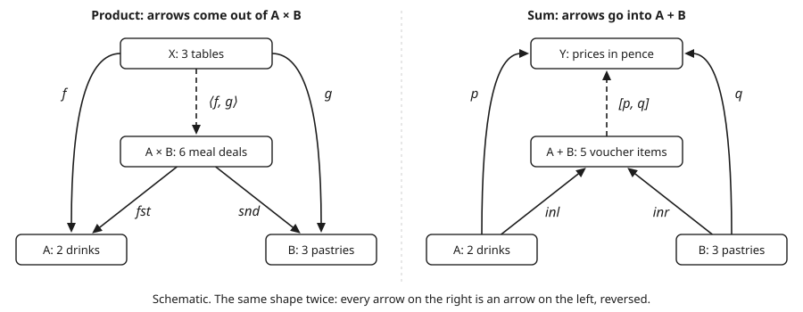
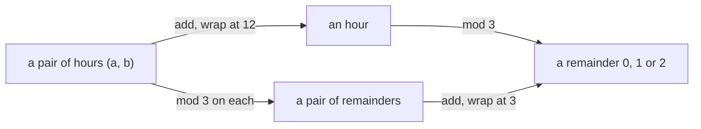

# Commutative diagrams: every route agrees, and every arrow can be reversed

[Syllabus](../../../SYLLABUS.md) → [Computability and complexity](../README.md) → [Category Theory in Outline](../README.md#s07) → Commutative diagrams

---

## General Overview

A café sells 2 drinks, tea and coffee, and 3 pastries: scone, muffin and toast. It runs two offers.

- **The meal deal:** one drink *and* one pastry. There are 2 × 3 = 6 deals, such as (tea, scone).
- **The free-item voucher:** one drink *or* one pastry. There are 2 + 3 = 5 choices.

The till reads the drink and the pastry off a meal deal: two arrows *out* of the deal. It files a drink or a pastry as a voucher item: two arrows *in*. Drawn as diagrams, the two offers are the same picture with every arrow turned round.

A diagram **commutes** when any two routes with the same start and end give the same function. Each such pair of routes is one equation. Turning every arrow round is called **dualising**.

**A commutative diagram is a set of equations drawn as arrows, one equation for each pair of routes with the same start and end; reverse every arrow and the product of two sets turns into their sum, and a statement true in every category stays true with its arrows reversed.**

**What kind of fact this is:** "commutes", the product, the sum and the reversed category are definitions. That exactly one arrow completes each café diagram, and the duality principle, are theorems, proved on this card in Why it works.

### The picture: the meal deal and the voucher, one shape

<p align="center"></p>

Schematic, not to scale. Boxes are sets and arrows are functions. The dashed arrow is the one the other arrows force: the card proves it exists and is unique.

---

## The formula

A reminder from [Categories and functors](01-categories-and-functors.md): a category $`\mathcal{C}`$ has objects, arrows $`f: S \to T`$, an identity arrow $`\mathrm{id}_S`$ on each object, and a composite $`g \circ f`$ ("g after f") when $`f`$ ends where $`g`$ starts. $`\mathrm{Hom}(S, T)`$ is the set of arrows from $`S`$ to $`T`$. Here objects are sets and arrows are functions.

Three new pieces of notation:

- **The product** $`A \times B`$: the ordered pairs, as in [Ordered pairs and the Cartesian product](../../01-Foundations/07-Sets/05-ordered-pairs-and-cartesian-product.md), with two arrows out. $`\mathrm{fst}`$ reads the first slot, $`\mathrm{snd}`$ the second.
- **The sum** $`A + B`$, or disjoint union: every member of $`A`$ and of $`B`$, each tagged with the set it came from, with two arrows in. $`\mathrm{inl}`$ tags a drink, $`\mathrm{inr}`$ a pastry.
- **The opposite category** $`\mathcal{C}^{op}`$: the same objects and arrows, each pointing the other way, composed in the opposite order.

The café supplies the other letters. Three tables, $`X = \{1, 2, 3\}`$, each order one meal deal. The function $`f: X \to A`$ gives each table's drink and $`g: X \to B`$ its pastry. The pairing $`\langle f, g \rangle: X \to A \times B`$ gives each table's whole deal.

The meal-deal diagram on the left of the picture reads as two equations:

```math
\mathrm{fst} \circ \langle f, g \rangle = f, \qquad \mathrm{snd} \circ \langle f, g \rangle = g
```

**Read it aloud:** read the drink off a table's meal deal and you get that table's drink; read the pastry off and you get its pastry.

Reverse every arrow and swap the order of every composite. Now $`Y`$ is the set of prices in pence, $`p: A \to Y`$ prices each drink and $`q: B \to Y`$ each pastry. The case split $`[p, q]: A + B \to Y`$ prices any voucher item. The voucher diagram on the right reads as:

```math
[p, q] \circ \mathrm{inl} = p, \qquad [p, q] \circ \mathrm{inr} = q
```

**Read it aloud:** file a drink as a voucher item and then price it, and you get the drink's own price; the same holds for a pastry.

The reversed category is defined by one line:

```math
\mathrm{Hom}_{\mathcal{C}^{op}}(S, T) = \mathrm{Hom}_{\mathcal{C}}(T, S), \qquad g \circ_{op} f = f \circ g
```

Each diagram also gives a count: a pair of arrows into $`A`$ and $`B`$ is one arrow into $`A \times B`$, and a pair out of them is one arrow out of $`A + B`$.

```math
\lvert \mathrm{Hom}(X, A \times B) \rvert = \lvert \mathrm{Hom}(X, A) \rvert \cdot \lvert \mathrm{Hom}(X, B) \rvert, \qquad \lvert \mathrm{Hom}(A + B, Y) \rvert = \lvert \mathrm{Hom}(A, Y) \rvert \cdot \lvert \mathrm{Hom}(B, Y) \rvert
```

For the café that is 216 = 8 × 27 on the left and 3,125 = 25 × 125 on the right.

| Symbol | Plain meaning | In our example | Push it up and the answer… |
| --- | --- | --- | --- |
| $`A`$, $`B`$, $`X`$, $`Y`$ | sets: drinks, pastries, tables, prices | 2 drinks, 3 pastries, 3 tables, 5 prices in pence | more candidates; still one passes |
| $`f`$, $`g`$ | each table's drink; each table's pastry | tea, coffee, tea; scone, toast, muffin | — |
| $`p`$, $`q`$ | the price of each drink and each pastry, in pence | tea 250, coffee 300; scone 280, muffin 320, toast 200 | — |
| $`g \circ f`$, $`\mathrm{id}_S`$, $`h`$, $`u`$, $`v`$ | "g after f"; the arrow that changes nothing; any candidate function, or any two arrows tested for cancelling | $`\mathrm{fst} \circ h`$ | — |
| $`A \times B`$ | the product: all ordered pairs | 6 meal deals | multiplies: a third drink makes 9 |
| $`\mathrm{fst}`$, $`\mathrm{snd}`$ | the arrows out of the product: first slot, second slot | (tea, scone) gives tea and scone | — |
| $`\langle f, g \rangle`$ | the pairing: the one arrow into $`A \times B`$ the equations allow | table 1 to (tea, scone) | — |
| $`A + B`$ | the sum: every drink and every pastry, each tagged | 5 voucher items | adds: a third drink makes 6 |
| $`\mathrm{inl}`$, $`\mathrm{inr}`$ | the arrows into the sum: tag a drink, tag a pastry | tea to drink:tea | — |
| $`[p, q]`$ | the case split: the one arrow out of $`A + B`$ the equations allow | drink:tea to 250, pastry:toast to 200 | — |
| $`S`$, $`T`$, $`\lvert \mathrm{Hom}(S, T) \rvert`$ | any two objects; how many arrows run from $`S`$ to $`T`$ | $`\lvert \mathrm{Hom}(X, A) \rvert`$ = 8 | grows as a power |
| $`\mathcal{C}`$, $`\mathcal{C}^{op}`$, $`f^{op}`$, $`\circ_{op}`$ | a category; the same with every arrow reversed; one arrow reversed; composing there | the sets of size 0, 1 and 2 with their 11 functions | — |

### When it holds

- **Both routes share a start and an end.** Otherwise the two composites are not comparable and give no equation.
- **Every input is checked.** The clock square in Step 3, taken with "hours mod 5", agrees on the pair (2, 3) but fails on 66 of the 144 pairs.
- **The sum is tagged, not a plain union.** Drinks priced "here" and "to take away" need two tagged copies. The plain union has 2 members, and 0 of its 16 price lists pass (What breaks, row 1).
- **Duality needs a statement true in every category.** A fact about sets alone can fail reversed: every $`\mathrm{inl}`$ is one-to-one, but with no pastries $`\mathrm{fst}`$ reaches 0 of the 2 drinks (monos and epis, Step 5).

---

## Why it works

### Step 0: a diagram is a list of equations

A route is a chain of arrows, and following it is composing them. Two functions are equal when they agree on every input. So a diagram commutes exactly when each pair of routes with a shared start and end agrees on every input. In the meal-deal diagram, "the dashed arrow, then fst" must equal $`f`$, and "the dashed arrow, then snd" must equal $`g`$.

### Step 1: the meal-deal equations leave exactly one choice

Take table 1. The first equation says the drink in its meal deal is $`f(1)`$, which is tea. The second says the pastry is $`g(1)`$, which is scone. A pair is fixed by its two slots, so the deal must be (tea, scone).

The same holds at every table, so the only solution is $`\langle f, g \rangle(x) = (f(x), g(x))`$. It sends tables 1, 2, 3 to (tea, scone), (coffee, toast), (tea, muffin). The code tries all $`6^3 = 216`$ functions from 3 tables into 6 deals: exactly 1 passes, the pairing.

### Step 2: the voucher equations leave exactly one choice

The first voucher equation fixes the price of every item tagged "drink": drink:tea costs 250. The second fixes every item tagged "pastry": pastry:toast costs 200. Each voucher item carries exactly one tag, so each gets exactly one price and no two rules clash.

So the only solution is $`[p, q]`$, the case split: read the tag, then use $`p`$ or $`q`$. On the 5 items it gives 250, 300, 280, 320, 200 pence. The code tries all $`5^5 = 3{,}125`$ functions into the 5 prices: exactly 1 passes, the case split.

<details>
<summary>Why the counts multiply: a pair of arrows is one arrow</summary>

Step 1 turns each pair $`(f, g)`$ into one arrow $`\langle f, g \rangle`$, and an arrow $`h`$ into $`A \times B`$ gives back the pair $`(\mathrm{fst} \circ h, \mathrm{snd} \circ h)`$. The two directions undo each other, so:

$`\displaystyle \lvert \mathrm{Hom}(X, A \times B) \rvert = 2^3 \times 3^3 = 8 \times 27 = 216`$

Step 2 matches each pair $`(p, q)`$ with one arrow $`[p, q]`$, and an arrow $`h`$ out of the sum gives back $`(h \circ \mathrm{inl}, h \circ \mathrm{inr})`$:

$`\displaystyle \lvert \mathrm{Hom}(A + B, Y) \rvert = 5^2 \times 5^3 = 25 \times 125 = 3{,}125`$

The pattern "exactly one arrow makes the diagram commute" is called a universal property. [Universal properties](04-universal-properties-limits-and-colimits.md) shows that it fixes the product and the sum up to renaming, in any category.

</details>

### Step 3: groups alongside, where a square is a rule

The same reading works for groups. Take the 12-hour clock, with hours added and wrapped at 12. Map each hour to its remainder after dividing by 3. "The map respects addition" is a square:



Schematic. The top route adds, then takes the remainder; the bottom route takes remainders, then adds. The square commutes on all 144 pairs, because 3 divides 12. So "mod 3" is a homomorphism: a map that respects the group's operation, the arrows between groups in [Categories and functors](01-categories-and-functors.md). Its top-left corner is a product, the pairs of hours.

With 5 in place of 3, the square commutes on only 78 of the 144 pairs. The first failure is (1, 11): the top route gives 12, which wraps to 0; the bottom route gives 1 + 1 = 2. It fails whenever the sum reaches 12, since 12 is not a multiple of 5.

### Step 4: reversing every arrow gives another category

To build $`\mathcal{C}^{op}`$, keep every object and every arrow, and swap each arrow's start and end. Define the composite of $`f`$ then $`g`$ in $`\mathcal{C}^{op}`$ as $`f \circ g`$ in $`\mathcal{C}`$. The identities stay where they are.

The category laws still hold, because each law in $`\mathcal{C}^{op}`$ is a law of $`\mathcal{C}`$ read backwards. The code builds a small category $`\mathcal{C}`$, the sets with 0, 1 and 2 members and all 11 functions between them, and checks both laws on every case in $`\mathcal{C}`$ and $`\mathcal{C}^{op}`$.

### Step 5: the duality principle

**The duality principle.** Take any statement about categories that uses only objects, arrows, composition and identities. Its **dual** reverses every arrow and swaps the order of every composite. If the statement holds in every category, so does its dual.

The reason: the dual, said about $`\mathcal{C}`$, is the original said about $`\mathcal{C}^{op}`$, which Step 4 shows is a category.

<details>
<summary>Detailed proof: the reversed category obeys the laws, and the principle follows</summary>

Write $`f^{op}: T \to S`$ for the arrow $`f: S \to T`$ seen in $`\mathcal{C}^{op}`$, and define $`g^{op} \circ_{op} f^{op} = (f \circ g)^{op}`$.

Identities. $`f^{op} \circ_{op} \mathrm{id}^{op} = (\mathrm{id} \circ f)^{op} = f^{op}`$, and the other side is the same with the order swapped.

Associativity. For three composable arrows,

$`\displaystyle h^{op} \circ_{op} (g^{op} \circ_{op} f^{op}) = h^{op} \circ_{op} (f \circ g)^{op} = (f \circ g \circ h)^{op}`$

$`\displaystyle (h^{op} \circ_{op} g^{op}) \circ_{op} f^{op} = (g \circ h)^{op} \circ_{op} f^{op} = (f \circ g \circ h)^{op}`$

Both groupings give the same arrow, because grouping in $`\mathcal{C}`$ does not matter. So $`\mathcal{C}^{op}`$ is a category, and reversing twice gives back $`\mathcal{C}`$.

The principle. Take a statement built from objects, arrows, composition and identities, and its dual. Reading the dual in $`\mathcal{C}`$ is, symbol by symbol, reading the original in $`\mathcal{C}^{op}`$. If the original holds in every category, it holds in $`\mathcal{C}^{op}`$, so the dual holds in $`\mathcal{C}`$. The second source gives this argument in its chapter II.

</details>

Two duals worked out:

- **Product and sum.** "Two arrows out, with exactly one way to complete each pair of arrows into A and B" describes the product. Reversed, "two arrows in, exactly one way to complete each pair out", describes the sum.
- **Mono and epi.** An arrow $`f`$ is a **mono** when $`f \circ u = f \circ v`$ forces $`u = v`$ for any two arrows $`u`$, $`v`$: it can be cancelled on the left. Its dual, an **epi**, can be cancelled on the right: $`u \circ f = v \circ f`$ forces $`u = v`$. For sets, mono means one-to-one and epi means onto.

The code tests both by cancellation alone. In $`\mathcal{C}`$ it finds 8 monos and 5 epis: exactly the one-to-one and the onto functions. In $`\mathcal{C}^{op}`$ they swap, arrow for arrow, giving 5 monos and 8 epis. So this category is not its own mirror; duality gives dual theorems, not a mirror-image world. The swap itself holds by the definition of $`\mathcal{C}^{op}`$: cancelling on the left there is cancelling on the right here. The code's 11 of 11 confirms that the reversed category is built correctly, not a new fact.

---

## Worked numbers, by hand

| Step | Arithmetic | Value |
| --- | --- | --- |
| meal deals | 2 drinks × 3 pastries | 6 |
| voucher items | 2 drinks + 3 pastries | 5 |
| functions from 3 tables into 6 deals | $`6^3`$ = $`2^3 \times 3^3`$ = 8 × 27 | 216 |
| functions passing both meal-deal equations | one choice per slot per table | **1** |
| functions from 5 items into 5 prices | $`5^5`$ = $`5^2 \times 5^3`$ = 25 × 125 | 3,125 |
| functions passing both voucher equations | one price per tag | **1** |
| monos and epis among the 11 arrows of $`\mathcal{C}`$ | one-to-one, onto | 8 and 5 |
| the same in $`\mathcal{C}^{op}`$ | reversed | 5 and 8 |
| clock square, mod 3 | 3 divides 12 | 144 of 144 |
| clock square, mod 5 | fails when a + b ≥ 12 | 78 of 144 |

Each café diagram is completed by exactly one arrow, out of 216 and 3,125 candidates, and the voucher diagram is the meal-deal diagram reversed.

### What breaks if you drop a piece

| Mistake | Comes out at | What went wrong |
| --- | --- | --- |
| Plain union instead of tagged sum, for "here" and "takeaway" prices | 2 items; 0 of 16 functions pass | tea can't carry both 250 and 230 pence; the tagged sum has 4 items and 1 of 256 passes |
| Dualising a fact about sets only | with B empty, fst reaches 0 of 2 drinks | "inl is one-to-one" is not true in every category, so its dual "fst is onto" is not guaranteed |
| Checking one pair and calling the square commutative | (2, 3) gives 0 both ways; 66 of 144 pairs fail | a diagram commutes only if every input agrees |
| Counting the sum as a product | 6, not 5 | a voucher is one item, not a pair |

The code prints all four.

---

## Code, from first principles, and it actually runs

Nothing is imported. Three independent roads: build the pairing and the case split from the equations; try all 216 and 3,125 candidate functions and keep those that pass; and find monos and epis in a small category by cancellation alone, against one-to-one and onto functions found by looking inside. The clock squares and the mistakes are counted by trying every case.

### Python

```python
# Commutative diagrams and duality -- the check behind the card.  Nothing is
# imported.  A cafe: drinks A, pastries B, a meal deal in A x B, a voucher item
# in A + B.  Each diagram is read as equations and every candidate arrow is
# tried; then a small category of finite sets is reversed, arrow by arrow.
A, B, TABLES = ["tea", "coffee"], ["scone", "muffin", "toast"], [1, 2, 3]
F = {1: "tea", 2: "coffee", 3: "tea"}                 # f: X -> A, drink per table
G = {1: "scone", 2: "toast", 3: "muffin"}             # g: X -> B, pastry per table
P = {"tea": 250, "coffee": 300}                       # p: A -> Y, pence
Q = {"scone": 280, "muffin": 320, "toast": 200}       # q: B -> Y, pence
FIG = "product: X 220,60; AxB 220,170; A 80,280; B 360,280 | sum: Y 680,60; A+B 680,170; A 540,280; B 820,280"

def functions(dom, cod):                  # every function dom -> cod, as a dict
    out = [{}]
    for d in dom:
        out = [{**h, d: c} for h in out for c in cod]
    return out

def yn(claim): return "yes" if claim else "no"

prod = [(a, b) for a in A for b in B]                 # A x B, from the pairs card
fst, snd = (lambda pr: pr[0]), (lambda pr: pr[1])
summ = [("drink", a) for a in A] + [("pastry", b) for b in B]   # A + B, tagged
inl, inr = (lambda a: ("drink", a)), (lambda b: ("pastry", b))

pairing = {x: (F[x], G[x]) for x in TABLES}           # <f, g>, built directly
prod_maps = functions(TABLES, prod)                   # road two: try them all
prod_pass = [h for h in prod_maps
             if all(fst(h[x]) == F[x] and snd(h[x]) == G[x] for x in TABLES)]
Y = sorted(set(P.values()) | set(Q.values()))
case = {item: (P[item[1]] if item[0] == "drink" else Q[item[1]]) for item in summ}
sum_maps = functions(summ, Y)
sum_pass = [h for h in sum_maps
            if all(h[inl(a)] == P[a] for a in A) and all(h[inr(b)] == Q[b] for b in B)]

print(f"drinks A = {', '.join(A)}; pastries B = {', '.join(B)}")
print(f"A x B, the meal deals: {len(prod)} = {len(A)} x {len(B)}; a third drink makes {(len(A) + 1) * len(B)}")
print("  " + " ".join(f"({a}, {b})" for a, b in prod))
print(f"A + B, the voucher items: {len(summ)} = {len(A)} + {len(B)}; a third drink makes {len(A) + 1 + len(B)}")
print("  " + " ".join(f"{t}:{v}" for t, v in summ))
print("<f, g> sends tables 1, 2, 3 to: " + " ".join(f"({a}, {b})" for a, b in pairing.values()))
print(f"functions X -> A x B tried: {len(prod_maps)}; passing fst after h = f, snd after h = g: {len(prod_pass)}")
print(f"the one that passes is the pairing built directly: {yn(prod_pass == [pairing])}")
print(f"{len(prod_maps)} = 2^3 x 3^3 = {2 ** 3} x {3 ** 3}")
print("[p, q] sends the voucher items to: " + " ".join(str(case[i]) for i in summ))
print(f"functions A + B -> Y tried: {len(sum_maps)}; passing h after inl = p, h after inr = q: {len(sum_pass)}")
print(f"the one that passes is the case split built directly: {yn(sum_pass == [case])}")
print(f"{len(sum_maps)} = {len(Y)}^2 x {len(Y)}^3 = {len(Y) ** 2} x {len(Y) ** 3}")

# A finite category C: the sets {}, {0}, {0, 1} and every function between them.
arrows = [(n, m, tuple(h[i] for i in range(n)))
          for n in range(3) for m in range(3) for h in functions(range(n), range(m))]
def comp(g, f): return (f[0], g[1], tuple(g[2][i] for i in f[2]))   # g after f
def dom(f): return f[0]
def cod(f): return f[1]
def dom_op(f): return f[1]                            # C^op: same arrows, reversed
def cod_op(f): return f[0]
def comp_op(g, f): return comp(f, g)
def ident(n): return (n, n, tuple(range(n)))

def laws(d, c, k):                       # identities and associativity, every case
    ok = all(k(f, ident(d(f))) == f and k(ident(c(f)), f) == f for f in arrows)
    return ok and all(k(h, k(g, f)) == k(k(h, g), f) for f in arrows for g in arrows
                      for h in arrows if c(f) == d(g) and c(g) == d(h))
def mono(f, d, c, k):                    # f.g = f.h forces g = h
    return all(g == h for g in arrows for h in arrows if c(g) == d(f) == c(h)
               and d(g) == d(h) and k(f, g) == k(f, h))
def epi(f, d, c, k):                     # g.f = h.f forces g = h
    return all(g == h for g in arrows for h in arrows if d(g) == c(f) == d(h)
               and c(g) == c(h) and k(g, f) == k(h, f))

C, COP = (dom, cod, comp), (dom_op, cod_op, comp_op)
monos = [f for f in arrows if mono(f, *C)]
epis = [f for f in arrows if epi(f, *C)]
inj = [f for f in arrows if len(set(f[2])) == f[0]]
sur = [f for f in arrows if len(set(f[2])) == f[1]]
dual_ok = [f for f in arrows if mono(f, *C) == epi(f, *COP) and epi(f, *C) == mono(f, *COP)]
print(f"finite category C: sets of size 0, 1, 2 and every function between them: {len(arrows)} arrows")
print(f"laws (identity, associativity) hold in C: {yn(laws(*C))}; in C^op: {yn(laws(*COP))}")
print(f"monos in C: {len(monos)}; one-to-one functions: {len(inj)}; same arrows: {yn(monos == inj)}")
print(f"epis in C: {len(epis)}; onto functions: {len(sur)}; same arrows: {yn(epis == sur)}")
print(f"mono in C is epi in C^op, and epi is mono, arrow by arrow: {len(dual_ok)} of {len(arrows)}")
print(f"epis in C^op: {sum(epi(f, *COP) for f in arrows)}; monos in C^op: {sum(mono(f, *COP) for f in arrows)}")

def square(m):                           # h(a + b) against h(a) + h(b) on the clock
    good = [(a, b) for a in range(12) for b in range(12) if (a + b) % 12 % m == (a % m + b % m) % m]
    bad = [(a, b) for a in range(12) for b in range(12) if (a, b) not in good]
    return good, bad
good3, bad3 = square(3)
good5, bad5 = square(5)
a, b = bad5[0]
print(f"group square, x mod 3 on the 12-hour clock: commutes on {len(good3)} of 144 pairs")
print(f"group square, x mod 5 on the 12-hour clock: commutes on {len(good5)} of 144 pairs; "
      f"first failure ({a}, {b}): {(a + b) % 12 % 5} against {(a % 5 + b % 5) % 5}")

HERE, AWAY = P, {"tea": 230, "coffee": 270}
Y2 = sorted(set(HERE.values()) | set(AWAY.values()))
union_pass = [h for h in functions(A, Y2) if all(h[x] == HERE[x] and h[x] == AWAY[x] for x in A)]
twice = [("here", x) for x in A] + [("away", x) for x in A]
twice_pass = [h for h in functions(twice, Y2)
              if all(h[("here", x)] == HERE[x] and h[("away", x)] == AWAY[x] for x in A)]
empty_prod = [(x, y) for x in A for y in []]
print(f"mistake 1, plain union A u A for here and takeaway, {', '.join(f'{x} {HERE[x]} or {AWAY[x]}' for x in A)}: "
      f"{len(set(A) | set(A))} items, {len(union_pass)} of {len(Y2) ** 2} functions pass")
print(f"   disjoint union A + A: {len(twice)} items, {len(twice_pass)} of {len(Y2) ** 4} functions pass")
print(f"mistake 2, dualising a fact about sets only: inl is one-to-one, but with B empty "
      f"A x B has {len(empty_prod)} members and fst reaches {len({fst(pr) for pr in empty_prod})} of {len(A)} drinks")
print(f"mistake 3, one pair checked: x mod 5 at (2, 3) gives {(2 + 3) % 12 % 5} both ways, "
      f"yet {len(bad5)} of 144 pairs fail")
print(f"mistake 4, the sum counted as a product: {len(A) * len(B)}, not {len(summ)}")
print("figure, " + FIG)

assert prod_pass == [pairing] and sum_pass == [case]                 # exactly one, the built one
assert len(prod_maps) == len(functions(TABLES, A)) * len(functions(TABLES, B))
assert len(sum_maps) == len(functions(A, Y)) * len(functions(B, Y))
assert laws(*C) and laws(*COP) and monos == inj and epis == sur     # cancellation = elements
assert len(dual_ok) == len(arrows) and (len(monos), len(epis)) == (8, 5)
assert len(good3) == 144 and len(bad5) == sum(1 for a in range(12) for b in range(12) if a + b >= 12)
assert union_pass == [] and len(twice_pass) == 1
print("ALL CHECKS PASS")
```

**Ran 2026-11-19 on macOS, Python 3.14.10, standard library only. All checks passed. Output, pasted from the run:**

```
drinks A = tea, coffee; pastries B = scone, muffin, toast
A x B, the meal deals: 6 = 2 x 3; a third drink makes 9
  (tea, scone) (tea, muffin) (tea, toast) (coffee, scone) (coffee, muffin) (coffee, toast)
A + B, the voucher items: 5 = 2 + 3; a third drink makes 6
  drink:tea drink:coffee pastry:scone pastry:muffin pastry:toast
<f, g> sends tables 1, 2, 3 to: (tea, scone) (coffee, toast) (tea, muffin)
functions X -> A x B tried: 216; passing fst after h = f, snd after h = g: 1
the one that passes is the pairing built directly: yes
216 = 2^3 x 3^3 = 8 x 27
[p, q] sends the voucher items to: 250 300 280 320 200
functions A + B -> Y tried: 3125; passing h after inl = p, h after inr = q: 1
the one that passes is the case split built directly: yes
3125 = 5^2 x 5^3 = 25 x 125
finite category C: sets of size 0, 1, 2 and every function between them: 11 arrows
laws (identity, associativity) hold in C: yes; in C^op: yes
monos in C: 8; one-to-one functions: 8; same arrows: yes
epis in C: 5; onto functions: 5; same arrows: yes
mono in C is epi in C^op, and epi is mono, arrow by arrow: 11 of 11
epis in C^op: 8; monos in C^op: 5
group square, x mod 3 on the 12-hour clock: commutes on 144 of 144 pairs
group square, x mod 5 on the 12-hour clock: commutes on 78 of 144 pairs; first failure (1, 11): 0 against 2
mistake 1, plain union A u A for here and takeaway, tea 250 or 230, coffee 300 or 270: 2 items, 0 of 16 functions pass
   disjoint union A + A: 4 items, 1 of 256 functions pass
mistake 2, dualising a fact about sets only: inl is one-to-one, but with B empty A x B has 0 members and fst reaches 0 of 2 drinks
mistake 3, one pair checked: x mod 5 at (2, 3) gives 0 both ways, yet 66 of 144 pairs fail
mistake 4, the sum counted as a product: 6, not 5
figure, product: X 220,60; AxB 220,170; A 80,280; B 360,280 | sum: Y 680,60; A+B 680,170; A 540,280; B 820,280
ALL CHECKS PASS
```

### Rust

Same numbers, same labels, built with `rustc --edition 2021 -O`.

```rust
// Commutative diagrams and duality -- the same check as the Python, in Rust.
// No crates.  A cafe: drinks A, pastries B, a meal deal in A x B, a voucher
// item in A + B.  Each diagram is read as equations and every candidate arrow
// is tried; then a small category of finite sets is reversed, arrow by arrow.
use std::collections::BTreeSet;

const A: [&str; 2] = ["tea", "coffee"];
const B: [&str; 3] = ["scone", "muffin", "toast"];
const F: [usize; 3] = [0, 1, 0];                    // f: X -> A, drink per table
const G: [usize; 3] = [0, 2, 1];                    // g: X -> B, pastry per table
const P: [i64; 2] = [250, 300];                     // p: A -> Y, pence
const Q: [i64; 3] = [280, 320, 200];                // q: B -> Y, pence
const FIG: &str = "product: X 220,60; AxB 220,170; A 80,280; B 360,280 | sum: Y 680,60; A+B 680,170; A 540,280; B 820,280";

fn functions(n: usize, m: usize) -> Vec<Vec<usize>> {   // every map n -> m, as a list
    let mut out: Vec<Vec<usize>> = vec![vec![]];
    for _ in 0..n {
        let mut next = Vec::new();
        for h in &out { for c in 0..m { let mut k = h.clone(); k.push(c); next.push(k); } }
        out = next;
    }
    out
}
fn yn(claim: bool) -> &'static str { if claim { "yes" } else { "no" } }

type Arrow = (usize, usize, Vec<usize>);            // (domain size, codomain size, values)
fn comp(g: &Arrow, f: &Arrow) -> Arrow { (f.0, g.1, f.2.iter().map(|&i| g.2[i]).collect()) }
fn ident(n: usize) -> Arrow { (n, n, (0..n).collect()) }
struct Cat { op: bool }                                // C, or C^op: same arrows, reversed
impl Cat {
    fn d(&self, f: &Arrow) -> usize { if self.op { f.1 } else { f.0 } }
    fn c(&self, f: &Arrow) -> usize { if self.op { f.0 } else { f.1 } }
    fn k(&self, g: &Arrow, f: &Arrow) -> Arrow { if self.op { comp(f, g) } else { comp(g, f) } }
}
fn laws(cat: &Cat, ar: &[Arrow]) -> bool {           // identities and associativity
    let ok = ar.iter().all(|f| cat.k(f, &ident(cat.d(f))) == *f && cat.k(&ident(cat.c(f)), f) == *f);
    ok && ar.iter().all(|f| ar.iter().all(|g| ar.iter().all(|h|
        !(cat.c(f) == cat.d(g) && cat.c(g) == cat.d(h)) || cat.k(h, &cat.k(g, f)) == cat.k(&cat.k(h, g), f))))
}
fn mono(f: &Arrow, cat: &Cat, ar: &[Arrow]) -> bool { // f.g = f.h forces g = h
    ar.iter().all(|g| ar.iter().all(|h| !(cat.c(g) == cat.d(f) && cat.d(f) == cat.c(h)
        && cat.d(g) == cat.d(h) && cat.k(f, g) == cat.k(f, h)) || g == h))
}
fn epi(f: &Arrow, cat: &Cat, ar: &[Arrow]) -> bool {  // g.f = h.f forces g = h
    ar.iter().all(|g| ar.iter().all(|h| !(cat.d(g) == cat.c(f) && cat.c(f) == cat.d(h)
        && cat.c(g) == cat.c(h) && cat.k(g, f) == cat.k(h, f)) || g == h))
}
fn square(m: usize) -> (Vec<(usize, usize)>, Vec<(usize, usize)>) {
    let (mut good, mut bad) = (vec![], vec![]);
    for a in 0..12 { for b in 0..12 {
        if (a + b) % 12 % m == (a % m + b % m) % m { good.push((a, b)) } else { bad.push((a, b)) }
    } }
    (good, bad)
}

fn main() {
    let prod: Vec<(usize, usize)> = (0..2).flat_map(|a| (0..3).map(move |b| (a, b))).collect();
    let summ: Vec<(usize, usize)> = (0..2).map(|a| (0, a)).chain((0..3).map(|b| (1, b))).collect();
    let pairing: Vec<usize> = (0..3).map(|x| F[x] * 3 + G[x]).collect();       // <f, g>, built
    let prod_maps = functions(3, prod.len());
    let prod_pass: Vec<&Vec<usize>> = prod_maps.iter()
        .filter(|h| (0..3).all(|x| prod[h[x]].0 == F[x] && prod[h[x]].1 == G[x])).collect();
    let ys: Vec<i64> = P.iter().chain(Q.iter()).copied().collect::<BTreeSet<i64>>().into_iter().collect();
    let price = |t: usize, v: usize| if t == 0 { P[v] } else { Q[v] };
    let case: Vec<usize> = summ.iter().map(|&(t, v)| ys.iter().position(|&y| y == price(t, v)).unwrap()).collect();
    let sum_maps = functions(summ.len(), ys.len());
    let sum_pass: Vec<&Vec<usize>> = sum_maps.iter()
        .filter(|h| (0..2).all(|a| ys[h[a]] == P[a]) && (0..3).all(|b| ys[h[2 + b]] == Q[b])).collect();

    println!("drinks A = {}; pastries B = {}", A.join(", "), B.join(", "));
    println!("A x B, the meal deals: {} = 2 x 3; a third drink makes {}", prod.len(), (A.len() + 1) * B.len());
    println!("  {}", prod.iter().map(|&(a, b)| format!("({}, {})", A[a], B[b])).collect::<Vec<_>>().join(" "));
    println!("A + B, the voucher items: {} = 2 + 3; a third drink makes {}", summ.len(), A.len() + 1 + B.len());
    println!("  {}", summ.iter().map(|&(t, v)| if t == 0 { format!("drink:{}", A[v]) } else { format!("pastry:{}", B[v]) })
        .collect::<Vec<_>>().join(" "));
    println!("<f, g> sends tables 1, 2, 3 to: {}", pairing.iter().map(|&i| format!("({}, {})", A[prod[i].0], B[prod[i].1]))
        .collect::<Vec<_>>().join(" "));
    println!("functions X -> A x B tried: {}; passing fst after h = f, snd after h = g: {}", prod_maps.len(), prod_pass.len());
    println!("the one that passes is the pairing built directly: {}", yn(prod_pass == vec![&pairing]));
    println!("{} = 2^3 x 3^3 = {} x {}", prod_maps.len(), 2i64.pow(3), 3i64.pow(3));
    println!("[p, q] sends the voucher items to: {}", case.iter().map(|&i| ys[i].to_string()).collect::<Vec<_>>().join(" "));
    println!("functions A + B -> Y tried: {}; passing h after inl = p, h after inr = q: {}", sum_maps.len(), sum_pass.len());
    println!("the one that passes is the case split built directly: {}", yn(sum_pass == vec![&case]));
    println!("{} = {n}^2 x {n}^3 = {} x {}", sum_maps.len(), ys.len().pow(2), ys.len().pow(3), n = ys.len());

    let mut ar: Vec<Arrow> = vec![];                 // C: sets {}, {0}, {0, 1}, all functions
    for n in 0..3 { for m in 0..3 { for h in functions(n, m) { ar.push((n, m, h)); } } }
    let (c, cop) = (Cat { op: false }, Cat { op: true });
    let monos: Vec<&Arrow> = ar.iter().filter(|f| mono(f, &c, &ar)).collect();
    let epis: Vec<&Arrow> = ar.iter().filter(|f| epi(f, &c, &ar)).collect();
    let distinct = |f: &Arrow| f.2.iter().collect::<BTreeSet<_>>().len();
    let inj: Vec<&Arrow> = ar.iter().filter(|f| distinct(f) == f.0).collect();
    let sur: Vec<&Arrow> = ar.iter().filter(|f| distinct(f) == f.1).collect();
    let dual_ok = ar.iter().filter(|f| mono(f, &c, &ar) == epi(f, &cop, &ar) && epi(f, &c, &ar) == mono(f, &cop, &ar)).count();
    let (lc, lop) = (laws(&c, &ar), laws(&cop, &ar));
    println!("finite category C: sets of size 0, 1, 2 and every function between them: {} arrows", ar.len());
    println!("laws (identity, associativity) hold in C: {}; in C^op: {}", yn(lc), yn(lop));
    println!("monos in C: {}; one-to-one functions: {}; same arrows: {}", monos.len(), inj.len(), yn(monos == inj));
    println!("epis in C: {}; onto functions: {}; same arrows: {}", epis.len(), sur.len(), yn(epis == sur));
    println!("mono in C is epi in C^op, and epi is mono, arrow by arrow: {} of {}", dual_ok, ar.len());
    println!("epis in C^op: {}; monos in C^op: {}", ar.iter().filter(|f| epi(f, &cop, &ar)).count(),
             ar.iter().filter(|f| mono(f, &cop, &ar)).count());

    let ((good3, _), (good5, bad5)) = (square(3), square(5));
    let (a, b) = bad5[0];
    println!("group square, x mod 3 on the 12-hour clock: commutes on {} of 144 pairs", good3.len());
    println!("group square, x mod 5 on the 12-hour clock: commutes on {} of 144 pairs; first failure ({}, {}): {} against {}",
             good5.len(), a, b, (a + b) % 12 % 5, (a % 5 + b % 5) % 5);

    let (here, away): ([i64; 2], [i64; 2]) = (P, [230, 270]);
    let y2: Vec<i64> = here.iter().chain(away.iter()).copied().collect::<BTreeSet<i64>>().into_iter().collect();
    let union_pass = functions(2, y2.len()).iter().filter(|h| (0..2).all(|x| y2[h[x]] == here[x] && y2[h[x]] == away[x])).count();
    let twice_pass = functions(4, y2.len()).iter().filter(|h| (0..2).all(|x| y2[h[x]] == here[x] && y2[h[2 + x]] == away[x])).count();
    let both: Vec<String> = (0..2).map(|x| format!("{} {} or {}", A[x], here[x], away[x])).collect();
    println!("mistake 1, plain union A u A for here and takeaway, {}: 2 items, {} of {} functions pass",
             both.join(", "), union_pass, y2.len().pow(2));
    println!("   disjoint union A + A: 4 items, {} of {} functions pass", twice_pass, y2.len().pow(4));
    let empty_prod: Vec<(usize, usize)> = (0..2).flat_map(|x| (0..0).map(move |y| (x, y))).collect();
    let reached = empty_prod.iter().map(|p| p.0).collect::<BTreeSet<_>>().len();
    println!("mistake 2, dualising a fact about sets only: inl is one-to-one, but with B empty A x B has {} members and fst reaches {} of 2 drinks",
             empty_prod.len(), reached);
    println!("mistake 3, one pair checked: x mod 5 at (2, 3) gives {} both ways, yet {} of 144 pairs fail", (2 + 3) % 12 % 5, bad5.len());
    println!("mistake 4, the sum counted as a product: {}, not {}", A.len() * B.len(), summ.len());
    println!("figure, {}", FIG);

    assert!(prod_pass == vec![&pairing] && sum_pass == vec![&case]);      // exactly one, the built one
    assert!(prod_maps.len() == functions(3, 2).len() * functions(3, 3).len());
    assert!(sum_maps.len() == functions(2, ys.len()).len() * functions(3, ys.len()).len());
    assert!(lc && lop && monos == inj && epis == sur);                     // cancellation = elements
    assert!(dual_ok == ar.len() && monos.len() == 8 && epis.len() == 5);
    assert!(good3.len() == 144 && bad5.len() == (0..12).map(|a| (0..12).filter(|b| a + b >= 12).count()).sum::<usize>());
    assert!(union_pass == 0 && twice_pass == 1);
    println!("ALL CHECKS PASS");
}
```

**Ran 2026-11-19 on macOS, rustc 1.98.1, no crates. All checks passed. Output, pasted from the run:**

```
drinks A = tea, coffee; pastries B = scone, muffin, toast
A x B, the meal deals: 6 = 2 x 3; a third drink makes 9
  (tea, scone) (tea, muffin) (tea, toast) (coffee, scone) (coffee, muffin) (coffee, toast)
A + B, the voucher items: 5 = 2 + 3; a third drink makes 6
  drink:tea drink:coffee pastry:scone pastry:muffin pastry:toast
<f, g> sends tables 1, 2, 3 to: (tea, scone) (coffee, toast) (tea, muffin)
functions X -> A x B tried: 216; passing fst after h = f, snd after h = g: 1
the one that passes is the pairing built directly: yes
216 = 2^3 x 3^3 = 8 x 27
[p, q] sends the voucher items to: 250 300 280 320 200
functions A + B -> Y tried: 3125; passing h after inl = p, h after inr = q: 1
the one that passes is the case split built directly: yes
3125 = 5^2 x 5^3 = 25 x 125
finite category C: sets of size 0, 1, 2 and every function between them: 11 arrows
laws (identity, associativity) hold in C: yes; in C^op: yes
monos in C: 8; one-to-one functions: 8; same arrows: yes
epis in C: 5; onto functions: 5; same arrows: yes
mono in C is epi in C^op, and epi is mono, arrow by arrow: 11 of 11
epis in C^op: 8; monos in C^op: 5
group square, x mod 3 on the 12-hour clock: commutes on 144 of 144 pairs
group square, x mod 5 on the 12-hour clock: commutes on 78 of 144 pairs; first failure (1, 11): 0 against 2
mistake 1, plain union A u A for here and takeaway, tea 250 or 230, coffee 300 or 270: 2 items, 0 of 16 functions pass
   disjoint union A + A: 4 items, 1 of 256 functions pass
mistake 2, dualising a fact about sets only: inl is one-to-one, but with B empty A x B has 0 members and fst reaches 0 of 2 drinks
mistake 3, one pair checked: x mod 5 at (2, 3) gives 0 both ways, yet 66 of 144 pairs fail
mistake 4, the sum counted as a product: 6, not 5
figure, product: X 220,60; AxB 220,170; A 80,280; B 360,280 | sum: Y 680,60; A+B 680,170; A 540,280; B 820,280
ALL CHECKS PASS
```

The two outputs match line for line.

### Lean

Lean proves the three general facts for all sets, or for every category, and checks the café's worked numbers.

- Take any functions $`f: X \to A`$ and $`g: X \to B`$. Then a function $`h`$ passes both meal-deal equations exactly when $`h = \langle f, g \rangle`$.
- Take any functions $`p: A \to Y`$ and $`q: B \to Y`$. Then a function $`h`$ out of the tagged sum passes both voucher equations exactly when $`h = [p, q]`$.
- Take any arrow $`f`$ in any category $`\mathcal{C}`$. Then $`f`$ is a mono exactly when $`f^{op}`$ is an epi, and an epi exactly when $`f^{op}`$ is a mono.
- Take any finite sets $`X`$, $`A`$, $`B`$ and $`Y`$. Then the arrows from $`X`$ into $`A \times B`$ are as many as the arrows into $`A`$ times those into $`B`$. Likewise, the arrows from $`A + B`$ into $`Y`$ are as many as the arrows from $`A`$ times those from $`B`$.
- The café has 6 meal deals and 5 voucher items, with 216 = 8 × 27 and 3,125 = 25 × 125 candidate functions.
- Of the 216 functions from tables into meal deals, exactly 1 passes both equations for the card's $`f`$ and $`g`$.
- The clock square commutes on 144 of 144 pairs of hours with mod 3, and on 78 with mod 5.
- The category $`\mathcal{C}`$ of sets with 0, 1 and 2 members has 11 arrows: 8 one-to-one and 5 onto.
- For here and takeaway prices, the plain union has 2 items and 16 price lists; the tagged sum has 4 items and 256.

The price-list searches, the first clock failure, the cancellation tests and the laws in $`\mathcal{C}^{op}`$ are left to the Python and Rust checks.

```lean
-- Commutative diagrams: exactly one function completes the product diagram and exactly one completes its reversed sum diagram, reversing arrows swaps monos and epis, and the arrow counts multiply.
import Mathlib.CategoryTheory.EpiMono
import Mathlib.Data.Fintype.Pi
import Mathlib.Data.Fintype.Prod
import Mathlib.Data.Fintype.Sum
import Mathlib.Data.Fintype.Card
import Mathlib.Algebra.BigOperators.Fin

open CategoryTheory

/-- The product diagram and its reverse, the sum diagram, each commute for exactly one
completing function. For sets `X`, `A`, `B`, `Y` and functions `f : X → A`, `g : X → B`,
`p : A → Y`, `q : B → Y`: a function `h : X → A × B` satisfies `fst ∘ h = f` and
`snd ∘ h = g` exactly when `h` is the pairing `⟨f, g⟩ = fun x ↦ (f x, g x)`; and, with every
arrow reversed, a function `k : A + B → Y` from the tagged sum satisfies `k ∘ inl = p` and
`k ∘ inr = q` exactly when `k` is the case split `[p, q]`. -/
theorem product_and_sum_diagrams_complete_uniquely {X A B Y : Type*}
    (f : X → A) (g : X → B) (p : A → Y) (q : B → Y) :
    (∀ h : X → A × B, (Prod.fst ∘ h = f ∧ Prod.snd ∘ h = g) ↔ h = fun x => (f x, g x)) ∧
    (∀ k : A ⊕ B → Y, (k ∘ Sum.inl = p ∧ k ∘ Sum.inr = q) ↔ k = Sum.elim p q) := by
  constructor
  · intro h
    constructor
    · rintro ⟨h1, h2⟩
      funext x
      exact Prod.ext (congrFun h1 x) (congrFun h2 x)
    · rintro rfl
      exact ⟨rfl, rfl⟩
  · intro k
    constructor
    · rintro ⟨h1, h2⟩
      funext x
      cases x with
      | inl a => exact congrFun h1 a
      | inr b => exact congrFun h2 b
    · rintro rfl
      exact ⟨rfl, rfl⟩

/-- Duality for monos and epis: in any category, an arrow `f` can be cancelled on the left
(a mono) exactly when the same arrow reversed in the opposite category `𝒞ᵒᵖ` can be
cancelled on the right (an epi), and `f` is an epi exactly when its reverse is a mono. -/
theorem mono_epi_swap_in_opposite_category {C : Type*} [Category C] {S T : C} (f : S ⟶ T) :
    (Mono f ↔ Epi f.op) ∧ (Epi f ↔ Mono f.op) := by
  exact ⟨(op_epi_iff f).symm, (op_mono_iff f).symm⟩

/-- The counts multiply: for finite sets, the arrows `X → A × B` number
`|Hom(X, A)| · |Hom(X, B)|`, and the arrows `A + B → Y` number `|Hom(A, Y)| · |Hom(B, Y)|`. -/
theorem hom_counts_product_and_sum {X A B Y : Type*} [Fintype X] [DecidableEq X]
    [Fintype A] [DecidableEq A] [Fintype B] [DecidableEq B] [Fintype Y] [DecidableEq Y] :
    Fintype.card (X → A × B) = Fintype.card (X → A) * Fintype.card (X → B) ∧
    Fintype.card (A ⊕ B → Y) = Fintype.card (A → Y) * Fintype.card (B → Y) := by
  constructor
  · rw [Fintype.card_fun, Fintype.card_fun, Fintype.card_fun, Fintype.card_prod, mul_pow]
  · rw [Fintype.card_fun, Fintype.card_fun, Fintype.card_fun, Fintype.card_sum, pow_add]

-- The café: 2 drinks and 3 pastries give 6 meal deals and 5 voucher items.
example : Fintype.card (Fin 2 × Fin 3) = 6 ∧ Fintype.card (Fin 2 ⊕ Fin 3) = 5 := by decide

-- 216 = 8 × 27 functions from 3 tables into the meal deals; 3,125 = 25 × 125 into 5 prices.
example : Fintype.card (Fin 3 → Fin 2 × Fin 3) = 216 ∧ 216 = 2 ^ 3 * 3 ^ 3 := by
  simp
example : Fintype.card (Fin 2 ⊕ Fin 3 → Fin 5) = 3125 ∧ 3125 = 5 ^ 2 * 5 ^ 3 := by
  simp

-- Of the 216 functions from tables into meal deals, exactly 1 passes both equations
-- for f = (tea, coffee, tea) and g = (scone, toast, muffin).
example : (Finset.univ.filter (fun h : Fin 3 → Fin 2 × Fin 3 =>
    Prod.fst ∘ h = ![0, 1, 0] ∧ Prod.snd ∘ h = ![0, 2, 1])).card = 1 := by decide +kernel

-- The clock square: x mod 3 commutes on 144 of 144 pairs of hours, x mod 5 on 78.
example : (Finset.univ.filter (fun ab : Fin 12 × Fin 12 =>
    (ab.1.val + ab.2.val) % 12 % 3 = (ab.1.val % 3 + ab.2.val % 3) % 3)).card = 144 := by decide +kernel
example : (Finset.univ.filter (fun ab : Fin 12 × Fin 12 =>
    (ab.1.val + ab.2.val) % 12 % 5 = (ab.1.val % 5 + ab.2.val % 5) % 5)).card = 78 := by decide +kernel

-- The sets of size 0, 1, 2 and all functions between them: 11 arrows, 8 one-to-one, 5 onto.
example : (∑ n : Fin 3, ∑ m : Fin 3, Fintype.card (Fin n → Fin m)) = 11 := by decide
example : (∑ n : Fin 3, ∑ m : Fin 3,
    (Finset.univ.filter (fun h : Fin n → Fin m => Function.Injective h)).card) = 8 := by decide
example : (∑ n : Fin 3, ∑ m : Fin 3,
    (Finset.univ.filter (fun h : Fin n → Fin m => Function.Surjective h)).card) = 5 := by decide

-- Here and takeaway prices: the plain union has 2 items and 16 price lists into 4 prices;
-- the tagged sum has 4 items and 256.
example : Fintype.card (Fin 2 → Fin 4) = 16 ∧ Fintype.card (Fin 2 ⊕ Fin 2 → Fin 4) = 256 := by
  simp

#print axioms product_and_sum_diagrams_complete_uniquely
#print axioms mono_epi_swap_in_opposite_category
#print axioms hom_counts_product_and_sum
```

**Checked 2026-11-19 on macOS, Lean 4.36.0-rc2, Mathlib v4.36.0-rc2. Every proof is complete and uses only Lean's standard axioms. Output, pasted from the run:**

```
'product_and_sum_diagrams_complete_uniquely' depends on axioms: [Quot.sound]
'mono_epi_swap_in_opposite_category' depends on axioms: [propext]
'hom_counts_product_and_sum' depends on axioms: [propext, Classical.choice, Quot.sound]
```

> [!TIP]
> **Try changing**
> Guess first, then run it. An assert is a line that stops the program if a number comes out wrong.
> - **Price toast like tea.** Set `"toast": 250`. Does the clash break the sum? No: 4 prices give $`4^5 = 1{,}024`$ candidates, and still exactly 1 passes.
> - **Charge takeaway the same as here.** Set `AWAY` to `{"tea": 250, "coffee": 300}`. The plain union now works, 1 of 4 passing, and the assert `union_pass == []` stops the program.
> - **Try mod 7 on the clock.** Change `square(3)` to `square(7)`. Does it commute? No: 78 of 144 pairs, since 7 does not divide 12, and the assert on `good3` stops the program.

---

## The usual mistake

> [!warning]
> **Reversing the arrows but keeping the order of composition.** In the reversed category, "f then g" is $`f \circ g`$ in the original, not $`g \circ f`$. Keep the old order and the reversed arrows no longer meet end to end, so the "dual" means nothing.
>
> - **Plain union for a sum.** "Here" and "takeaway" drinks share names: 0 of 16 price lists fit, against 1 of 256 when tagged.
> - **One input as proof.** The mod 5 square agrees on (2, 3) but fails on 66 of 144 pairs.
> - **Dualising a fact about sets only.** "fst is onto", the reverse of "inl is one-to-one", fails with B empty: 0 of 2 drinks.
> - **Sum read as product.** The voucher has 5 choices, not 6.

---

## Where you meet it in real life

- **Programming languages.** A record with two fields is a product, read by field names in the role of fst and snd. A tagged union (an enum) is a sum, and a `match` statement handling each case is the case split $`[p, q]`$.
- **Databases.** A row is a product of its column types. A column holding one of several kinds of value, with a tag saying which, is a sum.
- **Algebra.** "f respects addition" is a commuting square, as on the clock in Step 3.
- **Logic.** A proof of "this and that" is a pair of proofs, a product. A proof of "this or that" is one proof tagged with its side, a sum, and using it means handling both cases.

> **Say it back**
> A commutative diagram is a picture of equations: two routes with the same start and end give the same function. The meal deal is a product, with two arrows out; exactly one arrow into it fits each table's drink and pastry. The voucher is a sum, with two arrows in; exactly one arrow out of it fits the prices. The second picture is the first with every arrow reversed. A statement true in every category stays true with its arrows reversed and its composites swapped.

---

## What this builds on

- [Categories and functors](01-categories-and-functors.md): objects, arrows, composition and identities, the only words a diagram uses.
- [Ordered pairs and the Cartesian product](../../01-Foundations/07-Sets/05-ordered-pairs-and-cartesian-product.md): builds A × B from ordered pairs and counts 2 × 3 of them; this card draws the same set as a diagram.

## Where this goes next

- [Natural transformations and Yoneda](03-natural-transformations-and-yoneda.md): squares that must commute for every object at once, such as reversal passing the naturality square that sorting fails.
- [Universal properties](04-universal-properties-limits-and-colimits.md): "exactly one arrow" as the definition of products and sums in any category.
- [Pullbacks and pushouts](05-pullbacks-pushouts-and-gluing.md): a construction and its dual, the one that glues.

Left open: this card checks a square for one map at a time; what does it mean for a square to commute for every object at once?

---

## Sources

Verified 2026-11-19: every link below resolves to the publisher's page.

- Eilenberg, Samuel, and Saunders MacLane. "General Theory of Natural Equivalences." *Transactions of the American Mathematical Society* 58 (1945): 231–294. [doi:10.1090/S0002-9947-1945-0013131-6](https://doi.org/10.1090/S0002-9947-1945-0013131-6). The paper that introduced categories, functors and the diagrams used to state them.
- Mac Lane, Saunders. *Categories for the Working Mathematician*. Graduate Texts in Mathematics 5. Springer, second edition, 1998. [doi:10.1007/978-1-4757-4721-8](https://doi.org/10.1007/978-1-4757-4721-8). Chapter II: duality, the opposite category, and the duality principle; chapter III: products and coproducts.
- Leinster, Tom. *Basic Category Theory*. Cambridge University Press, 2014. [doi:10.1017/CBO9781107360068](https://doi.org/10.1017/CBO9781107360068). A short first course; products and sums of sets as mirrored diagrams, monos and epis, and duality. Also free at [arXiv:1612.09375](https://arxiv.org/abs/1612.09375).
