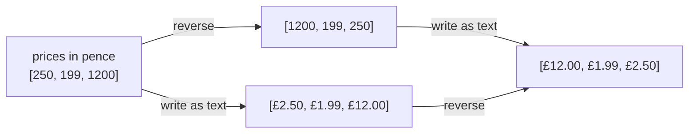

# Natural transformations and Yoneda: an object is known by its arrows

[Syllabus](../../../SYLLABUS.md) → [Computability and complexity](../README.md) → [Category Theory in Outline](../README.md#s07) → Natural transformations and Yoneda

---

## General Overview

A shop keeps its shelf prices as a list of pence: 250, 199, 1200. Two jobs come up all the time. One job reverses the list. The other writes each price as text for the till screen: £2.50, £1.99, £12.00.

Do them in either order and the screen shows the same thing: £12.00, £1.99, £2.50. That is no accident of these prices. Reversal moves items between slots and never reads them, so it works the same way on lists of pence, lists of text, or lists of customers. A programmer writes it once, for every element type at once.

Sorting is different. Sort the pence, then write text, and the screen shows £1.99, £2.50, £12.00. Write text first, then sort, and it shows £1.99, £12.00, £2.50, because text sorts character by character. That is the familiar spreadsheet bug where "12" lands before "2".

A family of functions, one at each type, that agrees with every relabelling of the items is a **natural transformation**. Reversal is one. Sorting is not. Category theory calls the types **objects** and the relabelling functions **arrows**; a square of arrows **commutes** when both routes round it give the same answer.

The second idea goes further. Reversal on lists of three items is fixed by one answer: it turns the list of positions 0, 1, 2 into 2, 1, 0. The **Yoneda lemma** says the same of every natural family built from arrows. A 3-list is an arrow out of the three positions; turned round, the same lemma says an object is pinned down by the arrows into it (Step 6 works this case on a group).

**A natural transformation is one function at every object that commutes with every arrow, and the Yoneda lemma says an object is known, up to a renaming, by the arrows into it.**

**What kind of fact this is:** two definitions (natural transformation, naturality square) and two theorems, both proved on this card in Why it works: reversal is natural, and the Yoneda lemma. The wider claim that every function written for all element types without reading the elements is natural is a theorem stated here with its source, not proved.

### The picture: the naturality square for reversal



Both routes end at the same list. That agreement, for every list and every relabelling, is the definition.

---

## The formula

Notation first, in words. A category $`\mathcal{C}`$ is a collection of objects with arrows between them that compose, and $`\mathrm{Hom}(X, A)`$ is the set of arrows from $`X`$ to $`A`$ ([Categories and functors](01-categories-and-functors.md)). Here the objects are sets and the arrows are functions.

A **functor** sends each object to an object and each arrow to an arrow, keeping identities and composition. The list functor $`\mathrm{List}`$ sends a set $`A`$ to the finite lists of its members, and a function $`f`$ to "apply $`f`$ in every slot", which programmers call map.

The card's main new notation is $`\eta: F \Rightarrow G`$, read "eta is a natural transformation from F to G". It is one arrow $`\eta_A: F(A) \to G(A)`$ for each object $`A`$, called the component at $`A`$, such that every arrow $`f: A \to B`$ makes this square commute:

```math
G(f) \circ \eta_A = \eta_B \circ F(f)
```

**Read it aloud:** apply the family at A and then relabel with f, or relabel first and then apply the family at B; for every f, the two answers agree.

For reversal, $`F`$ and $`G`$ are both $`\mathrm{List}`$, each $`\eta_A`$ reverses a list of members of $`A`$, and $`f`$ is "write as text". The square is the picture above.

Now the Yoneda lemma. The functor $`\mathrm{Hom}(-, A)`$ sends each object $`X`$ to the arrows from $`X`$ into $`A`$. It reverses arrows, so it is a functor out of $`\mathcal{C}^{op}`$, the category with every arrow turned round ([Commutative diagrams](02-commutative-diagrams-and-duality.md)). Two more symbols: $`\mathrm{Nat}(F, G)`$ is the set of natural transformations from $`F`$ to $`G`$, and $`\cong`$ means two sets match one for one. For any functor $`F`$ out of $`\mathcal{C}^{op}`$ into sets:

```math
\mathrm{Nat}\big(\mathrm{Hom}(-, A),\ F\big) \cong F(A), \qquad \eta \mapsto \eta_A(\mathrm{id}_A)
```

**Read it aloud:** a natural family that starts from the arrows into A is the same thing as one member of F(A), namely the family's answer on the identity arrow of A.

Take $`F = \mathrm{Hom}(-, B)`$. A natural match from arrows into A to arrows into B is then one arrow from A to B. So two objects with naturally matching arrows coming in are isomorphic: joined by two arrows that undo each other. That is the title.

Reverse every arrow and the same lemma reads for arrows out of $`A`$: $`\mathrm{Nat}(\mathrm{Hom}(A, -), F) \cong F(A)`$. Lists of length 3 are this case. A list of length 3 over $`X`$ is a function from the positions $`\{0, 1, 2\}`$ into $`X`$, so the 3-lists functor is $`\mathrm{Hom}(3, -)`$, writing 3 for the set of positions.

| Symbol | Plain meaning | In our example | Push it up and the answer… |
| --- | --- | --- | --- |
| $`\mathcal{C}`$, $`\mathcal{C}^{op}`$ | a category: objects, arrows, composition; the same with every arrow reversed | sets and functions | more arrows means more squares to pass |
| $`A`$, $`B`$, $`X`$, $`Y`$ | objects | prices in pence, price text, any set | — |
| $`f`$, $`g`$, $`h`$, $`x`$ | arrows, such as $`f: A \to B`$; in a group, its members | write pence as text | — |
| $`F`$, $`G`$ | functors: objects to objects, arrows to arrows | both are $`\mathrm{List}`$ | — |
| $`\mathrm{List}(A)`$, $`\mathrm{List}(f)`$; $`c_0, \dots, c_{n-1}`$ | finite lists of members of $`A`$; $`f`$ in every slot; a list's items, $`n`$ its length, $`i`$ a slot number | [250, 199, 1200]; map; $`n`$ = 3 | — |
| $`\eta: F \Rightarrow G`$; $`\theta`$, $`\varphi`$ | natural transformations | reversal; a group's 6 natural maps | — |
| $`\eta_A`$ | the component at $`A`$ | reverse a list of pence | — |
| $`\mathrm{Hom}(-, A)`$ | arrows into $`A`$, from each object | arrows into a group's one object | — |
| $`\mathrm{Hom}(3, X)`$ | arrows out of the 3 positions: lists of length 3 | 27 lists over a 3-member set | grows as the set size cubed |
| $`\mathrm{Nat}(F, G)`$ | the set of natural transformations $`F \Rightarrow G`$ | 4 rules on pairs | grows with $`F(A)`$ |
| $`\mathrm{id}_A`$; $`a`$ | the identity arrow on $`A`$; a member of $`F(A)`$, such as $`\eta_A(\mathrm{id}_A)`$ | the generic list [0, 1, 2]; its reversal [2, 1, 0] | — |
| $`\cong`$ | "matches one for one" | 4 natural rules, 4 functions 2 → 2 | — |

### When it holds

- **Every arrow, not one.** A square that commutes for one $`f`$ proves nothing. Sorting passes for "add 1p" and fails for "negate".
- **One rule, applied the same way at every object.** Reverse lists of pence but leave lists of text alone, and the square fails: £12.00, £1.99, £2.50 against £2.50, £1.99, £12.00.
- **Both sides are functors with the same source and target.** Otherwise the two routes round the square do not start and end in the same place.
- **Yoneda needs values in sets and arrows that form sets.** The lemma counts members of $`F(A)`$ and arrows in $`\mathrm{Hom}(X, A)`$. The category of all sets qualifies: its objects form no set, but each $`\mathrm{Hom}(X, A)`$ does.
- **The direction must match.** Arrows into $`A`$ pair with functors out of $`\mathcal{C}^{op}`$; arrows out of $`A`$ pair with ordinary functors.

---

## Why it works

### Step 0: reversal moves slots, relabelling changes contents

Reversal decides where each item goes using only the positions. Relabelling by $`f`$ changes each item and leaves every position alone. The two jobs touch different things, so their order cannot matter.

Sorting decides where each item goes by reading the items. Change the items and the decision can change. "£12.00" and "£2.50" compare differently as text than 1200 and 250 do as numbers.

### Step 1: the proof for reversal

Write a list of length $`n`$ as $`c_0, c_1, \dots, c_{n-1}`$, with slots numbered from 0. Reversal puts $`c_{n-1-i}`$ in slot $`i`$. Map puts $`f(c_i)`$ in slot $`i`$.

- Reverse, then map: slot $`i`$ holds $`f(c_{n-1-i})`$.
- Map, then reverse: slot $`i`$ holds the old slot $`n-1-i`$ of the mapped list, which is $`f(c_{n-1-i})`$.

Every slot agrees, for every list, every length and every $`f`$. The square commutes, and reversal is natural.

The argument works for any rule that picks slots by position alone, such as "keep the first item". For functions written for every element type at once, this is the "theorems for free" result (Wadler, in Sources).

### Step 2: brute force agrees

The check tries every function between sets of 1, 2 and 3 members, and every list up to length 4. That is 4,820 squares. Reversal passes all 4,820. Sorting fails 1,696 of them.

### Step 3: Yoneda, the key move

Here is why a natural family on arrows into $`A`$ is fixed by one value. Any arrow $`x: X \to A`$ is the identity of $`A`$ composed with $`x`$. So relabelling $`\mathrm{id}_A`$ along $`x`$ gives back $`x`$.

Now write the naturality square for the arrow $`x`$ and start it at $`\mathrm{id}_A`$. One route gives $`\eta_X(x)`$. The other gives $`F(x)`$ applied to $`\eta_A(\mathrm{id}_A)`$. Naturality says these agree:

```math
\eta_X(x) = F(x)\big(\eta_A(\mathrm{id}_A)\big)
```

**Read it aloud:** the family's answer on any arrow x is its answer on the identity, relabelled along x.

So the one value $`\eta_A(\mathrm{id}_A)`$ decides every component. In the other direction, any member of $`F(A)`$ defines a family by this formula, and that family is natural. The two directions undo each other.

<details>
<summary>Detailed proof: the Yoneda lemma, both directions</summary>

Let $`F`$ be a functor from $`\mathcal{C}^{op}`$ to sets, and $`A`$ an object. For an arrow $`g: Y \to X`$, the functor $`\mathrm{Hom}(-, A)`$ sends $`x: X \to A`$ to $`x \circ g: Y \to A`$, and $`F(g)`$ goes from $`F(X)`$ to $`F(Y)`$.

**From a family to a member.** Given $`\eta`$, set $`a = \eta_A(\mathrm{id}_A)`$, a member of $`F(A)`$.

**From a member to a family.** Given $`a`$ in $`F(A)`$, set $`\theta_X(x) = F(x)(a)`$ for each $`x: X \to A`$. Naturality of $`\theta`$ asks, for each $`g: Y \to X`$:

$`\displaystyle \theta_Y(x \circ g) = F(x \circ g)(a) = F(g)\big(F(x)(a)\big) = F(g)\big(\theta_X(x)\big).`$

The middle step is $`F`$ keeping composition, with the order turned round because $`F`$ reverses arrows. So $`\theta`$ is natural.

**The round trip from a member.** $`\theta_A(\mathrm{id}_A) = F(\mathrm{id}_A)(a) = a`$, since $`F`$ keeps identities.

**The round trip from a family.** For $`x: X \to A`$, the naturality square of $`\eta`$ for the arrow $`x`$, applied to $`\mathrm{id}_A`$, reads:

$`\displaystyle \eta_X(\mathrm{id}_A \circ x) = F(x)\big(\eta_A(\mathrm{id}_A)\big) = F(x)(a).`$

The left side is $`\eta_X(x)`$. So rebuilding from $`a`$ returns $`\eta`$. The two maps are inverse, which is the lemma.

**The corollary.** Put $`F = \mathrm{Hom}(-, B)`$. Natural families $`\mathrm{Hom}(-, A) \Rightarrow \mathrm{Hom}(-, B)`$ are arrows $`A \to B`$, each acting by composing on the left. A natural match with a natural inverse therefore comes from an arrow $`f: A \to B`$ and an arrow $`g: B \to A`$. Composing the two families composes the arrows, since $`g \circ (f \circ x) = (g \circ f) \circ x`$, and the identity family comes from $`\mathrm{id}_A`$. Families match arrows one for one, so $`g \circ f = \mathrm{id}_A`$, and in the same way $`f \circ g = \mathrm{id}_B`$: the two arrows undo each other, an isomorphism.

</details>

### Step 4: reversal rebuilt from one list

Lists of length 3 are arrows out of the positions $`\{0, 1, 2\}`$, so they use the arrows-out form. The identity arrow on the positions is the generic list [0, 1, 2]. Reversal sends it to [2, 1, 0].

The rebuild formula then says: to reverse any 3-list, read its slots in the order 2, 1, 0. For [a, b, c] that gives [c, b, a]. The check confirms the formula on all 36 lists of length 3 over sets of 1, 2 and 3 members.

Each of the 27 functions from the positions to themselves gives a recipe of this kind, such as "read slots 0, 0, 1". All 27 pass every square, and Yoneda says there are no others.

### Step 5: a blind search finds exactly Yoneda's count

To test "no others" without the lemma, the check uses pairs. A 2-member set has 4 pairs, so a rule on them is one of $`4^4 = 256`$ functions. The search keeps the rules that pass every square between sets of 1 and 2 members.

Four survive. On the generic pair [0, 1] they answer [0, 0], [0, 1], [1, 0] and [1, 1]: copy the first, keep, swap, copy the second. There are exactly 4 functions from 2 positions to 2 positions. The blind count and Yoneda's count agree.

### Step 6: groups alongside

A group is a category with one object, whose arrows are the group's members, composed by the group's operation ([Categories and functors](01-categories-and-functors.md)). Take the 6 rearrangements of 3 slots. Reversal is one of them, [2, 1, 0].

The arrows into the one object are all 6 members, and an arrow $`g`$ acts on them by composing on the right. A natural family is a map $`\varphi`$ from the group to itself with $`\varphi(h g) = \varphi(h) g`$ for all $`h`$ and $`g`$. Of all $`6^6 = 46{,}656`$ maps, exactly 6 pass. Each one is "compose with $`\varphi(\text{identity})`$ on the left", as Step 3 predicts.

This is Cayley's theorem: each member is known by how it rearranges the whole group. The 6 members give 6 different rearrangements.

---

## Worked numbers, by hand

| Step | Arithmetic | Value |
| --- | --- | --- |
| prices as text | 250p, 199p, 1200p, written in pounds | £2.50, £1.99, £12.00 |
| reverse, then write as text | [1200, 199, 250], then text | £12.00, £1.99, £2.50 |
| write as text, then reverse | [£2.50, £1.99, £12.00], then reverse | £12.00, £1.99, £2.50 |
| sort, then write as text | [199, 250, 1200], then text | £1.99, £2.50, £12.00 |
| write as text, then sort | "£1" before "£2", then "£1." before "£12" | £1.99, £12.00, £2.50 |
| the generic 3-list, reversed | [0, 1, 2] read backwards | [2, 1, 0] |
| any 3-list from that one answer | [a, b, c], read slots 2, 1, 0 | [c, b, a] |
| natural rules on pairs | 4 survivors of 256; functions 2 → 2 | **4 = 4** |

Reversal's square commutes on the prices, sorting's does not, and the four natural rules on pairs are exactly the four functions from two positions to two positions.

### What breaks if you drop a piece

| Mistake | Comes out at | What went wrong |
| --- | --- | --- |
| Sorting as the family, f = write as text | £1.99, £2.50, £12.00 against £1.99, £12.00, £2.50 | sorting reads the items, so relabelling changes its choices |
| Sorting, f = negate (refunds) | −199, −250, −1200 against −1200, −250, −199 | negating turns the order round |
| Reverse pence but leave text alone | £12.00, £1.99, £2.50 against £2.50, £1.99, £12.00 | the rule changes from object to object |
| Testing one arrow, f = add 1p | sorting agrees: 200, 251, 1201 both ways | one passing square proves nothing; 1,696 of 4,820 fail |

The code prints all four.

---

## Code, from first principles, and it actually runs

Nothing is imported. The code builds every function between small finite sets and every short list over them, then takes three independent roads. Road one checks every naturality square by brute force. Road two rebuilds reversal from its one answer on the generic list. Road three searches blind through all 256 rules on pairs and counts the natural ones against Yoneda's count, then repeats the idea for a group of 6.

### Python

```python
# Natural transformations and Yoneda -- the check behind the card.  Nothing is
# imported.  A finite set is {0, ..., n-1}; a function between finite sets is a
# tuple t, with t[i] the place member i goes.  Three roads: every naturality
# square checked by brute force; Yoneda's rebuild of a family from one value;
# a blind search over every candidate family, counted against Yoneda's count.

def fmap(f, xs):                       # the list functor on arrows: f slot by slot
    return [f(x) for x in xs]

def rev(xs):                           # reversal: moves slots, never reads a value
    return [xs[len(xs) - 1 - i] for i in range(len(xs))]

def pounds(p):                         # pence to price text: the arrow f
    return "£" + str(p // 100) + "." + str(p // 10 % 10) + str(p % 10)

def show(xs):
    return "[" + ", ".join(str(x) for x in xs) + "]"

def yn(claim):
    return "yes" if claim else "no"

def functions(m, n):                   # every function from an m-set to an n-set
    out = [()]
    for _ in range(m):
        out = [t + (y,) for t in out for y in range(n)]
    return out

def lists(m, k):                       # every list of length k over an m-set
    return [list(t) for t in functions(k, m)]

def squares(eta, sizes, lengths):      # (squares checked, squares that fail)
    checked = failed = 0
    for m in sizes:
        for n in sizes:
            for f in functions(m, n):
                for k in lengths:
                    for xs in lists(m, k):
                        checked += 1
                        down_then_across = fmap(lambda x: f[x], eta(m, xs))
                        across_then_down = eta(n, fmap(lambda x: f[x], xs))
                        failed += down_then_across != across_then_down
    return checked, failed

# 1. The square on one real list: shelf prices in pence, f = write as text.
prices = [250, 199, 1200]
route_a, route_b = fmap(pounds, rev(prices)), rev(fmap(pounds, prices))
print(f"prices in pence {show(prices)}, as text {show(fmap(pounds, prices))}")
print(f"reverse, then write as text: {show(route_a)}")
print(f"write as text, then reverse: {show(route_b)}")
print(f"the square commutes for reversal: {yn(route_a == route_b)}")
sort_a, sort_b = fmap(pounds, sorted(prices)), sorted(fmap(pounds, prices))
print(f"sort, then write as text: {show(sort_a)}")
print(f"write as text, then sort: {show(sort_b)}")
print(f"the square commutes for sorting: {yn(sort_a == sort_b)}")
neg, add1 = (lambda x: -x), (lambda x: x + 1)
print(f"refunds, f = negate: sort then negate {show(fmap(neg, sorted(prices)))}, "
      f"negate then sort {show(sorted(fmap(neg, prices)))}")
print(f"f = add 1p: sort then add {show(fmap(add1, sorted(prices)))}, "
      f"add then sort {show(sorted(fmap(add1, prices)))}: agree {yn(fmap(add1, sorted(prices)) == sorted(fmap(add1, prices)))}")
print(f"mistake, reverse numbers but leave text alone: {show(route_a)} against {show(fmap(pounds, prices))}")

# 2. Brute force: every function between sets of 1 to 3 members, every list up to length 4.
rev_checked, rev_failed = squares(lambda m, xs: rev(xs), (1, 2, 3), range(5))
sort_checked, sort_failed = squares(lambda m, xs: sorted(xs), (1, 2, 3), range(5))
print(f"reversal: {rev_checked} squares checked, {rev_failed} fail")
print(f"sorting: {sort_checked} squares checked, {sort_failed} fail")

# 3. Yoneda's rebuild: reversal on 3-lists is fixed by one value, its answer on [0, 1, 2].
generic = [0, 1, 2]
recipe = rev(generic)
all3 = [xs for m in (1, 2, 3) for xs in lists(m, 3)]
rebuilt = all(rev(xs) == fmap(lambda i: xs[i], recipe) for xs in all3)
print(f"reversal of the generic list {show(generic)} is {show(recipe)}")
print(f"rev(xs) = map (slot of xs) over {show(recipe)}, for all {len(all3)} lists of length 3: {yn(rebuilt)}")
print(f"example: [a, b, c] -> slots {show(recipe)} -> {show(fmap(lambda i: 'abc'[i], recipe))}")
recipes_ok = [p for p in functions(3, 3)
              if squares(lambda m, xs: [xs[p[0]], xs[p[1]], xs[p[2]]], (1, 2, 3), (3,))[1] == 0]
print(f"recipes p: 3 -> 3 tried as families on 3-lists: {len(recipes_ok)} of {3 ** 3} pass every square")

# 4. Blind search on pairs: any rule pairs -> pairs at sets of 1 and 2 members.
P = lists(2, 2)                        # the 4 pairs over {0, 1}
survivors = []
for c in functions(4, 4):              # 256 candidate rules at the 2-member set
    eta = lambda m, xs: xs if m == 1 else P[c[P.index(xs)]]
    if squares(eta, (1, 2), (2,))[1] == 0:
        survivors.append(P[c[1]])      # each survivor's answer on the generic pair [0, 1]
print(f"candidate rules on pairs: {len(functions(4, 4))}; natural: {len(survivors)}")
print(f"their answers on the generic pair [0, 1]: {show(survivors)}")
print(f"Yoneda's count, functions 2 -> 2: {len(functions(2, 2))}")

# 5. Groups alongside: the 6 rearrangements of 3 slots, composed.
G = [p for p in functions(3, 3) if len(set(p)) == 3]
idx = {p: i for i, p in enumerate(G)}
def comp(p, q): return tuple(p[q[i]] for i in range(3))
e = (0, 1, 2)
nat = [phi for phi in functions(6, 6)  # phi(h g) = phi(h) g for every h, g
       if all(G[phi[idx[comp(h, g)]]] == comp(G[phi[idx[h]]], g) for h in G for g in G)]
left = all(G[phi[i]] == comp(G[phi[idx[e]]], G[i]) for phi in nat for i in range(6))
print(f"group of {len(G)} rearrangements; reversal is {list(G[idx[(2, 1, 0)]])}")
print(f"maps G -> G respecting composing on the right: {len(nat)} of {6 ** 6}")
print(f"each is 'compose with phi(identity) on the left': {yn(left)}")
cayley = {tuple(idx[comp(a, h)] for h in G) for a in G}
print(f"Cayley: {len(G)} members give {len(cayley)} different rearrangements of the group")

assert route_a == route_b and sort_a != sort_b                    # one square each way
assert rev_failed == 0 and sort_failed > 0 and rev_checked == 4820  # brute force
assert rebuilt and recipe == [2, 1, 0] and len(recipes_ok) == 3 ** 3  # Yoneda's rebuild
assert survivors == lists(2, 2) and len(survivors) == len(functions(2, 2))   # blind count
assert len(nat) == len(G) and left and len(cayley) == len(G)       # Cayley, one object
print("ALL CHECKS PASS")
```

**Ran 2026-11-19 on macOS, Python 3.14.10, standard library only. All checks passed. Output, pasted from the run:**

```
prices in pence [250, 199, 1200], as text [£2.50, £1.99, £12.00]
reverse, then write as text: [£12.00, £1.99, £2.50]
write as text, then reverse: [£12.00, £1.99, £2.50]
the square commutes for reversal: yes
sort, then write as text: [£1.99, £2.50, £12.00]
write as text, then sort: [£1.99, £12.00, £2.50]
the square commutes for sorting: no
refunds, f = negate: sort then negate [-199, -250, -1200], negate then sort [-1200, -250, -199]
f = add 1p: sort then add [200, 251, 1201], add then sort [200, 251, 1201]: agree yes
mistake, reverse numbers but leave text alone: [£12.00, £1.99, £2.50] against [£2.50, £1.99, £12.00]
reversal: 4820 squares checked, 0 fail
sorting: 4820 squares checked, 1696 fail
reversal of the generic list [0, 1, 2] is [2, 1, 0]
rev(xs) = map (slot of xs) over [2, 1, 0], for all 36 lists of length 3: yes
example: [a, b, c] -> slots [2, 1, 0] -> [c, b, a]
recipes p: 3 -> 3 tried as families on 3-lists: 27 of 27 pass every square
candidate rules on pairs: 256; natural: 4
their answers on the generic pair [0, 1]: [[0, 0], [0, 1], [1, 0], [1, 1]]
Yoneda's count, functions 2 -> 2: 4
group of 6 rearrangements; reversal is [2, 1, 0]
maps G -> G respecting composing on the right: 6 of 46656
each is 'compose with phi(identity) on the left': yes
Cayley: 6 members give 6 different rearrangements of the group
ALL CHECKS PASS
```

### Rust

Same numbers, same labels, built with `rustc --edition 2021 -O`.

```rust
// Natural transformations and Yoneda -- the same check as the Python, in Rust.
// No crates.  A finite set is {0, ..., n-1}; a function between finite sets is
// a vector t, with t[i] the place member i goes.  Three roads: every naturality
// square checked by brute force; Yoneda's rebuild of a family from one value;
// a blind search over every candidate family, counted against Yoneda's count.
use std::fmt::Display;

type L = Vec<usize>;

fn fmap<A, B>(f: impl Fn(&A) -> B, xs: &[A]) -> Vec<B> {   // the list functor on arrows
    xs.iter().map(|x| f(x)).collect()
}

fn rev<T: Clone>(xs: &[T]) -> Vec<T> {                    // moves slots, never reads a value
    (0..xs.len()).map(|i| xs[xs.len() - 1 - i].clone()).collect()
}

fn pounds(p: &i64) -> String {                            // pence to price text: the arrow f
    format!("£{}.{}{}", p / 100, p / 10 % 10, p % 10)
}

fn show<T: Display>(xs: &[T]) -> String {
    format!("[{}]", xs.iter().map(|x| x.to_string()).collect::<Vec<_>>().join(", "))
}

fn yn(claim: bool) -> &'static str { if claim { "yes" } else { "no" } }

fn sorted<T: Ord + Clone>(xs: &[T]) -> Vec<T> { let mut v = xs.to_vec(); v.sort(); v }

fn functions(m: usize, n: usize) -> Vec<L> {             // every function m-set -> n-set
    let mut out: Vec<L> = vec![vec![]];
    for _ in 0..m {
        out = out.iter().flat_map(|t| (0..n).map(move |y| { let mut u = t.clone(); u.push(y); u })).collect();
    }
    out
}

fn lists(m: usize, k: usize) -> Vec<L> { functions(k, m) } // every k-list over an m-set

fn squares(eta: &dyn Fn(usize, &L) -> L, sizes: &[usize], lengths: &[usize]) -> (usize, usize) {
    let (mut checked, mut failed) = (0, 0);
    for &m in sizes {
        for &n in sizes {
            for f in functions(m, n) {
                for &k in lengths {
                    for xs in lists(m, k) {
                        checked += 1;
                        let down_then_across = fmap(|x: &usize| f[*x], &eta(m, &xs));
                        let across_then_down = eta(n, &fmap(|x: &usize| f[*x], &xs));
                        if down_then_across != across_then_down { failed += 1 }
                    }
                }
            }
        }
    }
    (checked, failed)
}

fn comp(p: &L, q: &L) -> L { (0..3).map(|i| p[q[i]]).collect() }

fn pos(set: &[L], x: &L) -> usize { set.iter().position(|y| y == x).unwrap() }

fn main() {
    // 1. The square on one real list: shelf prices in pence, f = write as text.
    let prices: Vec<i64> = vec![250, 199, 1200];
    let (route_a, route_b) = (fmap(pounds, &rev(&prices)), rev(&fmap(pounds, &prices)));
    println!("prices in pence {}, as text {}", show(&prices), show(&fmap(pounds, &prices)));
    println!("reverse, then write as text: {}", show(&route_a));
    println!("write as text, then reverse: {}", show(&route_b));
    println!("the square commutes for reversal: {}", yn(route_a == route_b));
    let (sort_a, sort_b) = (fmap(pounds, &sorted(&prices)), sorted(&fmap(pounds, &prices)));
    println!("sort, then write as text: {}", show(&sort_a));
    println!("write as text, then sort: {}", show(&sort_b));
    println!("the square commutes for sorting: {}", yn(sort_a == sort_b));
    let (neg, add1) = (|x: &i64| -x, |x: &i64| x + 1);
    println!("refunds, f = negate: sort then negate {}, negate then sort {}",
             show(&fmap(neg, &sorted(&prices))), show(&sorted(&fmap(neg, &prices))));
    let (p1, p2) = (fmap(add1, &sorted(&prices)), sorted(&fmap(add1, &prices)));
    println!("f = add 1p: sort then add {}, add then sort {}: agree {}", show(&p1), show(&p2), yn(p1 == p2));
    println!("mistake, reverse numbers but leave text alone: {} against {}",
             show(&route_a), show(&fmap(pounds, &prices)));

    // 2. Brute force: every function between sets of 1 to 3 members, every list up to length 4.
    let up_to_4: Vec<usize> = (0..5).collect();
    let (rev_checked, rev_failed) = squares(&|_m, xs| rev(xs), &[1, 2, 3], &up_to_4);
    let (sort_checked, sort_failed) = squares(&|_m, xs| sorted(xs), &[1, 2, 3], &up_to_4);
    println!("reversal: {} squares checked, {} fail", rev_checked, rev_failed);
    println!("sorting: {} squares checked, {} fail", sort_checked, sort_failed);

    // 3. Yoneda's rebuild: reversal on 3-lists is fixed by one value, its answer on [0, 1, 2].
    let generic: L = vec![0, 1, 2];
    let recipe = rev(&generic);
    let all3: Vec<L> = [1, 2, 3].iter().flat_map(|&m| lists(m, 3)).collect();
    let rebuilt = all3.iter().all(|xs| rev(xs) == fmap(|i: &usize| xs[*i], &recipe));
    println!("reversal of the generic list {} is {}", show(&generic), show(&recipe));
    println!("rev(xs) = map (slot of xs) over {}, for all {} lists of length 3: {}", show(&recipe), all3.len(), yn(rebuilt));
    let abc = ['a', 'b', 'c'];
    println!("example: [a, b, c] -> slots {} -> {}", show(&recipe), show(&fmap(|i: &usize| abc[*i], &recipe)));
    let recipes_ok = functions(3, 3).into_iter()
        .filter(|p| squares(&|_m, xs| vec![xs[p[0]], xs[p[1]], xs[p[2]]], &[1, 2, 3], &[3]).1 == 0).count();
    println!("recipes p: 3 -> 3 tried as families on 3-lists: {} of {} pass every square", recipes_ok, 27);

    // 4. Blind search on pairs: any rule pairs -> pairs at sets of 1 and 2 members.
    let pairs = lists(2, 2);                       // the 4 pairs over {0, 1}
    let mut survivors: Vec<L> = Vec::new();
    for c in functions(4, 4) {                     // 256 candidate rules at the 2-member set
        let eta = |m: usize, xs: &L| if m == 1 { xs.clone() } else { pairs[c[pos(&pairs, xs)]].clone() };
        if squares(&eta, &[1, 2], &[2]).1 == 0 { survivors.push(pairs[c[1]].clone()) }
    }
    let shown: Vec<String> = survivors.iter().map(|s| show(s)).collect();
    println!("candidate rules on pairs: {}; natural: {}", functions(4, 4).len(), survivors.len());
    println!("their answers on the generic pair [0, 1]: {}", show(&shown));
    println!("Yoneda's count, functions 2 -> 2: {}", functions(2, 2).len());

    // 5. Groups alongside: the 6 rearrangements of 3 slots, composed.
    let g: Vec<L> = functions(3, 3).into_iter().filter(|p| p[0] != p[1] && p[0] != p[2] && p[1] != p[2]).collect();
    let e: L = vec![0, 1, 2];
    let nat: Vec<L> = functions(6, 6).into_iter()      // phi(h g) = phi(h) g for every h, g
        .filter(|phi| g.iter().all(|h| g.iter().all(|x| g[phi[pos(&g, &comp(h, x))]] == comp(&g[phi[pos(&g, h)]], x))))
        .collect();
    let left = nat.iter().all(|phi| (0..6).all(|i| g[phi[i]] == comp(&g[phi[pos(&g, &e)]], &g[i])));
    println!("group of {} rearrangements; reversal is {}", g.len(), show(&g[pos(&g, &vec![2, 1, 0])]));
    println!("maps G -> G respecting composing on the right: {} of {}", nat.len(), 6usize.pow(6));
    println!("each is 'compose with phi(identity) on the left': {}", yn(left));
    let mut cayley: Vec<L> = g.iter().map(|a| g.iter().map(|h| pos(&g, &comp(a, h))).collect()).collect();
    cayley.sort();
    cayley.dedup();
    println!("Cayley: {} members give {} different rearrangements of the group", g.len(), cayley.len());

    assert!(route_a == route_b && sort_a != sort_b);                 // one square each way
    assert!(rev_failed == 0 && sort_failed > 0 && rev_checked == 4820); // brute force
    assert!(rebuilt && recipe == vec![2, 1, 0] && recipes_ok == 27);  // Yoneda's rebuild
    assert!(survivors == lists(2, 2) && survivors.len() == functions(2, 2).len()); // blind count
    assert!(nat.len() == g.len() && left && cayley.len() == g.len()); // Cayley, one object
    println!("ALL CHECKS PASS");
}
```

**Ran 2026-11-19 on macOS, rustc 1.98.1, no crates. All checks passed. Output, pasted from the run:**

```
prices in pence [250, 199, 1200], as text [£2.50, £1.99, £12.00]
reverse, then write as text: [£12.00, £1.99, £2.50]
write as text, then reverse: [£12.00, £1.99, £2.50]
the square commutes for reversal: yes
sort, then write as text: [£1.99, £2.50, £12.00]
write as text, then sort: [£1.99, £12.00, £2.50]
the square commutes for sorting: no
refunds, f = negate: sort then negate [-199, -250, -1200], negate then sort [-1200, -250, -199]
f = add 1p: sort then add [200, 251, 1201], add then sort [200, 251, 1201]: agree yes
mistake, reverse numbers but leave text alone: [£12.00, £1.99, £2.50] against [£2.50, £1.99, £12.00]
reversal: 4820 squares checked, 0 fail
sorting: 4820 squares checked, 1696 fail
reversal of the generic list [0, 1, 2] is [2, 1, 0]
rev(xs) = map (slot of xs) over [2, 1, 0], for all 36 lists of length 3: yes
example: [a, b, c] -> slots [2, 1, 0] -> [c, b, a]
recipes p: 3 -> 3 tried as families on 3-lists: 27 of 27 pass every square
candidate rules on pairs: 256; natural: 4
their answers on the generic pair [0, 1]: [[0, 0], [0, 1], [1, 0], [1, 1]]
Yoneda's count, functions 2 -> 2: 4
group of 6 rearrangements; reversal is [2, 1, 0]
maps G -> G respecting composing on the right: 6 of 46656
each is 'compose with phi(identity) on the left': yes
Cayley: 6 members give 6 different rearrangements of the group
ALL CHECKS PASS
```

The two outputs match line for line.

### Lean

Lean proves the Yoneda lemma and its corollary in every category, reversal's naturality at every type, and the card's worked numbers.

- Take any category $`\mathcal{C}`$ whose arrows form sets, an object $`A`$, and a functor $`F`$ from $`\mathcal{C}^{op}`$ into sets. Then natural transformations $`\mathrm{Hom}(-, A) \Rightarrow F`$ match the members of $`F(A)`$ one for one. The match sends $`\eta`$ to $`\eta_A(\mathrm{id}_A)`$. A member $`a`$ goes back to the family $`x \mapsto F(x)(a)`$.
- Take reversal, one function at every type. Then it is a natural transformation $`\mathrm{List} \Rightarrow \mathrm{List}`$: for every $`f`$, reverse then map $`f`$ equals map $`f`$ then reverse.
- Take a natural match from $`\mathrm{Hom}(-, A)`$ to $`\mathrm{Hom}(-, B)`$ with a natural inverse. Then $`A`$ and $`B`$ are isomorphic by some $`f: A \to B`$, and the match sends each $`x`$ to $`f \circ x`$.
- Reversing the prices 250, 199, 1200 gives 1200, 199, 250, and reversal's square commutes for "add 1p" on them.
- Sorting's square fails for "negate": −199, −250, −1200 against −1200, −250, −199. For "add 1p" both routes give 200, 251, 1201.
- The generic list [0, 1, 2] reverses to [2, 1, 0]. Reading slots 2, 1, 0 of the sample list [7, 8, 9] gives its reversal.
- The counts are 27 functions 3 → 3, 4 functions 2 → 2, 256 rules on pairs, 6 group members and 46,656 maps.

The price-text squares, the brute-force counts, the blind search and the group's 6 natural maps are left to the Python and Rust checks.

```lean
-- Natural transformations and Yoneda: list reversal is a natural transformation, a natural family out of the arrows into A is fixed by its answer on the identity arrow, and objects with naturally matching arrows coming in are isomorphic.
import Mathlib.CategoryTheory.Yoneda
import Mathlib.CategoryTheory.Types.Basic
import Mathlib.Data.List.Sort
import Mathlib.Data.Fintype.BigOperators
import Mathlib.Data.Fintype.Perm

open CategoryTheory Opposite

universe u v

/-- The Yoneda lemma. For a category `C` whose arrows between two objects form a set, an
object `A`, and any functor `F` from `Cᵒᵖ` into sets, natural transformations
`Hom(-, A) ⇒ F` match the members of `F(A)` one for one, by `η ↦ η_A(id_A)`; in the other
direction a member `a` gives the family whose answer on an arrow `x : X → A` is `F(x)(a)`. -/
theorem yoneda_lemma {C : Type u} [Category.{v} C] (A : C) (F : Cᵒᵖ ⥤ Type v) :
    ∃ e : (yoneda.obj A ⟶ F) ≃ F.obj (op A),
      (∀ η : yoneda.obj A ⟶ F, e η = η.app (op A) (𝟙 A)) ∧
      (∀ (a : F.obj (op A)) (X : Cᵒᵖ) (x : X.unop ⟶ A), (e.symm a).app X x = F.map x.op a) := by
  exact ⟨yonedaEquiv, fun η => rfl, fun a X x => rfl⟩

/-- Reversal is natural: reversing a list, one function at every type, is a natural
transformation from the list functor to itself, so for every function `f` the square
"reverse, then map `f`" equals "map `f`, then reverse". -/
theorem list_reverse_is_natural :
    ∃ η : ofTypeFunctor List ⟶ ofTypeFunctor List,
      ∀ (α : Type u) (l : List α), η.app α l = l.reverse := by
  refine ⟨{ app := fun α => ↾(List.reverse (α := α)), naturality := ?_ }, fun α l => rfl⟩
  intro α β f
  ext l
  exact (List.map_reverse (f := f.hom) (l := l)).symm

/-- An object is known by the arrows into it: a natural isomorphism between `Hom(-, A)` and
`Hom(-, B)` comes from an isomorphism `A ≅ B`, acting on each arrow `x` into `A` by composing
with it. -/
theorem iso_of_natural_iso_of_arrows_into {C : Type u} [Category.{v} C] {A B : C}
    (e : yoneda.obj A ≅ yoneda.obj B) :
    ∃ i : A ≅ B, ∀ (X : Cᵒᵖ) (x : X.unop ⟶ A), e.hom.app X x = x ≫ i.hom := by
  refine ⟨Yoneda.fullyFaithful.preimageIso e, fun X x => ?_⟩
  have h := e.hom.naturality_apply x.op (𝟙 A)
  change _ = x ≫ e.hom.app (op A) (𝟙 A)
  simpa using h

-- Reversing the shelf prices in pence.
example : ([250, 199, 1200] : List ℕ).reverse = [1200, 199, 250] := by decide
-- Reversal commutes with "add 1p" on the prices.
example : (([250, 199, 1200] : List ℕ).reverse.map (· + 1)) =
    (([250, 199, 1200] : List ℕ).map (· + 1)).reverse := by decide
-- Sorting fails the square for f = negate (refunds).
example : (([250, 199, 1200] : List ℤ).insertionSort (· ≤ ·)).map (fun x => -x) =
    [-199, -250, -1200] := by decide
example : (([250, 199, 1200] : List ℤ).map (fun x => -x)).insertionSort (· ≤ ·) =
    [-1200, -250, -199] := by decide
-- Sorting passes the one square for f = add 1p.
example : (([250, 199, 1200] : List ℕ).insertionSort (· ≤ ·)).map (· + 1) = [200, 251, 1201] := by
  decide
example : (([250, 199, 1200] : List ℕ).map (· + 1)).insertionSort (· ≤ ·) = [200, 251, 1201] := by
  decide
-- The generic 3-list [0, 1, 2], reversed.
example : ([0, 1, 2] : List ℕ).reverse = [2, 1, 0] := by decide
-- Reading slots 2, 1, 0 of a 3-list reverses it.
example : ([2, 1, 0] : List ℕ).map (fun i => ([7, 8, 9] : List ℕ).getD i 0) =
    ([7, 8, 9] : List ℕ).reverse := by decide
-- Yoneda's counts: 27 recipes 3 → 3, 4 functions 2 → 2, 256 candidate rules on pairs.
example : Fintype.card (Fin 3 → Fin 3) = 27 := by simp
example : Fintype.card (Fin 2 → Fin 2) = 4 := by simp
example : Fintype.card (Fin 4 → Fin 4) = 256 := by simp
-- The group of 6 rearrangements of 3 slots, and the 6 ^ 6 maps searched.
example : Fintype.card (Equiv.Perm (Fin 3)) = 6 := by simp [Fintype.card_perm, Nat.factorial]
example : Fintype.card (Fin 6 → Fin 6) = 46656 := by simp

#print axioms yoneda_lemma
#print axioms list_reverse_is_natural
#print axioms iso_of_natural_iso_of_arrows_into
```

**Checked 2026-11-19 on macOS, Lean 4.36.0-rc2, Mathlib v4.36.0-rc2. Every proof is complete and uses only Lean's standard axioms. Output, pasted from the run:**

```
'yoneda_lemma' depends on axioms: [propext, Classical.choice, Quot.sound]
'list_reverse_is_natural' depends on axioms: [propext, Classical.choice, Quot.sound]
'iso_of_natural_iso_of_arrows_into' depends on axioms: [propext, Classical.choice, Quot.sound]
```

> [!TIP]
> **Try changing**
> Guess first, then run the Python.
> - **A rule that only looks at positions.** In part 2, change `rev(xs)` to `xs[:1]`, keeping the first item. Natural or not? It passes all 4,820 squares, since it never reads an item.
> - **Prices that happen to sort alike.** Set `prices` to `[500, 600, 700]`. Every price has the same number of digits, so sorting's square now commutes on this list. The brute force still finds 1,696 failures, and the first assert stops the run.
> - **A smaller category.** In part 4, change `(1, 2)` to `(2,)`, so only the 2-member set remains. More rules survive, or fewer? Still 4: Yoneda holds in any category that contains the object.

---

## The usual mistake

> [!warning]
> **Checking one square and calling the family natural.** Naturality is a promise about every arrow at once. Sorting commutes with "add 1p": both routes give 200, 251, 1201. It fails for "negate", and it fails 1,696 of the 4,820 squares in the check.
>
> - **Judging one function alone.** Naturality belongs to a whole family, one component per object, and to the two functors it connects. Sorting lists of pence is a fine function on its own; set beside sorting at the other types, it fails 1,696 of 4,820 squares.
> - **A different rule at each type.** Reversing pence while leaving text alone gives £12.00, £1.99, £2.50 on one route and £2.50, £1.99, £12.00 on the other.
> - **Reading Yoneda as "an object is its members".** In sets, the arrows from a one-member set into $`A`$ are $`A`$'s members. In groups the same probe fails: the one-member group has exactly one map into any group, so it sees nothing. Yoneda uses the arrows from every object.

---

## Where you meet it in real life

- **Generic code.** A function written once for lists of any element type, such as reverse, take or append, is natural, so it can be moved past any map. Compilers for functional languages use laws of this kind to merge or reorder passes over data.
- **Spreadsheets and databases.** Sorting a column of prices stored as text gives £12.00 before £2.50. Sorting is not natural, so it must run on the original numbers, before formatting.
- **Linear algebra.** The dual of a vector space is the set of linear maps from it to the real numbers, and the double dual is the dual of that. A vector space sits inside its double dual with no choice of basis ([Vector spaces and subspaces](../../03-Algebra/03-Vectors/02-vector-spaces-and-subspaces.md)). That match is natural. The match with the single dual needs a basis and is not. This was the example naturality was invented to name, in 1945.
- **Group theory.** Cayley's theorem, every group as a group of rearrangements of its own members, is the Yoneda lemma for a one-object category.

> **Say it back**
> A natural transformation is one function at every object, such as reversing a list of any type, that gives the same answer whichever way round the square is walked. Reversal is natural because it moves slots and never reads items; sorting reads items, so it fails. The Yoneda lemma says a natural family that starts from arrows is fixed by its answer on one identity arrow. Reversal on 3-lists is just its answer on [0, 1, 2], which is [2, 1, 0]. So an object is known, up to renaming, by the arrows into it.

---

## What this builds on

- [Commutative diagrams](02-commutative-diagrams-and-duality.md): reading a square as an equation between two routes, and the reversed category $`\mathcal{C}^{op}`$ that Yoneda's arrows-into form uses.
- [Vector spaces and subspaces](../../03-Algebra/03-Vectors/02-vector-spaces-and-subspaces.md): the vector spaces whose double dual gave naturality its first job.

## Where this goes next

- [Universal properties](04-universal-properties-limits-and-colimits.md): defining an object by the arrows into or out of it, which Yoneda shows pins the object down to a unique renaming.

Elsewhere on the shelf, [Adjunctions](06-adjunctions.md) are natural matches between two kinds of arrows, and [Monoids and monads](07-monoids-and-monads-for-programmers.md) and [F-algebras](08-f-algebras-and-folds.md) build on natural families of list functions.

This card says what a natural family is and that one value fixes it. It leaves open which objects exist at all with a given pattern of arrows, and when such an object is unique.

---

## Sources

Verified 2026-11-19: every link below resolves to the publisher's page.

- Eilenberg, Samuel, and Saunders Mac Lane. "General Theory of Natural Equivalences." *Transactions of the American Mathematical Society* 58 (1945): 231–294. [doi:10.1090/S0002-9947-1945-0013131-6](https://doi.org/10.1090/S0002-9947-1945-0013131-6). Defines categories, functors and natural transformations, with the double dual as the motivating example.
- Wadler, Philip. "Theorems for Free!" *Proceedings of the Fourth International Conference on Functional Programming Languages and Computer Architecture* (1989): 347–359. [doi:10.1145/99370.99404](https://doi.org/10.1145/99370.99404). Every function written for all element types satisfies a naturality law, with reversal among the examples.
- Mac Lane, Saunders. *Categories for the Working Mathematician*. Graduate Texts in Mathematics 5. 2nd ed. Springer, 1998. [doi:10.1007/978-1-4757-4721-8](https://doi.org/10.1007/978-1-4757-4721-8). The standard reference for natural transformations and the Yoneda lemma.
- Leinster, Tom. *Basic Category Theory*. Cambridge University Press, 2014. [doi:10.1017/CBO9781107360068](https://doi.org/10.1017/CBO9781107360068). A gentle chapter on representable functors and the Yoneda lemma, with its consequences.
