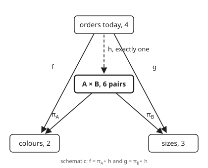

# Universal properties: defined by the one arrow that always exists

[Syllabus](../../../SYLLABUS.md) → [Computability and complexity](../README.md) → [Category Theory in Outline](../README.md#s07) → Universal properties

---

## General Overview

A shirt shop sells 2 colours, red and blue, in 3 sizes, S, M and L. Its stock list has 6 lines, one for each colour-and-size pair. Today 4 orders came in: #1 red M, #2 blue S, #3 red L, #4 blue M.

Each order has a colour and a size: two functions, f to colour and g to size. A third function h sends each order to its stock line, and the line reads back both. So h carries f and g together, and it is the only function that does.

Stock codes 0 to 5 do the same job, as long as each colour-and-size pair gets exactly one code. Code n reads back its colour as n divided by 3, rounded down, and its size as the remainder, with red, blue as 0, 1 and S, M, L as 0, 1, 2: code 4 is blue M. Category theory turns that job into the definition. The **product** of two sets is any set with two read-back functions such that every pair (f, g) passes through it by exactly one arrow (here, a function). That demand is a **universal property**.

So which set is "the" product, the lines or the codes? It does not matter. Of the 720 ways to match the 6 lines with the 6 codes, exactly 1 keeps every colour and size. Any two products match in exactly one such way: they are **unique up to unique isomorphism**.

**A universal property defines an object by its arrows: every candidate meets it by exactly one arrow that keeps the diagram's promises, and that one demand fixes the object up to exactly one matching that keeps the diagram's arrows.**

**What kind of fact this is:** universal property, product, coproduct, limit and colimit are definitions; that any two objects with the same universal property match by exactly one isomorphism that keeps the diagram's arrows (for a product, the projections) is a theorem, proved on this card in Why it works.

### The picture: one arrow through the product

<p align="center"></p>

Schematic. The arrows f and g are given; the dashed arrow h is the one the definition promises, and both routes to the bottom row agree.

---

## The formula

Notation from earlier on this shelf. A **category** is a collection of objects and arrows that compose ([Categories and functors](01-categories-and-functors.md)); here the objects are sets and the arrows are functions. $`\mathrm{Hom}(X, A)`$ is the set of all arrows from $`X`$ to $`A`$.

A **product** of $`A`$ and $`B`$ is an object $`P`$ with two arrows $`\pi_A: P \to A`$ and $`\pi_B: P \to B`$, called **projections**, such that:

```math
\text{for every } f: X \to A \text{ and } g: X \to B \text{ there is exactly one } h: X \to P \text{ with } \pi_A \circ h = f \text{ and } \pi_B \circ h = g
```

**Read it aloud:** whatever object X comes along with an arrow to A and an arrow to B, exactly one arrow runs from X into P that reproduces both after the projections.

In sets the arrow is $`h(x) = (f(x), g(x))`$, written $`\langle f, g \rangle`$: #1 goes to (red, M). [Commutative diagrams](02-commutative-diagrams-and-duality.md) builds this set of pairs, calls its projections fst and snd (here $`\pi_A`$ and $`\pi_B`$), and counts the arrows, with $`\lvert X \rvert`$ for the number of members of a set $`X`$:

```math
\lvert \mathrm{Hom}(X, A \times B) \rvert = \lvert \mathrm{Hom}(X, A) \rvert \times \lvert \mathrm{Hom}(X, B) \rvert, \qquad 6^4 = 1296 = 16 \times 81
```

**Read it aloud:** the ways to send 4 orders to the 6 stock lines are exactly the ways to pick a colour for each, times the ways to pick a size for each.

Turn every arrow round and the product becomes the **coproduct** $`A + B`$, the sum on that card, with **injections** $`\iota_A: A \to A + B`$ and $`\iota_B: B \to A + B`$, that card's inl and inr. Every pair $`p: A \to X`$, $`q: B \to X`$ gives exactly one $`k: A + B \to X`$ with $`k \circ \iota_A = p`$ and $`k \circ \iota_B = q`$. In sets, $`A + B`$ is the tagged union, 5 points here.

| Symbol | Plain meaning | In our example | Push it up and the answer… |
| --- | --- | --- | --- |
| $`A`$, $`B`$ | the two objects being combined | colours (2) and sizes (3) | more pairs: $`2 \times 3`$ grows |
| $`X`$ | a test object: any candidate that comes along | the 4 orders | more arrows to pass through |
| $`P`$, $`P'`$ | two objects that both claim to be the product | stock lines, stock codes 0 to 5 | — |
| $`\pi_A`$, $`\pi_B`$; $`\pi'_A`$, $`\pi'_B`$ | projections of $`P`$, and of $`P'`$: read the first or second part back | colour and size of a line; of code n, n divided by 3 rounded down, and the remainder | — |
| $`f`$, $`g`$ | the given arrows from $`X`$ | colour and size of each order | — |
| $`h = \langle f, g \rangle`$ | the one arrow the property promises | #1 → (red, M) | — |
| $`v \circ u`$, $`\mathrm{id}_P`$ | do $`u`$ then $`v`$; the arrow that changes nothing | — | — |
| $`\mathrm{Hom}(X, Y)`$, $`\lvert X \rvert`$ | all arrows from $`X`$ to $`Y`$; the size of a set | 1,296 arrows from orders to lines | multiplies |
| $`A + B`$, $`\iota_A`$, $`\iota_B`$ | the coproduct and its injections | 5 tagged points | sizes add, $`2 + 3`$ |
| $`p`$, $`q`$, $`k`$ | arrows out of $`A`$, $`B`$ and $`A + B`$ | yes/no answers per colour and per size | — |
| $`u`$, $`v`$ | the matching arrows between two products | line (blue, M) ↔ code 4 | — |
| $`1`$, $`0`$; $`\mathbb{Z}_n`$; $`*`$; $`a`$, $`b`$ | one-point set; empty set; the numbers 0 to n − 1 added with wrap-round at n; free product (coproduct of groups); elements of order 2 and 3 | $`\mathbb{Z}_6`$ beside $`\mathbb{Z}_2 \times \mathbb{Z}_3`$ | — |

### When it holds

- **Exactly one, not at least one.** Add a spare bit to every stock line: each pair (f, g) then passes through the 12 lines by 16 arrows.
- **At least one, not at most one.** Drop the line blue L: 671 of the 1,296 pairs then pass through the 5 lines by no arrow.
- **The projections are part of the product.** Without them, 720 bijections match lines with codes; with them, 1 does.
- **The category decides the answer.** Among groups, the coproduct of $`\mathbb{Z}_2`$ and $`\mathbb{Z}_3`$ is no 5-point union but an infinite group (Step 5).
- **It need not exist.** Among the non-empty subsets of {mushroom, olive, chilli}, {mushroom} and {olive} have no product: the only set inside both is empty.

---

## Why it works

### Step 0: an object is known by the arrows into it

The property says the arrows from any $`X`$ into $`P`$ look exactly like pairs of arrows, one to $`A`$ and one to $`B`$. Two objects whose incoming arrows look the same everywhere cannot be told apart by arrows. That is the idea of [Natural transformations and Yoneda](03-natural-transformations-and-yoneda.md); this card proves the case by hand.

### Step 1: the set of pairs has the property

[Commutative diagrams](02-commutative-diagrams-and-duality.md) proves it: $`h(x) = (f(x), g(x))`$ works, and no other does, since a pair is fixed by its two slots ([Ordered pairs and the Cartesian product](../../01-Foundations/07-Sets/05-ordered-pairs-and-cartesian-product.md)). The code checks all 1,296 arrows from the 4 orders to the 6 lines: each of the 16 × 81 pairs (f, g) is met by exactly one.

### Step 2: the only arrow from a product to itself that keeps the projections is the identity

Apply the property with $`X = P`$, $`f = \pi_A`$ and $`g = \pi_B`$. The identity $`\mathrm{id}_P`$ keeps both projections. The property allows exactly one such arrow, so it is the identity. In the code, of the 46,656 functions from the 6 lines to themselves, exactly 1 keeps colour and size.

### Step 3: two products match by exactly one isomorphism

An **isomorphism** is an arrow with an arrow back, the two composing to the identity both ways; in sets it is a bijection.

1. $`P'`$ is a product, so the pair $`(\pi_A, \pi_B)`$ from $`P`$ passes through it by exactly one arrow $`u: P \to P'`$.
2. $`P`$ is a product, so $`P'`$'s projections pass through $`P`$ by exactly one arrow $`v: P' \to P`$.
3. $`v \circ u`$ runs from $`P`$ to itself and keeps both projections. By Step 2 it is $`\mathrm{id}_P`$. In the same way $`u \circ v = \mathrm{id}_{P'}`$.
4. So $`u`$ is an isomorphism, and it is the only arrow that keeps the projections.

For the shop, $`u`$ sends (colour, size) to 3 × colour + size, with red, blue as 0, 1 and S, M, L as 0, 1, 2. Of the 46,656 functions from lines to codes, 720 are bijections and exactly 1 keeps both projections: (blue, M) goes to 4.

<details>
<summary>Detailed proof: the argument in any category</summary>

Let $`(P, \pi_A, \pi_B)`$ and $`(P', \pi'_A, \pi'_B)`$ both be products of $`A`$ and $`B`$. The property of $`P'`$ gives one $`u: P \to P'`$ with these two equations.

$`\displaystyle \pi'_A \circ u = \pi_A, \qquad \pi'_B \circ u = \pi_B`$

The property of $`P`$ gives one $`v: P' \to P`$ with $`\pi_A \circ v = \pi'_A`$ and $`\pi_B \circ v = \pi'_B`$. Composing, $`\pi_A \circ (v \circ u) = \pi'_A \circ u = \pi_A`$, and the same for $`B`$.

Both $`v \circ u`$ and $`\mathrm{id}_P`$ satisfy the equations for the pair $`(\pi_A, \pi_B)`$ into $`P`$. The property allows one arrow only, so $`v \circ u = \mathrm{id}_P`$. Swapping the roles gives $`u \circ v = \mathrm{id}_{P'}`$.

Any other isomorphism that keeps the projections satisfies the equations of $`u`$, so it is $`u`$. Nothing in the proof used sets, only composition and the word "exactly one", so it holds in every category and for every universal property.

</details>

### Step 4: turn the arrows round for the coproduct

Reverse every arrow and Steps 2 and 3 run unchanged for the coproduct; this mirror move is **duality** ([Commutative diagrams](02-commutative-diagrams-and-duality.md)). With $`X`$ = {yes, no}, the 5 tagged points have $`2^5 = 32`$ arrows out, against $`4 \times 8 = 32`$ pairs $`(p, q)`$, each met once.

### Step 5: limits and colimits gather every case

A **diagram** is a small picture of objects and arrows inside a category. A **cone** over it is an object with an arrow to each object of the diagram that agrees with the diagram's own arrows. A **limit** is a cone that every cone passes through by exactly one arrow. Reverse the arrows for a **cocone** and a **colimit**.

| Diagram | Limit | in sets | Colimit | in sets |
| --- | --- | --- | --- | --- |
| nothing at all | terminal object $`1`$ | one point | initial object $`0`$ | empty set |
| two objects $`A`$, $`B`$ | product $`A \times B`$ | pairs | coproduct $`A + B`$ | tagged union |
| two parallel arrows from $`A`$ to $`B`$ | equaliser | points of $`A`$ where the two agree | coequaliser | $`B`$ with the two images of each point glued |
| $`A \to C \leftarrow B`$ | pullback | matching pairs | pushout, from $`A \leftarrow C \to B`$ | glued union |

The last row is [Pullbacks and pushouts](05-pullbacks-pushouts-and-gluing.md). In the top row, the 4 orders have exactly 1 arrow to a one-point set, and the empty set has exactly 1 arrow, the empty function, to the 3 sizes. Step 3's proof works for every row, so every limit and colimit is unique up to unique isomorphism.

The same definition gives other answers in other categories:

- **Subsets of {mushroom, olive, chilli}**, from [Subsets and the power set](../../01-Foundations/07-Sets/02-subsets-and-power-set.md), with an arrow from one subset to another when the first sits inside the second. The product of two subsets is the largest subset inside both, their intersection; the coproduct is their union. A search over all 64 pairs agrees every time.
- **Groups**, with homomorphisms (maps that respect the operation) as arrows. The product of $`\mathbb{Z}_2`$ and $`\mathbb{Z}_3`$ is pairs, added slot by slot: from $`\mathbb{Z}_6`$ there are 2 homomorphisms to $`\mathbb{Z}_2`$, 3 to $`\mathbb{Z}_3`$ and 6 = 2 × 3 to the product. The coproduct is the free product $`\mathbb{Z}_2 * \mathbb{Z}_3`$: words that alternate non-zero elements of the two groups, which grow without end.

<details>
<summary>Counting the free product two ways</summary>

A word alternates $`a`$, the non-zero element of $`\mathbb{Z}_2`$, with $`b`$ or $`b^2`$, the non-zero elements of $`\mathbb{Z}_3`$. Each slot of the second kind has 2 choices, so the words of length 0 to 4 number 1, 3, 4, 6 and 8: running totals 1, 4, 8, 14 and 22.

The second road multiplies out every word of up to 4 letters in these two matrices, a matrix and its negative counted as one. It finds 1, 4, 8, 14 and 22 distinct elements.

$`\displaystyle a = \begin{pmatrix} 0 & -1 \\ 1 & 0 \end{pmatrix}, \qquad b = \begin{pmatrix} 0 & -1 \\ 1 & 1 \end{pmatrix}`$

That different alternating words always give different elements is the normal form theorem for free products, stated here without proof; Mac Lane in Sources builds free products as coproducts.

</details>

---

## Worked numbers, by hand

| Step | Arithmetic | Value |
| --- | --- | --- |
| stock lines | 2 colours × 3 sizes | 6 |
| arrows from 4 orders to colours, to sizes | $`2^4`$, $`3^4`$ | 16, 81 |
| pairs (f, g) | 16 × 81 | 1,296 |
| arrows from orders to lines | $`6^4`$ | 1,296 |
| today's h | #1 → (red, M), #2 → (blue, S), #3 → (red, L), #4 → (blue, M) | one arrow |
| pairs met by exactly one h | every pair, by search | **1,296 of 1,296** |
| functions from lines to codes | $`6^6`$ | 46,656 |
| of them bijections | 6 × 5 × 4 × 3 × 2 × 1 | 720 |
| bijections that keep colour and size | (c, s) → 3c + s | **1** |
| coproduct, arrows to yes/no | $`2^5`$ against $`2^2 \times 2^3`$ | 32 = 32 |

The definition never named the pairs, yet it pins them down: any other product, such as the codes, is the pairs relabelled in exactly one way.

### What breaks if you drop a piece

| Mistake | Comes out at | What went wrong |
| --- | --- | --- |
| A spare bit on every line, 12 lines | 16 arrows h for each pair | existence holds, uniqueness fails |
| Line blue L left out, 5 lines | 671 of 1,296 pairs met by no arrow | uniqueness holds, existence fails |
| Projections ignored | 720 bijections between lines and codes | only 1 keeps colour and size |
| The 6 lines used as the coproduct | 64 arrows to yes/no, not 32 | arrows out of a product do not split into pairs |
| The 5-point union taken as the coproduct of groups | 5 points, against 22 elements by word length 4 | the free product keeps growing |

The code prints all five.

---

## Code, from first principles, and it actually runs

Nothing is imported. Each claim is checked by listing every function between small sets and counting, against a second road: a closed formula (16 × 81, $`2^5`$, 3c + s), a separate filter, or a separate model. Uniqueness is checked twice: only the identity keeps the projections, and exactly one bijection between lines and codes does. The free product is counted by words and by matrices.

### Python

```python
# Universal properties -- the check behind the card.  Nothing is imported.
# A shirt shop: 2 colours, 3 sizes, 4 orders today.  The product of colours and
# sizes is fixed by its two projections.  Every claim is a count over every
# function, set against a count found another way.
COLOURS, SIZES, ORDERS = ["red", "blue"], ["S", "M", "L"], ["#1", "#2", "#3", "#4"]
F = ["red", "blue", "red", "blue"]               # f: the colour of each order
G = ["M", "S", "L", "M"]                         # g: the size of each order
PROD = [(c, s) for c in COLOURS for s in SIZES]  # the 6 pairs, A x B

def maps(dom, cod):                  # every function dom -> cod, as a tuple of images
    out = [()]
    for _ in dom:
        out = [m + (y,) for m in out for y in cod]
    return out

def tally(points, pa, pb, dom):      # for each h: dom -> points, record (pa o h, pb o h)
    seen = {}
    for h in maps(dom, points):
        key = (tuple(pa(p) for p in h), tuple(pb(p) for p in h))
        seen[key] = seen.get(key, 0) + 1
    return seen

def counts(points, pa, pb):          # how many h fit each of the 16 x 81 pairs (f, g)
    seen = tally(points, pa, pb, ORDERS)
    return [seen.get((f, g), 0) for f in maps(ORDERS, COLOURS) for g in maps(ORDERS, SIZES)]

first, second = (lambda p: p[0]), (lambda p: p[1])
yn = lambda claim: "yes" if claim else "no"
pairs = len(maps(ORDERS, COLOURS)) * len(maps(ORDERS, SIZES))
prod_counts = counts(PROD, first, second)
h = tuple((F[i], G[i]) for i in range(len(ORDERS)))   # the formula: h(x) = (f(x), g(x))
print(f"colours {len(COLOURS)}, sizes {len(SIZES)}, pairs in A x B {len(PROD)}, orders {len(ORDERS)}")
print(f"maps orders -> colours {len(maps(ORDERS, COLOURS))}, -> sizes {len(maps(ORDERS, SIZES))}, "
      f"pairs (f, g) {pairs}; maps orders -> A x B {len(maps(ORDERS, PROD))}")
print(f"pairs (f, g) met by exactly one h: {prod_counts.count(1)} of {pairs}")
print("today's h:", ", ".join(f"{o} -> {c} {s}" for o, (c, s) in zip(ORDERS, h)))
print(f"maps orders -> one-point set: {len(maps(ORDERS, ['*']))}; maps empty set -> sizes: {len(maps([], SIZES))}")

BIG = [(c, s, b) for c in COLOURS for s in SIZES for b in (0, 1)]   # an extra bit
SMALL = [p for p in PROD if p != ("blue", "L")]                     # blue L missing
big_counts, small_counts = counts(BIG, first, second), counts(SMALL, first, second)
print(f"mistake, 12-point candidate with a spare bit: {big_counts.count(16)} pairs met by 16 maps each")
print(f"mistake, 5-point candidate missing blue L: {small_counts.count(0)} pairs met by no map; "
      f"by subtraction {pairs} - 5^4 = {pairs - 5 ** 4}")

CODES = list(range(6))                           # a second product: stock codes 0 to 5
colour_of, size_of = (lambda n: COLOURS[n // 3]), (lambda n: SIZES[n % 3])
code_counts = counts(CODES, colour_of, size_of)
fits = [u for u in maps(PROD, CODES)
        if all(colour_of(u[i]) == c and size_of(u[i]) == s for i, (c, s) in enumerate(PROD))]
bij = [u for u in maps(PROD, CODES) if len(set(u)) == 6]
ends = [e for e in maps(PROD, PROD) if all(e[i] == p for i, p in enumerate(PROD))]
ends_fit = [e for e in maps(PROD, PROD)
            if all(e[i][0] == p[0] and e[i][1] == p[1] for i, p in enumerate(PROD))]
formula_u = tuple(3 * COLOURS.index(c) + SIZES.index(s) for c, s in PROD)
v = [(colour_of(n), size_of(n)) for n in CODES]  # back again: v(n) = (colour of n, size of n)
u_after_v = [fits[0][PROD.index(p)] for p in v]  # code -> its pair -> the code u gives that pair
print(f"stock codes as a product too: {code_counts.count(1)} of {pairs} pairs met once")
print(f"maps A x B -> codes {len(maps(PROD, CODES))}, of them bijections {len(bij)}, "
      f"respecting both projections {len(fits)}")
print("the one that fits:", ", ".join(f"{c} {s} -> {n}" for (c, s), n in zip(PROD, fits[0])))
print(f"maps A x B -> A x B {len(maps(PROD, PROD))}, respecting both projections {len(ends_fit)}")
print(f"codes -> pairs -> codes returns every code: {yn(u_after_v == CODES)}")

TAGGED = [("colour", c) for c in COLOURS] + [("size", s) for s in SIZES]   # A + B
Y = ["yes", "no"]
co = {}
for k in maps(TAGGED, Y):            # each k: A + B -> Y gives (k on colours, k on sizes)
    key = (k[:len(COLOURS)], k[len(COLOURS):])
    co[key] = co.get(key, 0) + 1
co_pairs = len(maps(COLOURS, Y)) * len(maps(SIZES, Y))
print(f"A + B has {len(TAGGED)} points; maps A + B -> yes/no {len(maps(TAGGED, Y))}, "
      f"pairs (p, q) {co_pairs}, met exactly once {list(co.values()).count(1)}")
print(f"mistake, A x B used as the coproduct: maps A x B -> yes/no {len(maps(PROD, Y))}, not {co_pairs}")

TOPS = ["mushroom", "olive", "chilli"]           # the power set, ordered by inclusion
SUBS = [frozenset(t for i, t in enumerate(TOPS) if bits >> i & 1) for bits in range(8)]
def best(U, V, below):               # the bound of U and V that every other bound passes through
    cands = [W for W in SUBS if (W <= U and W <= V if below else U <= W and V <= W)]
    return [W for W in cands if all((X <= W) if below else (W <= X) for X in cands)]
meets = sum(best(U, V, True) == [U & V] for U in SUBS for V in SUBS)
joins = sum(best(U, V, False) == [U | V] for U in SUBS for V in SUBS)
print(f"subsets of 3 toppings {len(SUBS)}; product = intersection in {meets} of 64 pairs, "
      f"coproduct = union in {joins} of 64")

Z6, Z2, Z3 = range(6), range(2), range(3)        # groups alongside: homomorphisms out of Z6
def homs(cod, add):
    return [m for m in maps(Z6, cod) if all(m[(x + y) % 6] == add(m[x], m[y]) for x in Z6 for y in Z6)]
Z23 = [(a, b) for a in Z2 for b in Z3]
h2, h3 = homs(Z2, lambda a, b: (a + b) % 2), homs(Z3, lambda a, b: (a + b) % 3)
h23 = homs(Z23, lambda p, q: ((p[0] + q[0]) % 2, (p[1] + q[1]) % 3))
print(f"homomorphisms Z6 -> Z2 {len(h2)}, Z6 -> Z3 {len(h3)}, Z6 -> Z2 x Z3 {len(h23)}")

def mul(p, q):                       # 2 x 2 integer matrices, written (a, b, c, d)
    return (p[0] * q[0] + p[1] * q[2], p[0] * q[1] + p[1] * q[3],
            p[2] * q[0] + p[3] * q[2], p[2] * q[1] + p[3] * q[3])
def sign(p):                         # a matrix and its negative count as one element
    return p if next(x for x in p if x != 0) > 0 else tuple(-x for x in p)
A2, B3 = (0, -1, 1, 0), (0, -1, 1, 1)            # orders 2 and 3, once signs are ignored
gens, level, seen, by_matrix, by_words = [A2, B3, mul(B3, B3)], {(1, 0, 0, 1)}, {(1, 0, 0, 1)}, [1], [1]
for k in range(1, 5):
    level = {sign(mul(p, g)) for p in level for g in gens} - seen
    seen |= level
    by_matrix.append(len(seen))
    by_words.append(by_words[-1] + 2 ** (k // 2) + 2 ** ((k + 1) // 2))
print(f"Z2 * Z3, elements of word length up to 0..4: by matrices {by_matrix}, by counting words {by_words}")
print("figure, nodes: orders (210,50) | A x B (210,170) | colours (70,290) | sizes (350,290)")

assert prod_counts.count(1) == pairs == 2 ** 4 * 3 ** 4 == len(maps(ORDERS, PROD))   # existence, uniqueness
assert [m for m in maps(ORDERS, PROD) if [p[0] for p in m] == F and [p[1] for p in m] == G] == [h]
assert big_counts.count(16) == pairs and small_counts.count(0) == pairs - 5 ** 4
assert len(fits) == 1 and fits[0] == formula_u and len(bij) == 720 and ends_fit == ends
assert code_counts.count(1) == pairs and u_after_v == CODES          # the codes are a product too
assert list(co.values()).count(1) == co_pairs == 2 ** 5 and len(maps(PROD, Y)) == 64
assert meets == joins == 64 and (len(h2), len(h3), len(h23)) == (2, 3, 6)
assert by_matrix == by_words == [1, 4, 8, 14, 22]
print("ALL CHECKS PASS")
```

**Ran 2026-11-19 on macOS, Python 3.14.10, standard library only. All checks passed. Output, pasted from the run:**

```
colours 2, sizes 3, pairs in A x B 6, orders 4
maps orders -> colours 16, -> sizes 81, pairs (f, g) 1296; maps orders -> A x B 1296
pairs (f, g) met by exactly one h: 1296 of 1296
today's h: #1 -> red M, #2 -> blue S, #3 -> red L, #4 -> blue M
maps orders -> one-point set: 1; maps empty set -> sizes: 1
mistake, 12-point candidate with a spare bit: 1296 pairs met by 16 maps each
mistake, 5-point candidate missing blue L: 671 pairs met by no map; by subtraction 1296 - 5^4 = 671
stock codes as a product too: 1296 of 1296 pairs met once
maps A x B -> codes 46656, of them bijections 720, respecting both projections 1
the one that fits: red S -> 0, red M -> 1, red L -> 2, blue S -> 3, blue M -> 4, blue L -> 5
maps A x B -> A x B 46656, respecting both projections 1
codes -> pairs -> codes returns every code: yes
A + B has 5 points; maps A + B -> yes/no 32, pairs (p, q) 32, met exactly once 32
mistake, A x B used as the coproduct: maps A x B -> yes/no 64, not 32
subsets of 3 toppings 8; product = intersection in 64 of 64 pairs, coproduct = union in 64 of 64
homomorphisms Z6 -> Z2 2, Z6 -> Z3 3, Z6 -> Z2 x Z3 6
Z2 * Z3, elements of word length up to 0..4: by matrices [1, 4, 8, 14, 22], by counting words [1, 4, 8, 14, 22]
figure, nodes: orders (210,50) | A x B (210,170) | colours (70,290) | sizes (350,290)
ALL CHECKS PASS
```

### Rust

Same numbers, same labels, built with `rustc --edition 2021 -O`. Points are numbered, so the pair (colour c, size s) is 3c + s.

```rust
// Universal properties -- the same check as the Python, in Rust.  No crates.
// A shirt shop: 2 colours, 3 sizes, 4 orders today.  Points are numbered: the
// pair (colour c, size s) is 3c + s.  Every claim is a count over every
// function, set against a count found another way.
use std::collections::{HashMap, HashSet};
const COLOURS: [&str; 2] = ["red", "blue"];
const SIZES: [&str; 3] = ["S", "M", "L"];
const ORDERS: [&str; 4] = ["#1", "#2", "#3", "#4"];
type M = (i64, i64, i64, i64);

fn maps(dom: usize, cod: usize) -> Vec<Vec<usize>> {   // every function, as a list of images
    let mut out: Vec<Vec<usize>> = vec![vec![]];
    for _ in 0..dom {
        out = out.iter().flat_map(|m| (0..cod).map(move |y| { let mut n = m.clone(); n.push(y); n })).collect();
    }
    out
}

// how many h: orders -> points fit each pair (f, g), for points read by pa and pb
fn counts(points: usize, pa: &dyn Fn(usize) -> usize, pb: &dyn Fn(usize) -> usize) -> Vec<usize> {
    let mut seen: HashMap<(Vec<usize>, Vec<usize>), usize> = HashMap::new();
    for h in maps(4, points) {
        let key = (h.iter().map(|&p| pa(p)).collect(), h.iter().map(|&p| pb(p)).collect());
        *seen.entry(key).or_insert(0) += 1;
    }
    let mut out = vec![];
    for f in maps(4, 2) { for g in maps(4, 3) { out.push(*seen.get(&(f.clone(), g)).unwrap_or(&0)) } }
    out
}

fn n_of(v: &[usize], x: usize) -> usize { v.iter().filter(|&&c| c == x).count() }
fn yn(claim: bool) -> &'static str { if claim { "yes" } else { "no" } }
fn name(i: usize) -> String { format!("{} {}", COLOURS[i / 3], SIZES[i % 3]) }
fn mul(p: M, q: M) -> M {                               // 2 x 2 integer matrices, (a, b, c, d)
    (p.0 * q.0 + p.1 * q.2, p.0 * q.1 + p.1 * q.3, p.2 * q.0 + p.3 * q.2, p.2 * q.1 + p.3 * q.3)
}
fn sign(p: M) -> M {                                    // a matrix and its negative count as one
    let first = [p.0, p.1, p.2, p.3].into_iter().find(|&x| x != 0).unwrap();
    if first > 0 { p } else { (-p.0, -p.1, -p.2, -p.3) }
}
fn best(u: usize, v: usize, below: bool) -> Vec<usize> { // the bound every other bound passes through
    let sub = |a: usize, b: usize| a & !b == 0;
    let cands: Vec<usize> = (0..8).filter(|&w| if below { sub(w, u) && sub(w, v) } else { sub(u, w) && sub(v, w) }).collect();
    cands.iter().copied().filter(|&w| cands.iter().all(|&x| if below { sub(x, w) } else { sub(w, x) })).collect()
}
fn homs(cod: usize, add: &dyn Fn(usize, usize) -> usize) -> usize {
    maps(6, cod).iter().filter(|m| (0..6).all(|x| (0..6).all(|y| m[(x + y) % 6] == add(m[x], m[y])))).count()
}

fn main() {
    let (f, g): (Vec<usize>, Vec<usize>) = (vec![0, 1, 0, 1], vec![1, 0, 2, 1]);   // colour, size of each order
    let (first, second) = (|p: usize| p / 3, |p: usize| p % 3);
    let pairs = maps(4, 2).len() * maps(4, 3).len();
    let prod_counts = counts(6, &first, &second);
    let h: Vec<usize> = (0..4).map(|i| 3 * f[i] + g[i]).collect();           // h(x) = (f(x), g(x))
    println!("colours {}, sizes {}, pairs in A x B {}, orders {}", COLOURS.len(), SIZES.len(), COLOURS.len() * SIZES.len(), ORDERS.len());
    println!("maps orders -> colours {}, -> sizes {}, pairs (f, g) {}; maps orders -> A x B {}",
             maps(4, 2).len(), maps(4, 3).len(), pairs, maps(4, 6).len());
    println!("pairs (f, g) met by exactly one h: {} of {}", n_of(&prod_counts, 1), pairs);
    let today: Vec<String> = (0..4).map(|i| format!("{} -> {}", ORDERS[i], name(h[i]))).collect();
    println!("today's h: {}", today.join(", "));
    println!("maps orders -> one-point set: {}; maps empty set -> sizes: {}", maps(4, 1).len(), maps(0, 3).len());
    let big_counts = counts(12, &|p| p / 6, &|p| (p / 2) % 3);                  // a spare bit
    let small_counts = counts(5, &first, &second);                              // blue L missing
    println!("mistake, 12-point candidate with a spare bit: {} pairs met by 16 maps each", n_of(&big_counts, 16));
    println!("mistake, 5-point candidate missing blue L: {} pairs met by no map; by subtraction {} - 5^4 = {}",
             n_of(&small_counts, 0), pairs, pairs - 625);
    let (colour_of, size_of) = (|n: usize| n / 3, |n: usize| n % 3);             // stock codes 0 to 5
    let code_counts = counts(6, &colour_of, &size_of);
    let all66 = maps(6, 6);
    let fits: Vec<&Vec<usize>> = all66.iter().filter(|u| (0..6).all(|i| colour_of(u[i]) == i / 3 && size_of(u[i]) == i % 3)).collect();
    let bij = all66.iter().filter(|u| u.iter().collect::<HashSet<_>>().len() == 6).count();
    let ends: Vec<&Vec<usize>> = all66.iter().filter(|e| (0..6).all(|i| e[i] == i)).collect();
    let ends_fit: Vec<&Vec<usize>> = all66.iter().filter(|e| (0..6).all(|i| e[i] / 3 == i / 3 && e[i] % 3 == i % 3)).collect();
    let formula_u: Vec<usize> = (0..6).map(|i| 3 * (i / 3) + i % 3).collect();
    let v: Vec<usize> = (0..6).map(|n| 3 * colour_of(n) + size_of(n)).collect(); // back again: code n -> its pair
    let u_after_v: Vec<usize> = v.iter().map(|&p| fits[0][p]).collect();          // then the code u gives that pair
    let every_code: Vec<usize> = (0..6).collect();
    println!("stock codes as a product too: {} of {} pairs met once", n_of(&code_counts, 1), pairs);
    println!("maps A x B -> codes {}, of them bijections {}, respecting both projections {}", all66.len(), bij, fits.len());
    let fit: Vec<String> = (0..6).map(|i| format!("{} -> {}", name(i), fits[0][i])).collect();
    println!("the one that fits: {}", fit.join(", "));
    println!("maps A x B -> A x B {}, respecting both projections {}", all66.len(), ends_fit.len());
    println!("codes -> pairs -> codes returns every code: {}", yn(u_after_v == every_code));
    let mut co: HashMap<(Vec<usize>, Vec<usize>), usize> = HashMap::new();
    for k in maps(5, 2) { *co.entry((k[..2].to_vec(), k[2..].to_vec())).or_insert(0) += 1 }
    let co_pairs = maps(2, 2).len() * maps(3, 2).len();
    let co_once = co.values().filter(|&&c| c == 1).count();
    println!("A + B has 5 points; maps A + B -> yes/no {}, pairs (p, q) {}, met exactly once {}", maps(5, 2).len(), co_pairs, co_once);
    println!("mistake, A x B used as the coproduct: maps A x B -> yes/no {}, not {}", maps(6, 2).len(), co_pairs);
    let meets = (0..8).flat_map(|u| (0..8).map(move |v| (u, v))).filter(|&(u, v)| best(u, v, true) == vec![u & v]).count();
    let joins = (0..8).flat_map(|u| (0..8).map(move |v| (u, v))).filter(|&(u, v)| best(u, v, false) == vec![u | v]).count();
    println!("subsets of 3 toppings 8; product = intersection in {} of 64 pairs, coproduct = union in {} of 64", meets, joins);
    let (h2, h3) = (homs(2, &|a, b| (a + b) % 2), homs(3, &|a, b| (a + b) % 3));
    let h23 = homs(6, &|p, q| ((p / 3 + q / 3) % 2) * 3 + (p % 3 + q % 3) % 3);
    println!("homomorphisms Z6 -> Z2 {}, Z6 -> Z3 {}, Z6 -> Z2 x Z3 {}", h2, h3, h23);
    let (a2, b3): (M, M) = ((0, -1, 1, 0), (0, -1, 1, 1));                     // orders 2 and 3, signs ignored
    let gens = [a2, b3, mul(b3, b3)];
    let mut level: HashSet<M> = HashSet::from([(1, 0, 0, 1)]);
    let mut seen = level.clone();
    let (mut by_matrix, mut by_words): (Vec<usize>, Vec<usize>) = (vec![1], vec![1]);
    for k in 1..5u32 {
        level = level.iter().flat_map(|&p| gens.iter().map(move |&q| sign(mul(p, q)))).filter(|x| !seen.contains(x)).collect();
        seen.extend(level.iter().copied());
        by_matrix.push(seen.len());
        by_words.push(by_words[by_words.len() - 1] + 2usize.pow(k / 2) + 2usize.pow((k + 1) / 2));
    }
    println!("Z2 * Z3, elements of word length up to 0..4: by matrices {:?}, by counting words {:?}", by_matrix, by_words);
    println!("figure, nodes: orders (210,50) | A x B (210,170) | colours (70,290) | sizes (350,290)");

    assert!(n_of(&prod_counts, 1) == pairs && pairs == 16 * 81 && pairs == maps(4, 6).len());
    let matching: Vec<Vec<usize>> = maps(4, 6).into_iter().filter(|m| (0..4).all(|i| m[i] / 3 == f[i] && m[i] % 3 == g[i])).collect();
    assert!(matching == vec![h.clone()]);
    assert!(n_of(&big_counts, 16) == pairs && n_of(&small_counts, 0) == pairs - 625);
    assert!(fits.len() == 1 && *fits[0] == formula_u && bij == 720 && ends_fit == ends);
    assert!(n_of(&code_counts, 1) == pairs && u_after_v == every_code);    // the codes are a product too
    assert!(co_once == co_pairs && co_pairs == 32 && maps(6, 2).len() == 64);
    assert!(meets == 64 && joins == 64 && (h2, h3, h23) == (2, 3, 6));
    assert!(by_matrix == by_words && by_words == vec![1, 4, 8, 14, 22]);
    println!("ALL CHECKS PASS");
}
```

**Ran 2026-11-19 on macOS, rustc 1.98.1, no crates. All checks passed. Output, pasted from the run:**

```
colours 2, sizes 3, pairs in A x B 6, orders 4
maps orders -> colours 16, -> sizes 81, pairs (f, g) 1296; maps orders -> A x B 1296
pairs (f, g) met by exactly one h: 1296 of 1296
today's h: #1 -> red M, #2 -> blue S, #3 -> red L, #4 -> blue M
maps orders -> one-point set: 1; maps empty set -> sizes: 1
mistake, 12-point candidate with a spare bit: 1296 pairs met by 16 maps each
mistake, 5-point candidate missing blue L: 671 pairs met by no map; by subtraction 1296 - 5^4 = 671
stock codes as a product too: 1296 of 1296 pairs met once
maps A x B -> codes 46656, of them bijections 720, respecting both projections 1
the one that fits: red S -> 0, red M -> 1, red L -> 2, blue S -> 3, blue M -> 4, blue L -> 5
maps A x B -> A x B 46656, respecting both projections 1
codes -> pairs -> codes returns every code: yes
A + B has 5 points; maps A + B -> yes/no 32, pairs (p, q) 32, met exactly once 32
mistake, A x B used as the coproduct: maps A x B -> yes/no 64, not 32
subsets of 3 toppings 8; product = intersection in 64 of 64 pairs, coproduct = union in 64 of 64
homomorphisms Z6 -> Z2 2, Z6 -> Z3 3, Z6 -> Z2 x Z3 6
Z2 * Z3, elements of word length up to 0..4: by matrices [1, 4, 8, 14, 22], by counting words [1, 4, 8, 14, 22]
figure, nodes: orders (210,50) | A x B (210,170) | colours (70,290) | sizes (350,290)
ALL CHECKS PASS
```

The two outputs match line for line.

### Lean

Lean proves that products are unique up to unique isomorphism in every category, the same for every limit and colimit, and the shop's numbers.

- Take two products $`P`$ and $`P'`$ of $`A`$ and $`B`$ in any category. Then exactly one isomorphism $`u: P \to P'`$ keeps both projections. That is, $`\pi'_A \circ u = \pi_A`$ and $`\pi'_B \circ u = \pi_B`$.
- Take any diagram in any category. Then any two limits match by exactly one isomorphism that keeps every arrow of the cone.
- Take the same diagram. Then any two colimits match by exactly one isomorphism that keeps every arrow of the cocone.
- Take sets $`X`$, $`A`$, $`B`$ and arrows $`f: X \to A`$, $`g: X \to B`$. Then exactly one $`h: X \to A \times B`$ has $`\pi_A \circ h = f`$ and $`\pi_B \circ h = g`$. It is $`h(x) = (f(x), g(x))`$.
- The counts are 6 stock lines, 16 × 81 = 1,296 pairs (f, g), and 1,296 arrows from the 4 orders to the 6 lines.
- The 1,296 arrows are also counted on the actual sets of 4 orders, 2 colours and 3 sizes.
- There are 46,656 functions from lines to codes and 720 bijections. Code 4 is 3 × 1 + 1, so it reads back as blue M.
- Dropping blue L leaves 671 pairs met by no arrow. The coproduct has 32 arrows to yes/no, and the 6 lines have 64.
- The free product's running totals 1, 4, 8, 14 and 22 follow from the counts 1, 3, 4, 6 and 8.

The searches over every function, the toppings, the group homomorphisms and the matrix count are left to the Python and Rust checks.

```lean
-- Universal properties: any two products of the same two objects match by exactly one isomorphism that keeps the projections, and the same holds for every limit and colimit.
import Mathlib.CategoryTheory.Limits.Shapes.BinaryProducts.BinaryFan
import Mathlib.CategoryTheory.Limits.IsLimit
import Mathlib.Data.Fintype.BigOperators
import Mathlib.Data.Fintype.Prod
import Mathlib.Tactic.NormNum
import Mathlib.Data.Nat.Factorial.Basic

open CategoryTheory CategoryTheory.Limits

universe v u w w'

/-- Products are unique up to unique isomorphism: if `P` (with projections `P.fst`, `P.snd`)
and `P'` (with projections `P'.fst`, `P'.snd`) are both products of `A` and `B` in any
category, then exactly one isomorphism `u : P ≅ P'` keeps both projections,
that is `π'_A ∘ u = π_A` and `π'_B ∘ u = π_B`. -/
theorem product_unique_up_to_unique_iso {C : Type u} [Category.{v} C] {A B : C}
    (P P' : BinaryFan A B) (hP : IsLimit P) (hP' : IsLimit P') :
    ∃! u : P.pt ≅ P'.pt, u.hom ≫ P'.fst = P.fst ∧ u.hom ≫ P'.snd = P.snd := by
  refine ⟨hP.conePointUniqueUpToIso hP', ⟨?_, ?_⟩, ?_⟩
  · exact IsLimit.conePointUniqueUpToIso_hom_comp hP hP' ⟨WalkingPair.left⟩
  · exact IsLimit.conePointUniqueUpToIso_hom_comp hP hP' ⟨WalkingPair.right⟩
  · rintro v ⟨h1, h2⟩
    ext
    refine BinaryFan.IsLimit.hom_ext hP' ?_ ?_
    · rw [h1]; exact (IsLimit.conePointUniqueUpToIso_hom_comp hP hP' ⟨WalkingPair.left⟩).symm
    · rw [h2]; exact (IsLimit.conePointUniqueUpToIso_hom_comp hP hP' ⟨WalkingPair.right⟩).symm

/-- Limits and colimits gather every case: for any diagram `F`, any two limit cones match by
exactly one isomorphism that keeps every arrow of the cone, and any two colimit cocones match by
exactly one isomorphism that keeps every arrow of the cocone. -/
theorem limits_and_colimits_unique_up_to_unique_iso {J : Type w} [Category.{w'} J]
    {C : Type u} [Category.{v} C] (F : J ⥤ C) :
    (∀ (s t : Cone F), IsLimit s → IsLimit t →
      ∃! u : s.pt ≅ t.pt, ∀ j : J, u.hom ≫ t.π.app j = s.π.app j) ∧
    (∀ (s t : Cocone F), IsColimit s → IsColimit t →
      ∃! u : s.pt ≅ t.pt, ∀ j : J, s.ι.app j ≫ u.hom = t.ι.app j) := by
  refine ⟨fun s t hs ht => ?_, fun s t hs ht => ?_⟩
  · refine ⟨hs.conePointUniqueUpToIso ht, fun j => IsLimit.conePointUniqueUpToIso_hom_comp hs ht j, ?_⟩
    intro v hv
    ext
    refine ht.hom_ext fun j => ?_
    rw [hv j]; exact (IsLimit.conePointUniqueUpToIso_hom_comp hs ht j).symm
  · refine ⟨hs.coconePointUniqueUpToIso ht, fun j => IsColimit.comp_coconePointUniqueUpToIso_hom hs ht j, ?_⟩
    intro v hv
    ext
    refine hs.hom_ext fun j => ?_
    rw [hv j]; exact (IsColimit.comp_coconePointUniqueUpToIso_hom hs ht j).symm

/-- The set of pairs has the property: for sets `A`, `B` and any `f : X → A`, `g : X → B`,
exactly one function `h : X → A × B` satisfies `fst ∘ h = f` and `snd ∘ h = g`
(namely `h x = (f x, g x)`). -/
theorem pairs_have_product_property {X A B : Type u} (f : X → A) (g : X → B) :
    ∃! h : X → A × B, Prod.fst ∘ h = f ∧ Prod.snd ∘ h = g := by
  refine ⟨fun x => (f x, g x), ⟨rfl, rfl⟩, ?_⟩
  rintro h ⟨rfl, rfl⟩
  rfl

-- 2 colours × 3 sizes give 6 stock lines.
example : 2 * 3 = 6 := by norm_num
-- Arrows from 4 orders to colours, to sizes: 2^4 = 16 and 3^4 = 81; pairs (f, g): 16 × 81 = 1,296.
example : (2 : ℕ) ^ 4 = 16 ∧ (3 : ℕ) ^ 4 = 81 ∧ 16 * 81 = 1296 := by norm_num
-- |Hom(X, A × B)| = |Hom(X, A)| × |Hom(X, B)|: 6^4 = 1296 = 16 × 81.
example : (6 : ℕ) ^ 4 = 1296 ∧ (6 : ℕ) ^ 4 = 2 ^ 4 * 3 ^ 4 := by norm_num
-- The same count on the actual finite sets: 4 orders, 2 colours, 3 sizes.
example : Fintype.card (Fin 4 → Fin 2 × Fin 3) =
    Fintype.card (Fin 4 → Fin 2) * Fintype.card (Fin 4 → Fin 3) := by
  norm_num
-- Functions from lines to codes: 6^6 = 46,656; bijections: 6! = 720.
example : (6 : ℕ) ^ 6 = 46656 := by norm_num
example : Nat.factorial 6 = 720 := by decide
-- The matching (c, s) ↦ 3c + s sends (blue, M) = (1, 1) to code 4, and code 4 reads back as (1, 1).
example : 3 * 1 + 1 = 4 ∧ 4 / 3 = 1 ∧ 4 % 3 = 1 := by decide
-- Missing blue L: 1,296 − 5^4 = 671 pairs met by no arrow.
example : 1296 - 5 ^ 4 = 671 := by norm_num
-- Coproduct: 2 + 3 = 5 tagged points; 2^5 = 32 arrows to yes/no against 2^2 × 2^3 = 4 × 8 = 32 pairs.
example : 2 + 3 = 5 ∧ (2 : ℕ) ^ 5 = 2 ^ 2 * 2 ^ 3 ∧ 2 ^ 2 * 2 ^ 3 = 32 := by norm_num
-- The 6 lines used as the coproduct: 2^6 = 64 arrows to yes/no, not 32.
example : (2 : ℕ) ^ 6 = 64 := by norm_num
-- Free product words of length 0 to 4: 1, 3, 4, 6, 8, running totals 1, 4, 8, 14, 22.
example : 1 + 3 = 4 ∧ 4 + 4 = 8 ∧ 8 + 6 = 14 ∧ 14 + 8 = 22 := by norm_num

#print axioms product_unique_up_to_unique_iso
#print axioms limits_and_colimits_unique_up_to_unique_iso
#print axioms pairs_have_product_property
```

**Checked 2026-11-19 on macOS, Lean 4.36.0-rc2, Mathlib v4.36.0-rc2. Every proof is complete and uses only Lean's standard axioms. Output, pasted from the run:**

```
'product_unique_up_to_unique_iso' depends on axioms: [propext, Classical.choice, Quot.sound]
'limits_and_colimits_unique_up_to_unique_iso' depends on axioms: [propext, Classical.choice, Quot.sound]
'pairs_have_product_property' does not depend on any axioms
```

> [!TIP]
> **Try changing**
> Guess first, then run it. The asserts are pinned to the shop's numbers, so expect one to stop the program.
> - **A fifth order.** Add `"#5"` to `ORDERS`, `"red"` to `F` and `"S"` to `G`. How many pairs (f, g)? 32 × 243 = 7,776, each met by exactly one arrow; the first assert stops it.
> - **Another labelling.** Change `COLOURS[n // 3]` to `COLOURS[n % 2]`. Still a product? Yes, with one fitting bijection, but red M now goes to 4; the fourth assert stops it.
> - **Remove the spare bit.** Change `for b in (0, 1)` to `for b in (0,)`. The candidate becomes a copy of the 6 lines, so no pair is met 16 times; the third assert stops it.

---

## The usual mistake

> [!warning]
> **Asking which set is the real product.** The pairs are one product and the codes 0 to 5 are another; neither is more correct. The theorem gives one matching between any two, (blue, M) to 4, and that is what makes the choice harmless.
>
> - **Checking existence only.** The 12-line set with a spare bit gets 16 arrows for each pair (f, g).
> - **Checking uniqueness only.** The 5-line set missing blue L gets no arrow for 671 of the 1,296 pairs.
> - **"Unique up to isomorphism" read as "only one bijection".** Lines and codes have 720 bijections; the projections cut that to 1.
> - **Copying an answer from sets into groups.** The coproduct of $`\mathbb{Z}_2`$ and $`\mathbb{Z}_3`$ has 22 elements by word length 4, not 5, and keeps growing.

---

## Where you meet it in real life

- **Product catalogues and databases.** A cross join of 2 colours and 3 sizes gives the 6 variant rows, and a column of stock codes that reads back both is the same product relabelled.
- **Programming languages.** A tuple or record type is a product: two fields in, two accessors out. A tagged union, such as an `enum` in Rust, is a coproduct, and a `match` with one branch per case is the unique arrow $`k`$.
- **Logic and number theory.** Among subsets, product and coproduct are "and" and "or", intersection and union. The free product $`\mathbb{Z}_2 * \mathbb{Z}_3`$ is the modular group, which organizes modular forms.

> **Say it back**
> A universal property defines an object by its arrows: every candidate meets it by exactly one arrow that keeps the promised equations. Any set whose two projections let each pair (f, g) through exactly once is a product of colours and sizes; the 6 pairs and the codes 0 to 5 both are. Applying the property both ways gives arrows whose composites must be identities, so two products match by exactly one isomorphism that keeps the projections. Reversed arrows give coproducts, and limits and colimits cover every diagram. Each category answers in its own way: pairs, intersections, or an infinite free product.

---

## What this builds on

- [Natural transformations and Yoneda](03-natural-transformations-and-yoneda.md): an object is fixed by the arrows into it, the general form of Step 0.
- [Subsets and the power set](../../01-Foundations/07-Sets/02-subsets-and-power-set.md): the 8 topping subsets, here a category where products are intersections.
- [Ordered pairs and the Cartesian product](../../01-Foundations/07-Sets/05-ordered-pairs-and-cartesian-product.md): the set of pairs and the rule that a pair is fixed by its two slots, used in Step 1.

## Where this goes next

- [Pullbacks and pushouts](05-pullbacks-pushouts-and-gluing.md): the limit of two arrows into one object, and its mirror, which glues spaces and sets together.
- [Adjunctions](06-adjunctions.md): a universal arrow for every object at once, fitting together into a pair of functors.

Each product here was a single universal arrow; when do such arrows, one for every object, fit together into one structure?

---

## Sources

Verified 2026-11-19: every link below resolves to the publisher's page.

- Samuel, Pierre. "On universal mappings and free topological groups." *Bulletin of the American Mathematical Society* 54, no. 6 (1948): 591–598. [doi:10.1090/S0002-9904-1948-09052-8](https://doi.org/10.1090/S0002-9904-1948-09052-8). An early general statement of universal mappings and of uniqueness up to isomorphism.
- Mac Lane, Saunders. *Categories for the Working Mathematician*, 2nd ed. Springer, Graduate Texts in Mathematics 5. [doi:10.1007/978-1-4757-4721-8](https://doi.org/10.1007/978-1-4757-4721-8). Universal arrows, limits, colimits, and free products of groups as coproducts.
- Leinster, Tom. *Basic Category Theory*. Cambridge University Press, 2014. [doi:10.1017/CBO9781107360068](https://doi.org/10.1017/CBO9781107360068). Products, cones and limits worked first in sets, with the uniqueness argument.
- Awodey, Steve. *Category Theory*. Oxford University Press, Oxford Logic Guides 49, 2006. [doi:10.1093/acprof:oso/9780198568612.001.0001](https://doi.org/10.1093/acprof:oso/9780198568612.001.0001). Products, coproducts and duality, with sets, posets and groups side by side.
