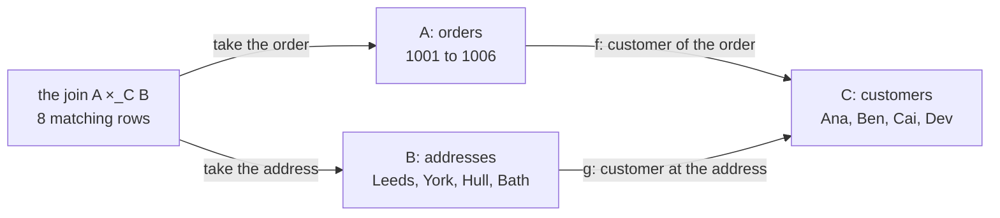

# Pullbacks and pushouts: matching pairs, and gluing along a shared part

[Syllabus](../../../SYLLABUS.md) → [Computability and complexity](../README.md) → [Category Theory in Outline](../README.md#s07) → Pullbacks and pushouts

---

## General Overview

A small online bookshop keeps two tables. The orders table has 6 rows: orders 1001 to 1006, each placed by one customer. The addresses table has 4 rows: Leeds, York, Hull and Bath, each belonging to one customer. Ana has 3 orders and 2 addresses.

To print delivery options, the shop **joins** the tables on the customer column: it keeps every (order, address) pair whose customer is the same. Of the 6 × 4 = 24 possible pairs, 8 survive. Ana alone gives 3 × 2 = 6 of them.

That join is a **pullback**: the set of all matching pairs, for two maps that land in one shared set (here, the customer). It is the most general way to have "an order and an address that agree on the customer". Any other table that pairs orders with addresses consistently, such as a sheet of shipping labels, passes through it in exactly one way.

The mirror idea is a **pushout**. The shop takes over a second shop and merges the two customer lists along a match table that says "this record and that record are one person". Lists of 4 and 5 with 2 matches give 7 customers. The pushout glues two pieces along a shared part.

**A pullback collects the pairs that agree in a shared set, and a pushout glues two sets where a shared part says they meet; each is fixed, up to renaming, by one universal property.**

**What kind of fact this is:** two definitions by universal property, with theorems proved on this card in Why it works: the join is the pullback of sets, the glued set with its equivalence classes is the pushout, and the counting rules for both.

### The picture: the join as a square



Schematic. Both routes from the join to the customers give the same customer: that agreement is what makes a row a match. The square is a commutative diagram, a picture where every route between two points gives the same map ([Commutative diagrams](02-commutative-diagrams-and-duality.md)).

---

## The formula

Notation first, in words. A map $`f: A \to C`$ sends each member of the set A to one member of C. The **fibre** $`f^{-1}(c)`$ is the set of members of A that f sends to c: for the orders, all orders by one customer. Bars count members: $`\lvert A \rvert`$ is the number of members of A.

This card introduces $`A \times_C B`$, read "A times B over C", for the pullback:

```math
A \times_C B = \{\, (a, b) \text{ in } A \times B \;:\; f(a) = g(b) \,\}, \qquad \lvert A \times_C B \rvert = \sum_{c \text{ in } C} \lvert f^{-1}(c) \rvert \cdot \lvert g^{-1}(c) \rvert
```

**Read it aloud:** the pullback is every pair of an A-member and a B-member that land on the same point of C; its size is, key by key, the number of A-rows with that key times the number of B-rows with it, added up.

The pushout glues A and B along a set S with maps $`i: S \to A`$ and $`j: S \to B`$. Write $`A + B`$ for the disjoint union, both sets side by side with nothing shared ([Commutative diagrams](02-commutative-diagrams-and-duality.md)). Glue with the smallest equivalence relation $`\sim`$ (a sameness rule: reflexive, symmetric, transitive) that puts $`i(s) \sim j(s)`$ for every s:

```math
A +_S B = (A + B)/\!\sim, \qquad \lvert A +_S B \rvert = \lvert A \rvert + \lvert B \rvert - \lvert S \rvert \;\text{ when } i \text{ and } j \text{ are one-to-one}
```

**Read it aloud:** the pushout is the two sets side by side, with every matched pair and every chain of matched pairs fused into one member; when no record is matched twice, each match removes exactly one member from the count.

| Symbol | Plain meaning | In our example | Push it up and the answer… |
| --- | --- | --- | --- |
| $`A`$, $`B`$ | the two tables' rows | 6 orders, 4 addresses | the join can grow |
| $`C`$ | the shared key set | 4 customers | the same rows spread over more keys: fewer matches |
| $`f`$, $`g`$ | maps reading each row's key | order 1001 to Ana; Leeds to Ana | — |
| $`f^{-1}(c)`$ | the rows of A with key c, a fibre | Ana's 3 orders | that key's share of the join grows |
| $`A \times_C B`$ | the pullback: matching pairs | the 8-row join | — |
| $`T`$, $`p`$, $`q`$, $`h`$ | a test set, its maps into A and B, and its one map h into the join | a 2-row label sheet | — |
| $`S`$, $`i`$, $`j`$ | the shared part, a match table, and where each match points in A and in B | 2 matches; Ana to ana.k | more matches: the merged list shrinks |
| $`A \times B`$, $`A + B`$ | the product, every pair; the disjoint union, side by side with nothing shared | 24 pairs; 4 + 5 = 9 records | — |
| $`\sim`$ | the gluing: the smallest sameness rule holding every match | Ana with ana.k | — |
| $`A +_S B`$ | the pushout: the merged list | 7 customers | — |
| $`X`$, $`u`$, $`v`$, $`k`$ | a test set, maps into it from A and B, and their one map k from the pushout | the labels {0, 1} | — |
| $`a`$, $`b`$, $`c`$, $`s`$, $`t`$, $`x`$, $`y`$, $`z`$ | single members of the sets above | order 1001, Leeds, Ana | — |

### When it holds

- **Each row has exactly one key.** f and g must be maps. A row with no key (a null in SQL, the database query language) leaves f undefined there, so f is not a map on all of A; SQL's inner join drops such rows.
- **Keys are compared in C, by equality.** "Ana" and "ana" are different members of C, so their rows never join. Cleaning keys changes C, and so the answer.
- **The count formula for the pushout needs one-to-one matches.** If a record appears in two matches, the gluing chains them, and $`\lvert A \rvert + \lvert B \rvert - \lvert S \rvert`$ can undercount: the faulty matcher below gives 5 where the truth is 6.
- **The gluing must be closed up.** Fusing only directly matched pairs is not transitive: two records matched to the same third are left apart. The pushout uses the smallest equivalence relation containing the matches.
- **Sets, then groups.** In groups the pullback is still the set of matching pairs. The pushout of groups is a different construction, the amalgamated free product, outside this card.

---

## Why it works

### Step 0: a pair of maps that agree is the same as a map into the pairs

The idea is that a matching pair of maps is already a single map in disguise. Take any set T with $`p: T \to A`$ and $`q: T \to B`$ such that $`f(p(t)) = g(q(t))`$ for every t. Then each t names one pair $`(p(t), q(t))`$, and that pair lies in the join. So T maps into the join, and in only one way.

That is the universal property of a pullback, the limit of the shape A → C ← B ([Universal properties](04-universal-properties-limits-and-colimits.md)). It fixes the join up to a unique renaming.

<details>
<summary>Detailed proof: the join is the pullback of sets</summary>

Every pair $`(a, b)`$ in $`A \times_C B`$ has $`f(a) = g(b)`$ by definition. So taking the first entry and then applying f gives the same as taking the second entry and then applying g: the square commutes.

Given T, p and q with $`f \circ p = g \circ q`$, define $`h(t) = (p(t), q(t))`$. The pair lies in $`A \times_C B`$ because $`f(p(t)) = g(q(t))`$. Its first entry is $`p(t)`$ and its second is $`q(t)`$, so h reproduces p and q: h exists.

If $`h'`$ also satisfies both, then $`h'(t)`$ is a pair whose first entry is $`p(t)`$ and whose second entry is $`q(t)`$. A pair is fixed by its entries, so $`h' = h`$. That is uniqueness.

</details>

The check counts this directly. A 2-row test table has $`6^2 \times 4^2 = 576`$ pairs of maps into A and B. Exactly 64 of them match, which is $`8 \times 8`$: one for each map from the 2 rows into the 8-row join. For each of the 64, exactly one map into the join reproduces it.

### Step 1: count the join key by key

Sort the matching pairs by their customer. "Same customer" is an equivalence relation on the join, so it cuts the join into blocks that cover it and never overlap ([Equivalence relations and partitions](../../01-Foundations/08-Relations%20and%20Functions/06-equivalence-relations-and-partitions.md)).

The block for key c is every pair of an order with key c and an address with key c: a full product of two fibres. Its size is $`\lvert f^{-1}(c) \rvert \cdot \lvert g^{-1}(c) \rvert`$. Adding the blocks gives the sum in the formula.

A database uses this. A **hash join** groups both tables by key first, then pairs rows within each group, instead of testing all 24 pairs.

### Step 2: three familiar sets are pullbacks

- **C has one point.** Every row has the same key, so every pair matches: the pullback is the plain product $`A \times B`$, 24 rows.
- **g is a subset inclusion.** Swap the addresses for the loyalty-card holders Ana and Ben, a subset of C, with g sending each holder to itself. A pair matches when the order's customer holds a card: the pullback is the preimage of that subset under f (every order whose customer is in it), the 5 orders by Ana or Ben.
- **Both maps are inclusions.** The pullback of two subsets of C is their intersection.

### Step 3: in groups, the matching pairs form a subgroup

Take the 4-hour clock and the 6-hour clock (addition with wrap-round), each mapped to its parity, even or odd. Matching pairs $`(x, y)`$ have x and y of the same parity. There are $`2 \times 3 + 2 \times 3 = 12`$, by the key-by-key count with keys "even" and "odd".

If $`(x_1, y_1)`$ and $`(x_2, y_2)`$ match, so does their sum, because parity respects addition. The undo of a matching pair also matches. So the 12 pairs form a subgroup. For a test group T with homomorphisms p and q that agree on parity, the one map $`h(t) = (p(t), q(t))`$ respects adding too, because p and q do, slot by slot. So the 12 pairs are the pullback in groups as well as in sets. The check tests all 144 sums.

### Step 4: reverse the arrows, and pairs become gluing

Flip every arrow of the square ([Commutative diagrams](02-commutative-diagrams-and-duality.md) calls this duality). The pullback's "maps in that agree" becomes "maps out that agree". A pushout of $`A \leftarrow S \rightarrow B`$ is a set with maps from A and B, agreeing on S, through which any other such pair passes in exactly one way.

So the pushout is built by gluing: put A and B side by side, then fuse $`i(s)`$ with $`j(s)`$ for each match s. The fusing must be an equivalence relation, so chains of matches fuse too. The pushout is a colimit ([Universal properties](04-universal-properties-limits-and-colimits.md)).

<details>
<summary>Detailed proof: the glued set is the pushout of sets</summary>

Let $`\sim`$ be the smallest equivalence relation on $`A + B`$ with $`i(s) \sim j(s)`$ for all s in S, and form $`A +_S B`$, its set of classes. Send each member of A or B to its class. Then $`i(s)`$ and $`j(s)`$ land in one class, so the two maps agree on S.

Now take any set X with $`u: A \to X`$ and $`v: B \to X`$ such that $`u(i(s)) = v(j(s))`$ for all s. Define a rule on $`A + B`$: two members are linked when they land on the same point of X, using u for members of A and v for members of B. That rule is an equivalence relation, and it holds every match. The smallest such rule, $`\sim`$, sits inside it, so $`u`$ and $`v`$ are constant on each class.

So $`k(\text{class of } z) = `$ the common value is well defined, and it is the only map from $`A +_S B`$ that agrees with u and v, since every class is the class of some member of A or B.

</details>

The check counts this too. Maps into a 2-member set {0, 1} from a pushout of 7 members number $`2^7 = 128`$. By brute force, 128 of the 512 pairs $`(u, v)`$ agree on the true matches. The faulty matches leave 64, which is $`2^6`$: six customers.

### Step 5: count the pushout

Draw the records as dots and each match as a line between an A-dot and a B-dot. The classes of $`\sim`$ are the connected groups of dots. When i and j are one-to-one, every dot touches at most one line. Each line then joins two singletons, and each match removes exactly one member: $`4 + 5 - 2 = 7`$.

When a record appears in two matches, a line can join dots that are already connected. That line removes nothing, and the subtraction overcounts the loss.

The **faulty matcher** shows it. It adds two wrong matches, Ana with ben.r and Ben with ana.k, because the two households share a phone number. Its 4 lines join the 4 dots Ana, Ben, ana.k and ben.r in a loop. Three lines already connect them, so the fourth removes nothing: 6 customers, not 4 + 5 − 4 = 5.

---

## Worked numbers, by hand

| Step | Arithmetic | Value |
| --- | --- | --- |
| all (order, address) pairs | 6 × 4 | 24 |
| Ana's block of the join | 3 orders × 2 addresses | 6 |
| Ben's block | 2 × 1 | 2 |
| Cai and Dev | 0 × 1 and 1 × 0 | 0 and 0 |
| the join, the pullback | 6 + 2 + 0 + 0 | **8** |
| matching map pairs from a 2-row table | 8 × 8, of 576 | 64 |
| groups: clock-4 and clock-6 over parity | 2 × 3 + 2 × 3 | 12 |
| merged customer list, the pushout | 4 + 5 − 2 | **7** |
| maps into {0, 1} agreeing on the matches | 2 to the 7, of 512 | 128 |

The shop prints 8 delivery options from 24 candidate pairs, and the merged list holds 7 customers, not 9.

### What breaks if you drop a piece

| Mistake | Comes out at | What went wrong |
| --- | --- | --- |
| Pairing rows by position, first with first | 4 rows, 1 a real match | Position is not a key; the condition $`f(a) = g(b)`$ was dropped |
| One row per shared key | 2 rows | A key with 3 orders and 2 addresses gives 6 pairs, not 1 |
| No key condition at all | 24 rows | That is the product, the pullback over one point |
| $`\lvert A \rvert + \lvert B \rvert - \lvert S \rvert`$ with the faulty matcher | 9 − 4 = 5 | Matches are not one-to-one; one match closes a loop and removes nothing; the truth is 6 |

The code prints all four.

---

## Code, from first principles, and it actually runs

Nothing is imported. The join is built by testing every pair, then counted again by grouping on the key. A third road checks the universal property by brute force: every pair of maps from a 2-row table, against maps into the join. The pushout is built with union-find, a structure that merges groups and names one leader per group, and counted again by brute force over all maps into a 2-member set. The parity pullback of the two clocks is checked for closure on all 144 sums.

### Python

```python
# Pullbacks and pushouts -- the check behind the card.  Nothing is imported.
# A pullback of sets is a join of two tables on a shared key; a pushout glues
# two customer lists along a match table.  Each answer is reached by two or
# more roads: the definition row by row, a count by keys or by classes, and
# the universal property counted by brute force over every pair of maps.
ORDERS = [(1001, "Ana"), (1002, "Ben"), (1003, "Ana"), (1004, "Dev"), (1005, "Ben"), (1006, "Ana")]
ADDRESSES = [("Leeds", "Ana"), ("York", "Ana"), ("Hull", "Ben"), ("Bath", "Cai")]
KEYS = ["Ana", "Ben", "Cai", "Dev"]
SHOP1 = ["Ana", "Ben", "Cai", "Dev"]
SHOP2 = ["ana.k", "ben.r", "eve", "fay", "gus"]
MATCH = [("Ana", "ana.k"), ("Ben", "ben.r")]
FAULTY = MATCH + [("Ana", "ben.r"), ("Ben", "ana.k")]  # a shared household phone

def all_maps(n, m):                      # every map from n things to m things, as lists
    out = [[]]
    for _ in range(n):
        out = [f + [v] for f in out for v in range(m)]
    return out

def nested_loop_join(left, right):       # road 1: the definition, every pair tested
    return [(a, b) for a, ka in left for b, kb in right if ka == kb]

def count_by_key(left, right):           # road 2: group by key, multiply the counts
    rows = []
    for c in KEYS:
        n = sum(1 for _, k in left if k == c)
        m = sum(1 for _, k in right if k == c)
        rows.append((c, n, m, n * m))
    return rows

def glue(a_list, b_list, match):         # pushout: union-find on the disjoint union
    nodes = [("A", x) for x in a_list] + [("B", y) for y in b_list]
    parent = {v: v for v in nodes}
    def find(v):
        while parent[v] != v:
            v = parent[v]
        return v
    for x, y in match:
        parent[find(("A", x))] = find(("B", y))
    classes = {}
    for v in nodes:
        classes.setdefault(find(v), []).append(v[1])
    return sorted(sorted(c) for c in classes.values())

def maps_agreeing(a_list, b_list, match):  # road 2: maps into {0, 1} that agree on S
    ia = {x: n for n, x in enumerate(a_list)}
    ib = {y: n for n, y in enumerate(b_list)}
    good = 0
    for u in all_maps(len(a_list), 2):
        for v in all_maps(len(b_list), 2):
            if all(u[ia[x]] == v[ib[y]] for x, y in match):
                good += 1
    return good, 2 ** len(a_list) * 2 ** len(b_list)

def yn(t):
    return "yes" if t else "no"

join = nested_loop_join(ORDERS, ADDRESSES)
by_key = count_by_key(ORDERS, ADDRESSES)
print(f"orders {len(ORDERS)}, addresses {len(ADDRESSES)}, all pairs {len(ORDERS) * len(ADDRESSES)}")
print(f"road 1, every pair tested: {len(join)} matching rows")
for a, b in join:
    print(f"  order {a} -> {b}")
for c, n, m, nm in by_key:
    print(f"road 2, key {c}: {n} orders x {m} addresses = {nm}")
total = sum(r[3] for r in by_key)
print(f"road 2 total: {total}")
# universal property: matching pairs of maps from a 2-row table T
fa = [k for _, k in ORDERS]
gb = [k for _, k in ADDRESSES]
pairs = [(p, q) for p in all_maps(2, len(ORDERS)) for q in all_maps(2, len(ADDRESSES))]
matching = [(p, q) for p, q in pairs if all(fa[p[t]] == gb[q[t]] for t in range(2))]
jpos = [(ia, ib) for ia, (a, ka) in enumerate(ORDERS) for ib, (b, kb) in enumerate(ADDRESSES) if ka == kb]
through = [sum(1 for h in all_maps(2, len(jpos)) if all(jpos[h[t]] == (p[t], q[t]) for t in range(2)))
           for p, q in matching]
print(f"pairs of maps from a 2-row table: {len(pairs)}; matching: {len(matching)} = {len(join)} x {len(join)}")
print(f"maps into the join giving each matching pair: exactly one every time: {yn(set(through) == {1})}")
one_point = nested_loop_join([(a, 0) for a, _ in ORDERS], [(b, 0) for b, _ in ADDRESSES])
cards = [("Ana", "Ana"), ("Ben", "Ben")]   # loyalty-card holders, a subset of the keys
print(f"key set of one point: {len(one_point)} rows, the plain product")
print(f"key map a subset inclusion (card holders Ana, Ben): {len(nested_loop_join(ORDERS, cards))} rows, "
      f"the orders by card holders")
z4z6 = [(x, y) for x in range(4) for y in range(6) if x % 2 == y % 2]
closed = all(((x1 + x2) % 4, (y1 + y2) % 6) in z4z6 for x1, y1 in z4z6 for x2, y2 in z4z6)
inverses = all(((-x) % 4, (-y) % 6) in z4z6 for x, y in z4z6)
print(f"groups: clock-4 and clock-6 over parity: {len(z4z6)} of 24 pairs; "
      f"closed under adding {yn(closed)}, undos inside {yn(inverses)}")
zipped = [(a, b) for (a, ka), (b, kb) in zip(ORDERS, ADDRESSES)]
real = sum(1 for (a, ka), (b, kb) in zip(ORDERS, ADDRESSES) if ka == kb)
shared = [c for c in KEYS if any(k == c for _, k in ORDERS) and any(k == c for _, k in ADDRESSES)]
print(f"mistake, rows paired by position: {len(zipped)} rows, {real} a real match")
print(f"mistake, one row per shared key: {len(shared)} rows")
print(f"mistake, no key condition: {len(ORDERS) * len(ADDRESSES)} rows")
for name, m in (("true matches", MATCH), ("faulty matcher", FAULTY)):
    cls = glue(SHOP1, SHOP2, m)
    good, tot = maps_agreeing(SHOP1, SHOP2, m)
    print(f"{name}: {len(SHOP1)} + {len(SHOP2)} - {len(m)} = {len(SHOP1) + len(SHOP2) - len(m)}; "
          f"classes found {len(cls)}")
    print("  merged list: " + ", ".join("{" + ", ".join(c) + "}" for c in cls))
    print(f"  maps into two labels agreeing on the matches: {good} of {tot} = 2 to the {len(cls)}")
direct = lambda x, y: x == y or (x, y) in FAULTY or (y, x) in FAULTY
broken = direct("Ana", "ana.k") and direct("ana.k", "Ben") and not direct("Ana", "Ben")
print(f"faulty, direct matches only: Ana with ana.k {yn(direct('Ana', 'ana.k'))}, "
      f"ana.k with Ben {yn(direct('ana.k', 'Ben'))}, Ana with Ben {yn(direct('Ana', 'Ben'))}: "
      f"{'not transitive' if broken else 'no break in this chain'}")
assert len(join) == total == 8                                  # road 1 against road 2
assert len(matching) == len(join) ** 2 and set(through) == {1}  # universal property, brute force
assert len(one_point) == 24 and len(nested_loop_join(ORDERS, cards)) == 5
assert len(z4z6) == sum(sum(1 for x in range(4) if x % 2 == c) * sum(1 for y in range(6) if y % 2 == c)
                        for c in range(2)) and closed and inverses
c1, c2 = glue(SHOP1, SHOP2, MATCH), glue(SHOP1, SHOP2, FAULTY)
assert maps_agreeing(SHOP1, SHOP2, MATCH)[0] == 2 ** len(c1) and len(c1) == 4 + 5 - 2
assert maps_agreeing(SHOP1, SHOP2, FAULTY)[0] == 2 ** len(c2) and len(c2) == 6 != len(SHOP1) + len(SHOP2) - len(FAULTY)
assert (real, len(shared)) == (1, 2) and broken
print("ALL CHECKS PASS")
```

**Ran 2026-11-19 on macOS, Python 3.14.10, standard library only. All checks passed. Output, pasted from the run:**

```
orders 6, addresses 4, all pairs 24
road 1, every pair tested: 8 matching rows
  order 1001 -> Leeds
  order 1001 -> York
  order 1002 -> Hull
  order 1003 -> Leeds
  order 1003 -> York
  order 1005 -> Hull
  order 1006 -> Leeds
  order 1006 -> York
road 2, key Ana: 3 orders x 2 addresses = 6
road 2, key Ben: 2 orders x 1 addresses = 2
road 2, key Cai: 0 orders x 1 addresses = 0
road 2, key Dev: 1 orders x 0 addresses = 0
road 2 total: 8
pairs of maps from a 2-row table: 576; matching: 64 = 8 x 8
maps into the join giving each matching pair: exactly one every time: yes
key set of one point: 24 rows, the plain product
key map a subset inclusion (card holders Ana, Ben): 5 rows, the orders by card holders
groups: clock-4 and clock-6 over parity: 12 of 24 pairs; closed under adding yes, undos inside yes
mistake, rows paired by position: 4 rows, 1 a real match
mistake, one row per shared key: 2 rows
mistake, no key condition: 24 rows
true matches: 4 + 5 - 2 = 7; classes found 7
  merged list: {Ana, ana.k}, {Ben, ben.r}, {Cai}, {Dev}, {eve}, {fay}, {gus}
  maps into two labels agreeing on the matches: 128 of 512 = 2 to the 7
faulty matcher: 4 + 5 - 4 = 5; classes found 6
  merged list: {Ana, Ben, ana.k, ben.r}, {Cai}, {Dev}, {eve}, {fay}, {gus}
  maps into two labels agreeing on the matches: 64 of 512 = 2 to the 6
faulty, direct matches only: Ana with ana.k yes, ana.k with Ben yes, Ana with Ben no: not transitive
ALL CHECKS PASS
```

### Rust

Same numbers, same labels, built with `rustc --edition 2021 -O`.

```rust
// Pullbacks and pushouts -- the same check as the Python, in Rust.  No crates.
// A pullback of sets is a join of two tables on a shared key; a pushout glues
// two customer lists along a match table.  Each answer is reached by two or
// more roads: the definition row by row, a count by keys or by classes, and
// the universal property counted by brute force over every pair of maps.
use std::collections::BTreeSet;

const KEYS: [&str; 4] = ["Ana", "Ben", "Cai", "Dev"];

fn all_maps(n: usize, m: usize) -> Vec<Vec<usize>> {   // every map from n things to m things
    let mut out: Vec<Vec<usize>> = vec![vec![]];
    for _ in 0..n {
        out = out.iter().flat_map(|f| (0..m).map(move |v| { let mut g = f.clone(); g.push(v); g })).collect();
    }
    out
}

fn nested_loop_join<A: Copy, B: Copy>(left: &[(A, &str)], right: &[(B, &str)]) -> Vec<(A, B)> {
    let mut out = Vec::new();                          // road 1: the definition, every pair tested
    for &(a, ka) in left { for &(b, kb) in right { if ka == kb { out.push((a, b)) } } }
    out
}

fn glue(a_list: &[&str], b_list: &[&str], m: &[(&str, &str)]) -> Vec<Vec<String>> {
    let na = a_list.len();                             // pushout: union-find on the disjoint union
    let names: Vec<&str> = a_list.iter().chain(b_list.iter()).copied().collect();
    let mut parent: Vec<usize> = (0..names.len()).collect();
    fn find(p: &Vec<usize>, mut v: usize) -> usize { while p[v] != v { v = p[v] } v }
    for &(x, y) in m {
        let i = a_list.iter().position(|&s| s == x).unwrap();
        let j = na + b_list.iter().position(|&s| s == y).unwrap();
        let (ri, rj) = (find(&parent, i), find(&parent, j));
        parent[ri] = rj;
    }
    let mut out: Vec<Vec<String>> = Vec::new();
    let roots: BTreeSet<usize> = (0..names.len()).map(|v| find(&parent, v)).collect();
    for r in roots {
        let mut c: Vec<String> = (0..names.len()).filter(|&v| find(&parent, v) == r).map(|v| names[v].to_string()).collect();
        c.sort();
        out.push(c);
    }
    out.sort();
    out
}

fn maps_agreeing(a_list: &[&str], b_list: &[&str], m: &[(&str, &str)]) -> (usize, usize) {
    let mut good = 0;                                  // road 2: maps into {0, 1} that agree on S
    for u in all_maps(a_list.len(), 2) {
        for v in all_maps(b_list.len(), 2) {
            if m.iter().all(|&(x, y)| u[a_list.iter().position(|&s| s == x).unwrap()]
                == v[b_list.iter().position(|&s| s == y).unwrap()]) { good += 1 }
        }
    }
    (good, (1 << a_list.len()) * (1 << b_list.len()))
}

fn yn(t: bool) -> &'static str { if t { "yes" } else { "no" } }

fn main() {
    let orders = [(1001, "Ana"), (1002, "Ben"), (1003, "Ana"), (1004, "Dev"), (1005, "Ben"), (1006, "Ana")];
    let addresses = [("Leeds", "Ana"), ("York", "Ana"), ("Hull", "Ben"), ("Bath", "Cai")];
    let shop1 = ["Ana", "Ben", "Cai", "Dev"];
    let shop2 = ["ana.k", "ben.r", "eve", "fay", "gus"];
    let matches = vec![("Ana", "ana.k"), ("Ben", "ben.r")];
    let mut faulty = matches.clone();                   // a shared household phone
    faulty.push(("Ana", "ben.r"));
    faulty.push(("Ben", "ana.k"));
    let join = nested_loop_join(&orders, &addresses);
    println!("orders {}, addresses {}, all pairs {}", orders.len(), addresses.len(), orders.len() * addresses.len());
    println!("road 1, every pair tested: {} matching rows", join.len());
    for (a, b) in &join { println!("  order {} -> {}", a, b) }
    let mut total = 0;
    for c in KEYS {                                    // road 2: group by key, multiply the counts
        let n = orders.iter().filter(|o| o.1 == c).count();
        let m = addresses.iter().filter(|o| o.1 == c).count();
        println!("road 2, key {}: {} orders x {} addresses = {}", c, n, m, n * m);
        total += n * m;
    }
    println!("road 2 total: {}", total);
    let mut pairs = 0;                                 // universal property: maps from a 2-row table T
    let mut matching: Vec<(Vec<usize>, Vec<usize>)> = Vec::new();
    for p in all_maps(2, orders.len()) {
        for q in all_maps(2, addresses.len()) {
            pairs += 1;
            if (0..2).all(|t| orders[p[t]].1 == addresses[q[t]].1) { matching.push((p.clone(), q)) }
        }
    }
    let mut jpos: Vec<(usize, usize)> = Vec::new();
    for (ia, o) in orders.iter().enumerate() {
        for (ib, d) in addresses.iter().enumerate() { if o.1 == d.1 { jpos.push((ia, ib)) } }
    }
    let through: BTreeSet<usize> = matching.iter().map(|(p, q)| all_maps(2, jpos.len()).iter()
        .filter(|h| (0..2).all(|t| jpos[h[t]] == (p[t], q[t]))).count()).collect();
    println!("pairs of maps from a 2-row table: {}; matching: {} = {} x {}", pairs, matching.len(), join.len(), join.len());
    println!("maps into the join giving each matching pair: exactly one every time: {}", yn(through == BTreeSet::from([1])));
    let pt_o: Vec<(i32, &str)> = orders.iter().map(|o| (o.0, "pt")).collect();
    let pt_a: Vec<(&str, &str)> = addresses.iter().map(|a| (a.0, "pt")).collect();
    let one_point = nested_loop_join(&pt_o, &pt_a);
    let cards = [("Ana", "Ana"), ("Ben", "Ben")];      // loyalty-card holders, a subset of the keys
    let card_rows = nested_loop_join(&orders, &cards).len();
    println!("key set of one point: {} rows, the plain product", one_point.len());
    println!("key map a subset inclusion (card holders Ana, Ben): {} rows, the orders by card holders", card_rows);
    let z4z6: Vec<(i32, i32)> = (0..4).flat_map(|x| (0..6).map(move |y| (x, y))).filter(|&(x, y)| x % 2 == y % 2).collect();
    let closed = z4z6.iter().all(|&(x1, y1)| z4z6.iter().all(|&(x2, y2)| z4z6.contains(&((x1 + x2) % 4, (y1 + y2) % 6))));
    let inverses = z4z6.iter().all(|&(x, y)| z4z6.contains(&((-x).rem_euclid(4), (-y).rem_euclid(6))));
    println!("groups: clock-4 and clock-6 over parity: {} of 24 pairs; closed under adding {}, undos inside {}",
             z4z6.len(), yn(closed), yn(inverses));
    let zipped = orders.len().min(addresses.len());
    let real = orders.iter().zip(addresses.iter()).filter(|(o, d)| o.1 == d.1).count();
    let shared: Vec<&str> = KEYS.iter().copied()
        .filter(|&c| orders.iter().any(|o| o.1 == c) && addresses.iter().any(|d| d.1 == c)).collect();
    println!("mistake, rows paired by position: {} rows, {} a real match", zipped, real);
    println!("mistake, one row per shared key: {} rows", shared.len());
    println!("mistake, no key condition: {} rows", orders.len() * addresses.len());
    for (name, m) in [("true matches", &matches), ("faulty matcher", &faulty)] {
        let cls = glue(&shop1, &shop2, m);
        let (good, tot) = maps_agreeing(&shop1, &shop2, m);
        println!("{}: {} + {} - {} = {}; classes found {}", name, shop1.len(), shop2.len(), m.len(),
                 shop1.len() + shop2.len() - m.len(), cls.len());
        let shown: Vec<String> = cls.iter().map(|c| format!("{{{}}}", c.join(", "))).collect();
        println!("  merged list: {}", shown.join(", "));
        println!("  maps into two labels agreeing on the matches: {} of {} = 2 to the {}", good, tot, cls.len());
    }
    let direct = |x: &str, y: &str| x == y || faulty.contains(&(x, y)) || faulty.contains(&(y, x));
    let broken = direct("Ana", "ana.k") && direct("ana.k", "Ben") && !direct("Ana", "Ben");
    println!("faulty, direct matches only: Ana with ana.k {}, ana.k with Ben {}, Ana with Ben {}: {}",
             yn(direct("Ana", "ana.k")), yn(direct("ana.k", "Ben")), yn(direct("Ana", "Ben")),
             if broken { "not transitive" } else { "no break in this chain" });
    assert!(join.len() == total && total == 8);                               // road 1 against road 2
    assert!(matching.len() == join.len() * join.len() && through == BTreeSet::from([1]));
    assert!(one_point.len() == 24 && card_rows == 5);
    let by_parity: usize = (0..2).map(|c| (0..4).filter(|x| x % 2 == c).count() * (0..6).filter(|y| y % 2 == c).count()).sum();
    assert!(z4z6.len() == by_parity && closed && inverses);
    let (c1, c2) = (glue(&shop1, &shop2, &matches), glue(&shop1, &shop2, &faulty));
    assert!(maps_agreeing(&shop1, &shop2, &matches).0 == 1 << c1.len() && c1.len() == 4 + 5 - 2);
    assert!(maps_agreeing(&shop1, &shop2, &faulty).0 == 1 << c2.len() && c2.len() == 6 && c2.len() != shop1.len() + shop2.len() - faulty.len());
    assert!(real == 1 && shared.len() == 2 && broken);
    println!("ALL CHECKS PASS");
}
```

**Ran 2026-11-19 on macOS, rustc 1.98.1, no crates. All checks passed. Output, pasted from the run:**

```
orders 6, addresses 4, all pairs 24
road 1, every pair tested: 8 matching rows
  order 1001 -> Leeds
  order 1001 -> York
  order 1002 -> Hull
  order 1003 -> Leeds
  order 1003 -> York
  order 1005 -> Hull
  order 1006 -> Leeds
  order 1006 -> York
road 2, key Ana: 3 orders x 2 addresses = 6
road 2, key Ben: 2 orders x 1 addresses = 2
road 2, key Cai: 0 orders x 1 addresses = 0
road 2, key Dev: 1 orders x 0 addresses = 0
road 2 total: 8
pairs of maps from a 2-row table: 576; matching: 64 = 8 x 8
maps into the join giving each matching pair: exactly one every time: yes
key set of one point: 24 rows, the plain product
key map a subset inclusion (card holders Ana, Ben): 5 rows, the orders by card holders
groups: clock-4 and clock-6 over parity: 12 of 24 pairs; closed under adding yes, undos inside yes
mistake, rows paired by position: 4 rows, 1 a real match
mistake, one row per shared key: 2 rows
mistake, no key condition: 24 rows
true matches: 4 + 5 - 2 = 7; classes found 7
  merged list: {Ana, ana.k}, {Ben, ben.r}, {Cai}, {Dev}, {eve}, {fay}, {gus}
  maps into two labels agreeing on the matches: 128 of 512 = 2 to the 7
faulty matcher: 4 + 5 - 4 = 5; classes found 6
  merged list: {Ana, Ben, ana.k, ben.r}, {Cai}, {Dev}, {eve}, {fay}, {gus}
  maps into two labels agreeing on the matches: 64 of 512 = 2 to the 6
faulty, direct matches only: Ana with ana.k yes, ana.k with Ben yes, Ana with Ben no: not transitive
ALL CHECKS PASS
```

The two outputs match line for line.

### Lean

Lean proves the join is the pullback for any sets, and both counts for finite sets, and checks the join's worked numbers.

- Take any maps $`f: A \to C`$ and $`g: B \to C`$. Then the join, with its maps to A and to B, is a pullback.
- So any matching pair of maps from a test set T passes through the join in exactly one way.
- Take finite sets A, B and C with maps f and g. Then the join has $`\sum_c \lvert f^{-1}(c) \rvert \cdot \lvert g^{-1}(c) \rvert`$ members.
- Take finite sets A, B and S with one-to-one maps $`i: S \to A`$ and $`j: S \to B`$. Then $`A +_S B`$ has $`\lvert A \rvert + \lvert B \rvert - \lvert S \rvert`$ members.
- Lean builds $`A +_S B`$ as the card does: A + B, with the matches fused and the fusing closed up.
- The shop's join has 8 of the 24 pairs, and key by key 6 + 2 + 0 + 0 = 8.
- From a 2-row table, 64 of the 576 pairs of maps match.
- Over a key set of one point the join is the plain product, 24 rows. Over the card holders Ana and Ben it has 5.
- For the 4-hour and 6-hour clocks over parity, 12 of the 24 pairs match. Sums and undos of matching pairs match too.

The merged customer lists, the mistakes and the maps into {0, 1} are left to the Python and Rust checks.

```lean
-- Pullbacks and pushouts: the join of two maps is their pullback of sets, its size is the key-by-key sum of fibre products, and gluing along one-to-one matches has |A| + |B| - |S| members.
import Mathlib.CategoryTheory.Limits.Types.Pushouts
import Mathlib.Data.Fintype.BigOperators
import Mathlib.Data.ZMod.Defs
import Mathlib.Data.Fin.VecNotation
import Mathlib.Data.Fintype.Pi
import Mathlib.SetTheory.Cardinal.Finite

open CategoryTheory CategoryTheory.Limits

universe u

/-- The join is the pullback of sets: for maps `f : A → C` and `g : B → C`, the set of
matching pairs `{(a, b) : f a = g b}`, with its two projections, is a pullback square
over `f` and `g`. Any set `T` with maps into `A` and `B` that agree in `C` maps into the
join in exactly one way. -/
theorem join_is_pullback {A B C : Type u} (f : A → C) (g : B → C) :
    IsPullback (↾(fun x : {x : A × B // f x.1 = g x.2} => x.1.1))
      (↾(fun x : {x : A × B // f x.1 = g x.2} => x.1.2)) (↾f) (↾g) := by
  rw [Types.isPullback_iff]
  refine ⟨?_, ?_, ?_⟩
  · ext x
    exact x.2
  · rintro x y ⟨h1, h2⟩
    exact Subtype.ext (Prod.ext h1 h2)
  · intro a b h
    exact ⟨⟨⟨a, b⟩, h⟩, rfl, rfl⟩

/-- Counting the join key by key: for finite sets, the number of matching pairs is the
sum over keys `c` of (the number of `A`-members with key `c`) times (the number of
`B`-members with key `c`). -/
theorem join_card_eq_sum_fibres {A B C : Type*} [Fintype A] [Fintype B] [Fintype C]
    [DecidableEq C] (f : A → C) (g : B → C) :
    Fintype.card {x : A × B // f x.1 = g x.2} =
      ∑ c : C, (Finset.univ.filter (fun a => f a = c)).card *
        (Finset.univ.filter (fun b => g b = c)).card := by
  let e : {x : A × B // f x.1 = g x.2} ≃ Σ c : C, {a // f a = c} × {b // g b = c} :=
    { toFun := fun x => ⟨f x.1.1, ⟨x.1.1, rfl⟩, ⟨x.1.2, x.2.symm⟩⟩
      invFun := fun y => ⟨(y.2.1.1, y.2.2.1), y.2.1.2.trans y.2.2.2.symm⟩
      left_inv := fun x => rfl
      right_inv := by
        rintro ⟨c, ⟨a, rfl⟩, ⟨b, hb⟩⟩
        rfl }
  rw [Fintype.card_congr e, Fintype.card_sigma]
  refine Finset.sum_congr rfl fun c _ => ?_
  rw [Fintype.card_prod, Fintype.card_subtype, Fintype.card_subtype]

/-- Counting the pushout: gluing finite sets `A` and `B` along `S` (side by side, then
fusing `i s` with `j s` for every match `s`, closed up to an equivalence relation) gives
`|A| + |B| - |S|` members when both match maps `i` and `j` are one-to-one. -/
theorem glued_card_of_injective {S A B : Type u} [Fintype S] [Fintype A] [Fintype B]
    (i : S → A) (j : S → B) (hi : Function.Injective i) (hj : Function.Injective j) :
    Nat.card (Types.Pushout (↾i) (↾j)) = Fintype.card A + Fintype.card B - Fintype.card S := by
  classical
  have : Mono (↾i : S ⟶ A) := (mono_iff_injective _).2 hi
  let φ : A ⊕ {b : B // b ∉ Set.range j} → Types.Pushout (↾i) (↾j) := fun x =>
    match x with
    | Sum.inl a => Quot.mk _ (Sum.inl a)
    | Sum.inr b => Quot.mk _ (Sum.inr b.1)
  have hφ : Function.Bijective φ := by
    constructor
    · rintro (a | ⟨b, hb⟩) (a' | ⟨b', hb'⟩) h
      · have := (Types.Pushout.quot_mk_eq_iff (↾i) (↾j) _ _).1 h
        rw [Types.Pushout.inl_rel'_inl_iff] at this
        obtain rfl | ⟨x, y, hxy, rfl, rfl⟩ := this
        · rfl
        · obtain rfl := hj hxy
          rfl
      · have := (Types.Pushout.quot_mk_eq_iff (↾i) (↾j) _ _).1 h
        rw [Types.Pushout.inl_rel'_inr_iff] at this
        obtain ⟨s, -, rfl⟩ := this
        exact absurd ⟨s, rfl⟩ hb'
      · have := (Types.Pushout.quot_mk_eq_iff (↾i) (↾j) _ _).1 h.symm
        rw [Types.Pushout.inl_rel'_inr_iff] at this
        obtain ⟨s, -, rfl⟩ := this
        exact absurd ⟨s, rfl⟩ hb
      · have := (Types.Pushout.quot_mk_eq_iff (↾i) (↾j) _ _).1 h
        rw [Types.Pushout.inr_rel'_inr_iff] at this
        subst this
        rfl
    · rintro ⟨a | b⟩
      · exact ⟨Sum.inl a, rfl⟩
      · by_cases hb : b ∈ Set.range j
        · obtain ⟨s, rfl⟩ := hb
          exact ⟨Sum.inl (i s), Quot.sound (Types.Pushout.Rel.inl_inr s)⟩
        · exact ⟨Sum.inr ⟨b, hb⟩, rfl⟩
  rw [← Nat.card_eq_of_bijective φ hφ, Nat.card_eq_fintype_card, Fintype.card_sum,
    Fintype.card_subtype_compl, Set.card_range_of_injective hj]
  have := Fintype.card_le_of_injective j hj
  omega

/-! Worked examples from the card. Customers: Ana = 0, Ben = 1, Cai = 2, Dev = 3.
Orders 1001 to 1006 are `Fin 6`; addresses Leeds, York, Hull, Bath are `Fin 4`. -/

/-- The customer of each order 1001 to 1006: Ana, Ben, Ana, Dev, Ben, Ana. -/
def orderCustomer : Fin 6 → Fin 4 := ![0, 1, 0, 3, 1, 0]

/-- The customer at each address Leeds, York, Hull, Bath: Ana, Ana, Ben, Cai. -/
def addressCustomer : Fin 4 → Fin 4 := ![0, 0, 1, 2]

-- the join has 8 matching rows out of 6 × 4 = 24 pairs
example : Fintype.card {x : Fin 6 × Fin 4 // orderCustomer x.1 = addressCustomer x.2} = 8 := by
  decide

-- key by key: 3 × 2 + 2 × 1 + 0 × 1 + 1 × 0 = 8
example : (∑ c : Fin 4, (Finset.univ.filter (fun a => orderCustomer a = c)).card *
    (Finset.univ.filter (fun b => addressCustomer b = c)).card) = 8 := by
  decide

-- a 2-row test table: 64 of the 576 pairs of maps match, which is 8 × 8
example : Fintype.card {pq : (Fin 2 → Fin 6) × (Fin 2 → Fin 4) //
    ∀ t, orderCustomer (pq.1 t) = addressCustomer (pq.2 t)} = 64 := by
  decide

-- key set of one point: the pullback is the plain product, 24 rows
example : Fintype.card {x : Fin 6 × Fin 4 // (fun _ => ()) x.1 = (fun _ => ()) x.2} = 24 := by
  decide

-- loyalty-card holders Ana and Ben, a subset of the keys: the 5 orders by card holders
example : Fintype.card {x : Fin 6 × Fin 2 //
    orderCustomer x.1 = (fun k : Fin 2 => (k.castSucc.castSucc : Fin 4)) x.2} = 5 := by
  decide

-- groups: the 4-hour and 6-hour clocks over parity have 12 matching pairs
example : Fintype.card {x : ZMod 4 × ZMod 6 // x.1.val % 2 = x.2.val % 2} = 12 := by
  decide

-- groups: the matching pairs are closed under adding and under undo
example : ∀ x y : ZMod 4 × ZMod 6, x.1.val % 2 = x.2.val % 2 → y.1.val % 2 = y.2.val % 2 →
    (x + y).1.val % 2 = (x + y).2.val % 2 := by
  decide

example : ∀ x : ZMod 4 × ZMod 6, x.1.val % 2 = x.2.val % 2 → (-x).1.val % 2 = (-x).2.val % 2 := by
  decide

#print axioms join_is_pullback
#print axioms join_card_eq_sum_fibres
#print axioms glued_card_of_injective
```

**Checked 2026-11-19 on macOS, Lean 4.36.0-rc2, Mathlib v4.36.0-rc2. Every proof is complete and uses only Lean's standard axioms. Output, pasted from the run:**

```
'join_is_pullback' depends on axioms: [propext, Classical.choice, Quot.sound]
'join_card_eq_sum_fibres' depends on axioms: [propext, Classical.choice, Quot.sound]
'glued_card_of_injective' depends on axioms: [propext, Classical.choice, Quot.sound]
```

> [!TIP]
> **Try changing**
> - **Guess first: give Dev an address.** Add `("Ripon", "Dev")` to the addresses. Dev's block becomes 1 × 1, so the join grows to 9 and the first assert stops the run.
> - **Guess first: move an address.** Change Hull's customer to `"Ana"`. Ana's block becomes 3 × 3 = 9 and Ben's 2 × 0 = 0, so the join has 9 rows and the first assert stops the run.
> - **Guess first: break the loop.** Remove `("Ben", "ana.k")` from the faulty matches. Three matches, no loop: 9 − 3 = 6 and 6 classes, so the subtraction is right again, and the sixth assert, which expects it to be wrong here, stops the run.
> - **Guess first: one more true match.** Add `("Cai", "eve")` to the true matches. The list merges to 9 − 3 = 6 customers, 64 of the 512 map pairs agree, and the assert pinned to 4 + 5 − 2 stops the run.

---

## The usual mistake

> [!warning]
> **Treating a pushout as "union minus matches" without closing the gluing.** A match table is a list of pairs, not yet a sameness rule. If Ana matches ana.k and ana.k matches Ben, then Ana and Ben are one customer, even though no row says so. The faulty matcher above glues 4 records into one class, and its count is 6 customers, not the 5 the subtraction gives.
>
> - **Pairing rows by position.** Zipping the two tables gives 4 rows, and only 1 of them, order 1001 with Leeds, is a real match.
> - **One row per shared key.** Ana and Ben are the shared keys, but the join has 8 rows, not 2.
> - **Fusing only direct matches.** With the faulty matcher, Ana is linked to ana.k and ana.k to Ben, but Ana is not linked to Ben: the rule is not transitive, so its "blocks" overlap.

---

## Where you meet it in real life

- **Databases.** An inner join on a key is a pullback of sets. Grouping on the key first, the hash join, is the key-by-key count of Step 1.
- **Record linkage.** Merging customer lists, patient records or library catalogues is a pushout along a match table. A single wrong match chains whole groups together, which is why linkage software reviews large merged groups.
- **Topology.** Gluing two discs along their boundary circle gives a sphere. That is a pushout of spaces, the same gluing with nearness kept.

> **Say it back**
> A pullback of two maps into a shared set C is the set of pairs that land on the same point of C. For two tables keyed by customer, it is the join: 8 of the 24 pairs. Any matching pair of maps passes through it in exactly one way, and its size is the sum over keys of the product of the counts. A pushout reverses the arrows: it puts two sets side by side and fuses what a shared part matches, closing the fusing into an equivalence relation. Two customer lists of 4 and 5 with 2 one-to-one matches merge into 7.

---

## What this builds on

- [Universal properties](04-universal-properties-limits-and-colimits.md): limits and colimits as the best object for a shape; this card computes the limit of A → C ← B and the colimit of A ← S → B.
- [Equivalence relations and partitions](../../01-Foundations/08-Relations%20and%20Functions/06-equivalence-relations-and-partitions.md): a sameness rule cuts a set into blocks, which builds the pushout and counts the join.

## Where this goes next

- [Adjunctions](06-adjunctions.md): pairs of functors (structure-keeping maps between categories) where maps out of one side match maps into the other; the right-hand partner keeps every pullback, the left-hand partner every pushout.
- [Monoidal categories](09-monoidal-categories-and-string-diagrams.md): products and disjoint unions as one example of a way to put things side by side.

Left open: when a pushout of finite groups, which is no longer a simple gluing, is finite, and how large it is.

---

## Sources

Verified 2026-11-19: every link below resolves to the publisher's page.

- Mac Lane, Saunders. *Categories for the Working Mathematician*, 2nd ed. Springer, Graduate Texts in Mathematics 5. [doi:10.1007/978-1-4757-4721-8](https://doi.org/10.1007/978-1-4757-4721-8). Chapter III defines pullbacks and pushouts as limits and colimits.
- Leinster, Tom. *Basic Category Theory*. Cambridge University Press, 2014. [doi:10.1017/CBO9781107360068](https://doi.org/10.1017/CBO9781107360068). Chapter 5 builds pullbacks in sets as matching pairs and pushouts as gluing by an equivalence relation.
- Codd, E. F. "A Relational Model of Data for Large Shared Data Banks." *Communications of the ACM* 13, no. 6 (1970): 377–387. [doi:10.1145/362384.362685](https://doi.org/10.1145/362384.362685). The relational model and the join on a shared column.
- Spivak, David I. "Functorial Data Migration." *Information and Computation* 217 (2012): 31–51. [doi:10.1016/j.ic.2012.05.001](https://doi.org/10.1016/j.ic.2012.05.001). Database schemas as categories, with joins and merges read as limits and colimits.
