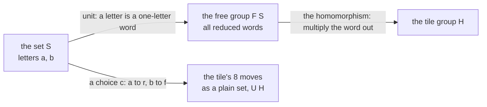

# Adjunctions: two functors whose arrows correspond exactly

[Syllabus](../../../SYLLABUS.md) → [Computability and complexity](../README.md) → [Category Theory in Outline](../README.md#s07) → Adjunctions

---

## General Overview

A square tile fits its recess in 8 ways ([Groups](../../03-Algebra/08-Groups/01-groups.md)). Call the quarter turn r and the flip over the diagonal f. The 8 moves are e (no move), r, r2, r3 (two and three quarter turns), f, rf, r2f and r3f. Here rf means "flip first, then turn".

Write products of moves as strings of the letters a and b, with A and B for their undos. A string such as aab is a **word**, and neighbouring pairs such as aA cancel. A word multiplies like the Groups card's products: its rightmost letter acts first, as in rf. These words form the **free group** on a and b: a group with no rule except that cancelling ([Van Kampen's theorem](../../17-Topology/04-Homotopy/06-van-kampens-theorem.md) builds it).

To read a word as a tile move, say only what a and b mean. Choose a as r and b as f: then aab becomes r, r, f, the move r2f. There are 8 × 8 = 64 such choices. Each gives exactly one translation of all words that respects combining, and each such translation comes from exactly one choice.

That two-way exchange is an **adjunction**: one side builds structure for free, the other forgets it. It moves problems. How many ways can the group with two commuting letters (ab = ba) map into the tile group? Across the adjunction this becomes: how many pairs of tile moves commute? The answer is 40.

**An adjunction matches arrows on two sides one for one, in a way relabelling does not disturb: here homomorphisms out of the free group match choices of where its letters go, so a problem about groups can be solved as a problem about sets.**

**What kind of fact this is:** an adjunction is a definition. That the free group and forgetting form one is a theorem, proved on this card in Why it works. That right adjoints keep limits is a theorem stated with its key steps in a fold, from Mac Lane (Chapter V).

### The picture: one choice, two readings



Schematic. The choice on the left and the homomorphism on the right carry the same information. Following the unit and then the homomorphism gives back the choice.

---

## The formula

Some words first. A **category** is a collection of objects with arrows between them that compose ([Categories and functors](01-categories-and-functors.md)). Here **Set** has sets as objects and functions as arrows, and **Grp** has groups as objects and homomorphisms (maps that respect combining) as arrows. $`\mathrm{Hom}(A, B)`$ is the set of arrows from $`A`$ to $`B`$. A **functor** maps objects to objects and arrows to arrows, keeping composition.

Two functors face each other:

- $`F : \mathbf{Set} \to \mathbf{Grp}`$ sends a set $`S`$ to the free group $`F S`$ of reduced words in its letters.
- $`U : \mathbf{Grp} \to \mathbf{Set}`$ sends a group $`H`$ to $`U H`$, its set of members, and forgets how they combine. $`U`$ is the **forgetful functor**.

The adjunction:

```math
\mathrm{Hom}_{\mathbf{Grp}}(F S,\ H) \;\cong\; \mathrm{Hom}_{\mathbf{Set}}(S,\ U H)
```

**Read it aloud:** homomorphisms from the free group on S into H match one for one with plain functions from S into the members of H, and the match ignores relabelling on either side.

The subscript on $`\mathrm{Hom}`$ names the category the arrows live in.

The symbol $`\cong`$ means a one-for-one match. "Ignores relabelling" is called **natural** ([Natural transformations and Yoneda](03-natural-transformations-and-yoneda.md)): renaming the letters first, or mapping $`H`$ onward afterwards, does not disturb the match.

This card introduces the notation $`F \dashv G`$, read "F is left adjoint to G", for any two functors matched this way; F is the functor applied in the first slot of a Hom, where the arrows start, and G the one applied in the second, where they end. Here it is $`F \dashv U`$.

Two arrows carry the match. The **unit** $`\eta_S`$ puts each letter into the free group. The **counit** $`\varepsilon_H`$ takes a word whose letters are members of $`H`$ and multiplies it out in $`H`$:

```math
\eta_S : S \to U F S, \quad a \mapsto \text{the word } a \qquad\qquad \varepsilon_H : F U H \to H, \quad \text{a word of members} \mapsto \text{their product in } H
```

A clash, said once: on this wing $`\varepsilon`$ was the empty string, then wing 14's allowance; from here it is also the counit. The unit $`\eta`$ is a natural transformation, written with the letter that card uses.

The match itself, in both directions, for a homomorphism $`\varphi`$ and a choice $`c`$:

```math
\varphi \;\mapsto\; U\varphi \circ \eta_S \qquad\qquad c \;\mapsto\; \varepsilon_H \circ F c
```

Here $`U\varphi`$ is $`\varphi`$ read as a plain function, combining forgotten. $`F c`$ is $`F`$ applied to the arrow $`c`$: it rewrites each word in the letters of $`S`$ as a word in their chosen members of $`H`$.

**Read it aloud:** to turn a homomorphism into a choice, see where it sends each one-letter word; to turn a choice into a homomorphism, replace each letter by its chosen member and multiply out.

The two **triangle identities** say these round trips change nothing:

```math
U\varepsilon_H \circ \eta_{U H} = \mathrm{id}_{U H} \qquad\qquad \varepsilon_{F S} \circ F\eta_S = \mathrm{id}_{F S}
```

**Read it aloud:** wrap a member of H as a one-letter word and multiply it out, and the member comes back; turn each letter of a word into a one-letter word and multiply those out, and the word comes back.

Between two orders ([Orders](../../01-Foundations/08-Relations%20and%20Functions/07-partial-and-total-orders.md)), an adjunction is called a **Galois connection**. Its arrows are just "is at most", so the match becomes an "exactly when":

```math
3x \le y \iff x \le \lfloor y/3 \rfloor
```

**Read it aloud:** x packs of 3 boxes fit in y boxes of space exactly when x is at most y divided by 3, rounded down.

| Symbol | Plain meaning | In our example | Push it up and the answer… |
| --- | --- | --- | --- |
| $`\mathbf{Set}`$, $`\mathbf{Grp}`$, $`\mathcal{C}`$, $`\mathcal{D}`$ | the category of sets and functions; of groups and homomorphisms; any two categories | — | — |
| $`S`$; $`H`$ | a set of letters; a group | a, b; the tile's 8 moves | each extra letter multiplies the choices by 8; more members, more choices |
| $`F S`$ | the free group: reduced words in the letters | 4, 12, 36, 108 words of lengths 1 to 4 | — |
| $`\langle a, b \mid ab = ba\rangle`$ | the free group on a, b with the rule ab = ba forced | homomorphisms into the tile: 40 | more rules, fewer homomorphisms |
| $`U H`$ | the members of $`H`$, combining forgotten | the 8 moves as a list | — |
| $`F \dashv U`$, $`F \dashv G`$ | F is left adjoint to U; any left adjoint F and its right adjoint G | free against forget | — |
| $`\mathrm{Hom}(A, B)`$, $`\cong`$, $`\mathrm{id}_A`$ | the arrows from A to B; a one-for-one match; the do-nothing arrow on A | 64 on each side | — |
| $`\varphi`$, $`U\varphi`$; $`c`$, $`F c`$ | a homomorphism out of $`F S`$, and the same map as a plain function; a choice from $`S`$ to $`U H`$, and its letter-by-letter rewrite of words | aab to r2f; a to r, b to f | — |
| $`\eta_S`$, $`\varepsilon_H`$ | the unit: letter to one-letter word; the counit: multiply a word out | a to the word a; r, r, f to r2f | — |
| $`r`$, $`f`$, $`e`$, $`p`$, $`q`$, $`g`$ | quarter turn, flip, no move; any tile moves | rf: flip, then turn | — |
| $`x`$, $`y`$, $`\lfloor y/3 \rfloor`$ | packs, boxes of space, y over 3 rounded down | 20 boxes hold 6 packs | y up by 3, one more pack |
| $`\hat c`$, $`u`$, $`v`$, $`w`$, $`t`$; $`L`$, $`D_i`$, $`\lim_i`$, $`X`$ | the extension of c, words, a letter; in the limits fold, a limit, its pattern, the limit taken over the pattern, a test object | aab to r2f | — |

### When it holds

- **The left side must be free.** The match needs a group with no rules beyond cancelling. The group of order 3, one generator g with $`g^3 = e`$, is not free: of the 8 places to send g, only e works, since no other tile move returns to e after 3 steps.
- **The sides go in this order.** Free goes in the first slot of a Hom, forget in the second. Swapped, there are $`2^8 = 256`$ functions from the tile's moves to the letters a, b, but only 1 homomorphism from the tile group to the free group: everything goes to the empty word. Each tile move g has $`g^4 = e`$, so its image w needs $`w^4`$ to cancel to the empty word, and no non-empty word does. Peel off the first and last letters while they undo each other, as abA peels to b. What is left is not empty and its ends do not undo each other, so its four copies in $`w^4`$ sit side by side with nothing cancelling: $`(abA)^4`$ reduces to abbbbA. The code finds no such word up to length 4, and 1 homomorphism among those sending r and f to words up to length 4.
- **The match must be natural.** Any two sets of the same size can be matched somehow; such a match says nothing about structure. An adjunction asks for one that relabelling does not disturb.
- **Rules on the group side become conditions on the set side.** The group $`\langle a, b \mid ab = ba\rangle`$ is the free group with ab = ba forced. Its homomorphisms match the 40 commuting pairs, not all 64.
- **For orders, round down.** Rounding y/3 to the nearest whole number breaks the "exactly when": it says 20 boxes hold 7 packs, which need 21.

---

## Why it works

### Step 0: a free group has only the rules it must have

A word's value is forced once each letter has a value, because a word is just letters combined. And any values are allowed, because the free group imposes no rule a target group could break. Forced and unconstrained together give a one-for-one match.

This is the free group's universal property ([Universal properties](04-universal-properties-limits-and-colimits.md)): one arrow always exists, and only one. An adjunction is that property holding for every set at once, in a way that ignores relabelling.

### Step 1: from a choice to a homomorphism

Take the choice a to r, b to f. Send A to $`r^{-1} = r3`$ and B to $`f^{-1} = f`$. Read a word left to right and multiply. The word ab gives rf. The word aab gives r2f.

The word abAB gives $`r \cdot f \cdot r^{-1} \cdot f^{-1}`$. On the tile, flip then quarter-turn-back then flip is a quarter turn forward, so the whole is $`r \cdot r`$ = r2, the half turn. So this pair does not commute.

The result respects combining. Multiplying two words means writing one after the other, which multiplies the values, and cancelling neighbours. A cancelled pair such as aA has value $`r \cdot r^{-1} = e`$, so cancelling changes nothing.

<details>
<summary>Detailed proof: the extension is a homomorphism, and the only one</summary>

Write $`\hat c(w)`$ for the product of the chosen members along a word $`w`$, with $`\hat c(\text{empty word}) = e`$.

For any words $`u`$ and $`v`$, the product along $`u`$ then $`v`$ is $`\hat c(u) \cdot \hat c(v)`$, by bracketing (associativity). Reducing $`uv`$ deletes neighbouring pairs $`t\, t^{-1}`$, where $`t`$ is a letter. Each such pair contributes

$`\displaystyle c(t) \cdot c(t)^{-1} = e,`$

so deleting it leaves the product unchanged. Hence $`\hat c(\text{reduce}(uv)) = \hat c(u) \cdot \hat c(v)`$: $`\hat c`$ is a homomorphism.

Uniqueness: any homomorphism $`\varphi`$ with $`\varphi(a) = c(a)`$ and $`\varphi(b) = c(b)`$ must send $`a^{-1}`$ to $`c(a)^{-1}`$, since homomorphisms keep undos. Every word is a product of letters, so $`\varphi(w)`$ is the same product as $`\hat c(w)`$.

</details>

### Step 2: from a homomorphism to a choice, and back

Given any homomorphism $`\varphi`$ out of the free group, look at where it sends the one-letter words a and b. That pair is a choice. Restricting $`\hat c`$ gives back $`c`$, because the one-letter word a multiplies out to $`c(a)`$. Extending the restriction of $`\varphi`$ gives back $`\varphi`$, by the uniqueness in Step 1.

So the two directions undo each other. For the tile, all 64 choices extend, and the code checks the law on every pair of words up to length 2.

### Step 3: the match ignores relabelling

Swap a and b before choosing, and the new homomorphism is the old one with the letters swapped in every word. Map the tile group onward to another group, and the choice and the homomorphism move along together. That is naturality in S and in H. Both hold because a word multiplies out the same way before or after the rename.

### Step 4: the unit, the counit and the triangles

The match is fixed by two arrows. Set $`\varphi`$ to the identity on $`F S`$: the choice it gives is the unit $`\eta_S`$, letter to one-letter word. Set $`c`$ to the identity on $`U H`$: the homomorphism it gives is the counit $`\varepsilon_H`$, multiply out.

Every other match is built from these two by the formulas above, and the triangle identities make those formulas undo each other. The code checks both: 8 of 8 tile moves and 53 of 53 reduced words up to length 3 come back unchanged.

### Step 5: moving a problem across

The question: how many homomorphisms run from $`\langle a, b \mid ab = ba\rangle`$ to the tile group?

A homomorphism out of that group is a homomorphism out of the free group that sends $`aba^{-1}b^{-1}`$ to e. By the adjunction, it is a pair (p, q) of tile moves with $`p q p^{-1} q^{-1} = e`$, that is, pq = qp. So the group question becomes a count of commuting pairs. The count is 40.

A second road gives the same number. The moves fall into 5 **conjugacy classes** (sets of moves of the form $`g p g^{-1}`$ for a fixed p, as g runs over all 8): {e}, {r2}, {r, r3}, {f, r2f}, {rf, r3f}. Commuting pairs number the group's size times the number of classes, 8 × 5 = 40. The reason is orbit-stabiliser ([Group actions](../../03-Algebra/08-Groups/08-group-actions-and-counting.md)), with the group acting on itself by conjugation: the moves that commute with p are its stabiliser, so there are 8 divided by the size of p's class of them, and each class contributes 8 commuting pairs in all.

### Step 6: orders, where the match is "exactly when"

An order is a category with one arrow from x to y when x ≤ y, and none otherwise. Each Hom set holds 0 or 1 arrow, so a match between them is an "exactly when". A functor between orders is a map that keeps ≤.

Multiplying by 3 and dividing by 3 rounded down form a Galois connection on whole numbers. A van with room for 20 boxes takes packs of 3: $`3x \le 20`$ exactly when $`x \le 6`$. The code checks all 3,721 pairs with x and y from −30 to 30.

The right side is forced by the left. Searching for the largest x with $`3x \le y`$ gives $`\lfloor y/3 \rfloor`$ for every y. In general a functor has at most one right adjoint, up to a one-for-one relabelling.

### Step 7: what each side keeps

A right adjoint keeps limits; a left adjoint keeps colimits (limits and colimits are built from arrows into, or out of, a pattern: [Universal properties](04-universal-properties-limits-and-colimits.md)).

- **U keeps products.** The members of the product group (tile × tile) are the pairs of members: 8 × 8 = 64. That is the product of the two sets.
- **F keeps sums.** The free group on the letters a and b is the free product of the free group on a and the free group on b. That is the free product of van Kampen's theorem.
- **U does not keep sums.** The sum of two groups in **Grp** is their free product, which is far larger than the two member sets placed side by side.

<details>
<summary>Detailed proof: right adjoints keep limits</summary>

Let $`F \dashv G`$, with $`G`$ going from $`\mathcal{D}`$ to $`\mathcal{C}`$, and let $`L`$ be a limit of objects $`D_i`$ in $`\mathcal{D}`$. For any object $`X`$ of $`\mathcal{C}`$, the adjunction and the definition of a limit give

$`\displaystyle \mathrm{Hom}(X, G L) \cong \mathrm{Hom}(F X, L) \cong \lim_i \mathrm{Hom}(F X, D_i) \cong \lim_i \mathrm{Hom}(X, G D_i).`$

Each step is natural in $`X`$. So arrows into $`G L`$ match arrows into the pattern $`G D_i`$, which is the definition of $`G L`$ being the limit of the $`G D_i`$, by Yoneda. Turning all arrows round gives the colimit statement for $`F`$. This is Mac Lane, Chapter V, Section 5.

</details>

---

## Worked numbers, by hand

| Step | Arithmetic | Value |
| --- | --- | --- |
| choices from {a, b} to the tile | 8 × 8 | 64 |
| homomorphisms out of the free group | one per choice | **64** |
| the word aab, with a to r, b to f | r · r · f | r2f |
| the word abAB, same choice | r · f · r3 · f | r2 |
| commuting pairs of tile moves | counted directly | 40 |
| the same, through conjugacy classes | 8 × 5 | **40** |
| van of 20 boxes, packs of 3 | 20 divided by 3, rounded down | **6 packs** |

The free group's 64 homomorphisms into the tile group are its 64 choices of where a and b go, and the commuting version has 40, one for each commuting pair.

### What breaks if you drop a piece

| Mistake | Comes out at | What went wrong |
| --- | --- | --- |
| A group of order 3 taken as free | 8 choices, 1 extends | the rule $`g^3 = e`$ blocks 7 of them |
| Sides swapped | 256 functions, 1 homomorphism | the free group is on the wrong side |
| Rounding instead of rounding down | 7 packs, 21 boxes in 20 | 20 pairs in the grid break "exactly when" |
| The rule ab = ba forgotten | 64 counted, 40 true | the rule must become a condition on the pair |

The code prints all four.

---

## Code, from first principles, and it actually runs

The code builds the tile group as permutations of the corners and the reduced words up to length 4. It takes three roads. First, it extends each of the 64 choices and tests the homomorphism law on all 17 × 17 pairs of words up to length 2. Second, it counts commuting pairs directly, through the extended word abAB, and through conjugacy classes. Third, for the Galois connection it checks every pair in a grid and finds the right side again by search.

### Python

```python
# Adjunctions -- the check behind the card.  Nothing is imported.
# Free groups against forgetting: a homomorphism out of the free group on the
# letters a, b is the same thing as a choice of where a and b go.  The target
# is the tile group: the 8 ways a square tile fits its recess, written as
# permutations of the corners 0, 1, 2, 3.  Then a Galois connection on numbers.

def compose(p, q):                        # do q first, then p
    return tuple(p[q[i]] for i in range(4))

def inverse(p):
    out = [0] * 4
    for i in range(4):
        out[p[i]] = i
    return tuple(out)

def power(p, k):
    out = (0, 1, 2, 3)
    for _ in range(k):
        out = compose(p, out)
    return out

E, R, F = (0, 1, 2, 3), (1, 2, 3, 0), (0, 3, 2, 1)   # unmoved, quarter turn, flip
TILE, NAME = [], {}
for j in range(2):
    for k in range(4):
        p = compose(power(R, k), power(F, j))
        TILE.append(p)
        NAME[p] = (["", "r", "r2", "r3"][k] + ("f" if j else "")) or "e"
INV = {"a": "A", "A": "a", "b": "B", "B": "b"}     # A is a backwards, B is b backwards

def reduce(word):                         # cancel neighbouring letter-undo pairs
    out = []
    for x in word:
        if out and out[-1] == INV[x]:
            out.pop()
        else:
            out.append(x)
    return "".join(out)

words = [""]                              # every reduced word up to length 4
for n in range(4):
    words += [w + x for w in words if len(w) == n for x in "abAB" if reduce(w + x) == w + x]
short = [w for w in words if len(w) <= 2]

def extend(img, word):                    # the counit's job: multiply the letters out
    acc = E
    for x in word:
        acc = compose(acc, img[x])
    return acc

def law_holds(img):                       # phi(u v) = phi(u) phi(v) on every short pair
    return all(extend(img, reduce(u + v)) == compose(extend(img, u), extend(img, v))
               for u in short for v in short)

choices = [(x, y) for x in TILE for y in TILE]      # functions from {a, b} to the tile
homs = 0
for x, y in choices:
    img = {"a": x, "A": inverse(x), "b": y, "B": inverse(y)}
    if law_holds(img) and extend(img, "a") == x and extend(img, "b") == y:
        homs += 1
commuting = sum(1 for x, y in choices if compose(x, y) == compose(y, x))
killed = sum(1 for x, y in choices
             if extend({"a": x, "A": inverse(x), "b": y, "B": inverse(y)}, "abAB") == E)
classes = {tuple(sorted(compose(compose(g, x), inverse(g)) for g in TILE)) for x in TILE}
ex = {"a": R, "A": inverse(R), "b": F, "B": inverse(F)}

print("== the tile group: 8 moves of a square tile ==")
print("moves:", " ".join(NAME[p] for p in TILE))
print("reduced words of length 1 to 4:", [sum(1 for w in words if len(w) == n) for n in range(1, 5)])
print("== the correspondence: a homomorphism out of the free group <-> where a and b go ==")
print(f"functions from {{a, b}} to the tile: 8 x 8 = {len(choices)}")
print(f"their extensions passing the law on all {len(short)} x {len(short)} short pairs: {homs}")
print(f"example a -> r, b -> f: ab -> {NAME[extend(ex, 'ab')]}, aab -> {NAME[extend(ex, 'aab')]}, "
      f"abAB -> {NAME[extend(ex, 'abAB')]}")
unit_ok = sum(1 for g in TILE if extend({"g": g}, "g") == g)
def rebuild(w):                           # F(unit): letter -> one-letter word; then multiply
    acc = ""
    for x in w:
        piece = x if x in "ab" else "".join(INV[c] for c in reversed(INV[x]))
        acc = reduce(acc + piece)
    return acc
back = sum(1 for w in words if len(w) <= 3 and rebuild(w) == w)
print(f"triangle 1, counit after unit on each move: {unit_ok} of 8 come back unchanged")
print(f"triangle 2, each reduced word up to length 3 rebuilt letter by letter: "
      f"{back} of {sum(1 for w in words if len(w) <= 3)}")
print("== moving a problem across: homomorphisms from <a, b | ab = ba> to the tile ==")
print(f"pairs (p, q) with pq = qp, counted directly: {commuting}")
print(f"extensions sending abAB to e: {killed}")
print(f"conjugacy classes: {len(classes)}; 8 moves x {len(classes)} classes = {8 * len(classes)}")
print(f"pairs in tile x tile, the product the forgetful side keeps: {len(TILE) * len(TILE)}")
print("== a Galois connection: 3x <= y exactly when x <= floor(y / 3) ==")
grid = [(x, y) for x in range(-30, 31) for y in range(-30, 31)]
agree = sum(1 for x, y in grid if (3 * x <= y) == (x <= y // 3))
searched = [max(x for x in range(-30, 31) if 3 * x <= y) for y in range(-30, 31)]
print(f"pairs from -30 to 30 where the two sides agree: {agree} of {len(grid)}")
same = searched == [y // 3 for y in range(-30, 31)]
print(f"right side found by search equals floor division: {'yes' if same else 'no'}")
print(f"van holds 20 boxes, packs of 3: at most {20 // 3} packs")
rounded = sum(1 for x, y in grid if (3 * x <= y) != (x <= (y + 1) // 3))
print(f"mistake, rounding instead of floor: 20 -> {(20 + 1) // 3} packs = {3 * ((20 + 1) // 3)} boxes; "
      f"{rounded} pairs disagree")
z3 = [NAME[x] for x in TILE if power(x, 3) == E]
print(f"mistake, one-generator group of order 3 (not free): 8 choices, {len(z3)} extend: {' '.join(z3)}")
fin = [w for w in words if w and reduce(w * 4) == ""]   # non-empty words with w^4 = 1
def lift(p, w1, w2):                      # r^k f^j -> w1^k w2^j: a candidate map tile -> words
    i = TILE.index(p)
    return reduce(w1 * (i % 4) + w2 * (i // 4))
swapped = sum(1 for w1 in words for w2 in words
              if all(lift(compose(p, q), w1, w2) == reduce(lift(p, w1, w2) + lift(q, w1, w2))
                     for p in TILE for q in TILE))
print(f"mistake, sides swapped: 2^8 = {2 ** 8} functions from tile to {{a, b}}; "
      f"non-empty words up to length 4 with w^4 = 1: {len(fin) or 'none'}")
print(f"  homomorphisms tile -> free group sending r and f to words up to length 4: {swapped}")
print(f"mistake, relation forgotten: {len(choices)} pairs counted, {commuting} are homomorphisms")
assert len(set(TILE)) == 8 and all(compose(p, q) in TILE for p in TILE for q in TILE)
assert homs == len(choices) == 64                   # every choice extends: the bijection
assert commuting == killed == 8 * len(classes) == 40   # three counts of one answer
assert agree == len(grid) and same
assert unit_ok == len(TILE) and back == 1 + sum(4 * 3 ** (n - 1) for n in range(1, 4))   # both triangles
assert rounded > 0 and len(z3) == 1 and fin == [] and swapped == 1
print("ALL CHECKS PASS")
```

**Ran 2026-11-19 on macOS, Python 3.14.10, standard library only. All checks passed. Output, pasted from the run:**

```
== the tile group: 8 moves of a square tile ==
moves: e r r2 r3 f rf r2f r3f
reduced words of length 1 to 4: [4, 12, 36, 108]
== the correspondence: a homomorphism out of the free group <-> where a and b go ==
functions from {a, b} to the tile: 8 x 8 = 64
their extensions passing the law on all 17 x 17 short pairs: 64
example a -> r, b -> f: ab -> rf, aab -> r2f, abAB -> r2
triangle 1, counit after unit on each move: 8 of 8 come back unchanged
triangle 2, each reduced word up to length 3 rebuilt letter by letter: 53 of 53
== moving a problem across: homomorphisms from <a, b | ab = ba> to the tile ==
pairs (p, q) with pq = qp, counted directly: 40
extensions sending abAB to e: 40
conjugacy classes: 5; 8 moves x 5 classes = 40
pairs in tile x tile, the product the forgetful side keeps: 64
== a Galois connection: 3x <= y exactly when x <= floor(y / 3) ==
pairs from -30 to 30 where the two sides agree: 3721 of 3721
right side found by search equals floor division: yes
van holds 20 boxes, packs of 3: at most 6 packs
mistake, rounding instead of floor: 20 -> 7 packs = 21 boxes; 20 pairs disagree
mistake, one-generator group of order 3 (not free): 8 choices, 1 extend: e
mistake, sides swapped: 2^8 = 256 functions from tile to {a, b}; non-empty words up to length 4 with w^4 = 1: none
  homomorphisms tile -> free group sending r and f to words up to length 4: 1
mistake, relation forgotten: 64 pairs counted, 40 are homomorphisms
ALL CHECKS PASS
```

### Rust

Same numbers, same labels, built with `rustc --edition 2021 -O`.

```rust
// Adjunctions -- the same check as the Python, in Rust.  No crates.
// Free groups against forgetting: a homomorphism out of the free group on the
// letters a, b is the same thing as a choice of where a and b go.  The target
// is the tile group: the 8 ways a square tile fits its recess, written as
// permutations of the corners 0, 1, 2, 3.  Then a Galois connection on numbers.
type P = [usize; 4];
const E: P = [0, 1, 2, 3];
const R: P = [1, 2, 3, 0]; // quarter turn
const F: P = [0, 3, 2, 1]; // flip

fn compose(p: P, q: P) -> P { [p[q[0]], p[q[1]], p[q[2]], p[q[3]]] } // q first, then p

fn inverse(p: P) -> P {
    let mut out = [0; 4];
    for i in 0..4 { out[p[i]] = i }
    out
}

fn power(p: P, k: usize) -> P {
    let mut out = E;
    for _ in 0..k { out = compose(p, out) }
    out
}

fn inv(x: char) -> char { match x { 'a' => 'A', 'A' => 'a', 'b' => 'B', _ => 'b' } }

fn reduce(word: &str) -> String { // cancel neighbouring letter-undo pairs
    let mut out: Vec<char> = Vec::new();
    for x in word.chars() {
        if out.last() == Some(&inv(x)) { out.pop(); } else { out.push(x) }
    }
    out.into_iter().collect()
}

fn image(img: &(P, P), x: char) -> P {
    match x { 'a' => img.0, 'A' => inverse(img.0), 'b' => img.1, _ => inverse(img.1) }
}

fn extend(img: &(P, P), word: &str) -> P { // the counit's job: multiply the letters out
    let mut acc = E;
    for x in word.chars() { acc = compose(acc, image(img, x)) }
    acc
}

fn rebuild(w: &str) -> String { // F(unit): letter -> one-letter word; then multiply
    let mut acc = String::new();
    for x in w.chars() {
        let letter = if x == 'a' || x == 'b' { x.to_string() } else { inv(x).to_string() };
        let piece: String = if x == 'a' || x == 'b' { letter } else { letter.chars().rev().map(inv).collect() };
        acc = reduce(&(acc + &piece));
    }
    acc
}

fn yn(b: bool) -> &'static str { if b { "yes" } else { "no" } }

fn main() {
    let mut tile: Vec<P> = Vec::new();
    let mut names: Vec<String> = Vec::new();
    for j in 0..2 {
        for k in 0..4 {
            tile.push(compose(power(R, k), power(F, j)));
            let s = format!("{}{}", ["", "r", "r2", "r3"][k], if j == 1 { "f" } else { "" });
            names.push(if s.is_empty() { "e".to_string() } else { s });
        }
    }
    let name = |p: P| names[tile.iter().position(|&q| q == p).unwrap()].clone();
    let mut words: Vec<String> = vec![String::new()];
    for n in 0..4 {
        let mut add = Vec::new();
        for w in words.iter().filter(|w| w.len() == n) {
            for x in "abAB".chars() {
                let wx = format!("{}{}", w, x);
                if reduce(&wx) == wx { add.push(wx) }
            }
        }
        words.extend(add);
    }
    let short: Vec<&String> = words.iter().filter(|w| w.len() <= 2).collect();
    let law_holds = |img: &(P, P)| short.iter().all(|u| short.iter().all(|v|
        extend(img, &reduce(&format!("{}{}", u, v))) == compose(extend(img, u), extend(img, v))));
    let mut choices: Vec<(P, P)> = Vec::new();
    for &x in &tile { for &y in &tile { choices.push((x, y)) } }
    let homs = choices.iter().filter(|c| law_holds(c) && extend(c, "a") == c.0 && extend(c, "b") == c.1).count();
    let commuting = choices.iter().filter(|c| compose(c.0, c.1) == compose(c.1, c.0)).count();
    let killed = choices.iter().filter(|c| extend(c, "abAB") == E).count();
    let mut classes: Vec<Vec<P>> = Vec::new();
    for &x in &tile {
        let mut c: Vec<P> = tile.iter().map(|&g| compose(compose(g, x), inverse(g))).collect();
        c.sort();
        if !classes.contains(&c) { classes.push(c) }
    }
    let ex = (R, F);
    println!("== the tile group: 8 moves of a square tile ==");
    println!("moves: {}", names.join(" "));
    let counts: Vec<usize> = (1..5).map(|n| words.iter().filter(|w| w.len() == n).count()).collect();
    println!("reduced words of length 1 to 4: {:?}", counts);
    println!("== the correspondence: a homomorphism out of the free group <-> where a and b go ==");
    println!("functions from {{a, b}} to the tile: 8 x 8 = {}", choices.len());
    println!("their extensions passing the law on all {} x {} short pairs: {}", short.len(), short.len(), homs);
    println!("example a -> r, b -> f: ab -> {}, aab -> {}, abAB -> {}",
             name(extend(&ex, "ab")), name(extend(&ex, "aab")), name(extend(&ex, "abAB")));
    let unit_ok = tile.iter().filter(|&&g| extend(&(g, g), "a") == g).count();
    let upto3 = words.iter().filter(|w| w.len() <= 3).count();
    let back = words.iter().filter(|w| w.len() <= 3 && rebuild(w) == **w).count();
    println!("triangle 1, counit after unit on each move: {} of 8 come back unchanged", unit_ok);
    println!("triangle 2, each reduced word up to length 3 rebuilt letter by letter: {} of {}", back, upto3);
    println!("== moving a problem across: homomorphisms from <a, b | ab = ba> to the tile ==");
    println!("pairs (p, q) with pq = qp, counted directly: {}", commuting);
    println!("extensions sending abAB to e: {}", killed);
    println!("conjugacy classes: {}; 8 moves x {} classes = {}", classes.len(), classes.len(), 8 * classes.len());
    println!("pairs in tile x tile, the product the forgetful side keeps: {}", tile.len() * tile.len());
    println!("== a Galois connection: 3x <= y exactly when x <= floor(y / 3) ==");
    let mut grid: Vec<(i64, i64)> = Vec::new();
    for x in -30..31 { for y in -30..31 { grid.push((x, y)) } }
    let agree = grid.iter().filter(|&&(x, y)| (3 * x <= y) == (x <= y.div_euclid(3))).count();
    let searched: Vec<i64> = (-30..31).map(|y: i64| (-30..31).filter(|x| 3 * x <= y).max().unwrap()).collect();
    let same = searched == (-30..31).map(|y: i64| y.div_euclid(3)).collect::<Vec<i64>>();
    println!("pairs from -30 to 30 where the two sides agree: {} of {}", agree, grid.len());
    println!("right side found by search equals floor division: {}", yn(same));
    println!("van holds 20 boxes, packs of 3: at most {} packs", 20 / 3);
    let rounded = grid.iter().filter(|&&(x, y)| (3 * x <= y) != (x <= (y + 1).div_euclid(3))).count();
    println!("mistake, rounding instead of floor: 20 -> {} packs = {} boxes; {} pairs disagree",
             (20 + 1) / 3, 3 * ((20 + 1) / 3), rounded);
    let z3: Vec<String> = tile.iter().filter(|&&x| power(x, 3) == E).map(|&x| name(x)).collect();
    println!("mistake, one-generator group of order 3 (not free): 8 choices, {} extend: {}", z3.len(), z3.join(" "));
    let fin = words.iter().filter(|w| !w.is_empty() && reduce(&w.repeat(4)).is_empty()).count();
    let lift = |p: P, w1: &str, w2: &str| { // r^k f^j -> w1^k w2^j: a candidate map tile -> words
        let i = tile.iter().position(|&q| q == p).unwrap();
        reduce(&(w1.repeat(i % 4) + &w2.repeat(i / 4)))
    };
    let swapped: usize = words.iter().map(|w1| words.iter().filter(|w2| tile.iter().all(|&p| tile.iter().all(|&q|
        lift(compose(p, q), w1, w2) == reduce(&(lift(p, w1, w2) + &lift(q, w1, w2)))))).count()).sum();
    println!("mistake, sides swapped: 2^8 = {} functions from tile to {{a, b}}; non-empty words up to length 4 with w^4 = 1: {}",
             1 << 8, if fin == 0 { "none".to_string() } else { fin.to_string() });
    println!("  homomorphisms tile -> free group sending r and f to words up to length 4: {}", swapped);
    println!("mistake, relation forgotten: {} pairs counted, {} are homomorphisms", choices.len(), commuting);
    assert!(tile.iter().all(|&p| tile.iter().all(|&q| tile.contains(&compose(p, q)))) && classes.len() == 5);
    assert!(homs == choices.len() && homs == 64); // every choice extends: the bijection
    assert!(commuting == killed && killed == 8 * classes.len() && commuting == 40); // three counts
    assert!(agree == grid.len() && same);
    assert!(unit_ok == tile.len() && back == 1 + (1..4u32).map(|n| 4 * 3usize.pow(n - 1)).sum::<usize>()); // both triangles
    assert!(rounded > 0 && z3.len() == 1 && fin == 0 && swapped == 1);
    println!("ALL CHECKS PASS");
}
```

**Ran 2026-11-19 on macOS, rustc 1.98.1, no crates. All checks passed. Output, pasted from the run:**

```
== the tile group: 8 moves of a square tile ==
moves: e r r2 r3 f rf r2f r3f
reduced words of length 1 to 4: [4, 12, 36, 108]
== the correspondence: a homomorphism out of the free group <-> where a and b go ==
functions from {a, b} to the tile: 8 x 8 = 64
their extensions passing the law on all 17 x 17 short pairs: 64
example a -> r, b -> f: ab -> rf, aab -> r2f, abAB -> r2
triangle 1, counit after unit on each move: 8 of 8 come back unchanged
triangle 2, each reduced word up to length 3 rebuilt letter by letter: 53 of 53
== moving a problem across: homomorphisms from <a, b | ab = ba> to the tile ==
pairs (p, q) with pq = qp, counted directly: 40
extensions sending abAB to e: 40
conjugacy classes: 5; 8 moves x 5 classes = 40
pairs in tile x tile, the product the forgetful side keeps: 64
== a Galois connection: 3x <= y exactly when x <= floor(y / 3) ==
pairs from -30 to 30 where the two sides agree: 3721 of 3721
right side found by search equals floor division: yes
van holds 20 boxes, packs of 3: at most 6 packs
mistake, rounding instead of floor: 20 -> 7 packs = 21 boxes; 20 pairs disagree
mistake, one-generator group of order 3 (not free): 8 choices, 1 extend: e
mistake, sides swapped: 2^8 = 256 functions from tile to {a, b}; non-empty words up to length 4 with w^4 = 1: none
  homomorphisms tile -> free group sending r and f to words up to length 4: 1
mistake, relation forgotten: 64 pairs counted, 40 are homomorphisms
ALL CHECKS PASS
```

The two outputs match line for line.

### Lean

Lean proves the adjunction for every set, the Galois connection for every whole number, and limit-keeping for every right adjoint.

- The free group functor F is left adjoint to the forgetful functor U: the match is one for one and ignores relabelling.
- Under that match, a homomorphism $`\varphi`$ becomes the choice sending each letter to $`\varphi`$ of its one-letter word.
- The unit puts each letter in as its one-letter word.
- Take any whole numbers x and y. Then $`3x \le y`$ exactly when $`x \le \lfloor y/3 \rfloor`$.
- Suppose $`F \dashv G`$. Then G keeps every limit, whatever the shape of its pattern.
- The tile group has 8 moves, so the letters a and b have 8 × 8 = 64 choices.
- Choose a as r and b as f. Then the word aab multiplies out to r2f, and abAB to r2.
- Of the 64 pairs of tile moves, 40 commute; the 5 conjugacy classes give 8 × 5 = 40 again.
- Only 1 of the 8 tile moves g has $`g^3 = e`$, namely e.
- There are $`2^8 = 256`$ functions from the tile's moves to the letters a, b.
- The word counts add up: 1 + 4 + 12 + 36 = 53.
- A van of 20 boxes holds 6 packs of 3, and 7 packs would need 21.
- Rounding to the nearest instead of rounding down breaks "exactly when" on 20 of the 3,721 grid pairs.

Listing the reduced words, the short-pair homomorphism tests and the sides-swapped search are left to the Python and Rust checks.

```lean
-- Adjunctions: the free group is left adjoint to forgetting the group, so homomorphisms out of a free group match choices of where its letters go; multiplying by 3 and dividing by 3 rounded down form a Galois connection; and every right adjoint keeps limits.
import Mathlib.Algebra.Category.Grp.Adjunctions
import Mathlib.CategoryTheory.Adjunction.Limits
import Mathlib.GroupTheory.SpecificGroups.Dihedral
import Mathlib.Order.GaloisConnection.Defs
import Mathlib.Data.Fintype.Pi
import Mathlib.Data.Int.Interval

open CategoryTheory CategoryTheory.Limits DihedralGroup

universe u v w u₁ v₁ u₂ v₂

/-- Free against forget. The free group functor `F : Set → Grp` is left adjoint to the
forgetful functor `U : Grp → Set`, `F ⊣ U`: there is an adjunction, a one-for-one match
`Hom_Grp(F S, H) ≅ Hom_Set(S, U H)` natural in the set `S` and the group `H`, under which a
homomorphism `φ` out of the free group on `S` matches the choice sending each letter `s` to
`φ` of the one-letter word `s`, and whose unit puts each letter in as its one-letter word. -/
theorem free_group_left_adjoint_to_forget :
    ∃ adj : GrpCat.free.{u} ⊣ forget GrpCat.{u},
      (∀ (S : Type u) (H : GrpCat.{u}) (φ : GrpCat.free.obj S ⟶ H) (s : S),
        adj.homEquiv S H φ s = φ (FreeGroup.of s)) ∧
      (∀ (S : Type u) (s : S), adj.unit.app S s = FreeGroup.of s) := by
  refine ⟨GrpCat.adj, fun S H φ s => rfl, fun S s => rfl⟩

/-- The Galois connection on whole numbers: `x` packs of 3 boxes fit in `y` boxes of space
exactly when `x` is at most `y / 3` rounded down, that is `3x ≤ y ↔ x ≤ ⌊y/3⌋` for all
integers `x`, `y`, so multiplying by 3 is left adjoint to dividing by 3 rounded down. -/
theorem times_three_galois_floor_div_three :
    GaloisConnection (fun x : ℤ => 3 * x) (fun y : ℤ => Int.fdiv y 3) := by
  intro x y
  show 3 * x ≤ y ↔ x ≤ Int.fdiv y 3
  rw [Int.fdiv_eq_ediv_of_nonneg _ (by norm_num : (0:ℤ) ≤ 3)]
  omega

/-- Right adjoints keep limits: if `F ⊣ G`, then `G` sends every limit, of any shape, to a
limit. -/
theorem right_adjoint_preserves_limits {C : Type u₁} [Category.{v₁} C] {D : Type u₂}
    [Category.{v₂} D] {F : C ⥤ D} {G : D ⥤ C} (adj : F ⊣ G) :
    PreservesLimitsOfSize.{v, w} G := by
  exact adj.rightAdjoint_preservesLimits

-- The tile group: the 8 moves of a square tile, quarter turn r = `r 1`, flip f = `sr 0`.
example : Fintype.card (DihedralGroup 4) = 8 := by simp [DihedralGroup.card]
-- Choices of where the letters a, b go: 8 × 8 = 64.
example : Fintype.card (Fin 2 → DihedralGroup 4) = 64 := by simp [DihedralGroup.card]
-- With a ↦ r, b ↦ f, extending to the free group: the word aab multiplies out to r2f.
example : FreeGroup.lift (fun x : Fin 2 => if x = 0 then r (1 : ZMod 4) else sr 0)
    (FreeGroup.of 0 * FreeGroup.of 0 * FreeGroup.of 1) = r 2 * sr 0 := by
  simp only [map_mul, FreeGroup.lift_apply_of]; decide
-- The same choice sends abAB to the half turn r2, so r and f do not commute.
example : FreeGroup.lift (fun x : Fin 2 => if x = 0 then r (1 : ZMod 4) else sr 0)
    (FreeGroup.of 0 * FreeGroup.of 1 * (FreeGroup.of 0)⁻¹ * (FreeGroup.of 1)⁻¹) = r 2 := by
  simp only [map_mul, map_inv, FreeGroup.lift_apply_of]; decide
-- Moving the problem across: 40 of the 64 pairs of tile moves commute.
example : (Finset.univ.filter
    (fun p : DihedralGroup 4 × DihedralGroup 4 => p.1 * p.2 = p.2 * p.1)).card = 40 := by
  decide
-- The second road: 5 conjugacy classes, and 8 × 5 = 40.
example : (Finset.univ.image (fun x : DihedralGroup 4 =>
    Finset.univ.image (fun g : DihedralGroup 4 => g * x * g⁻¹))).card = 5 := by decide
example : 8 * 5 = 40 := by norm_num
-- Order 3 is not free: of the 8 places to send g, only e satisfies g ^ 3 = e.
example : (Finset.univ.filter (fun g : DihedralGroup 4 => g ^ 3 = 1)).card = 1 := by decide
-- Sides swapped: 2 ^ 8 = 256 functions from the tile's moves to the letters a, b.
example : Fintype.card (DihedralGroup 4 → Fin 2) = 256 := by simp [DihedralGroup.card]
-- Reduced words of lengths 1 to 4: 4, 12, 36, 108; with the empty word, 53 up to length 3.
example : (List.range 4).map (fun n => 4 * 3 ^ n) = [4, 12, 36, 108] := by decide
example : 1 + 4 + 12 + 36 = 53 := by norm_num
-- A van of 20 boxes takes 6 packs of 3; rounding to the nearest gives 7 packs, needing 21.
example : Int.fdiv 20 3 = 6 := by decide
example : 3 * 7 = 21 ∧ ¬ (21 ≤ 20) := by decide
-- Rounding instead of rounding down breaks "exactly when" on 20 of the 3,721 grid pairs.
example : ((Finset.Icc (-30 : ℤ) 30 ×ˢ Finset.Icc (-30 : ℤ) 30).filter
    (fun p => (3 * p.1 ≤ p.2) ≠ (p.1 ≤ Int.fdiv (p.2 + 1) 3))).card = 20 := by decide +kernel
example : 61 * 61 = 3721 := by norm_num

#print axioms free_group_left_adjoint_to_forget
#print axioms times_three_galois_floor_div_three
#print axioms right_adjoint_preserves_limits
```

**Checked 2026-11-19 on macOS, Lean 4.36.0-rc2, Mathlib v4.36.0-rc2. Every proof is complete and uses only Lean's standard axioms. Output, pasted from the run:**

```
'free_group_left_adjoint_to_forget' depends on axioms: [propext, Classical.choice, Quot.sound]
'times_three_galois_floor_div_three' depends on axioms: [propext, Classical.choice, Quot.sound]
'right_adjoint_preserves_limits' depends on axioms: [propext, Classical.choice, Quot.sound]
```

> [!TIP]
> **Try changing**
> Guess first, then run it.
> - **Evaluate right to left.** In `extend`, change `compose(acc, img[x])` to `compose(img[x], acc)`. Guess first: still a homomorphism? No: it reverses every product, the law still holds for the 40 commuting choices but fails on the rest, and the second assert stops the program.
> - **A different pack size.** In the line that sets `agree`, change both 3s to 4. Guess first: does "exactly when" survive? Yes: 3,721 of 3,721 still agree, since rounding down works for any pack size.
> - **Round up.** Replace `y // 3` with `(y + 2) // 3` in the line that sets `agree`. Guess first: how many pairs break? The count falls below 3,721 and the fourth assert stops it.

---

## The usual mistake

> [!warning]
> **Treating every group like a free group.** Choosing images for generators defines a homomorphism only when the group has no rules beyond cancelling. For the group of order 3, sending its generator to the quarter turn r fails, since $`r^3`$ is r3, not e. Of 8 choices only 1 extends.
>
> - **Sides backwards.** Free is left adjoint to forget: 256 functions from the tile's moves to a, b, but 1 homomorphism from the tile group to the free group.
> - **Rules forgotten when moving a problem.** Homomorphisms out of $`\langle a, b \mid ab = ba\rangle`$ number 40, not 64.
> - **Rounding to nearest.** It claims 20 boxes hold 7 packs of 3, which need 21.
> - **Expecting U to keep sums.** U keeps products, 8 × 8 = 64 pairs, but the sum of two groups is their free product.

---

## Where you meet it in real life

- **Puzzle solvers.** Programs for permutation puzzles store move sequences as words and evaluate them only when needed. The adjunction makes this safe: a word's effect is fixed by what each basic move does.
- **Lists and folds in programming.** A list of values is the free monoid on those values, the monoid version of the free group. Summing or concatenating a list is the counit multiplying a word out: [Monoids and monads](07-monoids-and-monads-for-programmers.md).
- **Integer division.** Floor division is the right adjoint of multiplication, so "x packs fit in y" can be tested either way, as when sizing memory pages.
- **Program analysis.** Abstract interpretation, a method for proving facts about all runs of a program, pairs real values with coarse summaries such as "positive" by a Galois connection (Cousot and Cousot, 1977).

> **Say it back**
> An adjunction is two functors facing each other, with arrows from F S to H matched one for one with arrows from S to U H, in a way that ignores relabelling. For the free group and the forgetful functor, a homomorphism out of the words in a and b is the same as a choice of where a and b go: 64 choices into the tile group, 64 homomorphisms. The unit puts letters in as one-letter words and the counit multiplies words out; the triangle identities say the round trips change nothing. Moving a problem across turns homomorphisms from the commuting group into a count of 40 commuting pairs. Between orders the match is an "exactly when": 3x ≤ y exactly when x ≤ y over 3, rounded down.

---

## What this builds on

- [Universal properties](04-universal-properties-limits-and-colimits.md): the one arrow that always exists; an adjunction is that property for every object at once.
- [Groups](../../03-Algebra/08-Groups/01-groups.md): the tile's 8 moves and the four group rules.
- [Orders](../../01-Foundations/08-Relations%20and%20Functions/07-partial-and-total-orders.md): the orders that become categories in Step 6.
- [Van Kampen's theorem](../../17-Topology/04-Homotopy/06-van-kampens-theorem.md): free groups, presentations and free products, used here without rebuilding.
- [Natural transformations and Yoneda](03-natural-transformations-and-yoneda.md): naturality, and the Yoneda step in the limits proof.
- [Pullbacks and pushouts](05-pullbacks-pushouts-and-gluing.md): two of the limits and colimits that right and left adjoints keep.

## Where this goes next

- [Monoids and monads](07-monoids-and-monads-for-programmers.md): the next card. Free then forget, U F, is a monad: wrap a value, and flatten nested wrapping by the counit.
- [F-algebras](08-f-algebras-and-folds.md): folds as the arrows out of a free structure, the same "say where the letters go" in recursive form.

This card leaves open how to tell, for a functor that keeps limits, whether a left adjoint exists at all; the adjoint functor theorems answer that, with a size condition.

---

## Sources

Verified 2026-11-19: every link below resolves to the publisher's page.

- Kan, Daniel M. "Adjoint Functors." *Transactions of the American Mathematical Society* 87, no. 2 (1958): 294–329. [doi:10.1090/S0002-9947-1958-0131451-0](https://doi.org/10.1090/S0002-9947-1958-0131451-0). The paper that defined adjoint functors.
- Mac Lane, Saunders. *Categories for the Working Mathematician*, 2nd ed. Springer, Graduate Texts in Mathematics 5. [doi:10.1007/978-1-4757-4721-8](https://doi.org/10.1007/978-1-4757-4721-8). Chapter IV defines adjunctions by unit, counit and triangles; Chapter V proves that right adjoints keep limits.
- Leinster, Tom. *Basic Category Theory*. Cambridge University Press, 2014. [doi:10.1017/CBO9781107360068](https://doi.org/10.1017/CBO9781107360068). Free and forgetful functors as the first examples, and adjunctions between ordered sets.
- Riehl, Emily. *Category Theory in Context*. Dover, 2016. [Publisher page](https://store.doverpublications.com/products/9780486809038). Chapter 4 on adjunctions, with the limit-keeping proof in the form used here.
- Cousot, Patrick, and Radhia Cousot. "Abstract Interpretation: A Unified Lattice Model for Static Analysis of Programs by Construction or Approximation of Fixpoints." *Proceedings of the 4th ACM Symposium on Principles of Programming Languages* (1977): 238–252. [doi:10.1145/512950.512973](https://doi.org/10.1145/512950.512973). Galois connections as the link between real program values and their summaries.
