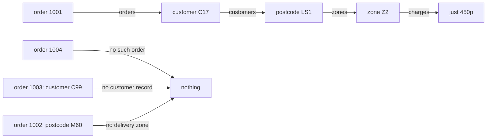

# Monoids and monads: combining values, and sequencing steps that can fail

[Syllabus](../../../SYLLABUS.md) → [Computability and complexity](../README.md) → [Category Theory in Outline](../README.md#s07) → Monoids and monads

---

## General Overview

An online grocer's basket holds four items: tea at 249p, milk at 120p, coffee at 375p and bread at 89p. The total is 833p, or £8.33. A program finds it by starting at 0 and adding one price at a time.

Split the basket across two tills. Till A adds the first three items and gets 744p; till B adds the bread, 89p. Then 744 + 89 = 833, the same answer, because addition ignores where the brackets go and 0 changes nothing. Those two facts make addition a **monoid**: a way to combine values that can be split and recombined freely.

Next the shop needs the delivery charge for order 1001. That takes four lookups in a row: order to customer, customer to postcode, postcode to delivery zone, zone to charge. Order 1001 gives customer C17, postcode LS1, zone Z2 and a delivery charge of 450p. The bill is the basket plus delivery: 833 + 450 = 1283p, or £12.83.

Any lookup can fail: the shop does not deliver to postcode M60, so order 1002 has no charge. A **monad** chains such steps. Each step runs only if the one before gave a value, and a failure passes straight to the end as "nothing". Its laws turn out to be the monoid laws again, applied to steps instead of prices.

**A monoid combines values with one operation where brackets can move and one value changes nothing, so a list can be folded in any grouping; a monad chains steps that may fail, and its laws say those steps also combine like a monoid.**

**What kind of fact this is:** two definitions, monoid and monad, and two theorems proved on this card in Why it works: every bracketing of a fold gives one answer, and Maybe obeys the three monad laws. "A monad is a monoid in the category of endofunctors" is stated with its source, not proved.

### The picture: four lookups, and where each order stops



Each arrow is one lookup. After a failed lookup, no later lookup runs.

---

## The formula

Notation first, in words. A **monoid** is a set $`M`$ with an operation written $`\cdot`$ and one member $`e`$, called the identity. For the basket, $`M`$ is whole numbers of pence, $`\cdot`$ is $`+`$ and $`e`$ is 0. Two laws must hold for all members $`a`$, $`b`$, $`c`$:

```math
(a \cdot b) \cdot c = a \cdot (b \cdot c), \qquad e \cdot a = a \cdot e = a
```

**Read it aloud:** brackets can move, and combining with the identity changes nothing.

The [Groups](../../03-Algebra/08-Groups/01-groups.md) card states four rules: closed, associative, identity and inverses. A monoid keeps the first three and drops inverses. A **fold** combines a list $`x_1, \ldots, x_n`$ by starting at the identity:

```math
\mathrm{fold}(x_1, \ldots, x_n) = e \cdot x_1 \cdot x_2 \cdots x_n, \qquad \mathrm{fold}() = e
```

**Read it aloud:** start at the identity and combine each item in turn; an empty list gives the identity. For the basket, 0 + 249 + 120 + 375 + 89 = 833.

Now the lookups. For a set $`X`$ of keys, $`T X`$ is $`X`$ plus one extra value, "nothing": $`T X = X + \{\text{nothing}\}`$, the sum of two sets from [Commutative diagrams](02-commutative-diagrams-and-duality.md). A member of $`X`$ inside $`T X`$ is written "just $`x`$". This $`T`$ is the **Maybe monad**. A **step** is a function $`f : X \to T X`$: a lookup that gives just a value or nothing.

Two operations come with it. The **unit** $`\eta`$ (eta) wraps a value: $`\eta(x) = \text{just } x`$. **Bind**, new notation on this card, feeds a Maybe value $`m`$ to the next step:

```math
\mathrm{bind}(m, f) = \begin{cases} f(x) & \text{if } m = \text{just } x \\ \text{nothing} & \text{if } m = \text{nothing} \end{cases}
```

**Read it aloud:** if there is a value, run the next step on it; if there is nothing, pass nothing on and skip the step.

The three **monad laws**, for every value $`a`$, every Maybe value $`m`$ and every pair of steps $`f`$, $`g`$:

```math
\mathrm{bind}(\eta(a), f) = f(a), \qquad \mathrm{bind}(m, \eta) = m, \qquad \mathrm{bind}(\mathrm{bind}(m, f), g) = \mathrm{bind}(m, x \mapsto \mathrm{bind}(f(x), g))
```

**Read it aloud:** wrapping then binding is just running the step; binding into the unit changes nothing; and f then g, one at a time, equals the combined step "f, then g".

Write $`f \mathbin{>\!=\!>} g`$ for that combined step: $`x \mapsto \mathrm{bind}(f(x), g)`$, read "f, then g". The three laws become:

```math
\eta \mathbin{>\!=\!>} f = f, \qquad f \mathbin{>\!=\!>} \eta = f, \qquad (f \mathbin{>\!=\!>} g) \mathbin{>\!=\!>} h = f \mathbin{>\!=\!>} (g \mathbin{>\!=\!>} h)
```

**Read it aloud:** steps under "then" form a monoid, with the unit as the identity.

That needs one shared key set. Here every key, from order numbers to zones, lives in one set $`X`$, so any step can follow any other. With a different key type at each stage, steps form a category instead; one shared set makes it a monoid, a category with one object (Step 2).

| Symbol | Plain meaning | In our example | Push it up and the answer… |
| --- | --- | --- | --- |
| $`M`$, $`\cdot`$, $`e`$; $`a`$ to $`d`$ | a monoid: its set, operation and identity; any members | pence, $`+`$, 0; any prices | — |
| $`x_1, \ldots, x_n`$, $`n`$ | the items folded, and how many | 249, 120, 375, 89; $`n = 4`$ | more bracketings: 5 for four items, 14 for five |
| $`\mathrm{fold}`$ | combine a whole list, starting at $`e`$ | 833p | — |
| $`X`$, $`T X`$ | a set of keys; the same set plus "nothing" | order numbers, postcodes and so on | — |
| just $`x`$, nothing | the two kinds of member of $`T X`$ | just 450, nothing | — |
| $`f`$, $`g`$, $`h`$ | steps $`X \to T X`$: lookups that may fail | orders, customers, zones, charges | more steps, more places to fail |
| $`\eta`$ | the unit: wrap a value, $`x \mapsto`$ just $`x`$ | just 1001 | — |
| $`m`$, $`\mathrm{bind}(m, f)`$ | a Maybe value; run $`f`$ on its value, or pass nothing on | just C17; just LS1 from it | — |
| $`L`$, $`P`$, $`Q`$, $`Q'`$, $`k`$ | in the proof of Step 1: the left-to-right value, the two parts of a bracketing, the right part less its last item, the split point | $`k = 3`$ for the two tills | — |
| $`f \mathbin{>\!=\!>} g`$ | step $`f`$, then step $`g`$, as one step | four lookups as one table: 1001 to 450 | — |
| $`\mu`$ | flatten: $`T T X`$, a Maybe of a Maybe, to $`T X`$ | just (just LS1) to just LS1 | — |
| $`\varepsilon`$, $`\mathrm{id}`$, $`\otimes`$ | from other cards: the counit of an adjunction (multiply out); an identity arrow; side by side | the fold; $`e`$; — | — |

### When it holds

- **Brackets must really move.** Subtraction is not associative: left to right the basket gives −335, right to left 415, so a split fold depends on the split.
- **The identity must change nothing.** Start the sum at 1 and one till gives 834p, two tills 835p: one error per chunk.
- **The operation must be the whole story.** A mean is not a monoid: the mean price is 208.25p, the mean of the tills' means 168.50p. (Sum, count) pairs add as a monoid, and (833, 4) gives 208.25p.
- **Order is kept.** Joining text is a monoid with identity "", but "LS" then "1" is "LS1" and the other order is "1LS". A fold may regroup items, never reorder them.
- **Bind must pass nothing through untouched.** Read a missing lookup as 0 and order 1002 is billed 833p with no delivery charge.

---

## Why it works

### Step 0: both ideas are about brackets

If every grouping of a long sum gives one answer, the work can be split or run in parallel safely. A monoid supplies exactly that: associativity for the grouping, an identity for the empty case and each chunk's start.

A chain of failing steps asks the same question one level up: is "(order then customer) then postcode" the same as "order then (customer then postcode)"? The monad laws say yes.

### Step 1: every bracketing gives one answer

Four items can be bracketed in 5 ways, such as $`((a + b) + c) + d`$ and $`a + (b + (c + d))`$. For the basket, all 5 give 833. For subtraction, the same 5 bracketings give 4 different answers: −335, −157, 415 and 593.

The reason: associativity moves one bracket at a time, so any bracketing can be walked to the left-to-right one without changing the value.

<details>
<summary>Detailed proof: any bracketing equals the left-to-right fold</summary>

Write $`L(x_1, \ldots, x_n)`$ for the left-to-right value. Use induction on $`n`$; for $`n = 1`$ there is one bracketing.

A bracketing of $`n \ge 2`$ items has a last operation, splitting it into a left part $`P`$ of the first $`k`$ items and a right part $`Q`$. By induction, $`P = L(x_1, \ldots, x_k)`$ and $`Q = L(x_{k+1}, \ldots, x_n)`$. It remains to show

$`\displaystyle L(x_1, \ldots, x_k) \cdot L(x_{k+1}, \ldots, x_n) = L(x_1, \ldots, x_n).`$

Use induction on the length of the right part. With one item, both sides agree by definition. Otherwise $`Q = Q' \cdot x_n`$, with $`Q'`$ the right part without its last item. Then

$`\displaystyle P \cdot (Q' \cdot x_n) = (P \cdot Q') \cdot x_n`$

by associativity, and $`P \cdot Q'`$ is $`L(x_1, \ldots, x_{n-1})`$ by the inner induction, so the whole is $`L(x_1, \ldots, x_n)`$. The identity is never used; it only gives the empty fold a value.

</details>

### Step 2: the identity gives the empty case and the split

Splitting the fold into two tills is the proof above with $`k = 3`$: 744 + 89 = 833. Each till starts from $`e`$, and $`e \cdot e \cdot \cdots = e`$, so the starting points add nothing. An empty basket folds to 0.

Groups sit alongside. Addition of integers of pence, a refund being negative, is a group: 249 + (−249) = 0. A fold never undoes anything, so it never needs inverses. The maximum, with identity 0, is a monoid without them: no price from 0 to 1,000 makes its maximum with 375 equal 0. Its fold still finds the dearest item, 375p.

In [Categories and functors](01-categories-and-functors.md) terms, a monoid is a category with one object: its arrows are the members of $`M`$, composition is $`\cdot`$, and $`\mathrm{id}`$ is $`e`$.

### Step 3: a fold is the one map out of lists

Lists joined end to end form a monoid, with the empty list as identity. It is the **free monoid** on the items: it obeys the monoid laws and nothing more.

Any function from items to a monoid $`M`$ extends to exactly one monoid map from lists to $`M`$: apply it to each item, then fold. Here the function reads a price, and the basket goes to 833p. "Monoid map" means two lists joined fold to the two folds combined, the two-till rule, and the empty list folds to $`e`$.

[Adjunctions](06-adjunctions.md) proves this pattern for the free group and forgetting. With monoids in place of groups, the counit $`\varepsilon`$ (multiply a word out) becomes the fold.

### Step 4: bind runs a step only when there is a value

Order 1001 runs through bind four times:

| Lookup | Value in | Value out |
| --- | --- | --- |
| orders | just 1001 | just C17 |
| customers | just C17 | just LS1 |
| zones | just LS1 | just Z2 |
| charges | just Z2 | just 450 |

Order 1002 reaches just M60; the zones lookup gives nothing, and bind skips the charges step. Orders 1003 and 1004 stop at steps 2 and 1. Plain nested if-statements, which never mention bind, agree on all four orders.

### Step 5: the three laws hold, case by case

Each law follows by splitting on whether $`m`$ is nothing.

<details>
<summary>Detailed proof: Maybe obeys the three monad laws</summary>

Left identity: $`\eta(a)`$ is just $`a`$, so bind runs $`f`$ on $`a`$ and gives $`f(a)`$.

Right identity: if $`m`$ is nothing, bind gives nothing, which is $`m`$. If $`m`$ is just $`x`$, bind gives $`\eta(x)`$, which is just $`x`$, which is $`m`$.

Associativity: if $`m`$ is nothing, both sides are nothing, since bind passes nothing on at every stage. If $`m`$ is just $`x`$, the left side is $`\mathrm{bind}(f(x), g)`$. The right side runs the combined step $`f \mathbin{>\!=\!>} g`$ on $`x`$, which is also $`\mathrm{bind}(f(x), g)`$.

</details>

The code checks every case on the shop's data: 15 keys, 16 Maybe values and 5 steps (the four lookups and the unit), 400 cases for associativity.

Each lookup is a finite table, so "f, then g" is a table too, keeping a key only if both lookups succeed. Folding the four tables with "then", from the unit, gives one row, 1001 to 450, which answers every key as the chain does. That is Step 1 again: a fold of steps.

### Step 6: the monoid in the category of endofunctors

Bind has two parts. Apply the step inside the Maybe: just C17 becomes just (just LS1). Then **flatten** with $`\mu`$ (mu): just (just LS1) becomes just LS1, and just nothing becomes nothing. The code checks this route equals bind on all 80 pairs of a Maybe value and a step.

So a monad is three things: the functor $`T`$, the unit $`\eta`$ from no wrapping to one layer of $`T`$, and the flatten $`\mu`$ from two layers, $`T T`$, to one. Both $`\eta`$ and $`\mu`$ are natural transformations ([Natural transformations and Yoneda](03-natural-transformations-and-yoneda.md)): they act the same way on every set $`X`$.

The laws say three layers flatten to one answer whichever pair goes first, and wrapping then flattening changes nothing: associativity and identity. Mac Lane states this as: a monad is a monoid in the category of endofunctors (functors from sets to sets, combined by composing), with $`\mu`$ as the operation and $`\eta`$ as the identity. This card states it with that source and does not prove it.

Every adjunction gives a monad. The free-monoid adjunction of Step 3 gives the **list monad**: a step returns several values, and $`\mu`$ joins a list of lists.

---

## Worked numbers, by hand

| Step | Arithmetic | Value |
| --- | --- | --- |
| start at the identity | 0 | 0 |
| add tea | 0 + 249 | 249 |
| add milk | 249 + 120 | 369 |
| add coffee | 369 + 375 | 744 |
| add bread | 744 + 89 | **833p** |
| two tills | 744 + 89 | 833 |
| order 1001 | just 1001 to C17 to LS1 to Z2 | just 450 |
| order 1002 | just 1002 to C42 to M60, then no zone | nothing |
| bill for order 1001 | 833 + 450 | **1283p = £12.83** |

Order 1001 pays £12.83. Order 1002 gets "nothing", a signal to stop and ask for another address, not a bill.

### What breaks if you drop a piece

| Mistake | Comes out at | What went wrong |
| --- | --- | --- |
| Subtraction as the operation | −335 left to right, 415 right to left | not associative: 5 bracketings give 4 answers |
| Mean of the two tills' means | 168.50p, not 208.25p | a mean is not a monoid; fold (sum, count) pairs instead |
| Sum started at 1 | 834p on one till, 835p on two | 1 is not the identity, and each chunk adds 1 again |
| Missing lookup read as 0 | order 1002 billed 833p | the failure became free delivery |

The code prints all four.

---

## Code, from first principles, and it actually runs

The code writes its own fold, Maybe and bind. Python imports nothing, Rust uses only its standard maps and sets, and neither uses a built-in fold or chaining helper. Three roads reach the basket total: left to right, every bracketing by brute force, and two tills. Three reach the delivery charge: the bind chain, nested ifs, and one table folded from the four lookups with "then". Both laws are checked on every case of the shop's data.

### Python

```python
# Monoids and monads -- the check behind the card.  Nothing is imported.
# Part 1 folds a basket of prices, in pence, with a monoid, and checks the
# answer three ways: left to right, every bracketing, and two tills.
# Part 2 chains lookups that may fail with the Maybe monad, checks the chain
# against plain nested ifs, and checks the monad laws on every case.
PRICES = [("tea", 249), ("milk", 120), ("coffee", 375), ("bread", 89)]
ORDERS = {"1001": "C17", "1002": "C42", "1003": "C99"}   # order -> customer
CUSTOMERS = {"C17": "LS1", "C42": "M60"}                  # customer -> postcode
ZONES = {"LS1": "Z2"}                                     # postcode -> zone
CHARGES = {"Z1": "299", "Z2": "450", "Z3": "650"}         # zone -> pence
STEPS = [ORDERS, CUSTOMERS, ZONES, CHARGES]

def fold(op, e, xs):                    # start at the identity, combine left to right
    acc = e
    for x in xs:
        acc = op(acc, x)
    return acc

def brackets(op, xs):                   # every way to put brackets on xs
    if len(xs) == 1:
        return [xs[0]]
    return [op(a, b) for k in range(1, len(xs))
            for a in brackets(op, xs[:k]) for b in brackets(op, xs[k:])]

def add(a, b): return a + b
def sub(a, b): return a - b
def big(a, b): return a if a >= b else b
def pair(a, b): return (a[0] + b[0], a[1] + b[1])        # (sum, count)

def monoid(op, e, xs):                  # the two laws on every pair and triple
    ident = all(op(e, a) == a and op(a, e) == a for a in xs)
    assoc = all(op(op(a, b), c) == op(a, op(b, c)) for a in xs for b in xs for c in xs)
    return ident and assoc

def yn(claim): return "yes" if claim else "no"

pence = [p for _, p in PRICES]
total = fold(add, 0, pence)
trees = brackets(add, pence)
till_a, till_b = fold(add, 0, pence[:3]), fold(add, 0, pence[3:])
print("basket:", ", ".join(f"{n} {p}p" for n, p in PRICES))
print(f"fold with +, from 0, left to right: {total}p = £{total // 100}.{total % 100:02d}")
print("running total:", ", ".join(str(fold(add, 0, pence[:k])) for k in range(1, 5)))
print(f"all {len(trees)} bracketings give: {sorted(set(trees))}; with one more item, "
      f"{len(brackets(add, pence + [195]))} bracketings")
print(f"two tills: {till_a} + {till_b} = {till_a + till_b}")
print(f"empty basket folds to the identity: {fold(add, 0, [])}")
sample = pence + [0, 1000]
print(f"laws hold for +, 0 on {len(sample)}^3 triples: {yn(monoid(add, 0, sample))}")
print(f"laws hold for max, 0: {yn(monoid(big, 0, sample))}; dearest item {fold(big, 0, pence)}p")
words = ["", "LS", "1", "M6"]
print(f"laws hold for joining text, '': {yn(monoid(add, '', words))}")
undo = [q for q in range(0, 1001) if big(375, q) == 0]
print(f"+ has undos (249 + -249 = {249 + -249}); max undo for 375 among 0..1000: {len(undo)}")
subs = brackets(sub, pence)
print(f"minus, left to right: {subs[-1]}; right to left: {subs[0]}")
print(f"minus over {len(subs)} bracketings: {len(set(subs))} different answers {sorted(set(subs))}")
mean_all = total / 4
mean_of_means = (till_a / 3 + till_b / 1) / 2
print(f"mean price {mean_all:.2f}p; mean of the two tills' means {mean_of_means:.2f}p")
s, c = fold(pair, (0, 0), [(p, 1) for p in pence])
s1, c1 = fold(pair, (0, 0), [(p, 1) for p in pence[:3]])
s2, c2 = fold(pair, (0, 0), [(p, 1) for p in pence[3:]])
print(f"fold (sum, count): ({s}, {c}) = {s / c:.2f}p; two tills ({s1}, {c1}) + ({s2}, {c2})")
print(f"start + at 1 instead of 0: one till {fold(add, 1, pence)}, two tills "
      f"{fold(add, 1, pence[:3]) + fold(add, 1, pence[3:])}")

NOTHING = None                          # Maybe: None, or a 1-tuple (x,) = "just x"
def unit(x): return (x,)
def bind(m, f):                         # pass nothing on; feed a value to the next step
    return NOTHING if m is NOTHING else f(m[0])
def step(table): return lambda k: unit(table[k]) if k in table else NOTHING
def show(m): return "nothing" if m is NOTHING else f"just {m[0]}"
def chain(order):
    m = unit(order)
    for t in STEPS:
        m = bind(m, step(t))
    return m
def nested(order):                      # the second road: plain nested ifs
    if order not in ORDERS: return "stops at step 1"
    if ORDERS[order] not in CUSTOMERS: return "stops at step 2"
    if CUSTOMERS[ORDERS[order]] not in ZONES: return "stops at step 3"
    return "just " + CHARGES[ZONES[CUSTOMERS[ORDERS[order]]]]
def lenient(order):                     # the mistake: a missing key read as 0, no Maybe
    k = order
    for t in STEPS:
        k = t.get(k, "0")
    return int(k)
def kleisli(f, g):                      # table f, then table g, as one table
    return {k: g[v] for k, v in f.items() if v in g}

ids = ["1001", "1002", "1003", "1004"]
for o in ids:
    print(f"order {o}: chain {show(chain(o))}; nested ifs {nested(o)}")
fee = int(chain("1001")[0])
bill = total + fee
print(f"order 1001 bill: {total} + {fee} = {bill}p = £{bill // 100}.{bill % 100:02d}")
free = lenient("1002")
print(f"order 1002 with a missing lookup read as 0: delivery {free}p, bill {total + free}p")
dom = sorted({k for t in STEPS for k in t} | {v for t in STEPS for v in t.values()} | {"1004"})
ID = {k: k for k in dom}                # unit, written as a table on the domain
ts = STEPS + [ID]
fs = [step(t) for t in ts]
ms = [NOTHING] + [unit(a) for a in dom]
left = all(bind(unit(a), f) == f(a) for a in dom for f in fs)
right = all(bind(m, unit) == m for m in ms)
assoc = all(bind(bind(m, f), g) == bind(m, lambda x: bind(f(x), g))
            for m in ms for f in fs for g in fs)
print(f"domain {len(dom)} keys, {len(ms)} Maybe values, {len(fs)} steps")
print(f"left identity: {yn(left)}; right identity: {yn(right)}; "
      f"associativity on {len(ms) * len(fs) ** 2} cases: {yn(assoc)}")
def flat(mm): return NOTHING if mm is NOTHING else mm[0]      # Maybe Maybe -> Maybe
def fmap(f, m): return NOTHING if m is NOTHING else unit(f(m[0]))
via_mu = all(flat(fmap(f, m)) == bind(m, f) for m in ms for f in fs)
print(f"bind equals flatten after map on {len(ms) * len(fs)} cases: {yn(via_mu)}")
kid = all(kleisli(ID, t) == t and kleisli(t, ID) == t for t in ts)
kas = all(kleisli(kleisli(f, g), h) == kleisli(f, kleisli(g, h)) for f in ts for g in ts for h in ts)
print(f"tables under >=>: identity {yn(kid)}; associativity on {len(ts) ** 3} triples {yn(kas)}")
whole = fold(kleisli, ID, STEPS)
print("fold of the four steps with >=>, from unit:",
      ", ".join(f"{k} -> {v}" for k, v in sorted(whole.items())))
same = all(show(chain(o)) == show(step(whole)(o)) for o in dom)
print(f"that one table answers every key as the chain does: {yn(same)}")
assert sorted(set(trees)) == [total]                # every bracketing, one answer
assert till_a + till_b == total and total == 833    # two tills; the hand sum
assert len(trees) == 5 and len(set(subs)) == 4 and undo == [] and subs[0] != subs[-1]
assert s / c == mean_all and mean_of_means != mean_all
assert [show(chain(o)) for o in ids] == [nested("1001"), "nothing", "nothing", "nothing"]
assert [nested(o) for o in ids[1:]] == ["stops at step 3", "stops at step 2", "stops at step 1"]
assert left and right and assoc and via_mu and kid and kas and same
assert monoid(add, 0, sample) and monoid(big, 0, sample) and monoid(add, "", words)
assert whole == {"1001": "450"} and bill == 1283
assert lenient("1001") == fee and free == 0         # the default hides the failure
print("ALL CHECKS PASS")
```

**Ran 2026-11-19 on macOS, Python 3.14.10, standard library only. All checks passed. Output, pasted from the run:**

```
basket: tea 249p, milk 120p, coffee 375p, bread 89p
fold with +, from 0, left to right: 833p = £8.33
running total: 249, 369, 744, 833
all 5 bracketings give: [833]; with one more item, 14 bracketings
two tills: 744 + 89 = 833
empty basket folds to the identity: 0
laws hold for +, 0 on 6^3 triples: yes
laws hold for max, 0: yes; dearest item 375p
laws hold for joining text, '': yes
+ has undos (249 + -249 = 0); max undo for 375 among 0..1000: 0
minus, left to right: -335; right to left: 415
minus over 5 bracketings: 4 different answers [-335, -157, 415, 593]
mean price 208.25p; mean of the two tills' means 168.50p
fold (sum, count): (833, 4) = 208.25p; two tills (744, 3) + (89, 1)
start + at 1 instead of 0: one till 834, two tills 835
order 1001: chain just 450; nested ifs just 450
order 1002: chain nothing; nested ifs stops at step 3
order 1003: chain nothing; nested ifs stops at step 2
order 1004: chain nothing; nested ifs stops at step 1
order 1001 bill: 833 + 450 = 1283p = £12.83
order 1002 with a missing lookup read as 0: delivery 0p, bill 833p
domain 15 keys, 16 Maybe values, 5 steps
left identity: yes; right identity: yes; associativity on 400 cases: yes
bind equals flatten after map on 80 cases: yes
tables under >=>: identity yes; associativity on 125 triples yes
fold of the four steps with >=>, from unit: 1001 -> 450
that one table answers every key as the chain does: yes
ALL CHECKS PASS
```

### Rust

Same numbers, same labels, built with `rustc --edition 2021 -O`.

```rust
// Monoids and monads -- the same check as the Python, in Rust.  No crates.
// Part 1 folds a basket of prices, in pence, with a monoid, and checks the
// answer three ways: left to right, every bracketing, and two tills.
// Part 2 chains lookups that may fail with the Maybe monad, checks the chain
// against plain nested ifs, and checks the monad laws on every case.
use std::collections::{BTreeMap, BTreeSet};
type Table = BTreeMap<String, String>;
type M = Option<String>; // Maybe: None = nothing, Some(x) = just x

fn table(pairs: &[(&str, &str)]) -> Table {
    pairs.iter().map(|(k, v)| (k.to_string(), v.to_string())).collect()
}
fn fold<T: Clone>(op: fn(&T, &T) -> T, e: T, xs: &[T]) -> T {
    let mut acc = e; // start at the identity, combine left to right
    for x in xs { acc = op(&acc, x) }
    acc
}
fn brackets(op: fn(&i64, &i64) -> i64, xs: &[i64]) -> Vec<i64> {
    if xs.len() == 1 { return vec![xs[0]] } // every way to put brackets on xs
    let mut out = Vec::new();
    for k in 1..xs.len() {
        for a in brackets(op, &xs[..k]) { for b in brackets(op, &xs[k..]) { out.push(op(&a, &b)) } }
    }
    out
}
fn add(a: &i64, b: &i64) -> i64 { a + b }
fn sub(a: &i64, b: &i64) -> i64 { a - b }
fn big(a: &i64, b: &i64) -> i64 { if a >= b { *a } else { *b } }
fn join(a: &String, b: &String) -> String { format!("{}{}", a, b) }
fn pair(a: &(i64, i64), b: &(i64, i64)) -> (i64, i64) { (a.0 + b.0, a.1 + b.1) }
fn monoid<T: Clone + PartialEq>(op: fn(&T, &T) -> T, e: T, xs: &[T]) -> bool {
    let ident = xs.iter().all(|a| op(&e, a) == *a && op(a, &e) == *a);
    let assoc = xs.iter().all(|a| xs.iter().all(|b| xs.iter().all(|c|
        op(&op(a, b), c) == op(a, &op(b, c)))));
    ident && assoc
}
fn yn(claim: bool) -> &'static str { if claim { "yes" } else { "no" } }
fn unit(x: &str) -> M { Some(x.to_string()) }
fn bind(m: &M, f: &dyn Fn(&str) -> M) -> M { // pass nothing on; feed a value on
    match m { None => None, Some(x) => f(x) }
}
fn look(t: &Table, k: &str) -> M { t.get(k).cloned() }
fn show(m: &M) -> String { match m { None => "nothing".to_string(), Some(x) => format!("just {}", x) } }
fn kleisli(f: &Table, g: &Table) -> Table { // table f, then table g, as one table
    f.iter().filter(|(_, v)| g.contains_key(*v)).map(|(k, v)| (k.clone(), g[v].clone())).collect()
}

fn main() {
    let prices = [("tea", 249i64), ("milk", 120), ("coffee", 375), ("bread", 89)];
    let orders = table(&[("1001", "C17"), ("1002", "C42"), ("1003", "C99")]);
    let customers = table(&[("C17", "LS1"), ("C42", "M60")]);
    let zones = table(&[("LS1", "Z2")]);
    let charges = table(&[("Z1", "299"), ("Z2", "450"), ("Z3", "650")]);
    let steps = vec![orders.clone(), customers.clone(), zones.clone(), charges.clone()];
    let pence: Vec<i64> = prices.iter().map(|p| p.1).collect();
    let total = fold(add, 0, &pence);
    let trees = brackets(add, &pence);
    let (till_a, till_b) = (fold(add, 0, &pence[..3]), fold(add, 0, &pence[3..]));
    let tset: Vec<i64> = trees.iter().copied().collect::<BTreeSet<i64>>().into_iter().collect();
    let items: Vec<String> = prices.iter().map(|(n, p)| format!("{} {}p", n, p)).collect();
    println!("basket: {}", items.join(", "));
    println!("fold with +, from 0, left to right: {}p = £{}.{:02}", total, total / 100, total % 100);
    let run: Vec<String> = (1..5).map(|k| fold(add, 0, &pence[..k]).to_string()).collect();
    println!("running total: {}", run.join(", "));
    println!("all {} bracketings give: {:?}; with one more item, {} bracketings", trees.len(), tset,
             brackets(add, &[pence.clone(), vec![195]].concat()).len());
    println!("two tills: {} + {} = {}", till_a, till_b, till_a + till_b);
    println!("empty basket folds to the identity: {}", fold(add, 0, &[]));
    let mut sample = pence.clone();
    sample.extend([0, 1000]);
    println!("laws hold for +, 0 on {}^3 triples: {}", sample.len(), yn(monoid(add, 0, &sample)));
    println!("laws hold for max, 0: {}; dearest item {}p", yn(monoid(big, 0, &sample)), fold(big, 0, &pence));
    let words: Vec<String> = ["", "LS", "1", "M6"].iter().map(|w| w.to_string()).collect();
    println!("laws hold for joining text, '': {}", yn(monoid(join, String::new(), &words)));
    let undo: Vec<i64> = (0..=1000).filter(|q| big(&375, q) == 0).collect();
    println!("+ has undos (249 + -249 = {}); max undo for 375 among 0..1000: {}", 249 + -249, undo.len());
    let subs = brackets(sub, &pence);
    let sset: Vec<i64> = subs.iter().copied().collect::<BTreeSet<i64>>().into_iter().collect();
    println!("minus, left to right: {}; right to left: {}", subs[subs.len() - 1], subs[0]);
    println!("minus over {} bracketings: {} different answers {:?}", subs.len(), sset.len(), sset);
    let mean_all = total as f64 / 4.0;
    let mean_of_means = (till_a as f64 / 3.0 + till_b as f64 / 1.0) / 2.0;
    println!("mean price {:.2}p; mean of the two tills' means {:.2}p", mean_all, mean_of_means);
    let ones = |xs: &[i64]| -> Vec<(i64, i64)> { xs.iter().map(|&p| (p, 1)).collect() };
    let (s, c) = fold(pair, (0, 0), &ones(&pence));
    let (s1, c1) = fold(pair, (0, 0), &ones(&pence[..3]));
    let (s2, c2) = fold(pair, (0, 0), &ones(&pence[3..]));
    println!("fold (sum, count): ({}, {}) = {:.2}p; two tills ({}, {}) + ({}, {})",
             s, c, s as f64 / c as f64, s1, c1, s2, c2);
    println!("start + at 1 instead of 0: one till {}, two tills {}", fold(add, 1, &pence),
             fold(add, 1, &pence[..3]) + fold(add, 1, &pence[3..]));

    let chain = |order: &str| -> M {
        let mut m = unit(order);
        for t in &steps { m = bind(&m, &|k| look(t, k)) }
        m
    };
    let nested = |o: &str| -> String { // the second road: plain nested ifs
        if !orders.contains_key(o) { return "stops at step 1".to_string() }
        if !customers.contains_key(&orders[o]) { return "stops at step 2".to_string() }
        if !zones.contains_key(&customers[&orders[o]]) { return "stops at step 3".to_string() }
        format!("just {}", charges[&zones[&customers[&orders[o]]]])
    };
    let ids = ["1001", "1002", "1003", "1004"];
    for o in ids { println!("order {}: chain {}; nested ifs {}", o, show(&chain(o)), nested(o)) }
    let fee: i64 = chain("1001").unwrap().parse().unwrap();
    let bill = total + fee;
    println!("order 1001 bill: {} + {} = {}p = £{}.{:02}", total, fee, bill, bill / 100, bill % 100);
    let lenient = |order: &str| -> i64 { // the mistake: a missing key read as 0, no Maybe
        let mut k = order.to_string();
        for t in &steps { k = t.get(&k).cloned().unwrap_or("0".to_string()) }
        k.parse().unwrap()
    };
    let free = lenient("1002");
    println!("order 1002 with a missing lookup read as 0: delivery {}p, bill {}p", free, total + free);
    let mut dset: BTreeSet<String> = BTreeSet::new();
    for t in &steps { for (k, v) in t { dset.insert(k.clone()); dset.insert(v.clone()); } }
    dset.insert("1004".to_string());
    let dom: Vec<String> = dset.into_iter().collect();
    let id: Table = dom.iter().map(|k| (k.clone(), k.clone())).collect(); // unit, as a table
    let mut ts = steps.clone();
    ts.push(id.clone());
    let mut ms: Vec<M> = vec![None];
    ms.extend(dom.iter().map(|a| unit(a)));
    let left = dom.iter().all(|a| ts.iter().all(|f| bind(&unit(a), &|k| look(f, k)) == look(f, a)));
    let right = ms.iter().all(|m| bind(m, &unit) == *m);
    let assoc = ms.iter().all(|m| ts.iter().all(|f| ts.iter().all(|g|
        bind(&bind(m, &|k| look(f, k)), &|k| look(g, k))
            == bind(m, &|x| bind(&look(f, x), &|k| look(g, k))))));
    println!("domain {} keys, {} Maybe values, {} steps", dom.len(), ms.len(), ts.len());
    println!("left identity: {}; right identity: {}; associativity on {} cases: {}",
             yn(left), yn(right), ms.len() * ts.len() * ts.len(), yn(assoc));
    let flat = |mm: Option<M>| -> M { match mm { None => None, Some(m) => m } }; // Maybe Maybe -> Maybe
    let fmap = |f: &Table, m: &M| -> Option<M> { match m { None => None, Some(x) => Some(look(f, x)) } };
    let via_mu = ms.iter().all(|m| ts.iter().all(|f| flat(fmap(f, m)) == bind(m, &|k| look(f, k))));
    println!("bind equals flatten after map on {} cases: {}", ms.len() * ts.len(), yn(via_mu));
    let kid = ts.iter().all(|t| kleisli(&id, t) == *t && kleisli(t, &id) == *t);
    let kas = ts.iter().all(|f| ts.iter().all(|g| ts.iter().all(|h|
        kleisli(&kleisli(f, g), h) == kleisli(f, &kleisli(g, h)))));
    println!("tables under >=>: identity {}; associativity on {} triples {}",
             yn(kid), ts.len().pow(3), yn(kas));
    let whole = fold(kleisli, id.clone(), &steps);
    let shown: Vec<String> = whole.iter().map(|(k, v)| format!("{} -> {}", k, v)).collect();
    println!("fold of the four steps with >=>, from unit: {}", shown.join(", "));
    let same = dom.iter().all(|o| show(&chain(o)) == show(&look(&whole, o)));
    println!("that one table answers every key as the chain does: {}", yn(same));
    assert!(tset == vec![total]); // every bracketing, one answer
    assert!(till_a + till_b == total && total == 833); // two tills; the hand sum
    assert!(trees.len() == 5 && sset.len() == 4 && undo.is_empty() && subs[0] != subs[subs.len() - 1]);
    assert!(s as f64 / c as f64 == mean_all && mean_of_means != mean_all);
    let got: Vec<String> = ids.iter().map(|o| show(&chain(o))).collect();
    assert!(got == vec![nested("1001"), "nothing".into(), "nothing".into(), "nothing".into()]);
    let stops: Vec<String> = ids[1..].iter().map(|o| nested(o)).collect();
    assert!(stops == vec!["stops at step 3", "stops at step 2", "stops at step 1"]);
    assert!(left && right && assoc && via_mu && kid && kas && same);
    assert!(monoid(add, 0, &sample) && monoid(big, 0, &sample) && monoid(join, String::new(), &words));
    assert!(whole == table(&[("1001", "450")]) && bill == 1283);
    assert!(lenient("1001") == fee && free == 0); // the default hides the failure
    println!("ALL CHECKS PASS");
}
```

**Ran 2026-11-19 on macOS, rustc 1.98.1, no crates. All checks passed. Output, pasted from the run:**

```
basket: tea 249p, milk 120p, coffee 375p, bread 89p
fold with +, from 0, left to right: 833p = £8.33
running total: 249, 369, 744, 833
all 5 bracketings give: [833]; with one more item, 14 bracketings
two tills: 744 + 89 = 833
empty basket folds to the identity: 0
laws hold for +, 0 on 6^3 triples: yes
laws hold for max, 0: yes; dearest item 375p
laws hold for joining text, '': yes
+ has undos (249 + -249 = 0); max undo for 375 among 0..1000: 0
minus, left to right: -335; right to left: 415
minus over 5 bracketings: 4 different answers [-335, -157, 415, 593]
mean price 208.25p; mean of the two tills' means 168.50p
fold (sum, count): (833, 4) = 208.25p; two tills (744, 3) + (89, 1)
start + at 1 instead of 0: one till 834, two tills 835
order 1001: chain just 450; nested ifs just 450
order 1002: chain nothing; nested ifs stops at step 3
order 1003: chain nothing; nested ifs stops at step 2
order 1004: chain nothing; nested ifs stops at step 1
order 1001 bill: 833 + 450 = 1283p = £12.83
order 1002 with a missing lookup read as 0: delivery 0p, bill 833p
domain 15 keys, 16 Maybe values, 5 steps
left identity: yes; right identity: yes; associativity on 400 cases: yes
bind equals flatten after map on 80 cases: yes
tables under >=>: identity yes; associativity on 125 triples yes
fold of the four steps with >=>, from unit: 1001 -> 450
that one table answers every key as the chain does: yes
ALL CHECKS PASS
```

The two outputs match line for line.

### Lean

Lean proves Steps 1 and 2 for any monoid, Step 5's three laws for Maybe on any key set, and checks the worked numbers.

- In any monoid, every bracketing of a list gives the left-to-right fold from the identity.
- Take a list split across two tills, each folded from the identity. Then combining the two answers gives the fold of the whole list.
- An empty list folds to the identity.
- Take any set $`X`$ of keys and any steps $`f`$, $`g`$. Then Maybe obeys left identity, right identity and associativity, with unit $`\eta`$ and bind.
- The basket folds to 833p, and the two tills give 744 + 89. The bill for order 1001 is 833 + 450 = 1283p.
- Order 1001's four lookups give just 450, and order 1002's give nothing.
- Subtraction gives −335 left to right and 415 right to left. Starting the sum at 1 gives 834p on one till, 835p on two.
- The maximum finds 375p, (sum, count) pairs fold to (833, 4), and "LS" then "1" is "LS1" while the other order is "1LS".

Counting the 5 bracketings, the means, the table steps under "then" and flatten $`\mu`$ are left to the Python and Rust checks.

```lean
-- Monoids and monads: in a monoid every bracketing of a list gives the left-to-right fold, a fold splits across two tills, and Maybe obeys the three monad laws.
import Mathlib.Algebra.Free
import Mathlib.Algebra.Group.Defs
import Mathlib.Tactic.NormNum

/-- Folding from any start `a` is `a` times the fold from the identity. -/
theorem foldl_mul_start_eq {M : Type*} [Monoid M] (a : M) (l : List M) :
    l.foldl (· * ·) a = a * l.foldl (· * ·) 1 := by
  induction l generalizing a with
  | nil => simp
  | cons x xs ih =>
    simp only [List.foldl_cons, one_mul]
    rw [ih (a * x), ih x, mul_assoc]

#print axioms foldl_mul_start_eq

/-- The fold from the identity splits across an append. -/
theorem foldl_mul_append_eq {M : Type*} [Monoid M] (xs ys : List M) :
    (xs ++ ys).foldl (· * ·) 1 = xs.foldl (· * ·) 1 * ys.foldl (· * ·) 1 := by
  rw [List.foldl_append, foldl_mul_start_eq]

#print axioms foldl_mul_append_eq

/-- In a monoid, every way to put brackets on a list of items gives the same answer as the
fold that starts at the identity and combines the items left to right. A bracketing is a
binary tree of items (`FreeMagma M`); `FreeMagma.lift id` multiplies it out by its brackets,
and its items in order are the head and tail of its image in the free semigroup. -/
theorem every_bracketing_equals_fold {M : Type*} [Monoid M] (t : FreeMagma M) :
    FreeMagma.lift id t =
      ((FreeMagma.toFreeSemigroup t).head :: (FreeMagma.toFreeSemigroup t).tail).foldl
        (· * ·) 1 := by
  induction t with
  | ih1 x =>
    simp [FreeMagma.lift_of, FreeMagma.toFreeSemigroup_of, FreeSemigroup.of]
  | ih2 a b iha ihb =>
    rw [map_mul, map_mul, iha, ihb, FreeSemigroup.head_mul, FreeSemigroup.tail_mul,
      ← List.cons_append, foldl_mul_append_eq]

/-- Two tills: folding a list split into two parts, each started at the identity, and
combining the two answers gives the fold of the whole list; the empty list folds to the
identity. -/
theorem fold_splits_across_two_tills {M : Type*} [Monoid M] (xs ys : List M) :
    (xs ++ ys).foldl (· * ·) 1 = xs.foldl (· * ·) 1 * ys.foldl (· * ·) 1 ∧
      ([] : List M).foldl (· * ·) 1 = 1 := by
  exact ⟨foldl_mul_append_eq xs ys, rfl⟩

/-- Maybe (`Option`) obeys the three monad laws, with unit `some` and `Option.bind` as bind:
binding a wrapped value runs the step on it, binding into the unit changes nothing, and
binding f then g equals binding the combined step "f, then g". -/
theorem maybe_obeys_monad_laws {X : Type*} :
    (∀ (a : X) (f : X → Option X), (some a).bind f = f a) ∧
      (∀ m : Option X, m.bind some = m) ∧
      (∀ (m : Option X) (f g : X → Option X),
        (m.bind f).bind g = m.bind (fun x => (f x).bind g)) := by
  refine ⟨fun a f => rfl, fun m => ?_, fun m f g => ?_⟩
  · cases m <;> rfl
  · cases m <;> rfl

-- The basket, in pence: tea 249, milk 120, coffee 375, bread 89.
example : [249, 120, 375, 89].foldl (· + ·) (0 : ℕ) = 833 := by decide
example : [249, 120, 375].foldl (· + ·) (0 : ℕ) = 744 := by decide
example : (744 : ℕ) + 89 = 833 := by norm_num
example : (833 : ℕ) + 450 = 1283 := by norm_num
example : ([] : List ℕ).foldl (· + ·) 0 = 0 := by decide

-- Running total: 249, 369, 744, 833.
example : [249, 120].foldl (· + ·) (0 : ℕ) = 369 := by decide

-- Subtraction is not associative: left to right gives -335, right to left 415.
example : (((249 : ℤ) - 120) - 375) - 89 = -335 := by norm_num
example : (249 : ℤ) - (120 - (375 - 89)) = 415 := by norm_num

-- Starting the sum at 1 instead of the identity: 834 on one till, 835 on two.
example : [249, 120, 375, 89].foldl (· + ·) (1 : ℕ) = 834 := by decide
example : [249, 120, 375].foldl (· + ·) (1 : ℕ) + [89].foldl (· + ·) 1 = 835 := by decide

-- Maximum with identity 0 finds the dearest item, 375p.
example : [249, 120, 375, 89].foldl max (0 : ℕ) = 375 := by decide

-- (Sum, count) pairs fold to (833, 4).
example : [((249 : ℕ), (1 : ℕ)), (120, 1), (375, 1), (89, 1)].foldl (· + ·) (0, 0) = (833, 4) := by
  decide

-- Joining text keeps order: "LS" then "1" is "LS1", the other order "1LS".
example : "LS" ++ "1" = "LS1" ∧ "1" ++ "LS" = "1LS" := by decide

-- The four lookups for order 1001 give just 450; order 1002 stops at postcode M60.
example :
    (((some "1001").bind (fun k => [("1001", "C17"), ("1002", "C42"), ("1003", "C99")].lookup k)
      |>.bind (fun k => [("C17", "LS1"), ("C42", "M60")].lookup k)
      |>.bind (fun k => [("LS1", "Z2")].lookup k)
      |>.bind (fun k => [("Z1", "299"), ("Z2", "450"), ("Z3", "650")].lookup k))) = some "450" := by
  decide
example :
    (((some "1002").bind (fun k => [("1001", "C17"), ("1002", "C42"), ("1003", "C99")].lookup k)
      |>.bind (fun k => [("C17", "LS1"), ("C42", "M60")].lookup k)
      |>.bind (fun k => [("LS1", "Z2")].lookup k)
      |>.bind (fun k => [("Z1", "299"), ("Z2", "450"), ("Z3", "650")].lookup k))) = none := by
  decide

#print axioms every_bracketing_equals_fold
#print axioms fold_splits_across_two_tills
#print axioms maybe_obeys_monad_laws
```

**Checked 2026-11-19 on macOS, Lean 4.36.0-rc2, Mathlib v4.36.0-rc2. Every proof is complete and uses only Lean's standard axioms. Output, pasted from the run:**

```
'foldl_mul_start_eq' depends on axioms: [propext]
'foldl_mul_append_eq' depends on axioms: [propext, Quot.sound]
'every_bracketing_equals_fold' depends on axioms: [propext, Quot.sound]
'fold_splits_across_two_tills' depends on axioms: [propext, Quot.sound]
'maybe_obeys_monad_laws' does not depend on any axioms
```

> [!TIP]
> **Try changing**
> Guess first, then run it. The asserts are pinned to this basket and these tables, so expect one to stop the program.
> - **A fifth item.** Add `("butter", 195)` to `PRICES`. Guess first: how many different answers does subtraction give? It gives 8 over the 14 bracketings, while + gives 1028p in all 14. The second assert, pinned to 833p, stops it.
> - **Deliver to M60.** Add `"M60": "Z3"` to `ZONES`. Guess first: what does order 1002 cost to deliver? It becomes just 650, both roads agree, and the assert on the orders stops it.
> - **A bind that invents a value.** Change bind so that nothing becomes `f("Z1")`. Guess first: which law breaks? Right identity fails while associativity still passes, and orders 1002, 1003 and 1004 are each charged 299p.

---

## The usual mistake

> [!warning]
> **Turning "nothing" into a default value.** A lookup that returns 0 for a missing key turns a failure into a real-looking number. Order 1002 has no delivery zone, yet it is billed 833p and shipped free. Bind keeps nothing as nothing, so the failure stays visible.
>
> - **A non-associative operation.** Subtraction gives −335 or 415 for one basket.
> - **Averaging averages.** 168.50p, not 208.25p. Fold (sum, count) and divide once.
> - **A wrong start.** Starting at 1 gives 834p on one till, 835p on two.
> - **Reordering.** "LS" then "1" is "LS1"; swapped, it is "1LS".

---

## Where you meet it in real life

- **Data pipelines.** Systems that sum across many machines, such as MapReduce and Spark, need an associative, and in practice commutative, combining step with an identity, because the pieces come back in no fixed order. Averages travel as (sum, count) pairs.
- **Optional values in programming languages.** Haskell's Maybe, Rust's Option with the `?` operator, and the optional chaining `a?.b?.c` in Swift and JavaScript all stop at the first missing value, as bind does.
- **Database queries.** A join with no matching row returns no row, not a zero: this card's chain is a small chain of joins.
- **Effects in functional code.** Moggi modelled state, errors and input-output each as a monad; Wadler turned that into a working tool for Haskell programmers.

> **Say it back**
> A monoid is a set with one operation where brackets can move and an identity changes nothing. That is all a fold needs: the basket sums to 833p in any grouping. A monad lets a step fail, and bind runs the next step only on a value. The monad laws say steps combine under "then" like a monoid, with the unit as identity. Order 1001 comes to £12.83; order 1002 gives nothing, never a zero.

---

## What this builds on

- [Adjunctions](06-adjunctions.md): free against forget, whose counit becomes the fold for monoids, and the source of every monad.
- [Groups](../../03-Algebra/08-Groups/01-groups.md): the four rules; a monoid keeps closure, associativity and the identity, and drops inverses.

## Where this goes next

- [F-algebras](08-f-algebras-and-folds.md): the fold on lists becomes the fold on any recursive structure, such as a tree of sub-baskets.
- [Monoidal categories](09-monoidal-categories-and-string-diagrams.md): the monoid idea lifted to a whole category, with $`\otimes`$ for placing things side by side.

This card folds lists; how a fold works on trees and other recursive data, one layer at a time, is the question it leaves open.

---

## Sources

Verified 2026-11-19: every link below resolves to the publisher's page.

- Moggi, Eugenio. "Notions of computation and monads." *Information and Computation* 93(1), 1991. [doi:10.1016/0890-5401(91)90052-4](https://doi.org/10.1016/0890-5401%2891%2990052-4). Monads as a model of programs with effects.
- Wadler, Philip. "Monads for functional programming." In *Advanced Functional Programming*, Lecture Notes in Computer Science 925, Springer, 1995. [doi:10.1007/3-540-59451-5_2](https://doi.org/10.1007/3-540-59451-5_2). Unit, bind, the three laws, and failure as a worked case.
- Hutton, Graham. "A tutorial on the universality and expressiveness of fold." *Journal of Functional Programming* 9(4), 1999. [doi:10.1017/S0956796899003500](https://doi.org/10.1017/S0956796899003500). Fold as the one map out of lists, and proofs with it.
- Mac Lane, Saunders. *Categories for the Working Mathematician*. Springer, Graduate Texts in Mathematics 5. [doi:10.1007/978-1-4757-4721-8](https://doi.org/10.1007/978-1-4757-4721-8). One-object categories, monads from adjunctions, and monads as monoids in endofunctors.
