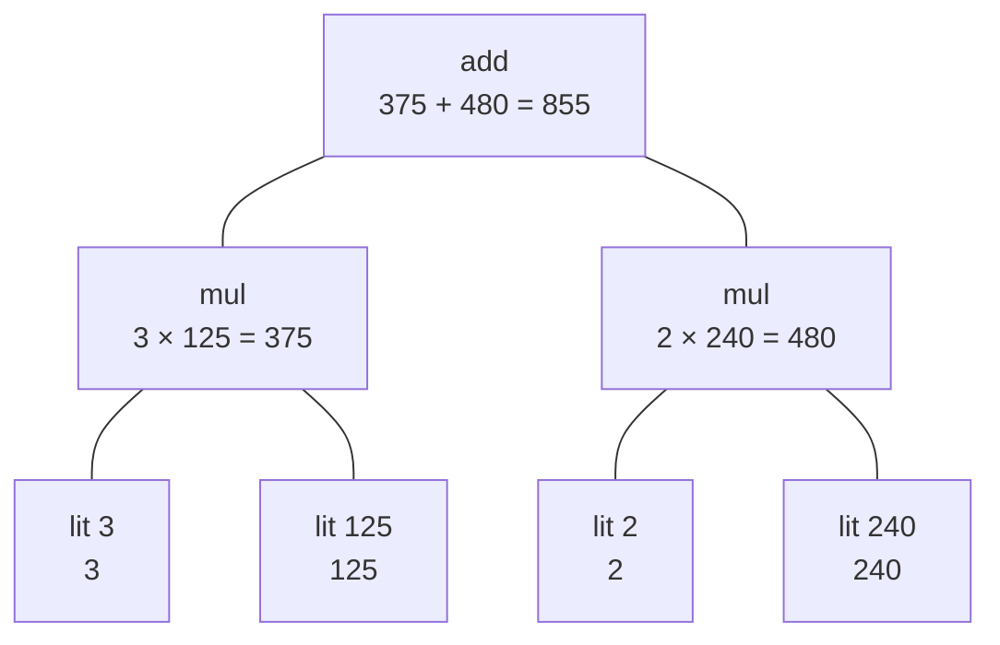
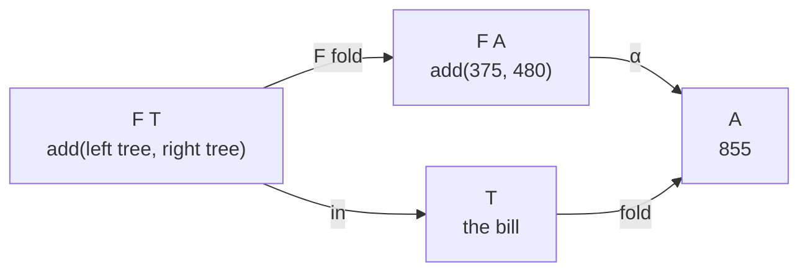

# F-algebras: one step of a recursive structure, then folded away

[Syllabus](../../../SYLLABUS.md) → [Computability and complexity](../README.md) → [Category Theory in Outline](../README.md#s07) → F-algebras

---

## General Overview

A café till rings up three coffees at 125 pence and two sandwiches at 240 pence. The till holds the bill as an expression, 3 × 125 + 2 × 240, and an expression is a tree: the plus at the top, a times on each side, and the four numbers at the bottom. Seven nodes, height 2.

Many jobs walk that tree: the total, 855 pence or £8.55; printing the bill; counting nodes; a last-digit check. Written the usual way, each job is its own recursive function that handles one node and calls itself on the children.

Each function repeats the same walk; only the one-node rule changes, such as "at a plus, add the two answers". This card splits the two apart:

- **The functor** F describes one layer of the tree: a number, or an operator with two holes where the subtrees go.
- **An algebra** is one rule for each kind of layer, given answers in the holes. It never recurses.
- **The fold** is the walk, written once. It folds the children, fills the holes with their answers, and applies the algebra.

The combinatorics wing already walks trees this way: [Rooted trees](../../04-Combinatorics%20and%20graphs/10-Trees%20and%20Cheapest%20Routes/02-rooted-and-binary-trees.md) totals folder sizes in post-order, children before parents, and an expression tree evaluates the same way. What is new here is the split itself, and the theorem that makes it safe: for each algebra there is exactly one fold.

**Write one layer of a data type as a functor F; then every job is an algebra, one non-recursive step that turns a layer of answers into an answer, and a single fold, the only one there is, does all the recursion.**

**What kind of fact this is:** the functor, the algebra and the fold are definitions. That each fold exists and is unique (the trees form the initial algebra) is a theorem. Why it works proves it for this F, by strong induction. Lambek's lemma is a theorem, proved in a Detailed proof box. The power-set functor having no initial algebra is a theorem, proved from Cantor's theorem.

### The picture: the bill, folded from the bottom up



Schematic. Each box shows its layer, then the answer the evaluate algebra gives it once its children are done.

---

## The formula

Some words first. This card works in the category of sets: the objects are sets and the arrows are functions ([Categories and functors](01-categories-and-functors.md)). A **functor** F sends each set X to a set F X and each function $`f: X \to Y`$ to a function $`F f: F X \to F Y`$, keeping identities and composites.

$`A + B`$ is the disjoint union: a member of A or a member of B, tagged with which ([Commutative diagrams](02-commutative-diagrams-and-duality.md)). $`X \times X`$ is the set of ordered pairs of members of X, and $`\mathbb{N}`$ is the whole numbers 0, 1, 2, …

The expression functor is one layer with holes of type X:

```math
F X = \mathbb{N} + (X \times X) + (X \times X)
```

**Read it aloud:** one layer is a literal number $`\mathrm{lit}\ n`$, or an $`\mathrm{add}(x, y)`$ with two holes, or a $`\mathrm{mul}(x, y)`$ with two holes.

On a function f, $`F f`$ keeps the shape and applies f in each hole: $`\mathrm{add}(x, y) \mapsto \mathrm{add}(f(x), f(y))`$, and $`\mathrm{lit}\ n`$ stays as it is.

An **F-algebra** is a set A, its **carrier**, with one arrow $`\alpha: F A \to A`$ that turns a layer of answers into an answer. The evaluate algebra on whole numbers:

```math
\alpha(\mathrm{lit}\ n) = n, \qquad \alpha(\mathrm{add}(a, b)) = a + b, \qquad \alpha(\mathrm{mul}(a, b)) = a \times b
```

The trees T are an algebra too. Their arrow $`\mathrm{in}: F T \to T`$ builds a tree from one layer of subtrees. Its partner $`\mathrm{out}: T \to F T`$ reads a tree's top layer back.

The fold of α is the arrow $`\mathrm{fold}_\alpha: T \to A`$ defined by one equation:

```math
\mathrm{fold}_\alpha \circ \mathrm{in} = \alpha \circ F(\mathrm{fold}_\alpha)
```

**Read it aloud:** to fold a tree built from one layer, fold each subtree in the holes, then apply one step of α to the layer of answers.

On the bill: the top layer is $`\mathrm{add}(\text{left}, \text{right})`$. Folding the holes gives $`\mathrm{add}(375, 480)`$, and one step of α gives 855.

An arrow $`h: A \to B`$ between two algebras $`(A, \alpha)`$ and $`(B, \beta)`$ is an **algebra map** when $`h \circ \alpha = \beta \circ F h`$: doing one step and then h gives the same as h in the holes and then one step.

| Symbol | Plain meaning | In our example | Push it up and the answer… |
| --- | --- | --- | --- |
| $`F`$, $`L`$; $`1`$ | the functor: one layer, with holes; L is the list functor; 1 is a one-member set, the empty list | lit, add or mul; L: empty, or a number and the rest | more kinds of layer, more rules per algebra |
| $`X`$, $`F X`$; $`x`$, $`y`$ | a set, and the layers whose holes hold its members; members in the holes | X = 0 to 4, literals 2 and 3: 52 layers | — |
| $`f`$, $`F f`$ | a function, and the same function applied in every hole | f adds 1 on a 5-hour clock | — |
| $`A`$, $`\mathbb{N}`$ | the carrier: the set the answers live in; ℕ is the whole numbers | ℕ, in pence | — |
| $`\alpha: F A \to A`$; $`n`$; $`a`$, $`b`$ | an algebra: one step, no recursion; a literal; answers in the holes | add, multiply, or return n; n = 125; a, b = 375, 480 at the plus | — |
| $`T`$; $`t`$, $`u`$, $`v`$ | the finite expression trees; a tree and its two subtrees | the bill, 7 nodes; its two line trees | — |
| $`\mathrm{in}`$, $`\mathrm{out}`$; $`g`$, $`\mathrm{id}`$ | build a tree from one layer; read the top layer back; in Lambek's proof, the inverse of in, and the do-nothing arrow | add of two mul trees | — |
| $`\mathrm{fold}_\alpha`$ | the fold: the unique algebra map from T to A | 855 | — |
| $`h`$ | an arrow between carriers | the last digit, 855 to 5 | — |
| $`\beta`$ | a second algebra | the same rules on a 10-hour clock | — |
| $`k`$, $`a(k)`$ | layers allowed; trees built in at most k layers | 3 layers, 202 trees | the count roughly squares |
| $`\mathcal{P}`$ | the power-set functor: X to the set of its subsets | 5 members, 32 subsets | — |

### When it holds

- **Finite trees.** Every tree must bottom out in literals. Cells A1 = B1 + 1 and B1 = 2 × A1 never do, so they have no fold.
- **The algebra takes answers, not subtrees.** One that recurses into subtrees is ordinary recursion again, outside the uniqueness proof.
- **An algebra map, for fusion.** The last digit fuses into the fold; "drop the last digit" does not, and gives 0 where the truth is 85.
- **A functor built from sums and products.** Such polynomial functors have initial algebras, the finite trees. The power-set functor has none.

---

## Why it works

### Step 0: every tree is exactly one layer over smaller trees

A tree is a literal, or an operator over two subtrees, and it is exactly one of these. Each subtree has fewer nodes than the whole. So any definition that says what to do with one layer, given the answers for the smaller trees inside it, pins down an answer for every tree. That is strong induction on the node count ([Strong induction and the least element](../../01-Foundations/06-Proof/05-strong-induction-and-well-ordering.md)).

### Step 1: the fold exists

Define $`\mathrm{fold}_\alpha`$ on a tree t by the equation. If t is $`\mathrm{lit}\ n`$, the answer is $`\alpha(\mathrm{lit}\ n)`$. If t is $`\mathrm{add}(u, v)`$, the answer is $`\alpha(\mathrm{add}(\mathrm{fold}_\alpha(u), \mathrm{fold}_\alpha(v)))`$, and u and v are smaller, so their answers are already settled.

On the bill the fold reaches 3 and 125, then 375; then 2 and 240, then 480; then 855. Seven steps, one per node, children before parent.

### Step 2: the fold is the only algebra map from the trees

Suppose some arrow $`h: T \to A`$ also satisfies $`h \circ \mathrm{in} = \alpha \circ F h`$. Take the smallest tree where h and the fold disagree. Its subtrees are smaller, so h and the fold agree on them. Then both apply α to the same layer of answers, so they agree on this tree too. No smallest disagreement exists, so h is the fold.

The code tests this by brute force. It takes the 10 trees of height at most 1 with literals 2 and 3, and tries every one of the 59,049 ways to send them to the 3-hour clock. Exactly 1 satisfies the equation on all 10, and it is the fold.

In the language of [Universal properties](04-universal-properties-limits-and-colimits.md): the trees with $`\mathrm{in}`$ are an **initial algebra**, an algebra with exactly one algebra map to every other.



Both routes from the top left to the bottom right give 855. That commuting square is the fold's whole definition.

### Step 3: Lambek's lemma, a tree is the same thing as one layer of trees

$`\mathrm{in}`$ has an inverse, $`\mathrm{out}`$, so F T and T match one for one. Every tree has exactly one top layer, and every layer of trees builds exactly one tree. Lambek proved this for every initial algebra in 1968, using only initiality: the fold exists and is unique.

<details>
<summary>Detailed proof: in is invertible for any initial algebra</summary>

Make F T an algebra by applying F to $`\mathrm{in}`$: its arrow is $`F(\mathrm{in}): F(F T) \to F T`$. By initiality there is one algebra map $`g: T \to F T`$, the fold of $`F(\mathrm{in})`$, with

$`\displaystyle g \circ \mathrm{in} = F(\mathrm{in}) \circ F g`$

Now $`\mathrm{in} \circ g: T \to T`$ is an algebra map from $`(T, \mathrm{in})`$ to itself, since

$`\displaystyle \mathrm{in} \circ g \circ \mathrm{in} = \mathrm{in} \circ F(\mathrm{in}) \circ F g = \mathrm{in} \circ F(\mathrm{in} \circ g)`$

The identity is also such a map, and there is only one, so $`\mathrm{in} \circ g`$ is the identity on T. Then

$`\displaystyle g \circ \mathrm{in} = F(\mathrm{in} \circ g) = F(\mathrm{id}) = \mathrm{id}`$

using the functor law for identities. So g is the inverse of $`\mathrm{in}`$: it is $`\mathrm{out}`$, itself a fold. The code checks both facts on all 202 trees of height at most 2.

</details>

Lambek's lemma explains the power-set row of When it holds. If $`\mathcal{P}`$ had an initial algebra T, then T would match its own set of subsets one for one. [Comparing infinities](../../01-Foundations/09-Sizes%20of%20Infinity/04-comparing-infinities.md) proves no set does, by Cantor's diagonal move: the code lists 1, 2, 4, 8, 16, 32 subsets for sets of 0 to 5 members, never n.

### Step 4: the trees are built layer by layer

Start from the empty set and apply F again and again. $`F(\varnothing)`$ holds only the literals. $`F(F(\varnothing))`$ adds every operator over two literals. With literals 2 and 3, the counts follow

```math
a(k+1) = 2 + 2\, a(k)^2
```

**Read it aloud:** the trees of up to k + 1 layers are the 2 literals, plus 2 operators over any ordered pair of trees of up to k layers.

From $`a(0) = 0`$ that gives 0, 2, 10, 202, 81,610. Listing the trees gives the same 0, 2, 10, 202. Every finite tree turns up at some stage, and the union of the stages is T. The same construction works for any polynomial functor.

### Step 5: one fold, many jobs, and fusion

Change the algebra and the same fold does a different job on the bill:

| Algebra | lit n | add(a, b) | mul(a, b) | The bill |
| --- | --- | --- | --- | --- |
| evaluate | n | a + b | a × b | 855 |
| count nodes | 1 | 1 + a + b | 1 + a + b | 7 |
| height | 0 | 1 + larger of a, b | 1 + larger of a, b | 2 |
| print | n as text | (a + b) | (a * b) | ((3 * 125) + (2 * 240)) |
| 10-hour clock | n mod 10 | a + b mod 10 | a × b mod 10 | 5 |

The last row is the house example's groups alongside the sets: the remainders 0 to 9 under addition are the 10-hour clock group, and multiplication wraps the same way.

Taking the last digit, $`h(n) = n \bmod 10`$, is an algebra map from evaluate to the clock algebra. That holds because the last digit of a sum or product depends only on the last digits of its parts.

That gives the **fusion law**: if h is an algebra map from α to β, then

```math
h \circ \mathrm{fold}_\alpha = \mathrm{fold}_\beta
```

The proof is one line: $`h \circ \mathrm{fold}_\alpha`$ is an algebra map from the trees to β, and Step 2 says there is only one. On the bill, 855 ends in 5, and the clock fold gives 5 without ever forming 855. The code checks this on all 202 trees.

Lists are the same idea with the functor $`L X = 1 + \mathbb{N} \times X`$, where 1 is a one-member set standing for the empty list: empty, or a first number and a hole for the rest. Their fold is the familiar fold over a list. It works from the right, combining the first item with the fold of the rest; [Monoids and monads](07-monoids-and-monads-for-programmers.md) folds from the left, starting at the identity. For a monoid the two agree, by associativity and the identity law. The two line totals, 375 and 480, fold to 855 that way too.

---

## Worked numbers, by hand

| Step | Arithmetic | Value |
| --- | --- | --- |
| fold the first literals | lit 3, lit 125 | 3 and 125 |
| one step at the first times | 3 × 125 | 375 |
| fold the second literals | lit 2, lit 240 | 2 and 240 |
| one step at the second times | 2 × 240 | 480 |
| one step at the plus | 375 + 480 | **855 pence = £8.55** |
| the same fold, count nodes | 1 + (1 + 1 + 1) + (1 + 1 + 1) | 7 |
| the same fold, 10-hour clock | last digits only: 3 × 5, then 2 × 0, then their sum | 5 |

The till owes £8.55, and every job on the bill came from the same seven-step walk with a different one-step rule.

### What breaks if you drop a piece

| Mistake | Comes out at | What went wrong |
| --- | --- | --- |
| A calculator reads the bill left to right | ((3 × 125) + 2) × 240 = 90,480 | The tree's shape was lost, so the layers were not the bill's |
| Fusing "drop the last digit" | 0, but 855 drops to 85 | Not an algebra map: the literals lose their digits before the products carry into them |
| A1 = B1 + 1 and B1 = 2 × A1 | A1, then B1, then A1 again after 2 steps | A cycle is no finite tree, so the fold never bottoms out |
| The power-set functor | 2, 4, 8 subsets for 1, 2, 3 members | No set matches its subsets, so no initial algebra exists |

The code prints all four. The cycle is proved by the repeated cell, not guessed from a long run.

---

## Code, from first principles, and it actually runs

Each script writes F on functions, the arrows in and out, and one recursive fold; every job is an algebra handed to it. Three independent roads reach 855: the fold, a stack run on the post-order list, and a list fold over the two line totals, each read off the tree as quantity times price, with no recursion.

On all 202 trees of up to 3 layers, the fold meets the stack run, fusion meets the last digit, and Lambek's inverse meets out. Uniqueness is brute force over 59,049 maps; the layer counts are a listing against the recurrence. Nothing imported folds anything.

### Python

```python
# F-algebras and folds -- the check behind the card.  Nothing is imported.
# The expression type is a functor F: one layer, a literal or an operator over
# two holes.  fold is the only recursive function the algebras use; every job
# on the tree is an algebra, one step of rules handed to fold.  No functools.reduce.

def fmap(f, layer):                     # F on arrows: apply f to each hole, keep the shape
    return layer if layer[0] == "lit" else (layer[0], f(layer[1]), f(layer[2]))

def In(layer): return ("T", layer)      # in: one layer of trees becomes a tree
def out(tree): return tree[1]           # out: read a tree's top layer back

def fold(alg, tree):                    # fold the children first, then one step of alg
    return alg(fmap(lambda child: fold(alg, child), out(tree)))

lit = lambda n: In(("lit", n))          # the three ways to build one layer
node = lambda op, a, b: In((op, a, b))

def evaluate(l):                        # the algebra on whole numbers
    return l[1] if l[0] == "lit" else l[1] + l[2] if l[0] == "add" else l[1] * l[2]

def clock(m):                           # the same rules on an m-hour clock
    return lambda l: l[1] % m if l[0] == "lit" else evaluate(l) % m

size = lambda l: 1 if l[0] == "lit" else 1 + l[1] + l[2]
height = lambda l: 0 if l[0] == "lit" else 1 + max(l[1], l[2])
show = lambda l: str(l[1]) if l[0] == "lit" else f"({l[1]} {'+' if l[0] == 'add' else '*'} {l[2]})"

def drop_digit(l):                      # leaves lose their last digit, operators kept
    return l[1] // 10 if l[0] == "lit" else evaluate(l)

def postorder(t):                       # road two: the walk from Rooted trees, no fold
    l = out(t)
    return [l[1]] if l[0] == "lit" else postorder(l[1]) + postorder(l[2]) + [l[0]]

def stack_run(tokens):                  # evaluate the post-order list with a stack
    stack = []
    for tok in tokens:
        if tok in ("add", "mul"):
            b, a = stack.pop(), stack.pop()
            stack.append(a + b if tok == "add" else a * b)
        else:
            stack.append(tok)
    return stack[0]

def fold_list(nil, cons, xs):           # the list functor 1 + N x X, and its fold
    return nil if not xs else cons(xs[0], fold_list(nil, cons, xs[1:]))

def receipt(p):                         # 3 coffees at p pence, 2 sandwiches at 240 pence
    return node("add", node("mul", lit(3), lit(p)), node("mul", lit(2), lit(240)))

t, log = receipt(125), []
def traced(l):
    v = evaluate(l)
    log.append(f"  {l[0]} {' '.join(str(x) for x in l[1:])} -> {v}")
    return v
total = fold(traced, t)
rpn = postorder(t)
lines = [out(q)[1] * out(p)[1] for _, q, p in (out(s) for s in out(t)[1:])]   # road three: each line read off
via_list = fold_list(0, lambda x, acc: x + acc, lines)                          # the tree, then a list fold
print("expression: 3 x 125 + 2 x 240, prices in pence")
print(f"tree, printed by a fold: {fold(show, t)}")
print(f"fold, evaluate: {total} pence = £{total // 100}.{total % 100:02d}")
print(f"fold, count nodes: {fold(size, t)}; fold, height: {fold(height, t)}")
print(f"fold, the 10-hour clock: {fold(clock(10), t)}")
print("the evaluate fold, in the order its steps run:")
for line in log:
    print(line)
print(f"road two, a stack run on the post-order list {' '.join(str(x) for x in rpn)}: {stack_run(rpn)}")
print(f"road three, a list fold over the line totals read off the tree, {lines}: {via_list}")

X = range(5)                            # functor laws on every layer over {0, 1, 2, 3, 4}
layers = [("lit", 2), ("lit", 3)] + [(op, a, b) for op in ("add", "mul") for a in X for b in X]
f, g = (lambda x: (x + 1) % 5), (lambda x: 2 * x % 5)
ident = all(fmap(lambda x: x, l) == l for l in layers)
comp = all(fmap(lambda x: g(f(x)), l) == fmap(g, fmap(f, l)) for l in layers)
print(f"functor laws on all {len(layers)} layers over 0 to 4: identity {'yes' if ident else 'no'}, composition {'yes' if comp else 'no'}")

levels = [[]]                           # F applied k times to the empty set, leaves 2 and 3
for k in range(3):
    prev = levels[-1]
    levels.append([lit(2), lit(3)] + [node(op, a, b) for op in ("add", "mul") for a in prev for b in prev])
rec = [0]
for k in range(4):
    rec.append(2 + 2 * rec[-1] ** 2)
print(f"trees built in k layers, k = 0 to 3, by listing: {[len(x) for x in levels]}")
print(f"the same by the count a(k+1) = 2 + 2 a(k)^2, k = 0 to 4: {rec}")
trees = levels[3]
lambek = all(In(out(s)) == s and fold(lambda l: fmap(In, l), s) == out(s) for s in trees)
same_eval = all(fold(evaluate, s) == stack_run(postorder(s)) for s in trees)
fusion = all(fold(clock(10), s) == fold(evaluate, s) % 10 for s in trees)
same_size = all(fold(size, s) == len(postorder(s)) for s in trees)
print(f"on all {len(trees)} trees: in undoes out, and out is a fold: {'yes' if lambek else 'no'}")
print(f"on all {len(trees)} trees: evaluate fold = stack run {'yes' if same_eval else 'no'}; "
      f"clock fold = last digit of evaluate {'yes' if fusion else 'no'}; size = list length {'yes' if same_size else 'no'}")

def commuting(m, small):                # every map small -> m-hour clock, tested on the square
    good = []
    for code in range(m ** len(small)):
        h = [code // m ** i % m for i in range(len(small))]
        look = lambda c: h[small.index(c)]
        if all(h[i] == clock(m)(fmap(look, out(s))) for i, s in enumerate(small)):
            good.append(h)
    return good

small = levels[2]
good = commuting(3, small)
print(f"maps from the {len(small)} trees of height at most 1 to the 3-hour clock: {3 ** len(small)}; "
      f"squares commuting: {len(good)}; it is the fold: {'yes' if good == [[fold(clock(3), s) for s in small]] else 'no'}")

toks = fold(lambda l: [l[1]] if l[0] == "lit" else l[1] + [l[0]] + l[2], t)   # the bill's tokens, brackets lost
flat = toks[0]                          # a calculator with no precedence: each operator as it comes
for op, x in zip(toks[1::2], toks[2::2]):
    flat = flat + x if op == "add" else flat * x
subsets, sizes = [[]], [1]              # list every subset of {0, ..., 4}: each member left out, or put in
for x in range(5):
    subsets = subsets + [s + [x] for s in subsets]
    sizes.append(len(subsets))
dropped = fold(drop_digit, t)
cells = {"A1": ("add", ("ref", "B1"), ("lit", 1)), "B1": ("mul", ("lit", 2), ("ref", "A1"))}
path, cell = ["A1"], "A1"
while True:
    nxt = [e[1] for e in cells[cell][1:] if e[0] == "ref"][0]
    if nxt in path:
        break
    path.append(nxt)
    cell = nxt
print(f"mistake 1, a calculator read left to right over {' '.join(str(x) for x in toks)}: {flat}")
print(f"mistake 2, fusing 'drop the last digit', no algebra map: fold gives {dropped}, but {total} drops to {total // 10}")
print(f"mistake 3, A1 = B1 + 1 and B1 = 2 x A1: unfolding {' -> '.join(path + [nxt])} meets A1 again after {len(path)} steps: a cycle, no finite tree, no fold")
print(f"no initial algebra for the power-set functor: subsets listed for sets of 0 to 5 members: {sizes}, never n")
print(f"try: price 140 gives {fold(evaluate, receipt(140))}; the 7-hour clock gives {fold(clock(7), t)}; "
      f"the 2-hour clock: {2 ** len(small)} maps, {len(commuting(2, small))} commuting")
assert total == stack_run(rpn) == via_list                      # three roads to the total
assert ident and comp and lambek                                 # functor laws, Lambek
assert same_eval and fusion and same_size                        # fold against walk, on 202 trees
assert [len(x) for x in levels] == rec[:4]                       # listing against the count
assert len(good) == 1 and good[0] == [fold(clock(3), s) for s in small]   # uniqueness, by brute force
assert dropped != total // 10 and flat != total                  # the mistakes really differ
assert sizes == [2 ** n for n in range(6)]                       # the listing against 2^n
print("ALL CHECKS PASS")
```

**Ran 2026-11-19 on macOS, Python 3.14.10, standard library only. All checks passed. Output, pasted from the run:**

```
expression: 3 x 125 + 2 x 240, prices in pence
tree, printed by a fold: ((3 * 125) + (2 * 240))
fold, evaluate: 855 pence = £8.55
fold, count nodes: 7; fold, height: 2
fold, the 10-hour clock: 5
the evaluate fold, in the order its steps run:
  lit 3 -> 3
  lit 125 -> 125
  mul 3 125 -> 375
  lit 2 -> 2
  lit 240 -> 240
  mul 2 240 -> 480
  add 375 480 -> 855
road two, a stack run on the post-order list 3 125 mul 2 240 mul add: 855
road three, a list fold over the line totals read off the tree, [375, 480]: 855
functor laws on all 52 layers over 0 to 4: identity yes, composition yes
trees built in k layers, k = 0 to 3, by listing: [0, 2, 10, 202]
the same by the count a(k+1) = 2 + 2 a(k)^2, k = 0 to 4: [0, 2, 10, 202, 81610]
on all 202 trees: in undoes out, and out is a fold: yes
on all 202 trees: evaluate fold = stack run yes; clock fold = last digit of evaluate yes; size = list length yes
maps from the 10 trees of height at most 1 to the 3-hour clock: 59049; squares commuting: 1; it is the fold: yes
mistake 1, a calculator read left to right over 3 mul 125 add 2 mul 240: 90480
mistake 2, fusing 'drop the last digit', no algebra map: fold gives 0, but 855 drops to 85
mistake 3, A1 = B1 + 1 and B1 = 2 x A1: unfolding A1 -> B1 -> A1 meets A1 again after 2 steps: a cycle, no finite tree, no fold
no initial algebra for the power-set functor: subsets listed for sets of 0 to 5 members: [1, 2, 4, 8, 16, 32], never n
try: price 140 gives 900; the 7-hour clock gives 1; the 2-hour clock: 1024 maps, 1 commuting
ALL CHECKS PASS
```

### Rust

Same numbers, same labels, built with `rustc --edition 2021 -O`.

```rust
// F-algebras and folds -- the same check as the Python, in Rust.  No crates.
// The expression type is a functor F: one layer, a literal or an operator over
// two holes.  fold is the only recursive function the algebras use; every job
// on the tree is an algebra, one step of rules handed to fold.  No Iterator::fold.
#[derive(Clone, PartialEq, Debug)]
enum Layer<X> { Lit(i64), Add(X, X), Mul(X, X) }
use Layer::*;

#[derive(Clone, PartialEq, Debug)]
struct Tree(Box<Layer<Tree>>);

fn fmap<X, Y>(l: &Layer<X>, f: &mut dyn FnMut(&X) -> Y) -> Layer<Y> {   // F on arrows
    match l { Lit(n) => Lit(*n), Add(a, b) => { let x = f(a); Add(x, f(b)) }, Mul(a, b) => { let x = f(a); Mul(x, f(b)) } }
}

fn into(l: Layer<Tree>) -> Tree { Tree(Box::new(l)) }      // in: one layer of trees becomes a tree
fn out(t: &Tree) -> &Layer<Tree> { &t.0 }                  // out: read a tree's top layer back

fn fold<A>(alg: &mut dyn FnMut(Layer<A>) -> A, t: &Tree) -> A {   // children first, then one step
    let l = fmap(out(t), &mut |c: &Tree| fold(&mut *alg, c));
    alg(l)
}

fn lit(n: i64) -> Tree { into(Lit(n)) }
fn node(op: &str, a: Tree, b: Tree) -> Tree { into(if op == "add" { Add(a, b) } else { Mul(a, b) }) }

fn evaluate(l: Layer<i64>) -> i64 { match l { Lit(n) => n, Add(a, b) => a + b, Mul(a, b) => a * b } }
fn clock(m: i64) -> impl Fn(Layer<i64>) -> i64 { move |l| match l { Lit(n) => n % m, o => evaluate(o) % m } }
fn size(l: Layer<i64>) -> i64 { match l { Lit(_) => 1, Add(a, b) | Mul(a, b) => 1 + a + b } }
fn height(l: Layer<i64>) -> i64 { match l { Lit(_) => 0, Add(a, b) | Mul(a, b) => 1 + a.max(b) } }
fn show(l: Layer<String>) -> String {
    match l { Lit(n) => n.to_string(), Add(a, b) => format!("({} + {})", a, b), Mul(a, b) => format!("({} * {})", a, b) }
}
fn drop_digit(l: Layer<i64>) -> i64 { match l { Lit(n) => n / 10, o => evaluate(o) } }

fn postorder(t: &Tree) -> Vec<String> {                    // road two: the walk from Rooted trees
    match out(t) {
        Lit(n) => vec![n.to_string()],
        Add(a, b) => [postorder(a), postorder(b), vec!["add".to_string()]].concat(),
        Mul(a, b) => [postorder(a), postorder(b), vec!["mul".to_string()]].concat(),
    }
}

fn stack_run(tokens: &[String]) -> i64 {                   // evaluate the post-order list with a stack
    let mut stack: Vec<i64> = Vec::new();
    for tok in tokens {
        if tok == "add" || tok == "mul" {
            let (b, a) = (stack.pop().unwrap(), stack.pop().unwrap());
            stack.push(if tok == "add" { a + b } else { a * b });
        } else { stack.push(tok.parse().unwrap()) }
    }
    stack[0]
}

fn fold_list(nil: i64, cons: &dyn Fn(i64, i64) -> i64, xs: &[i64]) -> i64 {   // the list functor's fold
    if xs.is_empty() { nil } else { cons(xs[0], fold_list(nil, cons, &xs[1..])) }
}
fn line_totals(t: &Tree) -> Vec<i64> {                     // road three: each line read off the tree
    let lit_of = |s: &Tree| if let Lit(n) = out(s) { *n } else { 0 };
    let line = |s: &Tree| match out(s) { Add(q, p) | Mul(q, p) => lit_of(q) * lit_of(p), Lit(n) => *n };
    match out(t) { Add(a, b) | Mul(a, b) => vec![line(a), line(b)], Lit(n) => vec![*n] }
}
fn receipt(p: i64) -> Tree { node("add", node("mul", lit(3), lit(p)), node("mul", lit(2), lit(240))) }

fn ev(t: &Tree) -> i64 { fold(&mut evaluate, t) }
fn fc(m: i64, t: &Tree) -> i64 { let c = clock(m); fold(&mut |l| c(l), t) }
fn yn(b: bool) -> &'static str { if b { "yes" } else { "no" } }

fn commuting(m: i64, small: &[Tree]) -> Vec<Vec<i64>> {   // every map small -> m-hour clock, on the square
    let mut good = Vec::new();
    let c = clock(m);
    for code in 0..m.pow(small.len() as u32) {
        let h: Vec<i64> = (0..small.len()).map(|i| code / m.pow(i as u32) % m).collect();
        let ok = small.iter().enumerate().all(|(i, s)| {
            h[i] == c(fmap(out(s), &mut |ch: &Tree| h[small.iter().position(|x| x == ch).unwrap()]))
        });
        if ok { good.push(h) }
    }
    good
}

fn main() {
    let t = receipt(125);
    let mut log: Vec<String> = Vec::new();
    let total = fold(&mut |l: Layer<i64>| {
        let args = match &l { Lit(n) => ("lit", n.to_string()), Add(a, b) => ("add", format!("{} {}", a, b)), Mul(a, b) => ("mul", format!("{} {}", a, b)) };
        let v = evaluate(l);
        log.push(format!("  {} {} -> {}", args.0, args.1, v));
        v
    }, &t);
    let rpn = postorder(&t);
    let lines = line_totals(&t);
    let via_list = fold_list(0, &|x, acc| x + acc, &lines);                   // then a list fold
    println!("expression: 3 x 125 + 2 x 240, prices in pence");
    println!("tree, printed by a fold: {}", fold(&mut show, &t));
    println!("fold, evaluate: {} pence = £{}.{:02}", total, total / 100, total % 100);
    println!("fold, count nodes: {}; fold, height: {}", fold(&mut size, &t), fold(&mut height, &t));
    println!("fold, the 10-hour clock: {}", fc(10, &t));
    println!("the evaluate fold, in the order its steps run:");
    for line in &log { println!("{}", line) }
    println!("road two, a stack run on the post-order list {}: {}", rpn.join(" "), stack_run(&rpn));
    println!("road three, a list fold over the line totals read off the tree, {:?}: {}", lines, via_list);

    let mut layers: Vec<Layer<i64>> = vec![Lit(2), Lit(3)];   // functor laws over {0, 1, 2, 3, 4}
    for op in ["add", "mul"] { for a in 0..5 { for b in 0..5 { layers.push(if op == "add" { Add(a, b) } else { Mul(a, b) }) } } }
    let (f, g) = (|x: &i64| (x + 1) % 5, |x: &i64| 2 * x % 5);
    let ident = layers.iter().all(|l| fmap(l, &mut |x: &i64| *x) == *l);
    let comp = layers.iter().all(|l| fmap(l, &mut |x: &i64| g(&f(x))) == fmap(&fmap(l, &mut |x: &i64| f(x)), &mut |x: &i64| g(x)));
    println!("functor laws on all {} layers over 0 to 4: identity {}, composition {}", layers.len(), yn(ident), yn(comp));

    let mut levels: Vec<Vec<Tree>> = vec![Vec::new()];        // F applied k times to the empty set
    for _ in 0..3 {
        let prev = levels.last().unwrap().clone();
        let mut next = vec![lit(2), lit(3)];
        for op in ["add", "mul"] { for a in &prev { for b in &prev { next.push(node(op, a.clone(), b.clone())) } } }
        levels.push(next);
    }
    let mut rec: Vec<usize> = vec![0];
    for _ in 0..4 { let a = *rec.last().unwrap(); rec.push(2 + 2 * a * a) }
    let counts: Vec<usize> = levels.iter().map(|x| x.len()).collect();
    println!("trees built in k layers, k = 0 to 3, by listing: {:?}", counts);
    println!("the same by the count a(k+1) = 2 + 2 a(k)^2, k = 0 to 4: {:?}", rec);
    let trees = &levels[3];
    let lambek = trees.iter().all(|s| into(out(s).clone()) == *s
        && fold(&mut |l: Layer<Layer<Tree>>| fmap(&l, &mut |x: &Layer<Tree>| into(x.clone())), s) == *out(s));
    let same_eval = trees.iter().all(|s| ev(s) == stack_run(&postorder(s)));
    let fusion = trees.iter().all(|s| fc(10, s) == ev(s) % 10);
    let same_size = trees.iter().all(|s| fold(&mut size, s) == postorder(s).len() as i64);
    println!("on all {} trees: in undoes out, and out is a fold: {}", trees.len(), yn(lambek));
    println!("on all {} trees: evaluate fold = stack run {}; clock fold = last digit of evaluate {}; size = list length {}",
             trees.len(), yn(same_eval), yn(fusion), yn(same_size));

    let small = &levels[2];
    let good = commuting(3, small);
    let the_fold: Vec<i64> = small.iter().map(|s| fc(3, s)).collect();
    println!("maps from the {} trees of height at most 1 to the 3-hour clock: {}; squares commuting: {}; it is the fold: {}",
             small.len(), 3i64.pow(small.len() as u32), good.len(), yn(good == vec![the_fold.clone()]));

    let toks: Vec<String> = fold(&mut |l: Layer<Vec<String>>| match l { Lit(n) => vec![n.to_string()],   // brackets lost
        Add(a, b) => [a, vec!["add".to_string()], b].concat(), Mul(a, b) => [a, vec!["mul".to_string()], b].concat() }, &t);
    let mut flat: i64 = toks[0].parse().unwrap();             // a calculator with no precedence
    for k in (1..toks.len()).step_by(2) { let x: i64 = toks[k + 1].parse().unwrap(); flat = if toks[k] == "add" { flat + x } else { flat * x } }
    let dropped = fold(&mut drop_digit, &t);
    let cells: Vec<(&str, Vec<(&str, &str)>)> = vec![("A1", vec![("ref", "B1"), ("lit", "1")]), ("B1", vec![("lit", "2"), ("ref", "A1")])];
    let (mut path, mut cell) = (vec!["A1"], "A1");
    let nxt = loop {
        let ops = &cells.iter().find(|c| c.0 == cell).unwrap().1;
        let n = ops.iter().find(|e| e.0 == "ref").unwrap().1;
        if path.contains(&n) { break n }
        path.push(n);
        cell = n;
    };
    let shown = [path.clone(), vec![nxt]].concat();
    println!("mistake 1, a calculator read left to right over {}: {}", toks.join(" "), flat);
    println!("mistake 2, fusing 'drop the last digit', no algebra map: fold gives {}, but {} drops to {}", dropped, total, total / 10);
    println!("mistake 3, A1 = B1 + 1 and B1 = 2 x A1: unfolding {} meets A1 again after {} steps: a cycle, no finite tree, no fold", shown.join(" -> "), path.len());
    let (mut subsets, mut sizes): (Vec<Vec<i64>>, Vec<usize>) = (vec![vec![]], vec![1]);   // each member out, or in
    for x in 0..5 { let more: Vec<Vec<i64>> = subsets.iter().map(|s| [s.clone(), vec![x]].concat()).collect(); subsets.extend(more); sizes.push(subsets.len()) }
    println!("no initial algebra for the power-set functor: subsets listed for sets of 0 to 5 members: {:?}, never n", sizes);
    println!("try: price 140 gives {}; the 7-hour clock gives {}; the 2-hour clock: {} maps, {} commuting",
             ev(&receipt(140)), fc(7, &t), 2i64.pow(small.len() as u32), commuting(2, small).len());
    assert!(total == stack_run(&rpn) && total == via_list);                 // three roads to the total
    assert!(ident && comp && lambek);                                       // functor laws, Lambek
    assert!(same_eval && fusion && same_size);                              // fold against walk, on 202 trees
    assert!(counts == rec[..4].to_vec());                                   // listing against the count
    assert!(good.len() == 1 && good[0] == the_fold);                        // uniqueness, by brute force
    assert!(dropped != total / 10 && flat != total);                        // the mistakes really differ
    assert!(sizes == (0..6).map(|n| 1usize << n).collect::<Vec<usize>>());   // the listing against 2^n
    println!("ALL CHECKS PASS");
}
```

**Ran 2026-11-19 on macOS, rustc 1.98.1, no crates. All checks passed. Output, pasted from the run:**

```
expression: 3 x 125 + 2 x 240, prices in pence
tree, printed by a fold: ((3 * 125) + (2 * 240))
fold, evaluate: 855 pence = £8.55
fold, count nodes: 7; fold, height: 2
fold, the 10-hour clock: 5
the evaluate fold, in the order its steps run:
  lit 3 -> 3
  lit 125 -> 125
  mul 3 125 -> 375
  lit 2 -> 2
  lit 240 -> 240
  mul 2 240 -> 480
  add 375 480 -> 855
road two, a stack run on the post-order list 3 125 mul 2 240 mul add: 855
road three, a list fold over the line totals read off the tree, [375, 480]: 855
functor laws on all 52 layers over 0 to 4: identity yes, composition yes
trees built in k layers, k = 0 to 3, by listing: [0, 2, 10, 202]
the same by the count a(k+1) = 2 + 2 a(k)^2, k = 0 to 4: [0, 2, 10, 202, 81610]
on all 202 trees: in undoes out, and out is a fold: yes
on all 202 trees: evaluate fold = stack run yes; clock fold = last digit of evaluate yes; size = list length yes
maps from the 10 trees of height at most 1 to the 3-hour clock: 59049; squares commuting: 1; it is the fold: yes
mistake 1, a calculator read left to right over 3 mul 125 add 2 mul 240: 90480
mistake 2, fusing 'drop the last digit', no algebra map: fold gives 0, but 855 drops to 85
mistake 3, A1 = B1 + 1 and B1 = 2 x A1: unfolding A1 -> B1 -> A1 meets A1 again after 2 steps: a cycle, no finite tree, no fold
no initial algebra for the power-set functor: subsets listed for sets of 0 to 5 members: [1, 2, 4, 8, 16, 32], never n
try: price 140 gives 900; the 7-hour clock gives 1; the 2-hour clock: 1024 maps, 1 commuting
ALL CHECKS PASS
```

The two outputs match line for line.

### Lean

Lean proves the card's three theorems, with Lambek's lemma for every functor, and checks the bill's worked numbers.

- Take the expression functor F and any algebra $`\alpha: F A \to A`$. Then exactly one arrow from the trees T to A satisfies the fold's equation.
- Suppose an algebra of any functor, on any category, is initial. Then its arrow, like in for the trees, has an inverse.
- The power-set functor $`\mathcal{P}`$ has no initial algebra.
- F keeps identities and composites for every function, not only on the 52 layers over 0 to 4.
- On the bill, the fold gives 855 pence, 7 nodes, height 2 and 5 on the 10-hour clock.
- The 7-hour clock gives 1, and a coffee at 140 pence gives 900.
- Fusion holds on the bill: the clock's 5 is the last digit of 855. Dropping the last digit instead gives 0, not 85.
- Read left to right, the bill gives 90,480.
- Listing the trees of up to 3 layers gives 0, 2, 10, 202. The count $`a(k)`$ gives the same, then 81,610.
- The brute-force search's counts, 59,049 and 1,024 maps, are right, and a set of 5 members has 32 subsets.

The other two roads, the tests on all 202 trees, the brute-force search and the spreadsheet cycle are left to the Python and Rust checks.

```lean
-- F-algebras: every algebra of the expression functor F X = ℕ + X × X + X × X has exactly one fold from the finite expression trees, the arrow in of any initial algebra is invertible (Lambek's lemma), and the power-set functor has no initial algebra.
import Mathlib.CategoryTheory.Endofunctor.Algebra
import Mathlib.CategoryTheory.Types.Basic
import Mathlib.Data.Fintype.Powerset
import Mathlib.Tactic.NormNum.Basic

open CategoryTheory

namespace FAlgebrasAndFolds

/-- One layer of an expression, with holes of type X: the card's F X = ℕ + (X × X) + (X × X).
`Sum.inl n` is `lit n`, `Sum.inr (Sum.inl (x, y))` is `add(x, y)`,
`Sum.inr (Sum.inr (x, y))` is `mul(x, y)`. -/
abbrev Layer (X : Type) : Type := ℕ ⊕ (X × X) ⊕ (X × X)

/-- F on a function f: keep the shape, apply f in each hole; `lit n` stays as it is. -/
def layerMap {X Y : Type} (f : X → Y) : Layer X → Layer Y :=
  Sum.map id (Sum.map (Prod.map f f) (Prod.map f f))

/-- The expression functor F on the category of sets (Lean's `Type`). -/
def exprF : Type ⥤ Type where
  obj X := Layer X
  map f := TypeCat.ofHom (layerMap f)
  map_id X := by
    ext l
    rcases l with n | ⟨a, b⟩ | ⟨a, b⟩ <;> rfl
  map_comp f g := by
    ext l
    rcases l with n | ⟨a, b⟩ | ⟨a, b⟩ <;> rfl

/-- The finite expression trees T: a literal, or an add or a mul over two smaller trees. -/
inductive Expr : Type
  | lit : ℕ → Expr
  | add : Expr → Expr → Expr
  | mul : Expr → Expr → Expr
  deriving DecidableEq

/-- in : F T → T, building a tree from one layer of subtrees. -/
def inFun : Layer Expr → Expr
  | Sum.inl n => Expr.lit n
  | Sum.inr (Sum.inl (a, b)) => Expr.add a b
  | Sum.inr (Sum.inr (a, b)) => Expr.mul a b

/-- in, as an arrow of the category of sets. -/
def inn : exprF.obj Expr ⟶ Expr := TypeCat.ofHom inFun

/-- The power-set functor 𝒫: a set X goes to its set of subsets, a function f to taking images. -/
def powersetF : Type ⥤ Type where
  obj X := Set X
  map f := TypeCat.ofHom (Set.image f)
  map_id X := by
    ext s x
    simp
  map_comp f g := by
    ext s x
    simp

/-- Helper: the fold of an algebra map `α`, written by recursion on trees. -/
def foldFun {A : Type} (α : Layer A → A) : Expr → A
  | Expr.lit n => α (Sum.inl n)
  | Expr.add a b => α (Sum.inr (Sum.inl (foldFun α a, foldFun α b)))
  | Expr.mul a b => α (Sum.inr (Sum.inr (foldFun α a, foldFun α b)))

#print axioms foldFun

/-- **Each algebra has exactly one fold.** For every F-algebra, a carrier set A with one arrow
α : F A → A, there is exactly one arrow fold : T → A from the finite expression trees with
fold ∘ in = α ∘ F(fold): fold the subtrees in the holes, then apply one step of α. Lean writes
`g ≫ f` for "g first, then f". -/
theorem fold_exists_unique (A : Type) (α : exprF.obj A ⟶ A) :
    ∃! fold : Expr ⟶ A, inn ≫ fold = exprF.map fold ≫ α := by
  refine ⟨TypeCat.ofHom (foldFun (fun l => α l)), ?_, ?_⟩
  · ext l
    rcases l with n | ⟨a, b⟩ | ⟨a, b⟩ <;> rfl
  · intro g hg
    have key : ∀ l : Layer Expr, g (inFun l) = α (layerMap (fun x => g x) l) := fun l =>
      congrArg (fun h : exprF.obj Expr ⟶ A => h l) hg
    have H : ∀ e : Expr, g e = foldFun (fun l => α l) e := by
      intro e
      induction e with
      | lit n => exact key (Sum.inl n)
      | add a b iha ihb =>
        have := key (Sum.inr (Sum.inl (a, b)))
        simp only [inFun, layerMap, Sum.map_inr, Sum.map_inl, Prod.map] at this
        rw [this, iha, ihb]; rfl
      | mul a b iha ihb =>
        have := key (Sum.inr (Sum.inr (a, b)))
        simp only [inFun, layerMap, Sum.map_inr, Prod.map] at this
        rw [this, iha, ihb]; rfl
    ext e
    exact H e

/-- **Lambek's lemma.** For any endofunctor F of any category, if an F-algebra (T, in) is
initial (exactly one algebra map to every other algebra), then in : F T → T is invertible. -/
theorem lambek_lemma {C : Type*} [Category C] {F : C ⥤ C} (T : Endofunctor.Algebra F)
    (h : Limits.IsInitial T) : IsIso T.str := by
  exact Endofunctor.Algebra.Initial.str_isIso h

/-- **The power-set functor has no initial algebra.** There is no algebra of the power-set
functor 𝒫 that is initial. -/
theorem powerset_no_initial_algebra :
    ¬ ∃ T : Endofunctor.Algebra powersetF, Nonempty (Limits.IsInitial T) := by
  rintro ⟨T, ⟨h⟩⟩
  have hiso : IsIso T.str := Endofunctor.Algebra.Initial.str_isIso h
  have hbij := (isIso_iff_bijective T.str).1 hiso
  exact Function.cantor_injective (fun s : Set T.a => T.str s) hbij.1

/-! ### The card's worked numbers -/

/-- The fold of α, written out by recursion, for computing the card's examples. -/
def Expr.fold {A : Type} (α : Layer A → A) : Expr → A
  | Expr.lit n => α (Sum.inl n)
  | Expr.add a b => α (Sum.inr (Sum.inl (Expr.fold α a, Expr.fold α b)))
  | Expr.mul a b => α (Sum.inr (Sum.inr (Expr.fold α a, Expr.fold α b)))

/-- The bill: 3 coffees at p pence plus 2 sandwiches at 240 pence. -/
def receipt (p : ℕ) : Expr :=
  Expr.add (Expr.mul (Expr.lit 3) (Expr.lit p)) (Expr.mul (Expr.lit 2) (Expr.lit 240))

/-- The evaluate algebra: return n, add, multiply. -/
def evalAlg : Layer ℕ → ℕ := Sum.elim id (Sum.elim (fun p => p.1 + p.2) (fun p => p.1 * p.2))
/-- The same rules on an m-hour clock. -/
def clockAlg (m : ℕ) : Layer ℕ → ℕ :=
  Sum.elim (fun n => n % m) (Sum.elim (fun p => (p.1 + p.2) % m) (fun p => p.1 * p.2 % m))
/-- Count nodes. -/
def sizeAlg : Layer ℕ → ℕ := Sum.elim (fun _ => 1) (Sum.elim (fun p => 1 + p.1 + p.2) (fun p => 1 + p.1 + p.2))
/-- Height. -/
def heightAlg : Layer ℕ → ℕ :=
  Sum.elim (fun _ => 0) (Sum.elim (fun p => 1 + max p.1 p.2) (fun p => 1 + max p.1 p.2))
/-- Leaves lose their last digit, operators kept: not an algebra map from evaluate. -/
def dropDigitAlg : Layer ℕ → ℕ := Sum.elim (fun n => n / 10) (Sum.elim (fun p => p.1 + p.2) (fun p => p.1 * p.2))

/-- The trees built in k layers (F applied k times to the empty set), literals 2 and 3. -/
def levels : ℕ → List Expr
  | 0 => []
  | k + 1 =>
    [Expr.lit 2, Expr.lit 3] ++
      ((levels k).flatMap fun a => (levels k).map fun b => Expr.add a b) ++
      ((levels k).flatMap fun a => (levels k).map fun b => Expr.mul a b)

/-- The count a(k+1) = 2 + 2 a(k)^2 from a(0) = 0. -/
def a : ℕ → ℕ
  | 0 => 0
  | k + 1 => 2 + 2 * a k ^ 2

-- The bill evaluates to 855 pence; 7 nodes; height 2; the 10-hour clock gives 5; the 7-hour
-- clock gives 1; a coffee at 140 pence gives 900.
example : (receipt 125).fold evalAlg = 855 := by decide
example : (receipt 125).fold sizeAlg = 7 := by decide
example : (receipt 125).fold heightAlg = 2 := by decide
example : (receipt 125).fold (clockAlg 10) = 5 := by decide
example : (receipt 125).fold (clockAlg 7) = 1 := by decide
example : (receipt 140).fold evalAlg = 900 := by decide
-- Fusion on the bill: the clock fold equals the last digit of the evaluate fold.
example : (receipt 125).fold (clockAlg 10) = (receipt 125).fold evalAlg % 10 := by decide
-- Fusing "drop the last digit" gives 0, but 855 drops to 85.
example : (receipt 125).fold dropDigitAlg = 0 ∧ 855 / 10 = 85 := by decide
-- Read left to right, the bill gives 90,480.
example : ((3 * 125) + 2) * 240 = 90480 := by norm_num
-- Trees built in k layers: 0, 2, 10, 202 by listing; the count gives 0, 2, 10, 202, 81,610.
example : (List.range 4).map (fun k => (levels k).length) = [0, 2, 10, 202] := by
  decide +kernel
example : (List.range 5).map a = [0, 2, 10, 202, 81610] := by decide
-- The brute-force uniqueness test runs over 3^10 = 59,049 maps; the 2-hour clock over 2^10 = 1,024.
example : 3 ^ 10 = 59049 ∧ 2 ^ 10 = 1024 := by norm_num
-- A set of 5 members has 32 subsets, never 5.
example : Fintype.card (Set (Fin 5)) = 32 := by rw [Fintype.card_set]; norm_num

#print axioms fold_exists_unique
#print axioms lambek_lemma
#print axioms powerset_no_initial_algebra

end FAlgebrasAndFolds
```

**Checked 2026-11-19 on macOS, Lean 4.36.0-rc2, Mathlib v4.36.0-rc2. Every proof is complete and uses only Lean's standard axioms. Output, pasted from the run:**

```
'FAlgebrasAndFolds.foldFun' does not depend on any axioms
'FAlgebrasAndFolds.fold_exists_unique' depends on axioms: [propext, Quot.sound]
'FAlgebrasAndFolds.lambek_lemma' depends on axioms: [propext, Classical.choice, Quot.sound]
'FAlgebrasAndFolds.powerset_no_initial_algebra' depends on axioms: [propext, Classical.choice, Quot.sound]
```

> [!TIP]
> **Try changing**
> - Guess first: raise the coffee to 140 pence in `receipt(125)`. All three roads give 900 pence, as the try line predicts, and every check still passes: each road reads the new tree, so road three's line totals become 420 and 480.
> - Guess first: change the printed `clock(10)` to `clock(7)`. The fold gives 1, the remainder of 855 on division by 7. Fusion works for any clock, because remainders respect both + and ×.
> - Guess first: run the brute-force uniqueness test with `commuting(2, small)`. There are 1,024 maps to the 2-hour clock, and still exactly 1 makes the square commute.
> - Guess first: in the fusion check, replace `clock(10)` with `drop_digit` and `% 10` with `// 10`. The third assert stops the run, because dropping a digit is not an algebra map.

---

## The usual mistake

> [!warning]
> **Putting the recursion back inside the algebra.** The algebra receives the children's answers, never the children. At the bill's top layer it sees add(375, 480), not two subtrees. An "algebra" that calls itself on subtrees is ordinary recursion with extra steps, and the uniqueness of Step 2 no longer applies to it.
>
> - **Losing the shape.** Read left to right, the bill gives 90,480, not 855: the tree decides what combines with what.
> - **Fusing a map that is not an algebra map.** Dropping each literal's last digit, then evaluating, gives 0; the total drops to 85.
> - **Folding a cycle.** A1 = B1 + 1 and B1 = 2 × A1 meet A1 again after 2 steps: a circular reference, never finished.
> - **Assuming every functor has a fold.** The power-set functor has none: 1, 2, 4, 8, 16, 32 subsets for 0 to 5 members, never a match.

---

## Where you meet it in real life

- **Compilers and interpreters.** A program is parsed into a syntax tree. Evaluating it, type-checking it and printing it are separate algebras over one tree type.
- **Spreadsheets.** A cell formula is an expression tree, recalculated from the bottom up. The circular-reference warning is the case with no finite tree.
- **Document rendering.** A web page is a tree; rendering it, counting its words and collecting its links are folds.
- **Functional programming.** Haskell's foldr, written from the list functor, and the "recursion schemes" style of programming apply this card directly: one fold per data type, one algebra per job.

> **Say it back**
> A functor describes one layer of a recursive data type, with holes where the smaller pieces go. An algebra is one non-recursive step that turns a layer of answers into an answer. The fold is the one arrow from the trees that respects the layers: fold the children, then apply the step. It exists and is unique by strong induction, and uniqueness gives fusion and Lambek's lemma. On the café bill, one fold gives £8.55, 7 nodes, height 2 and last digit 5 by changing only the step.

---

## What this builds on

- [Monoids and monads](07-monoids-and-monads-for-programmers.md): combining values with one associative step, the list fold this card generalises.
- [Strong induction and the least element](../../01-Foundations/06-Proof/05-strong-induction-and-well-ordering.md): the smallest-counterexample argument behind existence and uniqueness.
- [Rooted trees](../../04-Combinatorics%20and%20graphs/10-Trees%20and%20Cheapest%20Routes/02-rooted-and-binary-trees.md): post-order, children before parents, the walk every fold performs.

## Where this goes next

- [Monoidal categories](09-monoidal-categories-and-string-diagrams.md): the products and sums used inside F, treated as a way to put things side by side.

The fold consumes finite trees; what plays its part for infinite structures, such as a stream of readings that never ends, built by unfolding rather than folding, is a question this card leaves open.

---

## Sources

Verified 2026-11-19: every link below resolves to the publisher's page.

- Lambek, Joachim. "A fixpoint theorem for complete categories." *Mathematische Zeitschrift* 103 (1968). [doi:10.1007/BF01110627](https://doi.org/10.1007/BF01110627). The lemma that an initial algebra's arrow is invertible.
- Malcolm, Grant. "Data structures and program transformation." *Science of Computer Programming* 14 (1990). [doi:10.1016/0167-6423(90)90023-7](https://doi.org/10.1016/0167-6423(90)90023-7). Folds over any polynomial functor, and the fusion law.
- Meijer, Erik, Maarten Fokkinga and Ross Paterson. "Functional programming with bananas, lenses, envelopes and barbed wire." *Functional Programming Languages and Computer Architecture*, Springer (1991). [doi:10.1007/3540543961_7](https://doi.org/10.1007/3540543961_7). Folds as a programming style, with their laws.
- Hutton, Graham. "A tutorial on the universality and expressiveness of fold." *Journal of Functional Programming* 9 (1999). [doi:10.1017/S0956796899003500](https://doi.org/10.1017/S0956796899003500). The uniqueness of the list fold, used to prove programs equal.
