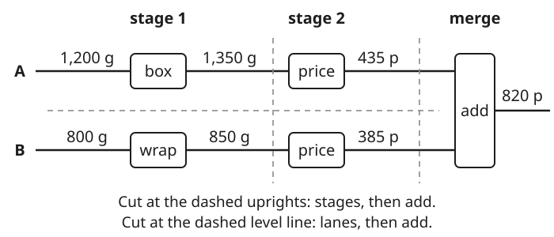

# Monoidal categories: things side by side, drawn as parallel wires

[Syllabus](../../../SYLLABUS.md) → [Computability and complexity](../README.md) → [Category Theory in Outline](../README.md#s07) → Monoidal categories

---

## General Overview

A parcel depot runs two lanes. Parcel A weighs 1,200 g and goes through a box machine, which adds 150 g of cardboard. Parcel B weighs 800 g and goes through a wrap machine, which adds 50 g of bubble wrap. Then each lane has a pricing machine: 300 p plus 1 p for every 10 g.

Parcel A leaves at 1,350 g and costs 435 p. Parcel B leaves at 850 g and costs 385 p. A last machine adds the two bills: 820 p, or £8.20.

The run has two descriptions. Stage by stage: box beside wrap, then price beside price. Lane by lane: "box, then price" beside "wrap, then price". They must give the same bills.

Draw each lane as a wire and each machine as a box on it. Both descriptions are now two ways to cut one picture, a **string diagram**. The structure that makes the picture trustworthy is a **monoidal category**: a category with a second way to combine things, side by side, next to the usual "in turn".

**A monoidal category adds a side-by-side operation to a category, and because side by side respects "in turn", a process can be drawn as boxes on parallel wires and every way of reading the drawing gives the same answer.**

**What kind of fact this is:** a definition plus theorems. The interchange law is part of the definition: it is the condition that $`\otimes`$ keeps composites, written out. Why it works checks it for pairs of sets and proves box sliding from it. Mac Lane's coherence theorem (1963) and the Joyal–Street theorem (1991) are stated with key steps and sources, not proved here.

### The picture: one drawing, two readings

<p align="center"></p>

Schematic: lengths mean nothing, only which box sits on which wire and in what order. Time runs left to right.

---

## The formula

Notation first, in words. A **category** $`\mathcal{C}`$ is a collection of objects and arrows between them, with an arrow $`\mathrm{id}_A`$ that does nothing and a way to run arrows in turn, written $`g \circ f`$, "g after f" ([Categories and functors](01-categories-and-functors.md)). This card introduces $`\otimes`$, read "tensor": it puts two objects, or two arrows, side by side. The [Qubits](../05-Algebraic%2C%20Interactive%20and%20Quantum/05-qubits-superposition-and-measurement.md) card used the same symbol to join two qubits; that is one example of this one.

In the depot, objects are sets of possible values, such as weights in grams. Arrows are machines. Side by side, $`A \otimes B`$ is the set of pairs $`(a, b)`$, and $`f \otimes g`$ sends $`(a, b)`$ to $`(f(a), g(b))`$.

The law that makes the picture safe is the **interchange law**:

```math
(f' \otimes g') \circ (f \otimes g) = (f' \circ f) \otimes (g' \circ g)
```

**Read it aloud:** two stages of side-by-side machines equal two lanes of in-turn machines, set side by side.

Here $`f`$ is box, $`g`$ is wrap and $`f' = g'`$ is price. The left side takes (1,200, 800) to (1,350, 850), then (435, 385). The right side gives price of box of 1,200, 435, beside price of wrap of 800, 385.

The whole picture, the add box included, is one arrow. Its two readings, by stages and by lanes, are:

```math
\mathrm{add} \circ (\mathrm{price} \otimes \mathrm{price}) \circ (\mathrm{box} \otimes \mathrm{wrap}) = \mathrm{add} \circ ((\mathrm{price} \circ \mathrm{box}) \otimes (\mathrm{price} \circ \mathrm{wrap}))
```

**Read it aloud:** add after two side-by-side stages equals add after two lanes set side by side; both send (1,200, 800) to 820.

### What a monoidal category is

A **monoidal category** is a category $`\mathcal{C}`$ with these extra pieces:

1. **Side by side.** For objects $`A`$ and $`B`$ an object $`A \otimes B`$, and for arrows $`f`$ and $`g`$ an arrow $`f \otimes g`$. This must be a functor of two inputs, a structure-keeping map: it keeps identities, $`\mathrm{id}_A \otimes \mathrm{id}_B = \mathrm{id}_{A \otimes B}`$, and it keeps composites of pairs. Written out, keeping composites is the interchange law above.
2. **A unit object** $`I`$, the "nothing" beside a thing: in sets, a one-point set.
3. **Three exchange arrows**, each one a natural isomorphism (an arrow with an undo that commutes with every box, see [Natural transformations and Yoneda](03-natural-transformations-and-yoneda.md)): $`\alpha`$ moves brackets, $`(A \otimes B) \otimes C \to A \otimes (B \otimes C)`$; $`\lambda`$ and $`\rho`$ remove the unit, $`I \otimes A \to A`$ and $`A \otimes I \to A`$.
4. **Two coherence laws**, the pentagon and the triangle: the exchange arrows never disagree (Step 3).

The name comes from [Monoids and monads](07-monoids-and-monads-for-programmers.md): a monoid has an associative multiply and a unit. A monoidal category lifts that pattern one level, with $`\otimes`$ as multiply, $`I`$ as unit, and the laws holding up to exchange arrows.

A monoidal category is **symmetric** when it also has a natural swap $`\sigma_{A,B} : A \otimes B \to B \otimes A`$ that undoes itself. In a drawing the swap is two wires crossing.

Some monoidal categories met in this library:

| Category | Objects | Side by side, $`\otimes`$ | Unit $`I`$ | Symmetric? |
| --- | --- | --- | --- | --- |
| Sets and functions | sets | pairs, $`A \times B`$ | a one-point set | yes |
| Sets and functions, again | sets | "one or the other", the disjoint union | the empty set | yes |
| Groups | groups | the direct product | the one-member group | yes |
| Real vector spaces | vector spaces | the tensor product | the real line | yes |
| A category's endofunctors | functors from $`\mathcal{C}`$ to itself | doing one after the other | doing nothing | not in general |

The last row is the one behind monads: a monad is a monoid in that category (see [Monoids and monads](07-monoids-and-monads-for-programmers.md)).

| Symbol | Plain meaning | In our example | Push it up and the answer… |
| --- | --- | --- | --- |
| $`\mathcal{C}`$ | the category: objects and arrows | sets of values and the machines | — |
| $`A`$, $`B`$, $`C`$ | objects: what a wire carries | weights in grams; prices in pence | — |
| $`f`$, $`g`$, $`f'`$, $`g'`$; $`\mathrm{add}`$ | arrows: boxes on wires; add joins two wires into one | box (+150 g), wrap (+50 g), price; 435 + 385 | heavier packing raises the bill |
| $`\circ`$ | in turn: $`g \circ f`$ is f, then g | price after box | — |
| $`\otimes`$, $`\times`$ | side by side, on objects and on arrows; $`\times`$ is pairs, the side by side of sets and of groups | box beside wrap: (1,200, 800) to (1,350, 850); $`\mathbb{Z}_2 \times \mathbb{Z}_3`$, 6 members | — |
| $`\mathrm{id}_A`$ | the arrow that does nothing: a bare wire | an empty stretch of conveyor | — |
| $`I`$ | the unit object: "nothing" beside a thing | a one-point set; drawn as no wire | — |
| $`\alpha`$ | the bracket mover | $`((0, 1), 0)`$ to $`(0, (1, 0))`$ | — |
| $`\lambda`$, $`\rho`$ | the unit removers, left and right | $`(\text{the point}, a)`$ to $`a`$ | — |
| $`\sigma_{A,B}`$ | the swap: two wires crossing | lanes A and B change places | — |
| $`\mathbb{R}^2`$, $`\mathbb{Z}_2`$ | the plane, lists of two real numbers; the 2-hour clock | dimension 2; 2 members | the tensor's size grows by multiplying |
| $`ad - bc`$; $`u`$, $`w`$ | the determinant of a four-entry list $`(a, b, c, d)`$ set out as a 2 × 2 table, the product test of Qubits: 0 for every pair of vectors $`u`$, $`w`$ | $`(1, 0, 0, 1)`$ scores 1 | any nonzero score means no pair makes the list |

Clashes, said once: $`\alpha`$ was an F-algebra's structure map on [F-algebras](08-f-algebras-and-folds.md) and is the bracket mover here; $`\lambda`$ makes a function in the lambda calculus and removes a unit here.

### When it holds

- **The boxes share no hidden state.** A labeller with one counter for both lanes gives A label #1 if lane A runs first and #2 if lane B does. A shared counter is not two separate machines $`f \otimes g`$, so sliding does not apply.
- **Order along one wire is fixed.** Only boxes on different wires slide past each other. Pricing the parcel before boxing reads 1,200 g: 420 p, not 435 p.
- **Brackets match only through an exchange arrow.** In sets, $`((0, 1), 0)`$ and $`(0, (1, 0))`$ are different elements of two 8-member sets. The drawing may drop brackets only because of the coherence theorem.
- **Crossings need a swap.** Wires may cross only when the category has one: a braiding, where an over-crossing and an under-crossing differ, or a symmetry, where they are the same. Endofunctors under "one after the other" have neither in general, so their diagrams never cross.
- **A joint wire is not always a pair.** In $`\mathbb{R}^2 \otimes \mathbb{R}^2`$ a pair of vectors $`(u_0, u_1)`$ and $`(w_0, w_1)`$ becomes the four-entry list $`(u_0 w_0,\ u_0 w_1,\ u_1 w_0,\ u_1 w_1)`$. Call the entries $`(a, b, c, d)`$ and set them out as a 2 × 2 table. Its determinant $`ad - bc`$ (first times last, minus second times third) is $`u_0 w_0 u_1 w_1 - u_0 w_1 u_1 w_0 = 0`$. This is the product test of [Qubits](../05-Algebraic%2C%20Interactive%20and%20Quantum/05-qubits-superposition-and-measurement.md), which proves that a zero determinant is also enough. The list $`(1, 0, 0, 1)`$ scores 1, so no pair of vectors makes it.

---

## Why it works

### Step 0: side by side is a functor, so it respects "in turn"

The key idea is that $`\otimes`$ is not just any way to stick two things together. It is a functor of two inputs: feed it a pair of arrows run in turn, and it gives the arrows' side-by-side versions run in turn. That is the interchange law.

Everything a string diagram does follows from this law, plus bookkeeping for brackets, units and crossings.

### Step 1: the interchange law, checked on one parcel pair

In sets, follow a pair $`(a, b)`$ through both sides.

- Left side: $`f \otimes g`$ gives $`(f(a), g(b))`$, then $`f' \otimes g'`$ gives $`(f'(f(a)), g'(g(b)))`$.
- Right side: $`f' \circ f`$ sends $`a`$ to $`f'(f(a))`$ and $`g' \circ g`$ sends $`b`$ to $`g'(g(b))`$; side by side, $`(f'(f(a)), g'(g(b)))`$.

The two sides agree on every pair, so they are the same function. On the parcels, both give (435, 385). So pairs of sets meet the functor condition of item 1.

<details>
<summary>Detailed proof: keeping composites is the interchange law</summary>

The arrows of the product category $`\mathcal{C} \times \mathcal{C}`$ are pairs of arrows $`(f, g)`$, run in turn one slot at a time:

$`\displaystyle (f', g') \circ (f, g) = (f' \circ f,\ g' \circ g)`$

Item 1 asks $`\otimes`$, as a map from $`\mathcal{C} \times \mathcal{C}`$ to $`\mathcal{C}`$, to keep composites: the image of a composite is the composite of the images. The image of the right side above is $`(f' \circ f) \otimes (g' \circ g)`$. The composite of the images of $`(f', g')`$ and $`(f, g)`$ is $`(f' \otimes g') \circ (f \otimes g)`$. Keeping composites says these two are equal, which is the interchange law.

So interchange holds in every monoidal category by definition. What needs checking, for a given $`\otimes`$ such as pairs of sets, is that it keeps composites, and Step 1 does that.

</details>

### Step 2: boxes on different wires slide past each other

Put identities into the interchange law. With $`f' = \mathrm{id}`$ and $`g = \mathrm{id}`$, and again with the roles reversed:

```math
f \otimes g = (f \otimes \mathrm{id}) \circ (\mathrm{id} \otimes g) = (\mathrm{id} \otimes g) \circ (f \otimes \mathrm{id})
```

**Read it aloud:** two boxes on different wires can run together, either one first, and nothing changes.

In the picture this is sliding a box along its wire past a box on another wire. Wrap B first and box A afterwards: the bills are still (435, 385). The code checks this slide and the interchange law for every function on a two-member set: 256 choices of four functions, 1,024 inputs, 0 failures.

### Step 3: brackets and the unit disappear from the drawing

A drawing shows three wires side by side, not $`(A \otimes B) \otimes C`$ or $`A \otimes (B \otimes C)`$. It can forget the brackets only if every way of moving brackets with $`\alpha`$ gives the same answer.

The **pentagon** is the first test. From $`((A \otimes B) \otimes C) \otimes D`$ to $`A \otimes (B \otimes (C \otimes D))`$ there are two routes made of $`\alpha`$: two moves along the top, three along the bottom. The pentagon law says they agree. The **triangle** says the same for $`\alpha`$ with $`\lambda`$ and $`\rho`$.

Mac Lane's **coherence theorem** (1963) says these two laws are enough: any two routes between the same objects, built from $`\alpha`$, $`\lambda`$, $`\rho`$, their undos and identities with $`\otimes`$ and $`\circ`$, are equal. So the drawing may drop brackets and draw $`I`$ as no wire at all.

The proof, in Mac Lane's book below, turns every bracketing into one standard form, all brackets to the right, and shows that any two routes to that form agree. The code checks the pentagon in sets: the two routes agree on all 16 members of $`((A \times B) \times C) \times D`$ for two-member sets.

### Step 4: equal pictures mean equal arrows

Joyal and Street (1991) proved the result that makes string diagrams a method, not a sketch. Two expressions built from boxes, $`\circ`$ and $`\otimes`$ are equal by the monoidal laws exactly when their drawings deform into each other in the plane. The deformation slides boxes along wires and stretches wires, keeping the ends fixed and never passing a wire through another.

So a drawing is an exact calculation. Reading it by stages or by lanes, as in the picture, is a choice of cuts, and any two choices give equal expressions.

### Step 5: crossings, when the category is symmetric

In a symmetric monoidal category the swap $`\sigma`$ obeys more laws. Two of them do the work in a drawing:

- **Boxes pass through a crossing:** $`\sigma \circ (f \otimes g) = (g \otimes f) \circ \sigma`$.
- **Two crossings cancel:** $`\sigma \circ \sigma = \mathrm{id}`$.

A third, the **hexagon** law, makes the swap agree with the bracket mover $`\alpha`$: crossing one wire over two at once equals crossing it over each in turn.

Then a wire may cross another freely, over or under, and the two count as the same. Only which box connects to which matters. In sets, $`\sigma`$ swaps a pair, and the code finds 0 failures of both laws over every pair of functions on a two-member set.

---

## Worked numbers, by hand

| Step | Arithmetic | Value |
| --- | --- | --- |
| parcels in | lane A, lane B | 1,200 g, 800 g |
| stage 1: box beside wrap | 1,200 + 150; 800 + 50 | 1,350 g, 850 g |
| stage 2: price beside price | 300 + 1,350 ÷ 10; 300 + 850 ÷ 10 | 435 p, 385 p |
| lane by lane instead | price of box of 1,200; price of wrap of 800 | 435 p, 385 p |
| wrap slid before box | the same boxes, other order across lanes | 435 p, 385 p |
| merge: two wires into one | 435 + 385 | **820 p** |

The depot bills £8.20 however the drawing is read, because the drawing is one arrow and every reading names the same arrow.

### What breaks if you drop a piece

| Mistake | Comes out at | What went wrong |
| --- | --- | --- |
| A labeller sharing one counter across lanes | A gets #1 or #2, depending on which lane runs first | one shared counter is not two separate machines, so sliding does not apply |
| Price the parcel before boxing it | 420 p, not 435 p | pricing read 1,200 g, not 1,350 g: order along one wire is fixed |
| Tensor read as listing the two vectors one after the other (the direct sum) | dimension 5, not 6 | the tensor multiplies dimensions; 2 + 3 is the direct sum, not the tensor |
| $`(1, 0, 0, 1)`$ read as a pair of vectors | no pair with entries −3 to 3; $`ad - bc = 1`$ | a joint wire in vector spaces can carry a state no pair makes |

The code prints all four.

---

## Code, from first principles, and it actually runs

The code builds "side by side" and "in turn" from scratch and imports nothing. It takes three roads to the bills: stage by stage, lane by lane, and a slid box. It then searches every function on a two-member set for a failure of the interchange, slide and crossing laws, and checks the pentagon on all 16 members. For vectors it checks interchange for matrices both ways round, and tests $`(1, 0, 0, 1)`$ by a search and by the determinant $`ad - bc`$. Set sizes and dimensions are counted by listing members and coordinates. The figure's positions follow one layout rule, one column per stage and one row per lane, printed on the `figure,` line. The Rust stores each small function as a table, so its search is written separately from the Python.

### Python

```python
# Monoidal categories and string diagrams -- the check behind the card.  Nothing
# is imported.  Two parcels ride two lanes: A (1,200 g) through a box machine,
# B (800 g) through a wrap machine, then both through pricing, and a merge adds
# the two bills.  Road one reads the diagram stage by stage, road two lane by
# lane, road three slides one box past the other; a search then checks the same
# law for every function on a two-member set, and the swap and the brackets too.
def box(w): return w + 150                   # f: adds 150 g of cardboard
def wrap(w): return w + 50                   # g: adds 50 g of bubble wrap
def price(w): return 300 + w // 10           # f' = g': 300 p plus 1 p per 10 g
def merge(pair): return pair[0] + pair[1]    # two wires in, one wire out
def tensor(f, g): return lambda p: (f(p[0]), g(p[1]))    # side by side
def then(f, g): return lambda x: g(f(x))                 # in turn: f, then g
def ident(x): return x
def swap(p): return (p[1], p[0])                         # two wires crossing
def assoc(t): return (t[0][0], (t[0][1], t[1]))          # ((a, b), c) -> (a, (b, c))
def yn(c): return "yes" if c else "no"

parcels = (1200, 800)
by_stage = then(tensor(box, wrap), tensor(price, price))     # (f' x g') o (f x g)
by_lane = tensor(then(box, price), then(wrap, price))        # (f' o f) x (g' o g)
slid = then(then(tensor(ident, wrap), tensor(box, ident)), tensor(price, price))
print(f"parcels in: A {parcels[0]} g, B {parcels[1]} g")
print(f"after box and wrap, side by side: {tensor(box, wrap)(parcels)}")
print(f"road 1, stage by stage: bills {by_stage(parcels)} pence")
print(f"road 2, lane by lane:   bills {by_lane(parcels)} pence")
print(f"road 3, wrap slid before box: bills {slid(parcels)} pence")
print(f"merge the two wires into one: {merge(by_stage(parcels))} pence")

tables = [(a, b) for a in (0, 1) for b in (0, 1)]    # every function {0,1} -> {0,1}
fns = [lambda x, t=t: t[x] for t in tables]
pairs = [(a, b) for a in (0, 1) for b in (0, 1)]
quads = [(f, g, h, k) for f in fns for g in fns for h in fns for k in fns]
law = slide = 0
for f, g, h, k in quads:
    for p in pairs:
        law += then(tensor(f, g), tensor(h, k))(p) != tensor(then(f, h), then(g, k))(p)
        slide += then(tensor(f, ident), tensor(ident, g))(p) != then(tensor(ident, g), tensor(f, ident))(p)
cross = sum(swap(tensor(f, g)(p)) != tensor(g, f)(swap(p)) for f in fns for g in fns for p in pairs)
twice = sum(swap(swap(p)) != p for p in pairs)
print(f"all functions on {{0, 1}}: {len(fns)}; quadruples {len(quads)}, inputs checked {len(quads) * len(pairs)}")
print(f"interchange failures {law}; sliding failures {slide}; crossing failures {cross}; swap twice failures {twice}")

quad = [(((a, b), c), d) for a in (0, 1) for b in (0, 1) for c in (0, 1) for d in (0, 1)]
path1 = [assoc(assoc(x)) for x in quad]
path2 = [then(then(tensor(assoc, ident), assoc), tensor(ident, assoc))(x) for x in quad]
print(f"pentagon: {len(quad)} members of ((A x B) x C) x D, the two re-bracketings agree on {sum(a == b for a, b in zip(path1, path2))}")
x = ((0, 1), 0)
left3 = [((a, b), c) for a in (0, 1) for b in (0, 1) for c in (0, 1)]    # (A x B) x C, listed
print(f"brackets: {x} becomes {assoc(x)}; the same element: {yn(x == assoc(x))}; both sets have "
      f"{len(left3)} members, matched one for one: {yn(len({assoc(t) for t in left3}) == len(left3))}")
print(f"unit: A = {{0, 1, 2}} beside the one-point set has {len([(a, u) for a in (0, 1, 2) for u in [()]])} members")

def labels(order):                     # a labeller that shares one counter
    count, out = 0, {}
    for lane in order:
        count += 1
        out[lane] = count
    return out
l1, l2 = labels("AB"), labels("BA")
print(f"mistake 1, shared counter: lane A first gives A #{l1['A']}, B #{l1['B']}; lane B first gives A #{l2['A']}, B #{l2['B']}")
print(f"mistake 2, price before box: {price(parcels[0])} p, not {by_lane(parcels)[0]} p")

def kron(m, n): return [[m[i // 2][j // 2] * n[i % 2][j % 2] for j in range(4)] for i in range(4)]
def mul(m, n): return [[sum(m[i][t] * n[t][j] for t in range(len(n))) for j in range(len(n[0]))] for i in range(len(m))]
a, b, a2, b2 = [[1, 1], [0, 1]], [[2, 0], [0, 1]], [[0, 1], [1, 0]], [[1, 0], [1, 1]]
lhs, rhs = mul(kron(a2, b2), kron(a, b)), kron(mul(a2, a), mul(b2, b))
print(f"vectors: (A' x B')(A x B) = (A'A) x (B'B): {yn(lhs == rhs)}; rows {rhs}")
u3, w3 = [1, 2], [3, 4, 5]                   # one vector in R^2, one in R^3
print(f"mistake 3, dimensions: R^2 tensor R^3 has {len([s * t for s in u3 for t in w3])}, "
      f"R^2 and R^3 listed one after the other (the direct sum) has {len(u3 + w3)}")
v = (1, 0, 0, 1)
grid = [(s, t) for s in range(-3, 4) for t in range(-3, 4)]
hits = [(u, w) for u in grid for w in grid if (u[0] * w[0], u[0] * w[1], u[1] * w[0], u[1] * w[1]) == v]
print(f"mistake 4, {v} as a pair: ad - bc = {v[0] * v[3] - v[1] * v[2]}; pairs found with entries -3 to 3: {len(hits)}")
pa, pb = (90, 10), (80, 20)
joint = [pa[i] * pb[j] // 100 for i in (0, 1) for j in (0, 1)]
print(f"independent lanes: {pa} x {pb} percent = {joint}; ad - bc = {joint[0] * joint[3] - joint[1] * joint[2]}")
step, g = 1, (1, 1)
while g != (0, 0):
    g, step = ((g[0] + 1) % 2, (g[1] + 1) % 3), step + 1
z6 = [(s, t) for s in range(2) for t in range(3)]
print(f"groups: Z2 x Z3 has {len(z6)} members; (1, 1) has order {step}")
cols = [200 + 200 * k for k in range(3)]     # figure layout: one column per stage, one row per lane
rows = [90 + 100 * i for i in range(len(parcels))]
print(f"figure, schematic: stage columns x {cols}; lane wires y {rows}; merged wire y {sum(rows) // 2}")
assert by_stage(parcels) == (435, 385) and merge(by_stage(parcels)) == 820   # by hand
assert by_lane(parcels) == by_stage(parcels) == slid(parcels)
assert law == slide == cross == twice == 0 and path1 == path2
assert l1 != l2 and lhs == rhs and len(hits) == 0 and step == 6
assert len(z6) == step and len({assoc(t) for t in left3}) == len(left3) == 8   # order against size
print("ALL CHECKS PASS")
```

**Ran 2026-11-19 on macOS, Python 3.14.10, standard library only. All checks passed. Output, pasted from the run:**

```
parcels in: A 1200 g, B 800 g
after box and wrap, side by side: (1350, 850)
road 1, stage by stage: bills (435, 385) pence
road 2, lane by lane:   bills (435, 385) pence
road 3, wrap slid before box: bills (435, 385) pence
merge the two wires into one: 820 pence
all functions on {0, 1}: 4; quadruples 256, inputs checked 1024
interchange failures 0; sliding failures 0; crossing failures 0; swap twice failures 0
pentagon: 16 members of ((A x B) x C) x D, the two re-bracketings agree on 16
brackets: ((0, 1), 0) becomes (0, (1, 0)); the same element: no; both sets have 8 members, matched one for one: yes
unit: A = {0, 1, 2} beside the one-point set has 3 members
mistake 1, shared counter: lane A first gives A #1, B #2; lane B first gives A #2, B #1
mistake 2, price before box: 420 p, not 435 p
vectors: (A' x B')(A x B) = (A'A) x (B'B): yes; rows [[0, 0, 2, 0], [0, 0, 2, 1], [2, 0, 2, 0], [2, 1, 2, 1]]
mistake 3, dimensions: R^2 tensor R^3 has 6, R^2 and R^3 listed one after the other (the direct sum) has 5
mistake 4, (1, 0, 0, 1) as a pair: ad - bc = 1; pairs found with entries -3 to 3: 0
independent lanes: (90, 10) x (80, 20) percent = [72, 18, 8, 2]; ad - bc = 0
groups: Z2 x Z3 has 6 members; (1, 1) has order 6
figure, schematic: stage columns x [200, 400, 600]; lane wires y [90, 190]; merged wire y 140
ALL CHECKS PASS
```

### Rust

Same numbers, same labels, built with `rustc --edition 2021 -O`.

```rust
// Monoidal categories and string diagrams -- the same check as the Python, in
// Rust.  No crates.  Two parcels ride two lanes: A (1,200 g) through a box
// machine, B (800 g) through a wrap machine, then both through pricing, and a
// merge adds the two bills.  Road one reads the diagram stage by stage, road
// two lane by lane, road three slides one box past the other; a search then
// checks the same law for every function on a two-member set, and the swap and
// the brackets too.
fn bx(w: i64) -> i64 { w + 150 }                      // f: adds 150 g of cardboard
fn wrap(w: i64) -> i64 { w + 50 }                     // g: adds 50 g of bubble wrap
fn price(w: i64) -> i64 { 300 + w / 10 }              // f' = g': 300 p plus 1 p per 10 g
fn merge(p: (i64, i64)) -> i64 { p.0 + p.1 }          // two wires in, one wire out
fn id(x: i64) -> i64 { x }
fn tensor(f: fn(i64) -> i64, g: fn(i64) -> i64, p: (i64, i64)) -> (i64, i64) { (f(p.0), g(p.1)) }
fn assoc<A, B, C>(t: ((A, B), C)) -> (A, (B, C)) { (t.0 .0, (t.0 .1, t.1)) }
type T = [usize; 2];                                   // a function {0,1} -> {0,1}, as its table
fn ten(f: T, g: T, p: (usize, usize)) -> (usize, usize) { (f[p.0], g[p.1]) }
fn then(f: T, g: T) -> T { [g[f[0]], g[f[1]]] }        // in turn: f, then g
fn swap(p: (usize, usize)) -> (usize, usize) { (p.1, p.0) }
fn yn(c: bool) -> &'static str { if c { "yes" } else { "no" } }
type M = Vec<Vec<i64>>;
fn kron(m: &M, n: &M) -> M { (0..4).map(|i| (0..4).map(|j| m[i / 2][j / 2] * n[i % 2][j % 2]).collect()).collect() }
fn mul(m: &M, n: &M) -> M {
    (0..m.len()).map(|i| (0..n[0].len()).map(|j| (0..n.len()).map(|t| m[i][t] * n[t][j]).sum()).collect()).collect()
}

fn main() {
    let parcels = (1200, 800);
    let by_stage = tensor(price, price, tensor(bx, wrap, parcels));
    let by_lane = (price(bx(parcels.0)), price(wrap(parcels.1)));
    let slid = tensor(price, price, tensor(bx, id, tensor(id, wrap, parcels)));
    println!("parcels in: A {} g, B {} g", parcels.0, parcels.1);
    println!("after box and wrap, side by side: {:?}", tensor(bx, wrap, parcels));
    println!("road 1, stage by stage: bills {:?} pence", by_stage);
    println!("road 2, lane by lane:   bills {:?} pence", by_lane);
    println!("road 3, wrap slid before box: bills {:?} pence", slid);
    println!("merge the two wires into one: {} pence", merge(by_stage));

    let fns: Vec<T> = vec![[0, 0], [0, 1], [1, 0], [1, 1]];
    let idt: T = [0, 1];
    let pairs = [(0, 0), (0, 1), (1, 0), (1, 1)];
    let (mut law, mut slide, mut cross, mut quads) = (0, 0, 0, 0);
    for &f in &fns { for &g in &fns { for &h in &fns { for &k in &fns {
        quads += 1;
        for &p in &pairs {
            if ten(h, k, ten(f, g, p)) != ten(then(f, h), then(g, k), p) { law += 1 }
            if ten(f, idt, ten(idt, g, p)) != ten(idt, g, ten(f, idt, p)) { slide += 1 }
        }
    }}}}
    for &f in &fns { for &g in &fns { for &p in &pairs { if swap(ten(f, g, p)) != ten(g, f, swap(p)) { cross += 1 } } } }
    let twice = pairs.iter().filter(|&&p| swap(swap(p)) != p).count();
    println!("all functions on {{0, 1}}: {}; quadruples {}, inputs checked {}", fns.len(), quads, quads * pairs.len());
    println!("interchange failures {}; sliding failures {}; crossing failures {}; swap twice failures {}", law, slide, cross, twice);

    let mut agree = 0;
    let mut members = 0;
    for a in 0..2 { for b in 0..2 { for c in 0..2 { for d in 0..2 {
        let x = (((a, b), c), d);
        members += 1;
        let p1 = assoc(assoc(x));
        let z = assoc((assoc(x.0), x.1));
        let p2 = (z.0, assoc(z.1));
        if p1 == p2 { agree += 1 }
    }}}}
    println!("pentagon: {} members of ((A x B) x C) x D, the two re-bracketings agree on {}", members, agree);
    let x = ((0, 1), 0);
    let same = format!("{:?}", x) == format!("{:?}", assoc(x));
    let mut left3 = Vec::new();                         // (A x B) x C, listed
    for a in 0..2 { for b in 0..2 { for c in 0..2 { left3.push(((a, b), c)) } } }
    let images: std::collections::BTreeSet<(i32, (i32, i32))> = left3.iter().map(|&t| assoc(t)).collect();
    println!("brackets: {:?} becomes {:?}; the same element: {}; both sets have {} members, matched one for one: {}",
             x, assoc(x), yn(same), left3.len(), yn(images.len() == left3.len()));
    let unit: Vec<(i64, ())> = [0, 1, 2].iter().map(|&a| (a, ())).collect();
    println!("unit: A = {{0, 1, 2}} beside the one-point set has {} members", unit.len());

    let labels = |order: [char; 2]| { let mut out = [0; 2]; for (n, &lane) in order.iter().enumerate() { out[if lane == 'A' { 0 } else { 1 }] = n + 1 } out };
    let (l1, l2) = (labels(['A', 'B']), labels(['B', 'A']));
    println!("mistake 1, shared counter: lane A first gives A #{}, B #{}; lane B first gives A #{}, B #{}", l1[0], l1[1], l2[0], l2[1]);
    println!("mistake 2, price before box: {} p, not {} p", price(parcels.0), by_lane.0);

    let (a, b): (M, M) = (vec![vec![1, 1], vec![0, 1]], vec![vec![2, 0], vec![0, 1]]);
    let (a2, b2): (M, M) = (vec![vec![0, 1], vec![1, 0]], vec![vec![1, 0], vec![1, 1]]);
    let (lhs, rhs) = (mul(&kron(&a2, &b2), &kron(&a, &b)), kron(&mul(&a2, &a), &mul(&b2, &b)));
    println!("vectors: (A' x B')(A x B) = (A'A) x (B'B): {}; rows {:?}", yn(lhs == rhs), rhs);
    let (u3, w3) = (vec![1, 2], vec![3, 4, 5]);        // one vector in R^2, one in R^3
    let tens: Vec<i64> = u3.iter().flat_map(|s| w3.iter().map(move |t| s * t)).collect();
    println!("mistake 3, dimensions: R^2 tensor R^3 has {}, R^2 and R^3 listed one after the other (the direct sum) has {}",
             tens.len(), [u3.clone(), w3.clone()].concat().len());
    let v = (1, 0, 0, 1);
    let mut hits = 0;
    for u0 in -3..4 { for u1 in -3..4 { for w0 in -3..4 { for w1 in -3..4 {
        if (u0 * w0, u0 * w1, u1 * w0, u1 * w1) == v { hits += 1 }
    }}}}
    println!("mistake 4, {:?} as a pair: ad - bc = {}; pairs found with entries -3 to 3: {}", v, v.0 * v.3 - v.1 * v.2, hits);
    let (pa, pb) = ([90, 10], [80, 20]);
    let joint: Vec<i64> = (0..4).map(|n| pa[n / 2] * pb[n % 2] / 100).collect();
    println!("independent lanes: ({}, {}) x ({}, {}) percent = {:?}; ad - bc = {}", pa[0], pa[1], pb[0], pb[1], joint, joint[0] * joint[3] - joint[1] * joint[2]);
    let (mut step, mut g) = (1, (1, 1));
    while g != (0, 0) { g = ((g.0 + 1) % 2, (g.1 + 1) % 3); step += 1 }
    let z6: Vec<(i64, i64)> = (0..2).flat_map(|s| (0..3).map(move |t| (s, t))).collect();
    println!("groups: Z2 x Z3 has {} members; (1, 1) has order {}", z6.len(), step);
    let cols: Vec<i64> = (0..3).map(|k| 200 + 200 * k).collect(); // figure layout: one column per stage, one row per lane
    let rows: Vec<i64> = (0..2).map(|i| 90 + 100 * i).collect();
    println!("figure, schematic: stage columns x {:?}; lane wires y {:?}; merged wire y {}", cols, rows, (rows[0] + rows[1]) / 2);
    assert!(by_stage == (435, 385) && merge(by_stage) == 820);                  // by hand
    assert!(by_lane == by_stage && slid == by_stage);
    assert!(law == 0 && slide == 0 && cross == 0 && twice == 0 && agree == members);
    assert!(l1 != l2 && lhs == rhs && hits == 0 && step == 6);
    assert!(z6.len() == step && images.len() == left3.len() && left3.len() == 8); // order against size
    println!("ALL CHECKS PASS");
}
```

**Ran 2026-11-19 on macOS, rustc 1.98.1, no crates. All checks passed. Output, pasted from the run:**

```
parcels in: A 1200 g, B 800 g
after box and wrap, side by side: (1350, 850)
road 1, stage by stage: bills (435, 385) pence
road 2, lane by lane:   bills (435, 385) pence
road 3, wrap slid before box: bills (435, 385) pence
merge the two wires into one: 820 pence
all functions on {0, 1}: 4; quadruples 256, inputs checked 1024
interchange failures 0; sliding failures 0; crossing failures 0; swap twice failures 0
pentagon: 16 members of ((A x B) x C) x D, the two re-bracketings agree on 16
brackets: ((0, 1), 0) becomes (0, (1, 0)); the same element: no; both sets have 8 members, matched one for one: yes
unit: A = {0, 1, 2} beside the one-point set has 3 members
mistake 1, shared counter: lane A first gives A #1, B #2; lane B first gives A #2, B #1
mistake 2, price before box: 420 p, not 435 p
vectors: (A' x B')(A x B) = (A'A) x (B'B): yes; rows [[0, 0, 2, 0], [0, 0, 2, 1], [2, 0, 2, 0], [2, 1, 2, 1]]
mistake 3, dimensions: R^2 tensor R^3 has 6, R^2 and R^3 listed one after the other (the direct sum) has 5
mistake 4, (1, 0, 0, 1) as a pair: ad - bc = 1; pairs found with entries -3 to 3: 0
independent lanes: (90, 10) x (80, 20) percent = [72, 18, 8, 2]; ad - bc = 0
groups: Z2 x Z3 has 6 members; (1, 1) has order 6
figure, schematic: stage columns x [200, 400, 600]; lane wires y [90, 190]; merged wire y 140
ALL CHECKS PASS
```

The two outputs match line for line.

### Lean

Lean proves the interchange and sliding laws in every monoidal category, the crossing laws in every symmetric one, and the card's worked numbers.

- Take any monoidal category, with arrows $`f`$, $`f'`$ on one wire and $`g`$, $`g'`$ on another. Then $`(f' \otimes g') \circ (f \otimes g) = (f' \circ f) \otimes (g' \circ g)`$.
- Take arrows $`f`$ and $`g`$ on different wires of any monoidal category. Then $`f \otimes g = (f \otimes \mathrm{id}) \circ (\mathrm{id} \otimes g)`$. It also equals $`(\mathrm{id} \otimes g) \circ (f \otimes \mathrm{id})`$, so either box may run first.
- Take any symmetric monoidal category and arrows $`f`$ and $`g`$. Then $`\sigma \circ (f \otimes g) = (g \otimes f) \circ \sigma`$ and $`\sigma \circ \sigma = \mathrm{id}`$.
- In the depot, stages, lanes and the slid box all give bills of 435 p and 385 p, merged to 820 p.
- Pricing the parcel before boxing it reads 1,200 g and charges 420 p.
- For every function on a two-member set, the interchange, sliding and crossing laws hold on every input.
- The two pentagon routes agree on all 16 members of $`((A \times B) \times C) \times D`$ for two-member sets.
- Counting coordinates, the tensor of $`\mathbb{R}^2`$ and $`\mathbb{R}^3`$ has 6 and the direct sum has 5.
- The list $`(1, 0, 0, 1)`$ has $`ad - bc = 1`$, and no pair of vectors with entries −3 to 3 makes it.
- The independent lanes give 72%, 18%, 8% and 2%, with $`ad - bc = 0`$.
- $`\mathbb{Z}_2 \times \mathbb{Z}_3`$ has 6 members, and $`(1, 1)`$ first returns to $`(0, 0)`$ at step 6.

The matrix check of interchange, the shared-counter labeller, bracket and unit counts and the figure layout are left to the Python and Rust checks.

```lean
-- Monoidal categories: in every monoidal category side by side respects "in turn" (the interchange law), so boxes on different wires slide past each other, and in a symmetric one boxes pass through a crossing and two crossings cancel.
import Mathlib.CategoryTheory.Monoidal.Category
import Mathlib.CategoryTheory.Monoidal.Braided.Basic
import Mathlib.Data.ZMod.Defs
import Mathlib.Data.Fintype.Prod
import Mathlib.Data.Fintype.Sum
import Mathlib.Data.Fintype.Pi
import Mathlib.Tactic.NormNum.Basic

open CategoryTheory MonoidalCategory

/-- The interchange law. In any monoidal category, two stages of side-by-side boxes equal two
lanes of in-turn boxes set side by side: for arrows f : X₁ → Y₁, f' : Y₁ → Z₁ on one wire and
g : X₂ → Y₂, g' : Y₂ → Z₂ on the other, (f' ⊗ g') ∘ (f ⊗ g) = (f' ∘ f) ⊗ (g' ∘ g).
Lean writes `f ≫ f'` for "f first, then f'", the card's f' ∘ f, and `⊗ₘ` for ⊗ on arrows. -/
theorem interchange_law {C : Type*} [Category C] [MonoidalCategory C]
    {X₁ Y₁ Z₁ X₂ Y₂ Z₂ : C} (f : X₁ ⟶ Y₁) (f' : Y₁ ⟶ Z₁) (g : X₂ ⟶ Y₂) (g' : Y₂ ⟶ Z₂) :
    (f ⊗ₘ g) ≫ (f' ⊗ₘ g') = (f ≫ f') ⊗ₘ (g ≫ g') := by
  exact MonoidalCategory.tensorHom_comp_tensorHom f g f' g'

/-- Boxes on different wires slide past each other. In any monoidal category, for
f : X₁ → Y₁ on one wire and g : X₂ → Y₂ on the other,
f ⊗ g = (f ⊗ id) ∘ (id ⊗ g) = (id ⊗ g) ∘ (f ⊗ id): either box may run first. -/
theorem boxes_slide_past_each_other {C : Type*} [Category C] [MonoidalCategory C]
    {X₁ Y₁ X₂ Y₂ : C} (f : X₁ ⟶ Y₁) (g : X₂ ⟶ Y₂) :
    f ⊗ₘ g = (𝟙 X₁ ⊗ₘ g) ≫ (f ⊗ₘ 𝟙 Y₂) ∧
      f ⊗ₘ g = (f ⊗ₘ 𝟙 X₂) ≫ (𝟙 Y₁ ⊗ₘ g) := by
  constructor
  · rw [MonoidalCategory.tensorHom_comp_tensorHom, Category.id_comp, Category.comp_id]
  · rw [MonoidalCategory.tensorHom_comp_tensorHom, Category.id_comp, Category.comp_id]

/-- Crossings in a symmetric monoidal category. Boxes pass through a crossing,
σ ∘ (f ⊗ g) = (g ⊗ f) ∘ σ, and two crossings cancel, σ_{B,A} ∘ σ_{A,B} = id.
Lean writes the swap σ_{A,B} as `(β_ A B).hom`. -/
theorem crossings_in_symmetric_category {C : Type*} [Category C] [MonoidalCategory C]
    [SymmetricCategory C] {X₁ Y₁ X₂ Y₂ : C} (f : X₁ ⟶ Y₁) (g : X₂ ⟶ Y₂) :
    (f ⊗ₘ g) ≫ (β_ Y₁ Y₂).hom = (β_ X₁ X₂).hom ≫ (g ⊗ₘ f) ∧
      (β_ X₁ X₂).hom ≫ (β_ X₂ X₁).hom = 𝟙 (X₁ ⊗ X₂) := by
  exact ⟨BraidedCategory.braiding_naturality f g, SymmetricCategory.symmetry X₁ X₂⟩

-- The depot, in sets: box adds 150 g, wrap adds 50 g, price is 300 p plus 1 p per 10 g.
-- Side by side on sets sends (a, b) to (f a, g b), which is `Prod.map f g`.
-- Stage 1: (1,200, 800) becomes (1,350, 850).
example : Prod.map (fun w : ℕ => w + 150) (fun w : ℕ => w + 50) (1200, 800) = (1350, 850) := by
  decide
-- Stage by stage, lane by lane, and wrap slid before box all give the bills (435, 385).
example : Prod.map (fun w : ℕ => 300 + w / 10) (fun w : ℕ => 300 + w / 10)
    (Prod.map (fun w : ℕ => w + 150) (fun w : ℕ => w + 50) (1200, 800)) = (435, 385) := by
  decide
example : ((fun w : ℕ => 300 + w / 10) ((fun w : ℕ => w + 150) 1200),
    (fun w : ℕ => 300 + w / 10) ((fun w : ℕ => w + 50) 800)) = (435, 385) := by
  decide
example : Prod.map (fun w : ℕ => 300 + w / 10) (fun w : ℕ => 300 + w / 10)
    (Prod.map (fun w : ℕ => w + 150) id (Prod.map id (fun w : ℕ => w + 50) (1200, 800))) =
    (435, 385) := by
  decide
-- Merging the two wires: 435 + 385 = 820 p. Pricing before boxing reads 1,200 g: 420 p.
example : 435 + 385 = 820 := by norm_num
example : 300 + 1200 / 10 = 420 := by norm_num
-- Every function on {0, 1}: interchange and sliding hold on all 256 quadruples and 4 inputs,
-- and boxes pass the swap on every pair of functions.
example : ∀ f g h k : Fin 2 → Fin 2, ∀ p : Fin 2 × Fin 2,
    Prod.map h k (Prod.map f g p) = Prod.map (h ∘ f) (k ∘ g) p := by
  decide
example : ∀ f g : Fin 2 → Fin 2, ∀ p : Fin 2 × Fin 2,
    Prod.map f id (Prod.map id g p) = Prod.map id g (Prod.map f id p) := by
  decide
example : ∀ f g : Fin 2 → Fin 2, ∀ p : Fin 2 × Fin 2,
    (Prod.map f g p).swap = Prod.map g f p.swap ∧ p.swap.swap = p := by
  decide
-- Pentagon in sets: the two re-bracketings of ((a, b), c), d agree on all 16 members.
-- Two moves along the top: α then α. Three along the bottom: α ⊗ id, then α, then id ⊗ α.
example : ∀ x : ((Fin 2 × Fin 2) × Fin 2) × Fin 2,
    Equiv.prodAssoc _ _ _ (Equiv.prodAssoc _ _ _ x) =
      Prod.map id (Equiv.prodAssoc _ _ _)
        (Equiv.prodAssoc _ _ _ (Prod.map (Equiv.prodAssoc _ _ _) id x)) := by
  decide
-- Coordinates: R^2 tensor R^3 has 2 · 3 = 6, the direct sum 2 + 3 = 5.
example : Fintype.card (Fin 2 × Fin 3) = 6 ∧ Fintype.card (Fin 2 ⊕ Fin 3) = 5 := by decide
-- (1, 0, 0, 1) has ad - bc = 1, and no pair of vectors with entries -3 to 3 makes it.
example : (1 : ℤ) * 1 - 0 * 0 = 1 := by norm_num
example : ∀ u₀ u₁ w₀ w₁ : Fin 7,
    ¬ (((u₀ : ℤ) - 3) * ((w₀ : ℤ) - 3) = 1 ∧ ((u₀ : ℤ) - 3) * ((w₁ : ℤ) - 3) = 0 ∧
      ((u₁ : ℤ) - 3) * ((w₀ : ℤ) - 3) = 0 ∧ ((u₁ : ℤ) - 3) * ((w₁ : ℤ) - 3) = 1) := by
  decide
-- Independent lanes: (90, 10) by (80, 20) percent gives 72, 18, 8, 2, with ad - bc = 0.
example : 90 * 80 / 100 = 72 ∧ 90 * 20 / 100 = 18 ∧ 10 * 80 / 100 = 8 ∧ 10 * 20 / 100 = 2 ∧
    (72 : ℤ) * 2 - 18 * 8 = 0 := by norm_num
-- Groups side by side: Z2 x Z3 has 6 members, and (1, 1) first returns to (0, 0) at step 6.
example : Fintype.card (ZMod 2 × ZMod 3) = 6 := by decide
example : (6 : ℕ) • ((1, 1) : ZMod 2 × ZMod 3) = 0 ∧
    ∀ k : Fin 5, ((k : ℕ) + 1) • ((1, 1) : ZMod 2 × ZMod 3) ≠ 0 := by decide

#print axioms interchange_law
#print axioms boxes_slide_past_each_other
#print axioms crossings_in_symmetric_category
```

**Checked 2026-11-19 on macOS, Lean 4.36.0-rc2, Mathlib v4.36.0-rc2. Every proof is complete and uses only Lean's standard axioms. Output, pasted from the run:**

```
'interchange_law' does not depend on any axioms
'boxes_slide_past_each_other' does not depend on any axioms
'crossings_in_symmetric_category' depends on axioms: [propext, Quot.sound]
```

> [!TIP]
> **Try changing**
> Guess first, then run it. The first assert holds the hand-worked bills, so changing a machine stops the program after the printout.
> - **A cheaper tariff.** Set `price` to `300 + w // 20`. All three roads still agree, now on (367, 342) and a merged 709 p; the first assert stops it.
> - **Heavier wrap.** Make `wrap` add 250 g. Lane A is untouched at 435 p; lane B rises to 405 p and the merge to 840 p.
> - **A swap that does not swap.** Change `swap` to return `(p[0], p[1])`. It still undoes itself, but boxes no longer pass through it: 40 crossing failures.
> - **A vector that is a pair.** Set `v` to `(2, 4, 3, 6)`. Now $`ad - bc = 0`$ and the search finds 2 pairs, (2, 3) with (1, 2) and both negated.

---

## The usual mistake

> [!warning]
> **Reading every joint wire as a pair.** In sets, a value on two wires side by side is a pair, one value per wire. In vector spaces it need not be. The vector $`(1, 0, 0, 1)`$ in $`\mathbb{R}^2 \otimes \mathbb{R}^2`$ fails the product test: its determinant is $`1 \times 1 - 0 \times 0 = 1`$, not 0, and a search finds no pair of vectors that makes it. This is entanglement on the [Qubits](../05-Algebraic%2C%20Interactive%20and%20Quantum/05-qubits-superposition-and-measurement.md) card. A diagram may join two wires into a state; it may not then assume each wire has a state of its own.
>
> - **Sliding boxes that share a counter.** Parcel A gets label #1 or #2, depending on which lane runs first.
> - **Swapping boxes on one wire.** Pricing before boxing charges 420 p, not 435 p.
> - **Adding dimensions.** $`\mathbb{R}^2 \otimes \mathbb{R}^3`$ has dimension 6, not 5. The 5 belongs to the two vectors listed one after the other, a different monoidal structure.
> - **Treating brackets as equal.** $`((0, 1), 0)`$ and $`(0, (1, 0))`$ are different elements, matched only through $`\alpha`$.

---

## Where you meet it in real life

- **Quantum circuits.** A circuit diagram is a string diagram: qubits are wires, gates are boxes. [Qubits](../05-Algebraic%2C%20Interactive%20and%20Quantum/05-qubits-superposition-and-measurement.md) computes $`U \otimes I`$, a gate on one qubit of two; there $`I`$ is the do-nothing gate, a bare wire, not the unit object.
- **Boolean circuits.** Gates on separate wires run in parallel, and the depth of [Boolean circuits](../05-Algebraic%2C%20Interactive%20and%20Quantum/01-boolean-circuits-and-formulas.md) counts the stages of the stage-by-stage reading.
- **Independent chances.** Lane A is on time with chance 90%, lane B with chance 80%. If they are independent, the joint table is their tensor, 72%, 18%, 8% and 2%, and its determinant $`ad - bc`$ is 0. A nonzero determinant means the lanes depend on each other.
- **Groups side by side.** The direct product $`\mathbb{Z}_2 \times \mathbb{Z}_3`$, a 2-hour and a 3-hour clock run together, has 6 members, and $`(1, 1)`$ takes 6 steps to return: it is the 6-hour clock ([Direct products](../../03-Algebra/08-Groups/07-direct-products.md)).

> **Say it back**
> A monoidal category adds $`\otimes`$, side by side, to running arrows in turn. Because $`\otimes`$ respects "in turn", the interchange law holds and boxes on different wires slide past each other. Coherence lets a drawing drop brackets and the unit, and equal drawings mean equal arrows. In the depot, stages and lanes both give 435 p and 385 p, merged to 820 p. In vector spaces a joint wire can hold a state that is no pair.

---

## What this builds on

- [Monoids and monads](07-monoids-and-monads-for-programmers.md): the monoid pattern, an associative multiply with a unit, that a monoidal category lifts one level up; and monads, which are monoids in the endofunctor row of the table.
- [F-algebras](08-f-algebras-and-folds.md): functors built from pairs and "one or the other", the two side-by-side structures on sets in the table.
- [Vector spaces and subspaces](../../03-Algebra/03-Vectors/02-vector-spaces-and-subspaces.md): the objects of the vector-space row, whose tensor product multiplies dimensions.

The frame comes from earlier on the shelf: [Categories and functors](01-categories-and-functors.md) for arrows and functors, [Commutative diagrams](02-commutative-diagrams-and-duality.md) for the older way to draw equal routes, and [Natural transformations and Yoneda](03-natural-transformations-and-yoneda.md) for the sense in which $`\alpha`$, $`\lambda`$, $`\rho`$ and $`\sigma`$ are natural.

## Where this goes next

- [Qubits](../05-Algebraic%2C%20Interactive%20and%20Quantum/05-qubits-superposition-and-measurement.md): seen earlier in this wing. Read again with this card, its circuits are string diagrams, and its joint wires carry entangled states.
- [Direct products](../../03-Algebra/08-Groups/07-direct-products.md): seen earlier, in the algebra wing. It is the side-by-side structure on groups, worked through with clocks.

The question this card leaves open: when a wire may bend back on itself, so that outputs can feed inputs, which drawings still mean arrows?

---

## Sources

Verified 2026-11-19: every link below resolves to the publisher's page.

- Mac Lane, Saunders. *Categories for the Working Mathematician*, 2nd ed. Springer, Graduate Texts in Mathematics 5. [doi:10.1007/978-1-4757-4721-8](https://doi.org/10.1007/978-1-4757-4721-8). Chapter VII defines monoidal categories, proves the coherence theorem, and defines monoids inside them.
- Joyal, André, and Ross Street. "The geometry of tensor calculus, I." *Advances in Mathematics* 88, no. 1 (1991): 55–112. [doi:10.1016/0001-8708(91)90003-P](https://doi.org/10.1016/0001-8708(91)90003-P). The theorem that equal string diagrams mean equal arrows.
- Selinger, Peter. "A survey of graphical languages for monoidal categories." In *New Structures for Physics*, Lecture Notes in Physics 813. Springer, 2010. [doi:10.1007/978-3-642-12821-9_4](https://doi.org/10.1007/978-3-642-12821-9_4). Which kinds of diagram fit which kinds of monoidal category, with the crossings and their laws.
- Fong, Brendan, and David I. Spivak. *An Invitation to Applied Category Theory: Seven Sketches in Compositionality*. Cambridge University Press, 2019. [doi:10.1017/9781108668804](https://doi.org/10.1017/9781108668804). Monoidal categories and wiring diagrams for processes and resources, at the level of this card.
- Coecke, Bob, and Aleks Kissinger. *Picturing Quantum Processes*. Cambridge University Press, 2017. [doi:10.1017/9781316219317](https://doi.org/10.1017/9781316219317). Quantum theory done in string diagrams, including why a joint state need not be a pair.
