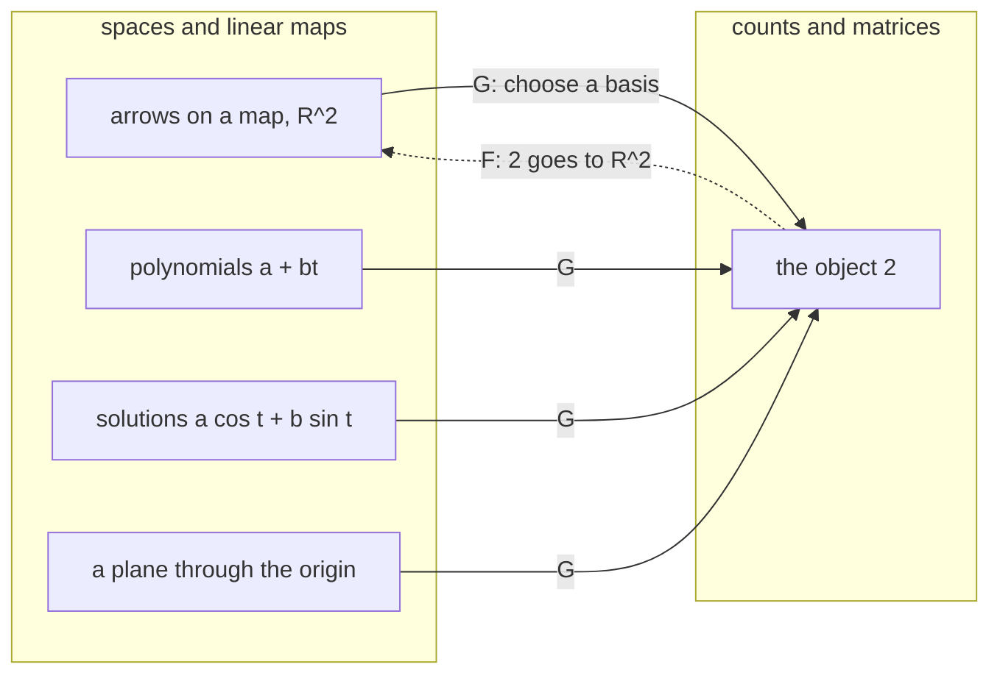

# Equivalence of categories: the right notion of 'the same', weaker than isomorphism

[Syllabus](../../../SYLLABUS.md) → [Computability and complexity](../README.md) → [Category Theory in Outline](../README.md#s07) → Equivalence of categories

---

## General Overview

Take the quadratic $`p(t) = 3 + 5t + 4t^2`$. Its derivative is $`5 + 8t`$. A computer finds it without knowing what a polynomial is. It stores $`p`$ as the list (3, 5, 4) and the derivative as a table of numbers with 2 rows and 3 columns, `[[0, 1, 0], [0, 0, 2]]`. Multiply the table by the list and out comes (5, 8): the coefficients of $`5 + 8t`$.

The same trick works for every space of this kind. A **finite-dimensional real vector space** is a collection of things that can be added and scaled, described by finitely many independent directions ([Change of basis](../../03-Algebra/07-Eigenvalues%20and%20Symmetric%20Matrices/01-change-of-basis.md)). There are a great many of them with 2 directions: arrows on a flat map, polynomials $`a + bt`$, the solutions $`a \cos t + b \sin t`$ of $`y'' = -y`$, and every plane through the origin in space. A matrix program knows only the number 2.

So two worlds sit side by side: the spaces with their linear maps, and the counts 0, 1, 2, … with tables of numbers. The first has countless objects of dimension 2, the second has one. Yet every question about linear maps can be answered in the second.

Category theory names this relation. Two categories are **equivalent** when functors (maps between categories) run both ways and each round trip brings every object back to an isomorphic copy, joined to it by an arrow that can be undone, in a way that respects every arrow.

**An equivalence of categories is a pair of functors whose round trips return each object up to a natural isomorphism; a functor gives one exactly when it is full, faithful and essentially surjective, and then the two categories differ only in how many copies they keep of each object.**

**What kind of fact this is:** equivalence, full, faithful, essentially surjective and skeleton are definitions. The test (full, faithful and essentially surjective exactly when an equivalence) and the equivalence of spaces with matrices are theorems, proved on this card in Why it works. That every equivalence can be upgraded to an adjoint one is a theorem stated with its key steps, from Mac Lane (Chapter IV, Section 4).

### The picture: many planes, one number



Schematic. Going right, the functor G chooses two directions for each space and keeps only the count. Going back, F sends 2 to $`\mathbb{R}^2`$. The polynomials do not come back as polynomials, but as $`\mathbb{R}^2`$, which is isomorphic to them.

---

## The formula

Notation first, in words. A category $`\mathcal{C}`$ has objects and arrows that chain, and $`\mathrm{Hom}(A, B)`$ is the set of arrows from $`A`$ to $`B`$ ([Categories and functors](01-categories-and-functors.md)). An **isomorphism** is an arrow with an arrow back that undoes it on both sides; $`A \cong B`$ says one exists. A **natural isomorphism** between two functors is a natural transformation ([Natural transformations and Yoneda](03-natural-transformations-and-yoneda.md)) whose every component is an isomorphism. The identity functor $`\mathrm{id}_{\mathcal{C}}`$ leaves every object and arrow alone.

The two categories of the example:

- $`\mathbf{FinVect}`$: objects are finite-dimensional real vector spaces, arrows are linear maps.
- $`\mathbf{Mat}`$: objects are the numbers 0, 1, 2, …; an arrow $`n \to m`$ is a matrix with $`m`$ rows and $`n`$ columns; chaining is matrix multiplication, the right-hand matrix acting first.

The functor $`F : \mathbf{Mat} \to \mathbf{FinVect}`$ sends $`n`$ to $`\mathbb{R}^n`$, the lists of $`n`$ real numbers, and a matrix $`M`$ to the map $`x \mapsto Mx`$.

An **isomorphism of categories** asks for a functor $`G`$ back with both round trips equal to the identity. An **equivalence** asks only for natural isomorphisms:

```math
\eta : \mathrm{id}_{\mathcal{C}} \Rightarrow G F, \qquad \varepsilon : F G \Rightarrow \mathrm{id}_{\mathcal{D}}, \qquad \text{every component an isomorphism}
```

**Read it aloud:** going there and back lands each object on a copy of itself, and the copying arrows fit every arrow of the category.

This card introduces $`\mathcal{C} \simeq \mathcal{D}`$, read "C is equivalent to D". The unit $`\eta`$ and counit $`\varepsilon`$ carry the same names as on [Adjunctions](06-adjunctions.md), for a reason Step 7 gives.

The test that decides it. A functor $`F : \mathcal{C} \to \mathcal{D}`$ is part of an equivalence exactly when, for all objects $`A`$, $`B`$ of $`\mathcal{C}`$ and $`X`$ of $`\mathcal{D}`$:

```math
f \mapsto F(f) \text{ is a one-for-one match } \mathrm{Hom}_{\mathcal{C}}(A, B) \to \mathrm{Hom}_{\mathcal{D}}(F A, F B), \qquad \text{and } X \cong F A \text{ for some } A
```

**Read it aloud:** the functor matches the arrows between any two objects one for one with the arrows between their images, and every object of the target is isomorphic to some image.

The three parts have names:

- **full**: every arrow $`F A \to F B`$ is $`F(f)`$ for some $`f`$ (the match is onto);
- **faithful**: different arrows $`f`$ give different $`F(f)`$ (the match is one-to-one);
- **essentially surjective**: every object of $`\mathcal{D}`$ is isomorphic to an image, not necessarily equal to one.

| Symbol | Plain meaning | In our example | Push it up and the answer… |
| --- | --- | --- | --- |
| $`\mathcal{C}`$, $`\mathcal{D}`$; $`\mathbf{Mat}`$, $`\mathbf{FinVect}`$; $`A`$, $`B`$, $`X`$, $`Y`$ | two categories; the example's two; their objects | $`\mathbf{Mat}`$, $`\mathbf{FinVect}`$ | — |
| $`\mathrm{Hom}(A, B)`$ | the arrows from $`A`$ to $`B`$ | 16 matrices $`2 \to 2`$ over $`\mathbb{F}_2`$ | more arrows to match one for one |
| $`F`$, $`G`$; $`G F`$, $`F G`$; $`\mathrm{id}_{\mathcal{C}}`$ | functors there and back; the round trips; the do-nothing functor | $`n \mapsto \mathbb{R}^n`$; choose a basis | — |
| $`\cong`$; $`\simeq`$ | isomorphic; equivalent | $`\mathbf{Mat} \simeq \mathbf{FinVect}`$ | — |
| $`\eta`$, $`\varepsilon`$; $`F \dashv G`$ | unit and counit: the round trips' natural isomorphisms; F is left adjoint to G | identity; $`P_V`$ | — |
| $`n`$, $`m`$, $`\mathbb{R}^n`$, $`M`$ | objects of $`\mathbf{Mat}`$; lists of $`n`$ reals; a matrix | 3, 2; $`\mathbb{R}^3`$ | — |
| $`V`$, $`W`$, $`U`$; $`\dim V`$ | spaces; their number of basis directions | quadratics; 3 | — |
| $`f`$, $`g`$, $`h`$, $`k`$ | linear maps, or arrows in general | $`d/dt`$; value at $`t = 2`$ | — |
| $`P_V`$; $`b_i`$; $`c_i`$, $`x`$ | a chosen basis as an isomorphism $`\mathbb{R}^n \to V`$; its directions; coordinates | (3, 5, 4) to $`p`$ | — |
| $`D`$, $`E`$, $`Q`$; $`p`$, $`t`$ | matrices of $`f`$ and $`g`$; a second basis; a quadratic and its variable | $`p = 3 + 5t + 4t^2`$ | — |
| $`\mathbb{F}_2`$, $`\mathbb{F}_2^n`$ | the two-element field: 0 and 1, with 1 + 1 = 0; lists of $`n`$ such digits | where the code counts | — |
| $`V^*`$, $`f^*`$, $`V^{**}`$, $`M^{\mathsf{T}}`$, $`\mathcal{C}^{op}`$ | dual space, dual map, double dual; transpose; arrows reversed | $`D^{\mathsf{T}}`$ | — |

The letter $`D`$ is the derivative's matrix; the curly $`\mathcal{D}`$ is a category.

The counts below use the same two categories built over $`\mathbb{F}_2`$ (0 and 1, with 1 + 1 = 0), where every hom-set is finite; there $`F`$ sends 2 to $`\mathbb{F}_2^2`$.

### When it holds

- **Full.** Keep only the invertible matrices: over $`\mathbb{F}_2`$ they reach 6 of the 16 linear maps $`2 \to 2`$, so the functor is no equivalence.
- **Faithful.** The determinant turns each 2 by 2 matrix into 0 or 1, and the determinant of a product is the product of the determinants. So it is a functor to the category with one object whose arrows are 0 and 1, chained by multiplication. It reaches both arrows, yet merges the 16 maps $`2 \to 2`$ into 2, so it is no equivalence.
- **Essentially surjective.** Keep only the even counts 0, 2, 4, …: the 3 lines inside $`\mathbb{F}_2^2`$ have 2 points each, while an even count gives a space of 1, 4, 16, … points, so none of them is reached.
- **Choices are allowed.** The way back picks one basis per space with no rule that singles one out. In a general category this step uses the axiom of choice (Step 4).
- **Isomorphism asks too much.** $`\mathbb{F}_2^3`$ alone holds 7 different planes, all sent to the one object 2, so no functor back returns all seven exactly.

---

## Why it works

### Step 0: categories see arrows, not names

Every categorical fact is stated through arrows and their chaining. An isomorphic copy of an object has the same arrows in and out, carried across by the isomorphism. So replacing each object by a chosen copy, and moving every arrow along the copying isomorphisms, changes nothing a category can see. An equivalence is that replacement done for a whole category at once.

### Step 1: matrices form a category, and F is a functor

Matrix multiplication is associative and the identity matrix changes nothing, so $`\mathbf{Mat}`$ is a category. $`F`$ keeps chains because $`(EM)x = E(Mx)`$: multiply first, or apply one after the other, and the vector is the same.

On the example, $`g`$ reads off the value at $`t = 2`$, so $`g(a + bt) = a + 2b`$, with matrix $`E`$ = `[[1, 2]]`. The chained map "differentiate, then take the value at 2" has matrix $`E D`$ = `[[0, 1, 4]]`. Applied to (3, 5, 4) it gives 5 + 16 = 21.

A second road needs no matrix. For a quadratic, the central difference $`(p(t + 1) - p(t - 1))/2`$ is the slope at $`t`$ exactly: at $`t = 2`$ it gives $`(54 - 12)/2`$ = 21. Over $`\mathbb{F}_2`$ the code checks chaining on all 256 pairs of 2 by 2 matrices.

### Step 2: F is full and faithful

A linear map is fixed by what it does to the basis directions: every vector is a mix of them, and a linear map keeps mixes. Column $`j`$ of a matrix is where the map sends the $`j`$-th direction. So:

- **faithful**: two matrices giving the same map send every direction to the same place, so they have the same columns and are equal;
- **full**: any linear map $`\mathbb{R}^n \to \mathbb{R}^m`$ is the map of the matrix whose columns are the images of the directions.

The derivative shows it. The directions of the quadratics are $`1, t, t^2`$, and $`d/dt`$ sends them to $`0, 1, 2t`$. Written in the directions $`1, t`$ of the target, those are the columns (0, 0), (1, 0) and (0, 2): the matrix $`D`$ = `[[0, 1, 0], [0, 0, 2]]`. Then $`D`$ times (3, 5, 4) is (5, 8). Central differences give the same pair with no matrix in sight: the slope is 5 at $`t = 0`$ and 13 at $`t = 1`$, and 13 − 5 = 8.

Real hom-sets (the sets $`\mathrm{Hom}(A, B)`$) are infinite, so the code counts over $`\mathbb{F}_2`$, where the same argument applies. It searches every function $`\mathbb{F}_2^n \to \mathbb{F}_2^m`$ for the linear ones. For $`n, m`$ up to 2 it finds 1 + 1 + 1 + 1 + 2 + 4 + 1 + 4 + 16 = 31, each the map of exactly one matrix. The largest case keeps 16 of 256 functions: $`2^{2 \times 2}`$, one per matrix.

### Step 3: F is essentially surjective

Pick a basis $`b_1, \dots, b_n`$ of $`V`$. The map $`P_V : \mathbb{R}^n \to V`$ sending $`(c_1, \dots, c_n)`$ to $`c_1 b_1 + \dots + c_n b_n`$ is an isomorphism: each vector has exactly one such list of coordinates. So every space is isomorphic to some $`\mathbb{R}^n`$, an image of $`F`$.

The choice is real, not a formality. Inside $`\mathbb{F}_2^3`$ the code finds 7 planes by search, and the count of ordered pairs of independent vectors gives the same number: $`(8 - 1)(8 - 2) / ((4 - 1)(4 - 2)) = 7`$. Each plane has 6 isomorphisms from $`\mathbb{F}_2^2`$, one per invertible 2 by 2 matrix, and nothing makes one of the six special.

### Step 4: build the functor back

Choose one basis $`P_V`$ for every space, taking the standard one for each $`\mathbb{R}^n`$. Define:

```math
G(V) = \dim V, \qquad G(f) = P_W^{-1} \circ f \circ P_V
```

**Read it aloud:** send a space to its count of directions, and a linear map to its matrix in the chosen bases: turn coordinates into a vector, apply the map, read the coordinates back.

$`G`$ is a functor because the inner $`P`$'s cancel: $`G(g) \, G(f) = P_U^{-1} g P_W P_W^{-1} f P_V = G(g \circ f)`$, for a third space $`U`$. With standard bases on every $`\mathbb{R}^n`$, $`G F`$ is exactly the identity, so $`\eta`$ is the identity. The counit is $`\varepsilon_V = P_V : F G(V) = \mathbb{R}^{\dim V} \to V`$, an isomorphism by Step 3. It is natural because, by the definition of $`G(f)`$,

```math
f \circ P_V = P_W \circ G(f)
```

**Read it aloud:** turning coordinates into a vector and then applying the map equals multiplying the coordinates by the matrix and then turning them into a vector.

<details>
<summary>Detailed proof: full, faithful and essentially surjective gives an equivalence, in any category</summary>

Let $`F : \mathcal{C} \to \mathcal{D}`$ be full, faithful and essentially surjective. For each object $`X`$ of $`\mathcal{D}`$, choose an object $`G X`$ of $`\mathcal{C}`$ and an isomorphism $`\varepsilon_X : F G X \to X`$. Essential surjectivity says such a pair exists; choosing one for every $`X`$ at once is where the axiom of choice enters.

For an arrow $`h : X \to Y`$, the arrow

$`\displaystyle \varepsilon_Y^{-1} \circ h \circ \varepsilon_X : F G X \to F G Y`$

is, because $`F`$ is full and faithful, $`F(k)`$ for exactly one arrow $`k : G X \to G Y`$. Set $`G h = k`$. Then $`\varepsilon_Y \circ F G h = h \circ \varepsilon_X`$, which is naturality of $`\varepsilon`$. $`G`$ keeps chains and identities because $`F`$ does and $`F`$ is faithful: both sides of $`G(h' \circ h) = G h' \circ G h`$ have the same image under $`F`$.

For the unit, $`\varepsilon_{F A} : F G F A \to F A`$ is an isomorphism, so by fullness and faithfulness it is $`F`$ of exactly one arrow $`G F A \to A`$, which is again an isomorphism, since $`F`$ also matches its inverse. Its inverse is $`\eta_A`$. Naturality of $`\eta`$ follows by applying $`F`$ and using naturality of $`\varepsilon`$, then faithfulness.

The converse: if $`G F \cong \mathrm{id}`$ and $`F G \cong \mathrm{id}`$, then $`X \cong F G X`$ gives essential surjectivity, and transporting arrows along $`\eta`$ shows $`f \mapsto F f`$ has an inverse on each hom-set, so $`F`$ is full and faithful. This is Mac Lane, Chapter IV, Section 4, Theorem 1.

</details>

### Step 5: another choice, another G, the same up to isomorphism

Give the straight-line polynomials a second basis: $`1 + t`$ and $`1 - t`$. As columns in the old directions they form $`Q`$ = `[[1, 1], [1, -1]]`, with determinant −2. The derivative's matrix becomes $`Q^{-1} D`$ = `[[0, 0.5, 1], [0, 0.5, -1]]`, the rewriting rule of [Change of basis](../../03-Algebra/07-Eigenvalues%20and%20Symmetric%20Matrices/01-change-of-basis.md), with nothing changed on the source side.

Applied to (3, 5, 4) it gives (6.5, −1.5). Check: $`6.5(1 + t) - 1.5(1 - t) = 5 + 8t`$. And $`Q`$ times (6.5, −1.5) is (5, 8), the first answer.

So the functor back is not unique: each choice of bases gives its own $`G`$. Any two are naturally isomorphic, and the change-of-basis matrices are the components of that isomorphism. The equivalence does not depend on the choice; the matrices do.

### Step 6: skeletons

A **skeleton** of a category is a part of it with exactly one object from each isomorphism class, keeping every arrow between the objects it keeps. The spaces $`\mathbb{R}^0, \mathbb{R}^1, \mathbb{R}^2, \dots`$ form a skeleton of $`\mathbf{FinVect}`$, since two spaces are isomorphic exactly when they have the same dimension. $`\mathbf{Mat}`$ is that skeleton with the lists of numbers dropped.

By Step 4, every category is equivalent to each of its skeletons: the inclusion is full, faithful, and essentially surjective by definition. So two categories are equivalent exactly when their skeletons are isomorphic.

Sets work the same way. The subsets of {0, 1, 2, 3} include 6 with two members, all isomorphic. A skeleton of finite sets keeps one set per size, $`\{0, \dots, n - 1\}`$, with the $`3^2 = 9`$ functions as its arrows $`2 \to 3`$. For groups, the 4-hour clock and the quarter turns of a square share one place in a skeleton; the clock and the four flip patterns of two switches from [Categories and functors](01-categories-and-functors.md) do not.

### Step 7: every equivalence can be made an adjunction

On [Adjunctions](06-adjunctions.md), a unit and a counit satisfy two triangle identities. An equivalence whose $`\eta`$ and $`\varepsilon`$ satisfy them is an **adjoint equivalence**: then $`F \dashv G`$ and also $`G \dashv F`$.

The equivalence built in Step 4 is one already. With $`\eta`$ the identity, the triangles ask that $`\varepsilon_{F n}`$ be the identity on $`\mathbb{R}^n`$ and that $`G \varepsilon_V`$ be the identity matrix. Both hold because each $`\mathbb{R}^n`$ received its standard basis.

In general, one of the two isomorphisms can be adjusted, by chaining it with others built from $`\eta`$ and $`\varepsilon`$, until both triangles hold. So every equivalence can be improved to an adjoint one (Mac Lane, Chapter IV, Section 4).

### Step 8: duality, an equivalence with arrows reversed

The **dual** $`V^*`$ of a space is its set of linear maps $`V \to \mathbb{R}`$, with the same dimension as $`V`$. A map $`f : V \to W`$ gives $`f^* : W^* \to V^*`$, "apply $`f`$ first". The arrow turns round, so $`V \mapsto V^*`$ is a functor from $`\mathbf{FinVect}`$ to $`\mathbf{FinVect}^{op}`$, the category with every arrow reversed ([Commutative diagrams](02-commutative-diagrams-and-duality.md)). It is an equivalence: $`V \cong V^{**}`$ by a natural isomorphism that needs no basis, $`v \mapsto`$ "evaluate at $`v`$".

On matrices the dual is the transpose: the derivative's dual has matrix $`D^{\mathsf{T}}`$, an arrow $`2 \to 3`$. Transposing reverses chains and matches $`\mathrm{Hom}(n, m)`$ with $`\mathrm{Hom}(m, n)`$ one for one, so $`\mathbf{Mat}`$ is even isomorphic to $`\mathbf{Mat}^{op}`$. The code checks both over $`\mathbb{F}_2`$, on all 9 pairs of hom-sets and all 256 products.

---

## Worked numbers, by hand

| Step | Arithmetic | Value |
| --- | --- | --- |
| coordinates of $`p`$ | $`3 + 5t + 4t^2`$ in the basis $`1, t, t^2`$ | (3, 5, 4) |
| derivative by the matrix | $`(0 \cdot 3 + 1 \cdot 5 + 0 \cdot 4,\ 0 \cdot 3 + 0 \cdot 5 + 2 \cdot 4)`$ | (5, 8) |
| value at 2, chained | $`E D`$ = `[[0, 1, 4]]`; $`0 \cdot 3 + 1 \cdot 5 + 4 \cdot 4`$ | 21 |
| the same, by central difference | $`(p(3) - p(1))/2 = (54 - 12)/2`$ | 21 |
| second basis for the target | $`Q^{-1} D`$ times (3, 5, 4) | (6.5, −1.5) |
| back to the first basis | $`Q`$ times (6.5, −1.5) $`= (6.5 - 1.5,\ 6.5 + 1.5)`$ | **(5, 8)** |
| arrows $`2 \to 2`$ over $`\mathbb{F}_2`$ | $`2^{2 \times 2}`$ matrices, against a search of $`4^4`$ functions | 16 of 256 |
| planes in $`\mathbb{F}_2^3`$ | $`(7 \times 6) / (3 \times 2)`$ | **7**, against 1 object 2 |

Two bases give two matrices and two lists of coordinates, yet both name the polynomial $`5 + 8t`$. The matrix world loses nothing but the names.

### What breaks if you drop a piece

| Mistake | Comes out at | What went wrong |
| --- | --- | --- |
| Invertible matrices only | 6 of 16 arrows $`2 \to 2`$ reached | not full |
| Each matrix sent to its determinant | 16 arrows $`2 \to 2`$ become 2 | not faithful |
| Even counts only | 0 of the 3 lines in $`\mathbb{F}_2^2`$ reached | not essentially surjective |
| Asking for an isomorphism of categories | 7 planes in $`\mathbb{F}_2^3`$, 1 object 2 | the objects cannot be matched one for one |
| (5, 8) read in the second basis | $`13 - 3t`$, not $`5 + 8t`$ | the matrix was used without its bases |

The code prints every row.

---

## Code, from first principles, and it actually runs

Nothing is imported. The code takes three independent roads. The real part reaches the derivative by the matrix and by central differences, which never mention a matrix, then compares two bases. The $`\mathbb{F}_2`$ part sets exhaustive search against counting: every function searched for the linear ones against the $`2^{mn}`$ matrices, and planes found by search against the formula.

### Python

```python
# Equivalence of categories -- the check behind the card.  Nothing is imported.
# Part 1, real numbers: the derivative from quadratics to straight-line
# polynomials becomes a matrix, checked against central differences, in two
# bases for the target.  Part 2, the two-element field F2 (0 and 1, 1 + 1 = 0),
# where every hom-set is finite: matrices against the linear maps found by
# searching all functions (full and faithful), planes counted two ways (many
# objects, one dimension), and functors that fall short of an equivalence.

def matvec(m, v):                         # matrix times column vector
    return [sum(a * b for a, b in zip(row, v)) for row in m]

def matmul(a, b):                         # matrix product: b acts first
    return [[sum(a[i][k] * b[k][j] for k in range(len(b))) for j in range(len(b[0]))]
            for i in range(len(a))]

def value(c, t):                          # c[0] + c[1] t + c[2] t^2
    return sum(ck * t ** k for k, ck in enumerate(c))

def slope(c, t):                          # central difference: exact on quadratics
    return (value(c, t + 1) - value(c, t - 1)) // 2

def show(xs):                             # floats with one decimal, as in Rust
    return "[" + ", ".join(f"{x + 0.0:.1f}" for x in xs) + "]"

def yn(claim):
    return "yes" if claim else "no"

def ones(x):
    return bin(x).count("1")

def apply(rows, x):                       # F2 matrix (rows as bit masks) on x
    return sum((ones(r & x) % 2) << i for i, r in enumerate(rows))

def matrices(n, m):                       # every m by n matrix over F2
    return [[(code >> (n * i)) & ((1 << n) - 1) for i in range(m)]
            for code in range(1 << (n * m))]

def f2mul(a, b):                          # F2 product, b acts first
    out = []
    for r in a:
        row = 0
        for k in range(len(b)):
            if r >> k & 1:
                row ^= b[k]
        out.append(row)
    return out

def f2det(rows):                          # 2 by 2 F2 determinant: ad + bc, since 1 + 1 = 0
    return ((rows[0] & 1) & (rows[1] >> 1)) ^ ((rows[0] >> 1) & (rows[1] & 1))

def transpose(rows, n):
    return [sum((r >> j & 1) << i for i, r in enumerate(rows)) for j in range(n)]

def closed(mask):                         # a subset of F2^k: is it a subspace?
    xs = [x for x in range(16) if mask >> x & 1]
    return 0 in xs and all(mask >> (x ^ y) & 1 for x in xs for y in xs)

def search(n, m):                         # all functions F2^n -> F2^m, linear ones kept
    N, M = 1 << n, 1 << m
    linear = set()
    for code in range(M ** N):
        f = [(code // M ** x) % M for x in range(N)]
        if all(f[x ^ y] == f[x] ^ f[y] for x in range(N) for y in range(N)):
            linear.add(tuple(f))
    images = {tuple(apply(r, x) for x in range(N)) for r in matrices(n, m)}
    return M ** N, linear, images

p, D, E, Q = [3, 5, 4], [[0, 1, 0], [0, 0, 2]], [[1, 2]], [[1, 1], [1, -1]]
by_matrix = matvec(D, p)
by_values = [slope(p, 0), slope(p, 1) - slope(p, 0)]
ED = matmul(E, D)
det = Q[0][0] * Q[1][1] - Q[0][1] * Q[1][0]
Qinv = [[Q[1][1] / det, -Q[0][1] / det], [-Q[1][0] / det, Q[0][0] / det]]
D2 = matmul(Qinv, D)
new = matvec(D2, p)
back = matvec(Q, new)
print("V = polynomials of degree at most 2, W = degree at most 1, f = d/dt")
print(f"p(t) = 3 + 5t + 4t^2 has coordinates {p} in the basis 1, t, t^2")
print(f"matrix of f in the bases 1, t, t^2 and 1, t: {D}")
print(f"f(p) by the matrix: {by_matrix}")
print(f"f(p) by central differences, no matrix: {by_values}, from slopes {slope(p, 0)} at t = 0 and {slope(p, 1)} at t = 1")
print(f"g = evaluate at t = 2, matrix {E}; matrix of g after f: {ED}")
print(f"g(f(p)) by the product matrix: {matvec(ED, p)[0]}; by central difference at t = 2: ({value(p, 3)} - {value(p, 1)})/2 = {slope(p, 2)}")
print(f"second basis for W: 1 + t and 1 - t; Q = {Q}, det {det}")
print(f"matrix of f in the second basis, Q^-1 D: [{show(D2[0])}, {show(D2[1])}]")
print(f"f(p) in the second basis: {show(new)}; Q turns it back into {show(back)}")
wrong = matvec(Q, by_matrix)
print(f"mistake, {by_matrix} read in the second basis: {wrong[0]} - {-wrong[1]}t, not 5 + 8t")
print("F2: arrows n -> m, matrices against linear maps found among all functions")
print("n m functions linear matrices same")
total, all_same = 0, True
for n in range(3):
    for m in range(3):
        funcs, linear, images = search(n, m)
        same = images == linear and len(images) == len(matrices(n, m)) == 1 << (m * n)
        all_same = all_same and same
        total += len(linear)
        print(f"{n} {m} {funcs} {len(linear)} {len(matrices(n, m))} {yn(same)}")
print(f"arrows among 0, 1, 2: {total}; full and faithful on every pair: {yn(all_same)}")
planes = [s for s in range(256) if ones(s) == 4 and closed(s)]
formula = (8 - 1) * (8 - 2) // ((4 - 1) * (4 - 2))
print(f"planes inside F2^3: by search {len(planes)}, by formula {formula}; objects 2 in the matrix category: 1")
onto = {s: 0 for s in planes}
for rows in matrices(2, 3):
    image = sum(1 << apply(rows, x) for x in range(4))
    if ones(image) == 4:
        onto[image] += 1
invertible = [r for r in matrices(2, 2) if ones(sum(1 << apply(r, x) for x in range(4))) == 4]
print(f"isomorphisms from F2^2 onto each plane: {[onto[s] for s in planes]}; invertible 2 by 2: {len(invertible)}")
lines = [s for s in range(16) if ones(s) == 2 and closed(s)]
even = [1 << k for k in (0, 2, 4)]                                  # points in F2^0, F2^2, F2^4
reached = [s for s in lines if ones(s) in even]
print(f"lines inside F2^2: {len(lines)}, {ones(lines[0])} points each; even counts give {even} points; "
      f"reached by the even-dimension category: {len(reached)}, so not essentially surjective")
print(f"mistake, invertible matrices only: {len(invertible)} of {len(matrices(2, 2))} arrows 2 -> 2, so not full")
pairs = [(a, b) for a in matrices(2, 2) for b in matrices(2, 2)]
keeps = all([apply(f2mul(a, b), x) for x in range(4)] == [apply(a, apply(b, x)) for x in range(4)] for a, b in pairs)
reverses = all(transpose(f2mul(a, b), 2) == f2mul(transpose(b, 2), transpose(a, 2)) for a, b in pairs)
sizes = all(sorted(transpose(r, n) for r in matrices(n, m)) == sorted(matrices(m, n))
            for n in range(3) for m in range(3))
dets = [f2det(r) for r in matrices(2, 2)]                # the determinant: a functor to {0, 1} under times
functor = all(f2det(f2mul(a, b)) == f2det(a) * f2det(b) for a, b in pairs)
print(f"mistake, the determinant as a functor to 0 and 1 under times: keeps all {len(pairs)} products: {yn(functor)}; "
      f"{len(dets)} arrows 2 -> 2 become {len(set(dets))}, {dets.count(1)} with determinant 1, so not faithful")
print(f"product of matrices = maps run in turn, all {len(pairs)} pairs: {yn(keeps)}")
print(f"transpose matches Hom(n, m) with Hom(m, n) on all 9 pairs: {yn(sizes)}; reverses all {len(pairs)} products: {yn(reverses)}")
subsets = [s for s in range(16) if ones(s) == 2]
print(f"finite sets: 2-element subsets of 0, 1, 2, 3: {len(subsets)}; functions 2 -> 3: {len([(a, b) for a in range(3) for b in range(3)])}")
assert by_matrix == by_values == [5, 8]                    # matrix against values
assert matvec(ED, p)[0] == slope(p, 2) == 21               # product matrix = composite
assert back == [float(v) for v in by_matrix] and new == [6.5, -1.5]
assert all_same and total == 31                            # search against 2^(mn)
assert len(planes) == formula == 7 and all(onto[s] == len(invertible) == 6 for s in planes)
assert len(lines) == 3 and not reached and keeps and reverses and sizes
assert functor and len(set(dets)) == 2 and dets.count(1) == len(invertible)   # full but not faithful
print("ALL CHECKS PASS")
```

**Ran 2026-11-24 on macOS, Python 3.14.10, standard library only. All checks passed. Output, pasted from the run:**

```
V = polynomials of degree at most 2, W = degree at most 1, f = d/dt
p(t) = 3 + 5t + 4t^2 has coordinates [3, 5, 4] in the basis 1, t, t^2
matrix of f in the bases 1, t, t^2 and 1, t: [[0, 1, 0], [0, 0, 2]]
f(p) by the matrix: [5, 8]
f(p) by central differences, no matrix: [5, 8], from slopes 5 at t = 0 and 13 at t = 1
g = evaluate at t = 2, matrix [[1, 2]]; matrix of g after f: [[0, 1, 4]]
g(f(p)) by the product matrix: 21; by central difference at t = 2: (54 - 12)/2 = 21
second basis for W: 1 + t and 1 - t; Q = [[1, 1], [1, -1]], det -2
matrix of f in the second basis, Q^-1 D: [[0.0, 0.5, 1.0], [0.0, 0.5, -1.0]]
f(p) in the second basis: [6.5, -1.5]; Q turns it back into [5.0, 8.0]
mistake, [5, 8] read in the second basis: 13 - 3t, not 5 + 8t
F2: arrows n -> m, matrices against linear maps found among all functions
n m functions linear matrices same
0 0 1 1 1 yes
0 1 2 1 1 yes
0 2 4 1 1 yes
1 0 1 1 1 yes
1 1 4 2 2 yes
1 2 16 4 4 yes
2 0 1 1 1 yes
2 1 16 4 4 yes
2 2 256 16 16 yes
arrows among 0, 1, 2: 31; full and faithful on every pair: yes
planes inside F2^3: by search 7, by formula 7; objects 2 in the matrix category: 1
isomorphisms from F2^2 onto each plane: [6, 6, 6, 6, 6, 6, 6]; invertible 2 by 2: 6
lines inside F2^2: 3, 2 points each; even counts give [1, 4, 16] points; reached by the even-dimension category: 0, so not essentially surjective
mistake, invertible matrices only: 6 of 16 arrows 2 -> 2, so not full
mistake, the determinant as a functor to 0 and 1 under times: keeps all 256 products: yes; 16 arrows 2 -> 2 become 2, 6 with determinant 1, so not faithful
product of matrices = maps run in turn, all 256 pairs: yes
transpose matches Hom(n, m) with Hom(m, n) on all 9 pairs: yes; reverses all 256 products: yes
finite sets: 2-element subsets of 0, 1, 2, 3: 6; functions 2 -> 3: 9
ALL CHECKS PASS
```

### Rust

Same numbers, same labels, built with `rustc --edition 2021 -O`.

```rust
// Equivalence of categories -- the same check as the Python, in Rust.  No crates.
// Part 1, real numbers: the derivative from quadratics to straight-line
// polynomials becomes a matrix, checked against central differences, in two
// bases for the target.  Part 2, the two-element field F2 (0 and 1, 1 + 1 = 0),
// where every hom-set is finite: matrices against the linear maps found by
// searching all functions (full and faithful), planes counted two ways (many
// objects, one dimension), and functors that fall short of an equivalence.
use std::collections::BTreeSet;

fn matvec(m: &[Vec<i64>], v: &[i64]) -> Vec<i64> {             // matrix times column vector
    m.iter().map(|row| row.iter().zip(v).map(|(a, b)| a * b).sum()).collect()
}
fn matvec_f(m: &[Vec<f64>], v: &[f64]) -> Vec<f64> {
    m.iter().map(|row| row.iter().zip(v).fold(0.0, |s, (a, b)| s + a * b)).collect()
}
fn matmul(a: &[Vec<i64>], b: &[Vec<i64>]) -> Vec<Vec<i64>> {   // matrix product: b acts first
    (0..a.len()).map(|i| (0..b[0].len()).map(|j| (0..b.len()).map(|k| a[i][k] * b[k][j]).sum()).collect()).collect()
}
fn value(c: &[i64], t: i64) -> i64 {                             // c[0] + c[1] t + c[2] t^2
    c.iter().enumerate().map(|(k, ck)| ck * t.pow(k as u32)).sum()
}
fn slope(c: &[i64], t: i64) -> i64 { (value(c, t + 1) - value(c, t - 1)) / 2 }  // exact on quadratics
fn show(xs: &[f64]) -> String {                                  // floats with one decimal
    format!("[{}]", xs.iter().map(|x| format!("{:.1}", x + 0.0)).collect::<Vec<_>>().join(", "))
}
fn yn(claim: bool) -> &'static str { if claim { "yes" } else { "no" } }
fn ones(x: u64) -> u32 { x.count_ones() }
fn apply(rows: &[u64], x: u64) -> u64 {                          // F2 matrix (rows as bit masks) on x
    rows.iter().enumerate().map(|(i, r)| ((ones(r & x) % 2) as u64) << i).sum()
}
fn matrices(n: u64, m: u64) -> Vec<Vec<u64>> {                   // every m by n matrix over F2
    (0..1u64 << (n * m)).map(|code| (0..m).map(|i| (code >> (n * i)) & ((1 << n) - 1)).collect()).collect()
}
fn f2mul(a: &[u64], b: &[u64]) -> Vec<u64> {                     // F2 product, b acts first
    a.iter().map(|r| {
        let mut row = 0;
        for k in 0..b.len() { if r >> k & 1 == 1 { row ^= b[k] } }
        row
    }).collect()
}
fn f2det(r: &[u64]) -> u64 {                                     // 2 by 2 F2 determinant: ad + bc, since 1 + 1 = 0
    ((r[0] & 1) & (r[1] >> 1)) ^ ((r[0] >> 1) & (r[1] & 1))
}
fn transpose(rows: &[u64], n: u64) -> Vec<u64> {
    (0..n).map(|j| rows.iter().enumerate().map(|(i, r)| (r >> j & 1) << i).sum()).collect()
}
fn closed(mask: u64) -> bool {                                   // a subset of F2^k: is it a subspace?
    let xs: Vec<u64> = (0..16).filter(|x| mask >> x & 1 == 1).collect();
    xs.contains(&0) && xs.iter().all(|x| xs.iter().all(|y| mask >> (x ^ y) & 1 == 1))
}
fn search(n: u64, m: u64) -> (u64, BTreeSet<Vec<u64>>, BTreeSet<Vec<u64>>) {  // all functions, linear kept
    let (nn, mm) = (1u64 << n, 1u64 << m);
    let mut linear = BTreeSet::new();
    for code in 0..mm.pow(nn as u32) {
        let f: Vec<u64> = (0..nn).map(|x| (code / mm.pow(x as u32)) % mm).collect();
        if (0..nn).all(|x| (0..nn).all(|y| f[(x ^ y) as usize] == f[x as usize] ^ f[y as usize])) {
            linear.insert(f);
        }
    }
    let images = matrices(n, m).iter().map(|r| (0..nn).map(|x| apply(r, x)).collect()).collect();
    (mm.pow(nn as u32), linear, images)
}

fn main() {
    let p = vec![3i64, 5, 4];
    let d = vec![vec![0i64, 1, 0], vec![0, 0, 2]];
    let e = vec![vec![1i64, 2]];
    let q = vec![vec![1i64, 1], vec![1, -1]];
    let by_matrix = matvec(&d, &p);
    let by_values = vec![slope(&p, 0), slope(&p, 1) - slope(&p, 0)];
    let ed = matmul(&e, &d);
    let det = q[0][0] * q[1][1] - q[0][1] * q[1][0];
    let df = det as f64;
    let qinv = vec![vec![q[1][1] as f64 / df, -q[0][1] as f64 / df], vec![-q[1][0] as f64 / df, q[0][0] as f64 / df]];
    let d2: Vec<Vec<f64>> = (0..2).map(|i| (0..3).map(|j| (0..2).fold(0.0, |s, k| s + qinv[i][k] * d[k][j] as f64)).collect()).collect();
    let pf: Vec<f64> = p.iter().map(|&x| x as f64).collect();
    let new = matvec_f(&d2, &pf);
    let qf: Vec<Vec<f64>> = q.iter().map(|r| r.iter().map(|&x| x as f64).collect()).collect();
    let back = matvec_f(&qf, &new);
    println!("V = polynomials of degree at most 2, W = degree at most 1, f = d/dt");
    println!("p(t) = 3 + 5t + 4t^2 has coordinates {:?} in the basis 1, t, t^2", p);
    println!("matrix of f in the bases 1, t, t^2 and 1, t: {:?}", d);
    println!("f(p) by the matrix: {:?}", by_matrix);
    println!("f(p) by central differences, no matrix: {:?}, from slopes {} at t = 0 and {} at t = 1", by_values, slope(&p, 0), slope(&p, 1));
    println!("g = evaluate at t = 2, matrix {:?}; matrix of g after f: {:?}", e, ed);
    println!("g(f(p)) by the product matrix: {}; by central difference at t = 2: ({} - {})/2 = {}",
             matvec(&ed, &p)[0], value(&p, 3), value(&p, 1), slope(&p, 2));
    println!("second basis for W: 1 + t and 1 - t; Q = {:?}, det {}", q, det);
    println!("matrix of f in the second basis, Q^-1 D: [{}, {}]", show(&d2[0]), show(&d2[1]));
    println!("f(p) in the second basis: {}; Q turns it back into {}", show(&new), show(&back));
    let wrong = matvec(&q, &by_matrix);
    println!("mistake, {:?} read in the second basis: {} - {}t, not 5 + 8t", by_matrix, wrong[0], -wrong[1]);
    println!("F2: arrows n -> m, matrices against linear maps found among all functions");
    println!("n m functions linear matrices same");
    let (mut total, mut all_same) = (0, true);
    for n in 0..3u64 {
        for m in 0..3u64 {
            let (funcs, linear, images) = search(n, m);
            let k = matrices(n, m).len();
            let same = images == linear && images.len() == k && k == 1 << (m * n);
            all_same = all_same && same;
            total += linear.len();
            println!("{} {} {} {} {} {}", n, m, funcs, linear.len(), k, yn(same));
        }
    }
    println!("arrows among 0, 1, 2: {}; full and faithful on every pair: {}", total, yn(all_same));
    let planes: Vec<u64> = (0..256).filter(|&s| ones(s) == 4 && closed(s)).collect();
    let formula = (8 - 1) * (8 - 2) / ((4 - 1) * (4 - 2));
    println!("planes inside F2^3: by search {}, by formula {}; objects 2 in the matrix category: 1", planes.len(), formula);
    let mut onto = vec![0usize; 256];
    for rows in matrices(2, 3) {
        let image: u64 = (0..4).map(|x| 1u64 << apply(&rows, x)).fold(0, |s, b| s | b);
        if ones(image) == 4 { onto[image as usize] += 1 }
    }
    let invertible: Vec<Vec<u64>> = matrices(2, 2).into_iter()
        .filter(|r| ones((0..4).map(|x| 1u64 << apply(r, x)).fold(0, |s, b| s | b)) == 4).collect();
    let per: Vec<usize> = planes.iter().map(|&s| onto[s as usize]).collect();
    println!("isomorphisms from F2^2 onto each plane: {:?}; invertible 2 by 2: {}", per, invertible.len());
    let lines: Vec<u64> = (0..16).filter(|&s| ones(s) == 2 && closed(s)).collect();
    let even: Vec<u32> = [0u32, 2, 4].iter().map(|&k| 1 << k).collect();       // points in F2^0, F2^2, F2^4
    let reached: Vec<u64> = lines.iter().copied().filter(|&s| even.contains(&ones(s))).collect();
    println!("lines inside F2^2: {}, {} points each; even counts give {:?} points; reached by the even-dimension category: {}, so not essentially surjective",
             lines.len(), ones(lines[0]), even, reached.len());
    println!("mistake, invertible matrices only: {} of {} arrows 2 -> 2, so not full", invertible.len(), matrices(2, 2).len());
    let all22 = matrices(2, 2);
    let pairs: Vec<(&Vec<u64>, &Vec<u64>)> = all22.iter().flat_map(|a| all22.iter().map(move |b| (a, b))).collect();
    let keeps = pairs.iter().all(|(a, b)| (0..4).all(|x| apply(&f2mul(a, b), x) == apply(a, apply(b, x))));
    let reverses = pairs.iter().all(|(a, b)| transpose(&f2mul(a, b), 2) == f2mul(&transpose(b, 2), &transpose(a, 2)));
    let sizes = (0..3u64).all(|n| (0..3u64).all(|m| {
        let mut t: Vec<Vec<u64>> = matrices(n, m).iter().map(|r| transpose(r, n)).collect();
        let mut o = matrices(m, n);
        t.sort();
        o.sort();
        t == o
    }));
    let dets: Vec<u64> = all22.iter().map(|r| f2det(r)).collect();      // the determinant: a functor to {0, 1} under times
    let functor = pairs.iter().all(|(a, b)| f2det(&f2mul(a, b)) == f2det(a) * f2det(b));
    let (kinds, det1) = (dets.iter().collect::<BTreeSet<_>>().len(), dets.iter().filter(|&&d| d == 1).count());
    println!("mistake, the determinant as a functor to 0 and 1 under times: keeps all {} products: {}; {} arrows 2 -> 2 become {}, {} with determinant 1, so not faithful",
             pairs.len(), yn(functor), dets.len(), kinds, det1);
    println!("product of matrices = maps run in turn, all {} pairs: {}", pairs.len(), yn(keeps));
    println!("transpose matches Hom(n, m) with Hom(m, n) on all 9 pairs: {}; reverses all {} products: {}", yn(sizes), pairs.len(), yn(reverses));
    let subsets = (0..16u64).filter(|&s| ones(s) == 2).count();
    let funcs23 = (0..3).flat_map(|a| (0..3).map(move |b| (a, b))).count();
    println!("finite sets: 2-element subsets of 0, 1, 2, 3: {}; functions 2 -> 3: {}", subsets, funcs23);
    assert!(by_matrix == by_values && by_matrix == vec![5, 8]);                 // matrix against values
    assert!(matvec(&ed, &p)[0] == slope(&p, 2) && slope(&p, 2) == 21);          // product = composite
    assert!(back == vec![5.0, 8.0] && new == vec![6.5, -1.5]);
    assert!(all_same && total == 31);                                           // search against 2^(mn)
    assert!(planes.len() == formula && formula == 7 && per.iter().all(|&c| c == invertible.len() && c == 6));
    assert!(lines.len() == 3 && reached.is_empty() && keeps && reverses && sizes);
    assert!(functor && kinds == 2 && det1 == invertible.len());                 // full but not faithful
    println!("ALL CHECKS PASS");
}
```

**Ran 2026-11-24 on macOS, rustc 1.98.1, no crates. All checks passed. Output, pasted from the run:**

```
V = polynomials of degree at most 2, W = degree at most 1, f = d/dt
p(t) = 3 + 5t + 4t^2 has coordinates [3, 5, 4] in the basis 1, t, t^2
matrix of f in the bases 1, t, t^2 and 1, t: [[0, 1, 0], [0, 0, 2]]
f(p) by the matrix: [5, 8]
f(p) by central differences, no matrix: [5, 8], from slopes 5 at t = 0 and 13 at t = 1
g = evaluate at t = 2, matrix [[1, 2]]; matrix of g after f: [[0, 1, 4]]
g(f(p)) by the product matrix: 21; by central difference at t = 2: (54 - 12)/2 = 21
second basis for W: 1 + t and 1 - t; Q = [[1, 1], [1, -1]], det -2
matrix of f in the second basis, Q^-1 D: [[0.0, 0.5, 1.0], [0.0, 0.5, -1.0]]
f(p) in the second basis: [6.5, -1.5]; Q turns it back into [5.0, 8.0]
mistake, [5, 8] read in the second basis: 13 - 3t, not 5 + 8t
F2: arrows n -> m, matrices against linear maps found among all functions
n m functions linear matrices same
0 0 1 1 1 yes
0 1 2 1 1 yes
0 2 4 1 1 yes
1 0 1 1 1 yes
1 1 4 2 2 yes
1 2 16 4 4 yes
2 0 1 1 1 yes
2 1 16 4 4 yes
2 2 256 16 16 yes
arrows among 0, 1, 2: 31; full and faithful on every pair: yes
planes inside F2^3: by search 7, by formula 7; objects 2 in the matrix category: 1
isomorphisms from F2^2 onto each plane: [6, 6, 6, 6, 6, 6, 6]; invertible 2 by 2: 6
lines inside F2^2: 3, 2 points each; even counts give [1, 4, 16] points; reached by the even-dimension category: 0, so not essentially surjective
mistake, invertible matrices only: 6 of 16 arrows 2 -> 2, so not full
mistake, the determinant as a functor to 0 and 1 under times: keeps all 256 products: yes; 16 arrows 2 -> 2 become 2, 6 with determinant 1, so not faithful
product of matrices = maps run in turn, all 256 pairs: yes
transpose matches Hom(n, m) with Hom(m, n) on all 9 pairs: yes; reverses all 256 products: yes
finite sets: 2-element subsets of 0, 1, 2, 3: 6; functions 2 -> 3: 9
ALL CHECKS PASS
```

The two outputs match line for line.

### Lean

Lean proves the test, the skeleton fact and the adjoint upgrade for all categories, and checks the card's worked numbers.

- Take any functor $`F`$. Then some functor $`G`$ back has both round trips naturally isomorphic to the identity exactly when $`F`$ is full, faithful and essentially surjective.
- Two categories are equivalent exactly when their skeletons are isomorphic, with both round trips equal to the identity.
- Take an equivalence with unit $`\eta`$ and counit $`\varepsilon`$. Then another natural isomorphism $`\eta'`$ in place of $`\eta`$ makes both triangle identities hold.
- The derivative's matrix $`D`$ takes (3, 5, 4) to (5, 8).
- $`E D`$ is `[[0, 1, 4]]`, which takes (3, 5, 4) to 21, as the central difference $`(54 - 12)/2`$ does.
- Read in the basis $`1 + t`$, $`1 - t`$, the list (5, 8) means $`13 - 3t`$.
- Over $`\mathbb{F}_2`$ there are 16 arrows $`2 \to 2`$, and 6 of them have nonzero determinant.
- Take $`n`$ and $`m`$ up to 2. Then the $`2^{mn}`$ matrices $`n \to m`$ add up to 31 arrows.
- $`\mathbb{F}_2^3`$ holds 7 planes, by search and by the formula $`(8 - 1)(8 - 2) / ((4 - 1)(4 - 2))`$.
- There are 6 two-member subsets of {0, 1, 2, 3}, and 9 functions $`2 \to 3`$.

Lean does not build $`\mathbf{Mat}`$, so the function search and the three failing functors are left to the Python and Rust checks.

```lean
-- Equivalence of categories: a functor has a functor back with both round trips naturally isomorphic to the identity exactly when it is full, faithful and essentially surjective.
import Mathlib.CategoryTheory.Equivalence
import Mathlib.CategoryTheory.Skeletal
import Mathlib.CategoryTheory.IsoCat
import Mathlib.LinearAlgebra.Matrix.Notation
import Mathlib.LinearAlgebra.Matrix.Determinant.Basic
import Mathlib.Data.ZMod.Defs

open CategoryTheory Matrix

universe v₁ v₂ u₁ u₂

/-- The test for an equivalence: a functor `F : C ⥤ D` has a functor `G` back with natural
isomorphisms `η : id ≅ G F` and `ε : F G ≅ id` exactly when `F` is full (every arrow
`F A ⟶ F B` is `F f` for some `f`), faithful (different arrows give different images) and
essentially surjective (every object of `D` is isomorphic to some `F A`). -/
theorem equivalence_iff_full_faithful_essSurj {C : Type u₁} [Category.{v₁} C]
    {D : Type u₂} [Category.{v₂} D] (F : C ⥤ D) :
    (∃ G : D ⥤ C, Nonempty (𝟭 C ≅ F ⋙ G) ∧ Nonempty (G ⋙ F ≅ 𝟭 D)) ↔
      F.Full ∧ F.Faithful ∧ F.EssSurj := by
  constructor
  · rintro ⟨G, ⟨η⟩, ⟨ε⟩⟩
    have h := Functor.IsEquivalence.mk' G η ε
    exact ⟨h.full, h.faithful, h.essSurj⟩
  · rintro ⟨h1, h2, h3⟩
    have : F.IsEquivalence := { faithful := h2, full := h1, essSurj := h3 }
    exact ⟨F.inv, ⟨F.asEquivalence.unitIso⟩, ⟨F.asEquivalence.counitIso⟩⟩

/-- Skeletons: two categories are equivalent exactly when their skeletons (one object from
each isomorphism class, with every arrow between them) are isomorphic as categories, with
both round trips equal to the identity. -/
theorem equivalent_iff_skeletons_isomorphic {C : Type u₁} [Category.{v₁} C]
    {D : Type u₂} [Category.{v₂} D] :
    Nonempty (C ≌ D) ↔ Nonempty (IsoCat (Skeleton C) (Skeleton D)) := by
  constructor
  · rintro ⟨e⟩
    exact ⟨e.skeletonIsoCat⟩
  · rintro ⟨i⟩
    exact ⟨((skeletonEquivalence C).symm.trans i.toEquivalence).trans (skeletonEquivalence D)⟩

/-- Every equivalence can be made an adjoint equivalence: given natural isomorphisms
`η : id ≅ G F` and `ε : F G ≅ id`, the unit can be replaced by another natural isomorphism
`η'` so that both triangle identities of an adjunction hold. -/
theorem exists_adjoint_equivalence {C : Type u₁} [Category.{v₁} C]
    {D : Type u₂} [Category.{v₂} D] (F : C ⥤ D) (G : D ⥤ C)
    (η : 𝟭 C ≅ F ⋙ G) (ε : G ⋙ F ≅ 𝟭 D) :
    ∃ η' : 𝟭 C ≅ F ⋙ G,
      (∀ X : C, F.map (η'.hom.app X) ≫ ε.hom.app (F.obj X) = 𝟙 (F.obj X)) ∧
      (∀ Y : D, η'.hom.app (G.obj Y) ≫ G.map (ε.hom.app Y) = 𝟙 (G.obj Y)) := by
  refine ⟨(CategoryTheory.Equivalence.mk F G η ε).unitIso, fun X => ?_, fun Y => ?_⟩
  · exact (CategoryTheory.Equivalence.mk F G η ε).functor_unit_comp X
  · exact (CategoryTheory.Equivalence.mk F G η ε).unit_inverse_comp Y

/-! The card's worked numbers. -/

-- The derivative of 3 + 5t + 4t^2: the matrix D = [[0, 1, 0], [0, 0, 2]] takes (3, 5, 4) to (5, 8).
example : (!![0, 1, 0; 0, 0, 2] : Matrix (Fin 2) (Fin 3) ℤ) *ᵥ ![3, 5, 4] = ![5, 8] := by
  decide

-- Value at t = 2 after the derivative: E D = [[1, 2]] [[0, 1, 0], [0, 0, 2]] = [[0, 1, 4]].
example : (!![1, 2] : Matrix (Fin 1) (Fin 2) ℤ) * (!![0, 1, 0; 0, 0, 2] : Matrix (Fin 2) (Fin 3) ℤ) =
    !![0, 1, 4] := by
  decide

-- ... which takes (3, 5, 4) to 21.
example : (!![0, 1, 4] : Matrix (Fin 1) (Fin 3) ℤ) *ᵥ ![3, 5, 4] = ![21] := by
  decide

-- The same by central difference: (p(3) - p(1)) / 2 = (54 - 12) / 2 = 21.
example : ((3 + 5 * 3 + 4 * 3 ^ 2) - (3 + 5 * 1 + 4 * 1 ^ 2)) / 2 = (21 : ℤ) := by
  norm_num

-- The mistake: (5, 8) read in the basis 1 + t, 1 - t is 13 - 3t.
example : (!![1, 1; 1, -1] : Matrix (Fin 2) (Fin 2) ℤ) *ᵥ ![5, 8] = ![13, -3] := by
  decide

-- Arrows 2 -> 2 over F2: 16 matrices, 6 of them invertible.
example : Fintype.card (Matrix (Fin 2) (Fin 2) (ZMod 2)) = 16 := by
  decide

example : (Finset.univ.filter
    (fun M : Matrix (Fin 2) (Fin 2) (ZMod 2) => M 0 0 * M 1 1 - M 0 1 * M 1 0 ≠ 0)).card = 6 := by
  decide

-- Arrows among the objects 0, 1, 2 over F2: 2^(m n) matrices n -> m, 31 in all.
example : ∑ n ∈ Finset.range 3, ∑ m ∈ Finset.range 3, 2 ^ (m * n) = 31 := by
  decide

-- 7 planes inside F2^3: subsets of 4 vectors containing 0 and closed under addition.
example : ((Finset.univ : Finset (Fin 3 → ZMod 2)).powersetCard 4 |>.filter
    (fun s => (0 : Fin 3 → ZMod 2) ∈ s ∧ ∀ x ∈ s, ∀ y ∈ s, x + y ∈ s)).card = 7 := by
  decide

-- The same count by formula: (8 - 1)(8 - 2) / ((4 - 1)(4 - 2)) = 7.
example : (8 - 1) * (8 - 2) / ((4 - 1) * (4 - 2)) = 7 := by
  norm_num

-- Skeleton of finite sets: 6 two-member subsets of {0, 1, 2, 3}; 3^2 = 9 functions 2 -> 3.
example : ((Finset.univ : Finset (Fin 4)).powersetCard 2).card = 6 := by
  decide

example : Fintype.card (Fin 2 → Fin 3) = 9 := by
  decide

#print axioms equivalence_iff_full_faithful_essSurj
#print axioms equivalent_iff_skeletons_isomorphic
#print axioms exists_adjoint_equivalence
```

**Checked 2026-11-24 on macOS, Lean 4.36.0-rc2, Mathlib v4.36.0-rc2. Every proof is complete and uses only Lean's standard axioms. Output, pasted from the run:**

```
'equivalence_iff_full_faithful_essSurj' depends on axioms: [propext, Classical.choice, Quot.sound]
'equivalent_iff_skeletons_isomorphic' depends on axioms: [propext, Classical.choice, Quot.sound]
'exists_adjoint_equivalence' depends on axioms: [propext, Classical.choice, Quot.sound]
```

> [!TIP]
> **Try changing**
> Guess first, then run it.
> - **A different quadratic.** Set `p` to `[1, 0, 1]`, which is $`1 + t^2`$. Guess the derivative first: $`2t`$, so (0, 2). The first assert stops the run, since it is pinned to (5, 8), but the printed lines show matrix and central differences agreeing.
> - **A bad second basis.** Set `Q` to `[[1, 2], [1, 2]]`, two directions on one line. The determinant is 0, so there is no way back, and Python stops with a division by zero.
> - **Break the search.** In `search`, change `f[x] ^ f[y]` to `f[x] | f[y]`. Only the constant functions pass, 21 in all against 31, the search no longer matches the matrices, and the fourth assert stops the run.

---

## The usual mistake

> [!warning]
> **Expecting the way back to undo F exactly.** It cannot. $`\mathbb{F}_2^3`$ alone holds 7 planes, and all go to the one object 2, which comes back as $`\mathbb{F}_2^2`$, none of the seven. An equivalence promises an isomorphic copy, not the same object. Demanding the same object rejects equivalences that are real.
>
> - **A matrix without its bases.** The list (5, 8) means $`5 + 8t`$ in the basis $`1, t`$. Read in the basis $`1 + t, 1 - t`$, it means $`13 - 3t`$.
> - **Surjective instead of essentially surjective.** $`F`$ reaches only the spaces $`\mathbb{R}^n`$, never the polynomials themselves. That is enough: the test asks for an isomorphic image, not an equal one. Demanding equal images, $`F`$ over $`\mathbb{F}_2`$ reaches none of the 7 planes in $`\mathbb{F}_2^3`$, though each is a copy of $`F(2)`$ in 6 ways.
> - **Same objects, missed arrows.** The invertible matrices keep every object, yet reach only 6 of the 16 arrows $`2 \to 2`$; the determinant fails the other way, merging the 16 into 2.

---

## Where you meet it in real life

- **Linear algebra software.** Libraries store only arrays of numbers. The equivalence of $`\mathbf{FinVect}`$ with $`\mathbf{Mat}`$ is why that loses nothing: every linear question has the same answer on matrices.
- **Computer graphics and robotics.** One rotation has a different matrix in the camera's frame and in the world's frame. The change-of-frame matrix $`Q`$ links them: for a map from a space to itself, Step 5's rule applies at both ends, and the matrix $`M`$ becomes $`Q^{-1} M Q`$. Forgetting it is the $`13 - 3t`$ mistake.
- **Stone duality.** Finite Boolean algebras, the algebras of true and false behind logic circuits, are equivalent to the opposite of finite sets. Each algebra matches the set of its atoms, its smallest elements other than false, and arrows reverse, as for $`V \mapsto V^*`$.
- **Network and graph software.** A network of $`n`$ named nodes is stored as nodes 0 to $`n - 1`$. That relabelling is the skeleton of finite sets from Step 6, and no fact about the network is lost.

> **Say it back**
> Two categories are equivalent when functors run both ways and each round trip returns every object to an isomorphic copy, by isomorphisms that fit every arrow. A functor gives an equivalence exactly when it is full, faithful and essentially surjective. Matrices and finite-dimensional spaces are equivalent: the way back chooses a basis, and the derivative of $`3 + 5t + 4t^2`$ becomes a matrix taking (3, 5, 4) to (5, 8). They are not isomorphic, since many spaces of dimension 2 meet one object 2. A skeleton keeps one object per isomorphism class, and two categories are equivalent exactly when their skeletons are isomorphic.

---

## What this builds on

- [Categories and functors](01-categories-and-functors.md): categories, functors and isomorphisms, the pieces an equivalence is made of.
- [Natural transformations and Yoneda](03-natural-transformations-and-yoneda.md): the naturality square that $`f \circ P_V = P_W \circ G(f)`$ fills in.
- [Adjunctions](06-adjunctions.md): unit, counit and the triangle identities, which turn an equivalence into an adjoint equivalence.
- [Change of basis](../../03-Algebra/07-Eigenvalues%20and%20Symmetric%20Matrices/01-change-of-basis.md): the rule that rewrites a matrix for new bases, here read as the natural isomorphism between two choices of the functor back.

## Where this goes next

- [Cartesian closed categories](11-cartesian-closed-categories-and-curry-howard.md): categories with functions as objects, where a structure is again defined only up to isomorphism.
- [Kan extensions](12-kan-extensions.md): extending a functor along another; extending along an equivalence changes nothing essential.

This card says when two categories hold the same information; it leaves open how to tell, for two categories that look different, whether any equivalence between them exists at all.

---

## Sources

Verified 2026-11-24: every link below resolves to the publisher's page.

- Eilenberg, Samuel, and Saunders Mac Lane. "General Theory of Natural Equivalences." *Transactions of the American Mathematical Society* 58 (1945): 231–294. [doi:10.1090/S0002-9947-1945-0013131-6](https://doi.org/10.1090/S0002-9947-1945-0013131-6). Defines natural isomorphisms, the "natural equivalences" of the title, and discusses the double dual as a natural one.
- Mac Lane, Saunders. *Categories for the Working Mathematician*, 2nd ed. Springer, Graduate Texts in Mathematics 5, 1998. [doi:10.1007/978-1-4757-4721-8](https://doi.org/10.1007/978-1-4757-4721-8). Chapter IV, Section 4: equivalence of categories, the full, faithful and essentially surjective test, skeletons and adjoint equivalences.
- Leinster, Tom. *Basic Category Theory*. Cambridge University Press, 2014. [doi:10.1017/CBO9781107360068](https://doi.org/10.1017/CBO9781107360068). Section 1.3: Proposition 1.3.18 is the full, faithful and essentially surjective test, Exercise 1.3.33 the equivalence of matrices with finite-dimensional spaces, and Example 1.3.14 the double dual; also free at [arXiv:1612.09375](https://arxiv.org/abs/1612.09375).
- Axler, Sheldon. *Linear Algebra Done Right*, 4th ed. Springer, 2024. [doi:10.1007/978-3-031-41026-0](https://doi.org/10.1007/978-3-031-41026-0). Chapter 3: the matrix of a linear map, and spaces isomorphic exactly when their dimensions agree.
