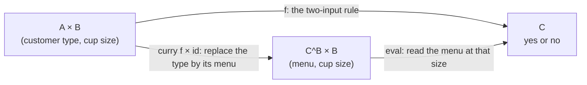

# Cartesian closed categories: where functions are objects, and proofs are programs

[Syllabus](../../../SYLLABUS.md) → [Computability and complexity](../README.md) → [Category Theory in Outline](../README.md#s07) → Cartesian closed categories

---

## General Overview

A café gives free refills by a rule. The rule takes two inputs: the customer type (member or guest) and the cup size (S, M or L). It answers yes or no. One such rule: members get a refill on every size, guests only on L.

The same rule can be stored a second way. Hand over the customer type first, and get back a small menu: a rule from cup size to yes or no. Members get the menu (yes, yes, yes). Guests get (no, no, yes). This trade of a two-input rule for a rule that returns a rule is **currying**.

Count both kinds. A two-input rule picks yes or no for each of 2 × 3 = 6 pairs: $`2^6 = 64`$ rules. A menu picks yes or no for 3 sizes: $`2^3 = 8`$ menus. A curried rule picks one of 8 menus for each of 2 customer types: $`8^2 = 64`$. The counts agree because the two kinds of rule match one for one.

That match needs one thing: the 8 menus must form an object of their own, so a rule can return one. A category where this works for every pair of objects is **cartesian closed**. Sets with functions form one. Groups with homomorphisms do not.

The payoff is a three-way dictionary. A typed program is an arrow in such a category, and it is also a proof. The program swap(x, y) = (y, x) takes a pair and returns it reversed: an input of type P × Q gives an output of type Q × P. Read its type as logic and it says "if P and Q, then Q and P". The program is the proof.

**A cartesian closed category has products and an object of arrows $`C^B`$ for every B and C, so arrows out of a pair match arrows into a function object; the simply typed lambda calculus lives in any such category, and its programs, read as logic, are exactly the constructive proofs built from "and" and "if … then".**

**What kind of fact this is:** "cartesian closed" is a definition. That sets form one and groups do not are theorems, proved on this card in Why it works. That every simply typed term gives an arrow in every cartesian closed category, with equal programs giving equal arrows, is a theorem stated with its key steps and source (Awodey, Chapter 6). The match between programs and proofs (Curry–Howard–Lambek) is a theorem for the "and" and "if … then" logic used here, stated with its source (Wadler). That Peirce's law has no constructive proof is a theorem; the code shows it two ways, by a proof search that Dyckhoff proved complete and by a two-stage Kripke model, which is sound by a theorem in Awodey, Chapter 6.

### The picture: currying and evaluation



Schematic. Both routes from A × B reach the same answer. Following the bottom route for (guest, L): the guest's menu is (no, no, yes), and reading it at L gives yes.

---

## The formula

Notation from earlier on this shelf. $`\mathrm{Hom}(X, Y)`$ is the set of arrows from $`X`$ to $`Y`$ ([Categories and functors](01-categories-and-functors.md)). $`A \times B`$ is the product, with projections $`\pi_1`$ and $`\pi_2`$ that read the first or second part ([Universal properties](04-universal-properties-limits-and-colimits.md)). $`F \dashv G`$ says F is left adjoint to G ([Adjunctions](06-adjunctions.md)).

This card introduces $`C^B`$, the **exponential**: an object that stands for "arrows from B to C". In sets it is the set of all functions from B to C. It comes with an arrow $`\mathrm{eval} : C^B \times B \to C`$, "apply a function to an input".

The exponential is defined by currying:

```math
\mathrm{Hom}(A \times B,\ C) \;\cong\; \mathrm{Hom}(A,\ C^B)
```

**Read it aloud:** arrows from pairs (a, b) into C match one for one with arrows from A into the function object $`C^B`$, and the match ignores relabelling of A.

The match in both directions, in sets:

```math
\mathrm{curry}(f)(a) = \big(b \mapsto f(a, b)\big) \qquad\qquad \mathrm{uncurry}(g) = \mathrm{eval} \circ (g \times \mathrm{id}_B)
```

**Read it aloud:** to curry f, fix the first input a and keep the rule that still waits for b; to uncurry g, look up a's menu and read it at b.

Counted for finite sets, with $`\lvert X \rvert`$ for the number of members of X:

```math
\lvert C \rvert^{\lvert A \rvert \cdot \lvert B \rvert} \;=\; \big(\lvert C \rvert^{\lvert B \rvert}\big)^{\lvert A \rvert}, \qquad 2^{6} = 64 = 8^{2}
```

**Read it aloud:** choosing an answer for every pair is the same as choosing, for every first input, an answer for every second input.

A category is **cartesian closed** when it has three things:

1. a **terminal object** 1: exactly one arrow from any object into it (in sets, a one-point set);
2. a product $`A \times B`$ for any two objects;
3. an exponential $`C^B`$ for any two objects, with the match above natural in A.

In the language of the Adjunctions card, the third point says $`(- \times B) \dashv (-)^B`$: "pair with B" is left adjoint to "arrows from B". Its counit is eval.

| Symbol | Plain meaning | In our example | Push it up and the answer… |
| --- | --- | --- | --- |
| $`A`$, $`B`$, $`C`$ | three objects; here, three sets | customer types (2), cup sizes (3), {no, yes} | each extra member multiplies the counts |
| $`A \times B`$, $`\pi_1`$, $`\pi_2`$ | the product and its two read-back arrows | 6 (type, size) pairs | — |
| $`C^B`$ | the exponential: all arrows from B to C, as one object | 8 menus | $`\lvert C \rvert^{\lvert B \rvert}`$ grows fast |
| $`\mathrm{eval}`$ | apply a function to an input | the guest's menu at L gives yes | — |
| $`f`$, $`g`$ | a two-input rule; a rule that returns a menu | the refill rule; member to (yes, yes, yes) | — |
| $`\mathrm{curry}`$, $`\mathrm{uncurry}`$ | the two directions of the match | refill rule to points 7 and 1 of $`C^B`$ | — |
| $`1`$, $`\mathrm{id}_B`$; $`u`$, $`h`$, $`k`$ | terminal object; the do-nothing arrow on B; relabellings of A, and of A and B | the one-element group, among groups | — |
| $`\mathrm{Hom}(X, Y)`$, $`\cong`$, $`\lvert X \rvert`$, $`\dashv`$ | arrows from X to Y; one-for-one match; size of a set; "is left adjoint to" | 64 on each side | — |
| $`P`$, $`Q`$, $`R`$; $`\wedge`$, $`\rightarrow`$ | letters for statements or types; "and", "if … then" | P = customer types, Q = cup sizes, R = {no, yes} | — |
| $`\lambda x{:}T.\, M`$; $`\langle M, N \rangle`$, fst, snd | a function taking x of type T; a pair and its two parts | swap = $`\lambda p{:}P \times Q.\, \langle \mathrm{snd}\, p, \mathrm{fst}\, p \rangle`$ | — |
| $`\Gamma \vdash M : T`$, $`[\![M]\!]`$, $`m`$, $`n`$ | in context Γ (the typed variables in scope) the term M has type T; the arrow a term stands for | $`[\![\mathrm{swap}]\!] : A \times B \to B \times A`$ | — |
| $`\mathbb{Z}_n`$ | the numbers 0 to n − 1 added with wrap-round | $`\mathbb{Z}_2`$, $`\mathbb{Z}_3`$ | — |

### When it holds

- **The exponential holds all functions.** Read $`C^B`$ as $`B^C`$ by mistake and there are $`3^2 = 9`$ points and 81 curried rules, not 64. Read it as pairs $`C \times B`$ and there are 6 points and 36 curried rules.
- **The category must allow it.** Groups have products and a terminal object (the one-element group), but no exponentials: Step 4 shows $`\mathbb{Z}_2`$ would need 2 arrows where only 1 exists.
- **"Natural" means every relabelling, not just the one-to-one ones.** Among the 46,656 functions from $`A \times B`$ to $`B \times A`$, only swap commutes with all 108 relabellings. Tested on the 12 one-to-one relabellings alone, 2 pass.
- **The logic is constructive.** Programs prove only what can be built. Peirce's law, $`((P \rightarrow Q) \rightarrow P) \rightarrow P`$, is true in all 8 rows of the truth table for P, Q and R (R plays no part in it), yet no program has its type.
- **Only "and", "if … then" and "true" are covered.** "Or" and "false" need sums and an empty object as well: a bicartesian closed category.

---

## Why it works

### Step 0: a two-input rule is a rule that returns a rule

Fix the first input of a two-input rule, and what is left is a one-input rule. Nothing is lost: the left-over rule still answers for every second input. Nothing is added: every rule that returns a rule comes from one two-input rule. That is all currying is. The category-theory step is to demand that "the rules from B to C" be an object, so this trade happens inside the category.

### Step 1: curry and uncurry undo each other in sets

Start with f. Its curried form sends a to the rule $`b \mapsto f(a, b)`$. Uncurrying reads that rule at b, giving $`f(a, b)`$ again. Start instead with g. Uncurrying gives the two-input rule $`(a, b) \mapsto g(a)(b)`$. Currying fixes a and leaves $`b \mapsto g(a)(b)`$, which is $`g(a)`$.

So the two directions undo each other, and the match is one for one. The code lists all 64 rules on each side and checks both round trips: 64 of 64 each way.

### Step 2: the match ignores relabelling, so eval is the counit

Relabel the customer types first by any function $`u : A \to A`$, then curry. Or curry first, then relabel. Both give the same rule, because fixing $`u(a)`$ as the first input is the same in either order. The code checks all 4 relabellings on all 64 rules: 256 of 256.

So the match is natural, and $`(- \times B) \dashv (-)^B`$ is an adjunction. Its counit is eval, which applies a function to an input: set $`g = \mathrm{id}`$ on $`C^B`$ in the uncurry formula, and what comes out is $`\mathrm{eval} : C^B \times B \to C`$.

Sets also have a terminal object (one point) and products (pairs). So sets form a cartesian closed category. Two other standard ones, stated here with Awodey (Chapters 7 and 8) as source: the category of small categories (those whose objects form a set), where $`D^C`$ is the category of functors from C to D; and presheaves on any small category $`\mathcal{C}`$, the functors from $`\mathcal{C}^{op}`$ into sets.

### Step 3: what currying buys, the same law at every size

The count $`\lvert C \rvert^{\lvert A \rvert \cdot \lvert B \rvert} = (\lvert C \rvert^{\lvert B \rvert})^{\lvert A \rvert}`$ is the power law $`c^{ab} = (c^b)^a`$, now with a reason behind it. The code lists both sides at three more sizes: 9 and 9, 81 and 81, 64 and 64.

### Step 4: groups are not cartesian closed

Groups have a terminal object: the one-element group, 1. Suppose an exponential $`C^B`$ existed. Put $`A = 1`$ in the match:

```math
\mathrm{Hom}(1 \times B,\ C) \;\cong\; \mathrm{Hom}(1,\ C^B)
```

The left side is $`\mathrm{Hom}(B, C)`$, since $`1 \times B`$ is B. The right side has exactly 1 member, because a homomorphism from the one-element group must send its one element to the identity. With $`B = C = \mathbb{Z}_2`$, the left side has 2 members (send 1 to 0, or to 1). Since 2 ≠ 1, no exponential exists. The code counts both by brute force.

The cause: in groups, 1 is also the **initial** object, with exactly one arrow out of it. In sets, arrows out of the one-point set are its points, so $`\mathrm{Hom}(1, C^B)`$ really is all of $`C^B`$.

### Step 5: typed lambda terms are arrows

The [Lambda calculus](../02-Computability%20and%20Logic/07-lambda-calculus-in-outline.md) card wrote programs with λ and application only. The **simply typed** version gives each variable a type, built from letters P, Q, R by $`\times`$ (pairs) and $`\rightarrow`$ (functions). The notation $`a : A`$, "a has type A", is the one from [Proof assistants](../02-Computability%20and%20Logic/08-proof-assistants-and-formal-verification.md).

A term with free variables $`x_1 : A_1, \dots, x_n : A_n`$ and type T becomes an arrow $`[\![M]\!] : A_1 \times \dots \times A_n \to T`$ in any cartesian closed category. Each way of building a term has one construction:

| Term | Arrow |
| --- | --- |
| a variable $`x_i`$ | the projection onto the i-th part |
| a pair $`\langle M, N \rangle`$ | the pairing $`\langle [\![M]\!], [\![N]\!] \rangle`$ from the product's universal property |
| fst M, snd M | $`\pi_1`$ or $`\pi_2`$ after $`[\![M]\!]`$ |
| a function $`\lambda x{:}T.\, M`$ | curry of $`[\![M]\!]`$, which has x as its last input |
| an application $`M\, N`$ | eval after $`\langle [\![M]\!], [\![N]\!] \rangle`$ |

So swap becomes $`\langle \pi_2, \pi_1 \rangle : A \times B \to B \times A`$. The code runs this construction in sets, with the lambda-calculus card's environment evaluator (its Road 2) extended by types and pairs. The term curry, run on all 64 refill rules, agrees with the listed curry on all 384 entries. Uncurry after curry gives back all 64 rules.

<details>
<summary>Detailed proof: equal programs give equal arrows (the beta rule)</summary>

Beta reduction rewrites $`(\lambda x{:}B.\, M)\, N`$ to $`M[x := N]`$. Let $`m = [\![M]\!] : \Gamma \times B \to C`$ and $`n = [\![N]\!] : \Gamma \to B`$, with Γ the product of the context. The left side becomes

$`\displaystyle \mathrm{eval} \circ \langle \mathrm{curry}(m),\ n \rangle = \mathrm{eval} \circ (\mathrm{curry}(m) \times \mathrm{id}_B) \circ \langle \mathrm{id}_\Gamma,\ n \rangle = m \circ \langle \mathrm{id}_\Gamma,\ n \rangle .`$

The first equality splits the pairing. The second is uncurry after curry, which is the defining property of curry (Step 1 checks it in sets). The right side, $`[\![M[x := N]]\!]`$, is also $`m \circ \langle \mathrm{id}_\Gamma, n \rangle`$: substituting N for x is feeding n into the slot x, which a short induction on M confirms. The eta rule, $`\lambda x.\, M\, x = M`$, is curry after uncurry, the other round trip. Awodey, Chapter 6, gives the full argument.

</details>

### Step 6: read the types as formulas, and a type checker is a proof checker

Read $`\times`$ as "and" and $`\rightarrow`$ as "if … then". Then each typing rule is a rule of natural deduction, the proof system of [Formal proofs and soundness](../02-Computability%20and%20Logic/11-formal-deduction-and-soundness.md):

| Program | Proof | Arrow |
| --- | --- | --- |
| a type T | a statement T | an object |
| a variable x : P | an assumption P | a projection |
| $`\lambda x.\, M`$ | if-then in: assume P, derive Q, conclude P → Q | curry |
| $`M\, N`$ | if-then out: from P → Q and P, conclude Q | eval |
| $`\langle M, N \rangle`$ | and in: from P and Q, conclude P ∧ Q | pairing |
| fst, snd | and out: from P ∧ Q, conclude P (or Q) | $`\pi_1`$, $`\pi_2`$ |
| beta reduction | removing a detour from a proof | equal arrows |

So swap is a proof of $`(P \wedge Q) \rightarrow (Q \wedge P)`$: assume P ∧ Q, take out Q and P, put them back in the other order. The code's type checker prints the formula for each term. A term the checker rejects, such as $`\lambda p{:}P.\, \mathrm{fst}\, p`$, is a proof with a broken step. So is a term that applies a rule from P to Q to something of type R: a broken if-then step, which the checker also rejects. This match is the **Curry–Howard correspondence**. Adding the arrows of a cartesian closed category as the third column is **Lambek's** contribution.

### Step 7: a proof is a uniform arrow

In sets, there are $`6^6 = 46{,}656`$ functions from $`A \times B`$ to $`B \times A`$. Most use special facts about members and sizes. A proof cannot: it must work for every P and Q. In arrow terms it must be **natural**: relabel A by any function h and B by any function k, before or after, and the result agrees.

The code tests all 46,656 against all 4 × 27 = 108 pairs (h, k). Exactly 1 passes, and it is $`[\![\mathrm{swap}]\!]`$. This is the shadow, in sets, of a stronger fact. The simply typed lambda calculus, with a one-element type for 1 and the beta and eta rules, is the **free** cartesian closed category: its arrows are built from the structure alone, so they exist in every cartesian closed category and cannot depend on what the letters stand for. This is Lambek's theorem, stated here without proof; Lambek and Scott prove it in Part I of their book. (For a type such as swap's, "cannot depend" is exactly the naturality tested above; for types with a letter on the left of an arrow it is a weaker, two-sided version.)

### Step 8: constructive, not classical

A formula with a program is true in every truth-table row: the four typed terms each pass 8 of 8 rows. The reverse fails. Peirce's law is true in all 8 rows, yet nothing of its type can be built.

The code checks this by **proof search**: a program that looks for a natural-deduction proof of a formula from nothing. It uses Dyckhoff's rules (1992), which always stop and find a proof whenever one exists. It finds proofs for swap, curry, uncurry and const, and for $`((P \rightarrow Q) \rightarrow R) \rightarrow (Q \rightarrow R)`$, which it can reach only through its one rule that makes a choice. It finds none for Peirce's law.

A second road needs no search. A **Kripke model** reads each statement as knowledge that can only grow: once true, it stays true. With two stages, now and later, a letter is true from the start (value 2), true only later (1), or never true (0). "And" takes the smaller value. "If A then B" takes 2 when A's value is at most B's, and B's value otherwise. A formula with a proof takes the value 2 in every one of the 27 rows (Awodey, Chapter 6: Kripke's completeness theorem). Peirce's law takes 2 in only 24 of the 27: when P becomes true only later and Q never, it is not yet true at the start. So it has no proof, and this road never runs the search. Keeping only the values 0 and 2 gives back the ordinary truth table.

In sets, "true in every row" and "has a program" differ because a program cannot inspect whether a set is empty before choosing what to return.

---

## Worked numbers, by hand

| Step | Arithmetic | Value |
| --- | --- | --- |
| pairs (type, size) | 2 × 3 | 6 |
| two-input rules | $`2^6`$ | 64 |
| menus, the points of $`C^B`$ | $`2^3`$ | 8 |
| curried rules | $`8^2`$ | **64** |
| member's menu | (yes, yes, yes), read as binary 111 | point 7 |
| guest's menu | (no, no, yes), binary 001 | point 1 |
| eval(guest's menu, L) | third entry of (no, no, yes) | **yes** |
| $`\mathrm{Hom}(\mathbb{Z}_2, \mathbb{Z}_2)`$ against $`\mathrm{Hom}(1, \text{anything})`$ | send 1 to 0 or to 1; one element to the identity | 2 against 1 |
| functions $`A \times B \to B \times A`$ | $`6^6`$ | 46,656 |
| the natural ones | test all 108 relabellings | **1, swap** |

The refill rule and its curried form are one rule stored two ways, and swap is the only reordering that works without looking at what P and Q are.

### What breaks if you drop a piece

| Mistake | Comes out at | What went wrong |
| --- | --- | --- |
| $`C^B`$ read as $`B^C`$ | 9 points, 81 curried rules, not 64 | arrows from B to C, not from C to B |
| $`C^B`$ read as pairs $`C \times B`$ | 6 points, 36 curried rules | a function is a choice per input, not one pair |
| exponential assumed for groups | 2 arrows needed, 1 exists | in groups 1 is initial too |
| naturality tested on one-to-one relabellings only | 2 functions pass, not 1 | (a, b) to (b, other a) survives every reordering but not merging |
| Peirce's law taken as provable | true in 8 of 8 rows, but in 24 of 27 two-stage rows; no proof found | truth tables are classical; programs are constructive |
| the term $`\lambda p.\, \langle \mathrm{fst}\, p, \mathrm{snd}\, p \rangle`$ taken as swap | type $`P \times Q \rightarrow P \times Q`$ | it proves a different formula |

The code prints all six.

---

## Code, from first principles, and it actually runs

The code lists the sets as tuples of outputs and takes four roads. First, it lists both sides of the currying match and checks the round trips and naturality. Second, it interprets typed lambda terms as functions between sets and compares them with the listed curry. Third, a brute-force search over all 46,656 functions finds the only natural one and compares it with the interpreted swap. Fourth, a proof search, a truth table and a two-stage Kripke table judge each formula without looking at any program.

### Python

```python
# Cartesian closed categories -- the check behind the card.  Nothing is imported.
# Sets: currying matches rules A x B -> C with rules A -> C^B.  Typed lambda terms three ways: a type
# checker (types are formulas), the lambda-calculus card's environment evaluator (terms become arrows:
# functions between sets), and a proof search (Dyckhoff's rules), against truth and Kripke tables.

def functions(n, m):                      # every list of n outputs, each below m
    out = [()]
    for _ in range(n):
        out = [f + (v,) for f in out for v in range(m)]
    return out

NA, NB, NC = 2, 3, 2
AN, BN, CN = ["member", "guest"], ["S", "M", "L"], ["no", "yes"]
rules = functions(NA * NB, NC)            # a rule f: A x B -> C; f(a, b) is f[a * NB + b]
expo = functions(NB, NC)                  # C^B: the 8 functions B -> C, as points
curried = functions(NA, len(expo))        # A -> C^B: each value is a point of C^B
def curry(f): return tuple(expo.index(tuple(f[a * NB + b] for b in range(NB))) for a in range(NA))
def ev(h, b): return expo[h][b]          # eval: C^B x B -> C
def uncurry(g): return tuple(ev(g[a], b) for a in range(NA) for b in range(NB))
back1, back2 = sum(uncurry(curry(f)) == f for f in rules), sum(curry(uncurry(g)) == g for g in curried)
refill = (1, 1, 1, 0, 0, 1)
nat = sum(curry(tuple(f[u[a] * NB + b] for a in range(NA) for b in range(NB)))
          == tuple(curry(f)[u[a]] for a in range(NA)) for u in functions(NA, NA) for f in rules)
print("== currying in Set: A = 2 customer types, B = 3 cup sizes, C = {no, yes} ==")
print(f"rules A x B -> C, listed: {len(rules)}; points of C^B: {len(expo)}; rules A -> C^B, listed: {len(curried)}")
print(f"uncurry after curry gives back {back1} of 64; curry after uncurry gives back {back2} of 64")
print("refill rule on (member S, M, L, guest S, M, L):", " ".join(CN[v] for v in refill))
g = curry(refill)
print(f"curried: member -> point {g[0]} = ({', '.join(CN[v] for v in expo[g[0]])}), "
      f"guest -> point {g[1]} = ({', '.join(CN[v] for v in expo[g[1]])}); eval(guest's menu, L) = {CN[ev(g[1], 2)]}")
print(f"naturality in A, curry(f after (u x id)) = curry(f) after u: {nat} of {4 * len(rules)}")
print("both sides listed at |A|, |B|, |C| = " + "; ".join(f"{a}, {b}, {c}: {len(functions(a * b, c))} and "
      f"{len(functions(a, len(functions(b, c))))}" for a, b, c in [(1, 2, 3), (2, 2, 3), (3, 2, 2)]))
print(f"mistake, C^B read as B^C: {len(functions(NC, NB))} points, {len(functions(NA, len(functions(NC, NB))))} curried rules")
print(f"mistake, C^B read as pairs C x B: {NC * NB} points, {len(functions(NA, NC * NB))} curried rules")
def homs(n, m):                           # homomorphisms Z_n -> Z_m, by brute force
    return sum(all(f[(x + y) % n] == (f[x] + f[y]) % m for x in range(n) for y in range(n))
               for f in functions(n, m))
print("== groups are not cartesian closed ==")
print(f"Hom(1 x Z2, Z2) = Hom(Z2, Z2): {homs(2, 2)}; Hom(Z3, Z3): {homs(3, 3)}; "
      f"Hom(1, Z2): {homs(1, 2)}; Hom(1, Z3): {homs(1, 3)}")
P, Q, R, V = "P", "Q", "R", (lambda n: ("var", n))
AND, IMP = (lambda x, y: ("*", x, y)), (lambda x, y: ("->", x, y))   # a type is also a formula
def show(t, word):
    return t if isinstance(t, str) else "(" + show(t[1], word) + (" -> " if t[0] == "->" else word) + show(t[2], word) + ")"
def typeof(t, ctx):                       # the type checker; None means rejected
    k = t[0]
    if k == "var": return ctx.get(t[1])
    if k == "lam":
        body = typeof(t[3], {**ctx, t[1]: t[2]})
        return body and IMP(t[2], body)
    a = typeof(t[1], ctx)
    if k in ("fst", "snd"):
        return a[1 if k == "fst" else 2] if isinstance(a, tuple) and a[0] == "*" else None
    b = typeof(t[2], ctx)
    if k == "pair": return a and b and AND(a, b)
    return a[2] if isinstance(a, tuple) and a[0] == "->" and a[1] == b else None
def run(t, env):                          # values: ints, ("pr", x, y), closures, tables
    k = t[0]
    if k == "var": return env[t[1]]
    if k == "lam": return ("clo", t[1], t[3], env)
    if k == "pair": return ("pr", run(t[1], env), run(t[2], env))
    if k in ("fst", "snd"): return run(t[1], env)[1 if k == "fst" else 2]
    return apply(run(t[1], env), run(t[2], env))
def apply(f, x):
    return f[1][x] if f[0] == "tab" else run(f[2], {**f[3], f[1]: x})
terms = {
    "swap": ("lam", "p", AND(P, Q), ("pair", ("snd", V("p")), ("fst", V("p")))),
    "curry": ("lam", "f", IMP(AND(P, Q), R), ("lam", "a", P, ("lam", "b", Q,
              ("app", V("f"), ("pair", V("a"), V("b")))))),
    "uncurry": ("lam", "g", IMP(P, IMP(Q, R)), ("lam", "p", AND(P, Q),
                ("app", ("app", V("g"), ("fst", V("p"))), ("snd", V("p"))))),
    "const": ("lam", "x", P, ("lam", "y", Q, V("x"))),
    "same": ("lam", "p", AND(P, Q), ("pair", ("fst", V("p")), ("snd", V("p")))),
    "bad": ("lam", "p", P, ("fst", V("p"))),
    "bad apply": ("lam", "f", IMP(P, Q), ("lam", "r", R, ("app", V("f"), V("r"))))}
print("== simply typed terms: each type is a formula ==")
for name, t in terms.items():
    ty = typeof(t, {})
    print(f"{name}: " + (f"type {show(ty, ' x ')[1:-1]}, formula {show(ty, ' and ')[1:-1]}" if ty else "rejected"))
print("== terms as arrows in Set, with P = A, Q = B, R = C ==")
pr = [("pr", a, b) for a in range(NA) for b in range(NB)]
sw = run(terms["swap"], {})
swap_table = tuple(apply(sw, x)[1] * NA + apply(sw, x)[2] for x in pr)   # (b, a) coded b * NA + a
print(f"[[swap]] sends (guest, M) to ({BN[apply(sw, pr[4])[1]]}, {AN[apply(sw, pr[4])[2]]})")
cu, un = run(terms["curry"], {}), run(terms["uncurry"], {})
curry_ok = sum(apply(apply(apply(cu, ("tab", dict(zip(pr, f)))), a), b) == ev(curry(f)[a], b)
               for f in rules for a in range(NA) for b in range(NB))
un_ok = sum(all(apply(apply(un, apply(cu, ("tab", dict(zip(pr, f))))), x) == f[i] for i, x in enumerate(pr))
            for f in rules)
print(f"[[curry]] agrees with the listed curry on {curry_ok} of {64 * 6} entries; "
      f"[[uncurry]] after [[curry]] gives back {un_ok} of 64 rules")
ends = [(h, k) for h in functions(NA, NA) for k in functions(NB, NB)]
perms = [(h, k) for h, k in ends if len(set(h)) == NA and len(set(k)) == NB]
def natural(f, maps):                     # f(h a, k b) = (k x h)(f(a, b)) for every pair (h, k)
    return all(f[h[a] * NB + k[b]] == k[f[a * NB + b] // NA] * NA + h[f[a * NB + b] % NA]
               for h, k in maps for a in range(NA) for b in range(NB))
cands = functions(NA * NB, NA * NB)
by_all = [f for f in cands if natural(f, ends)]
by_perm = sum(natural(f, perms) for f in cands)
print(f"functions A x B -> B x A: {len(cands)}; natural for all {len(functions(NA, NA))} x {len(functions(NB, NB))} = {len(ends)} "
      f"relabellings: {len(by_all)}, and it is [[swap]]: {'yes' if by_all == [swap_table] else 'no'}")
print(f"mistake, naturality tested on the {len(perms)} one-to-one relabellings only: {by_perm} pass")
def prove(G, goal):                       # Dyckhoff's search; the first six rules lose nothing
    for i, h in enumerate(G):
        rest = G[:i] + G[i + 1:]
        if isinstance(h, tuple) and h[0] == "*": return prove(rest + [h[1], h[2]], goal)
        if isinstance(h, tuple) and isinstance(h[1], tuple) and h[1][0] == "*":
            return prove(rest + [IMP(h[1][1], IMP(h[1][2], h[2]))], goal)
        if isinstance(h, tuple) and isinstance(h[1], str) and h[1] in rest: return prove(rest + [h[2]], goal)
    if goal in G: return True
    if isinstance(goal, tuple) and goal[0] == "*": return prove(G, goal[1]) and prove(G, goal[2])
    if isinstance(goal, tuple): return prove(G + [goal[1]], goal[2])
    for i, h in enumerate(G):             # the one rule that needs a choice: (C -> D) -> B
        if isinstance(h, tuple) and isinstance(h[1], tuple) and h[1][0] == "->":
            rest = G[:i] + G[i + 1:]
            if prove(rest + [IMP(h[1][2], h[2])], h[1]) and prove(rest + [h[2]], goal): return True
    return False
def value(t, v):          # two stages: 0 never true, 1 true only later, 2 true from the start
    if isinstance(t, str): return v[t]
    return min(value(t[1], v), value(t[2], v)) if t[0] == "*" else (2 if value(t[1], v) <= value(t[2], v) else value(t[2], v))
stages = [dict(zip("PQR", r)) for r in functions(3, 3)]   # 27 Kripke rows
rows = [v for v in stages if 1 not in v.values()]          # values 0 and 2 only: the 8 truth-table rows
forms = [(n, typeof(terms[n], {})) for n in ("swap", "curry", "uncurry", "const")]
forms += [("nested if", IMP(IMP(IMP(P, Q), R), IMP(Q, R))), ("Peirce's law", IMP(IMP(IMP(P, Q), P), P)), ("guess", IMP(IMP(P, Q), Q))]
print("== the formulas alone: proof search, truth table (8 rows of P, Q, R), two-stage Kripke table (27 rows) ==")
found, rows_true, kripke = {}, {}, {}
for name, t in forms:
    found[name], rows_true[name], kripke[name] = prove([], t), sum(value(t, v) == 2 for v in rows), sum(value(t, v) == 2 for v in stages)
    print(f"{name}: {show(t, ' and ')[1:-1]}: proof found {'yes' if found[name] else 'no'}; "
          f"true in {rows_true[name]} of 8 rows and {kripke[name]} of 27 two-stage rows")
assert len(rules) == NC ** (NA * NB) == 64 and len(curried) == len(expo) ** NA == 64   # count vs power law
assert back1 == back2 == 64 and len(set(map(curry, rules))) == 64 and nat == 256
assert g == (7, 1) and expo[7] == (1, 1, 1) and expo[1] == (0, 0, 1) and ev(g[1], 2) == 1
assert curry_ok == 384 and un_ok == 64 and by_all == [swap_table] and by_perm == 2   # interpreter; one natural arrow
assert homs(2, 2) == 2 and homs(3, 3) == 3 and homs(1, 2) == homs(1, 3) == 1
assert all(typeof(terms[n], {}) is None for n in ("bad", "bad apply")) and typeof(terms["same"], {}) != typeof(terms["swap"], {})
assert all(found[n] and rows_true[n] == 8 and kripke[n] == 27 for n, _ in forms[:5])   # provable means true everywhere
assert [(found[n], rows_true[n], kripke[n]) for n in ("Peirce's law", "guess")] == [(False, 8, 24), (False, 6, 18)]
print("ALL CHECKS PASS")
```

**Ran 2026-11-24 on macOS, Python 3.14.10, standard library only. All checks passed. Output, pasted from the run:**

```
== currying in Set: A = 2 customer types, B = 3 cup sizes, C = {no, yes} ==
rules A x B -> C, listed: 64; points of C^B: 8; rules A -> C^B, listed: 64
uncurry after curry gives back 64 of 64; curry after uncurry gives back 64 of 64
refill rule on (member S, M, L, guest S, M, L): yes yes yes no no yes
curried: member -> point 7 = (yes, yes, yes), guest -> point 1 = (no, no, yes); eval(guest's menu, L) = yes
naturality in A, curry(f after (u x id)) = curry(f) after u: 256 of 256
both sides listed at |A|, |B|, |C| = 1, 2, 3: 9 and 9; 2, 2, 3: 81 and 81; 3, 2, 2: 64 and 64
mistake, C^B read as B^C: 9 points, 81 curried rules
mistake, C^B read as pairs C x B: 6 points, 36 curried rules
== groups are not cartesian closed ==
Hom(1 x Z2, Z2) = Hom(Z2, Z2): 2; Hom(Z3, Z3): 3; Hom(1, Z2): 1; Hom(1, Z3): 1
== simply typed terms: each type is a formula ==
swap: type (P x Q) -> (Q x P), formula (P and Q) -> (Q and P)
curry: type ((P x Q) -> R) -> (P -> (Q -> R)), formula ((P and Q) -> R) -> (P -> (Q -> R))
uncurry: type (P -> (Q -> R)) -> ((P x Q) -> R), formula (P -> (Q -> R)) -> ((P and Q) -> R)
const: type P -> (Q -> P), formula P -> (Q -> P)
same: type (P x Q) -> (P x Q), formula (P and Q) -> (P and Q)
bad: rejected
bad apply: rejected
== terms as arrows in Set, with P = A, Q = B, R = C ==
[[swap]] sends (guest, M) to (M, guest)
[[curry]] agrees with the listed curry on 384 of 384 entries; [[uncurry]] after [[curry]] gives back 64 of 64 rules
functions A x B -> B x A: 46656; natural for all 4 x 27 = 108 relabellings: 1, and it is [[swap]]: yes
mistake, naturality tested on the 12 one-to-one relabellings only: 2 pass
== the formulas alone: proof search, truth table (8 rows of P, Q, R), two-stage Kripke table (27 rows) ==
swap: (P and Q) -> (Q and P): proof found yes; true in 8 of 8 rows and 27 of 27 two-stage rows
curry: ((P and Q) -> R) -> (P -> (Q -> R)): proof found yes; true in 8 of 8 rows and 27 of 27 two-stage rows
uncurry: (P -> (Q -> R)) -> ((P and Q) -> R): proof found yes; true in 8 of 8 rows and 27 of 27 two-stage rows
const: P -> (Q -> P): proof found yes; true in 8 of 8 rows and 27 of 27 two-stage rows
nested if: ((P -> Q) -> R) -> (Q -> R): proof found yes; true in 8 of 8 rows and 27 of 27 two-stage rows
Peirce's law: ((P -> Q) -> P) -> P: proof found no; true in 8 of 8 rows and 24 of 27 two-stage rows
guess: (P -> Q) -> Q: proof found no; true in 6 of 8 rows and 18 of 27 two-stage rows
ALL CHECKS PASS
```

### Rust

Same numbers, same labels, built with `rustc --edition 2021 -O`.

```rust
// Cartesian closed categories -- the same check as the Python, in Rust.  No crates.
// Sets: currying matches rules A x B -> C with rules A -> C^B.  Typed lambda terms three ways: a type
// checker (types are formulas), the lambda-calculus card's environment evaluator (terms become arrows:
// functions between sets), and a proof search (Dyckhoff's rules), against truth and Kripke tables.
use std::rc::Rc;
const NA: usize = 2; const NB: usize = 3; const NC: usize = 2;
fn functions(n: usize, m: usize) -> Vec<Vec<usize>> { // every list of n outputs, each below m
    let mut out: Vec<Vec<usize>> = vec![vec![]];
    for _ in 0..n { out = out.iter().flat_map(|f| (0..m).map(move |v| [f.clone(), vec![v]].concat())).collect() }
    out
}
#[derive(Clone, PartialEq, Debug)]
enum Ty { At(char), And(Box<Ty>, Box<Ty>), Imp(Box<Ty>, Box<Ty>) } // a type is also a formula
fn and(x: Ty, y: Ty) -> Ty { Ty::And(Box::new(x), Box::new(y)) }
fn imp(x: Ty, y: Ty) -> Ty { Ty::Imp(Box::new(x), Box::new(y)) }
fn show(t: &Ty, w: &str) -> String { match t { Ty::At(c) => c.to_string(),
    Ty::And(x, y) => format!("({}{}{})", show(x, w), w, show(y, w)), Ty::Imp(x, y) => format!("({} -> {})", show(x, w), show(y, w)) } }
fn inner(s: String) -> String { s[1..s.len() - 1].to_string() }
#[derive(Clone, PartialEq)]
enum Tm { Var(&'static str), Lam(&'static str, Ty, Rc<Tm>), App(Rc<Tm>, Rc<Tm>), Pair(Rc<Tm>, Rc<Tm>), Fst(Rc<Tm>), Snd(Rc<Tm>) }
fn v(n: &'static str) -> Rc<Tm> { Rc::new(Tm::Var(n)) }
fn lam(n: &'static str, t: Ty, b: Rc<Tm>) -> Rc<Tm> { Rc::new(Tm::Lam(n, t, b)) }
fn app(f: Rc<Tm>, x: Rc<Tm>) -> Rc<Tm> { Rc::new(Tm::App(f, x)) }
fn pair(x: Rc<Tm>, y: Rc<Tm>) -> Rc<Tm> { Rc::new(Tm::Pair(x, y)) }
fn fst(x: Rc<Tm>) -> Rc<Tm> { Rc::new(Tm::Fst(x)) } fn snd(x: Rc<Tm>) -> Rc<Tm> { Rc::new(Tm::Snd(x)) }
fn type_of(t: &Tm, ctx: &Vec<(&'static str, Ty)>) -> Option<Ty> { // the type checker; None means rejected
    match t {
        Tm::Var(n) => ctx.iter().rev().find(|(m, _)| m == n).map(|(_, ty)| ty.clone()),
        Tm::Lam(n, ty, b) => { let mut c = ctx.clone(); c.push((*n, ty.clone())); type_of(b, &c).map(|r| imp(ty.clone(), r)) }
        Tm::Fst(x) => match type_of(x, ctx) { Some(Ty::And(a, _)) => Some(*a), _ => None },
        Tm::Snd(x) => match type_of(x, ctx) { Some(Ty::And(_, b)) => Some(*b), _ => None },
        Tm::Pair(x, y) => Some(and(type_of(x, ctx)?, type_of(y, ctx)?)),
        Tm::App(f, x) => match (type_of(f, ctx), type_of(x, ctx)) { (Some(Ty::Imp(a, r)), Some(b)) if *a == b => Some(*r), _ => None },
    }
}
#[derive(Clone, PartialEq)]
enum V { At(usize), Pr(Box<V>, Box<V>), Clo(&'static str, Rc<Tm>, Vec<(&'static str, V)>), Tab(Vec<(V, V)>) }
fn run(t: &Tm, env: &Vec<(&'static str, V)>) -> V { // values: atoms, pairs, closures, tables
    match t {
        Tm::Var(n) => env.iter().rev().find(|(m, _)| m == n).unwrap().1.clone(),
        Tm::Lam(n, _, b) => V::Clo(*n, b.clone(), env.clone()),
        Tm::Pair(x, y) => V::Pr(Box::new(run(x, env)), Box::new(run(y, env))),
        Tm::Fst(x) => match run(x, env) { V::Pr(a, _) => *a, _ => panic!("fst of a non-pair") },
        Tm::Snd(x) => match run(x, env) { V::Pr(_, b) => *b, _ => panic!("snd of a non-pair") },
        Tm::App(f, x) => apply(&run(f, env), run(x, env)),
    }
}
fn apply(f: &V, x: V) -> V {
    match f { V::Tab(t) => t.iter().find(|(k, _)| *k == x).unwrap().1.clone(),
              V::Clo(n, b, env) => { let mut e = env.clone(); e.push((*n, x)); run(b, &e) } _ => panic!("not a function") }
}
fn at(v: &V) -> usize { match v { V::At(n) => *n, _ => panic!("not an atom") } } fn parts(v: &V) -> (usize, usize) { match v { V::Pr(a, b) => (at(a), at(b)), _ => panic!("not a pair") } }
fn prove(g: &Vec<Ty>, goal: &Ty) -> bool { // Dyckhoff's search; the first six rules lose nothing
    for i in 0..g.len() {
        let mut rest = g.clone(); match rest.remove(i) {
            Ty::And(a, b) => { rest.push(*a); rest.push(*b); return prove(&rest, goal) }
            Ty::Imp(a, b) => match *a {
                Ty::And(c, d) => { rest.push(imp(*c, imp(*d, *b))); return prove(&rest, goal) }
                Ty::At(_) if rest.contains(&a) => { rest.push(*b); return prove(&rest, goal) }
                _ => {}
            },
            _ => {}
        }
    }
    if g.contains(goal) { return true }
    match goal { Ty::And(a, b) => return prove(g, a) && prove(g, b),
        Ty::Imp(a, b) => { let mut h = g.clone(); h.push((**a).clone()); return prove(&h, b) } _ => {} }
    for i in 0..g.len() { // the one rule that needs a choice: (C -> D) -> B
        let mut rest = g.clone(); if let Ty::Imp(a, b) = rest.remove(i) { if let Ty::Imp(_, d) = &*a {
            let (mut r1, mut r2) = (rest.clone(), rest);
            r1.push(imp((**d).clone(), (*b).clone()));
            r2.push(*b);
            if prove(&r1, &a) && prove(&r2, goal) { return true }
        } }
    }
    false
}
fn value(t: &Ty, v: &[usize]) -> usize { // two stages: 0 never true, 1 true only later, 2 true from the start
    match t { Ty::At(c) => v[(*c as u8 - b'P') as usize], Ty::And(a, b) => value(a, v).min(value(b, v)),
              Ty::Imp(a, b) => if value(a, v) <= value(b, v) { 2 } else { value(b, v) } }
}
fn homs(n: usize, m: usize) -> usize { // homomorphisms Z_n -> Z_m, by brute force
    functions(n, m).iter().filter(|f| (0..n).all(|x| (0..n).all(|y| f[(x + y) % n] == (f[x] + f[y]) % m))).count()
}
fn yn(b: bool) -> &'static str { if b { "yes" } else { "no" } }
fn main() {
    let (an, bn, cn) = (["member", "guest"], ["S", "M", "L"], ["no", "yes"]);
    let (rules, expo, curried) = (functions(NA * NB, NC), functions(NB, NC), functions(NA, NC.pow(NB as u32)));
    let curry = |f: &Vec<usize>| -> Vec<usize> {
        (0..NA).map(|a| expo.iter().position(|h| *h == (0..NB).map(|b| f[a * NB + b]).collect::<Vec<_>>()).unwrap()).collect() };
    let ev = |h: usize, b: usize| expo[h][b]; // eval: C^B x B -> C
    let uncurry = |g: &Vec<usize>| -> Vec<usize> { (0..NA * NB).map(|i| ev(g[i / NB], i % NB)).collect() };
    let back1 = rules.iter().filter(|f| uncurry(&curry(f)) == **f).count();
    let back2 = curried.iter().filter(|g| curry(&uncurry(g)) == **g).count();
    let refill = vec![1, 1, 1, 0, 0, 1];
    let nat = functions(NA, NA).iter().map(|u| rules.iter().filter(|f| curry(&(0..NA * NB).map(|i| f[u[i / NB] * NB + i % NB]).collect())
        == (0..NA).map(|a| curry(f)[u[a]]).collect::<Vec<_>>()).count()).sum::<usize>();
    let words = |p: &Vec<usize>| p.iter().map(|&x| cn[x]).collect::<Vec<_>>();
    println!("== currying in Set: A = 2 customer types, B = 3 cup sizes, C = {{no, yes}} ==");
    println!("rules A x B -> C, listed: {}; points of C^B: {}; rules A -> C^B, listed: {}", rules.len(), expo.len(), curried.len());
    println!("uncurry after curry gives back {} of 64; curry after uncurry gives back {} of 64", back1, back2);
    println!("refill rule on (member S, M, L, guest S, M, L): {}", words(&refill).join(" "));
    let g = curry(&refill);
    println!("curried: member -> point {} = ({}), guest -> point {} = ({}); eval(guest's menu, L) = {}",
             g[0], words(&expo[g[0]]).join(", "), g[1], words(&expo[g[1]]).join(", "), cn[ev(g[1], 2)]);
    println!("naturality in A, curry(f after (u x id)) = curry(f) after u: {} of {}", nat, 4 * rules.len());
    let sizes: Vec<String> = [(1, 2, 3), (2, 2, 3), (3, 2, 2)].iter().map(|&(a, b, c)| format!("{}, {}, {}: {} and {}",
        a, b, c, functions(a * b, c).len(), functions(a, functions(b, c).len()).len())).collect();
    println!("both sides listed at |A|, |B|, |C| = {}", sizes.join("; "));
    println!("mistake, C^B read as B^C: {} points, {} curried rules", functions(NC, NB).len(), functions(NA, functions(NC, NB).len()).len());
    println!("mistake, C^B read as pairs C x B: {} points, {} curried rules", NC * NB, functions(NA, NC * NB).len());
    println!("== groups are not cartesian closed ==");
    println!("Hom(1 x Z2, Z2) = Hom(Z2, Z2): {}; Hom(Z3, Z3): {}; Hom(1, Z2): {}; Hom(1, Z3): {}", homs(2, 2), homs(3, 3), homs(1, 2), homs(1, 3));
    let (p, q, r, pq) = (Ty::At('P'), Ty::At('Q'), Ty::At('R'), and(Ty::At('P'), Ty::At('Q')));
    let terms: Vec<(&str, Rc<Tm>)> = vec![
        ("swap", lam("p", pq.clone(), pair(snd(v("p")), fst(v("p"))))),
        ("curry", lam("f", imp(pq.clone(), r.clone()), lam("a", p.clone(), lam("b", q.clone(), app(v("f"), pair(v("a"), v("b"))))))),
        ("uncurry", lam("g", imp(p.clone(), imp(q.clone(), r.clone())), lam("p", pq.clone(), app(app(v("g"), fst(v("p"))), snd(v("p")))))),
        ("const", lam("x", p.clone(), lam("y", q.clone(), v("x")))),
        ("same", lam("p", pq.clone(), pair(fst(v("p")), snd(v("p"))))),
        ("bad", lam("p", p.clone(), fst(v("p")))),
        ("bad apply", lam("f", imp(p.clone(), q.clone()), lam("r", r.clone(), app(v("f"), v("r")))))];
    let ty = |i: usize| type_of(&terms[i].1, &vec![]);
    println!("== simply typed terms: each type is a formula ==");
    for (i, (name, _)) in terms.iter().enumerate() {
        match ty(i) { Some(t) => println!("{}: type {}, formula {}", name, inner(show(&t, " x ")), inner(show(&t, " and "))),
                      None => println!("{}: rejected", name) }
    }
    println!("== terms as arrows in Set, with P = A, Q = B, R = C ==");
    let pr: Vec<V> = (0..NA * NB).map(|i| V::Pr(Box::new(V::At(i / NB)), Box::new(V::At(i % NB)))).collect();
    let sw = run(&terms[0].1, &vec![]);
    let swap_table: Vec<usize> = pr.iter().map(|x| { let (b, a) = parts(&apply(&sw, x.clone())); b * NA + a }).collect();
    let (b4, a4) = parts(&apply(&sw, pr[4].clone()));
    println!("[[swap]] sends (guest, M) to ({}, {})", bn[b4], an[a4]);
    let (cu, un) = (run(&terms[1].1, &vec![]), run(&terms[2].1, &vec![]));
    let (mut curry_ok, mut un_ok) = (0, 0);
    for f in &rules {
        let h = apply(&cu, V::Tab(pr.iter().cloned().zip(f.iter().map(|&c| V::At(c))).collect()));
        for i in 0..NA * NB { if at(&apply(&apply(&h, V::At(i / NB)), V::At(i % NB))) == ev(curry(f)[i / NB], i % NB) { curry_ok += 1 } }
        let back = apply(&un, h);
        if (0..NA * NB).all(|i| at(&apply(&back, pr[i].clone())) == f[i]) { un_ok += 1 }
    }
    println!("[[curry]] agrees with the listed curry on {} of {} entries; [[uncurry]] after [[curry]] gives back {} of 64 rules", curry_ok, 64 * 6, un_ok);
    let ends: Vec<(Vec<usize>, Vec<usize>)> = functions(NA, NA).iter().flat_map(|h| functions(NB, NB).into_iter().map(move |k| (h.clone(), k))).collect();
    let perms: Vec<(Vec<usize>, Vec<usize>)> = ends.iter().filter(|(h, k)| (0..NA).all(|y| h.contains(&y)) && (0..NB).all(|y| k.contains(&y))).cloned().collect();
    let natural = |f: &Vec<usize>, maps: &Vec<(Vec<usize>, Vec<usize>)>| maps.iter().all(|(h, k)| (0..NA).all(|a| (0..NB).all(|b|
        f[h[a] * NB + k[b]] == k[f[a * NB + b] / NA] * NA + h[f[a * NB + b] % NA])));
    let cands = functions(NA * NB, NA * NB);
    let by_all: Vec<&Vec<usize>> = cands.iter().filter(|f| natural(f, &ends)).collect();
    let by_perm = cands.iter().filter(|f| natural(f, &perms)).count();
    println!("functions A x B -> B x A: {}; natural for all {} x {} = {} relabellings: {}, and it is [[swap]]: {}",
             cands.len(), functions(NA, NA).len(), functions(NB, NB).len(), ends.len(), by_all.len(), yn(by_all == vec![&swap_table]));
    println!("mistake, naturality tested on the {} one-to-one relabellings only: {} pass", perms.len(), by_perm);
    let mut forms: Vec<(&str, Ty)> = (0..4).map(|i| (terms[i].0, ty(i).unwrap())).collect();
    forms.push(("nested if", imp(imp(imp(p.clone(), q.clone()), r.clone()), imp(q.clone(), r.clone()))));
    forms.extend([("Peirce's law", imp(imp(imp(p.clone(), q.clone()), p.clone()), p.clone())), ("guess", imp(imp(p.clone(), q.clone()), q.clone()))]);
    println!("== the formulas alone: proof search, truth table (8 rows of P, Q, R), two-stage Kripke table (27 rows) ==");
    let holds = |t: &Ty, all: bool| functions(3, 3).iter().filter(|s| (all || !s.contains(&1)) && value(t, s) == 2).count(); // no 1: truth table
    let res: Vec<(bool, usize, usize)> = forms.iter().map(|(_, t)| (prove(&vec![], t), holds(t, false), holds(t, true))).collect();
    for (i, (name, t)) in forms.iter().enumerate() {
        println!("{}: {}: proof found {}; true in {} of 8 rows and {} of 27 two-stage rows", name, inner(show(t, " and ")), yn(res[i].0), res[i].1, res[i].2);
    }
    assert!(rules.len() == NC.pow((NA * NB) as u32) && rules.len() == 64 && curried.len() == expo.len().pow(NA as u32)); // count vs power law
    assert!(back1 == 64 && back2 == 64 && nat == 256 && g == vec![7, 1] && expo[7] == vec![1, 1, 1] && expo[1] == vec![0, 0, 1] && ev(g[1], 2) == 1);
    assert!(curry_ok == 384 && un_ok == 64 && by_all == vec![&swap_table] && by_perm == 2); // interpreter; one natural arrow
    assert!(homs(2, 2) == 2 && homs(3, 3) == 3 && homs(1, 2) == 1 && homs(1, 3) == 1);
    assert!(ty(5).is_none() && ty(6).is_none() && ty(4) != ty(0) && (0..5).all(|i| res[i] == (true, 8, 27))); // provable: true everywhere
    assert!(res[5] == (false, 8, 24) && res[6] == (false, 6, 18)); // Peirce's law and the guess: no proof
    println!("ALL CHECKS PASS");
}
```

**Ran 2026-11-24 on macOS, rustc 1.98.1, no crates. All checks passed. Output, pasted from the run:**

```
== currying in Set: A = 2 customer types, B = 3 cup sizes, C = {no, yes} ==
rules A x B -> C, listed: 64; points of C^B: 8; rules A -> C^B, listed: 64
uncurry after curry gives back 64 of 64; curry after uncurry gives back 64 of 64
refill rule on (member S, M, L, guest S, M, L): yes yes yes no no yes
curried: member -> point 7 = (yes, yes, yes), guest -> point 1 = (no, no, yes); eval(guest's menu, L) = yes
naturality in A, curry(f after (u x id)) = curry(f) after u: 256 of 256
both sides listed at |A|, |B|, |C| = 1, 2, 3: 9 and 9; 2, 2, 3: 81 and 81; 3, 2, 2: 64 and 64
mistake, C^B read as B^C: 9 points, 81 curried rules
mistake, C^B read as pairs C x B: 6 points, 36 curried rules
== groups are not cartesian closed ==
Hom(1 x Z2, Z2) = Hom(Z2, Z2): 2; Hom(Z3, Z3): 3; Hom(1, Z2): 1; Hom(1, Z3): 1
== simply typed terms: each type is a formula ==
swap: type (P x Q) -> (Q x P), formula (P and Q) -> (Q and P)
curry: type ((P x Q) -> R) -> (P -> (Q -> R)), formula ((P and Q) -> R) -> (P -> (Q -> R))
uncurry: type (P -> (Q -> R)) -> ((P x Q) -> R), formula (P -> (Q -> R)) -> ((P and Q) -> R)
const: type P -> (Q -> P), formula P -> (Q -> P)
same: type (P x Q) -> (P x Q), formula (P and Q) -> (P and Q)
bad: rejected
bad apply: rejected
== terms as arrows in Set, with P = A, Q = B, R = C ==
[[swap]] sends (guest, M) to (M, guest)
[[curry]] agrees with the listed curry on 384 of 384 entries; [[uncurry]] after [[curry]] gives back 64 of 64 rules
functions A x B -> B x A: 46656; natural for all 4 x 27 = 108 relabellings: 1, and it is [[swap]]: yes
mistake, naturality tested on the 12 one-to-one relabellings only: 2 pass
== the formulas alone: proof search, truth table (8 rows of P, Q, R), two-stage Kripke table (27 rows) ==
swap: (P and Q) -> (Q and P): proof found yes; true in 8 of 8 rows and 27 of 27 two-stage rows
curry: ((P and Q) -> R) -> (P -> (Q -> R)): proof found yes; true in 8 of 8 rows and 27 of 27 two-stage rows
uncurry: (P -> (Q -> R)) -> ((P and Q) -> R): proof found yes; true in 8 of 8 rows and 27 of 27 two-stage rows
const: P -> (Q -> P): proof found yes; true in 8 of 8 rows and 27 of 27 two-stage rows
nested if: ((P -> Q) -> R) -> (Q -> R): proof found yes; true in 8 of 8 rows and 27 of 27 two-stage rows
Peirce's law: ((P -> Q) -> P) -> P: proof found no; true in 8 of 8 rows and 24 of 27 two-stage rows
guess: (P -> Q) -> Q: proof found no; true in 6 of 8 rows and 18 of 27 two-stage rows
ALL CHECKS PASS
```

The two outputs match line for line.

### Lean

Lean proves the main facts for sets of every size, and checks the card's counts at the sizes the card uses.

- Sets have a terminal object and products.
- Take any set B. Then "pair with B" is left adjoint to "arrows from B": $`(- \times B) \dashv (-)^B`$.
- Take a two-input rule f. Then the match is currying: $`\mathrm{curry}(f)(a) = \big(b \mapsto f(a, b)\big)`$.
- The counit is eval: it sends a function g and an input b to g(b).
- Groups have a terminal object and products.
- Yet for some group B, "pair with B" has no right adjoint, so groups are not cartesian closed.
- Suppose a function f from $`A \times B`$ to $`B \times A`$ is natural for every relabelling h of A and k of B. Then f is swap.
- There are 64 two-input rules, 8 menus and 64 curried rules.
- Take any c, a and b from 0 to 4. Then $`c^{ab} = (c^b)^a`$.
- Reading $`C^B`$ as $`B^C`$ gives 9 points and 81 curried rules; reading it as pairs gives 36 curried rules.
- $`\mathrm{Hom}(\mathbb{Z}_2, \mathbb{Z}_2)`$ has 2 members, but $`\mathrm{Hom}(1, \mathbb{Z}_2)`$ has only 1.
- There are 46,656 functions from $`A \times B`$ to $`B \times A`$, 108 relabellings and 12 one-to-one relabellings.
- Peirce's law is true in all 8 truth-table rows, but in only 24 of the 27 two-stage rows.
- Swap's formula is true in all 27 two-stage rows.

The type checker, the terms run as arrows, the search over 46,656 functions and the proof search are left to the Python and Rust checks.

```lean
-- Cartesian closed categories: sets form a cartesian closed category, with the set of functions B → C as the exponential, currying as the match and eval as its counit; groups do not; and the only function A × B → B × A that commutes with every relabelling is swap.
import Mathlib.CategoryTheory.Monoidal.Types.Basic
import Mathlib.CategoryTheory.Limits.Types.Limits
import Mathlib.CategoryTheory.Yoneda
import Mathlib.Algebra.Category.Grp.CartesianMonoidal
import Mathlib.Algebra.Category.Grp.Limits
import Mathlib.Algebra.Category.Grp.Zero
import Mathlib.Data.Fintype.Pi
import Mathlib.Data.Fintype.Prod
import Mathlib.Data.Fintype.Perm
import Mathlib.Data.Fintype.BigOperators
import Mathlib.Data.ZMod.Defs

open CategoryTheory CategoryTheory.Limits MonoidalCategory Opposite

universe u

/-- Sets form a cartesian closed category. Sets have a terminal object (a one-point set) and a
product `A × B` for any two sets, and for every set `B` the functor "pair with `B`",
`X ↦ X × B`, is left adjoint to "arrows from `B`", `C ↦ C^B`, where `C^B` is the set of all
functions from `B` to `C`: `(- × B) ⊣ (-)^B`. The one-for-one match
`Hom(A × B, C) ≅ Hom(A, C^B)`, natural in `A` and `C`, is currying, sending a two-input rule `f`
to `a ↦ (b ↦ f(a, b))`, and its counit is `eval : C^B × B → C`, `eval(g, b) = g(b)`. -/
theorem sets_form_a_cartesian_closed_category :
    HasTerminal (Type u) ∧ HasBinaryProducts (Type u) ∧
    ∀ B : Type u, ∃ adj : tensorRight B ⊣ coyoneda.obj (op B),
      (∀ (A C : Type u) (f : A ⊗ B ⟶ C) (a : A) (b : B),
        (show B ⟶ C from adj.homEquiv A C f a) b = f (a, b)) ∧
      (∀ (C : Type u) (g : B ⟶ C) (b : B), adj.counit.app C (g, b) = g b) := by
  refine ⟨inferInstance, inferInstance, fun B => ?_⟩
  let adj : tensorRight B ⊣ coyoneda.obj (op B) :=
    { unit := { app Z := ↾fun z ↦ ↾fun x => ⟨z, x⟩ }
      counit := { app _ := ↾fun gx => gx.1.hom gx.2 } }
  refine ⟨adj, ?_, ?_⟩
  · intro A C f a b
    rfl
  · intro C g b
    rfl

/-- Groups are not cartesian closed. Groups have a terminal object (the one-element group) and a
product of any two groups, but some group `B` has no exponential: "pair with `B`",
`X ↦ X × B`, has no right adjoint. -/
theorem groups_not_cartesian_closed :
    HasTerminal GrpCat.{u} ∧ HasBinaryProducts GrpCat.{u} ∧
    ∃ B : GrpCat.{u}, ¬ (tensorRight B).IsLeftAdjoint := by
  refine ⟨inferInstance, inferInstance, ?_⟩
  refine ⟨GrpCat.of (ULift.{u} (Multiplicative (ZMod 2))), ?_⟩
  intro hL
  set B := GrpCat.of (ULift.{u} (Multiplicative (ZMod 2)))
  let adj := Adjunction.ofIsLeftAdjoint (tensorRight B)
  let X : GrpCat.{u} := GrpCat.of PUnit
  have hX : IsZero X := GrpCat.isZero_of_subsingleton _
  have hsub : ∀ (g₁ g₂ : X ⊗ B ⟶ B), g₁ = g₂ := by
    intro g₁ g₂
    apply (adj.homEquiv X B).injective
    exact hX.eq_of_src _ _
  have key := hsub (CartesianMonoidalCategory.snd X B)
    (CartesianMonoidalCategory.fst X B ≫ hX.to_ B)
  have h2 := congrArg (fun g => CartesianMonoidalCategory.lift (hX.from_ B) (𝟙 B) ≫ g) key
  simp only [CartesianMonoidalCategory.lift_snd, CartesianMonoidalCategory.lift_fst_assoc] at h2
  have h3 := congrArg (fun g => (g : B ⟶ B).hom (ULift.up (Multiplicative.ofAdd 1))) h2
  simp at h3
  have h4 : (hX.from_ B).hom (ULift.up (Multiplicative.ofAdd 1)) = 1 := Subsingleton.elim _ _
  rw [h4, MonoidHom.map_one] at h3
  have h5 := congrArg (fun x : ULift.{u} (Multiplicative (ZMod 2)) => Multiplicative.toAdd x.down) h3
  change (1 : ZMod 2) = 0 at h5
  exact absurd h5 (by decide)

/-- A proof is a uniform arrow. Among all functions `f : A × B → B × A`, the only one that is
natural, meaning that relabelling `A` by any function `h : A → A` and `B` by any function
`k : B → B` before `f` gives the same result as after it, is swap, `(a, b) ↦ (b, a)`. -/
theorem natural_pair_reversal_is_swap {A B : Type u} (f : A × B → B × A)
    (hf : ∀ (h : A → A) (k : B → B) (p : A × B),
      f (Prod.map h k p) = Prod.map k h (f p)) :
    f = Prod.swap := by
  funext ⟨a, b⟩
  have := hf (fun _ => a) (fun _ => b) (a, b)
  exact this

-- The refill rule: 2 customer types, 3 cup sizes, answers yes or no.
-- Two-input rules: 2 ^ 6 = 64; menus, the points of C^B: 2 ^ 3 = 8; curried rules: 8 ^ 2 = 64.
example : Fintype.card (Fin 2 × Fin 3 → Fin 2) = 64 := by simp
example : Fintype.card (Fin 3 → Fin 2) = 8 := by simp
example : Fintype.card (Fin 2 → Fin 3 → Fin 2) = 64 := by simp
example : (2 : ℕ) ^ (2 * 3) = 64 ∧ (2 ^ 3) ^ 2 = 64 := by norm_num
-- The power law at the card's three more sizes: 9 and 9, 81 and 81, 64 and 64 are of this form.
example : ∀ a b c : Fin 5, (c : ℕ) ^ ((a : ℕ) * b) = ((c : ℕ) ^ (b : ℕ)) ^ (a : ℕ) := by decide
-- Mistakes: C^B read as B^C gives 3 ^ 2 = 9 points and 9 ^ 2 = 81 curried rules;
-- read as pairs C × B it gives 6 points and 6 ^ 2 = 36 curried rules.
example : Fintype.card (Fin 2 → Fin 3) = 9 := by simp
example : Fintype.card (Fin 2 → Fin 2 → Fin 3) = 81 := by simp
example : Fintype.card (Fin 2 → Fin 2 × Fin 3) = 36 := by simp
-- Groups: Hom(Z_2, Z_2) has 2 members, but Hom(1, Z_2) has only 1, so 2 ≠ 1.
example : ((Finset.univ : Finset (ZMod 2 → ZMod 2)).filter
    (fun f => ∀ x y, f (x + y) = f x + f y)).card = 2 := by decide
example : ((Finset.univ : Finset (ZMod 1 → ZMod 2)).filter
    (fun f => ∀ x y, f (x + y) = f x + f y)).card = 1 := by decide
-- Step 7: 6 ^ 6 = 46,656 functions A × B → B × A; 4 × 27 = 108 relabellings (h, k);
-- 2 × 6 = 12 one-to-one relabellings.
example : Fintype.card (Fin 6 → Fin 6) = 46656 := by simp
example : Fintype.card ((Fin 2 → Fin 2) × (Fin 3 → Fin 3)) = 108 := by simp
example : Fintype.card (Equiv.Perm (Fin 2) × Equiv.Perm (Fin 3)) = 12 := by
  simp [Fintype.card_perm]; decide
-- Step 8, the two-stage Kripke table: values 0 (never), 1 (only later), 2 (from the start);
-- "if A then B" is 2 when A ≤ B, else B. Peirce's law ((P → Q) → P) → P is 2 in 24 of the
-- 27 rows of P, Q, R, but in all 8 truth-table rows (values 0 and 2 only).
example : ((Finset.univ : Finset (Fin 3 × Fin 3 × Fin 3)).filter (fun v =>
    let imp : Fin 3 → Fin 3 → Fin 3 := fun a b => if a ≤ b then 2 else b
    imp (imp (imp v.1 v.2.1) v.1) v.1 = 2)).card = 24 := by decide
example : ((Finset.univ : Finset (Fin 3 × Fin 3 × Fin 3)).filter (fun v =>
    let imp : Fin 3 → Fin 3 → Fin 3 := fun a b => if a ≤ b then 2 else b
    v.1 ≠ 1 ∧ v.2.1 ≠ 1 ∧ v.2.2 ≠ 1 ∧ imp (imp (imp v.1 v.2.1) v.1) v.1 = 2)).card = 8 := by
  decide
-- Swap's formula (P ∧ Q) → (Q ∧ P), with "and" as the smaller value, is 2 in all 27 rows.
example : ((Finset.univ : Finset (Fin 3 × Fin 3 × Fin 3)).filter (fun v =>
    let imp : Fin 3 → Fin 3 → Fin 3 := fun a b => if a ≤ b then 2 else b
    imp (min v.1 v.2.1) (min v.2.1 v.1) = 2)).card = 27 := by decide

#print axioms sets_form_a_cartesian_closed_category
#print axioms groups_not_cartesian_closed
#print axioms natural_pair_reversal_is_swap
```

**Checked 2026-11-24 on macOS, Lean 4.36.0-rc2, Mathlib v4.36.0-rc2. Every proof is complete and uses only Lean's standard axioms. Output, pasted from the run:**

```
'sets_form_a_cartesian_closed_category' depends on axioms: [propext, Classical.choice, Quot.sound]
'groups_not_cartesian_closed' depends on axioms: [propext, Classical.choice, Quot.sound]
'natural_pair_reversal_is_swap' depends on axioms: [Quot.sound]
```

> [!TIP]
> **Try changing**
> Guess first, then run it.
> - **Three answers instead of two.** Set `NA, NB, NC = 2, 3, 3`. Guess first: how many rules on each side? $`3^6 = 729`$ and $`27^2 = 729`$; the code prints 729, 27 and 729, then the first assert stops it, since it expects 64.
> - **A provable guess.** Change the guess formula to `IMP(IMP(P, Q), IMP(P, Q))`. Guess first: proof found? Yes, true in 8 of 8 rows and in 27 of 27 two-stage rows, so the last assert stops the program.
> - **Break swap.** In the swap term, put `fst` first and `snd` second. Guess first: what does the type checker print? $`P \times Q \rightarrow P \times Q`$, and the natural search line says `and it is [[swap]]: no`.

---

## The usual mistake

> [!warning]
> **Taking "true in every row" for "has a program".** Peirce's law $`((P \rightarrow Q) \rightarrow P) \rightarrow P`$ is true in all 8 truth-table rows, but no simply typed program has that type, the proof search finds no proof, and the two-stage Kripke table makes it true in only 24 of 27 rows. Programs build their answers, so they prove only constructive truths.
>
> - **Exponent the wrong way round.** $`B^C`$ instead of $`C^B`$ gives 81 curried rules, not 64.
> - **A function object as a list of pairs.** $`C \times B`$ has 6 points and gives 36 curried rules.
> - **Assuming every category with products is cartesian closed.** In groups, $`\mathrm{Hom}(\mathbb{Z}_2, \mathbb{Z}_2)`$ has 2 members but would need 1.
> - **Having a rule is not having its conclusion.** $`(P \rightarrow Q) \rightarrow Q`$ is true in only 6 of 8 rows, and has no proof.

---

## Where you meet it in real life

- **Functional programming.** Haskell and OCaml write every function of two inputs curried by default. Writing `price member` gives back the member's price rule, ready to apply to a size.
- **Proof assistants.** Lean, Coq and Agda check a proof by type-checking a program, as on [Proof assistants](../02-Computability%20and%20Logic/08-proof-assistants-and-formal-verification.md). The swap proof is a one-line term there.
- **Compilers.** OCaml descends from Caml, the "categorical abstract machine language", whose first machine ran programs as arrows of a cartesian closed category.
- **Type-directed tools.** A type such as $`(P \times Q) \rightarrow (Q \times P)`$ has only one natural program, so tools can write it from the type alone.

> **Say it back**
> A cartesian closed category has a terminal object, products and an exponential $`C^B`$, an object of arrows from B to C. Currying matches arrows from A × B to C with arrows from A to $`C^B`$: with 2 customer types, 3 sizes and yes or no, 64 rules on each side. Sets form such a category, and groups do not, because 2 arrows would have to match 1. Simply typed lambda terms become arrows: variables are projections, λ is curry and application is eval. Read the types as logic and the programs are constructive proofs: swap proves "P and Q implies Q and P", and Peirce's law, though true in every row, has no program.

---

## What this builds on

- [Adjunctions](06-adjunctions.md): the exponential is the right adjoint of "pair with B", and eval is its counit.
- [Universal properties](04-universal-properties-limits-and-colimits.md): products, projections and the pairing arrow $`\langle f, g \rangle`$ that the interpretation of pairs uses.
- [Lambda calculus](../02-Computability%20and%20Logic/07-lambda-calculus-in-outline.md): λ, application and beta reduction, here given types and run as arrows.
- [Proof assistants](../02-Computability%20and%20Logic/08-proof-assistants-and-formal-verification.md): the notation a : A and the idea that checking a proof is checking a type, made exact here.
- [Formal proofs and soundness](../02-Computability%20and%20Logic/11-formal-deduction-and-soundness.md): the natural-deduction rules that the typing rules mirror one for one.

## Where this goes next

- [Kan extensions](12-kan-extensions.md): the next card. It builds new functors as best approximations, the same "one arrow that always exists" reasoning that defines the exponential.

Two cards seen earlier on this shelf read differently after this one. [Monoidal categories](09-monoidal-categories-and-string-diagrams.md) put any side-by-side structure in place of the product; a closed monoidal category has an exponential for it, and linear logic is its logic. [Equivalence of categories](10-equivalence-of-categories.md) gives Lambek's theorem its exact form: typed lambda calculi and cartesian closed categories form equivalent categories (Lambek and Scott, Part I).

This card leaves open what logic matches richer types: "or" and "false" need sums, and types that depend on values, such as "lists of length n", need more than a cartesian closed category.

---

## Sources

Verified 2026-11-24: every link below resolves to the publisher's page.

- Mac Lane, Saunders. *Categories for the Working Mathematician*, 2nd ed. Springer, Graduate Texts in Mathematics 5, 1998. [doi:10.1007/978-1-4757-4721-8](https://doi.org/10.1007/978-1-4757-4721-8). Section IV.6 defines cartesian closed categories through the adjunction with the product.
- Awodey, Steve. *Category Theory*. Oxford University Press, 2006, Oxford Logic Guides 49. [doi:10.1093/acprof:oso/9780198568612.001.0001](https://doi.org/10.1093/acprof:oso/9780198568612.001.0001). Chapter 6, on exponentials: currying, cartesian closed categories, the lambda calculus interpreted in them, and Heyting algebras and Kripke models, with Kripke's completeness theorem for constructive logic; Chapter 7 shows the category of small categories is cartesian closed, and Chapter 8 the presheaf categories.
- Lambek, J., and P. J. Scott. *Introduction to Higher Order Categorical Logic*. Cambridge University Press, Cambridge Studies in Advanced Mathematics 7, 1986. [Publisher's front matter](https://assets.cambridge.org/97805213/56534/frontmatter/9780521356534_frontmatter.pdf). Part I: the free cartesian closed category, the one generated by a typed lambda calculus, and the equivalence between typed lambda calculi and cartesian closed categories.
- Wadler, Philip. "Propositions as Types." *Communications of the ACM* 58, no. 12 (2015): 75–84. [doi:10.1145/2699407](https://doi.org/10.1145/2699407). The correspondence between proofs and programs, its history, and the place of cartesian closed categories in it.
- Dyckhoff, Roy. "Contraction-free sequent calculi for intuitionistic logic." *Journal of Symbolic Logic* 57, no. 3 (1992): 795–807. [doi:10.2307/2275431](https://doi.org/10.2307/2275431). The terminating proof-search rules the code uses to show Peirce's law has no constructive proof.
