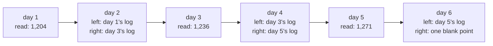

# Kan extensions: the best way to extend a functor along another, and why limits and adjoints are special cases

[Syllabus](../../../SYLLABUS.md) → [Computability and complexity](../README.md) → [Category Theory in Outline](../README.md#s07) → Kan extensions

---

## General Overview

An electricity meter is read on days 1, 3 and 5 of a week: 1,204 kWh, then 1,236 kWh, then 1,271 kWh. Days 2, 4 and 6 have no reading. The supplier's log still needs an entry for every day.

There are two honest ways to fill a gap. **Carry forward:** day 4 shows the log as it stood after day 3, so its newest reading is 1,236. **Carry back:** day 4 shows the log as it will stand at day 5, so its newest reading is 1,271. Data tools call these forward fill and back fill.

Category theory names both, and proves each is the *best* fill of its kind. Carrying forward is the **left Kan extension**. Carrying back is the **right Kan extension**. Each is built by one general recipe: glue together everything that comes before a day (a colimit), or everything that comes after it (a limit).

The recipe gives one surprise. At day 6 no later reading exists. Carrying back then gives neither the empty log nor day 5's log, but a set with exactly one blank element.

The same recipe, pointed at other shapes, produces the limits and colimits of [Universal properties](04-universal-properties-limits-and-colimits.md) and the adjoints of [Adjunctions](06-adjunctions.md). Mac Lane summed this up in a section title: "All concepts are Kan extensions".

**A Kan extension fills in a functor on new objects in the best possible way: the left one glues together everything that maps in from known objects, the right one gathers everything that agrees with the known objects ahead, and limits, colimits and adjoints are all extensions of this kind.**

**What kind of fact this is:** a Kan extension is a definition, by a universal property. The colimit and limit formulas for it are theorems, proved here for ordered sets and stated in general with their source, Mac Lane, Chapter X, Section 3. That limits and colimits are Kan extensions is a theorem proved on this card in Why it works. That adjoints are Kan extensions is a theorem proved here for orders and stated for all categories with its source, Mac Lane, Chapter X.

### The picture: one week, two fills



Schematic. Each arrow is "is earlier than". The left extension looks back along the arrows to the last reading; the right extension looks ahead to the next one.

---

## The formula

Notation from earlier on this shelf, in one line each. A **category** has objects and arrows that compose ([Categories and functors](01-categories-and-functors.md)). A **functor** sends objects to objects and arrows to arrows. A **natural transformation** $`\eta: F \Rightarrow G`$ (eta) is one arrow per object, from F's value to G's, that commutes with every arrow ([Natural transformations and Yoneda](03-natural-transformations-and-yoneda.md)).

An ordered set is a category with one arrow from $`a`$ to $`b`$ exactly when $`a \le b`$. So the days form two categories:

- $`A`$ = the reading days {1, 3, 5};
- $`B`$ = all the days {1, 2, 3, 4, 5, 6}.

$`K: A \to B`$ is the inclusion: it sends each reading day to itself. $`F: A \to \mathbf{Set}`$ sends a reading day to the log so far, the set of entries recorded up to that day. $`F(3)`$ = {d1: 1,204, d3: 1,236}. The arrow $`1 \le 3`$ goes to the inclusion of $`F(1)`$ into $`F(3)`$: the log only grows.

The two extensions, written with the card's new notation $`\mathrm{Lan}_K F`$ ("the left Kan extension of F along K") and $`\mathrm{Ran}_K F`$ (the right one):

```math
(\mathrm{Lan}_K F)(b) = \mathrm{colim}_{\,a \le b}\, F(a) \qquad\qquad (\mathrm{Ran}_K F)(b) = \lim_{\,a \ge b}\, F(a)
```

**Read it aloud:** on day b, the left extension glues together the logs of every reading day up to b, and the right extension gathers the logs of every reading day from b on into families that agree.

In a category that is not an ordered set, "reading days up to b" becomes the pairs (a, an arrow from $`K a`$ to b), with one copy of $`F(a)`$ for each such arrow, and the formula is otherwise the same. The two extensions are defined by what they do to natural maps:

```math
\mathrm{Nat}(\mathrm{Lan}_K F,\ G) \;\cong\; \mathrm{Nat}(F,\ G \circ K) \qquad\qquad \mathrm{Nat}(G \circ K,\ F) \;\cong\; \mathrm{Nat}(G,\ \mathrm{Ran}_K F)
```

**Read it aloud:** a natural map out of the left extension into any functor G on all six days is the same thing as a natural map out of F into G seen on reading days only; the right extension does the same for maps coming in.

Here $`\mathrm{Nat}(X, Y)`$ is the set of natural transformations from $`X`$ to $`Y`$, and $`\cong`$ means the two sets match one for one, naturally in G. This says $`\mathrm{Lan}_K`$ is left adjoint to "restrict to reading days" ([Adjunctions](06-adjunctions.md)), and $`\mathrm{Ran}_K`$ is its right adjoint.

| Symbol | Plain meaning | In our example | Push it up and the answer… |
| --- | --- | --- | --- |
| $`A`$, $`B`$ | the known objects; all objects | reading days {1, 3, 5}; days 1 to 6 | — |
| $`a`$, $`b`$ | a known object; any object | a reading day; any day | later b, longer left log |
| $`K: A \to B`$ | the functor to extend along | the inclusion of reading days | — |
| $`F: A \to \mathbf{Set}`$ | the functor known on $`A`$; $`\mathbf{Set}`$ is sets and functions | the log so far: 1, 2, 3 entries | — |
| $`G`$, $`G \circ K`$ | any functor on $`B`$; the same, read on $`A`$ only | three test functors | — |
| $`\mathrm{Lan}_K F`$, $`\mathrm{Ran}_K F`$ | left and right Kan extensions | carry forward; carry back | — |
| $`\mathrm{colim}`$, $`\lim`$ | glue a diagram together; gather agreeing families from it | day 6 left: 3 entries | — |
| $`\mathrm{Nat}(X, Y)`$, $`\cong`$ | natural maps from X to Y; one-for-one match | 27 on both sides for one G | — |
| $`\eta`$, $`\alpha`$, $`\beta`$, $`E`$, $`\iota_{a,b}`$ | natural maps; in the proof, E is $`\mathrm{Lan}_K F`$ and $`\iota_{a,b}`$ puts $`F(a)`$ into $`E(b)`$ | d1 goes to its class at day 4 | — |
| $`1`$, $`\ast`$, $`!: A \to 1`$ | the category with one object $`\ast`$ and one arrow; the only functor into it | everything sent to one point | — |
| $`L \dashv R`$, $`\mathrm{id}`$ | L left adjoint to R; the identity functor | $`3x \le y`$ exactly when $`x \le \lfloor y/3 \rfloor`$ | — |
| $`x`$, $`y`$, $`\lfloor y/3 \rfloor`$ | packs, boxes of space, y over 3 rounded down | 20 boxes hold 6 packs | — |

### When it holds

- **The target must have the colimits or limits the formula asks for.** Sets have all of them, so both extensions exist here. In a category missing them, the formula can fail while some other extension still exists, or none does.
- **The extension agrees with F on reading days because K is an inclusion that keeps every arrow.** The left extension at day 3 has 2 entries, day 3's own log. Extend along a functor that merges or drops arrows and the extension can differ from F on the old objects.
- **"Up to b" includes b.** Take only reading days strictly before b and day 3 gets 1 entry, not 2: the defining property then fails, with 1 natural map against 8 for one test functor.
- **Left and right are different answers.** At day 6 the left extension has 3 entries and the right one has 1 point. Neither is wrong; each is best in its own direction.

---

## Why it works

### Step 0: the best extension contains what is forced, and nothing else

Any functor $`G`$ on all six days that receives the readings must, on day 4, receive day 3's log, because $`3 \le 4`$ is an arrow. It need receive nothing more. So the smallest thing that does the job on day 4 is everything that maps in from reading days up to 4, with copies of the same entry glued together. That gluing is a colimit.

Turn every arrow round and the same thought gives the right extension, built from the reading days ahead.

### Step 1: compute the colimit and the limit

The left extension at day 6 starts from the disjoint union of $`F(1)`$, $`F(3)`$ and $`F(5)`$: 1 + 2 + 3 = 6 tagged entries. The arrows $`1 \le 3`$, $`3 \le 5`$ and $`1 \le 5`$ glue each entry to its copies. Three classes remain: d1, d3 and d5.

The right extension at day 2 starts from pairs (an entry of $`F(3)`$, an entry of $`F(5)`$): 2 × 3 = 6 pairs. It keeps the pairs that agree along $`3 \le 5`$, where the second entry is the first one carried forward. Two pairs remain: d1 with d1, and d3 with d3.

At day 6 no reading day lies ahead, so the limit is over nothing. The limit of nothing is the one-point set: exactly one empty family. Dually, if the calendar also had a day 0, before any reading, the left extension there would be the colimit of nothing: the empty set.

| Day | Left: entries, newest | Right: entries, newest |
| --- | --- | --- |
| 1 | 1, d1: 1,204 | 1, d1: 1,204 |
| 2 | 1, d1: 1,204 | 2, d3: 1,236 |
| 3 | 2, d3: 1,236 | 2, d3: 1,236 |
| 4 | 2, d3: 1,236 | 3, d5: 1,271 |
| 5 | 3, d5: 1,271 | 3, d5: 1,271 |
| 6 | 3, d5: 1,271 | 1 point, no reading |

### Step 2: in an order, a last element does all the work

Among the reading days up to 4, day 3 is the last, and every other one has an arrow into it. A diagram with a last object has that object's value as its colimit: every other entry is already glued to its copy there. So the left extension is "the log as of the last reading": carry forward. Dually, a diagram with a first object has that object's value as its limit: carry back. The code builds the general colimit and limit and checks both against this shortcut on every day.

### Step 3: the formula has the defining property

A natural map out of $`\mathrm{Lan}_K F`$ into $`G`$ is, on each day b, a map out of a colimit. A map out of a colimit is one map $`F(a) \to G(b)`$ for each reading day a up to b, all agreeing. Naturality in b forces each of them to be "map $`F(a)`$ into $`G(a)`$, then follow $`G`$'s arrow from a to b". So the whole thing is fixed by its maps on reading days, which is a natural map $`F \Rightarrow G \circ K`$.

<details>
<summary>Detailed proof: Nat(Lan F, G) matches Nat(F, G K)</summary>

Write $`E = \mathrm{Lan}_K F`$ (E for extension) and $`\iota_{a,b}: F(a) \to E(b)`$ for the colimit's inclusion, for each $`a \le b`$. Given $`\beta: E \Rightarrow G`$, set

$`\displaystyle \alpha_a = \beta_a \circ \iota_{a,a} : F(a) \to G(a).`$

For a reading-day arrow $`a \le a'`$, the colimit's maps satisfy $`\iota_{a',a'} \circ F(a \le a') = E(a \le a') \circ \iota_{a,a}`$, and $`\beta`$ is natural, so $`\alpha`$ is natural: $`\alpha: F \Rightarrow G \circ K`$.

Back the other way, given $`\alpha`$, define $`\beta_b`$ on the piece $`F(a)`$ of the colimit as $`G(a \le b) \circ \alpha_a`$. These pieces agree on glued entries because $`\alpha`$ is natural, so $`\beta_b`$ is well defined, and it is natural in b because $`G`$ is a functor.

The two constructions undo each other: $`\beta`$ is fixed by its values on every piece, and $`\iota_{a,b} = E(a \le b) \circ \iota_{a,a}`$ with naturality gives $`\beta_b \circ \iota_{a,b} = G(a \le b) \circ \alpha_a`$. The right extension's statement is the same proof with every arrow reversed. In a general category, replace "reading days up to b" by pairs (a, an arrow from K a to b); this is Mac Lane, Chapter X, Section 3.

</details>

The code counts both sides for three test functors G on the six days. For "a counter to 2" (three states each day, each day's arrow adds 1 and stops at 2), both sides of the left property have 27 natural maps and both sides of the right one have 9.

### Step 4: on its old objects, the extension is F again

At a reading day b, b itself is the last reading day up to b, so Step 2 gives $`(\mathrm{Lan}_K F)(b) = F(b)`$. This is why the readings survive the filling. It holds because K is an inclusion that keeps every arrow and adds none between old objects. In the table above, days 1, 3 and 5 have 1, 2 and 3 entries on both sides, as F does.

At the other extreme, K may be an equivalence ([Equivalence of categories](10-equivalence-of-categories.md)), with a functor back from B to A. Then restriction, which turns G into $`G \circ K`$, is undone, up to isomorphism, by composing with the functor back. An inverse of this kind is also a left adjoint, and the left extension is the left adjoint of restriction. So extending along an equivalence changes nothing essential: it only composes F with the functor back.

### Step 5: limits and colimits are Kan extensions

Take $`B = 1`$, one object with one arrow, and $`K = !`$, the only functor into it. Every reading day has an arrow into the one object, so the formula takes the colimit of all of F:

```math
(\mathrm{Lan}_{!} F)(\ast) = \mathrm{colim}\, F \qquad\qquad (\mathrm{Ran}_{!} F)(\ast) = \lim F
```

**Read it aloud:** extending a functor to a single point, from the left, is taking its colimit; from the right, its limit.

The defining property becomes the colimit's own universal property. A functor $`G`$ on the point is one set $`X`$, and $`G \circ !`$ is the constant functor at $`X`$. So natural maps from F to "always $`X`$" match functions from the colimit to $`X`$. With $`X`$ a 2-element set: the colimit has 3 entries, and the code counts 8 natural maps, which is $`2^3`$. The limit has 1 entry, and 1 natural map runs from "always $`X`$" into F, which is $`1^2`$.

### Step 6: adjoints are Kan extensions

If $`L \dashv R`$, then $`R`$ is the left Kan extension of the identity along $`L`$, and $`L`$ is the right Kan extension of the identity along $`R`$:

```math
R = \mathrm{Lan}_L\, \mathrm{id} \qquad\qquad L = \mathrm{Ran}_R\, \mathrm{id}
```

**Read it aloud:** the right adjoint is the best way to extend "do nothing" along the left adjoint, and the other way round.

On the whole numbers, with arrows "is at most", the colimit of a set of numbers is its largest member, and the limit its smallest. [Adjunctions](06-adjunctions.md) has $`3x \le y`$ exactly when $`x \le \lfloor y/3 \rfloor`$. The formula gives:

- $`(\mathrm{Lan}_{3x}\, \mathrm{id})(y)`$ = the largest x with $`3x \le y`$. For a van with room for 20 boxes, that is 6 packs, which is $`\lfloor 20/3 \rfloor`$.
- $`(\mathrm{Ran}_{\lfloor \cdot/3 \rfloor}\, \mathrm{id})(x)`$ = the smallest y with $`x \le \lfloor y/3 \rfloor`$. For 6 packs, that is 18 boxes, which is $`3 \times 6`$.

For orders the proof is one line. The colimit is the largest x with $`3x \le y`$; by the adjunction that is the largest x with $`x \le \lfloor y/3 \rfloor`$, which is $`\lfloor y/3 \rfloor`$ itself. The right case is the same with every inequality reversed. The code finds both by search and checks them against the adjoints for all 61 values from −30 to 30. For general categories this is in Mac Lane, Chapter X, Section 7, stated here without proof. That section's title, "All concepts are Kan extensions", is the slogan: limits, colimits, adjoints and the Yoneda lemma all come out of the one definition.

---

## Worked numbers, by hand

| Step | Arithmetic | Value |
| --- | --- | --- |
| the log so far | entries up to days 1, 3, 5 | 1, 2, 3 |
| left, day 4 | last reading day up to 4 is 3 | 2 entries, newest 1,236 |
| left, day 6, before gluing | 1 + 2 + 3 | 6 tagged entries |
| left, day 6, after gluing | one class per entry | **3 entries** |
| right, day 2, before agreement | 2 × 3 pairs | 6 |
| right, day 2, agreeing pairs | d1 with d1, d3 with d3 | **2** |
| right, day 6 | limit of nothing | **1 point** |
| colimit of F, natural maps to a 2-set | $`2^3`$ | 8 |
| right adjoint of 3x at y = 20, as a left extension | largest x with 3x at most 20 | **6** |

On day 4 the carried-forward log holds 2 entries with newest reading 1,236 kWh; the carried-back log holds 3, with newest 1,271 kWh.

### What breaks if you drop a piece

| Mistake | Comes out at | What went wrong |
| --- | --- | --- |
| Gluing forgotten at day 6 | 6 entries, not 3 | each reading counted once per later day |
| Agreement forgotten at day 2 | 6 pairs, not 2 | pairs that contradict each other kept |
| Strictly before b, not up to b | day 3 gets 1 entry, not 2; 1 natural map against 8 | the extension no longer agrees with F |
| Left and right swapped at day 6 | 3 entries against 1 point | carry forward is not carry back |

The code prints all four.

---

## Code, from first principles, and it actually runs

The code writes each functor on an ordered set as a set per day and a map per arrow. It takes three roads to each extension. First, the general colimit (a disjoint union glued by a union-find) and the general limit (agreeing tuples). Second, the shortcut: the last or next reading day. Third, the defining property: it counts natural maps on both sides by running along the chain of days, for three test functors. It then extends to one point to get the colimit and limit, and extends the identity along an adjoint.

### Python

```python
# Kan extensions -- the check behind the card.  Nothing is imported.
# A meter is read on days 1, 3 and 5.  F sends each reading day to the log so
# far.  An order is a category with one arrow from a to b when a <= b, so a
# functor on it is a set for each day and a map for each a <= b.  The left and
# right Kan extensions along days {1, 3, 5} -> days 1..6 are built from the
# general colimit and limit, checked against the last-or-next-reading shortcut,
# and checked by their defining property: natural maps counted on both sides.
READ = {1: 1204, 3: 1236, 5: 1271}                     # meter readings, kWh
A, B = [1, 3, 5], [1, 2, 3, 4, 5, 6]
F = {a: [f"d{d}:{READ[d]}" for d in A if d <= a] for a in A}   # log so far
keep = lambda j, k, x: x                               # F(j <= k): the log only grows

def colim(J, S, fmap):          # disjoint union of S[j], glued along every j <= k
    root = {(j, x): (j, x) for j in J for x in S[j]}
    def find(e):
        while root[e] != e:
            e = root[e]
        return e
    for j in J:
        for k in J:
            if j < k:
                for x in S[j]:
                    root[find((j, x))] = find((k, fmap(j, k, x)))
    cls = {}
    for e in root:
        cls.setdefault(find(e), []).append(f"{e[0]}/{e[1]}")
    return sorted("+".join(sorted(c)) for c in cls.values())

def lim(J, S, fmap):            # tuples, one entry per j, that agree along every j <= k
    tups = [[]]
    for j in J:
        tups = [t + [(j, x)] for t in tups for x in S[j]]
    good = [t for t in tups if all(fmap(j, k, x) == y for j, x in t for k, y in t if j < k)]
    return [",".join(f"{j}/{x}" for j, x in t) or "*" for t in good]

def lan(J0, S, fmap, strict=False):                    # left extension along J0 -> B
    sets = {b: colim([a for a in J0 if a < b or (a == b and not strict)], S, fmap) for b in B}
    def m(b, c, x):                                    # a class at b lies in one class at c
        return next(y for y in sets[c] if x.split("+")[0] in y.split("+"))
    return sets, m

def ran(J0, S, fmap):                                  # right extension along J0 -> B
    sets = {b: lim([a for a in J0 if a >= b], S, fmap) for b in B}
    def m(b, c, x):                                    # forget the entries for days before c
        return ",".join(p for p in x.split(",") if p != "*" and int(p.split("/")[0]) >= c) or "*"
    return sets, m

def funcs(X, Y):                                       # every function X -> Y, as image tuples
    out = [()]
    for _ in X:
        out = [f + (y,) for f in out for y in Y]
    return out

def nat(objs, X, xm, Y, ym):    # count natural maps X => Y on a chain of objects
    ways = {f: 1 for f in funcs(X[objs[0]], Y[objs[0]])}
    for c, d in zip(objs, objs[1:]):
        new = {}
        for g in funcs(X[d], Y[d]):
            n = sum(w for f, w in ways.items()
                    if all(ym(c, d, f[i]) == g[X[d].index(xm(c, d, x))] for i, x in enumerate(X[c])))
            if n:
                new[g] = n
        ways = new
    return sum(ways.values())

def test_functor(size, step):                          # G on days 1..6 from one-day steps
    S = {b: [str(v) for v in range(size(b))] for b in B}
    def m(b, c, x):
        for d in range(b, c):
            x = str(step(d, int(x)))
        return x
    return S, m

TESTS = [("two states, held", test_functor(lambda b: 2, lambda d, v: v)),
         ("counter to 2", test_functor(lambda b: 3, lambda d, v: min(v + 1, 2))),
         ("2 states on odd days, 1 on even", test_functor(lambda b: 1 + b % 2, lambda d, v: 0))]
ent = lambda n: f"{n} entry" if n == 1 else f"{n} entries"
label = lambda c: c.replace(",", "+").split("+")[0].split("/")[1]   # the entry a class carries

L, Lm = lan(A, F, keep)
R, Rm = ran(A, F, keep)
print("== the readings: F sends a reading day to the log so far ==")
for a in A:
    print(f"F({a}) = {F[a]}")
print("== the extensions to every day, by the colimit and limit formulas ==")
for b in B:
    last, nxt = max(a for a in A if a <= b), [a for a in A if a >= b]
    lab_l, lab_r = sorted(label(c) for c in L[b]), sorted(label(c) for c in R[b] if c != "*")
    r = f"{ent(len(R[b]))}, newest {lab_r[-1]}" if nxt else f"{len(R[b])} point, no reading"
    print(f"day {b}: left {ent(len(L[b]))}, newest {lab_l[-1]} | right {r}")
    assert lab_l == F[last] and len(lab_l) == len(L[b])                  # shortcut: last reading
    assert (lab_r == F[nxt[0]] and len(lab_r) == len(R[b])) if nxt else R[b] == ["*"]
print(f"day 0, before any reading: left {ent(len(colim([], F, keep)))} (the empty set)")
print("== the defining property: natural maps counted on both sides ==")
GK = lambda S: {a: S[a] for a in A}
for name, (S, m) in TESTS:
    l1, l2 = nat(B, L, Lm, S, m), nat(A, F, keep, GK(S), m)
    r1, r2 = nat(A, GK(S), m, F, keep), nat(B, S, m, R, Rm)
    print(f"G = {name}: Nat(Lan F, G) = {l1}, Nat(F, G K) = {l2}; Nat(G K, F) = {r1}, Nat(G, Ran F) = {r2}")
    assert l1 == l2 and r1 == r2                                         # the two adjunctions
print("== limits and colimits: extend along the functor to one point ==")
X = {a: ["0", "1"] for a in A}
cf, lf = colim(A, F, keep), lim(A, F, keep)
print(f"colimit of F: {ent(len(cf))}; Nat(F, constant 2-set) = {nat(A, F, keep, X, keep)} = 2^{len(cf)}")
print(f"limit of F: {ent(len(lf))}; Nat(constant 2-set, F) = {nat(A, X, keep, F, keep)} = {len(lf)}^2")
assert nat(A, F, keep, X, keep) == 2 ** len(cf) and nat(A, X, keep, F, keep) == len(lf) ** 2
print("== adjoints: 3x <= y exactly when x <= floor(y/3) ==")
grid = range(-30, 31)
lan_id = {y: max(x for x in range(-100, 101) if 3 * x <= y) for y in grid}   # Lan along 3x
ran_id = {x: min(y for y in range(-100, 101) if x <= y // 3) for x in grid}  # Ran along floor
print(f"left extension of the identity along 3x, at y = 20: {lan_id[20]} packs")
print(f"right extension of the identity along floor(y/3), at x = 6: {ran_id[6]} boxes")
ok_l, ok_r = all(lan_id[y] == y // 3 for y in grid), all(ran_id[x] == 3 * x for x in grid)
print(f"equals floor(y/3) on all {len(grid)} y: {'yes' if ok_l else 'no'}; equals 3x on all {len(grid)} x: {'yes' if ok_r else 'no'}")
assert ok_l and ok_r and lan_id[20] == 6 and ran_id[6] == 18
print("== what breaks ==")
glued = sum(len(F[a]) for a in A)
print(f"glue forgotten at day 6: {ent(glued)}, not {len(L[6])}")
print(f"agreement forgotten at day 2: {len(F[3]) * len(F[5])} tuples, not {len(R[2])}")
Ls, Lsm = lan(A, F, keep, strict=True)
S, m = TESTS[2][1]
print(f"strict a < b: day 3 gets {ent(len(Ls[3]))}, not {len(L[3])}; with G = {TESTS[2][0]}, "
      f"Nat(strict, G) = {nat(B, Ls, Lsm, S, m)} against Nat(F, G K) = {nat(A, F, keep, GK(S), m)}")
print(f"left and right swapped at day 6: {ent(len(L[6]))} against {len(R[6])} point")
assert glued == 6 and len(L[6]) == 3 and len(R[2]) == 2 and len(Ls[3]) == 1
assert nat(B, Ls, Lsm, S, m) != nat(A, F, keep, GK(S), m)
print("ALL CHECKS PASS")
```

**Ran 2026-11-24 on macOS, Python 3.14.10, standard library only. All checks passed. Output, pasted from the run:**

```
== the readings: F sends a reading day to the log so far ==
F(1) = ['d1:1204']
F(3) = ['d1:1204', 'd3:1236']
F(5) = ['d1:1204', 'd3:1236', 'd5:1271']
== the extensions to every day, by the colimit and limit formulas ==
day 1: left 1 entry, newest d1:1204 | right 1 entry, newest d1:1204
day 2: left 1 entry, newest d1:1204 | right 2 entries, newest d3:1236
day 3: left 2 entries, newest d3:1236 | right 2 entries, newest d3:1236
day 4: left 2 entries, newest d3:1236 | right 3 entries, newest d5:1271
day 5: left 3 entries, newest d5:1271 | right 3 entries, newest d5:1271
day 6: left 3 entries, newest d5:1271 | right 1 point, no reading
day 0, before any reading: left 0 entries (the empty set)
== the defining property: natural maps counted on both sides ==
G = two states, held: Nat(Lan F, G) = 8, Nat(F, G K) = 8; Nat(G K, F) = 1, Nat(G, Ran F) = 1
G = counter to 2: Nat(Lan F, G) = 27, Nat(F, G K) = 27; Nat(G K, F) = 9, Nat(G, Ran F) = 9
G = 2 states on odd days, 1 on even: Nat(Lan F, G) = 8, Nat(F, G K) = 8; Nat(G K, F) = 3, Nat(G, Ran F) = 3
== limits and colimits: extend along the functor to one point ==
colimit of F: 3 entries; Nat(F, constant 2-set) = 8 = 2^3
limit of F: 1 entry; Nat(constant 2-set, F) = 1 = 1^2
== adjoints: 3x <= y exactly when x <= floor(y/3) ==
left extension of the identity along 3x, at y = 20: 6 packs
right extension of the identity along floor(y/3), at x = 6: 18 boxes
equals floor(y/3) on all 61 y: yes; equals 3x on all 61 x: yes
== what breaks ==
glue forgotten at day 6: 6 entries, not 3
agreement forgotten at day 2: 6 tuples, not 2
strict a < b: day 3 gets 1 entry, not 2; with G = 2 states on odd days, 1 on even, Nat(strict, G) = 1 against Nat(F, G K) = 8
left and right swapped at day 6: 3 entries against 1 point
ALL CHECKS PASS
```

### Rust

Same numbers, same labels, built with `rustc --edition 2021 -O`.

```rust
// Kan extensions -- the same check as the Python, in Rust.  No crates.
// A meter is read on days 1, 3 and 5.  F sends each reading day to the log so
// far.  An order is a category with one arrow from a to b when a <= b, so a
// functor on it is a set for each day and a map for each a <= b.  The left and
// right Kan extensions along days {1, 3, 5} -> days 1..6 are built from the
// general colimit and limit, checked against the last-or-next-reading shortcut,
// and checked by their defining property: natural maps counted on both sides.
use std::collections::BTreeMap;

type Sets = BTreeMap<i64, Vec<String>>;
type Map = Box<dyn Fn(i64, i64, &str) -> String>;
const A: [i64; 3] = [1, 3, 5];
const B: [i64; 6] = [1, 2, 3, 4, 5, 6];

fn keep(_j: i64, _k: i64, x: &str) -> String { x.to_string() } // F(j <= k): the log only grows

fn find(root: &[usize], mut e: usize) -> usize { while root[e] != e { e = root[e] } e }

fn colim(jj: &[i64], s: &Sets, fmap: &dyn Fn(i64, i64, &str) -> String) -> Vec<String> {
    // disjoint union of s[j], glued along every j <= k
    let elems: Vec<(i64, String)> = jj.iter().flat_map(|&j| s[&j].iter().map(move |x| (j, x.clone()))).collect();
    let mut root: Vec<usize> = (0..elems.len()).collect();
    for &j in jj { for &k in jj { if j < k { for x in &s[&j] {
        let a = elems.iter().position(|e| e.0 == j && &e.1 == x).unwrap();
        let b = elems.iter().position(|e| e.0 == k && e.1 == fmap(j, k, x)).unwrap();
        let ra = find(&root, a);
        root[ra] = find(&root, b);
    }}}}
    let mut cls: BTreeMap<usize, Vec<String>> = BTreeMap::new();
    for (i, e) in elems.iter().enumerate() { cls.entry(find(&root, i)).or_default().push(format!("{}/{}", e.0, e.1)) }
    let mut out: Vec<String> = cls.into_values().map(|mut c| { c.sort(); c.join("+") }).collect();
    out.sort();
    out
}

fn lim(jj: &[i64], s: &Sets, fmap: &dyn Fn(i64, i64, &str) -> String) -> Vec<String> {
    // tuples, one entry per j, that agree along every j <= k
    let mut tups: Vec<Vec<(i64, String)>> = vec![vec![]];
    for &j in jj {
        tups = tups.iter().flat_map(|t| s[&j].iter().map(move |x| { let mut u = t.clone(); u.push((j, x.clone())); u })).collect();
    }
    tups.iter().filter(|t| t.iter().all(|(j, x)| t.iter().all(|(k, y)| j >= k || fmap(*j, *k, x) == *y)))
        .map(|t| t.iter().map(|(j, x)| format!("{}/{}", j, x)).collect::<Vec<_>>().join(","))
        .map(|s| if s.is_empty() { "*".to_string() } else { s }).collect()
}

fn lan(j0: &[i64], s: &Sets, strict: bool) -> (Sets, Map) { // left extension along j0 -> B
    let mut sets = Sets::new();
    for b in B {
        let jj: Vec<i64> = j0.iter().copied().filter(|&a| a < b || (a == b && !strict)).collect();
        sets.insert(b, colim(&jj, s, &keep));
    }
    let c2 = sets.clone();
    (sets, Box::new(move |_b, c, x| { // a class at b lies in one class at c
        let first = x.split('+').next().unwrap();
        c2[&c].iter().find(|y| y.split('+').any(|p| p == first)).unwrap().clone()
    }))
}

fn ran(j0: &[i64], s: &Sets) -> (Sets, Map) { // right extension along j0 -> B
    let mut sets = Sets::new();
    for b in B {
        let jj: Vec<i64> = j0.iter().copied().filter(|&a| a >= b).collect();
        sets.insert(b, lim(&jj, s, &keep));
    }
    (sets, Box::new(|_b, c, x| { // forget the entries for days before c
        let k: Vec<&str> = x.split(',')
            .filter(|p| *p != "*" && p.split('/').next().unwrap().parse::<i64>().unwrap() >= c).collect();
        if k.is_empty() { "*".to_string() } else { k.join(",") }
    }))
}

fn funcs(x: &[String], y: &[String]) -> Vec<Vec<String>> { // every function x -> y, as image lists
    let mut out: Vec<Vec<String>> = vec![vec![]];
    for _ in x { // one more argument: every earlier function, extended by every value
        out = out.iter().flat_map(|f| y.iter().map(move |v| { let mut g = f.clone(); g.push(v.clone()); g })).collect();
    }
    out
}

fn nat(objs: &[i64], xs: &Sets, xm: &dyn Fn(i64, i64, &str) -> String,
       ys: &Sets, ym: &dyn Fn(i64, i64, &str) -> String) -> u64 { // count natural maps on a chain
    let mut ways: BTreeMap<Vec<String>, u64> = funcs(&xs[&objs[0]], &ys[&objs[0]]).into_iter().map(|f| (f, 1)).collect();
    for w in objs.windows(2) {
        let (c, d) = (w[0], w[1]);
        let mut new = BTreeMap::new();
        for g in funcs(&xs[&d], &ys[&d]) {
            let n: u64 = ways.iter().filter(|(f, _)| xs[&c].iter().enumerate().all(|(i, x)| {
                let at = xs[&d].iter().position(|z| *z == xm(c, d, x)).unwrap();
                ym(c, d, &f[i]) == g[at]
            })).map(|(_, w)| w).sum();
            if n > 0 { new.insert(g, n); }
        }
        ways = new;
    }
    ways.values().sum()
}

fn test_functor(size: fn(i64) -> i64, step: fn(i64, i64) -> i64) -> (Sets, Map) { // G from one-day steps
    let sets = B.iter().map(|&b| (b, (0..size(b)).map(|v| v.to_string()).collect())).collect();
    (sets, Box::new(move |b, c, x| { let mut v: i64 = x.parse().unwrap(); for d in b..c { v = step(d, v) } v.to_string() }))
}

fn ent(n: usize) -> String { if n == 1 { format!("{} entry", n) } else { format!("{} entries", n) } }
fn label(c: &str) -> String { c.replace(',', "+").split('+').next().unwrap().split('/').nth(1).unwrap().to_string() }
fn yn(b: bool) -> &'static str { if b { "yes" } else { "no" } }

fn main() {
    let read = |d: i64| match d { 1 => 1204, 3 => 1236, _ => 1271 }; // meter readings, kWh
    let f: Sets = A.iter().map(|&a| (a, A.iter().filter(|&&d| d <= a).map(|&d| format!("d{}:{}", d, read(d))).collect())).collect();
    let tests: Vec<(&str, (Sets, Map))> = vec![
        ("two states, held", test_functor(|_| 2, |_, v| v)),
        ("counter to 2", test_functor(|_| 3, |_, v| (v + 1).min(2))),
        ("2 states on odd days, 1 on even", test_functor(|b| 1 + b % 2, |_, _| 0))];
    let (l, lm) = lan(&A, &f, false);
    let (r, rm) = ran(&A, &f);
    println!("== the readings: F sends a reading day to the log so far ==");
    for a in A { println!("F({}) = [{}]", a, f[&a].iter().map(|s| format!("'{}'", s)).collect::<Vec<_>>().join(", ")) }
    println!("== the extensions to every day, by the colimit and limit formulas ==");
    for b in B {
        let last = *A.iter().filter(|&&a| a <= b).max().unwrap();
        let nxt: Vec<i64> = A.iter().copied().filter(|&a| a >= b).collect();
        let (mut lab_l, mut lab_r): (Vec<String>, Vec<String>) =
            (l[&b].iter().map(|c| label(c)).collect(), r[&b].iter().filter(|c| *c != "*").map(|c| label(c)).collect());
        (lab_l.sort(), lab_r.sort());
        let rs = if !nxt.is_empty() { format!("{}, newest {}", ent(r[&b].len()), lab_r.last().unwrap()) }
                 else { format!("{} point, no reading", r[&b].len()) };
        println!("day {}: left {}, newest {} | right {}", b, ent(l[&b].len()), lab_l.last().unwrap(), rs);
        assert!(lab_l == f[&last] && lab_l.len() == l[&b].len()); // shortcut: last reading
        assert!(if !nxt.is_empty() { lab_r == f[&nxt[0]] && lab_r.len() == r[&b].len() } else { r[&b] == vec!["*".to_string()] });
    }
    println!("day 0, before any reading: left {} (the empty set)", ent(colim(&[], &f, &keep).len()));
    println!("== the defining property: natural maps counted on both sides ==");
    let gk = |s: &Sets| -> Sets { A.iter().map(|&a| (a, s[&a].clone())).collect() };
    for (name, (s, m)) in &tests {
        let (l1, l2) = (nat(&B, &l, &*lm, s, &**m), nat(&A, &f, &keep, &gk(s), &**m));
        let (r1, r2) = (nat(&A, &gk(s), &**m, &f, &keep), nat(&B, s, &**m, &r, &*rm));
        println!("G = {}: Nat(Lan F, G) = {}, Nat(F, G K) = {}; Nat(G K, F) = {}, Nat(G, Ran F) = {}", name, l1, l2, r1, r2);
        assert!(l1 == l2 && r1 == r2); // the two adjunctions
    }
    println!("== limits and colimits: extend along the functor to one point ==");
    let x: Sets = A.iter().map(|&a| (a, vec!["0".to_string(), "1".to_string()])).collect();
    let (cf, lf) = (colim(&A, &f, &keep), lim(&A, &f, &keep));
    let (to2, from2) = (nat(&A, &f, &keep, &x, &keep), nat(&A, &x, &keep, &f, &keep));
    println!("colimit of F: {}; Nat(F, constant 2-set) = {} = 2^{}", ent(cf.len()), to2, cf.len());
    println!("limit of F: {}; Nat(constant 2-set, F) = {} = {}^2", ent(lf.len()), from2, lf.len());
    assert!(to2 == 1u64 << cf.len() && from2 == (lf.len() * lf.len()) as u64);
    println!("== adjoints: 3x <= y exactly when x <= floor(y/3) ==");
    let lan_id = |y: i64| (-100..101).filter(|x| 3 * x <= y).max().unwrap(); // Lan along 3x
    let ran_id = |x: i64| (-100..101i64).filter(|y| x <= y.div_euclid(3)).min().unwrap(); // Ran along floor
    println!("left extension of the identity along 3x, at y = 20: {} packs", lan_id(20));
    println!("right extension of the identity along floor(y/3), at x = 6: {} boxes", ran_id(6));
    let (ok_l, ok_r) = ((-30..31i64).all(|y| lan_id(y) == y.div_euclid(3)), (-30..31i64).all(|x| ran_id(x) == 3 * x));
    println!("equals floor(y/3) on all {} y: {}; equals 3x on all {} x: {}", 61, yn(ok_l), 61, yn(ok_r));
    assert!(ok_l && ok_r && lan_id(20) == 6 && ran_id(6) == 18);
    println!("== what breaks ==");
    let glued: usize = A.iter().map(|a| f[a].len()).sum();
    println!("glue forgotten at day 6: {}, not {}", ent(glued), l[&6].len());
    println!("agreement forgotten at day 2: {} tuples, not {}", f[&3].len() * f[&5].len(), r[&2].len());
    let (ls, lsm) = lan(&A, &f, true);
    let (tname, (s, m)) = &tests[2];
    let (n1, n2) = (nat(&B, &ls, &*lsm, s, &**m), nat(&A, &f, &keep, &gk(s), &**m));
    println!("strict a < b: day 3 gets {}, not {}; with G = {}, Nat(strict, G) = {} against Nat(F, G K) = {}",
             ent(ls[&3].len()), l[&3].len(), tname, n1, n2);
    println!("left and right swapped at day 6: {} against {} point", ent(l[&6].len()), r[&6].len());
    assert!(glued == 6 && l[&6].len() == 3 && r[&2].len() == 2 && ls[&3].len() == 1);
    assert!(n1 != n2);
    println!("ALL CHECKS PASS");
}
```

**Ran 2026-11-24 on macOS, rustc 1.98.1, no crates. All checks passed. Output, pasted from the run:**

```
== the readings: F sends a reading day to the log so far ==
F(1) = ['d1:1204']
F(3) = ['d1:1204', 'd3:1236']
F(5) = ['d1:1204', 'd3:1236', 'd5:1271']
== the extensions to every day, by the colimit and limit formulas ==
day 1: left 1 entry, newest d1:1204 | right 1 entry, newest d1:1204
day 2: left 1 entry, newest d1:1204 | right 2 entries, newest d3:1236
day 3: left 2 entries, newest d3:1236 | right 2 entries, newest d3:1236
day 4: left 2 entries, newest d3:1236 | right 3 entries, newest d5:1271
day 5: left 3 entries, newest d5:1271 | right 3 entries, newest d5:1271
day 6: left 3 entries, newest d5:1271 | right 1 point, no reading
day 0, before any reading: left 0 entries (the empty set)
== the defining property: natural maps counted on both sides ==
G = two states, held: Nat(Lan F, G) = 8, Nat(F, G K) = 8; Nat(G K, F) = 1, Nat(G, Ran F) = 1
G = counter to 2: Nat(Lan F, G) = 27, Nat(F, G K) = 27; Nat(G K, F) = 9, Nat(G, Ran F) = 9
G = 2 states on odd days, 1 on even: Nat(Lan F, G) = 8, Nat(F, G K) = 8; Nat(G K, F) = 3, Nat(G, Ran F) = 3
== limits and colimits: extend along the functor to one point ==
colimit of F: 3 entries; Nat(F, constant 2-set) = 8 = 2^3
limit of F: 1 entry; Nat(constant 2-set, F) = 1 = 1^2
== adjoints: 3x <= y exactly when x <= floor(y/3) ==
left extension of the identity along 3x, at y = 20: 6 packs
right extension of the identity along floor(y/3), at x = 6: 18 boxes
equals floor(y/3) on all 61 y: yes; equals 3x on all 61 x: yes
== what breaks ==
glue forgotten at day 6: 6 entries, not 3
agreement forgotten at day 2: 6 tuples, not 2
strict a < b: day 3 gets 1 entry, not 2; with G = 2 states on odd days, 1 on even, Nat(strict, G) = 1 against Nat(F, G K) = 8
left and right swapped at day 6: 3 entries against 1 point
ALL CHECKS PASS
```

The two outputs match line for line.

### Lean

Lean proves the formula and Steps 5 and 6 for all categories, and checks the card's worked numbers.

- Take functors $`K: A \to B`$ and $`F`$ on $`A`$ whose target has every colimit the formula asks for. Then the colimit formula gives $`\mathrm{Lan}_K F`$, with its defining property for every test functor $`G`$.
- Suppose instead the target has every limit the formula asks for. Then the limit formula gives $`\mathrm{Ran}_K F`$, with its defining property for every $`G`$.
- Take any functor $`F`$, and an object with one map from each $`F(a)`$, all agreeing. Then that object is the colimit of $`F`$ exactly when it is $`\mathrm{Lan}_{!} F`$.
- The same holds with every arrow reversed: the limit of $`F`$ is exactly $`\mathrm{Ran}_{!} F`$.
- Suppose $`L \dashv R`$. Then $`R = \mathrm{Lan}_L\, \mathrm{id}`$ and $`L = \mathrm{Ran}_R\, \mathrm{id}`$.
- Carried forward, days 1 to 6 hold 1, 1, 2, 2, 3, 3 entries.
- Carried back, days 1 to 5 hold 1, 2, 2, 3, 3 entries, and day 6 has no reading ahead.
- Day 6 starts from $`1 + 2 + 3 = 6`$ tagged entries, and day 2 from $`2 \times 3 = 6`$ pairs.
- For a 2-element set, the colimit's 3 entries give $`2^3 = 8`$, and the limit's 1 entry gives $`1^2 = 1`$.
- A van of 20 boxes holds 6 packs of 3, since $`\lfloor 20/3 \rfloor = 6`$, and 6 packs need 18 boxes.
- Take any $`x`$ and $`y`$ from −30 to 30. Then $`3x \le y`$ exactly when $`x \le \lfloor y/3 \rfloor`$.

Building the day-by-day sets, counting natural maps one by one, and printing the four mistakes are left to the Python and Rust checks.

```lean
-- Kan extensions: the colimit and limit formulas give left and right Kan extensions with their defining property, limits and colimits are Kan extensions to one point, and adjoints are Kan extensions of the identity.
import Mathlib.CategoryTheory.Functor.KanExtension.Pointwise
import Mathlib.CategoryTheory.Adjunction.Basic
import Mathlib.CategoryTheory.PUnit
import Mathlib.Data.List.Basic

open CategoryTheory CategoryTheory.Limits CategoryTheory.Functor

universe w

theorem kanCheck_isLeftKanExtension_of_bijective
    {C D H : Type*} [Category* C] [Category* D] [Category* H]
    {L : C ⥤ D} {F : C ⥤ H} {F' : D ⥤ H} (α : F ⟶ L ⋙ F')
    (h : ∀ G : D ⥤ H, Function.Bijective (fun β : F' ⟶ G => α ≫ whiskerLeft L β)) :
    F'.IsLeftKanExtension α := by
  choose β hβ using fun G : LeftExtension L F => (h G.right).2 G.hom
  refine ⟨⟨IsInitial.ofUniqueHom
    (fun G => StructuredArrow.homMk (β G) ?_) ?_⟩⟩
  · simpa using hβ G
  · intro G m
    ext1
    apply (h G.right).1
    refine Eq.trans ?_ (hβ G).symm
    simpa using m.w

theorem kanCheck_isRightKanExtension_of_bijective
    {C D H : Type*} [Category* C] [Category* D] [Category* H]
    {L : C ⥤ D} {F : C ⥤ H} {F' : D ⥤ H} (α : L ⋙ F' ⟶ F)
    (h : ∀ G : D ⥤ H, Function.Bijective (fun β : G ⟶ F' => whiskerLeft L β ≫ α)) :
    F'.IsRightKanExtension α := by
  choose β hβ using fun G : RightExtension L F => (h G.left).2 G.hom
  refine ⟨⟨IsTerminal.ofUniqueHom
    (fun G => CostructuredArrow.homMk (β G) ?_) ?_⟩⟩
  · simpa using hβ G
  · intro G m
    ext1
    apply (h G.left).1
    refine Eq.trans ?_ (hβ G).symm
    simpa using m.w

#print axioms kanCheck_isLeftKanExtension_of_bijective
#print axioms kanCheck_isRightKanExtension_of_bijective

/-- The colimit and limit formulas give the Kan extensions. Let `K : A ⥤ B` be the functor to
extend along and `F : A ⥤ H` the functor known on `A`. If the target `H` has, for each object
`b` of `B`, the colimit of `F` over the pairs (`a`, an arrow `K a ⟶ b`), then some `E : B ⥤ H`
with `α : F ⟶ K ⋙ E` has `E b` equal to that colimit for every `b` (the colimit formula), and
natural maps `E ⟶ G` match natural maps `F ⟶ K ⋙ G` one for one for every functor `G` on `B`
(the defining property of the left Kan extension `Lan_K F`). Dually, if `H` has the limits over
the pairs (`a`, an arrow `b ⟶ K a`), the limit formula gives `E` with `α : K ⋙ E ⟶ F`, and
natural maps `G ⟶ E` match natural maps `K ⋙ G ⟶ F` one for one (the right Kan extension
`Ran_K F`). -/
theorem kan_extensions_by_colimit_and_limit_formulas
    {A B H : Type*} [Category* A] [Category* B] [Category* H]
    (K : A ⥤ B) (F : A ⥤ H) :
    (HasPointwiseLeftKanExtension K F →
      ∃ (E : B ⥤ H) (α : F ⟶ K ⋙ E),
        (∀ b : B, Nonempty (IsColimit ((LeftExtension.mk E α).coconeAt b))) ∧
        ∀ G : B ⥤ H, Function.Bijective (fun β : E ⟶ G => α ≫ whiskerLeft K β)) ∧
    (HasPointwiseRightKanExtension K F →
      ∃ (E : B ⥤ H) (α : K ⋙ E ⟶ F),
        (∀ b : B, Nonempty (IsLimit ((RightExtension.mk E α).coneAt b))) ∧
        ∀ G : B ⥤ H, Function.Bijective (fun β : G ⟶ E => whiskerLeft K β ≫ α)) := by
  refine ⟨fun _ => ?_, fun _ => ?_⟩
  · refine ⟨pointwiseLeftKanExtension K F, pointwiseLeftKanExtensionUnit K F,
      fun b => ⟨pointwiseLeftKanExtensionIsPointwiseLeftKanExtension K F b⟩,
      fun G => ?_⟩
    exact (homEquivOfIsLeftKanExtension _ (pointwiseLeftKanExtensionUnit K F) G).bijective
  · refine ⟨pointwiseRightKanExtension K F, pointwiseRightKanExtensionCounit K F,
      fun b => ⟨pointwiseRightKanExtensionIsPointwiseRightKanExtension K F b⟩,
      fun G => ?_⟩
    exact (homEquivOfIsRightKanExtension _ (pointwiseRightKanExtensionCounit K F) G).bijective

/-- Limits and colimits are Kan extensions along the only functor `! : A ⥤ 1` to the category
with one object. A cocone `c` on `F` (the point `c.pt`, seen as a functor on the one-object
category, with the cocone's legs as the map `F ⟶ ! ⋙ c.pt`) is a colimit of `F` exactly when
it is the left Kan extension of `F` along `!`; a cone `d` on `F` is a limit of `F` exactly when
it is the right Kan extension of `F` along `!`. -/
theorem limits_and_colimits_are_kan_extensions_to_a_point
    {A H : Type*} [Category* A] [Category* H] (F : A ⥤ H) (c : Cocone F) (d : Cone F) :
    (Nonempty (IsColimit c) ↔
      ((Functor.const (Discrete PUnit.{w + 1})).obj c.pt).IsLeftKanExtension
        (L := Functor.star A) (c.ι : F ⟶ Functor.star A ⋙ (Functor.const _).obj c.pt)) ∧
    (Nonempty (IsLimit d) ↔
      ((Functor.const (Discrete PUnit.{w + 1})).obj d.pt).IsRightKanExtension
        (L := Functor.star A) (d.π : Functor.star A ⋙ (Functor.const _).obj d.pt ⟶ F)) := by
  refine ⟨⟨?_, ?_⟩, ⟨?_, ?_⟩⟩
  · rintro ⟨hc⟩
    apply kanCheck_isLeftKanExtension_of_bijective
    intro G
    constructor
    · intro β₁ β₂ hβ
      have key : β₁.app ⟨⟨⟩⟩ = β₂.app ⟨⟨⟩⟩ := hc.hom_ext (fun j => by
        simpa using congr_app hβ j)
      ext ⟨⟨⟩⟩
      exact key
    · intro γ
      let s : Cocone F :=
        { pt := G.obj ⟨⟨⟩⟩
          ι := { app := fun j => γ.app j
                 naturality := by
                   intro j j' f
                   have h := γ.naturality f
                   dsimp at h ⊢
                   rw [h]
                   simp [Functor.star] } }
      refine ⟨{ app := fun _ => hc.desc s
                naturality := ?_ }, ?_⟩
      · rintro ⟨⟨⟩⟩ ⟨⟨⟩⟩ f
        obtain rfl : f = 𝟙 _ := Subsingleton.elim _ _
        simp
      · ext j
        simp [s]
  · intro hK
    let δ : ∀ s : Cocone F, (Functor.const (Discrete PUnit.{w + 1})).obj c.pt ⟶
        (Functor.const (Discrete PUnit.{w + 1})).obj s.pt := fun s =>
      descOfIsLeftKanExtension (L := Functor.star A) _ c.ι _ s.ι
    refine ⟨{ desc := fun s => (δ s).app ⟨⟨⟩⟩, fac := fun s j => ?_, uniq := fun s m hm => ?_ }⟩
    · exact descOfIsLeftKanExtension_fac_app (L := Functor.star A)
            ((Functor.const (Discrete PUnit.{w + 1})).obj c.pt) c.ι
            ((Functor.const (Discrete PUnit.{w + 1})).obj s.pt) s.ι j
    · have e : (Functor.const (Discrete PUnit.{w + 1})).map m = δ s :=
        hom_ext_of_isLeftKanExtension (L := Functor.star A) _ c.ι _ _ (by
          ext j
          have h2 := descOfIsLeftKanExtension_fac_app (L := Functor.star A)
            ((Functor.const (Discrete PUnit.{w + 1})).obj c.pt) c.ι
            ((Functor.const (Discrete PUnit.{w + 1})).obj s.pt) s.ι j
          dsimp [δ] at h2 ⊢
          rw [hm j, h2])
      exact congr_app e ⟨⟨⟩⟩
  · rintro ⟨hd⟩
    apply kanCheck_isRightKanExtension_of_bijective
    intro G
    constructor
    · intro β₁ β₂ hβ
      have key : β₁.app ⟨⟨⟩⟩ = β₂.app ⟨⟨⟩⟩ := hd.hom_ext (fun j => by
        simpa using congr_app hβ j)
      ext ⟨⟨⟩⟩
      exact key
    · intro γ
      let s : Cone F :=
        { pt := G.obj ⟨⟨⟩⟩
          π := { app := fun j => γ.app j
                 naturality := by
                   intro j j' f
                   have h := γ.naturality f
                   dsimp at h ⊢
                   rw [← h]
                   simp [Functor.star] } }
      refine ⟨{ app := fun _ => hd.lift s
                naturality := ?_ }, ?_⟩
      · rintro ⟨⟨⟩⟩ ⟨⟨⟩⟩ f
        obtain rfl : f = 𝟙 _ := Subsingleton.elim _ _
        simp
      · ext j
        simp [s]
  · intro hK
    let δ : ∀ s : Cone F, (Functor.const (Discrete PUnit.{w + 1})).obj s.pt ⟶
        (Functor.const (Discrete PUnit.{w + 1})).obj d.pt := fun s =>
      liftOfIsRightKanExtension (L := Functor.star A) _ d.π _ s.π
    refine ⟨{ lift := fun s => (δ s).app ⟨⟨⟩⟩, fac := fun s j => ?_, uniq := fun s m hm => ?_ }⟩
    · exact liftOfIsRightKanExtension_fac_app (L := Functor.star A)
            ((Functor.const (Discrete PUnit.{w + 1})).obj d.pt) d.π
            ((Functor.const (Discrete PUnit.{w + 1})).obj s.pt) s.π j
    · have e : (Functor.const (Discrete PUnit.{w + 1})).map m = δ s :=
        hom_ext_of_isRightKanExtension (L := Functor.star A) _ d.π _ _ (by
          ext j
          have h2 := liftOfIsRightKanExtension_fac_app (L := Functor.star A)
            ((Functor.const (Discrete PUnit.{w + 1})).obj d.pt) d.π
            ((Functor.const (Discrete PUnit.{w + 1})).obj s.pt) s.π j
          dsimp [δ] at h2 ⊢
          rw [hm j, h2])
      exact congr_app e ⟨⟨⟩⟩

/-- Adjoints are Kan extensions of the identity. If `L ⊣ R`, then `R` with the unit
`𝟭 ⟶ L ⋙ R` is the left Kan extension of the identity along `L`, and `L` with the counit
`R ⋙ L ⟶ 𝟭` is the right Kan extension of the identity along `R`. -/
theorem adjoints_are_kan_extensions_of_the_identity
    {C D : Type*} [Category* C] [Category* D] (L : C ⥤ D) (R : D ⥤ C) (adj : L ⊣ R) :
    R.IsLeftKanExtension adj.unit ∧ L.IsRightKanExtension adj.counit := by
  constructor
  · apply kanCheck_isLeftKanExtension_of_bijective
    intro G
    refine Function.bijective_iff_has_inverse.2
      ⟨fun γ => { app := fun d => γ.app (R.obj d) ≫ G.map (adj.counit.app d)
                  naturality := by
                    intro d d' f
                    have h1 := γ.naturality (R.map f)
                    dsimp at h1 ⊢
                    rw [reassoc_of% h1, Category.assoc, ← G.map_comp, ← G.map_comp]
                    congr 2
                    simp }, ?_, ?_⟩
    · intro β
      ext d
      dsimp
      rw [Category.assoc, ← β.naturality, Adjunction.right_triangle_components_assoc]
    · intro γ
      ext c
      have h1 := γ.naturality (adj.unit.app c)
      dsimp at h1 ⊢
      rw [reassoc_of% h1, ← G.map_comp, Adjunction.left_triangle_components, G.map_id,
        Category.comp_id]
  · apply kanCheck_isRightKanExtension_of_bijective
    intro G
    refine Function.bijective_iff_has_inverse.2
      ⟨fun γ => { app := fun c => G.map (adj.unit.app c) ≫ γ.app (L.obj c)
                  naturality := by
                    intro c c' f
                    have h1 := γ.naturality (L.map f)
                    dsimp at h1 ⊢
                    rw [Category.assoc, ← h1, ← G.map_comp_assoc, ← G.map_comp_assoc]
                    congr 2
                    simp }, ?_, ?_⟩
    · intro β
      ext c
      simp
    · intro γ
      ext d
      have h1 := γ.naturality (adj.counit.app d)
      dsimp at h1 ⊢
      rw [Category.assoc, ← h1, ← G.map_comp_assoc, Adjunction.right_triangle_components, G.map_id,
        Category.id_comp]

/-! ### The card's whole-number worked examples -/

-- The log so far on reading days 1, 3, 5 has 1, 2, 3 entries; carried forward (the last
-- reading day up to b) the left extension on days 1 to 6 has 1, 1, 2, 2, 3, 3 entries.
example : ([1, 2, 3, 4, 5, 6].map fun b => ([1, 3, 5].filter (· ≤ b)).length)
    = [1, 1, 2, 2, 3, 3] := by decide

-- Carried back (the next reading day from b on) the right extension on days 1 to 5 has
-- 1, 2, 2, 3, 3 entries; day 6 has no reading ahead.
example : ([1, 2, 3, 4, 5].map fun b =>
    ([1, 3, 5].filter (· ≤ (([1, 3, 5].filter (b ≤ ·)).headD 0))).length)
    = [1, 2, 2, 3, 3] ∧ ([1, 3, 5].filter (6 ≤ ·)) = [] := by decide

-- Left at day 6 before gluing: 1 + 2 + 3 = 6 tagged entries; right at day 2 before
-- agreement: 2 × 3 = 6 pairs.
example : 1 + 2 + 3 = 6 ∧ 2 * 3 = 6 := by decide

-- Colimit of F (3 entries): natural maps to a 2-element set number 2^3 = 8;
-- limit of F (1 entry): natural maps from a 2-element set number 1^2 = 1.
example : 2 ^ 3 = 8 ∧ 1 ^ 2 = 1 := by decide

-- Adjoints: 6 is the largest x with 3x ≤ 20, which is ⌊20/3⌋; 18 is the smallest y with
-- 6 ≤ ⌊y/3⌋, which is 3 × 6.
example : 3 * 6 ≤ 20 ∧ ¬ 3 * 7 ≤ 20 ∧ (20 : ℤ) / 3 = 6 := by decide
example : (6 : ℤ) ≤ 18 / 3 ∧ ¬ (6 : ℤ) ≤ 17 / 3 ∧ 3 * 6 = 18 := by decide

-- 3x ≤ y exactly when x ≤ ⌊y/3⌋, checked on all 61 × 61 pairs from −30 to 30.
example : ∀ x : Fin 61, ∀ y : Fin 61,
    (3 * ((x : ℤ) - 30) ≤ (y : ℤ) - 30 ↔ (x : ℤ) - 30 ≤ ((y : ℤ) - 30) / 3) := by decide

#print axioms kan_extensions_by_colimit_and_limit_formulas
#print axioms limits_and_colimits_are_kan_extensions_to_a_point
#print axioms adjoints_are_kan_extensions_of_the_identity
```

**Checked 2026-11-24 on macOS, Lean 4.36.0-rc2, Mathlib v4.36.0-rc2. Every proof is complete and uses only Lean's standard axioms. Output, pasted from the run:**

```
'kanCheck_isLeftKanExtension_of_bijective' depends on axioms: [propext, Classical.choice, Quot.sound]
'kanCheck_isRightKanExtension_of_bijective' depends on axioms: [propext, Classical.choice, Quot.sound]
'kan_extensions_by_colimit_and_limit_formulas' depends on axioms: [propext, Classical.choice, Quot.sound]
'limits_and_colimits_are_kan_extensions_to_a_point' depends on axioms: [propext, Classical.choice, Quot.sound]
'adjoints_are_kan_extensions_of_the_identity' depends on axioms: [propext, Classical.choice, Quot.sound]
```

> [!TIP]
> **Try changing**
> Guess first, then run it.
> - **Change a reading.** Set day 3's reading to `1250` in `READ`. Guess first: do any counts change? No. Only the labels change, to d3:1250; a Kan extension sees the shape of the log, not the numbers in it.
> - **Break the gluing.** In `colim`, change `if j < k:` to `if j < k and False:`. Guess first: where does it first go wrong? At day 3, where the left extension shows 3 entries instead of 2, and the first shortcut assert stops the program.
> - **Drop the agreement.** In `lim`, change `if all(` to `if True or all(`. Guess first: how many entries does the right extension show at day 1? 6, every triple of entries from days 1, 3 and 5, and the second shortcut assert stops the program.

---

## The usual mistake

> [!warning]
> **Treating the right extension at an empty end as "nothing".** At day 6 no reading lies ahead, so the right extension is the limit of an empty diagram: the one-point set, not the empty set. The empty set is what the left extension gives before the first reading, at day 0. Empty limits are terminal, empty colimits are initial.
>
> - **Forgetting to glue.** The disjoint union at day 6 has 6 entries; the left extension has 3.
> - **Forgetting agreement.** All pairs at day 2 number 6; only 2 agree.
> - **Using "strictly before".** Day 3 then shows day 1's log, 1 entry instead of 2, and the defining property fails: 1 natural map against 8.
> - **Expecting left and right to agree.** At day 4 they hold 2 and 3 entries.

---

## Where you meet it in real life

- **Gaps in time series.** Forward fill and back fill in data tools are the left and right extensions along the days that have readings. Clinical trials once filled dropouts by "last observation carried forward", the left extension; it is now criticised because it assumes nothing changes after the last visit.
- **Database migration.** A database schema can be read as a category and its data as a functor into sets. Moving data along a change of schema uses exactly three operations: restrict, and the left and right Kan extensions, which merge and join data (Spivak, 2012).
- **Groups.** A group is a category with one object. A set the subgroup H acts on, extended along the inclusion of H into G, is the induced G-set: one copy of it for each coset of H ([Cosets and Lagrange's theorem](../../03-Algebra/08-Groups/04-cosets-and-lagranges-theorem.md)). Induced representations in physics and chemistry are the same construction on vector spaces.
- **Shapes made of triangles.** Turning a combinatorial shape, a list of corners, edges and triangles, into an actual space is a left Kan extension: it extends "a triangle is a triangle" from the basic shapes to all of them.

> **Say it back**
> A Kan extension fills in a functor on objects where it was not given. The left one, on each new object, glues together everything that maps in from the known objects; the right one gathers families that agree with everything ahead. On the meter's days that is carry forward and carry back, and at day 6, with nothing ahead, the right extension is a single point. Each is defined by matching natural maps on both sides, which the code counts. Extending to one point gives colimits and limits, and extending the identity along an adjoint gives the other adjoint.

---

## What this builds on

- [Adjunctions](06-adjunctions.md): the left-and-right matching of arrows; Kan extensions are the adjoints of "restrict", and adjoints are Kan extensions in turn.
- [Universal properties](04-universal-properties-limits-and-colimits.md): colimits and limits, the gluing and gathering the formula uses.
- [Natural transformations and Yoneda](03-natural-transformations-and-yoneda.md): the natural maps counted on both sides of the defining property.
- [Equivalence of categories](10-equivalence-of-categories.md): extending along an equivalence changes nothing essential (Step 4), the case where filling gaps loses and adds no information.

## Where this goes next

The question this card leaves open: when does a functor keep a Kan extension, so that extending first and applying it after gives the same answer as the other way round?

---

## Sources

Verified 2026-11-24: every link below resolves to the publisher's page.

- Kan, Daniel M. "Adjoint Functors." *Transactions of the American Mathematical Society* 87, no. 2 (1958): 294–329. [doi:10.1090/S0002-9947-1958-0131451-0](https://doi.org/10.1090/S0002-9947-1958-0131451-0). The paper that defined adjoint functors and built the extensions now named after Kan.
- Mac Lane, Saunders. *Categories for the Working Mathematician*, 2nd ed. Springer, Graduate Texts in Mathematics 5, 1998. [doi:10.1007/978-1-4757-4721-8](https://doi.org/10.1007/978-1-4757-4721-8). Chapter X: the definition, the colimit formula, and the section "All concepts are Kan extensions".
- Riehl, Emily. *Category Theory in Context*. Dover, 2016. [Publisher page](https://store.doverpublications.com/products/9780486809038). The last chapter treats Kan extensions, pointwise formulas, and limits and adjoints as special cases.
- Spivak, David I. "Functorial Data Migration." *Information and Computation* 217 (2012): 31–51. [doi:10.1016/j.ic.2012.05.001](https://doi.org/10.1016/j.ic.2012.05.001). Moving database contents along a schema change by restriction and left and right Kan extensions.
