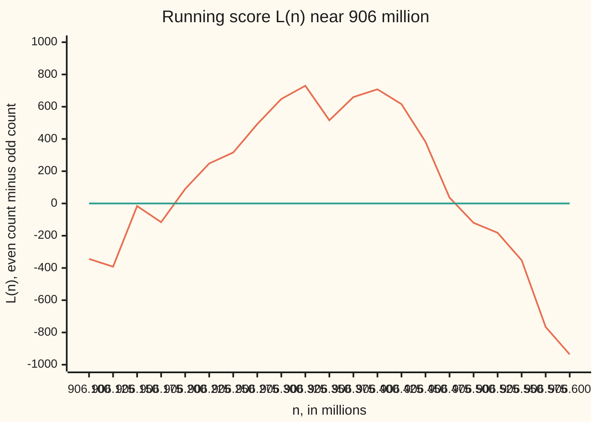
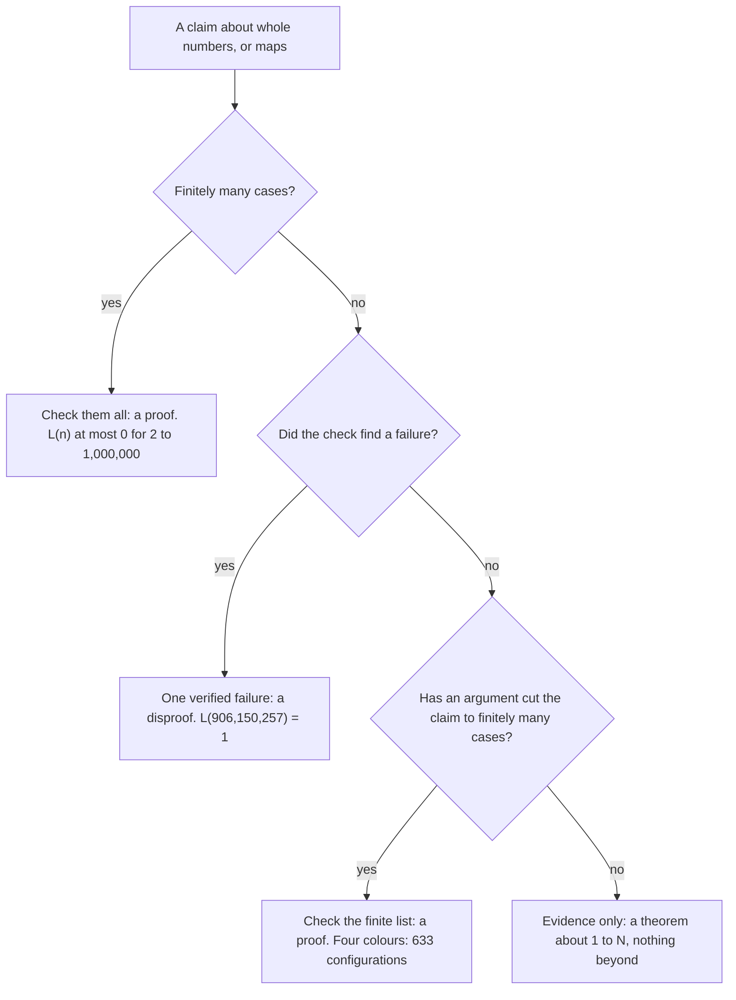

# Proof: a general argument, not a pile of checked cases

[Syllabus](../../../SYLLABUS.md) → [Frontier](../README.md) → [How Research Works](../README.md#s01) → Proof

---

## General Overview

In 1919 George Pólya made a guess about whole numbers. Split any number into primes: 12 is 2 × 2 × 3, three prime factors, counting repeats. 10 is 2 × 5, two prime factors. Pólya guessed that in the list of numbers from 1 up to any stopping point from 2 on, those with an odd count are never fewer than those with an even count. The number 1 has no prime factors, a count of zero, which is even.

Computers later tested his guess on every number up to 906 million. It held every time. Then, at 906,150,257, it broke: the even-count numbers pulled ahead by one. The guess was false, and 906 million agreeing cases had proved nothing.

That is the difference this card is about. A **check** tests listed cases. A **proof** is an argument that covers every case at once, including the ones nobody will ever list. The house example shows the other side. The four-colour theorem was proved with a computer in 1976. An argument first cut infinitely many maps down to a finite list, and the computer finished that list.

**A check proves the cases it checked and nothing beyond them; a claim about every case needs a general argument, and a computer can finish that argument only once it has cut the claim to finitely many cases.**

**What kind of fact this is:** a principle about evidence, shown on this card with two dated statuses. Pólya's conjecture is refuted: a failure was proved to exist in 1958 (Haselgrove), and the first one, 906,150,257, was found in 1980 (Tanaka). The range up to 1,000,000 is a theorem proved by this card's code.

### The picture: the first place the guess fails

The running score $`L(n)`$ counts +1 for each number from 1 to $`n`$ with an even count of prime factors, and −1 for each with an odd count. Pólya's guess says $`L(n)`$ stays at or below zero. Here it is near the first failure.



The orange line is L(n), sampled every 25,000 numbers. The green line is zero, the ceiling Pólya's guess puts on it. Below 906,150,257 the orange line never once reaches above zero. Then it rises to 829, and its last positive value in the window is at 906,488,079.

---

## The formula

[Direct proof](../../01-Foundations/06-Proof/01-direct-proof.md) already says what definitions, axioms, theorems and a proof are. This card adds one thing: the exact gap between a check and a proof. Pólya's guess shows it.

First the score. $`\Omega(n)`$ counts the prime factors of $`n`$ with repeats, so $`\Omega(12) = 3`$; this is the same $`\Omega`$ the number-theory wings use. Each number gets a sign, and the signs are added up:

```math
\lambda(n) = (-1)^{\Omega(n)}, \qquad L(n) = \sum_{k=1}^{n} \lambda(k)
```

Pólya's claim, and what a check up to $`N`$ gives:

```math
\underbrace{\forall n \text{ with } 2 \le n \le N:\ L(n) \le 0}_{\text{checked up to } N} \qquad \not\Longrightarrow \qquad \underbrace{\forall n \ge 2:\ L(n) \le 0}_{\text{the claim}}
```

**Read it aloud:** however large $`N`$ is, knowing the score stays at or below zero up to $`N`$ does not tell you it stays there for every number.

| Symbol | Plain meaning | In our example | Push it up and the answer… |
| --- | --- | --- | --- |
| $`n`$ | a whole number being tested | 12 | — |
| $`\Omega(n)`$ | prime factors of $`n`$, counted with repeats | $`\Omega(12) = 3`$ | its parity flips $`\lambda(n)`$ |
| $`\lambda(n)`$ | Liouville's sign: +1 if $`\Omega(n)`$ is even, −1 if odd | $`\lambda(12) = -1`$ | — |
| $`\sum_{k=1}^{n}`$ | add the terms for $`k = 1, 2, \dots, n`$ | — | — |
| $`L(n)`$ | the running score: even-count numbers minus odd-count numbers, from 1 to $`n`$ | $`L(10) = 0`$, $`L(1{,}000{,}000) = -530`$ | it wanders up and down |
| $`\sqrt{n}`$ | the square root of $`n`$ | $`\sqrt{1{,}000{,}000} = 1{,}000`$ | grows, more slowly than $`n`$ |
| $`N`$ | how far the check has gone | 1,000,000 here; 906,150,256 by Tanaka | more cases checked, still not a proof |
| $`\forall`$ | "for every" | for every $`n`$ from 2 up | — |
| $`\pi(x)`$ | the number of primes up to $`x`$ (here not 3.14…) | $`\pi(1{,}000{,}000) = 78{,}498`$ | grows |
| $`\zeta(s)`$ | the Riemann zeta function; its zeros control how far $`L(n)`$ swings | — | — |
| $`\mathrm{li}(x)`$ | the logarithmic integral: $`\mathrm{li}(2) \approx 1.045`$ plus the area under $`1/\log t`$ from 2 to $`x`$, a smooth estimate of $`\pi(x)`$ | $`\mathrm{li}(1{,}000{,}000) \approx 78{,}627.5`$ | grows |

Liouville's $`\lambda(n)`$ and its running sum $`L(n)`$ are introduced here, for this wing. Later cards use them with a one-line reminder.

### When it holds

- **The claim is about infinitely many cases.** Then no check covers it. For a finite claim, "$`L(n) \le 0`$ for $`2 \le n \le 1{,}000{,}000`$", checking every case *is* a proof, and this card's code gives one.
- **The check found no failure.** One verified failure is a complete disproof. $`L(906{,}150{,}257) = 1`$ refutes Pólya's claim outright.
- **No argument has reduced the claim to finitely many cases.** Once one has, a computer that checks the remaining cases finishes a proof. The four-colour theorem is that case.
- **The claim starts at $`n = 2`$.** At $`n = 1`$ the score is $`L(1) = 1`$, so a claim starting at 1 fails at once.

---

## Why it works

### Step 0: a check cannot see past its last case

A check up to $`N`$ looks at $`N`$ cases. A claim about every whole number speaks about infinitely many. Whatever the check saw is also what it would see if the claim failed at $`N + 1`$.

A blunt example makes it exact. The claim "$`n \le N`$" passes every check from 1 to $`N`$ and fails at $`N + 1`$. For any bound you name, there is a claim that agrees with every check up to it and then fails. So agreement up to $`N`$, by itself, carries no information about the next number.

### Step 1: what a proof does instead

A proof argues about an arbitrary $`n`$: a number with no special property beyond the claim's hypothesis. Every step holds for that $`n`$, so the conclusion holds for all of them at once. [Direct proof](../../01-Foundations/06-Proof/01-direct-proof.md) shows this with two even numbers; [Negating a quantifier](../../01-Foundations/05-Logic/05-negating-quantifiers-and-counterexamples.md) shows why one failure is enough to kill an "every" claim.

### Step 2: why Pólya's guess looked safe

Below a million the score is not just negative, it looks pinned down:

- $`L(n)`$ is at or below zero for every $`n`$ from 2 to 1,000,000.
- It touches zero only at 2, 4, 6, 10, 16, 26, 40, 96 and 586, and never again up to a million.
- $`L(1{,}000{,}000) = -530`$, about half of $`\sqrt{1{,}000{,}000} = 1{,}000`$.

There is a reason for the downward lean. The identity behind road 2 below ties the score to the squares: add up $`L(n/d)`$ over every $`d`$, rounding each $`n/d`$ down, and the total is exactly the number of squares up to $`n`$, about $`\sqrt{n}`$. Worked through the zeta function, this tie gives $`L(n)`$ an average lean below zero that grows like $`\sqrt{n}`$. The sign comes from the zeta function itself: its value at 1/2 is negative.

But the swings around that average are about the same size as the lean itself, roughly $`\sqrt{n}`$. With swings that large, one long upward stretch can beat the lean, and eventually one does. That is a heuristic (a reason to expect something), not a proof. It explains why 906 million cases could agree and still mislead.

### Step 3: how the guess was refuted, and found to fail

This is an outline of a research proof, with its source.

- **1958, existence without a number.** Haselgrove tied $`L(n)`$ to the zeros of the Riemann zeta function $`\zeta(s)`$. If $`L(n) \le 0`$ held for ever, the zeros would have to satisfy very tight conditions. He computed enough zeros to show they do not. So a failure exists, but his proof does not say where.
- **1960, a named failure.** Lehman computed $`L(906{,}180{,}359) = 1`$, an explicit counterexample, though not the first.
- **1980, the smallest failure found.** Tanaka computed $`L(n)`$ for every $`n`$ in order and found the first $`n \ge 2`$ with $`L(n) > 0`$: 906,150,257.

These are different kinds of fact. Haselgrove's is a proof that a counterexample exists. Lehman's and Tanaka's are counterexamples anyone can check, and Tanaka's is the first. This card's code checks Tanaka's four ways and Lehman's in its window (see Code).

Status, as of 2026-11-23: Pólya's conjecture, refuted (proved 1958; first failure 906,150,257, found 1980).

### Step 4: when a computer check is a proof

A computer search adds nothing magic: it is a fast, careful case-checker, and its result is a proof in exactly three situations. A proof assistant, which checks the steps of an argument rather than cases, is a different kind of help, met at the end of this step.



The four-colour theorem took the third road. The argument has two halves:

1. **Unavoidable.** Every map, however large, must contain at least one of a fixed list of small patterns, called configurations. The 1997 version of the proof uses 633 of them.
2. **Reducible.** None of the 633 can appear in a smallest map that needs five colours. Checking this for each configuration is a long finite job, done by computer.

Together they cover every map. Appel and Haken did this first in 1976, with a much longer list and more than 300 rules. In 2005 Gonthier completed a proof checked line by line inside Coq, a proof assistant (a program that accepts a proof only if every step follows from the rules); it was published in 2008. That is the house example: a proof by computer, checked by another computer. What such checking does and does not certify is the subject of [Machines in proofs](06-computer-assistance-and-formal-verification.md).

### Step 5: the larger case, primes against li(x)

The same lesson, at a larger scale. Count the primes up to $`x`$, $`\pi(x)`$, and compare with the smooth estimate $`\mathrm{li}(x)`$. At a million, $`\pi = 78{,}498`$ and $`\mathrm{li} \approx 78{,}627.5`$: the estimate is too high by 129.5.

Computation shows $`\pi(x) < \mathrm{li}(x)`$ for every $`x`$ from 2 to $`10^{19}`$ (Büthe, 2018). Yet Littlewood proved in 1914 that the order flips infinitely often. No $`x`$ where $`\pi(x) > \mathrm{li}(x)`$ has been computed.

Status, as of 2026-11-23: "$`\pi(x) < \mathrm{li}(x)`$ for all $`x \ge 2`$" is refuted (proved 1914). Checked true up to $`10^{19}`$, which proves nothing beyond.

---

## Worked numbers, by hand

The score from 1 to 10, then the failure.

| Step | Arithmetic | Value |
| --- | --- | --- |
| signs, $`n = 1`$ to 10 | 1 has no prime factors (even); 2, 3, 5, 7 have one; 4, 6, 9, 10 have two; 8 has three | +1 −1 −1 +1 −1 +1 −1 −1 +1 +1 |
| running score $`L(1)`$ to $`L(10)`$ | add the signs in order | 1 0 −1 0 −1 0 −1 −2 −1 0 |
| the claim from 2 to 10 | every score from $`L(2)`$ on is at most 0 | holds |
| the score just before | $`L(906{,}150{,}256)`$, from the code | 0 |
| factor the next number | $`906{,}150{,}257 = 10{,}039 \times 90{,}263`$, both prime | two prime factors |
| its sign | two is even | $`\lambda = +1`$ |
| the score there | $`0 + 1`$ | **$`L(906{,}150{,}257) = 1`$** |

One number with an even count of prime factors, arriving when the score sat at exactly zero, is enough. The claim is false, and the proof of that is one multiplication and one sum anyone can check.

### What breaks if you drop a piece

| Mistake | Comes out at | What went wrong |
| --- | --- | --- |
| Taking the check to 1,000,000 as a proof | $`L(906{,}150{,}257) = 1`$ | The check covered a million cases; the claim covers all of them |
| Starting the claim at $`n = 1`$ | $`L(1) = 1`$ | The boundary case: 1 has zero prime factors, an even count |
| Counting each prime once, not with repeats | the score first goes above 0 at $`n = 51`$ | A different sign is a different claim, and it fails early |
| Trusting a pattern: $`n^2 + n + 41`$ is prime for $`n = 0`$ to 39 | $`n = 40`$ gives $`1{,}681 = 41 \times 41`$ | Forty agreeing cases, then a factor |

The code prints all four.

---

## Code, from first principles, and it actually runs

The code builds the score $`L(n)`$ four ways and makes them agree. Roads 1, 2 and 4 compute the score; road 3 checks only the last step.

1. **Sieve.** Count prime factors for every number up to 1,000,000 and add the signs.
2. **Identity.** Use the fact that $`L(x/1) + L(x/2) + \dots + L(x/x)`$ (whole-number division) counts the squares up to $`x`$. Solve for $`L(x)`$ from the smaller values, never touching most numbers. This reaches $`L(906{,}150{,}257)`$ without sieving to it.
3. **Trial division.** Factor 906,150,257 directly, so the step from $`L(906{,}150{,}256)`$ to $`L(906{,}150{,}257)`$ must equal its sign.
4. **Window sieve.** Count prime factors of every number from 906,100,000 to 906,600,000 on their own, and add their signs to road 2's score at 906,099,999.

Road 4 shares only that starting score with road 2. Its own sieved signs then land on the same $`L(906{,}150{,}257) = 1`$. The window also verifies a slice of Tanaka's search: no positive score from 906,100,000 up to the failure. It also confirms Lehman's $`L(906{,}180{,}359) = 1`$. Separately, $`\mathrm{li}(1{,}000{,}000)`$ is computed twice, by a series and as $`\mathrm{li}(2)`$ plus an area, and the two must agree within 0.01.

### Python

```python
# Proof against evidence -- the check behind the card.  Standard library only.
# Polya's claim: L(n) <= 0 for every n >= 2, where lambda(k) is +1 when k has an
# even number of prime factors (counted with repeats), -1 when odd, and L(n) is
# their running sum.  It holds for every n below 906,150,257 and fails there.
from math import isqrt, log, exp

U = 1_000_000                                  # road 1: sieve every n up to here
omega = [0] * (U + 1)                          # prime factors of n, with repeats
for p in range(2, U + 1):
    if omega[p] == 0:                          # nothing divided p: p is prime
        q = p
        while q <= U:
            for m in range(q, U + 1, q):
                omega[m] += 1
            q *= p
lam = [0] + [1 if omega[k] % 2 == 0 else -1 for k in range(1, U + 1)]
L = [0] * (U + 1)
for k in range(1, U + 1):
    L[k] = L[k - 1] + lam[k]

def L_far(x, table, memo):
    # road 2: sum over d of L(x // d) counts the squares up to x, so
    # L(x) = isqrt(x) - (L(x // 2) + L(x // 3) + ... + L(x // x)), grouped by quotient
    if x < len(table):
        return table[x]
    if x not in memo:
        r, d = isqrt(x), 2
        while d <= x:
            qt = x // d
            last = x // qt
            r -= (last - d + 1) * L_far(qt, table, memo)
            d = last + 1
        memo[x] = r
    return memo[x]

def factor(n):                                 # trial division, smallest first
    f, p = [], 2
    while p * p <= n:
        while n % p == 0:
            f.append(p)
            n //= p
        p += 1
    return f + ([n] if n > 1 else [])

def sgn(v): return f"{v:+d}"
print("lambda(1..10):", " ".join(sgn(lam[k]) for k in range(1, 11)))
print("L(1..10):", " ".join(str(L[k]) for k in range(1, 11)))
print("L(10^k) for k = 0..6:", " ".join(str(L[10 ** k]) for k in range(7)))
top = max(L[2:])
zeros = [n for n in range(2, U + 1) if L[n] == 0]
print(f"road 1, sieve: largest L(n) for 2 <= n <= {U} is {top}")
print("road 1, sieve: n with L(n) = 0:", " ".join(map(str, zeros)))
squares = sum(L[U // d] for d in range(1, U + 1))
print(f"identity at n = {U}: sum of L(n // d) = {squares}, squares up to n = {isqrt(U)}")
small = L[:10_001]                             # road 2 sees only L up to 10,000
far_1e6 = L_far(U, small, {})
print(f"road 2, identity from L up to 10000: L({U}) = {far_1e6}")
N = 906_150_257
before, at = L_far(N - 1, L, {}), L_far(N, L, {})
print(f"road 2, identity: L({N - 1}) = {before}, L({N}) = {at}")
fN = factor(N)
lamN = 1 if len(fN) % 2 == 0 else -1
print(f"road 3, trial division: {N} = {' x '.join(map(str, fN))}, "
      f"{len(fN)} prime factors, lambda = {sgn(lamN)}")

lo, hi = 906_100_000, 906_600_000              # road 4: sieve a window by itself
W = hi - lo + 1
rem, cnt = list(range(lo, hi + 1)), [0] * W
for p in range(2, isqrt(hi) + 1):
    if omega[p] == 1:                          # p is prime
        q = p
        while q <= hi:
            for i in range((-lo) % q, W, q):
                cnt[i] += 1
                rem[i] //= p
            q *= p
run, win = L_far(lo - 1, L, {}), []
for i in range(W):
    run += 1 if (cnt[i] + (rem[i] > 1)) % 2 == 0 else -1
    win.append(run)
pos = [lo + i for i in range(W) if win[i] > 0]
peak = max(win)
LEH = 906_180_359                              # Lehman's 1960 failure, inside the window
print(f"road 4, window {lo}..{hi}: L({N}) = {win[N - lo]}, L({LEH}) = {win[LEH - lo]}")
print(f"road 4: first n in the window with L(n) > 0 is {pos[0]}, last is {pos[-1]}")
print(f"road 4: {len(pos)} of {W} n in the window have L(n) > 0; "
      f"largest L = {peak} at n = {lo + win.index(peak)}")
print("chart, n then L(n), every 25000:")
for j in range(0, 21, 4):
    print("  " + "  ".join(f"{lo + 25000 * k} {win[25000 * k]}" for k in range(j, min(j + 4, 21))))

w = [0] * (U + 1)                              # mistake: count each prime once
for p in range(2, U + 1):
    if omega[p] == 1:
        for m in range(p, U + 1, p):
            w[m] += 1
run, first_w = 1, None
for k in range(2, U + 1):
    run += 1 if w[k] % 2 == 0 else -1
    if run > 0 and first_w is None:
        first_w = (k, run)
print(f"mistake, n = 1 allowed: L(1) = {L[1]}")
print(f"mistake, each prime counted once: running sum first above 0 at n = {first_w[0]}, value {first_w[1]}")
f41 = [n * n + n + 41 for n in range(41)]
first_comp = next(n for n in range(41) if len(factor(f41[n])) > 1)
print(f"mistake, n^2 + n + 41 prime for n = 0..{first_comp - 1}; "
      f"n = {first_comp} gives {f41[first_comp]} = {' x '.join(map(str, factor(f41[first_comp])))}")

pi = sum(1 for k in range(2, U + 1) if omega[k] == 1)
x = log(U)                                     # li(x) = gamma + log log x + sum x^k/(k k!)
term, total, k = 1.0, 0.5772156649015329 + log(x), 1
while k < 200:
    term *= x / k
    total += term / k
    k += 1
def simpson(f, a, b, n):                       # li by a second road: an area, Simpson's rule
    h = (b - a) / n
    return h / 3 * (f(a) + f(b) + sum((4 if i % 2 else 2) * f(a + i * h) for i in range(1, n)))
def g(t):                                      # 1/log t - 1/(t - 1): the spike at t = 1 removed
    return 1.0 if t == 0 else 0.5 if abs(t - 1) < 1e-6 else 1 / log(t) - 1 / (t - 1)
li2 = simpson(g, 0.0, 2.0, 2000)               # li(2); the removed 1/(t - 1) adds 0 over 0..2
li_area = li2 + simpson(lambda u: exp(u) / u, log(2), log(U), 20000)   # t = e^u, 2 to U
print(f"pi({U}) = {pi}, li({U}) = {total:.1f}, li - pi = {total - pi:.1f}")
print(f"li by area: li(2) = {li2:.3f}, li(2) + area under 1/log t from 2 to {U} = {li_area:.1f}")
print("quoted, not computed: Polya 1919; Haselgrove 1958; Lehman 1960; Tanaka 1980, first failure 906150257;")
print("  li(x) - pi(x) > 0 for 2 <= x <= 1e19 (Buthe 2018); Littlewood 1914;")
print("  four colours: Appel and Haken 1976 (over 300 rules), 633 configurations (1997),")
print("  Coq proof (2005, published 2008); Goldbach checked to 4e18 (linked card)")

assert far_1e6 == L[U] == -530                 # road 2 against road 1
assert squares == isqrt(U)                     # the identity behind road 2
assert at == win[N - lo] == 1 and before == 0  # road 2 against road 4
assert at - before == lamN                     # step = lambda(N), by trial division
assert top == 0 and pos[0] == N                # the slice: L(n) <= 0 below N
assert win[LEH - lo] == 1                      # Lehman's failure, from the window sieve
assert f41[40] == 41 * 41 and first_comp == 40
assert pi == 78498 and total - pi > 0
assert abs(total - li_area) < 0.01             # li: series against area
print("ALL CHECKS PASS")
```

**Ran 2026-11-23 on macOS, Python 3.14.10, standard library only. All checks passed. Output, pasted from the run:**

```
lambda(1..10): +1 -1 -1 +1 -1 +1 -1 -1 +1 +1
L(1..10): 1 0 -1 0 -1 0 -1 -2 -1 0
L(10^k) for k = 0..6: 1 0 -2 -14 -94 -288 -530
road 1, sieve: largest L(n) for 2 <= n <= 1000000 is 0
road 1, sieve: n with L(n) = 0: 2 4 6 10 16 26 40 96 586
identity at n = 1000000: sum of L(n // d) = 1000, squares up to n = 1000
road 2, identity from L up to 10000: L(1000000) = -530
road 2, identity: L(906150256) = 0, L(906150257) = 1
road 3, trial division: 906150257 = 10039 x 90263, 2 prime factors, lambda = +1
road 4, window 906100000..906600000: L(906150257) = 1, L(906180359) = 1
road 4: first n in the window with L(n) > 0 is 906150257, last is 906488079
road 4: 305426 of 500001 n in the window have L(n) > 0; largest L = 829 at n = 906316571
chart, n then L(n), every 25000:
  906100000 -344  906125000 -392  906150000 -16  906175000 -116
  906200000 90  906225000 248  906250000 316  906275000 492
  906300000 648  906325000 730  906350000 516  906375000 660
  906400000 708  906425000 616  906450000 382  906475000 36
  906500000 -120  906525000 -182  906550000 -352  906575000 -766
  906600000 -936
mistake, n = 1 allowed: L(1) = 1
mistake, each prime counted once: running sum first above 0 at n = 51, value 1
mistake, n^2 + n + 41 prime for n = 0..39; n = 40 gives 1681 = 41 x 41
pi(1000000) = 78498, li(1000000) = 78627.5, li - pi = 129.5
li by area: li(2) = 1.045, li(2) + area under 1/log t from 2 to 1000000 = 78627.5
quoted, not computed: Polya 1919; Haselgrove 1958; Lehman 1960; Tanaka 1980, first failure 906150257;
  li(x) - pi(x) > 0 for 2 <= x <= 1e19 (Buthe 2018); Littlewood 1914;
  four colours: Appel and Haken 1976 (over 300 rules), 633 configurations (1997),
  Coq proof (2005, published 2008); Goldbach checked to 4e18 (linked card)
ALL CHECKS PASS
```

### Rust

Same numbers, same labels, built with `rustc --edition 2021 -O`.

```rust
// Proof against evidence -- the same check as the Python, in Rust.  No crates.
// Polya's claim: L(n) <= 0 for every n >= 2, where lambda(k) is +1 when k has an
// even number of prime factors (counted with repeats), -1 when odd, and L(n) is
// their running sum.  It holds for every n below 906,150,257 and fails there.
use std::collections::HashMap;

fn isqrt(x: u64) -> u64 {
    let mut r = (x as f64).sqrt() as u64;
    while r * r > x { r -= 1; }
    while (r + 1) * (r + 1) <= x { r += 1; }
    r
}
// road 2: sum over d of L(x / d) counts the squares up to x, so
// L(x) = isqrt(x) - (L(x / 2) + L(x / 3) + ... + L(x / x)), grouped by quotient
fn l_far(x: u64, table: &[i64], memo: &mut HashMap<u64, i64>) -> i64 {
    if (x as usize) < table.len() { return table[x as usize]; }
    if let Some(&v) = memo.get(&x) { return v; }
    let (mut r, mut d) = (isqrt(x) as i64, 2u64);
    while d <= x {
        let qt = x / d;
        let last = x / qt;
        r -= (last - d + 1) as i64 * l_far(qt, table, memo);
        d = last + 1;
    }
    memo.insert(x, r);
    r
}
fn factor(mut n: u64) -> Vec<u64> {               // trial division, smallest first
    let (mut f, mut p) = (Vec::new(), 2u64);
    while p * p <= n {
        while n % p == 0 { f.push(p); n /= p; }
        p += 1;
    }
    if n > 1 { f.push(n); }
    f
}
fn simpson(f: &dyn Fn(f64) -> f64, a: f64, b: f64, n: usize) -> f64 { // li by a second road: an area
    let h = (b - a) / n as f64;
    let inner: f64 = (1..n).map(|i| (if i % 2 == 1 { 4.0 } else { 2.0 }) * f(a + i as f64 * h)).sum();
    h / 3.0 * (f(a) + f(b) + inner)
}
fn sgn(v: i64) -> String { format!("{:+}", v) }
fn join<T: ToString>(v: &[T], sep: &str) -> String {
    v.iter().map(|x| x.to_string()).collect::<Vec<_>>().join(sep)
}
fn main() {
    const U: usize = 1_000_000;                     // road 1: sieve every n up to here
    let mut omega = vec![0u32; U + 1];              // prime factors of n, with repeats
    for p in 2..=U {
        if omega[p] == 0 {                          // nothing divided p: p is prime
            let mut q = p;
            while q <= U {
                let mut m = q;
                while m <= U { omega[m] += 1; m += q; }
                q *= p;
            }
        }
    }
    let mut lam = vec![0i64; U + 1];
    let mut l = vec![0i64; U + 1];
    for k in 1..=U {
        lam[k] = if omega[k] % 2 == 0 { 1 } else { -1 };
        l[k] = l[k - 1] + lam[k];
    }
    println!("lambda(1..10): {}", (1..=10).map(|k| sgn(lam[k])).collect::<Vec<_>>().join(" "));
    println!("L(1..10): {}", join(&l[1..=10], " "));
    println!("L(10^k) for k = 0..6: {}", join(&(0..7).map(|k| l[10usize.pow(k)]).collect::<Vec<_>>(), " "));
    let top = *l[2..].iter().max().unwrap();
    let zeros: Vec<usize> = (2..=U).filter(|&n| l[n] == 0).collect();
    println!("road 1, sieve: largest L(n) for 2 <= n <= {} is {}", U, top);
    println!("road 1, sieve: n with L(n) = 0: {}", join(&zeros, " "));
    let squares: i64 = (1..=U).map(|d| l[U / d]).sum();
    println!("identity at n = {}: sum of L(n // d) = {}, squares up to n = {}", U, squares, isqrt(U as u64));
    let far_1e6 = l_far(U as u64, &l[..10_001], &mut HashMap::new());  // sees L up to 10,000
    println!("road 2, identity from L up to 10000: L({}) = {}", U, far_1e6);
    const N: u64 = 906_150_257;
    let before = l_far(N - 1, &l, &mut HashMap::new());
    let at = l_far(N, &l, &mut HashMap::new());
    println!("road 2, identity: L({}) = {}, L({}) = {}", N - 1, before, N, at);
    let f_n = factor(N);
    let lam_n: i64 = if f_n.len() % 2 == 0 { 1 } else { -1 };
    println!("road 3, trial division: {} = {}, {} prime factors, lambda = {}",
             N, join(&f_n, " x "), f_n.len(), sgn(lam_n));

    let (lo, hi) = (906_100_000u64, 906_600_000u64); // road 4: sieve a window by itself
    let w_len = (hi - lo + 1) as usize;
    let mut rem: Vec<u64> = (lo..=hi).collect();
    let mut cnt = vec![0u32; w_len];
    for p in 2..=isqrt(hi) {
        if omega[p as usize] == 1 {                 // p is prime
            let mut q = p;
            while q <= hi {
                let mut i = ((q - lo % q) % q) as usize;
                while i < w_len { cnt[i] += 1; rem[i] /= p; i += q as usize; }
                q *= p;
            }
        }
    }
    let mut run = l_far(lo - 1, &l, &mut HashMap::new());
    let mut win = Vec::with_capacity(w_len);
    for i in 0..w_len {
        run += if (cnt[i] + (rem[i] > 1) as u32) % 2 == 0 { 1 } else { -1 };
        win.push(run);
    }
    let pos: Vec<u64> = (0..w_len).filter(|&i| win[i] > 0).map(|i| lo + i as u64).collect();
    let peak = *win.iter().max().unwrap();
    let peak_at = lo + win.iter().position(|&v| v == peak).unwrap() as u64;
    const LEH: u64 = 906_180_359;                   // Lehman's 1960 failure, inside the window
    println!("road 4, window {}..{}: L({}) = {}, L({}) = {}", lo, hi, N, win[(N - lo) as usize], LEH, win[(LEH - lo) as usize]);
    println!("road 4: first n in the window with L(n) > 0 is {}, last is {}", pos[0], pos[pos.len() - 1]);
    println!("road 4: {} of {} n in the window have L(n) > 0; largest L = {} at n = {}",
             pos.len(), w_len, peak, peak_at);
    println!("chart, n then L(n), every 25000:");
    for j in (0..21).step_by(4) {
        let row: Vec<String> = (j..(j + 4).min(21))
            .map(|k| format!("{} {}", lo + 25000 * k as u64, win[25000 * k])).collect();
        println!("  {}", row.join("  "));
    }

    let mut w = vec![0u32; U + 1];                  // mistake: count each prime once
    for p in 2..=U {
        if omega[p] == 1 { let mut m = p; while m <= U { w[m] += 1; m += p; } }
    }
    let (mut run_w, mut first_w) = (1i64, None);
    for k in 2..=U {
        run_w += if w[k] % 2 == 0 { 1 } else { -1 };
        if run_w > 0 && first_w.is_none() { first_w = Some((k, run_w)); }
    }
    let first_w = first_w.unwrap();
    println!("mistake, n = 1 allowed: L(1) = {}", l[1]);
    println!("mistake, each prime counted once: running sum first above 0 at n = {}, value {}", first_w.0, first_w.1);
    let f41: Vec<u64> = (0..41u64).map(|n| n * n + n + 41).collect();
    let first_comp = (0..41).find(|&n| factor(f41[n]).len() > 1).unwrap();
    println!("mistake, n^2 + n + 41 prime for n = 0..{}; n = {} gives {} = {}",
             first_comp - 1, first_comp, f41[first_comp], join(&factor(f41[first_comp]), " x "));

    let pi = (2..=U).filter(|&k| omega[k] == 1).count();
    let x = (U as f64).ln();                        // li(x) = gamma + log log x + sum x^k/(k k!)
    let (mut term, mut total) = (1.0f64, 0.5772156649015329 + x.ln());
    for k in 1..200 { term *= x / k as f64; total += term / k as f64; }
    // 1/log t - 1/(t - 1): the spike at t = 1 removed; the removed part adds 0 over 0..2
    let g = |t: f64| if t == 0.0 { 1.0 } else if (t - 1.0).abs() < 1e-6 { 0.5 } else { 1.0 / t.ln() - 1.0 / (t - 1.0) };
    let li2 = simpson(&g, 0.0, 2.0, 2000);
    let li_area = li2 + simpson(&|u: f64| u.exp() / u, 2f64.ln(), (U as f64).ln(), 20000); // t = e^u
    println!("pi({}) = {}, li({}) = {:.1}, li - pi = {:.1}", U, pi, U, total, total - pi as f64);
    println!("li by area: li(2) = {:.3}, li(2) + area under 1/log t from 2 to {} = {:.1}", li2, U, li_area);
    println!("quoted, not computed: Polya 1919; Haselgrove 1958; Lehman 1960; Tanaka 1980, first failure 906150257;");
    println!("  li(x) - pi(x) > 0 for 2 <= x <= 1e19 (Buthe 2018); Littlewood 1914;");
    println!("  four colours: Appel and Haken 1976 (over 300 rules), 633 configurations (1997),");
    println!("  Coq proof (2005, published 2008); Goldbach checked to 4e18 (linked card)");

    assert!(far_1e6 == l[U] && l[U] == -530);         // road 2 against road 1
    assert!(squares == isqrt(U as u64) as i64);         // the identity behind road 2
    assert!(at == win[(N - lo) as usize] && at == 1 && before == 0); // road 2 against road 4
    assert!(at - before == lam_n);                      // step = lambda(N), by trial division
    assert!(top == 0 && pos[0] == N);                   // the slice: L(n) <= 0 below N
    assert!(win[(LEH - lo) as usize] == 1);             // Lehman's failure, from the window sieve
    assert!(f41[40] == 41 * 41 && first_comp == 40);
    assert!(pi == 78498 && total - pi as f64 > 0.0);
    assert!((total - li_area).abs() < 0.01);            // li: series against area
    println!("ALL CHECKS PASS");
}
```

**Ran 2026-11-23 on macOS, rustc 1.98.1, no crates. All checks passed. Output, pasted from the run:**

```
lambda(1..10): +1 -1 -1 +1 -1 +1 -1 -1 +1 +1
L(1..10): 1 0 -1 0 -1 0 -1 -2 -1 0
L(10^k) for k = 0..6: 1 0 -2 -14 -94 -288 -530
road 1, sieve: largest L(n) for 2 <= n <= 1000000 is 0
road 1, sieve: n with L(n) = 0: 2 4 6 10 16 26 40 96 586
identity at n = 1000000: sum of L(n // d) = 1000, squares up to n = 1000
road 2, identity from L up to 10000: L(1000000) = -530
road 2, identity: L(906150256) = 0, L(906150257) = 1
road 3, trial division: 906150257 = 10039 x 90263, 2 prime factors, lambda = +1
road 4, window 906100000..906600000: L(906150257) = 1, L(906180359) = 1
road 4: first n in the window with L(n) > 0 is 906150257, last is 906488079
road 4: 305426 of 500001 n in the window have L(n) > 0; largest L = 829 at n = 906316571
chart, n then L(n), every 25000:
  906100000 -344  906125000 -392  906150000 -16  906175000 -116
  906200000 90  906225000 248  906250000 316  906275000 492
  906300000 648  906325000 730  906350000 516  906375000 660
  906400000 708  906425000 616  906450000 382  906475000 36
  906500000 -120  906525000 -182  906550000 -352  906575000 -766
  906600000 -936
mistake, n = 1 allowed: L(1) = 1
mistake, each prime counted once: running sum first above 0 at n = 51, value 1
mistake, n^2 + n + 41 prime for n = 0..39; n = 40 gives 1681 = 41 x 41
pi(1000000) = 78498, li(1000000) = 78627.5, li - pi = 129.5
li by area: li(2) = 1.045, li(2) + area under 1/log t from 2 to 1000000 = 78627.5
quoted, not computed: Polya 1919; Haselgrove 1958; Lehman 1960; Tanaka 1980, first failure 906150257;
  li(x) - pi(x) > 0 for 2 <= x <= 1e19 (Buthe 2018); Littlewood 1914;
  four colours: Appel and Haken 1976 (over 300 rules), 633 configurations (1997),
  Coq proof (2005, published 2008); Goldbach checked to 4e18 (linked card)
ALL CHECKS PASS
```

The two outputs match line for line.

### Lean

Lean proves Step 0's principle for any bound, and the step that turns $`L(906{,}150{,}256) = 0`$ into Pólya's failure.

- Suppose a claim holds for every $`n`$ up to $`N`$. Then another claim agrees with it up to $`N`$ and fails at $`N + 1`$.
- Suppose $`L(906{,}150{,}256) = 0`$. Then $`L(906{,}150{,}257) = 1`$, so "$`L(n) \le 0`$ for every $`n \ge 2`$" is false.
- Started at $`n = 1`$, Pólya's claim fails at once, because $`L(1) = 1`$.
- $`\Omega(12) = 3`$ and $`\lambda(12) = -1`$. The scores $`L(1)`$ to $`L(10)`$ match the worked numbers, and the claim holds from 2 to 10.
- $`906{,}150{,}257 = 10{,}039 \times 90{,}263`$, both factors are prime, and its sign is +1.
- Counting each prime once, the score first goes above 0 at $`n = 51`$, with value 1.
- $`n^2 + n + 41`$ is prime for $`n = 0`$ to 39. At $`n = 40`$ it is $`41 \times 41`$.

The score $`L(906{,}150{,}256) = 0`$, the sieve to a million, the window and $`\mathrm{li}(x)`$ are left to the Python and Rust checks.

```lean
-- Proof: a check up to any bound says nothing beyond it, and Liouville's running score L(n) reaches 1 at 906,150,257 once it sits at 0 just before.
import Mathlib.NumberTheory.ArithmeticFunction.Liouville
import Mathlib.Algebra.BigOperators.Intervals
import Mathlib.Order.Interval.Finset.Nat
import Mathlib.Tactic.NormNum.Prime
import Mathlib.Tactic.Simproc.Factors
import Mathlib.Tactic.IntervalCases

open ArithmeticFunction
open scoped ArithmeticFunction.Omega ArithmeticFunction.omega

/-- The running score `L(n) = λ(1) + λ(2) + ... + λ(n)`, where Liouville's sign `λ(k)`
is `+1` when `k` has an even number of prime factors counted with repeats and `-1` when odd. -/
def liouvilleScore (n : ℕ) : ℤ := ∑ k ∈ Finset.Icc 1 n, liouville k

/-- A sum over `1, ..., n` is the sum of the list of the first `n` shifted values. -/
theorem sum_Icc_one_eq_list_sum (f : ℕ → ℤ) (n : ℕ) :
    ∑ k ∈ Finset.Icc 1 n, f k = ((List.range n).map (fun i => f (i + 1))).sum := by
  induction n with
  | zero => simp
  | succ n ih =>
    rw [Finset.sum_Icc_succ_top (by omega), ih, List.range_succ]
    simp

/-- For `n ≤ m`, the sum over `1, ..., n` is the sum of the first `n` entries of a list of length `m`. -/
theorem sum_Icc_one_eq_take {f : ℕ → ℤ} {n m : ℕ} (h : n ≤ m) :
    ∑ k ∈ Finset.Icc 1 n, f k = (((List.range m).map (fun i => f (i + 1))).take n).sum := by
  rw [sum_Icc_one_eq_list_sum, ← List.map_take, List.take_range, min_eq_left h]

/-- The signs `λ(1), ..., λ(10)`. -/
theorem liouville_one_to_ten :
    (List.range 10).map (fun i => liouville (i + 1)) = [1, -1, -1, 1, -1, 1, -1, -1, 1, 1] := by
  simp [List.range_succ, liouville_apply, cardFactors_apply, Nat.primeFactorsList_ofNat]

/-- The distinct-prime counts `ω(1), ..., ω(51)`. -/
theorem omega_one_to_51 :
    (List.range 51).map (fun i => ω (i + 1)) =
      [0, 1, 1, 1, 1, 2, 1, 1, 1, 2, 1, 2, 1, 2, 2, 1, 1, 2, 1, 2, 2, 2, 1, 2, 1, 2, 1, 2, 1, 3,
       1, 1, 2, 2, 2, 2, 1, 2, 2, 2, 1, 3, 1, 2, 2, 2, 1, 2, 1, 2, 2] := by
  simp [List.range_succ, cardDistinctFactors_apply, Nat.primeFactorsList_ofNat]

#print axioms sum_Icc_one_eq_list_sum
#print axioms sum_Icc_one_eq_take
#print axioms liouville_one_to_ten
#print axioms omega_one_to_51

/-- A check proves the cases it checked and nothing beyond them: whatever claim `P` has
passed every check from 0 to `N`, there is another claim `Q` that gives exactly the same
answer on every checked case and yet fails at `N + 1`. So agreement up to `N` carries no
information about the next number. -/
theorem check_up_to_bound_proves_nothing_beyond (N : ℕ) (P : ℕ → Prop)
    (hP : ∀ n ≤ N, P n) :
    ∃ Q : ℕ → Prop, (∀ n ≤ N, Q n ↔ P n) ∧ ¬ Q (N + 1) := by
  have _ := hP
  refine ⟨fun n => n ≤ N ∧ P n, fun n hn => ⟨fun h => h.2, fun h => ⟨hn, h⟩⟩, ?_⟩
  rintro ⟨h, -⟩
  omega

/-- One verified failure disproves Pólya's claim: if the score is `0` at 906,150,256
(the value the card's code computes), then `906,150,257 = 10,039 × 90,263` has two prime
factors, so the score there is `1`, and "`L(n) ≤ 0` for every `n ≥ 2`" is false. -/
theorem polya_fails_at_906150257 (h : liouvilleScore 906150256 = 0) :
    liouvilleScore 906150257 = 1 ∧ ¬ ∀ n ≥ 2, liouvilleScore n ≤ 0 := by
  have hlam : liouville 906150257 = 1 := by
    rw [show (906150257 : ℕ) = 10039 * 90263 by norm_num, liouville_apply_mul,
      liouville_apply (by norm_num), liouville_apply (by norm_num),
      cardFactors_apply_prime (by norm_num), cardFactors_apply_prime (by norm_num)]
    norm_num
  have hL : liouvilleScore 906150257 = 1 := by
    rw [liouvilleScore, show (906150257 : ℕ) = 906150256 + 1 from rfl,
      Finset.sum_Icc_succ_top (by norm_num), ← liouvilleScore, h, hlam]
    norm_num
  refine ⟨hL, fun hall => ?_⟩
  have := hall 906150257 (by norm_num)
  rw [hL] at this
  norm_num at this

/-- The boundary case: started at `n = 1`, Pólya's claim fails at once, because `1` has
zero prime factors, an even count, so `L(1) = 1`. -/
theorem polya_claim_from_one_fails : ¬ ∀ n ≥ 1, liouvilleScore n ≤ 0 := by
  intro hall
  have h := hall 1 le_rfl
  simp [liouvilleScore, liouville_apply_one] at h

-- Worked numbers: 12 = 2 × 2 × 3 has three prime factors, so its sign is -1.
example : Ω 12 = 3 := by simp [cardFactors_apply, Nat.primeFactorsList_ofNat]
example : liouville 12 = -1 := by
  simp [liouville_apply, cardFactors_apply, Nat.primeFactorsList_ofNat]

-- The running score L(1) to L(10): 1 0 -1 0 -1 0 -1 -2 -1 0.
example : (List.range 10).map (fun i => liouvilleScore (i + 1)) =
    [1, 0, -1, 0, -1, 0, -1, -2, -1, 0] := by
  have h : ∀ n ≤ 10, liouvilleScore n =
      (([1, -1, -1, 1, -1, 1, -1, -1, 1, 1] : List ℤ).take n).sum := by
    intro n hn
    rw [liouvilleScore, sum_Icc_one_eq_take hn, liouville_one_to_ten]
  simp only [List.range_succ, List.range_zero, List.nil_append, List.map_append, List.map_cons,
    List.map_nil]
  rw [h 1 (by norm_num), h 2 (by norm_num), h 3 (by norm_num), h 4 (by norm_num),
    h 5 (by norm_num), h 6 (by norm_num), h 7 (by norm_num), h 8 (by norm_num),
    h 9 (by norm_num), h 10 (by norm_num)]
  decide

-- The finite claim from 2 to 10 holds, checked case by case.
example : ∀ n ∈ Finset.Icc 2 10, liouvilleScore n ≤ 0 := by
  intro n hn
  rw [Finset.mem_Icc] at hn
  rw [liouvilleScore, sum_Icc_one_eq_take hn.2, liouville_one_to_ten]
  obtain ⟨h1, h2⟩ := hn
  interval_cases n <;> decide

-- The failure's factorization: 906,150,257 = 10,039 × 90,263, both prime, sign +1.
example : (906150257 : ℕ) = 10039 * 90263 := by norm_num
example : Nat.Prime 10039 := by norm_num
example : Nat.Prime 90263 := by norm_num
example : liouville 906150257 = 1 := by
  rw [show (906150257 : ℕ) = 10039 * 90263 by norm_num, liouville_apply_mul,
    liouville_apply (by norm_num), liouville_apply (by norm_num),
    cardFactors_apply_prime (by norm_num), cardFactors_apply_prime (by norm_num)]
  norm_num

-- Counting each prime once instead: that score first goes above 0 at n = 51, with value 1.
example : (∑ k ∈ Finset.Icc 1 51, (-1 : ℤ) ^ ω k) = 1 ∧
    ∀ n ∈ Finset.Icc 2 50, (∑ k ∈ Finset.Icc 1 n, (-1 : ℤ) ^ ω k) ≤ 0 := by
  have h : ∀ n ≤ 51, (∑ k ∈ Finset.Icc 1 n, (-1 : ℤ) ^ ω k) =
      ((([0, 1, 1, 1, 1, 2, 1, 1, 1, 2, 1, 2, 1, 2, 2, 1, 1, 2, 1, 2, 2, 2, 1, 2, 1, 2, 1, 2, 1, 3,
       1, 1, 2, 2, 2, 2, 1, 2, 2, 2, 1, 3, 1, 2, 2, 2, 1, 2, 1, 2, 2] : List ℕ).map
        (fun c => (-1 : ℤ) ^ c)).take n).sum := by
    intro n hn
    rw [sum_Icc_one_eq_take (f := fun k => (-1 : ℤ) ^ ω k) hn, ← omega_one_to_51, List.map_map]
    rfl
  refine ⟨by rw [h 51 le_rfl]; decide, ?_⟩
  intro n hn
  rw [Finset.mem_Icc] at hn
  obtain ⟨h1, h2⟩ := hn
  rw [h n (by omega)]
  interval_cases n <;> decide

-- Trusting a pattern: n^2 + n + 41 is prime for n = 0 to 39, but n = 40 gives 41 × 41.
example : ∀ n < 40, Nat.Prime (n ^ 2 + n + 41) := by
  intro n hn
  interval_cases n <;> norm_num
example : 40 ^ 2 + 40 + 41 = 41 * 41 ∧ ¬ Nat.Prime (40 ^ 2 + 40 + 41) := by norm_num

#print axioms check_up_to_bound_proves_nothing_beyond
#print axioms polya_fails_at_906150257
#print axioms polya_claim_from_one_fails
```

**Checked 2026-11-23 on macOS, Lean 4.36.0-rc2, Mathlib v4.36.0-rc2. Every proof is complete and uses only Lean's standard axioms. Output, pasted from the run:**

```
'sum_Icc_one_eq_list_sum' depends on axioms: [propext, Classical.choice, Quot.sound]
'sum_Icc_one_eq_take' depends on axioms: [propext, Classical.choice, Quot.sound]
'liouville_one_to_ten' depends on axioms: [propext, Classical.choice, Quot.sound]
'omega_one_to_51' depends on axioms: [propext, Classical.choice, Quot.sound]
'check_up_to_bound_proves_nothing_beyond' depends on axioms: [propext, Quot.sound]
'polya_fails_at_906150257' depends on axioms: [propext, Classical.choice, Quot.sound]
'polya_claim_from_one_fails' depends on axioms: [propext, Classical.choice, Quot.sound]
```

> [!TIP]
> **Try changing**
> Guess first, then run it. An assert is a line that stops the program when a number comes out wrong.
> - **Guess first: does a smaller sieve change the verdict?** Set `U = 100_000`. The largest score from 2 up is still 0, and the last zero is still 586. $`L(100{,}000) = -288`$, so the assert pinned to −530 stops it.
> - **Guess first: how long does another prime pattern last?** Replace both 41s in the $`n^2 + n + 41`$ lines with 17. Now $`n = 16`$ gives $`289 = 17 \times 17`$, and the assert expecting 40 stops it.
> - **Guess first: is 906,150,257 the only failure?** Read the window line: 305,426 of the 500,001 numbers in it have a positive score, peaking at 829. Once the guess fails, it fails for a long stretch.
> - **Guess first: what if prime factors are counted once each?** The code already prints it: that score goes above zero at 51. The repeats in $`\Omega(n)`$ matter.

---

## The usual mistake

> [!warning]
> **Treating a huge check as a proof.** 906 million agreeing cases did not make Pólya's guess true, and $`10^{19}`$ agreeing values do not make $`\pi(x) < \mathrm{li}(x)`$ true. A check up to $`N`$ is a theorem about 1 to $`N`$. Beyond $`N`$ it is evidence only, and the gap is infinite.
>
> - **Reading a margin as safety.** $`L(1{,}000{,}000) = -530`$ and $`\mathrm{li} - \pi = 129.5`$ at a million both look comfortable. Both claims fail later.
> - **Forgetting the boundary.** "For every $`n`$" from 1 fails at once: $`L(1) = 1`$. The exact statement matters.
> - **Thinking a computer proof is just a big check.** The four-colour proof is a proof because an argument reduced every map to 633 cases first. Without that argument the computer would only have checked maps.
> - **Writing "true up to $`N`$".** Say "checked up to $`N`$". "True" is reserved for a proof.

---

## Where you meet it in real life

- **Software testing.** A test suite runs listed inputs. It shows those inputs work. Formal verification proves the code works for every input; the difference is the one on this card.
- **Open problems.** Goldbach's claim is checked for even numbers up to $`4 \times 10^{18}`$ and stays open: [Goldbach, twin primes and friends](../../02-Number%20theory/07-For%20the%20Curious/04-goldbach-and-open-problems.md).
- **Computer searches in research.** A search to a bound proves exact statements about the range, and with an argument can force bounds beyond it, such as a minimum length for any Collatz cycle: [Erdos problems](../../21-Algebraic%20and%20analytic%20number%20theory/08-Additive%20Combinatorics%20and%20Probabilistic%20Number%20Theory/07-erdos-problems-and-computer-search.md).
- **Reading a status line.** "Checked to $`10^{19}`$" and "proved" are different entries in a record of what is known, as [Kinds of claim](02-theorem-conjecture-model-approximation.md) sets out.

> **Say it back**
> A check tests listed cases; a proof covers every case through a general argument. Pólya guessed that the running score L(n) stays at or below zero from 2 on. It did for every number up to 906,150,256, then reached 1 at 906,150,257 = 10,039 × 90,263. A computer check proves a finite claim, or disproves a claim with one verified failure. It proves an infinite claim only after an argument has cut it to finitely many cases, as with the four-colour theorem's 633 configurations.

---

## What this builds on

- [Direct proof](../../01-Foundations/06-Proof/01-direct-proof.md): what definitions, axioms, theorems and a proof are, and checked cases set against a proof that covers every case.
- [Negating a quantifier](../../01-Foundations/05-Logic/05-negating-quantifiers-and-counterexamples.md): why one failure kills a claim about "every".
- [Erdos problems](../../21-Algebraic%20and%20analytic%20number%20theory/08-Additive%20Combinatorics%20and%20Probabilistic%20Number%20Theory/07-erdos-problems-and-computer-search.md): what a verified search range does and does not prove, worked on the Collatz walk.
- [Goldbach, twin primes and friends](../../02-Number%20theory/07-For%20the%20Curious/04-goldbach-and-open-problems.md): a claim checked to $`4 \times 10^{18}`$ that is still open, where no failure has been found.

## Where this goes next

- [Kinds of claim](02-theorem-conjecture-model-approximation.md): theorem, conjecture, model and approximation, and the dated status each carries, kept as separate fields.
- [Counterexamples](03-how-a-counterexample-works.md): how one failure refutes a universal claim, and how to check that a claimed failure is real.
- Other cards on this shelf: [Reading a statement](04-reading-a-mathematical-statement.md), [Reading a paper](05-reading-a-research-paper.md), [Machines in proofs](06-computer-assistance-and-formal-verification.md) and [Working on a problem](07-how-to-work-on-an-open-problem.md).

Left open: when a computer has checked a proof, what exactly has been certified, and who checks the checker?

---

## Sources

Verified 2026-11-23: every link below resolves to the publisher's page.

- Haselgrove, C. B. "A disproof of a conjecture of Pólya." *Mathematika* 5 (1958), 141–145. [doi:10.1112/S0025579300001480](https://doi.org/10.1112/S0025579300001480). The proof, through the zeta zeros, that $`L(n)`$ is positive somewhere.
- Tanaka, Minoru. "A numerical investigation on cumulative sum of the Liouville function." *Tokyo Journal of Mathematics* 3 (1980), 187–189. [doi:10.3836/tjm/1270216093](https://doi.org/10.3836/tjm/1270216093). The search that found the first failure, 906,150,257.
- Büthe, Jan. "An analytic method for bounding ψ(x)." *Mathematics of Computation* 87 (2018), 1991–2009. [doi:10.1090/mcom/3264](https://doi.org/10.1090/mcom/3264). Shows $`\mathrm{li}(x) - \pi(x) > 0`$ for $`2 \le x \le 10^{19}`$.
- Robertson, N., D. Sanders, P. Seymour and R. Thomas. "The four-colour theorem." *Journal of Combinatorial Theory, Series B* 70 (1997), 2–44. [doi:10.1006/jctb.1997.1750](https://doi.org/10.1006/jctb.1997.1750). The proof with 633 reducible configurations, building on Appel and Haken's 1976 proof.
- Gonthier, Georges. "The four colour theorem: engineering of a formal proof." In *Computer Mathematics*, Lecture Notes in Computer Science, Springer, 2008, p. 333 (a one-page abstract). [doi:10.1007/978-3-540-87827-8_28](https://doi.org/10.1007/978-3-540-87827-8_28). The proof checked inside the Coq proof assistant.
