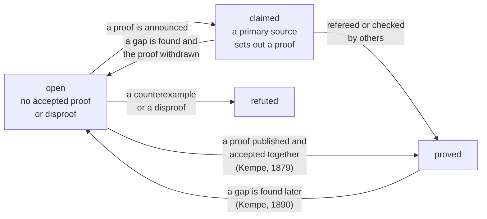

# Kinds of claim: theorem, conjecture, model, approximation, and the status each carries

[Syllabus](../../../SYLLABUS.md) → [Frontier](../README.md) → [How Research Works](../README.md#s01) → Kinds of claim

---

## General Overview

In 1852 Francis Guthrie noticed that four colours were enough to shade the counties of England so that no two neighbours matched. He asked whether four always suffice. In 1879 Alfred Kempe published a proof, and for eleven years it was accepted. In 1890 Percy Heawood found a gap in it. The question was open again.

In 1976 Kenneth Appel and Wolfgang Haken announced a proof that leaned on about 1,200 hours of computer time. It was refereed and published in 1977. In 2005 Georges Gonthier rebuilt the whole proof inside Coq, a proof assistant (a program that accepts a proof only if every step follows from the rules). One computer proof was checked by another.

The sentence "four colours suffice" never changed in those 150 years. What changed was where it stood: open, then proved, then open, then claimed, then proved. That is why a careful library records two separate facts about every claim:

- its **kind**: what sort of claim it is, and what could settle it;
- its **status**: where the settling stands, on a stated date.

Three claims from this library show the kinds. The central limit theorem is a theorem: proved from its assumptions, true forever. Goldbach's conjecture, that every even number above 2 is a sum of two primes, is a conjecture: checked for every even number up to 4 × 10^18 in 2014, and still open. The Black–Scholes price of $9.23 comes from a model. The option is a one-year right to buy a $100 share for $100, with interest at 5%, dividends at 2% and volatility (how jumpy the price is) at 20%. The price is proved inside a set of assumptions about markets, which only evidence can test.

**Every claim carries a kind, fixed when it is stated, and a dated status, which moves as proofs, gaps and counterexamples arrive; one label cannot do both jobs.**

**What kind of fact this is:** a definition (the two fields and their values), plus a theorem about the ledger on this card: kind does not determine status, shown by counting the ten rows in Why it works. The dates are history, each with a source or a linked card.

### The picture: how a status moves



The kind sits outside this picture. It never moves. Only the status walks the arrows, and every step has a date.

---

## The formula

A claim's record is a row with five fields. The status on any date is read off the row's history:

```math
\mathrm{status}(c, d) = \text{the status set by the latest event on claim } c \text{ dated on or before } d
```

**Read it aloud:** to know where a claim stood on a date, find the last thing that happened to it before then.

For the four-colour claim on 1 January 1885, the latest event is Kempe's 1879 proof, so the status is "proved". On 1 January 1900 the latest event is Heawood's 1890 gap, so the status is "open".

The four kinds, by what can settle them:

| Kind | What it is | What settles it |
| --- | --- | --- |
| theorem | an exact statement offered with a proof | the proof is checked, or a gap or counterexample is found |
| conjecture | an exact statement offered without a proof | a proof, or a counterexample or disproof |
| model | assumptions about the world, plus what follows from them | inside: a proof; outside: evidence, never proof |
| approximation | a value or formula standing in for an exact one | an error that is computed or proved |

The four statuses, as this wing uses them:

- **open:** no accepted proof or disproof.
- **claimed:** a primary source sets out a proof or disproof, for others to check, that is not yet accepted.
- **proved:** refereed, or accepted in a source independent of the authors.
- **refuted:** a counterexample or disproof is accepted.

| Symbol | Plain meaning | In our example | Push it up and the answer… |
| --- | --- | --- | --- |
| $`c`$ | one claim: a fixed sentence | the four-colour claim | — |
| $`d`$ | the date the status is read on | 1885, then 1900 | later dates pass more events |
| kind | what sort of claim, and what settles it | conjecture: asked in 1852 without a proof | fixed: never moves |
| status | open, claimed, proved or refuted | proved in 1885, open in 1900 | moves only with an event |
| source | the primary paper or check behind the status | Appel and Haken, 1977 | — |
| $`n`$ | a whole number being tested | 100 | — |
| $`r(n)`$ | the Goldbach count: ways to write $`n`$ as $`p + q`$, both prime, $`p \le q`$ | $`r(100) = 6`$ | grows, roughly |
| $`\lambda(n)`$ | Liouville's sign: +1 if $`n`$ has an even number of prime factors counted with repeats, −1 if odd | +1 or −1 for each $`n`$ | — |
| $`L(n)`$ | the running sum $`\lambda(1) + \dots + \lambda(n)`$ | largest value 0 for $`2 \le n \le 10^6`$ | wanders |
| $`N`$ | the bound a pattern is checked up to | $`10^6`$ here | more evidence, still no proof |
| $`\pi(x)`$ | the number of primes up to $`x`$ | $`\pi(10^6) = 78{,}498`$ | grows like $`x / \ln x`$ |
| $`\Phi(z)`$ | the bell-curve area to the left of $`z`$ | $`\Phi(1.1) = 0.864334`$ | rises towards 1 |

### When it holds

- **The statement is fixed.** A status belongs to one exact sentence. Change a word, such as "every even number" to "every even number above 4 × 10^18", and it is a new claim with its own row.
- **Every status has a date and a source.** "Open" with no date goes stale. Without a source, "proved" is a rumour: the 2026 "dying percolation" lead gets no status at all, only "no primary source found".
- **A model carries two statuses.** The maths inside it can be proved; the fit to the world is evidence. Merge them and a proved formula reads as a fact about markets.
- **An approximation states its error.** "About 0.86" settles nothing. "0.864334, off by 0.000040" can be checked.
- **The name is not a field.** Names are given once and rarely updated. Fermat's last theorem was called a theorem long before it was proved.

---

## Why it works

### Step 0: the sentence stays put; knowledge about it moves

A mathematical statement is true or false whatever anyone knows. "Four colours suffice" was true in 1860, when nobody knew it. So the facts a record tracks are of two sorts: what the claim is, which never changes, and what has been shown about it, which changes with events. Two sorts of fact need two fields.

### Step 1: kind is set by what could settle the claim

The kinds differ in what counts as settling them, not in how sure anyone feels.

- A **theorem** and a **conjecture** are both exact statements about mathematical objects. A proof settles them, and so does one counterexample ([Counterexamples](03-how-a-counterexample-works.md)). The difference is how the claim was offered: with a proof, or without one.
- A **model** says "suppose the world works like this". Inside the supposition, results are proved. Whether the world does work like this is a question for data. No proof can answer it.
- An **approximation** stands in for an exact value. It is settled when its error is pinned down, by computing the exact value or by proving a bound.

So "what could settle it" is fixed the moment the claim is written. That is the kind.

### Step 2: status is the latest dated event

Events arrive in time order: a proof announced, a referee's report, a gap, a counterexample. The rule in The formula reads the status off the latest one. Nothing else is needed, and nothing in the rule mentions the kind.

That rule allows a status to move backwards. Kempe's proof was accepted in 1879, and the claim went back to open in 1890. Wiles announced a proof of Fermat's last theorem in June 1993, a gap was found that autumn, and the repaired proof, with Richard Taylor, was published in 1995 ([Modularity](../../21-Algebraic%20and%20analytic%20number%20theory/07-Diophantine%20and%20Modular/08-modularity-and-the-proof-of-fermat.md)). Wiles did not withdraw the proof, so through 1994 the status was "claimed", not "proved".

### Step 3: count the ledger, and kind fails to predict status

Here are ten statements from this library, each with its kind and its status as of 2026-11-23.

| Claim | Kind | Status | Year | What backs the status |
| --- | --- | --- | --- | --- |
| [Central limit theorem](../../09-Probability%20and%20statistics/06-Limit%20Theorems%20in%20Practice/02-central-limit-theorem.md) | theorem | proved | 1901 | Lyapunov's proof |
| Four-colour theorem ([Colouring maps](../../04-Combinatorics%20and%20graphs/12-Planarity%20and%20Colouring/05-five-and-four-colour-theorems.md)) | conjecture | proved | 1977 | refereed; formal proof 2005 |
| [Fermat's last theorem](../../21-Algebraic%20and%20analytic%20number%20theory/07-Diophantine%20and%20Modular/04-fermats-last-theorem-history-and-descent.md) | conjecture | proved | 1995 | open from about 1637 to 1993, then claimed |
| Poincaré conjecture ([Ricci flow](../../23-Differential%20geometry%20and%20Lie%20groups/07-Geometric%20Analysis%20and%20Physics/01-ricci-flow-and-the-poincare-proof-in-outline.md)) | conjecture | proved | 2006 | Perelman's 2002–2003 preprints, checked by three teams |
| Goldbach | conjecture | open | 2026 | checked to 4 × 10^18 in 2014 |
| [The Riemann hypothesis](../../21-Algebraic%20and%20analytic%20number%20theory/02-The%20Zeta%20Function%20and%20the%20Prime%20Number%20Theorem/09-riemann-hypothesis-statement-and-equivalents.md) | conjecture | open | 2026 | zeros checked to height 3 × 10^12 |
| Pólya: $`L(n) \le 0`$ for every $`n \ge 2`$ | conjecture | refuted | 1958 | Haselgrove proved a failure exists; the first, 906,150,257, was found in 1980 |
| [Black–Scholes call](../../12-Financial%20mathematics/08-The%20Black-Scholes%20call%20and%20put/01-black-scholes-call.md) of $9.23 | model | proved | 1973 | inside the model; the fit is evidence |
| P(at most 55 heads in 100 flips) ≈ $`\Phi(1.1)`$ | approximation | proved | 2026 | error 0.000040, computed exactly here |
| $`\pi(10^6) \approx 10^6 / \ln 10^6`$ | approximation | proved | 2026 | error 7.79%, computed by count here |

Kind follows how each claim was first offered. Guthrie asked the four-colour question in 1852 with no proof, so it is a conjecture by kind, whatever its later name. Fermat wrote in a margin that he had a proof but never wrote it down. Nothing could be checked, so his claim is a conjecture by kind, and its status was open, not claimed, until 1993. Poincaré offered his in 1904 as a question. All three are now proved and keep the kind they were stated with. Two of the three are now called theorems; the ledger keeps both facts.

Counting kinds down and statuses across gives this grid:

| Kind | open | claimed | proved | refuted |
| --- | ---: | ---: | ---: | ---: |
| theorem | 0 | 0 | 1 | 0 |
| conjecture | 2 | 0 | 3 | 1 |
| model | 0 | 0 | 1 | 0 |
| approximation | 0 | 0 | 2 | 0 |

One kind, conjecture, sits under three different statuses. And one status, proved, sits beside all four kinds. If kind fixed status, each kind's row would have one non-zero cell; if status fixed kind, each column would. Neither happens, so neither field can be computed from the other. The code counts the grid and asserts the three statuses.

No row here is "claimed" today. The abc conjecture is the standard current case: a proof was claimed in 2012 and published in a refereed journal in 2021, yet a written objection from 2018 is, in the critics' view, unresolved, and no independent check has rebuilt the disputed step. Refereeing counts as acceptance only when no such dispute stands, so abc stays claimed; [The abc conjecture](../03-Primes%20and%20Numbers/04-abc-conjecture.md) gives both sides with sources.

### Step 4: a model and an approximation each split in two

The Black–Scholes row says "proved", and that is true only of the inside. Given constant volatility (how jumpy the price is) and the other assumptions, the price $9.23 follows by proof, and the code reaches it two ways: by the formula, 9.227006, and by averaging the option's payoff over the bell curve, 9.227006. Whether real prices move that way is evidence, and the evidence is mixed: markets price a different volatility at each strike, which the model forbids.

The coin-flip row works like this. A hundred fair flips average 50 heads, with a spread (standard deviation) of 5. The bell curve is smooth, so it reads "at most 55 heads" as everything up to 55.5, the half step. That point sits $`(55.5 - 50) / 5 = 1.1`$ spreads above the average, so the approximation is $`\Phi(1.1) = 0.864334`$. The exact chance, a finite sum, is 0.864373: the error is 0.000040, computed, not guessed.

The prime-count row splits the same way. The prime number theorem ([The prime number theorem](../../21-Algebraic%20and%20analytic%20number%20theory/02-The%20Zeta%20Function%20and%20the%20Prime%20Number%20Theorem/05-prime-number-theorem-proved.md)) is a theorem: the ratio of $`\pi(x)`$ to $`x / \ln x`$ tends to 1. It says nothing about the error at any one $`x`$. At $`x = 10^6`$ the count is 78,498 and $`x / \ln x`$ is 72,382.4, short by 7.79%. That number is a finite computation, so it is proved, but it is a fact about one $`x`$, not about the limit.

<details>
<summary>Why a finite check proves an approximation's error but never a conjecture</summary>

An approximation's claim names one value: "at 55 heads in 100 flips, the bell is within 0.0001". The exact value is a finite sum of whole numbers,

$`\displaystyle P(\text{at most 55 heads}) = \frac{1}{2^{100}} \sum_{k=0}^{55} \binom{100}{k} = 0.864373\ldots`$

and a finite sum can be done completely, here twice, by Pascal's rule and by the product formula. Every case of the claim is covered, so the computation is a proof.

A conjecture such as Goldbach's names infinitely many cases: every even number. A check up to $`N`$ covers finitely many and leaves infinitely many. Pólya's claim held for every $`n`$ from 2 to 906,150,256 and fails at the next number. So a finite check moves an approximation to "proved", and moves a conjecture nowhere: it stays "open", with "checked up to $`N`$" written beside it as evidence.

</details>

---

## Worked numbers, by hand

The house example: the four-colour claim's record, read on six dates, with one real map as an instance.

| Step | Arithmetic | Value |
| --- | --- | --- |
| Status in 1860 | latest event: Guthrie's question, 1852 | open |
| Status in 1885 | latest event: Kempe's proof, 1879 | proved |
| Status in 1900 | latest event: Heawood's gap, 1890 | open |
| Status in 1976 | latest event: Appel and Haken announce | claimed |
| Status in 2010 | latest event: refereed in 1977, formal proof 2005 | **proved** |
| One instance | Belgium, France, Germany and Luxembourg all border each other; the Netherlands borders Belgium and Germany | 4 colours needed |
| Colourings with 3 colours | $`3 \times 2 \times 1^2 \times 0`$ | 0 |
| Colourings with 4 colours | $`4 \times 3 \times 2^2 \times 1`$ | 48 |

Its status was proved in 2010 and still is; the 48 colourings of five real countries are an instance, which illustrates the theorem and proves nothing about other maps.

The colouring count uses a formula: four countries that all touch take $`k(k-1)(k-2)(k-3)`$ colourings with $`k`$ colours, and the Netherlands then has $`k - 2`$ choices, avoiding Belgium's and Germany's colours. The code counts the same by trying every one of the $`k^5`$ colour lists.

### What breaks if you drop a piece

| Mistake | Comes out at | What went wrong |
| --- | --- | --- |
| Status read off the name: Fermat's last theorem in 1900 | "proved", but the record says open in 1900, claimed in 1994, proved in 2000 | the name records how it was offered, not what was shown |
| Status taken as permanent: four colours | proved in 1885, open in 1900 | no date on the status, so Kempe's gap is invisible |
| Checked up to $`N`$ read as proved: Pólya | largest $`L(n)`$ is 0 for every $`2 \le n \le 10^6`$ | the first failure is at 906,150,257 |
| Approximation used without its error: drop the half step | $`\Phi(1.0) = 0.841345`$ against the exact 0.864373 | an error of 0.023029; with the half step, $`\Phi(1.1) = 0.864334`$, off by 0.000040 |

The code prints all four.

---

## How a status moves

A status moves only when an event arrives. The two stories below use four of the picture's arrows: open to proved and back to open (Kempe, Heawood), open to claimed (1976, 1993) and claimed to proved (1977, 1995). Open to refuted is Pólya's conjecture, refuted by Haselgrove in 1958. Claimed to open, a proof withdrawn, happens in neither story: Wiles kept his claim while the gap was repaired.

| Year | Four-colour event | Status after | Fermat event | Status after |
| --- | --- | --- | --- | --- |
| about 1637 | — | — | Fermat writes the claim in a margin | open |
| 1852 | Guthrie asks | open | — | open |
| 1879 | Kempe publishes a proof | proved | — | open |
| 1890 | Heawood finds the gap | open | — | open |
| 1976 | Appel and Haken announce | claimed | — | open |
| 1977 | the proof is refereed and published | proved | — | open |
| 1993 | — | proved | Wiles announces; a gap is found | claimed |
| 1995 | — | proved | the repaired proof is published | proved |
| 2005 | a formal proof in Coq | proved | — | proved |

Evidence moves along a different axis. A check up to $`N`$ changes no status; it is written beside the status. These bars give $`\log_{10}`$ of how far two patterns are known to hold, two marks per power of ten:

```
Polya, checked here      ############                           6.00
Polya, first failure     ##################                     8.96
Goldbach, checked here   ############                           6.00
Goldbach, checked 2014   ##################################### 18.60
```

Pólya's pattern held three powers of ten past this card's check and then failed. Goldbach's has been checked eighteen powers of ten out, and its status is still "open as of 2026-11-23; even numbers checked to 4 × 10^18 in 2014, which proves nothing beyond".

---

## Code, from first principles, and it actually runs

The code holds the ten-row ledger, counts the kind-by-status grid, and reads the status rule on dated events. It then computes the numbers behind the rows, each by two roads sharing no arithmetic: the primes below a million by two sieves (Eratosthenes, and smallest prime factors); Goldbach to a million, with $`r(100)`$ by sieve and by trial division; Liouville's sign by sieve and by hand factoring; the map's colourings by brute force and by formula; the coin-flip probability by Pascal's rule and by the product formula; the bell-curve area by a series and by Simpson's rule (adding up thin slices under the curve); and the Black–Scholes price by formula and by integral. Nothing is imported except basic maths functions.

### Python

```python
# Kinds of claim -- the check behind the card.  Standard library only.
# Ten claims get a kind (fixed) and a dated status (moves).  The numbers
# behind them are computed here, each by two roads that share no arithmetic.
from math import exp, log, sqrt, pi, log10

LIMIT = 10**6
LEDGER = [  # (claim, kind, status, year of that status, what backs it)
    ("central limit theorem", "theorem", "proved", 1901, "Lyapunov's proof"),
    ("four-colour theorem", "conjecture", "proved", 1977, "refereed; formal proof 2005"),
    ("Fermat's last theorem", "conjecture", "proved", 1995, "open 1637 to 1993"),
    ("Poincare conjecture", "conjecture", "proved", 2006, "checked by three teams"),
    ("Goldbach", "conjecture", "open", 2026, "checked to 4e18 in 2014"),
    ("Riemann hypothesis", "conjecture", "open", 2026, "zeros checked to 3e12"),
    ("Polya: L(n) <= 0 for n >= 2", "conjecture", "refuted", 1958, "Haselgrove; first failure 906150257"),
    ("Black-Scholes call 9.23", "model", "proved", 1973, "inside the model; fit is evidence"),
    ("P(<= 55 heads) ~ Phi(1.1)", "approximation", "proved", 2026, "error computed below"),
    ("pi(1e6) ~ 1e6/ln(1e6)", "approximation", "proved", 2026, "error computed below"),
]
TIMELINE = {"four-colour": [(1852, "open"), (1879, "proved"), (1890, "open"),
                            (1976, "claimed"), (1977, "proved")],
            "Fermat": [(1637, "open"), (1993, "claimed"), (1995, "proved")]}

def status_on(claim, year):              # the latest event on or before the year
    s = "not yet stated"
    for y, st in TIMELINE[claim]:
        if y <= year:
            s = st
    return s

sieve = bytearray([1]) * (LIMIT + 1)     # road A to the primes: Eratosthenes
sieve[0] = sieve[1] = 0
for p in range(2, int(LIMIT ** 0.5) + 1):
    if sieve[p]:
        sieve[p * p::p] = bytearray(len(range(p * p, LIMIT + 1, p)))
spf = list(range(LIMIT + 1))             # road B: smallest prime factor of each n
for p in range(2, int(LIMIT ** 0.5) + 1):
    if spf[p] == p:
        for m in range(p * p, LIMIT + 1, p):
            if spf[m] == m:
                spf[m] = p
primes = [p for p in range(2, LIMIT + 1) if sieve[p]]
count_b = sum(1 for n in range(2, LIMIT + 1) if spf[n] == n)

def trial_prime(n):                      # a third test, by trial division
    return n > 1 and all(n % d for d in range(2, int(n ** 0.5) + 1))

goldbach_ok = True                       # every even 4 <= n <= LIMIT, one pair each
for n in range(4, LIMIT + 1, 2):
    for p in primes:
        if p > n // 2 or sieve[n - p]:   # stop at n/2: n - p never goes below 0
            break
    goldbach_ok = goldbach_ok and p <= n // 2
r100 = sum(1 for p in primes if p <= 50 and sieve[100 - p])
r100_trial = sum(1 for p in range(2, 51) if trial_prime(p) and trial_prime(100 - p))

lam = [0, 1] + [0] * (LIMIT - 1)         # Liouville: -1 to the number of prime factors
for n in range(2, LIMIT + 1):
    lam[n] = -lam[n // spf[n]]
def lam_trial(n):                       # the same sign, by factoring n by hand
    k, d = 0, 2
    while n > 1:
        while n % d == 0:
            n //= d; k += 1
        d += 1
    return (-1) ** k
L, worst = 1, -LIMIT
for n in range(2, LIMIT + 1):
    L += lam[n]
    worst = max(worst, L)

def colourings(k):                       # Belgium, France, Germany, Luxembourg, Netherlands
    edges = [(0, 1), (0, 2), (0, 3), (1, 2), (1, 3), (2, 3), (4, 0), (4, 2)]
    total = 0
    for c in range(k ** 5):
        col = [c // k ** i % k for i in range(5)]
        total += all(col[a] != col[b] for a, b in edges)
    return total
colour_formula = lambda k: k * (k - 1) * (k - 2) ** 2 * (k - 3)   # road two

row = [1]                                # 100 fair flips: Pascal's rule, exact integers
for _ in range(100):
    row = [1] + [row[i] + row[i + 1] for i in range(len(row) - 1)] + [1]
prod = [1]                               # road two: C(n,k) = C(n,k-1)(n-k+1)/k
for k in range(1, 101):
    prod.append(prod[-1] * (101 - k) // k)
exact = sum(row[:56]) / 2 ** 100; z = (55.5 - 100 * 0.5) / sqrt(100 * 0.25)  # half step

def Phi(z):                              # bell-curve area left of z, by the erf series
    s, term, n = 0.0, z, 0
    while abs(term) > 1e-17:
        s += term / (2 * n + 1); n += 1; term *= -z * z / (2 * n)
    return 0.5 + s / sqrt(2 * pi)
def Phi_simpson(z, m=2000):              # the same area, by Simpson's rule
    h = z / m
    f = lambda x: exp(-x * x / 2) / sqrt(2 * pi)
    return 0.5 + h / 3 * sum((1 if i in (0, m) else 4 if i % 2 else 2) * f(i * h) for i in range(m + 1))

S, K, r, q, sig, T = 100.0, 100.0, 0.05, 0.02, 0.20, 1.0
d1 = (log(S / K) + (r - q + sig * sig / 2) * T) / (sig * sqrt(T)); d2 = d1 - sig * sqrt(T)
bs = S * exp(-q * T) * Phi(d1) - K * exp(-r * T) * Phi(d2)
m, a, b = 4000, -d2, 10.0                # road two: average the payoff over the bell
h = (b - a) / m
pay = lambda x: (S * exp((r - q - sig * sig / 2) * T + sig * sqrt(T) * x) - K) * exp(-x * x / 2) / sqrt(2 * pi)
bs_int = exp(-r * T) * h / 3 * sum((1 if i in (0, m) else 4 if i % 2 else 2) * pay(a + i * h) for i in range(m + 1))
xlnx = LIMIT / log(LIMIT)

print("ledger, status as of 2026-11-23")
for name, kind, st, yr, why in LEDGER:
    print(f"  {name:<28} {kind:<13} {st:<8} {yr}  {why}")
kinds = ["theorem", "conjecture", "model", "approximation"]
stats = ["open", "claimed", "proved", "refuted"]
print("grid, kind down, status across:  " + "  ".join(stats))
for kd in kinds:
    print(f"  {kd:<13}" + "".join(f"{sum(1 for x in LEDGER if x[1] == kd and x[2] == st):>9}" for st in stats))
for claim, years in (("four-colour", (1860, 1885, 1900, 1976, 2010)), ("Fermat", (1900, 1994, 2000))):
    print(f"status of {claim}: " + ", ".join(f"{y} {status_on(claim, y)}" for y in years))
print(f"primes below 1e6: Eratosthenes {len(primes)}, smallest-factor sieve {count_b}")
print(f"Goldbach, every even n from 4 to 1e6 has a pair: {'yes' if goldbach_ok else 'no'}; r(100) = {r100} by sieve, {r100_trial} by trial division")
print(f"Polya, largest L(n) for 2 <= n <= 1e6: {worst}; lambda by sieve = by trial division to 1e4: {'yes' if all(lam[n] == lam_trial(n) for n in range(1, 10001)) else 'no'}")
print(f"map of 5 neighbours: 3 colours {colourings(3)} ways, 4 colours {colourings(4)} ways; formula {colour_formula(3)}, {colour_formula(4)}")
print(f"P(at most 55 heads in 100): exact {exact:.6f}; Pascal = product formula: {'yes' if row == prod else 'no'}")
print(f"  bell with half step, z = (55.5 - 50) / 5 = {z:.1f}: Phi {Phi(z):.6f}, Simpson {Phi_simpson(z):.6f}, error {abs(Phi(z) - exact):.6f}")
print(f"  bell without it   Phi(1.0) {Phi(1.0):.6f}, error {abs(Phi(1.0) - exact):.6f}")
print(f"Black-Scholes call: formula {bs:.6f}, integral {bs_int:.6f}")
print(f"pi(1e6) = {len(primes)}; 1e6/ln(1e6) = {xlnx:.1f}; ratio {len(primes) / xlnx:.6f}; short by {1 - xlnx / len(primes):.4f}")
print("log10 of how far each pattern is known to hold:")
for label, x in (("Polya, checked here", LIMIT), ("Polya, first failure", 906150257),
                 ("Goldbach, checked here", LIMIT), ("Goldbach, checked 2014", 4e18)):
    print(f"  {label:<24} {'#' * round(2 * log10(x)):<37} {log10(x):5.2f}")

assert len(primes) == count_b == 78498                    # two sieves, the known count
assert goldbach_ok and r100 == r100_trial == 6            # checked for n <= 1e6 only
assert worst == 0 and all(lam[n] == lam_trial(n) for n in range(1, 10001))
assert colourings(3) == colour_formula(3) == 0 and colourings(4) == colour_formula(4)
assert row == prod and abs(Phi(z) - Phi_simpson(1.1)) < 1e-9 and abs(Phi(z) - exact) < 1e-4
assert abs(bs - bs_int) < 1e-6 and abs(bs - 9.227005508154) < 1e-9
assert status_on("four-colour", 1885) == "proved" and status_on("four-colour", 1900) == "open"
assert len({x[2] for x in LEDGER if x[1] == "conjecture"}) == 3   # one kind, three statuses
print("ALL CHECKS PASS")
```

**Ran 2026-11-23 on macOS, Python 3.14.10, standard library only. All checks passed. Output, pasted from the run:**

```
ledger, status as of 2026-11-23
  central limit theorem        theorem       proved   1901  Lyapunov's proof
  four-colour theorem          conjecture    proved   1977  refereed; formal proof 2005
  Fermat's last theorem        conjecture    proved   1995  open 1637 to 1993
  Poincare conjecture          conjecture    proved   2006  checked by three teams
  Goldbach                     conjecture    open     2026  checked to 4e18 in 2014
  Riemann hypothesis           conjecture    open     2026  zeros checked to 3e12
  Polya: L(n) <= 0 for n >= 2  conjecture    refuted  1958  Haselgrove; first failure 906150257
  Black-Scholes call 9.23      model         proved   1973  inside the model; fit is evidence
  P(<= 55 heads) ~ Phi(1.1)    approximation proved   2026  error computed below
  pi(1e6) ~ 1e6/ln(1e6)        approximation proved   2026  error computed below
grid, kind down, status across:  open  claimed  proved  refuted
  theorem              0        0        1        0
  conjecture           2        0        3        1
  model                0        0        1        0
  approximation        0        0        2        0
status of four-colour: 1860 open, 1885 proved, 1900 open, 1976 claimed, 2010 proved
status of Fermat: 1900 open, 1994 claimed, 2000 proved
primes below 1e6: Eratosthenes 78498, smallest-factor sieve 78498
Goldbach, every even n from 4 to 1e6 has a pair: yes; r(100) = 6 by sieve, 6 by trial division
Polya, largest L(n) for 2 <= n <= 1e6: 0; lambda by sieve = by trial division to 1e4: yes
map of 5 neighbours: 3 colours 0 ways, 4 colours 48 ways; formula 0, 48
P(at most 55 heads in 100): exact 0.864373; Pascal = product formula: yes
  bell with half step, z = (55.5 - 50) / 5 = 1.1: Phi 0.864334, Simpson 0.864334, error 0.000040
  bell without it   Phi(1.0) 0.841345, error 0.023029
Black-Scholes call: formula 9.227006, integral 9.227006
pi(1e6) = 78498; 1e6/ln(1e6) = 72382.4; ratio 1.084490; short by 0.0779
log10 of how far each pattern is known to hold:
  Polya, checked here      ############                           6.00
  Polya, first failure     ##################                     8.96
  Goldbach, checked here   ############                           6.00
  Goldbach, checked 2014   ##################################### 18.60
ALL CHECKS PASS
```

### Rust

Same numbers, same labels, built with `rustc --edition 2021 -O`.

```rust
// Kinds of claim -- the same check as the Python, in Rust.  No crates.
// Ten claims get a kind (fixed) and a dated status (moves).  The numbers
// behind them are computed here, each by two roads that share no arithmetic.
use std::f64::consts::PI;

const LIMIT: usize = 1_000_000;
const LEDGER: [(&str, &str, &str, u32, &str); 10] = [ // claim, kind, status, year, backing
    ("central limit theorem", "theorem", "proved", 1901, "Lyapunov's proof"),
    ("four-colour theorem", "conjecture", "proved", 1977, "refereed; formal proof 2005"),
    ("Fermat's last theorem", "conjecture", "proved", 1995, "open 1637 to 1993"),
    ("Poincare conjecture", "conjecture", "proved", 2006, "checked by three teams"),
    ("Goldbach", "conjecture", "open", 2026, "checked to 4e18 in 2014"),
    ("Riemann hypothesis", "conjecture", "open", 2026, "zeros checked to 3e12"),
    ("Polya: L(n) <= 0 for n >= 2", "conjecture", "refuted", 1958, "Haselgrove; first failure 906150257"),
    ("Black-Scholes call 9.23", "model", "proved", 1973, "inside the model; fit is evidence"),
    ("P(<= 55 heads) ~ Phi(1.1)", "approximation", "proved", 2026, "error computed below"),
    ("pi(1e6) ~ 1e6/ln(1e6)", "approximation", "proved", 2026, "error computed below"),
];

fn timeline(claim: &str) -> Vec<(u32, &'static str)> {
    if claim == "four-colour" { vec![(1852, "open"), (1879, "proved"), (1890, "open"), (1976, "claimed"), (1977, "proved")] }
    else { vec![(1637, "open"), (1993, "claimed"), (1995, "proved")] }
}

fn status_on(claim: &str, year: u32) -> &'static str { // the latest event on or before the year
    let mut s = "not yet stated";
    for (y, st) in timeline(claim) { if y <= year { s = st } }
    s
}

fn trial_prime(n: usize) -> bool {                    // a third test, by trial division
    n > 1 && (2..).take_while(|d| d * d <= n).all(|d| n % d != 0)
}

fn lam_trial(mut n: usize) -> i64 {                   // the same sign, by factoring n by hand
    let (mut k, mut d) = (0, 2);
    while n > 1 {
        while n % d == 0 { n /= d; k += 1 }
        d += 1;
    }
    if k % 2 == 0 { 1 } else { -1 }
}

fn colourings(k: usize) -> usize {                    // Belgium, France, Germany, Luxembourg, Netherlands
    let edges = [(0, 1), (0, 2), (0, 3), (1, 2), (1, 3), (2, 3), (4, 0), (4, 2)];
    let mut total = 0;
    for c in 0..k.pow(5) {
        let col: Vec<usize> = (0..5).map(|i| c / k.pow(i) % k).collect();
        if edges.iter().all(|&(a, b)| col[a] != col[b]) { total += 1 }
    }
    total
}

fn colour_formula(k: i64) -> i64 { k * (k - 1) * (k - 2) * (k - 2) * (k - 3) } // road two

fn phi(z: f64) -> f64 {                               // bell-curve area left of z, by the erf series
    let (mut s, mut term, mut n) = (0.0, z, 0.0);
    while term.abs() > 1e-17 { s += term / (2.0 * n + 1.0); n += 1.0; term *= -z * z / (2.0 * n) }
    0.5 + s / (2.0 * PI).sqrt()
}

fn simpson(f: &dyn Fn(f64) -> f64, a: f64, b: f64, m: usize) -> f64 {
    let h = (b - a) / m as f64;
    let mut s = 0.0;
    for i in 0..=m {
        let w = if i == 0 || i == m { 1.0 } else if i % 2 == 1 { 4.0 } else { 2.0 };
        s += w * f(a + i as f64 * h);
    }
    h / 3.0 * s
}

fn yn(b: bool) -> &'static str { if b { "yes" } else { "no" } }

fn main() {
    let mut sieve = vec![true; LIMIT + 1];           // road A to the primes: Eratosthenes
    sieve[0] = false; sieve[1] = false;
    let mut p = 2;
    while p * p <= LIMIT {
        if sieve[p] { let mut m = p * p; while m <= LIMIT { sieve[m] = false; m += p } }
        p += 1;
    }
    let mut spf: Vec<usize> = (0..=LIMIT).collect(); // road B: smallest prime factor of each n
    let mut p = 2;
    while p * p <= LIMIT {
        if spf[p] == p { let mut m = p * p; while m <= LIMIT { if spf[m] == m { spf[m] = p } m += p } }
        p += 1;
    }
    let primes: Vec<usize> = (2..=LIMIT).filter(|&n| sieve[n]).collect();
    let count_b = (2..=LIMIT).filter(|&n| spf[n] == n).count();
    let mut goldbach_ok = true;                       // every even 4 <= n <= LIMIT, one pair each
    for n in (4..=LIMIT).step_by(2) {
        if !primes.iter().take_while(|&&q| q < n).any(|&q| sieve[n - q]) { goldbach_ok = false }
    }
    let r100 = primes.iter().filter(|&&q| q <= 50 && sieve[100 - q]).count();
    let r100_trial = (2..=50).filter(|&q| trial_prime(q) && trial_prime(100 - q)).count();
    let mut lam = vec![0i64; LIMIT + 1];             // Liouville: -1 to the number of prime factors
    lam[1] = 1;
    for n in 2..=LIMIT { lam[n] = -lam[n / spf[n]] }
    let (mut l, mut worst) = (1i64, -(LIMIT as i64));
    for n in 2..=LIMIT { l += lam[n]; worst = worst.max(l) }
    let lam_agree = (1..=10000).all(|n| lam[n] == lam_trial(n));

    let mut row: Vec<u128> = vec![1];                 // 100 fair flips: Pascal's rule, exact integers
    for _ in 0..100 {
        let mut next = vec![1u128];
        for i in 0..row.len() - 1 { next.push(row[i] + row[i + 1]) }
        next.push(1); row = next;
    }
    let mut prod: Vec<u128> = vec![1];                // road two: C(n,k) = C(n,k-1)(n-k+1)/k
    for k in 1..=100u128 { let c = prod[prod.len() - 1] * (101 - k) / k; prod.push(c) }
    let exact = row[..56].iter().sum::<u128>() as f64 / 2f64.powi(100); let z = (55.5 - 100.0 * 0.5) / (100.0f64 * 0.25).sqrt();
    let bell = |x: f64| (-x * x / 2.0).exp() / (2.0 * PI).sqrt();
    let phi_simpson = 0.5 + simpson(&bell, 0.0, z, 2000);

    let (s, k, r, q, sig, t) = (100.0f64, 100.0f64, 0.05f64, 0.02f64, 0.20f64, 1.0f64);
    let d1 = ((s / k).ln() + (r - q + sig * sig / 2.0) * t) / (sig * t.sqrt());
    let d2 = d1 - sig * t.sqrt();
    let bs = s * (-q * t).exp() * phi(d1) - k * (-r * t).exp() * phi(d2);
    let pay = |x: f64| (s * ((r - q - sig * sig / 2.0) * t + sig * t.sqrt() * x).exp() - k) * bell(x);
    let bs_int = (-r * t).exp() * simpson(&pay, -d2, 10.0, 4000); // road two: average the payoff
    let xlnx = LIMIT as f64 / (LIMIT as f64).ln();

    println!("ledger, status as of 2026-11-23");
    for (name, kind, st, yr, why) in LEDGER.iter() {
        println!("  {:<28} {:<13} {:<8} {}  {}", name, kind, st, yr, why);
    }
    let kinds = ["theorem", "conjecture", "model", "approximation"];
    let stats = ["open", "claimed", "proved", "refuted"];
    println!("grid, kind down, status across:  {}", stats.join("  "));
    for kd in kinds {
        let cells: String = stats.iter()
            .map(|st| format!("{:>9}", LEDGER.iter().filter(|x| x.1 == kd && x.2 == *st).count())).collect();
        println!("  {:<13}{}", kd, cells);
    }
    for (claim, years) in [("four-colour", vec![1860, 1885, 1900, 1976, 2010]), ("Fermat", vec![1900, 1994, 2000])] {
        let parts: Vec<String> = years.iter().map(|&y| format!("{} {}", y, status_on(claim, y))).collect();
        println!("status of {}: {}", claim, parts.join(", "));
    }
    println!("primes below 1e6: Eratosthenes {}, smallest-factor sieve {}", primes.len(), count_b);
    println!("Goldbach, every even n from 4 to 1e6 has a pair: {}; r(100) = {} by sieve, {} by trial division",
             yn(goldbach_ok), r100, r100_trial);
    println!("Polya, largest L(n) for 2 <= n <= 1e6: {}; lambda by sieve = by trial division to 1e4: {}", worst, yn(lam_agree));
    println!("map of 5 neighbours: 3 colours {} ways, 4 colours {} ways; formula {}, {}",
             colourings(3), colourings(4), colour_formula(3), colour_formula(4));
    println!("P(at most 55 heads in 100): exact {:.6}; Pascal = product formula: {}", exact, yn(row == prod));
    println!("  bell with half step, z = (55.5 - 50) / 5 = {:.1}: Phi {:.6}, Simpson {:.6}, error {:.6}", z, phi(z), phi_simpson, (phi(z) - exact).abs());
    println!("  bell without it   Phi(1.0) {:.6}, error {:.6}", phi(1.0), (phi(1.0) - exact).abs());
    println!("Black-Scholes call: formula {:.6}, integral {:.6}", bs, bs_int);
    println!("pi(1e6) = {}; 1e6/ln(1e6) = {:.1}; ratio {:.6}; short by {:.4}",
             primes.len(), xlnx, primes.len() as f64 / xlnx, 1.0 - xlnx / primes.len() as f64);
    println!("log10 of how far each pattern is known to hold:");
    for (label, x) in [("Polya, checked here", LIMIT as f64), ("Polya, first failure", 906150257.0),
                       ("Goldbach, checked here", LIMIT as f64), ("Goldbach, checked 2014", 4e18)] {
        let bar = "#".repeat((2.0 * x.log10()).round() as usize);
        println!("  {:<24} {:<37} {:5.2}", label, bar, x.log10());
    }

    assert!(primes.len() == count_b && count_b == 78498);          // two sieves, the known count
    assert!(goldbach_ok && r100 == r100_trial && r100 == 6);        // checked for n <= 1e6 only
    assert!(worst == 0 && lam_agree);
    assert!(colourings(3) as i64 == colour_formula(3) && colour_formula(3) == 0 && colourings(4) as i64 == colour_formula(4));
    assert!(row == prod && (phi(1.1) - phi_simpson).abs() < 1e-9 && (phi(1.1) - exact).abs() < 1e-4);
    assert!((bs - bs_int).abs() < 1e-6 && (bs - 9.227005508154).abs() < 1e-9);
    assert!(status_on("four-colour", 1885) == "proved" && status_on("four-colour", 1900) == "open");
    let conj: std::collections::BTreeSet<&str> = LEDGER.iter().filter(|x| x.1 == "conjecture").map(|x| x.2).collect();
    assert!(conj.len() == 3);                                       // one kind, three statuses
    println!("ALL CHECKS PASS");
}
```

**Ran 2026-11-23 on macOS, rustc 1.98.1, no crates. All checks passed. Output, pasted from the run:**

```
ledger, status as of 2026-11-23
  central limit theorem        theorem       proved   1901  Lyapunov's proof
  four-colour theorem          conjecture    proved   1977  refereed; formal proof 2005
  Fermat's last theorem        conjecture    proved   1995  open 1637 to 1993
  Poincare conjecture          conjecture    proved   2006  checked by three teams
  Goldbach                     conjecture    open     2026  checked to 4e18 in 2014
  Riemann hypothesis           conjecture    open     2026  zeros checked to 3e12
  Polya: L(n) <= 0 for n >= 2  conjecture    refuted  1958  Haselgrove; first failure 906150257
  Black-Scholes call 9.23      model         proved   1973  inside the model; fit is evidence
  P(<= 55 heads) ~ Phi(1.1)    approximation proved   2026  error computed below
  pi(1e6) ~ 1e6/ln(1e6)        approximation proved   2026  error computed below
grid, kind down, status across:  open  claimed  proved  refuted
  theorem              0        0        1        0
  conjecture           2        0        3        1
  model                0        0        1        0
  approximation        0        0        2        0
status of four-colour: 1860 open, 1885 proved, 1900 open, 1976 claimed, 2010 proved
status of Fermat: 1900 open, 1994 claimed, 2000 proved
primes below 1e6: Eratosthenes 78498, smallest-factor sieve 78498
Goldbach, every even n from 4 to 1e6 has a pair: yes; r(100) = 6 by sieve, 6 by trial division
Polya, largest L(n) for 2 <= n <= 1e6: 0; lambda by sieve = by trial division to 1e4: yes
map of 5 neighbours: 3 colours 0 ways, 4 colours 48 ways; formula 0, 48
P(at most 55 heads in 100): exact 0.864373; Pascal = product formula: yes
  bell with half step, z = (55.5 - 50) / 5 = 1.1: Phi 0.864334, Simpson 0.864334, error 0.000040
  bell without it   Phi(1.0) 0.841345, error 0.023029
Black-Scholes call: formula 9.227006, integral 9.227006
pi(1e6) = 78498; 1e6/ln(1e6) = 72382.4; ratio 1.084490; short by 0.0779
log10 of how far each pattern is known to hold:
  Polya, checked here      ############                           6.00
  Polya, first failure     ##################                     8.96
  Goldbach, checked here   ############                           6.00
  Goldbach, checked 2014   ##################################### 18.60
ALL CHECKS PASS
```

The two outputs match line for line.

### Lean

Lean proves that neither field fixes the other on this card's ledger, that a status can move backwards, and checks the whole-number instances.

- In the card's ten-row ledger, no rule from kind to status fits every row, and no rule from status to kind does either.
- Take any ledger. Then a rule from kind to status fits every row exactly when any two rows with the same kind have the same status.
- The status rule lets a status move backwards: the four-colour claim reads proved in 1885 and open in 1900.
- The grid matches the table: conjecture sits under three statuses, and proved sits beside all four kinds.
- The status rule gives the four-colour claim's five dated statuses and Fermat's three, as in the tables above.
- Take the primes $`p \le 50`$ with $`100 - p`$ also prime. Then there are 6, so $`r(100) = 6`$.
- The five countries have 0 colourings with 3 colours and 48 with 4, by trying every colour list, matching the formula.
- The exact chance of at most 55 heads in 100 flips lies between 0.864373 and 0.864374.

Primes, Goldbach and Pólya to a million, the bell curve and the Black–Scholes price are left to the Python and Rust checks.

```lean
-- Kinds of claim: in the card's ten-row ledger neither field, kind or status, can be computed from the other, the status rule lets a status move backwards, and the card's whole-number instances are exact.
import Mathlib.Data.Nat.Prime.Basic
import Mathlib.Data.Fintype.Pi
import Mathlib.Data.Nat.Choose.Sum
import Mathlib.Tactic.NormNum.Prime

/-- A claim's kind: what sort of claim it is, fixed when it is stated. -/
inductive Kind
  | «theorem» | conjecture | model | approximation
  deriving DecidableEq, Repr

/-- A claim's status on a date: open, claimed, proved or refuted. -/
inductive Status
  | «open» | claimed | proved | refuted
  deriving DecidableEq, Repr

instance : Inhabited Status := ⟨Status.open⟩

/-- One row of the ledger: the claim, its kind, its status and the year of that status. -/
structure Row where
  claim : String
  kind : Kind
  status : Status
  year : ℕ

open Kind Status

/-- The card's ten-row ledger, status as of 2026-11-23. -/
def ledger : List Row :=
  [⟨"central limit theorem", «theorem», proved, 1901⟩,
   ⟨"four-colour theorem", conjecture, proved, 1977⟩,
   ⟨"Fermat's last theorem", conjecture, proved, 1995⟩,
   ⟨"Poincare conjecture", conjecture, proved, 2006⟩,
   ⟨"Goldbach", conjecture, «open», 2026⟩,
   ⟨"Riemann hypothesis", conjecture, «open», 2026⟩,
   ⟨"Polya: L(n) <= 0 for n >= 2", conjecture, refuted, 1958⟩,
   ⟨"Black-Scholes call 9.23", model, proved, 1973⟩,
   ⟨"P(<= 55 heads) ~ Phi(1.1)", approximation, proved, 2026⟩,
   ⟨"pi(1e6) ~ 1e6/ln(1e6)", approximation, proved, 2026⟩]

/-- The status rule: on date `d`, a claim's status is the one set by the latest event dated on
or before `d` (events listed in date order); `none` before the claim is first stated. -/
def statusOn (timeline : List (ℕ × Status)) (d : ℕ) : Option Status :=
  ((timeline.filter (fun e => e.1 ≤ d)).getLast?).map Prod.snd

/-- The four-colour claim's dated events: asked 1852, Kempe 1879, Heawood's gap 1890,
Appel and Haken's announcement 1976, refereed and published 1977. -/
def fourColour : List (ℕ × Status) :=
  [(1852, «open»), (1879, proved), (1890, «open»), (1976, claimed), (1977, proved)]

/-- Fermat's claim's dated events: the margin note about 1637, Wiles's announcement 1993,
the repaired proof published 1995. -/
def fermat : List (ℕ × Status) :=
  [(1637, «open»), (1993, claimed), (1995, proved)]

/-- Number of ledger rows with kind `k` and status `s`: one cell of the kind-by-status grid. -/
def gridCount (k : Kind) (s : Status) : ℕ :=
  (ledger.filter (fun r => r.kind = k ∧ r.status = s)).length

/-- Kind does not determine status, and status does not determine kind: in the card's ten-row
ledger no rule from kinds to statuses fits every row, and no rule from statuses to kinds does
either, so one label cannot do both jobs. -/
theorem kind_does_not_determine_status :
    (¬ ∃ f : Kind → Status, ∀ r ∈ ledger, r.status = f r.kind) ∧
    (¬ ∃ g : Status → Kind, ∀ r ∈ ledger, r.kind = g r.status) := by
  refine ⟨?_, ?_⟩
  · rintro ⟨f, hf⟩
    have h1 := hf ⟨"four-colour theorem", conjecture, proved, 1977⟩ (by simp [ledger])
    have h2 := hf ⟨"Goldbach", conjecture, «open», 2026⟩ (by simp [ledger])
    rw [← h1] at h2
    cases h2
  · rintro ⟨g, hg⟩
    have h1 := hg ⟨"central limit theorem", «theorem», proved, 1901⟩ (by simp [ledger])
    have h2 := hg ⟨"four-colour theorem", conjecture, proved, 1977⟩ (by simp [ledger])
    rw [← h1] at h2
    cases h2

/-- The grid test, for any ledger: a rule from kinds to statuses fits every row exactly when
any two rows with the same kind have the same status, that is, when each kind's row of the
grid has at most one non-zero cell. -/
theorem status_is_function_of_kind_iff (L : List Row) :
    (∃ f : Kind → Status, ∀ r ∈ L, r.status = f r.kind) ↔
      ∀ r ∈ L, ∀ s ∈ L, r.kind = s.kind → r.status = s.status := by
  classical
  constructor
  · rintro ⟨f, hf⟩ r hr s hs hk
    rw [hf r hr, hf s hs, hk]
  · intro h
    refine ⟨fun k => if hk : ∃ r ∈ L, r.kind = k then hk.choose.status else default, ?_⟩
    intro r hr
    have hk : ∃ t ∈ L, t.kind = r.kind := ⟨r, hr, rfl⟩
    simp only [hk, ↓reduceDIte]
    exact h r hr _ hk.choose_spec.1 hk.choose_spec.2.symm

/-- The status rule lets a status move backwards: the four-colour claim was proved on one date
and open again on a later one (Kempe's proof 1879, Heawood's gap 1890). -/
theorem status_can_move_backwards :
    ∃ d₁ d₂ : ℕ, d₁ < d₂ ∧ statusOn fourColour d₁ = some proved ∧
      statusOn fourColour d₂ = some «open» := by
  exact ⟨1885, 1900, by norm_num, by decide, by decide⟩

-- The kind-by-status grid: kinds down (theorem, conjecture, model, approximation),
-- statuses across (open, claimed, proved, refuted).
example : [«theorem», conjecture, model, approximation].map
      (fun k => [«open», claimed, proved, refuted].map (gridCount k)) =
    [[0, 0, 1, 0], [2, 0, 3, 1], [0, 0, 1, 0], [0, 0, 2, 0]] := by decide
-- One kind, conjecture, sits under three statuses; one status, proved, sits beside all four kinds.
example : (((ledger.filter (·.kind = conjecture)).map (·.status)).dedup).length = 3 := by decide
example : (((ledger.filter (·.status = proved)).map (·.kind)).dedup).length = 4 := by decide
-- The four-colour claim read on five dates: 1860 open, 1885 proved, 1900 open, 1976 claimed,
-- 2010 proved.
example : [1860, 1885, 1900, 1976, 2010].map (statusOn fourColour) =
    [some «open», some proved, some «open», some claimed, some proved] := by decide
-- Fermat's claim: 1900 open, 1994 claimed, 2000 proved.
example : [1900, 1994, 2000].map (statusOn fermat) =
    [some «open», some claimed, some proved] := by decide
-- The Goldbach count r(100) = 6: primes p ≤ 50 with 100 − p also prime.
example : ((Finset.Icc 2 50).filter (fun p => p.Prime ∧ (100 - p).Prime)).card = 6 := by decide

/-- Borders among Belgium (0), France (1), Germany (2), Luxembourg (3), Netherlands (4). -/
def borders : List (Fin 5 × Fin 5) :=
  [(0, 1), (0, 2), (0, 3), (1, 2), (1, 3), (2, 3), (4, 0), (4, 2)]

-- The five countries have 0 proper colourings with 3 colours and 48 with 4, by trying every
-- colour list, matching the formula k(k − 1)(k − 2)^2(k − 3).
example : (Finset.univ.filter
    (fun c : Fin 5 → Fin 3 => ∀ e ∈ borders, c e.1 ≠ c e.2)).card = 0 := by decide
example : (Finset.univ.filter
    (fun c : Fin 5 → Fin 4 => ∀ e ∈ borders, c e.1 ≠ c e.2)).card = 48 := by decide
example : 3 * 2 * 1 ^ 2 * 0 = 0 ∧ 4 * 3 * 2 ^ 2 * 1 = 48 := by norm_num
-- P(at most 55 heads in 100 fair flips) = (sum of C(100, k) for k ≤ 55) / 2^100 lies between
-- 864,373 and 864,374 millionths.
example : 864373 * 2 ^ 100 ≤ 10 ^ 6 * (∑ k ∈ Finset.range 56, Nat.choose 100 k) ∧
    10 ^ 6 * (∑ k ∈ Finset.range 56, Nat.choose 100 k) < 864374 * 2 ^ 100 := by
  simp only [Finset.sum_range_succ, Finset.sum_range_zero]
  norm_num [Nat.choose_eq_factorial_div_factorial, Nat.factorial]

#print axioms kind_does_not_determine_status
#print axioms status_is_function_of_kind_iff
#print axioms status_can_move_backwards
```

**Checked 2026-11-23 on macOS, Lean 4.36.0-rc2, Mathlib v4.36.0-rc2. Every proof is complete and uses only Lean's standard axioms. Output, pasted from the run:**

```
'kind_does_not_determine_status' depends on axioms: [propext, Classical.choice, Quot.sound]
'status_is_function_of_kind_iff' depends on axioms: [propext, Classical.choice]
'status_can_move_backwards' depends on axioms: [propext, Classical.choice, Quot.sound]
```

> [!TIP]
> **Try changing**
> Guess first, then run it. The asserts are pinned to this card's numbers, so expect some to stop the program.
> - **Guess first: does a smaller check change any status?** Set `LIMIT = 10**5`. Goldbach still holds and the largest $`L(n)`$ is still 0: less evidence, same status. The first assert stops the run, because the prime count is no longer 78,498.
> - **Guess first: what if Heawood had found the gap in 1880?** Change `(1890, "open")` to `(1880, "open")`. The 1885 status becomes open, and the timeline assert stops the run.
> - **Guess first: where does a claimed proof go?** Add the row `("abc conjecture", "conjecture", "claimed", 2012, "disputed")` to `LEDGER`. The grid's claimed column gets its first entry, conjecture now sits under four statuses, and the last assert stops the run.
> - **Guess first: does the instance depend on which borders exist?** Add the border `(4, 1)`, so the Netherlands also touches France. The brute-force count falls below the formula's 48, and the colouring assert stops the run.

---

## The usual mistake

> [!warning]
> **Reading the status off the name.** A name is given once, when a claim is offered, and is rarely changed. "Fermat's last theorem" was open from about 1637 to 1993. "The Poincaré conjecture" has been proved since 2006. Neither name even tells the kind: both were offered without a proof, so both are conjectures by kind. The status needs its own field, with a date and a source.
>
> - **Checked up to $`N`$ read as proved.** Pólya's $`L(n) \le 0`$ holds for every $`n`$ from 2 to $`10^6`$ in the code, with largest value 0, and fails at 906,150,257.
> - **An approximation used without its error.** The bell without the half step gives 0.841345 for a chance that is exactly 0.864373, off by 0.023029, and only computing the error shows it.
> - **A limit theorem read as an error bound.** The prime number theorem is proved, but $`10^6 / \ln 10^6 = 72{,}382.4`$ against a true count of 78,498 is short by 7.79%.
> - **A model's output read as a fact about the world.** The $9.23 is proved from the model's assumptions; the assumption of one fixed volatility is contradicted by market prices at other strikes.

---

## Where you meet it in real life

- **Research papers.** A paper labels its results "Theorem", "Conjecture" and "Lemma" (a theorem used as a step). The label is the kind as the authors offer it. The status comes later, from referees and readers ([Reading a paper](05-reading-a-research-paper.md)).
- **Prize problems.** The Clay Mathematics Institute lists its problems with a status in its own words; this wing quotes that word as the institute's, separate from the mathematical status.
- **Proof assistants.** A formal proof moves a claim towards "proved" only after its formal statement is matched to the informal one ([Machines in proofs](06-computer-assistance-and-formal-verification.md)).
- **Finance desks.** A pricing formula is a model. Risk teams track the model's proved properties and its evidence against data in separate reports.
- **Engineering tables.** A tabulated value with "± 0.5%" is an approximation with its error stated. Without the error it settles nothing.

> **Say it back**
> Every claim has a kind and a status, and they are separate fields. The kind (theorem, conjecture, model or approximation) is fixed when the claim is stated and says what could settle it. The status (open, claimed, proved or refuted) moves with dated events and is read off the latest one. The four-colour claim went from open to proved to open to claimed to proved while its sentence never changed. A check up to some bound is evidence written beside the status, never a change to it.

---

## What this builds on

- [Proof](01-what-counts-as-a-proof.md): what a proof is, as against a pile of checked cases, and Liouville's $`\lambda(n)`$ with its running sum $`L(n)`$; the status "proved" means a proof in that sense was accepted.

## Where this goes next

- [Counterexamples](03-how-a-counterexample-works.md): the event that moves a status to "refuted", and Pólya's conjecture in full.
- [Reading a statement](04-reading-a-mathematical-statement.md): the exact sentence a status belongs to, with its hypotheses, domain and boundary cases.
- [Reading a paper](05-reading-a-research-paper.md): finding the theorem a paper actually proves, and what it depends on.
- [Machines in proofs](06-computer-assistance-and-formal-verification.md): the audit list (statement, artifact, independent check, status) that decides when a computer-assisted claim counts as proved.
- [Working on a problem](07-how-to-work-on-an-open-problem.md): the status ledger kept for one open problem, using these same fields.

The question this card leaves open: when a proof is too long for any person to read, as with four colours, who decides that it has been "accepted in a source independent of the authors"?

---

## Sources

Verified 2026-11-23: every link below resolves to the publisher's page.

- Kempe, A. B. "On the Geographical Problem of the Four Colours." *American Journal of Mathematics* 2 (1879): 193–200. [doi:10.2307/2369235](https://doi.org/10.2307/2369235). The 1879 proof, accepted until Heawood's 1890 gap.
- Appel, K., and W. Haken. "Every planar map is four colorable. Part I: Discharging." *Illinois Journal of Mathematics* 21, no. 3 (1977): 429–490. [doi:10.1215/ijm/1256049011](https://doi.org/10.1215/ijm/1256049011). The refereed computer proof announced in 1976.
- Gonthier, Georges. "The Four Colour Theorem: Engineering of a Formal Proof." In *Computer Mathematics*, Lecture Notes in Computer Science, Springer, 2008, p. 333 (a one-page abstract). [doi:10.1007/978-3-540-87827-8_28](https://doi.org/10.1007/978-3-540-87827-8_28). The machine-checked proof in Coq, completed in 2005: one computer checking another.
- Oliveira e Silva, Tomás, Siegfried Herzog, and Silvio Pardi. "Empirical verification of the even Goldbach conjecture and computation of prime gaps up to 4·10^18." *Mathematics of Computation* 83 (2014): 2033–2060. [doi:10.1090/S0025-5718-2013-02787-1](https://doi.org/10.1090/S0025-5718-2013-02787-1). The bound 4 × 10^18 for Goldbach, checked, not proved.
- Black, Fischer, and Myron Scholes. "The Pricing of Options and Corporate Liabilities." *Journal of Political Economy* 81, no. 3 (1973): 637–654. [doi:10.1086/260062](https://doi.org/10.1086/260062). The model. The dividend-yield version behind the $9.23 is Merton's 1973 extension, worked on the [Black–Scholes call](../../12-Financial%20mathematics/08-The%20Black-Scholes%20call%20and%20put/01-black-scholes-call.md) card.
