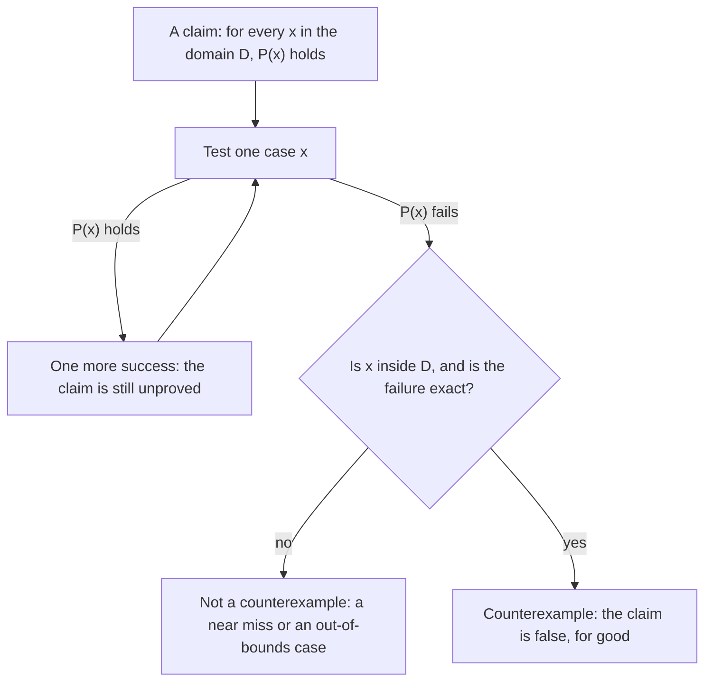

# Counterexamples: one failure refutes a universal claim, and a million successes prove nothing

[Syllabus](../../../SYLLABUS.md) → [Frontier](../README.md) → [How Research Works](../README.md#s01) → Counterexamples

---

## General Overview

In 1769 Leonhard Euler guessed a pattern about powers. Two cubes never add up to a cube. Three fourth powers never add up to a fourth power. Euler proposed the general rule: to make a k-th power out of k-th powers, you need at least k of them.

The guess stood from 1769 to 1966. Then L. J. Lander and T. R. Parkin published a paper a few lines long. Its heart was one line of arithmetic:

```math
27^5 + 84^5 + 110^5 + 133^5 = 144^5
```

Four fifth powers make a fifth power. Both sides come to 61,917,364,224. Anyone with a calculator that keeps 11 digits can check it in a minute. That one line ended the conjecture (a statement offered without proof).

A search in order meets 515,853,624 candidates before it reaches 144. A candidate is a target below 144 plus four numbers below it, listed smallest first, such as $`1^5 + 1^5 + 1^5 + 1^5 = 2^5`$. Every one of them fails to balance. None of those half a billion successes proved anything. The one failure proved the rule false.

Why one case is enough is already on the [Negating a quantifier](../../01-Foundations/05-Logic/05-negating-quantifiers-and-counterexamples.md) card: "not every" means "some one fails". This card is about the research side. It builds counterexamples to three real claims, shows three ways to find them, and shows what a witness must pass before it counts.

**A claim about every case is refuted by one case that is checked exactly and lies inside the claim's own terms, and no number of successful cases can stand in for a proof.**

**What kind of fact this is:** the logic is a theorem, proved on the Negating a quantifier card. The three refutations on this card are proved facts: each is a finite, exact computation, and both checks below redo it.

**Status, as of 2026-11-23:** Euler's conjecture is refuted, for fifth powers (1966) and for fourth powers (1988). For sixth and higher powers no witness is known, and none is proved impossible.

### The picture: what a test can and cannot tell you



The success loop can run forever and never reach a proof. The failure branch needs one case.

---

## The formula

The general shape, and Euler's claim in that shape:

```math
\text{claim: } \forall x \in D:\ P(x) \qquad\qquad \text{counterexample: a } w \in D \text{ with } P(w) \text{ false}
```

```math
\text{Euler: } \forall k \ge 3\ \ \forall n \text{ with } 2 \le n < k\ \ \forall \text{ positive integers } a_1, \dots, a_n, b:\ \ a_1^k + \dots + a_n^k \ne b^k
```

**Read it aloud:** for every power k from 3 up, and every number of terms n smaller than k, no n positive k-th powers add up to a k-th power. A counterexample is one choice of all those numbers where the sum does come out to a k-th power.

The witness (the case that breaks the claim) is $`k = 5`$, $`n = 4`$, $`(a_1, a_2, a_3, a_4) = (27, 84, 110, 133)`$ and $`b = 144`$.

| Symbol | Plain meaning | In our example | Push it up and the answer… |
| --- | --- | --- | --- |
| $`\forall`$ | "for every": the claim covers each case, no exceptions | every k, every n, every list of numbers | — |
| $`\exists`$ | "there is at least one": what a refutation shows | there is one bad list | — |
| $`D`$ | the domain: the set of cases the claim talks about | k at least 3, n below k, positive integers | a larger domain gives more places for a failure to hide |
| $`x`$ | one case from the domain | one choice of k, n, the a's and b | — |
| $`P(x)`$ | the property the claim says every case has | "the sum is not a k-th power" | — |
| $`w`$ | the witness: one case in $`D`$ where $`P`$ fails | $`(5, 4;\ 27, 84, 110, 133;\ 144)`$ | — |
| $`k`$ | the power | 5 | a larger power makes every number bigger and a witness harder to find |
| $`n`$ | how many powers are added | 4 | more terms make a sum easier to hit; Euler's claim stops at $`n = k - 1`$ |
| $`a_1, \dots, a_n`$ | the numbers raised to the power and added | 27, 84, 110, 133 | — |
| $`b`$ | the number whose power the sum should equal | 144 | the search for a witness grows fast with $`b`$ |
| $`m`$ | the index in Fermat's numbers $`2^{2^m} + 1`$ | 5 gives $`2^{32} + 1`$ | the number roughly squares at each step |
| mod | "x mod 641" is the remainder after dividing x by 641 | $`2^{32}`$ mod 641 is 640 | — |

The quantifiers $`\forall`$ and $`\exists`$ come from [Quantifiers](../../01-Foundations/05-Logic/04-quantifiers.md). The rule that a "not" turns $`\forall`$ into $`\exists`$ comes from [Negating a quantifier](../../01-Foundations/05-Logic/05-negating-quantifiers-and-counterexamples.md).

### When it holds

- **The arithmetic is exact.** A witness must make the two sides equal to the last digit. Rounded arithmetic can show two numbers as equal when they differ; see "What breaks" below.
- **The witness lies inside the domain.** Euler's claim needs fewer than k terms. $`3^3 + 4^3 + 5^3 = 6^3`$ uses three cubes, which the claim allows, so it refutes nothing.
- **The claim is the one stated.** A counterexample kills the exact statement it breaks. A weaker or different claim can survive. For example, $`2^{32} + 1`$ fails "every Fermat number is prime", but it says nothing about whether infinitely many are prime.
- **Each case has a yes-or-no answer that can be computed.** "Is this sum a fifth power?" is a finite computation. If a case could not be decided, a failure could not be shown.
- **Someone else can repeat the check.** A witness is a short list of numbers. Its value as evidence is that anyone can redo the arithmetic, as both programs on this card do.

---

## Why it works

### Step 0: a universal claim is a long "and"

"For every x in D, P(x)" says P holds for the first case, and for the second, and for the third, with no end. An "and" is false as soon as one part is false. So one failing case makes the whole claim false.

Successes do the opposite: each one confirms only its own part. The parts not yet checked can still fail. This is the logic of [Negating a quantifier](../../01-Foundations/05-Logic/05-negating-quantifiers-and-counterexamples.md), here applied to a domain with no end.

### Step 1: checking a witness is finite

Finding a counterexample can take centuries. Checking one takes minutes. For Euler's witness, raise five numbers to the fifth power, add four of them and compare. The largest number involved has 11 digits.

This difference is why a counterexample is so strong as evidence. The claim was hard to judge. The witness is easy to judge, and the judging needs no trust in whoever found it.

### Step 2: why no pile of successes adds up to a proof

Every claim on this card held for many cases before it failed:

- **Fermat's numbers:** the first 5 are prime, and the 6th is not.
- **Goldbach's other conjecture:** 2,131 odd composite numbers fit the pattern before 5777 breaks it.
- **Euler's conjecture, fifth powers:** 515,853,624 candidates fail before 144.
- **Pólya's conjecture** (up to any n from 2 on, at least half the whole numbers from 1 to n have an odd count of prime factors, repeats counted): it holds from 2 up to 906,150,256, then fails at 906,150,257. The [Proof](01-what-counts-as-a-proof.md) card tells that story.

The successes measure how hard the search was, not how true the claim is. A claim that holds up to some bound N says nothing about N + 1. The bars below, from the checks, show how long each run of successes lasted. Each mark is a quarter of a power of ten.

```
Successes before the first failure (log10, one # per 0.25)
  Fermat, cases m=0..4      ###                                           5  0.70
  Goldbach, odd composites  #############                              2131  3.33
  Euler k=5, candidates     ###################################   515853624  8.71
  Polya, n=2.., quoted      ####################################  906150255  8.96
```

The longest run is the Pólya one, and it still ended. The Pólya count is quoted from Tanaka (1980), not recomputed here.

### Step 3: three ways to build a counterexample

Research counterexamples are rarely found by luck. The three claims on this card show three methods.

1. **Narrow with theory, then test.** Fermat claimed in 1640 that every number $`2^{2^m} + 1`$ is prime. Euler found the factor 641 of $`2^{32} + 1`$ in 1732, and only later proved the rule that shows the method: any prime factor of $`2^{32} + 1`$ is one more than a multiple of 64. With the rule, as anyone would use it now, the search shrinks to five candidates: 193, 257, 449, 577 and 641. The fifth one divides.
2. **Search in order.** In 1752 Christian Goldbach suggested that every odd composite number (an odd number that is not prime, from 9 up) is a prime plus twice a square, such as $`9 = 7 + 2 \times 1^2`$. Moritz Stern and his students tested the odd numbers in order and found 5777 and 5993 in 1856. Nothing clever is needed, only patience and care.
3. **Organise the search.** Lander and Parkin's note calls their run "a direct search" on a CDC 6600 computer. A search can also be organised. It can store every sum of two fifth powers in a table first. For each pair (c, d) and each target b, it then looks up whether $`b^5 - c^5 - d^5`$ is in the table. That turns a four-number search into a two-number search plus a lookup. The checks below use this trick, and it finds 144 at once.

A fourth method builds the witness from structure instead of searching. In 1988 Noam Elkies used the geometry of curves to construct a witness for fourth powers:

```math
2682440^4 + 15365639^4 + 18796760^4 = 20615673^4
```

Roger Frye then found the smallest one by a computer search: $`95800^4 + 217519^4 + 414560^4 = 422481^4`$. Both checks confirm these equalities exactly.

### Step 4: a refutation without a witness

A proof can show that a counterexample exists without naming it. In 1958 C. B. Haselgrove proved that Pólya's conjecture fails somewhere, before anyone knew where. That still refutes the claim: it proves "there is a w in D with P(w) false". A named witness is better evidence only because it is easier to check. The [Proof](01-what-counts-as-a-proof.md) card covers this case.

<details>
<summary>Detailed proof: why 641 divides 2^32 + 1, with no long division</summary>

Euler's argument uses two ways of writing 641.

First, $`641 = 5 \times 2^7 + 1`$. So $`5 \times 2^7`$ leaves remainder 640 on division by 641, which is one less than 641. Call that remainder "minus 1".

Raise both to the fourth power. Minus 1 to the fourth is plus 1, so:

$`\displaystyle 5^4 \times 2^{28} \text{ leaves remainder } 1 \text{ on division by } 641.`$

Second, $`641 = 5^4 + 2^4`$. So $`5^4`$ leaves the same remainder as minus $`2^4`$. Put that into the line above:

$`\displaystyle -\,2^4 \times 2^{28} = -\,2^{32} \text{ leaves remainder } 1 \text{, so } 2^{32} + 1 \text{ leaves remainder } 0.`$

So 641 divides $`2^{32} + 1`$ exactly. The checks confirm the same fact a second way, by squaring 2 five times and keeping only remainders.

</details>

<details>
<summary>Detailed proof: the mod 30 shortcut for fifth powers</summary>

The shortcut says: x and $`x^5`$ always leave the same remainder on division by 30.

Fermat's little theorem says that for a prime p, x and $`x^p`$ leave the same remainder on division by p. For p = 5 that is the claim directly. For p = 2, x and $`x^5`$ are both even or both odd. For p = 3, $`x^5 = x^3 \times x^2`$, which has the same remainder as $`x \times x^2 = x^3`$, and so as x.

So $`x^5 - x`$ is divisible by 2, by 3 and by 5, hence by 30. A sum of fifth powers therefore has the same remainder on division by 30 as the sum of the plain numbers. That gives a quick test that any proposed witness must pass, as Euler's does below.

</details>

---

## Worked numbers, by hand

Euler's witness first, then the other two claims.

| Step | Arithmetic | Value |
| --- | --- | --- |
| $`27^5`$ | $`27 \times 27 \times 27 \times 27 \times 27`$ | 14,348,907 |
| $`84^5`$ | five 84s multiplied | 4,182,119,424 |
| $`110^5`$ | five 110s multiplied | 16,105,100,000 |
| $`133^5`$ | five 133s multiplied | 41,615,795,893 |
| sum of the four | add the four lines above | 61,917,364,224 |
| $`144^5`$ | five 144s multiplied | 61,917,364,224 |
| quick test, mod 30 | $`27 + 84 + 110 + 133 = 354`$; 354 mod 30 | 24 |
| quick test, other side | 144 mod 30 | 24 |
| Fermat: $`2^{32}`$ mod 641 | square 2 five times, keep remainders: 4, 16, 256, 154, 640 | 640 |
| Fermat: the witness | $`2^{32} + 1 = 4{,}294{,}967{,}297 = 641 \times 6{,}700{,}417`$ | not prime |
| Goldbach: 5777 | $`53 \times 109`$, so odd and composite | in the domain |
| Goldbach: 5777 minus twice each square | 53 numbers, from $`5777 - 2 \times 1^2`$ to $`5777 - 2 \times 53^2`$ | 0 of them prime |
| **Euler's claim** | **both sides 61,917,364,224** | **false** |

The two sides agree to the last digit, so four fifth powers do make a fifth power, and Euler's claim is false for k = 5. The quick test cannot prove a witness right, but a wrong remainder would have proved it wrong in seconds.

### What breaks if you drop a piece

| Mistake | Comes out at | What went wrong |
| --- | --- | --- |
| Checking $`1782^{12} + 1841^{12} = 1922^{12}`$ in floating point (rounded arithmetic) | sides $`25412102586 \times 10^{29}`$ and $`25412102593 \times 10^{29}`$; gap $`-276`$ parts per $`10^{12}`$ | A screen showing 9 digits shows them equal. Exactly, the left side is odd and the right side is even, so they cannot be equal. |
| Offering $`3^3 + 4^3 + 5^3 = 6^3`$ against Euler | $`27 + 64 + 125 = 216`$, true | Three cubes is k terms, not fewer. The witness lies outside the domain. |
| Stopping the fifth-power search at $`b = 143`$ | 515,853,624 candidates tried, 0 witnesses | The search stopped one step short. An empty search is no evidence that the claim is true. |

---

## Code, from first principles, and it actually runs

Each program works the three claims. Every refutation is reached by two independent roads. Fermat: trial division finds 641, and Euler's candidate list plus repeated squaring confirm it. Goldbach: a sieve (a table that marks every prime up to 6000) finds 5777 and 5993, and trial division with no sieve confirms that 5777 has no fitting prime. Euler: a table-lookup search finds the only witness up to 150, and direct exact arithmetic confirms it. The count of failed candidates before 144 is computed by a sum and by a closed formula, and the two agree. Rust has no built-in big integers, so it compares the 12th-power near miss by remainders modulo four primes instead of exact values.

### Python

```python
# Counterexamples -- the check behind the card.  Standard library only.
# Three "for every" claims, each refuted by one exact witness, and each witness
# reached by two roads: a search that finds it, and a direct exact check of it.
import math

def smallest_factor(n):                     # trial division, written out
    d = 2
    while d * d <= n:
        if n % d == 0:
            return d
        d += 1 if d == 2 else 2
    return n

def is_prime(n):
    return n >= 2 and smallest_factor(n) == n

def comb(n, k):                             # n choose k, written out
    c = 1
    for i in range(k):
        c = c * (n - i) // (i + 1)
    return c

print("Claim 1 (Fermat, 1640): every 2^(2^m) + 1 is prime")
fermat = [2 ** (2 ** m) + 1 for m in range(6)]
for m, F in enumerate(fermat):
    p = smallest_factor(F)
    print(f"  m={m}  {F:>10}  " + ("prime" if p == F else f"divisible by {p}"))
cands = [p for p in range(65, 642, 64) if is_prime(p)]   # Euler: a factor is 1 + a multiple of 64
print(f"  primes one more than a multiple of 64, up to 641: {cands}")
hits = [p for p in cands if fermat[5] % p == 0]
x, chain = 2, []
for _ in range(5):                                       # square five times: 2^32 mod 641
    x = x * x % 641
    chain.append(x)
print(f"  squaring 2 mod 641: 2^2,2^4,2^8,2^16,2^32 -> {chain}")
print(f"  641 = 5*2^7 + 1 = {5 * 2 ** 7 + 1} = 5^4 + 2^4 = {5 ** 4 + 2 ** 4}")
cof = fermat[5] // 641
print(f"  witness: 2^32 + 1 = 641 x {cof}; cofactor prime: {is_prime(cof)}")
assert [is_prime(F) for F in fermat] == [True] * 5 + [False]
assert hits == [641] and cands.index(641) == 4 and chain[-1] == 640 and 641 * cof == fermat[5]

print("Claim 2 (Goldbach, 1752): every odd composite is a prime + 2 x a square")
N = 6000
sieve = [False, False] + [True] * (N - 1)
for i in range(2, int(N ** 0.5) + 1):
    if sieve[i]:
        for j in range(i * i, N + 1, i):
            sieve[j] = False
def has_form(n):
    k = 1
    while 2 * k * k < n:
        if sieve[n - 2 * k * k]:
            return k
        k += 1
    return 0
odd_comp = [n for n in range(9, N + 1, 2) if not sieve[n]]
fails = [n for n in odd_comp if has_form(n) == 0]
passed = sum(1 for n in odd_comp if n < fails[0])
print(f"  odd composites 9..{N}: {len(odd_comp)}; failures: {fails}")
print(f"  odd composites below {fails[0]} that fit: {passed}, first ones: "
      + ", ".join(f"{n}={n - 2 * has_form(n) ** 2}+2*{has_form(n)}^2" for n in odd_comp[:3]))
rest = [5777 - 2 * k * k for k in range(1, 5777) if 2 * k * k < 5777]  # road 2: no sieve
print(f"  5777 = {smallest_factor(5777)} x {5777 // smallest_factor(5777)}; "
      f"5777 - 2 x (1^2..53^2): {len(rest)} numbers, primes among them: "
      f"{sum(1 for r in rest if is_prime(r))}")
assert fails == [5777, 5993] and not any(is_prime(r) for r in rest)
assert all(not is_prime(n) for n in fails)

print("Claim 3 (Euler, 1769): k-th powers need at least k terms to sum to a k-th power")
w = (27, 84, 110, 133, 144)
for v in w:
    print(f"  {v:>3}^5 = {v ** 5:>11}")
lhs = sum(v ** 5 for v in w[:4])
print(f"  sum of the four = {lhs}; 144^5 = {w[4] ** 5}; equal: {lhs == w[4] ** 5}")
print(f"  mod 30 shortcut: 27+84+110+133 = {sum(w[:4])} = {sum(w[:4]) % 30} mod 30, "
      f"144 = {144 % 30} mod 30")
E = 150                                                  # road 2: meet-in-the-middle search
p5 = [i ** 5 for i in range(E + 1)]
pairs = {}
for a in range(1, E):
    for b in range(a, E):
        pairs.setdefault(p5[a] + p5[b], []).append((a, b))
found = []
for e in range(2, E + 1):
    for c in range(1, e):
        for d in range(c, e):
            r = p5[e] - p5[c] - p5[d]
            if r < 2:
                break
            for a, b in pairs.get(r, []):
                if b <= c:
                    found.append((a, b, c, d, e))
print(f"  search a<=b<=c<=d<e<={E}: solutions {found}")
cand = sum(comb(e + 2, 4) for e in range(2, 144))
print(f"  candidates a<=b<=c<=d<e, e < 144, all failing: {cand} (formula C(146,5) = {comb(146, 5)})")
s = tuple(2 * v for v in w)
print(f"  doubled witness {s}: still equal: {sum(v ** 5 for v in s[:4]) == s[4] ** 5}")
frye, elkies = (95800, 217519, 414560, 422481), (2682440, 15365639, 18796760, 20615673)
for name, q in (("Frye 1988", frye), ("Elkies 1988", elkies)):
    print(f"  k=4, {name}: {q[0]}^4+{q[1]}^4+{q[2]}^4 = {q[3]}^4 is {sum(v ** 4 for v in q[:3]) == q[3] ** 4}")
print(f"  not a witness: 3^3+4^3+5^3 = {3 ** 3 + 4 ** 3 + 5 ** 3} = 6^3, but that is k = 3 terms, not fewer")
assert found == [w] and lhs == w[4] ** 5 == 61917364224 and cand == comb(146, 5)
assert sum(w[:4]) % 30 == w[4] % 30 and sum(v ** 5 for v in s[:4]) == s[4] ** 5
assert all(sum(v ** 4 for v in q[:3]) == q[3] ** 4 for q in (frye, elkies))

print("Trap: a near miss is not a witness (k = 12)")
fl, fr, fa = 1.0, 1.0, 1.0
for _ in range(12):
    fl, fr, fa = fl * 1782.0, fr * 1841.0, fa * 1922.0
gap = (fl + fr - fa) / fa
print(f"  floats: 1782^12+1841^12 ~ {math.floor((fl + fr) / 1e29)} x 10^29, 1922^12 ~ {math.floor(fa / 1e29)} x 10^29")
print(f"  relative gap, parts per 10^12: {math.floor(gap * 1e12 + 0.5)}")
L, R = 1782 ** 12 + 1841 ** 12, 1922 ** 12
print(f"  exact: left is {'odd' if L % 2 else 'even'}, right is {'odd' if R % 2 else 'even'}; equal: {L == R}")
assert L != R and L % 2 == 1 and R % 2 == 0 and 0 < -gap < 1e-9

print("Successes before the first failure (log10, one # per 0.25)")
rows = [("Fermat, cases m=0..4", 5), ("Goldbach, odd composites", passed),
        ("Euler k=5, candidates", cand), ("Polya, n=2.., quoted", 906150257 - 2)]
for name, v in rows:
    lg = math.log10(v)
    print(f"  {name:<26}{'#' * int(lg * 4 + 0.5):<36}{v:>11}  {lg:.2f}")
print("ALL CHECKS PASS")
```

**Ran 2026-11-23 on macOS, Python 3.14.10, standard library only. All checks passed. Output, pasted from the run:**

```
Claim 1 (Fermat, 1640): every 2^(2^m) + 1 is prime
  m=0           3  prime
  m=1           5  prime
  m=2          17  prime
  m=3         257  prime
  m=4       65537  prime
  m=5  4294967297  divisible by 641
  primes one more than a multiple of 64, up to 641: [193, 257, 449, 577, 641]
  squaring 2 mod 641: 2^2,2^4,2^8,2^16,2^32 -> [4, 16, 256, 154, 640]
  641 = 5*2^7 + 1 = 641 = 5^4 + 2^4 = 641
  witness: 2^32 + 1 = 641 x 6700417; cofactor prime: True
Claim 2 (Goldbach, 1752): every odd composite is a prime + 2 x a square
  odd composites 9..6000: 2217; failures: [5777, 5993]
  odd composites below 5777 that fit: 2131, first ones: 9=7+2*1^2, 15=13+2*1^2, 21=19+2*1^2
  5777 = 53 x 109; 5777 - 2 x (1^2..53^2): 53 numbers, primes among them: 0
Claim 3 (Euler, 1769): k-th powers need at least k terms to sum to a k-th power
   27^5 =    14348907
   84^5 =  4182119424
  110^5 = 16105100000
  133^5 = 41615795893
  144^5 = 61917364224
  sum of the four = 61917364224; 144^5 = 61917364224; equal: True
  mod 30 shortcut: 27+84+110+133 = 354 = 24 mod 30, 144 = 24 mod 30
  search a<=b<=c<=d<e<=150: solutions [(27, 84, 110, 133, 144)]
  candidates a<=b<=c<=d<e, e < 144, all failing: 515853624 (formula C(146,5) = 515853624)
  doubled witness (54, 168, 220, 266, 288): still equal: True
  k=4, Frye 1988: 95800^4+217519^4+414560^4 = 422481^4 is True
  k=4, Elkies 1988: 2682440^4+15365639^4+18796760^4 = 20615673^4 is True
  not a witness: 3^3+4^3+5^3 = 216 = 6^3, but that is k = 3 terms, not fewer
Trap: a near miss is not a witness (k = 12)
  floats: 1782^12+1841^12 ~ 25412102586 x 10^29, 1922^12 ~ 25412102593 x 10^29
  relative gap, parts per 10^12: -276
  exact: left is odd, right is even; equal: False
Successes before the first failure (log10, one # per 0.25)
  Fermat, cases m=0..4      ###                                           5  0.70
  Goldbach, odd composites  #############                              2131  3.33
  Euler k=5, candidates     ###################################   515853624  8.71
  Polya, n=2.., quoted      ####################################  906150255  8.96
ALL CHECKS PASS
```

### Rust

Same numbers, same labels, built with `rustc --edition 2021 -O`.

```rust
// Counterexamples -- the same check as the Python one, in Rust.  No crates.
// Three "for every" claims, each refuted by one exact witness, and each witness
// reached by two roads: a search that finds it, and a direct exact check of it.
use std::collections::HashMap;

fn smallest_factor(n: u64) -> u64 {                // trial division, written out
    let mut d = 2;
    while d * d <= n {
        if n % d == 0 { return d; }
        d += if d == 2 { 1 } else { 2 };
    }
    n
}
fn is_prime(n: u64) -> bool { n >= 2 && smallest_factor(n) == n }
fn py(b: bool) -> &'static str { if b { "True" } else { "False" } }
fn comb(n: u128, k: u128) -> u128 { (0..k).fold(1, |acc, i| acc * (n - i) / (i + 1)) }
fn powmod(b: u128, e: u32, m: u128) -> u128 { (0..e).fold(1, |acc, _| acc * b % m) }
fn list(v: &[u64]) -> String {
    format!("[{}]", v.iter().map(|x| x.to_string()).collect::<Vec<_>>().join(", "))
}

fn main() {
    println!("Claim 1 (Fermat, 1640): every 2^(2^m) + 1 is prime");
    let fermat: Vec<u64> = (0..6).map(|m| (1u64 << (1u32 << m)) + 1).collect();
    for (m, &f) in fermat.iter().enumerate() {
        let p = smallest_factor(f);
        let tail = if p == f { "prime".to_string() } else { format!("divisible by {}", p) };
        println!("  m={}  {:>10}  {}", m, f, tail);
    }
    let cands: Vec<u64> = (65..642).step_by(64).filter(|&p| is_prime(p)).collect(); // Euler: 1 + a multiple of 64
    println!("  primes one more than a multiple of 64, up to 641: {}", list(&cands));
    let hits: Vec<u64> = cands.iter().cloned().filter(|&p| fermat[5] % p == 0).collect();
    let (mut x, mut chain) = (2u64, Vec::new());
    for _ in 0..5 { x = x * x % 641; chain.push(x); }   // square five times: 2^32 mod 641
    println!("  squaring 2 mod 641: 2^2,2^4,2^8,2^16,2^32 -> {}", list(&chain));
    println!("  641 = 5*2^7 + 1 = {} = 5^4 + 2^4 = {}", 5 * 128 + 1, 625 + 16);
    let cof = fermat[5] / 641;
    println!("  witness: 2^32 + 1 = 641 x {}; cofactor prime: {}", cof, py(is_prime(cof)));
    let pr: Vec<bool> = fermat.iter().map(|&f| is_prime(f)).collect();
    assert!(pr == vec![true, true, true, true, true, false]);
    assert!(hits == vec![641] && cands[4] == 641 && chain[4] == 640 && 641 * cof == fermat[5]);

    println!("Claim 2 (Goldbach, 1752): every odd composite is a prime + 2 x a square");
    let n_max = 6000usize;
    let mut sieve = vec![true; n_max + 1];
    sieve[0] = false; sieve[1] = false;
    let mut i = 2;
    while i * i <= n_max {
        if sieve[i] { let mut j = i * i; while j <= n_max { sieve[j] = false; j += i; } }
        i += 1;
    }
    let has_form = |n: usize| -> usize {
        let mut k = 1;
        while 2 * k * k < n { if sieve[n - 2 * k * k] { return k; } k += 1; }
        0
    };
    let odd_comp: Vec<usize> = (9..=n_max).step_by(2).filter(|&n| !sieve[n]).collect();
    let fails: Vec<u64> = odd_comp.iter().filter(|&&n| has_form(n) == 0).map(|&n| n as u64).collect();
    let passed = odd_comp.iter().filter(|&&n| (n as u64) < fails[0]).count() as u64;
    println!("  odd composites 9..{}: {}; failures: {}", n_max, odd_comp.len(), list(&fails));
    let first: Vec<String> = odd_comp[..3].iter()
        .map(|&n| { let k = has_form(n); format!("{}={}+2*{}^2", n, n - 2 * k * k, k) }).collect();
    println!("  odd composites below {} that fit: {}, first ones: {}", fails[0], passed, first.join(", "));
    let rest: Vec<u64> = (1..5777u64).filter(|k| 2 * k * k < 5777).map(|k| 5777 - 2 * k * k).collect(); // road 2
    let f5777 = smallest_factor(5777);
    println!("  5777 = {} x {}; 5777 - 2 x (1^2..53^2): {} numbers, primes among them: {}",
        f5777, 5777 / f5777, rest.len(), rest.iter().filter(|&&r| is_prime(r)).count());
    assert!(fails == vec![5777, 5993] && !rest.iter().any(|&r| is_prime(r)));
    assert!(fails.iter().all(|&n| !is_prime(n)));

    println!("Claim 3 (Euler, 1769): k-th powers need at least k terms to sum to a k-th power");
    let w: [u64; 5] = [27, 84, 110, 133, 144];
    for v in w { println!("  {:>3}^5 = {:>11}", v, v.pow(5)); }
    let lhs: u64 = w[..4].iter().map(|v| v.pow(5)).sum();
    println!("  sum of the four = {}; 144^5 = {}; equal: {}", lhs, w[4].pow(5), py(lhs == w[4].pow(5)));
    let s4: u64 = w[..4].iter().sum();
    println!("  mod 30 shortcut: 27+84+110+133 = {} = {} mod 30, 144 = {} mod 30", s4, s4 % 30, 144 % 30);
    let e_max = 150u64;                                // road 2: meet-in-the-middle search
    let p5: Vec<u64> = (0..=e_max).map(|i| i.pow(5)).collect();
    let mut pairs: HashMap<u64, Vec<(u64, u64)>> = HashMap::new();
    for a in 1..e_max { for b in a..e_max {
        pairs.entry(p5[a as usize] + p5[b as usize]).or_default().push((a, b));
    } }
    let mut found: Vec<[u64; 5]> = Vec::new();
    for e in 2..=e_max { for c in 1..e { for d in c..e {
        let used = p5[c as usize] + p5[d as usize];
        if used + 2 > p5[e as usize] { break; }
        if let Some(v) = pairs.get(&(p5[e as usize] - used)) {
            for &(a, b) in v { if b <= c { found.push([a, b, c, d, e]); } }
        }
    } } }
    let shown: Vec<String> = found.iter()
        .map(|t| format!("({})", t.iter().map(|x| x.to_string()).collect::<Vec<_>>().join(", "))).collect();
    println!("  search a<=b<=c<=d<e<={}: solutions [{}]", e_max, shown.join(", "));
    let cand: u128 = (2..144u128).map(|e| comb(e + 2, 4)).sum();
    println!("  candidates a<=b<=c<=d<e, e < 144, all failing: {} (formula C(146,5) = {})", cand, comb(146, 5));
    let s: Vec<u64> = w.iter().map(|v| 2 * v).collect();
    let s_ok = s[..4].iter().map(|v| v.pow(5)).sum::<u64>() == s[4].pow(5);
    println!("  doubled witness ({}): still equal: {}",
        s.iter().map(|x| x.to_string()).collect::<Vec<_>>().join(", "), py(s_ok));
    let frye: [u128; 4] = [95800, 217519, 414560, 422481];
    let elkies: [u128; 4] = [2682440, 15365639, 18796760, 20615673];
    let ok4 = |q: &[u128; 4]| q[..3].iter().map(|v| v.pow(4)).sum::<u128>() == q[3].pow(4);
    for (name, q) in [("Frye 1988", &frye), ("Elkies 1988", &elkies)] {
        println!("  k=4, {}: {}^4+{}^4+{}^4 = {}^4 is {}", name, q[0], q[1], q[2], q[3], py(ok4(q)));
    }
    println!("  not a witness: 3^3+4^3+5^3 = {} = 6^3, but that is k = 3 terms, not fewer", 27 + 64 + 125);
    assert!(found == vec![w] && lhs == w[4].pow(5) && lhs == 61917364224 && cand == comb(146, 5));
    assert!(s4 % 30 == w[4] % 30 && s_ok && ok4(&frye) && ok4(&elkies));

    println!("Trap: a near miss is not a witness (k = 12)");
    let (mut fl, mut fr, mut fa) = (1.0f64, 1.0f64, 1.0f64);
    for _ in 0..12 { fl *= 1782.0; fr *= 1841.0; fa *= 1922.0; }
    let gap = (fl + fr - fa) / fa;
    println!("  floats: 1782^12+1841^12 ~ {} x 10^29, 1922^12 ~ {} x 10^29",
        ((fl + fr) / 1e29).floor(), (fa / 1e29).floor());
    println!("  relative gap, parts per 10^12: {}", (gap * 1e12 + 0.5).floor());
    // exact comparison without big integers: residues modulo several primes
    let ms: [u128; 4] = [2, 1_000_000_007, 998_244_353, 2_147_483_647];
    let lr: Vec<(u128, u128)> = ms.iter()
        .map(|&m| ((powmod(1782, 12, m) + powmod(1841, 12, m)) % m, powmod(1922, 12, m))).collect();
    let equal = lr.iter().all(|&(l, r)| l == r);
    let oe = |r: u128| if r == 1 { "odd" } else { "even" };
    println!("  exact: left is {}, right is {}; equal: {}", oe(lr[0].0), oe(lr[0].1), py(equal));
    assert!(!equal && lr[0] == (1, 0) && lr[1].0 != lr[1].1 && 0.0 < -gap && -gap < 1e-9);

    println!("Successes before the first failure (log10, one # per 0.25)");
    let rows: [(&str, u128); 4] = [("Fermat, cases m=0..4", 5), ("Goldbach, odd composites", passed as u128),
        ("Euler k=5, candidates", cand), ("Polya, n=2.., quoted", 906150257 - 2)];
    for (name, v) in rows {
        let lg = (v as f64).log10();
        println!("  {:<26}{:<36}{:>11}  {:.2}", name, "#".repeat((lg * 4.0 + 0.5) as usize), v, lg);
    }
    println!("ALL CHECKS PASS");
}
```

**Ran 2026-11-23 on macOS, rustc 1.98.1, no crates. All checks passed. Output, pasted from the run:**

```
Claim 1 (Fermat, 1640): every 2^(2^m) + 1 is prime
  m=0           3  prime
  m=1           5  prime
  m=2          17  prime
  m=3         257  prime
  m=4       65537  prime
  m=5  4294967297  divisible by 641
  primes one more than a multiple of 64, up to 641: [193, 257, 449, 577, 641]
  squaring 2 mod 641: 2^2,2^4,2^8,2^16,2^32 -> [4, 16, 256, 154, 640]
  641 = 5*2^7 + 1 = 641 = 5^4 + 2^4 = 641
  witness: 2^32 + 1 = 641 x 6700417; cofactor prime: True
Claim 2 (Goldbach, 1752): every odd composite is a prime + 2 x a square
  odd composites 9..6000: 2217; failures: [5777, 5993]
  odd composites below 5777 that fit: 2131, first ones: 9=7+2*1^2, 15=13+2*1^2, 21=19+2*1^2
  5777 = 53 x 109; 5777 - 2 x (1^2..53^2): 53 numbers, primes among them: 0
Claim 3 (Euler, 1769): k-th powers need at least k terms to sum to a k-th power
   27^5 =    14348907
   84^5 =  4182119424
  110^5 = 16105100000
  133^5 = 41615795893
  144^5 = 61917364224
  sum of the four = 61917364224; 144^5 = 61917364224; equal: True
  mod 30 shortcut: 27+84+110+133 = 354 = 24 mod 30, 144 = 24 mod 30
  search a<=b<=c<=d<e<=150: solutions [(27, 84, 110, 133, 144)]
  candidates a<=b<=c<=d<e, e < 144, all failing: 515853624 (formula C(146,5) = 515853624)
  doubled witness (54, 168, 220, 266, 288): still equal: True
  k=4, Frye 1988: 95800^4+217519^4+414560^4 = 422481^4 is True
  k=4, Elkies 1988: 2682440^4+15365639^4+18796760^4 = 20615673^4 is True
  not a witness: 3^3+4^3+5^3 = 216 = 6^3, but that is k = 3 terms, not fewer
Trap: a near miss is not a witness (k = 12)
  floats: 1782^12+1841^12 ~ 25412102586 x 10^29, 1922^12 ~ 25412102593 x 10^29
  relative gap, parts per 10^12: -276
  exact: left is odd, right is even; equal: False
Successes before the first failure (log10, one # per 0.25)
  Fermat, cases m=0..4      ###                                           5  0.70
  Goldbach, odd composites  #############                              2131  3.33
  Euler k=5, candidates     ###################################   515853624  8.71
  Polya, n=2.., quoted      ####################################  906150255  8.96
ALL CHECKS PASS
```

The two outputs match line for line.

### Lean

Lean proves the card's three claims about every case, and redoes Euler's, Fermat's and Goldbach's witnesses exactly.

- Take a claim "for every x in D, P(x)" whose cases have computable yes-or-no answers. Then one case inside D that answers no makes the claim false.
- Take any bound N. Then some claim holds for every case below N and fails at N, so a checked range never proves the next case.
- Take k = 5, n = 4, the numbers 27, 84, 110, 133 and b = 144. Then the four fifth powers add up to $`144^5`$, so Euler's conjecture is false.
- The five fifth powers match the table above, and both sides come to 61,917,364,224.
- The quick test gives 24 mod 30 on both sides. Take any whole number x from 0 to 29. Then $`x^5`$ mod 30 is x.
- Take $`1 \le a \le b \le c \le d < e \le 150`$. Then $`a^5 + b^5 + c^5 + d^5 = e^5`$ only for 27, 84, 110, 133 and 144.
- The count of candidates before 144 comes out as 515,853,624 two ways, by a sum and by a closed formula.
- The doubled witness (54, 168, 220, 266, 288) still balances.
- For fourth powers, Frye's and Elkies's 1988 witnesses both balance exactly.
- Three cubes do make a cube: $`3^3 + 4^3 + 5^3 = 6^3`$. It lies outside Euler's domain.
- In the near miss, the left side is odd and the right side is even, so they differ.
- Fermat's first five numbers, 3, 5, 17, 257 and 65537, are prime.
- The witness $`2^{32} + 1`$ equals 641 times 6,700,417, and 6,700,417 is prime. So Fermat's claim is false.
- Every prime factor of $`2^{32} + 1`$ is one more than a multiple of 64.
- The primes of that form up to 641 are 193, 257, 449, 577 and 641.
- Squaring 2 five times mod 641 gives 4, 16, 256, 154 and 640.
- Both of Euler's ways of writing 641 hold: $`5 \times 2^7 + 1`$ and $`5^4 + 2^4`$.
- The first odd composites 9, 15 and 21 each fit Goldbach's pattern, with a square of 1.
- 5777 is 53 times 109, so it is odd and composite. Take k from 1 to 53. Then $`5777 - 2k^2`$ is never prime.
- From 9 to 6000 there are 2,217 odd composites, and only 5777 and 5993 fail the pattern.
- All 2,131 odd composites below 5777 fit, and Goldbach's other conjecture is false.

The floating-point view of the near miss and the bar chart are left to the Python and Rust checks.

```lean
-- Counterexamples: one exactly checked case inside a claim's domain refutes a claim about every case, no run of checked cases up to a bound proves the next case, and 27^5 + 84^5 + 110^5 + 133^5 = 144^5 refutes Euler's sum-of-powers conjecture.
import Mathlib.Data.Nat.Prime.Defs
import Mathlib.Data.Nat.Choose.Basic
import Mathlib.Algebra.BigOperators.Fin
import Mathlib.Algebra.Group.Nat.Even
import Mathlib.Order.Interval.Finset.Nat
import Mathlib.Data.Nat.Choose.Sum
import Mathlib.Tactic.NormNum.Prime
import Mathlib.Tactic.IntervalCases

open Finset

/-! Helpers. A downward and an upward loop over whole numbers that the kernel can run, with
their specifications; a trial-division prime test with a proof that it agrees with
`Nat.Prime`; and the search behind the table-lookup claim for fifth powers. -/

/-- Check `f k` for k = n, n - 1, …, 0, stopping (with success) at the first k where `stop k`. -/
def loopDown (stop f : ℕ → Bool) : ℕ → Bool
  | 0 => stop 0 || f 0
  | n + 1 => stop (n + 1) || (f (n + 1) && loopDown stop f n)

theorem loopDown_spec (stop f : ℕ → Bool) : ∀ n, loopDown stop f n = true →
    ∀ k ≤ n, (∀ j, k ≤ j → j ≤ n → stop j = false) → f k = true
  | 0 => by
    intro h k hk hs
    obtain rfl : k = 0 := by omega
    simpa [loopDown, hs 0 le_rfl le_rfl] using h
  | n + 1 => by
    intro h k hk hs
    simp only [loopDown, Bool.or_eq_true, Bool.and_eq_true] at h
    rcases h with h | ⟨h1, h2⟩
    · rw [hs (n + 1) hk le_rfl] at h; exact absurd h (by simp)
    · rcases Nat.lt_or_ge k (n + 1) with hlt | hge
      · exact loopDown_spec stop f n h2 k (by omega) (fun j hj1 hj2 => hs j hj1 (by omega))
      · obtain rfl : k = n + 1 := by omega
        exact h1

/-- Check `f k` for k = m, m + 1, …, stopping (with success) at the first k where `stop k`;
after `fuel` steps without stopping it answers false. -/
def loopUp (stop f : ℕ → Bool) : ℕ → ℕ → Bool
  | _, 0 => false
  | m, fuel + 1 => stop m || (f m && loopUp stop f (m + 1) fuel)

theorem loopUp_sound (stop f : ℕ → Bool) : ∀ fuel m, loopUp stop f m fuel = true →
    ∀ k, m ≤ k → (∀ j, m ≤ j → j ≤ k → stop j = false) → f k = true
  | 0 => by intro m h; simp [loopUp] at h
  | fuel + 1 => by
    intro m h k hk hs
    simp only [loopUp, Bool.or_eq_true, Bool.and_eq_true] at h
    rcases h with h | ⟨h1, h2⟩
    · rw [hs m le_rfl hk] at h; exact absurd h (by simp)
    · rcases Nat.lt_or_ge m k with hlt | hge
      · exact loopUp_sound stop f fuel (m + 1) h2 k hlt (fun j hj1 hj2 => hs j (by omega) hj2)
      · obtain rfl : k = m := by omega
        exact h1

theorem loopUp_complete (stop f : ℕ → Bool) : ∀ fuel m,
    (∀ j, m ≤ j → j < m + fuel → stop j = false → f j = true) →
    (∃ j, m ≤ j ∧ j < m + fuel ∧ stop j = true) → loopUp stop f m fuel = true
  | 0 => by
    intro m _ ⟨j, hj1, hj2, _⟩; omega
  | fuel + 1 => by
    intro m hf ⟨j, hj1, hj2, hj3⟩
    simp only [loopUp, Bool.or_eq_true, Bool.and_eq_true]
    cases hm : stop m
    · right
      refine ⟨hf m le_rfl (by omega) hm, ?_⟩
      apply loopUp_complete stop f fuel (m + 1) (fun i hi1 hi2 => hf i (by omega) (by omega))
      refine ⟨j, ?_, by omega, hj3⟩
      rcases Nat.lt_or_ge m j with h | h
      · omega
      · obtain rfl : j = m := by omega
        rw [hm] at hj3; exact absurd hj3 (by simp)
    · left; rfl

/-- Trial division by 2, 3, 4, … while the divisor's square is at most n. -/
def primeB (n : ℕ) : Bool :=
  decide (2 ≤ n) && loopUp (fun k => decide (n < k * k)) (fun k => n % k != 0) 2 n

theorem primeB_iff (n : ℕ) : primeB n = true ↔ Nat.Prime n := by
  unfold primeB
  simp only [Bool.and_eq_true, decide_eq_true_eq]
  constructor
  · rintro ⟨h2, hl⟩
    by_contra hnp
    have hp := Nat.minFac_prime (show n ≠ 1 by omega)
    have hsq := Nat.minFac_sq_le_self (by omega) hnp
    have key := loopUp_sound _ _ n 2 hl (Nat.minFac n) hp.two_le (fun j _ hj2 => by
      simp only [decide_eq_false_iff_not, not_lt]
      calc j * j ≤ n.minFac * n.minFac := Nat.mul_le_mul hj2 hj2
        _ = n.minFac ^ 2 := (sq _).symm
        _ ≤ n := hsq)
    simp [Nat.mod_eq_zero_of_dvd (Nat.minFac_dvd n)] at key
  · intro hp
    have h2 := hp.two_le
    refine ⟨h2, loopUp_complete _ _ n 2 ?_ ⟨n, h2, by omega, by simp; nlinarith⟩⟩
    intro j hj1 _ hj3
    simp only [decide_eq_false_iff_not, not_lt] at hj3
    simp only [bne_iff_ne, ne_eq]
    intro hmod
    rcases hp.eq_one_or_self_of_dvd j (Nat.dvd_of_mod_eq_zero hmod) with h | h
    · omega
    · subst h; nlinarith

theorem oddComposite_iff (n : ℕ) :
    (Odd n ∧ ¬ Nat.Prime n) ↔ (n % 2 = 1 ∧ primeB n = false) := by
  rw [Nat.odd_iff, ← primeB_iff]; simp

/-- Is n a prime plus twice a nonzero square? Tries k = 1, 2, … in turn. -/
def pptsB (n : ℕ) : Bool :=
  (List.range' 1 n).any (fun k => decide (2 * k ^ 2 < n) && primeB (n - 2 * k ^ 2))

theorem pptsB_iff (n : ℕ) :
    pptsB n = true ↔ ∃ k ∈ Finset.Icc 1 n, 2 * k ^ 2 < n ∧ Nat.Prime (n - 2 * k ^ 2) := by
  simp only [pptsB, List.any_eq_true, List.mem_range'_1, Finset.mem_Icc, Bool.and_eq_true,
    decide_eq_true_eq, primeB_iff]
  constructor <;> rintro ⟨k, hk, h⟩ <;> exact ⟨k, by omega, h⟩

/-- The whole-number fifth root of R, for R below 256^5, by fixing one binary digit at a time. -/
def root5 (R : ℕ) : ℕ :=
  let step (r bit : ℕ) : ℕ := if (r + bit) ^ 5 ≤ R then r + bit else r
  step (step (step (step (step (step (step (step 0 128) 64) 32) 16) 8) 4) 2) 1

theorem root5_pow : ∀ a < 151, root5 (a ^ 5) = a := by decide +kernel

/-- Bit `R % p` of the mask m: a table of which remainders mod p are allowed. -/
def inMask (m p R : ℕ) : Bool := (m >>> (R % p)) % 2 == 1

/-- R leaves a remainder that a fifth power can leave, mod 11, 25, 31 and 61. -/
def fifthOK (R : ℕ) : Bool :=
  inMask 1027 11 R && inMask 17039491 25 R && inMask 1174405219 31 R &&
    inMask 1154470721324345347 61 R

/-- R leaves a remainder that a sum of two fifth powers can leave, mod 11, 25, 31 and 61. -/
def twoFifthOK (R : ℕ) : Bool :=
  inMask 1543 11 R && inMask 26102215 25 R && inMask 1865948407 31 R &&
    inMask 2049119963381104015 61 R

theorem inMask_pow {m p : ℕ} (hp : 0 < p) (H : ∀ i < p, inMask m p (i ^ 5) = true) (x : ℕ) :
    inMask m p (x ^ 5) = true := by
  have h := H (x % p) (Nat.mod_lt _ hp)
  unfold inMask at h ⊢
  rwa [Nat.pow_mod]

theorem inMask_sum {m p : ℕ} (hp : 0 < p)
    (H : ∀ i < p, ∀ j < p, inMask m p (i ^ 5 + j ^ 5) = true) (x y : ℕ) :
    inMask m p (x ^ 5 + y ^ 5) = true := by
  have h := H (x % p) (Nat.mod_lt _ hp) (y % p) (Nat.mod_lt _ hp)
  unfold inMask at h ⊢
  rwa [Nat.add_mod, Nat.pow_mod x, Nat.pow_mod y, ← Nat.add_mod]

theorem fifthOK_pow (x : ℕ) : fifthOK (x ^ 5) = true := by
  have h1 := inMask_pow (m := 1027) (p := 11) (by decide) (by decide +kernel) x
  have h2 := inMask_pow (m := 17039491) (p := 25) (by decide) (by decide +kernel) x
  have h3 := inMask_pow (m := 1174405219) (p := 31) (by decide) (by decide +kernel) x
  have h4 := inMask_pow (m := 1154470721324345347) (p := 61) (by decide) (by decide +kernel) x
  simp only [fifthOK, h1, h2, h3, h4, Bool.and_self]

theorem twoFifthOK_sum (x y : ℕ) : twoFifthOK (x ^ 5 + y ^ 5) = true := by
  have h1 := inMask_sum (m := 1543) (p := 11) (by decide) (by decide +kernel) x y
  have h2 := inMask_sum (m := 26102215) (p := 25) (by decide) (by decide +kernel) x y
  have h3 := inMask_sum (m := 1865948407) (p := 31) (by decide) (by decide +kernel) x y
  have h4 := inMask_sum (m := 2049119963381104015) (p := 61) (by decide) (by decide +kernel) x y
  simp only [twoFifthOK, h1, h2, h3, h4, Bool.and_self]

/-- Last step of the search: is R3 = a^5 for some a, and if so is it the known witness? -/
def checkB (e d c b R3 : ℕ) : Bool :=
  !fifthOK R3 ||
  (let a := root5 R3
   (a ^ 5 != R3) || (a == 27 && b == 84 && c == 110 && d == 133 && e == 144))

/-- For fixed e, d, c with R1 = e^5 − d^5: try every b ≤ c with b^5 < R2 ≤ 2 b^5. -/
def checkEDC (e d c R1 : ℕ) : Bool :=
  let R2 := R1 - c ^ 5
  !twoFifthOK R2 ||
  loopDown (fun b => decide (2 * b ^ 5 < R2))
    (fun b => decide (R2 ≤ b ^ 5) || checkB e d c b (R2 - b ^ 5)) c

/-- For fixed e, d: try every c ≤ d with c^5 < R1 ≤ 3 c^5. -/
def checkED (e d : ℕ) : Bool :=
  let R1 := e ^ 5 - d ^ 5
  loopDown (fun c => decide (3 * c ^ 5 < R1)) (fun c => decide (R1 ≤ c ^ 5) || checkEDC e d c R1) d

/-- For fixed e: try every d < e with e^5 ≤ 4 d^5. -/
def checkE (e : ℕ) : Bool :=
  loopDown (fun d => decide (4 * d ^ 5 < e ^ 5)) (fun d => checkED e d) (e - 1)

set_option maxHeartbeats 4000000 in
theorem fifth_power_search : loopDown (fun _ => false) checkE 150 = true := by decide +kernel

/-- The search, read back: the only solution of a^5 + b^5 + c^5 + d^5 = e^5 with
1 ≤ a ≤ b ≤ c ≤ d < e ≤ 150 is (27, 84, 110, 133, 144). -/
theorem fifth_power_search_sound (a b c d e : ℕ) (ha : 1 ≤ a) (hab : a ≤ b) (hbc : b ≤ c)
    (hcd : c ≤ d) (hde : d < e) (he : e ≤ 150) (heq : a ^ 5 + b ^ 5 + c ^ 5 + d ^ 5 = e ^ 5) :
    a = 27 ∧ b = 84 ∧ c = 110 ∧ d = 133 ∧ e = 144 := by
  have pa : 1 ≤ a ^ 5 := Nat.one_le_pow _ _ ha
  have pab := Nat.pow_le_pow_left hab 5
  have pbc := Nat.pow_le_pow_left hbc 5
  have pcd := Nat.pow_le_pow_left hcd 5
  have hE := loopDown_spec _ _ 150 fifth_power_search e he (fun _ _ _ => rfl)
  have hD := loopDown_spec _ _ (e - 1) hE d (by omega) (fun j hj1 _ => by
    have := Nat.pow_le_pow_left hj1 5
    simp only [decide_eq_false_iff_not, not_lt]; omega)
  have hR1 : e ^ 5 - d ^ 5 = a ^ 5 + b ^ 5 + c ^ 5 := by omega
  simp only [checkED, hR1] at hD
  have hC := loopDown_spec _ _ d hD c hcd (fun j hj1 _ => by
    have := Nat.pow_le_pow_left hj1 5
    simp only [decide_eq_false_iff_not, not_lt]; omega)
  have hR2 : a ^ 5 + b ^ 5 + c ^ 5 - c ^ 5 = a ^ 5 + b ^ 5 := by omega
  simp only [Bool.or_eq_true, decide_eq_true_eq, checkEDC, hR2, twoFifthOK_sum,
    Bool.not_true, Bool.false_or] at hC
  rcases hC with hC | hC
  · omega
  have hB := loopDown_spec _ _ c hC b hbc (fun j hj1 _ => by
    have := Nat.pow_le_pow_left hj1 5
    simp only [decide_eq_false_iff_not, not_lt]; omega)
  have hR3 : a ^ 5 + b ^ 5 - b ^ 5 = a ^ 5 := by omega
  simp only [Bool.or_eq_true, decide_eq_true_eq, checkB, hR3, fifthOK_pow,
    root5_pow a (by omega), bne_self_eq_false, Bool.not_true, Bool.false_or,
    Bool.and_eq_true, beq_iff_eq] at hB
  rcases hB with hB | hB
  · omega
  · exact ⟨hB.1.1.1.1, hB.1.1.1.2, hB.1.1.2, hB.1.2, hB.2⟩


set_option maxHeartbeats 4000000 in
theorem fermat_candidates :
    (Finset.range 642).filter (fun p => primeB p = true ∧ p % 64 = 1) =
      {193, 257, 449, 577, 641} := by decide +kernel

set_option maxHeartbeats 4000000 in
theorem goldbach_5777_terms : ∀ k < 54, 1 ≤ k → primeB (5777 - 2 * k ^ 2) = false := by
  decide +kernel

set_option maxHeartbeats 4000000 in
theorem goldbach_count_6000 :
    ((Finset.Icc 9 6000).filter (fun n => n % 2 = 1 ∧ primeB n = false)).card = 2217 := by
  decide +kernel

set_option maxHeartbeats 4000000 in
theorem goldbach_failures_6000 :
    (Finset.Icc 9 6000).filter (fun n => n % 2 = 1 ∧ primeB n = false ∧ pptsB n = false) =
      {5777, 5993} := by
  decide +kernel

set_option maxHeartbeats 4000000 in
theorem goldbach_count_5777 :
    ((Finset.Ico 9 5777).filter (fun n => n % 2 = 1 ∧ primeB n = false)).card = 2131 := by
  decide +kernel

set_option maxHeartbeats 4000000 in
theorem goldbach_no_failure_5777 :
    (Finset.Ico 9 5777).filter (fun n => n % 2 = 1 ∧ primeB n = false ∧ pptsB n = false) =
      ∅ := by
  decide +kernel

#print axioms loopDown_spec
#print axioms loopUp_sound
#print axioms loopUp_complete
#print axioms primeB_iff
#print axioms oddComposite_iff
#print axioms pptsB_iff
#print axioms root5_pow
#print axioms inMask_pow
#print axioms inMask_sum
#print axioms fifthOK_pow
#print axioms twoFifthOK_sum
#print axioms fifth_power_search
#print axioms fifth_power_search_sound
#print axioms fermat_candidates
#print axioms goldbach_5777_terms
#print axioms goldbach_count_6000
#print axioms goldbach_failures_6000
#print axioms goldbach_count_5777
#print axioms goldbach_no_failure_5777

/-- One counterexample is enough. Take a claim "for every x in the domain D, P(x)", where each
case has a yes-or-no answer that can be computed. If one case w lies inside D and the exact
computation of P(w) answers no, then the claim is false. -/
theorem counterexample_refutes_universal_claim {α : Type*} (D : Set α) (P : α → Prop)
    [DecidablePred P] (w : α) (hw : w ∈ D) (hfail : decide (P w) = false) :
    ¬ ∀ x ∈ D, P x := by
  exact fun h => of_decide_eq_false hfail (h w hw)

/-- A run of successes proves nothing about the next case: for every bound N there is a claim
about whole numbers, with a computable yes-or-no answer, that holds for every case below N
and fails at N. So "checked for every n below N" can never by itself give "true for every n". -/
theorem checked_below_bound_proves_nothing (N : ℕ) :
    ∃ P : ℕ → Prop, ∃ _ : DecidablePred P, (∀ n < N, P n) ∧ ¬ P N := by
  exact ⟨fun n => n < N, inferInstance, fun n hn => hn, lt_irrefl N⟩

/-- Euler's sum-of-powers conjecture (1769) is false: it is not true that for every power
k ≥ 3, every number of terms n with 2 ≤ n < k, and all positive whole numbers a₁, …, aₙ and b,
the sum a₁^k + … + aₙ^k differs from b^k. Lander and Parkin's 1966 witness is k = 5, n = 4,
(27, 84, 110, 133) and b = 144. -/
theorem euler_sum_of_powers_conjecture_false :
    ¬ ∀ k : ℕ, 3 ≤ k → ∀ n : ℕ, 2 ≤ n → n < k → ∀ (a : Fin n → ℕ) (b : ℕ),
      (∀ i, 0 < a i) → 0 < b → ∑ i, a i ^ k ≠ b ^ k := by
  intro h
  apply h 5 (by norm_num) 4 (by norm_num) (by norm_num) ![27, 84, 110, 133] 144 (by decide)
    (by norm_num)
  rw [Fin.sum_univ_four]
  norm_num

/-- Goldbach's other conjecture, case by case: n is a prime plus twice a nonzero square. -/
def PrimePlusTwiceSquare (n : ℕ) : Prop :=
  ∃ k ∈ Finset.Icc 1 n, 2 * k ^ 2 < n ∧ Nat.Prime (n - 2 * k ^ 2)

instance : DecidablePred PrimePlusTwiceSquare := fun n => by
  unfold PrimePlusTwiceSquare; infer_instance

/-! Euler's witness, by hand. -/

-- The five fifth powers, and both sides equal to 61,917,364,224.
example : 27 ^ 5 = 14348907 ∧ 84 ^ 5 = 4182119424 ∧ 110 ^ 5 = 16105100000 ∧
    133 ^ 5 = 41615795893 ∧ 144 ^ 5 = 61917364224 := by norm_num
example : 27 ^ 5 + 84 ^ 5 + 110 ^ 5 + 133 ^ 5 = 144 ^ 5 := by norm_num
-- The mod 30 quick test: 27 + 84 + 110 + 133 = 354, which is 24 mod 30, and 144 is 24 mod 30.
example : 27 + 84 + 110 + 133 = 354 ∧ 354 % 30 = 24 ∧ 144 % 30 = 24 := by norm_num
-- The mod 30 shortcut behind it: x^5 and x leave the same remainder on division by 30.
example : ∀ x < 30, x ^ 5 % 30 = x := by decide
-- The table-lookup search: the only solution with 1 ≤ a ≤ b ≤ c ≤ d < e ≤ 150.
example : ∀ a b c d e : ℕ, 1 ≤ a → a ≤ b → b ≤ c → c ≤ d → d < e → e ≤ 150 →
    a ^ 5 + b ^ 5 + c ^ 5 + d ^ 5 = e ^ 5 → (a, b, c, d, e) = (27, 84, 110, 133, 144) := by
  intro a b c d e h1 h2 h3 h4 h5 h6 h7
  obtain ⟨rfl, rfl, rfl, rfl, rfl⟩ := fifth_power_search_sound a b c d e h1 h2 h3 h4 h5 h6 h7
  rfl
-- The candidates before 144, counted by a sum and by the closed formula C(146, 5).
example : ∑ e ∈ Finset.Ico 2 144, (e + 2).choose 4 = 515853624 ∧
    Nat.choose 146 5 = 515853624 := by
  have h1 : Nat.choose 146 5 = 515853624 := by
    rw [Nat.choose_eq_factorial_div_factorial (by norm_num)]
    norm_num [Nat.factorial]
  refine ⟨?_, h1⟩
  have hI : Finset.Icc 4 145 = Finset.Ico 4 146 := by ext; simp; omega
  rw [← h1, ← Nat.sum_Icc_choose 145 4, Finset.sum_Ico_eq_sum_range, hI,
    Finset.sum_Ico_eq_sum_range, show 144 - 2 = 142 from rfl]
  exact Finset.sum_congr rfl (fun k _ => by rw [show 2 + k + 2 = 4 + k by omega])
-- The doubled witness still balances: the same counterexample at a different scale.
example : 54 ^ 5 + 168 ^ 5 + 220 ^ 5 + 266 ^ 5 = 288 ^ 5 := by norm_num
-- Fourth powers, 1988: Frye's smallest witness and Elkies's constructed one.
example : 95800 ^ 4 + 217519 ^ 4 + 414560 ^ 4 = 422481 ^ 4 := by norm_num
example : 2682440 ^ 4 + 15365639 ^ 4 + 18796760 ^ 4 = 20615673 ^ 4 := by norm_num
-- Not a witness: three cubes making a cube is true, but uses k = 3 terms, not fewer.
example : 3 ^ 3 + 4 ^ 3 + 5 ^ 3 = 6 ^ 3 ∧ 27 + 64 + 125 = 216 := by norm_num
-- The near miss is not a witness: the left side is odd and the right side is even.
example : (1782 ^ 12 + 1841 ^ 12) % 2 = 1 ∧ 1922 ^ 12 % 2 = 0 ∧
    1782 ^ 12 + 1841 ^ 12 ≠ 1922 ^ 12 := by norm_num

/-! Fermat's claim (1640): every 2^(2^m) + 1 is prime. -/

-- The first five, m = 0 to 4 (3, 5, 17, 257, 65537), are prime.
example : ∀ m < 5, Nat.Prime (2 ^ 2 ^ m + 1) := by
  intro m hm
  interval_cases m <;> norm_num
example : 2 ^ 2 ^ 4 + 1 = 65537 := by norm_num
-- The witness: 2^32 + 1 = 4,294,967,297 = 641 × 6,700,417, and the cofactor is prime.
example : 2 ^ 2 ^ 5 + 1 = 4294967297 ∧ 4294967297 = 641 * 6700417 := by norm_num
example : Nat.Prime 6700417 := by norm_num
example : ¬ Nat.Prime (2 ^ 2 ^ 5 + 1) := by norm_num
example : ¬ ∀ m : ℕ, Nat.Prime (2 ^ 2 ^ m + 1) := by
  intro h
  have := h 5
  norm_num at this
-- Euler's rule for m = 5: every prime factor of 2^32 + 1 is one more than a multiple of 64.
example : ∀ p : ℕ, Nat.Prime p → p ∣ 2 ^ 2 ^ 5 + 1 → p % 64 = 1 := by
  intro p hp hd
  rw [show 2 ^ 2 ^ 5 + 1 = 641 * 6700417 by norm_num] at hd
  rcases (Nat.Prime.dvd_mul hp).1 hd with h | h
  · rw [(Nat.prime_dvd_prime_iff_eq hp (by norm_num)).1 h]
  · rw [(Nat.prime_dvd_prime_iff_eq hp (by norm_num)).1 h]
-- The five candidates up to 641, and 641 is the fifth.
example : (Finset.range 642).filter (fun p => Nat.Prime p ∧ p % 64 = 1) =
    {193, 257, 449, 577, 641} := by
  rw [Finset.filter_congr (q := fun p => primeB p = true ∧ p % 64 = 1)
    (fun p _ => by rw [primeB_iff])]
  exact fermat_candidates
-- Squaring 2 five times mod 641: 4, 16, 256, 154, 640.
example : 2 ^ 2 % 641 = 4 ∧ 4 ^ 2 % 641 = 16 ∧ 16 ^ 2 % 641 = 256 ∧ 256 ^ 2 % 641 = 154 ∧
    154 ^ 2 % 641 = 640 ∧ 2 ^ 32 % 641 = 640 := by norm_num
-- Euler's two ways of writing 641.
example : 641 = 5 * 2 ^ 7 + 1 ∧ 641 = 5 ^ 4 + 2 ^ 4 := by norm_num

/-! Goldbach's other conjecture (1752): every odd composite is a prime plus twice a square. -/

-- The first cases fit: 9 = 7 + 2 × 1², 15 = 13 + 2 × 1², 21 = 19 + 2 × 1².
example : 9 = 7 + 2 * 1 ^ 2 ∧ 15 = 13 + 2 * 1 ^ 2 ∧ 21 = 19 + 2 * 1 ^ 2 := by norm_num
-- 5777 = 53 × 109 is odd and composite.
example : 5777 = 53 * 109 ∧ Odd 5777 ∧ ¬ Nat.Prime 5777 := by exact ⟨by norm_num, ⟨2888, by norm_num⟩, by norm_num⟩
-- None of the 53 numbers 5777 − 2 × 1², …, 5777 − 2 × 53² is prime.
example : ∀ k, 1 ≤ k → k ≤ 53 → ¬ Nat.Prime (5777 - 2 * k ^ 2) := by
  intro k h1 h2
  rw [← primeB_iff, goldbach_5777_terms k (by omega) h1]
  simp
example : 2 * 53 ^ 2 < 5777 ∧ 5777 < 2 * 54 ^ 2 := by norm_num
-- Among the odd composites from 9 to 6000 (2,217 of them) the failures are 5777 and 5993.
example : ((Finset.Icc 9 6000).filter (fun n => Odd n ∧ ¬ Nat.Prime n)).card = 2217 := by
  rw [Finset.filter_congr (q := fun n => n % 2 = 1 ∧ primeB n = false)
    (fun n _ => oddComposite_iff n)]
  exact goldbach_count_6000
example : (Finset.Icc 9 6000).filter
    (fun n => Odd n ∧ ¬ Nat.Prime n ∧ ¬ PrimePlusTwiceSquare n) = {5777, 5993} := by
  rw [Finset.filter_congr (q := fun n => n % 2 = 1 ∧ primeB n = false ∧ pptsB n = false)
    (fun n _ => by
      rw [← and_assoc, oddComposite_iff, and_assoc, PrimePlusTwiceSquare, ← pptsB_iff]
      simp)]
  exact goldbach_failures_6000
-- The 2,131 odd composites below 5777 all fit.
example : ((Finset.Ico 9 5777).filter (fun n => Odd n ∧ ¬ Nat.Prime n)).card = 2131 ∧
    ∀ n ∈ Finset.Ico 9 5777, Odd n → ¬ Nat.Prime n → PrimePlusTwiceSquare n := by
  refine ⟨?_, ?_⟩
  · rw [Finset.filter_congr (q := fun n => n % 2 = 1 ∧ primeB n = false)
      (fun n _ => oddComposite_iff n)]
    exact goldbach_count_5777
  · intro n hn ho hp
    have h := (oddComposite_iff n).1 ⟨ho, hp⟩
    have key := Finset.filter_eq_empty_iff.1 goldbach_no_failure_5777 hn
    unfold PrimePlusTwiceSquare
    rw [← pptsB_iff]
    by_contra hb
    exact key ⟨h.1, h.2, by simpa using hb⟩
-- So the conjecture is false.
example : ¬ ∀ n : ℕ, Odd n → 9 ≤ n → ¬ Nat.Prime n →
    ∃ p k : ℕ, Nat.Prime p ∧ 1 ≤ k ∧ n = p + 2 * k ^ 2 := by
  intro h
  obtain ⟨p, k, hp, hk, he⟩ := h 5777 ⟨2888, by norm_num⟩ (by norm_num) (by norm_num)
  have hk53 : k ≤ 53 := by
    by_contra hc
    have : 54 ^ 2 ≤ k ^ 2 := Nat.pow_le_pow_left (by omega) 2
    omega
  have hp' : p = 5777 - 2 * k ^ 2 := by omega
  rw [hp', ← primeB_iff, goldbach_5777_terms k (by omega) hk] at hp
  exact absurd hp (by simp)

#print axioms counterexample_refutes_universal_claim
#print axioms checked_below_bound_proves_nothing
#print axioms euler_sum_of_powers_conjecture_false
```

**Checked 2026-11-23 on macOS, Lean 4.36.0-rc2, Mathlib v4.36.0-rc2. Every proof is complete and uses only Lean's standard axioms. Output, pasted from the run:**

```
'loopDown_spec' depends on axioms: [propext, Quot.sound]
'loopUp_sound' depends on axioms: [propext, Quot.sound]
'loopUp_complete' depends on axioms: [propext, Quot.sound]
'primeB_iff' depends on axioms: [propext, Classical.choice, Quot.sound]
'oddComposite_iff' depends on axioms: [propext, Classical.choice, Quot.sound]
'pptsB_iff' depends on axioms: [propext, Classical.choice, Quot.sound]
'root5_pow' depends on axioms: [propext]
'inMask_pow' depends on axioms: [propext]
'inMask_sum' depends on axioms: [propext]
'fifthOK_pow' depends on axioms: [propext]
'twoFifthOK_sum' depends on axioms: [propext]
'fifth_power_search' depends on axioms: [propext]
'fifth_power_search_sound' depends on axioms: [propext, Classical.choice, Quot.sound]
'fermat_candidates' depends on axioms: [propext, Classical.choice, Quot.sound]
'goldbach_5777_terms' depends on axioms: [propext]
'goldbach_count_6000' depends on axioms: [propext, Classical.choice, Quot.sound]
'goldbach_failures_6000' depends on axioms: [propext, Classical.choice, Quot.sound]
'goldbach_count_5777' depends on axioms: [propext, Classical.choice, Quot.sound]
'goldbach_no_failure_5777' depends on axioms: [propext, Classical.choice, Quot.sound]
'counterexample_refutes_universal_claim' does not depend on any axioms
'checked_below_bound_proves_nothing' does not depend on any axioms
'euler_sum_of_powers_conjecture_false' depends on axioms: [propext, Classical.choice, Quot.sound]
```

> [!TIP]
> **Try changing**
> - Guess first: how many witnesses does the fifth-power search find up to 300? Set `E = 300`. It finds two: the witness and its double, (54, 168, 220, 266, 288). The assert pinned to one witness fires, because doubling makes no new refutation.
> - Guess first: does Goldbach's other conjecture fail again below 10,000? Set `N = 10000`. The failures stay 5777 and 5993, among 3,771 odd composites, and all checks still pass.
> - Guess first: where does 641 fall if the candidate list uses one more than a multiple of 128, a sharper rule proved later by Édouard Lucas? Change the range to `range(129, 642, 128)`. The list becomes 257 and 641, so 641 is now the second candidate, and the assert pinned to the fifth fires.
> - Guess first: what happens to the near miss with 1921 in place of 1922? Change `1922.0` to `1921.0`. The floats now differ in the 3rd digit and the assert on the tiny gap fires.

---

## The usual mistake

> [!warning]
> **Treating many successes as evidence that a claim is true.** A run of successes only shows that a search has not yet reached a failure. Euler's claim held for 515,853,624 candidates before 144. Pólya's held up to 906,150,256. A claim is true only when a proof covers every case.
>
> - **Trusting rounded arithmetic.** $`1782^{12} + 1841^{12}`$ and $`1922^{12}`$ agree in their first 9 digits, and differ by 276 parts in $`10^{12}`$. A witness must be checked exactly, or by a test such as odd against even.
> - **Using a witness outside the domain.** $`3^3 + 4^3 + 5^3 = 6^3`$ is true, but it uses 3 cubes, which Euler's claim allows. It refutes nothing.
> - **Counting copies as new refutations.** Doubling every number in Euler's witness gives (54, 168, 220, 266, 288), and it still works. It is the same counterexample at a different scale.
> - **Refuting more than the claim.** $`2^{32} + 1 = 641 \times 6{,}700{,}417`$ shows that not every Fermat number is prime. It does not show that only finitely many are prime.

---

## Where you meet it in real life

- **Software testing.** One failing input proves that a program has a bug. A thousand passing tests show only that those inputs work. Automated tools that search for a failing input use the same methods as this card: narrow the search, then test in order.
- **Cryptography.** The security of many systems rests on claims like "no fast method factors this number". One fast method would refute the claim for all users at once. Until then, years of failed attacks are evidence, not proof.
- **The four-colour theorem.** In 1879 Alfred Kempe published a proof that four colours suffice for any map. In 1890 Percy Heawood found a map on which Kempe's argument breaks. That was a counterexample to a step of the proof, not to the theorem. The theorem survived: a computer proof was announced in 1976 and published, refereed, in 1977.
- **Research practice.** A mathematician who suspects a claim is false hunts for a witness. One who suspects it is true looks for a proof. Most open problems are attacked from both sides; see [Working on a problem](07-how-to-work-on-an-open-problem.md).

> **Say it back**
> A claim about every case is a long "and", so one failing case makes it false. A counterexample counts only if it lies inside the claim's domain and fails exactly. Checking a witness is quick even when finding it took centuries. Witnesses are found by narrowing with theory, by searching in order, by organising the search, or by building them from structure. In 1966, $`27^5 + 84^5 + 110^5 + 133^5 = 144^5`$ refuted Euler's claim, after half a billion successes had proved nothing.

---

## What this builds on

- [Proof](01-what-counts-as-a-proof.md): why a checked range is evidence, not proof, shown on Pólya's conjecture. This card turns the same fact around and builds the failing case.
- [Quantifiers](../../01-Foundations/05-Logic/04-quantifiers.md): what "for every" and "there is" claim, and how to name a domain. Euler's claim stacks four of them.
- [Negating a quantifier](../../01-Foundations/05-Logic/05-negating-quantifiers-and-counterexamples.md): why "not every" means "some one fails", so one counterexample is enough.

## Where this goes next

- [Reading a statement](04-reading-a-mathematical-statement.md): how to take a research statement apart into domain, hypotheses and conclusion. Those parts decide what counts as a witness.

Also on this shelf: [Kinds of claim](02-theorem-conjecture-model-approximation.md) gives the status label "refuted" its exact meaning, and [Machines in proofs](06-computer-assistance-and-formal-verification.md) separates a computer search like Lander and Parkin's from other kinds of machine help.

The question this card leaves open: when a long search finds no witness, how should a mathematician decide whether to keep searching or to look for a proof?

---

## Sources

Verified 2026-11-23: every link below resolves to the publisher's page.

- Lander, L. J., and T. R. Parkin. "Counterexample to Euler's conjecture on sums of like powers." *Bulletin of the American Mathematical Society* 72 (1966): 1079. [doi:10.1090/S0002-9904-1966-11654-3](https://doi.org/10.1090/S0002-9904-1966-11654-3). The fifth-power witness, found by computer search.
- Elkies, Noam D. "On A⁴ + B⁴ + C⁴ = D⁴." *Mathematics of Computation* 51 (1988): 825–835. [doi:10.1090/S0025-5718-1988-0930224-9](https://doi.org/10.1090/S0025-5718-1988-0930224-9). The fourth-power witness built from curves, and Frye's smallest one.
- Křížek, Michal, Florian Luca, and Lawrence Somer. *17 Lectures on Fermat Numbers*. Springer, 2001. [doi:10.1007/978-0-387-21850-2](https://doi.org/10.1007/978-0-387-21850-2). Fermat's claim, Euler's factor 641 and the rules for the form of a factor.
- Hodges, Laurent. "A Lesser-Known Goldbach Conjecture." *Mathematics Magazine* 66 (1993): 45–47. [doi:10.1080/0025570X.1993.11996077](https://doi.org/10.1080/0025570X.1993.11996077). Goldbach's 1752 claim and Stern's counterexamples 5777 and 5993.
- Tanaka, Minoru. "A Numerical Investigation on Cumulative Sum of the Liouville Function." *Tokyo Journal of Mathematics* 3 (1980): 187–189. [doi:10.3836/tjm/1270216093](https://doi.org/10.3836/tjm/1270216093). The first failure of Pólya's conjecture, at 906,150,257, quoted in the bars.
