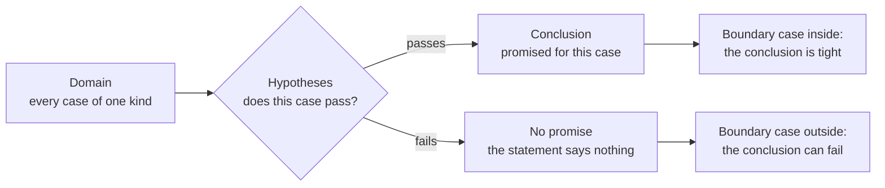

# Reading a statement: quantifiers, domain, hypotheses, conclusion, and the boundary cases

[Syllabus](../../../SYLLABUS.md) → [Frontier](../README.md) → [How Research Works](../README.md#s01) → Reading a statement

---

## General Overview

The four-colour theorem was proved with a computer in 1976 and published in 1977. Its short form fits in one line: every map can be coloured with four colours so that neighbouring countries get different colours.

Read that line too fast and it is false. Utah, Colorado, New Mexico and Arizona meet at one point, the Four Corners. Cut a round cake into six slices and all six meet at the centre. If "neighbours" included regions that touch at a single point, the cake would need six colours, not four.

The theorem survives because its exact statement says two things the short form drops. Neighbours share a border of positive length, not a point. And each country is one connected piece. Remove either one and the claim is false.

Research statements are built like this: every word does a job. This card reads three of them, each into the same four parts, and tests each part on small cases.

- **The four-colour theorem**, proved.
- **Goldbach's conjecture**, open: every even number above 2 is a sum of two primes.
- **The Navier-Stokes problem**, statement (A) from the official Clay Millennium Prize description: do smooth fluid flows in three dimensions last for all time?

**Most research statements have the shape "for every case in a named domain, if the hypotheses hold, then the conclusion holds", and the rest, like Clay's (C), have the opposite shape "some case passes the hypotheses and misses the conclusion"; read one by naming its four parts, then test it at its boundary: a case just inside the hypotheses, where the conclusion is tight, and a case just outside, where it fails.**

**What kind of fact this is:** a method of reading, plus small facts checked by computer on this card: colouring counts for six small maps, Goldbach for every even number up to 10,000 (checked, which proves nothing beyond), and the data clauses of the Navier-Stokes statement on two starting flows. The card settles none of the three problems.

### The picture: a statement is a filter and a promise



The promise covers only the cases that pass every hypothesis. The two boundary tests show where it starts and why it cannot reach further.

---

## The formula

Four terms come first, in words. [Quantifiers](../../01-Foundations/05-Logic/04-quantifiers.md) already defined the **domain**: the set of cases a "for every" ranges over.

- A **hypothesis** is a condition a case must pass before the statement promises anything about it.
- The **conclusion** is what the statement promises for each case that passes.
- A **boundary case** is a case at the edge of the hypotheses. Just inside, it shows the conclusion cannot be made stronger. Just outside (one hypothesis dropped, the rest kept), it shows that hypothesis is needed.
- A **parse** is the statement rewritten in the standard shape below, with every hidden "every" and "some" written out.

The standard shape:

```math
\forall s \in D:\quad \mathrm{Hyp}(s) \;\Rightarrow\; \mathrm{Concl}(s)
```

**Read it aloud:** for every case $`s`$ in the domain $`D`$, if $`s`$ passes the hypotheses, then the conclusion holds for $`s`$.

The Navier-Stokes statement (A), parsed. The equations are the incompressible Navier-Stokes equations, derived on wing 19's card [Navier-Stokes](../../19-Partial%20differential%20equations/07-Nonlinear%20PDE%20and%20Fluids/01-navier-stokes-derivation.md): Newton's law for each parcel of fluid, plus "no net outflow at any point" (divergence-free, written $`\mathrm{div}\, u = 0`$).

```math
\forall \nu > 0 \;\; \forall u^\circ \in C^\infty(\mathbb{R}^3):\;\; \big[\, \mathrm{div}\, u^\circ = 0,\ |\partial^\alpha u^\circ(\mathbf{x})| \le C_{\alpha K}(1 + |\mathbf{x}|)^{-K}\ \text{for all } \alpha, K,\ f = 0 \,\big] \;\Rightarrow\; \exists\, u, p \in C^\infty(\mathbb{R}^3 \times [0, \infty))\ \exists\, C:\ \text{they solve the equations},\ u(\mathbf{x}, 0) = u^\circ(\mathbf{x}),\ \int_{\mathbb{R}^3} |u(\mathbf{x}, t)|^2\, d\mathbf{x} < C \text{ for all } t \ge 0
```

**Read it aloud:** for every positive viscosity and every smooth starting velocity on all of space that is divergence-free and dies away faster than any power of distance, with no outside force, there is a smooth velocity and pressure, for all future time, that solve the equations, start from that velocity, and keep a bounded total energy.

| Symbol | Plain meaning | In our example | Push it up and the answer… |
| --- | --- | --- | --- |
| $`\forall`$, $`\exists`$, $`\neg`$, $`\wedge`$ | for every; there is at least one; not; and (wing 01) | every $`\nu`$ and every start; some solution | — |
| $`D`$, $`s`$ | the domain; one case drawn from it | smooth velocity fields on space; one start | a bigger domain makes a stronger claim |
| $`\mathrm{Hyp}(s)`$, $`\Rightarrow`$ | the hypotheses; "if … then" | divergence-free, decaying, no force | more hypotheses make a weaker claim |
| $`\mathrm{Concl}(s)`$ | what is promised for each case that passes | a smooth solution for all time, bounded energy | demand more and the claim gets stronger |
| $`\mathbf{x} = (x, y, z)`$, $`t`$, $`n`$ | position; time; number of space dimensions | $`t \ge 0`$; $`n = 3`$ | $`n = 2`$ is solved: a different statement |
| $`u`$, $`p`$ | the fluid's velocity and pressure: the unknowns | found, not given | — |
| $`u^\circ`$ | the starting velocity: the data | start A, peak speed 0.857764 | small starts are known to stay smooth |
| $`\nu`$ | viscosity (nu): the fluid's internal friction, above 0 | any positive value; 0.01 in start B | $`\nu = 0`$ gives the Euler equations, a different problem |
| $`f`$ | an outside force pushing the fluid | 0 in (A); allowed in (C) | allowing it changes the problem |
| $`\partial^\alpha`$, $`K`$, $`C_{\alpha K}`$ | any derivative of the start; any power; a constant for each pair | start A: $`(1+\lvert\mathbf{x}\rvert)^{10}`$ × speed at $`\lvert\mathbf{x}\rvert = 5`$ is 0.008398 | larger $`K`$: faster decay demanded |
| $`C^\infty`$, $`C`$ | smooth: every derivative exists and is continuous; an energy bound | start A's energy integral 3.937402 | — |
| $`\mathbb{R}^3`$, $`\mathbb{R}^3/\mathbb{Z}^3`$ | all of space; space repeating every unit in each direction | (A) and (C); (B) and (D) | — |

### When it holds

A parse is faithful only under these conditions.

- **It starts from the exact source text.** A summary such as "do smooth fluid flows last forever?" drops $`n = 3`$, $`f = 0`$, the decay clause and the energy bound. Each dropped clause changes which flows count.
- **Every hidden quantifier is written out.** "A map can be four-coloured" means every map. Read it as "some map" and the claim becomes trivial.
- **The order of quantifiers is kept.** In (A), $`\exists C`$ comes after $`\forall u^\circ`$, so the energy bound may depend on the start. Move $`\exists C`$ to the front and the claim demands one bound for every start, a different and stronger statement.
- **Every defined word keeps its definition.** "Prime" excludes 1. Count 1 as prime and 2 = 1 + 1 "passes", so the hypothesis "above 2" looks pointless when it is not.
- **Negations are computed by rule, not by ear.** The opposite of (A) is not the Clay statement (C); Step 3 shows why.

---

## Why it works

### Step 0: a statement can only fail inside its fence

The hypotheses are a fence. Outside it the statement promises nothing. So it is false only if some case inside the fence misses the conclusion.

That gives the whole method. Find the fence (domain and hypotheses), find the promise (conclusion), then test cases on both sides of each fence post. A case inside tests the promise. A case just outside tests whether that post is needed.

### Step 1: put it in the standard shape

Most statements hide their quantifiers. "Every planar map" hides nothing. "A map can be coloured" hides a "for every". "There is a smooth solution" hides an "exists", and Clay's "bounded energy" hides an "exists $`C`$" before a "for all $`t`$".

Write each one out, in the order the statement means. [Quantifiers](../../01-Foundations/05-Logic/04-quantifiers.md) showed why the order matters: whatever comes second may depend on whatever came first.

### Step 2: the three statements, parsed

| Part | Four-colour theorem | Goldbach's conjecture | Navier-Stokes (A) |
| --- | --- | --- | --- |
| Domain | every map drawn on the plane | every whole number | every viscosity above 0 and every smooth start on all of space |
| Hypotheses | each region one connected piece; neighbours share a border of positive length | the number is even; it is above 2 | $`n = 3`$; divergence-free; decays faster than any power; no force |
| Conclusion | some colouring with at most four colours gives neighbours different colours | some two primes, equal allowed, add to it | a smooth solution exists for all time, with bounded energy |
| Hidden quantifiers | for every map, there is a colouring | for every number, there are two primes | for every start, there are $`u`$, $`p`$ and $`C`$ |
| Status | proved: computer proof 1977, second proof 1997, re-checked by a proof assistant ([Machines in proofs](06-computer-assistance-and-formal-verification.md)) | open as of 2026-11-23; checked by computer to 4 × 10^18 | open as of 2026-11-23: no proof of (A) to (D) accepted; Clay lists it "Active", in its word (shelf 02's card [Navier-Stokes](../02-The%20Millennium%20Problems/04-navier-stokes-existence-and-smoothness.md)) |

The status row uses the separate fields of [Kinds of claim](02-theorem-conjecture-model-approximation.md): the kind of claim, and its dated status.

### Step 3: the negation, and why (C) is not "not (A)"

The negation of the standard shape follows from the quantifier rules:

```math
\neg\big(\forall s \in D:\ \mathrm{Hyp}(s) \Rightarrow \mathrm{Concl}(s)\big) \;\equiv\; \exists s \in D:\ \mathrm{Hyp}(s) \wedge \neg\,\mathrm{Concl}(s)
```

**Read it aloud:** the statement is false exactly when some case passes every hypothesis and still misses the conclusion. Here $`\neg`$ means "not" and $`\wedge`$ means "and".

That single case is a counterexample, as on [Counterexamples](03-how-a-counterexample-works.md). For (A), it would be a positive viscosity and a decaying, divergence-free start, with no force, whose solution does not stay smooth with bounded energy.

Clay's statement (C) asks for something else. It allows a smooth outside force $`f`$, decaying in space and time. So (C) is not the negation of (A):

- **A proof of (C) does not disprove (A).** A forced flow that breaks down says nothing about unforced ones.
- **(A) and (C) could both be true.** Every unforced flow might stay smooth while some forced flow breaks down.
- **Clay accepts a proof of any one of (A), (B), (C) or (D).** The four are separate targets, not two pairs of opposites.

Statements (B) and (D) are the same pair on $`\mathbb{R}^3/\mathbb{Z}^3`$: space that repeats every unit in each direction, so a flow is a pattern copied across a lattice of unit cubes.

### Step 4: boundary cases just inside show the conclusion is tight

A case just inside the fence where the conclusion only barely holds shows it cannot be made stronger. A case inside the fence also shows the fence is not empty, so the statement is about something.

- **Four colours are needed, not three.** Belgium, France, Germany and Luxembourg each border the other three. Four mutual neighbours need four colours. With the Netherlands added, the five countries have 48 four-colourings and no three-colouring.
- **"Two primes" must allow two equal ones.** 4 = 2 + 2 and 6 = 3 + 3 are the only splits. Ask for two different primes and both fail.
- **(A)'s data clauses are satisfiable.** Start A, $`u^\circ = e^{-(x^2+y^2+z^2)}(-2y,\ 2x,\ 0)`$, is a smooth swirl round the vertical axis. It is divergence-free, it decays faster than any power, and its energy integral is finite, 3.937402. So the statement does cover real flows; it is not empty.

### Step 5: boundary cases just outside show each hypothesis is needed

Drop one hypothesis, keep the rest, and look for a case where the conclusion fails.

- **Drop "borders, not points".** The six-slice cake, with point contacts counted, makes 15 neighbour pairs and needs six colours. Counted by borders only, it needs two.
- **Drop "one connected piece".** Five regions that all touch need five colours. No plane map of one-piece regions can do this: a plane map with 5 regions has at most 3 × 5 − 6 = 9 neighbour pairs, and five mutual neighbours make 10 ([Why some graphs cannot be drawn flat](../../04-Combinatorics%20and%20graphs/12-Planarity%20and%20Colouring/02-edge-bound-and-kuratowski.md)). Let one region come in two pieces and five regions can all touch in the plane: draw a map in which every pair touches but one, 9 pairs, which the plane allows, then give one region of that pair a second piece beside the other.
- **Drop "above 2".** 2 has no split: 1 is not prime.
- **Drop "even".** 11 has no split. An odd sum of two primes must use 2, and 11 − 2 = 9 is not prime.
- **Drop (A)'s decay clause.** Start B is $`u = e^{-4\pi^2\nu t}\big(\sin 2\pi z + \cos 2\pi y,\ \sin 2\pi x + \cos 2\pi z,\ \sin 2\pi y + \cos 2\pi x\big)`$. It is an exact smooth solution for all time, with pressure $`p = -\tfrac12 |u|^2`$. But it does not decay: its energy integral is 3 in one unit cube, 24 in a cube of side 2, 81 in side 3. On all of space it is infinite, so the bounded-energy conclusion fails.

Start B is a pattern repeating every unit, so it belongs to (B), not (A). There it is one start whose solution stays smooth. One success inside (B)'s fence proves nothing about all starts, the lesson of [Proof](01-what-counts-as-a-proof.md).

<details>
<summary>Why start B solves the Navier-Stokes equations exactly</summary>

Write $`k = 2\pi`$. Each component of start B is a sum of sines and cosines of $`k`$ times one coordinate. Three facts follow.

Divergence. The first component does not depend on $`x`$, the second not on $`y`$, the third not on $`z`$. So the divergence is 0.

Bend. Differentiating any of these waves twice gives back minus itself times $`k^2`$. So the Laplacian of $`u`$ is $`-k^2 u`$, and the friction term $`\nu`$ times it is $`-\nu k^2 u`$. The time derivative of the factor $`e^{-\nu k^2 t}`$ gives the same $`-\nu k^2 u`$, so the time change and the friction balance.

Self-push. Here $`\nabla`$ takes the slopes along $`x`$, $`y`$ and $`z`$, and $`\times`$ is the cross product, as in wing 19. This flow has curl $`\nabla \times u`$ equal to $`k u`$: its spin points along its own velocity. A vector identity then turns the self-push $`(u \cdot \nabla)u`$ into a pure gradient:

$`\displaystyle (u\cdot\nabla)u = \nabla\big(\tfrac12|u|^2\big) - u \times (\nabla \times u) = \nabla\big(\tfrac12|u|^2\big) - k\, u \times u = \nabla\big(\tfrac12|u|^2\big)`$

The pressure $`p = -\tfrac12|u|^2`$ cancels it exactly. The code checks the whole equation at three points by finite differences, without using any of this algebra.

</details>

### Step 6: what a small test can and cannot do

| Test result | What it shows |
| --- | --- |
| A case inside the fence where the conclusion holds | one instance: evidence, never proof |
| A case inside the fence where the conclusion fails | the statement is false (a counterexample) |
| A case just outside where the conclusion fails | that hypothesis is needed; the statement stands |
| A case just inside where the conclusion is tight | the conclusion cannot be strengthened |

A hypothesis can also be there only to make a proof possible. Then no boundary case outside fails, and dropping it gives a stronger, open statement. Telling the two kinds apart is part of reading a paper ([Reading a paper](05-reading-a-research-paper.md)).

---

## Worked numbers, by hand

| Step | Arithmetic | Value |
| --- | --- | --- |
| Belgium, France, Germany, Luxembourg, four colours | 4 × 3 × 2 × 1 | 24 |
| add the Netherlands: avoid Belgium's and Germany's colours | 24 × 2 | **48** |
| the same four, three colours | 3 × 2 × 1 × 0 | 0 |
| six-slice cake, point contacts counted, six colours | 6 × 5 × 4 × 3 × 2 × 1 | 720 |
| six-slice cake, borders only, two colours | alternate the two | 2 |
| five regions all touching: pairs against the plane limit | 10 against 3 × 5 − 6 | 10 > 9 |
| Goldbach splits of 100 | 3+97, 11+89, 17+83, 29+71, 41+59, 47+53 | 6 |
| start A's energy integral | $`2\,(\pi/2)^{3/2}`$ | 3.937402 |
| start A's peak speed | $`\sqrt{2}\, e^{-1/2}`$ | 0.857764 |
| start B's energy, cube of side 1, 2, 3 | 3 × 1, 3 × 8, 3 × 27 | 3, 24, 81 |
| start B, one cube at $`t = 1`$, $`\nu = 0.01`$ | $`3\, e^{-2 \times 0.01 \times 4\pi^2}`$ | 1.3621 |

The four-colour theorem is tight at four, Goldbach's hypotheses each exclude a real failure, and Navier-Stokes (A) covers real decaying flows while excluding start B, whose energy grows like the cube of the box side.

### What breaks if you drop a piece

| Mistake | Comes out at | What went wrong |
| --- | --- | --- |
| Counting point contacts as borders | six-slice cake needs 6 colours | the theorem's neighbours share a border of positive length |
| Asking for two different primes | 4 and 6 fail | the conjecture allows equal primes |
| Testing an odd number | 11 has no split | "even" is a hypothesis |
| Dropping (A)'s decay clause | start B's energy 3, 24, 81, without bound | the bounded-energy conclusion needs decaying data |

The code prints every row.

---

## Code, from first principles, and it actually runs

Nothing is imported that knows an answer. Each statement gets two independent roads. Colourings are counted by trying every colouring, and again by the chromatic polynomial (a count of colourings built by deleting and merging edges, from [The chromatic polynomial](../../04-Combinatorics%20and%20graphs/12-Planarity%20and%20Colouring/04-chromatic-polynomial.md)). Primes come from a sieve and again from trial division. Start A's energy is a grid sum against the Gaussian integral done by hand. Start B is checked against the Navier-Stokes equations by finite differences (slopes from nearby values), and its energy by a grid sum against the formula.

### Python

```python
# Reading a statement -- the check behind the card.  Standard library only.
# Three statements, each tested on small cases: the four-colour theorem on six
# small maps, Goldbach on the even numbers to 10,000, and the data clauses of
# Clay's Navier-Stokes statement (A) on two starting flows.
from math import exp, sin, cos, pi, sqrt

def brute(n, edges, k):          # road 1: try every colouring, count the proper ones
    count = 0
    for code in range(k ** n):
        c = [(code // k ** i) % k for i in range(n)]
        count += all(c[a] != c[b] for a, b in edges)
    return count
def poly(n, edges, k):           # road 2: deletion-contraction, P(G) = P(G-e) - P(G/e)
    if not edges: return k ** n
    (a, b), rest = edges[0], edges[1:]
    merged = {tuple(sorted((a if x == b else x, a if y == b else y))) for x, y in rest}
    return poly(n, rest, k) - poly(n - 1, sorted(e for e in merged if e[0] != e[1]), k)
def relabel(edges):              # vertices 0..n-1, as the contraction above expects
    names = sorted({v for e in edges for v in e})
    return len(names), [tuple(sorted((names.index(a), names.index(b)))) for a, b in edges]
def ring(m): return [(i, (i + 1) % m) for i in range(m)]
def complete(m): return [(i, j) for i in range(m) for j in range(i + 1, m)]
MAPS = [("Benelux, France, Germany", [("BE", "NL"), ("BE", "LU"), ("BE", "FR"), ("BE", "DE"),
          ("NL", "DE"), ("LU", "FR"), ("LU", "DE"), ("FR", "DE")]),
        ("Four Corners, borders only", ring(4)), ("Four Corners, points count", complete(4)),
        ("6-slice cake, borders only", ring(6)), ("6-slice cake, points count", complete(6)),
        ("5 regions all touching", complete(5))]
print("map                           regions pairs  most  colours  ways at k-1, k (brute / poly)")
needed, pairs = {}, {}
for name, raw in MAPS:
    n, edges = relabel(raw)
    k = next(k for k in range(1, n + 1) if brute(n, edges, k) > 0)
    lo, hi = brute(n, edges, k - 1), brute(n, edges, k)
    assert (lo, hi) == (poly(n, edges, k - 1), poly(n, edges, k))   # the two roads agree
    needed[name], pairs[name] = k, (len(edges), 3 * n - 6)
    print(f"{name:<30}{n:>7}{len(edges):>6}{3 * n - 6:>6}{k:>9}   {lo}, {hi} / {lo}, {hi}")
assert needed["Benelux, France, Germany"] == 4 and needed["6-slice cake, points count"] == 6
assert needed["5 regions all touching"] == 5 and pairs["5 regions all touching"] == (10, 9)

N = 10000                        # Goldbach: primes two ways, then every even number to N
sieve = [False, False] + [True] * (N - 1)
for i in range(2, int(N ** 0.5) + 1):
    if sieve[i]: sieve[i * i::i] = [False] * len(sieve[i * i::i])
trial = [m > 1 and all(m % d for d in range(2, int(m ** 0.5) + 1)) for m in range(N + 1)]
assert sieve == trial
def ways(m, distinct=False):
    return sum(1 for p in range(2, m // 2 + 1) if sieve[p] and sieve[m - p] and not (distinct and 2 * p == m))
print(f"primes below {N:,}: {sum(sieve)} (sieve and trial division agree)")
print("ways as a sum of two primes:  " + "  ".join(f"{m}: {ways(m)}" for m in (2, 4, 6, 8, 100)))
print("the same, two different primes: " + "  ".join(f"{m}: {ways(m, True)}" for m in (4, 6, 8)))
evens = range(4, N + 1, 2)
fail = [m for m in evens if ways(m) == 0]
fail_distinct = [m for m in evens if ways(m, True) == 0]
odd_fail = [m for m in range(3, 31, 2) if ways(m) == 0]
print(f"even numbers 4 to {N:,} checked: {len(evens):,}; with no split: {len(fail)}")
print(f"with no split into two different primes: {fail_distinct}")
print(f"odd numbers 3 to 29 with no split: {odd_fail}")
print("quoted, not computed: even numbers checked to 4e18 (published 2014)")
assert fail == [] and fail_distinct == [4, 6] and ways(2) == 0 and ways(100) == 6
assert odd_fail[:3] == [3, 11, 17]

def swirl(x, y, z):              # start A: a smooth swirl round the z-axis
    g = exp(-(x * x + y * y + z * z))
    return (-2 * y * g, 2 * x * g, 0.0)
h, worst = 1e-4, 0.0
for x, y, z in [(0.3, -0.7, 0.2), (1.1, 0.4, -0.5), (-0.6, 0.9, 1.3)]:
    d = ((swirl(x + h, y, z)[0] - swirl(x - h, y, z)[0]) + (swirl(x, y + h, z)[1] - swirl(x, y - h, z)[1])) / (2 * h)
    worst = max(worst, abs(d))
peak = max(sqrt(sum(c * c for c in swirl(i / 1000, 0, 0))) for i in range(0, 3001))
decay = [(r, (1 + r) ** 10 * sqrt(sum(c * c for c in swirl(r, 0, 0)))) for r in (5, 7, 9)]
s, m = 0.125, 80                  # road 1: energy by a grid sum over the cube [-5, 5]^3
grid = sum(sum(c * c for c in swirl(-5 + (i + 0.5) * s, -5 + (j + 0.5) * s, -5 + (l + 0.5) * s))
           for i in range(m) for j in range(m) for l in range(m)) * s ** 3
exact = 2 * (pi / 2) ** 1.5       # road 2: the Gaussian integral done by hand
print(f"start A: divergence at 3 points below 1e-6: {worst < 1e-6}; peak speed {peak:.6f} "
      f"(formula {sqrt(2) * exp(-0.5):.6f})")
print("start A: (1+|x|)^10 x speed at |x| = 5, 7, 9: " + ", ".join(f"{v:.3e}" for _, v in decay))
print(f"start A: energy integral, grid {grid:.6f}, formula {exact:.6f}")
assert worst < 1e-6 and abs(peak - sqrt(2) * exp(-0.5)) < 1e-6 and abs(grid - exact) < 1e-6
assert decay[0][1] > decay[1][1] > decay[2][1]

k, nu = 2 * pi, 0.01             # start B: a flow repeating in the unit cube, exact solution
def abc(x, y, z, t):
    a = exp(-nu * k * k * t)
    return [a * (sin(k * z) + cos(k * y)), a * (sin(k * x) + cos(k * z)), a * (sin(k * y) + cos(k * x))]
def pres(x, y, z, t): return -0.5 * sum(c * c for c in abc(x, y, z, t))
def d(f, p, axis, h):            # centred difference along one axis (axis 3 is time)
    a, b = list(p), list(p); a[axis] += h; b[axis] -= h
    return (f(*a) - f(*b)) / (2 * h)
left, biggest = 0.0, 0.0
for p in [(0.1, 0.2, 0.3, 0.5), (0.7, 0.4, 0.9, 0.5), (0.25, 0.6, 0.05, 1.0)]:
    u = abc(*p)
    for i in range(3):
        comp = lambda *q: abc(*q)[i]
        ut = d(comp, p, 3, 1e-5)
        conv = sum(u[j] * d(comp, p, j, 1e-5) for j in range(3))
        lap = sum((comp(*[p[q] + (1e-3 if q == j else 0) for q in range(4)]) - 2 * u[i]
                   + comp(*[p[q] - (1e-3 if q == j else 0) for q in range(4)])) / 1e-6 for j in range(3))
        left = max(left, abs(ut + conv + d(pres, p, i, 1e-5) - nu * lap))
        biggest = max(biggest, abs(conv))
print(f"start B: Navier-Stokes leftover at 3 points below 1e-4: {left < 1e-4} (largest term {biggest:.2f})")
cells = []
for side in (1, 2, 3):           # energy in a box of side 1, 2, 3 cells, grid exact for these waves
    q = 16 * side
    cells.append(sum(sum(c * c for c in abc(i / 16, j / 16, l / 16, 0)) for i in range(q)
                     for j in range(q) for l in range(q)) / 16 ** 3)
print("start B: energy integral in a box of side 1, 2, 3: " + ", ".join(f"{e:.4f}" for e in cells)
      + f" (formula 3, 24, 81); one cell at t = 1: {3 * exp(-2 * nu * k * k):.4f}")
assert left < 1e-4 and all(abs(e - 3 * s ** 3) < 1e-9 for e, s in zip(cells, (1, 2, 3)))
print("ALL CHECKS PASS")
```

**Ran 2026-11-23 on macOS, Python 3.14.10, standard library only. All checks passed. Output, pasted from the run:**

```
map                           regions pairs  most  colours  ways at k-1, k (brute / poly)
Benelux, France, Germany            5     8     9        4   0, 48 / 0, 48
Four Corners, borders only          4     4     6        2   0, 2 / 0, 2
Four Corners, points count          4     6     6        4   0, 24 / 0, 24
6-slice cake, borders only          6     6    12        2   0, 2 / 0, 2
6-slice cake, points count          6    15    12        6   0, 720 / 0, 720
5 regions all touching              5    10     9        5   0, 120 / 0, 120
primes below 10,000: 1229 (sieve and trial division agree)
ways as a sum of two primes:  2: 0  4: 1  6: 1  8: 1  100: 6
the same, two different primes: 4: 0  6: 0  8: 1
even numbers 4 to 10,000 checked: 4,999; with no split: 0
with no split into two different primes: [4, 6]
odd numbers 3 to 29 with no split: [3, 11, 17, 23, 27, 29]
quoted, not computed: even numbers checked to 4e18 (published 2014)
start A: divergence at 3 points below 1e-6: True; peak speed 0.857764 (formula 0.857764)
start A: (1+|x|)^10 x speed at |x| = 5, 7, 9: 8.398e-03, 7.881e-12, 1.195e-24
start A: energy integral, grid 3.937402, formula 3.937402
start B: Navier-Stokes leftover at 3 points below 1e-4: True (largest term 5.14)
start B: energy integral in a box of side 1, 2, 3: 3.0000, 24.0000, 81.0000 (formula 3, 24, 81); one cell at t = 1: 1.3621
ALL CHECKS PASS
```

### Rust

Same numbers, same labels, built with `rustc --edition 2021 -O`.

```rust
// Reading a statement -- the same check as the Python, in Rust.  No crates.
// Three statements, each tested on small cases: the four-colour theorem on six
// small maps, Goldbach on the even numbers to 10,000, and the data clauses of
// Clay's Navier-Stokes statement (A) on two starting flows.
use std::collections::BTreeSet;
use std::f64::consts::PI;
type E = Vec<(usize, usize)>;
fn brute(n: usize, edges: &E, k: usize) -> i64 {        // road 1: try every colouring
    let mut count = 0;
    for code in 0..k.pow(n as u32) {
        let c: Vec<usize> = (0..n).map(|i| (code / k.pow(i as u32)) % k).collect();
        if edges.iter().all(|&(a, b)| c[a] != c[b]) { count += 1; }
    }
    count
}
fn poly(n: usize, edges: &[(usize, usize)], k: i64) -> i64 {   // road 2: deletion-contraction
    if edges.is_empty() { return k.pow(n as u32); }
    let ((a, b), rest) = (edges[0], &edges[1..]);
    let mv = |x: usize| if x == b { a } else { x };
    let merged: BTreeSet<(usize, usize)> = rest.iter()
        .map(|&(x, y)| { let (p, q) = (mv(x), mv(y)); (p.min(q), p.max(q)) }).filter(|e| e.0 != e.1).collect();
    let m: E = merged.into_iter().collect();
    poly(n, rest, k) - poly(n - 1, &m, k)
}
fn relabel(raw: &[(&str, &str)]) -> (usize, E) {      // vertices 0..n-1
    let names: Vec<&str> = raw.iter().flat_map(|&(a, b)| [a, b]).collect::<BTreeSet<_>>().into_iter().collect();
    let ix = |s: &str| names.iter().position(|&x| x == s).unwrap();
    (names.len(), raw.iter().map(|&(a, b)| (ix(a).min(ix(b)), ix(a).max(ix(b)))).collect())
}
fn ring(m: usize) -> E { (0..m).map(|i| { let j = (i + 1) % m; (i.min(j), i.max(j)) }).collect() }
fn complete(m: usize) -> E { (0..m).flat_map(|i| (i + 1..m).map(move |j| (i, j))).collect() }
fn commas(n: usize) -> String {                       // Python's {:,}
    let s = n.to_string();
    s.chars().enumerate().map(|(i, c)| if i > 0 && (s.len() - i) % 3 == 0 { format!(",{}", c) } else { c.to_string() }).collect()
}
fn sci(v: f64) -> String {                             // Python's {:.3e}
    let s = format!("{:.3e}", v); let (m, e) = s.split_once('e').unwrap();
    let e: i32 = e.parse().unwrap();
    format!("{}e{}{:02}", m, if e < 0 { '-' } else { '+' }, e.abs())
}
fn swirl(x: f64, y: f64, z: f64) -> [f64; 3] {        // start A: a smooth swirl round the z-axis
    let g = (-(x * x + y * y + z * z)).exp();
    [-2.0 * y * g, 2.0 * x * g, 0.0]
}
fn norm(v: [f64; 3]) -> f64 { v.iter().map(|c| c * c).sum::<f64>().sqrt() }
const K: f64 = 2.0 * PI;
const NU: f64 = 0.01;
fn abc(p: &[f64; 4]) -> [f64; 3] {                     // start B: repeats in the unit cube
    let (x, y, z, a) = (p[0], p[1], p[2], (-NU * K * K * p[3]).exp());
    [a * ((K * z).sin() + (K * y).cos()), a * ((K * x).sin() + (K * z).cos()), a * ((K * y).sin() + (K * x).cos())]
}
fn pres(p: &[f64; 4]) -> f64 { -0.5 * abc(p).iter().map(|c| c * c).sum::<f64>() }
fn shift(p: &[f64; 4], axis: usize, h: f64) -> [f64; 4] { let mut q = *p; q[axis] += h; q }
fn d(f: &dyn Fn(&[f64; 4]) -> f64, p: &[f64; 4], axis: usize, h: f64) -> f64 {   // centred difference
    (f(&shift(p, axis, h)) - f(&shift(p, axis, -h))) / (2.0 * h)
}
fn main() {
    let benelux: E = relabel(&[("BE", "NL"), ("BE", "LU"), ("BE", "FR"), ("BE", "DE"), ("NL", "DE"),
        ("LU", "FR"), ("LU", "DE"), ("FR", "DE")]).1;
    let maps: Vec<(&str, usize, E)> = vec![("Benelux, France, Germany", 5, benelux),
        ("Four Corners, borders only", 4, ring(4)), ("Four Corners, points count", 4, complete(4)),
        ("6-slice cake, borders only", 6, ring(6)), ("6-slice cake, points count", 6, complete(6)),
        ("5 regions all touching", 5, complete(5))];
    println!("map                           regions pairs  most  colours  ways at k-1, k (brute / poly)");
    let mut needed = Vec::new();
    for (name, n, edges) in &maps {
        let k = (1..=*n).find(|&k| brute(*n, edges, k) > 0).unwrap();
        let (lo, hi) = (brute(*n, edges, k - 1), brute(*n, edges, k));
        assert!((lo, hi) == (poly(*n, edges, k as i64 - 1), poly(*n, edges, k as i64)));
        needed.push((k, edges.len(), 3 * n - 6));
        println!("{:<30}{:>7}{:>6}{:>6}{:>9}   {}, {} / {}, {}", name, n, edges.len(), 3 * n - 6, k, lo, hi, lo, hi);
    }
    assert!(needed[0].0 == 4 && needed[4].0 == 6);
    assert!(needed[5].0 == 5 && (needed[5].1, needed[5].2) == (10, 9));

    const N: usize = 10000;                            // Goldbach
    let mut sieve = vec![true; N + 1]; sieve[0] = false; sieve[1] = false;
    let mut i = 2;
    while i * i <= N { if sieve[i] { let mut j = i * i; while j <= N { sieve[j] = false; j += i; } } i += 1; }
    let trial: Vec<bool> = (0..=N).map(|m| m > 1 && (2..).take_while(|d| d * d <= m).all(|d| m % d != 0)).collect();
    assert!(sieve == trial);
    let ways = |m: usize, distinct: bool| (2..=m / 2).filter(|&p| sieve[p] && sieve[m - p] && !(distinct && 2 * p == m)).count();
    println!("primes below {}: {} (sieve and trial division agree)", commas(N), sieve.iter().filter(|&&b| b).count());
    let w: Vec<String> = [2, 4, 6, 8, 100].iter().map(|&m| format!("{}: {}", m, ways(m, false))).collect();
    println!("ways as a sum of two primes:  {}", w.join("  "));
    let w: Vec<String> = [4, 6, 8].iter().map(|&m| format!("{}: {}", m, ways(m, true))).collect();
    println!("the same, two different primes: {}", w.join("  "));
    let evens: Vec<usize> = (4..=N).step_by(2).collect();
    let fail: Vec<usize> = evens.iter().cloned().filter(|&m| ways(m, false) == 0).collect();
    let fail_distinct: Vec<usize> = evens.iter().cloned().filter(|&m| ways(m, true) == 0).collect();
    let odd_fail: Vec<usize> = (3..31).step_by(2).filter(|&m| ways(m, false) == 0).collect();
    println!("even numbers 4 to {} checked: {}; with no split: {}", commas(N), commas(evens.len()), fail.len());
    println!("with no split into two different primes: {:?}", fail_distinct);
    println!("odd numbers 3 to 29 with no split: {:?}", odd_fail);
    println!("quoted, not computed: even numbers checked to 4e18 (published 2014)");
    assert!(fail.is_empty() && fail_distinct == vec![4, 6] && ways(2, false) == 0 && ways(100, false) == 6);
    assert!(odd_fail[..3] == [3, 11, 17]);

    let (h, mut worst) = (1e-4, 0.0f64);
    for &(x, y, z) in &[(0.3, -0.7, 0.2), (1.1, 0.4, -0.5), (-0.6, 0.9, 1.3)] {
        let dv = ((swirl(x + h, y, z)[0] - swirl(x - h, y, z)[0]) + (swirl(x, y + h, z)[1] - swirl(x, y - h, z)[1])) / (2.0 * h);
        worst = worst.max(dv.abs());
    }
    let peak = (0..=3000).map(|i| norm(swirl(i as f64 / 1000.0, 0.0, 0.0))).fold(0.0f64, f64::max);
    let decay: Vec<f64> = [5.0f64, 7.0, 9.0].iter().map(|&r| (1.0 + r).powi(10) * norm(swirl(r, 0.0, 0.0))).collect();
    let (s, m) = (0.125, 80);                         // road 1: grid sum over [-5, 5]^3
    let mut grid = 0.0;
    for i in 0..m { for j in 0..m { for l in 0..m {
        let c = |q: usize| -5.0 + (q as f64 + 0.5) * s;
        grid += swirl(c(i), c(j), c(l)).iter().map(|v| v * v).sum::<f64>();
    } } }
    grid *= s * s * s;
    let exact = 2.0 * (PI / 2.0).powf(1.5);           // road 2: the Gaussian integral by hand
    let pf = 2.0f64.sqrt() * (-0.5f64).exp();
    println!("start A: divergence at 3 points below 1e-6: {}; peak speed {:.6} (formula {:.6})",
             if worst < 1e-6 { "True" } else { "False" }, peak, pf);
    println!("start A: (1+|x|)^10 x speed at |x| = 5, 7, 9: {}", decay.iter().map(|&v| sci(v)).collect::<Vec<_>>().join(", "));
    println!("start A: energy integral, grid {:.6}, formula {:.6}", grid, exact);
    assert!(worst < 1e-6 && (peak - pf).abs() < 1e-6 && (grid - exact).abs() < 1e-6);
    assert!(decay[0] > decay[1] && decay[1] > decay[2]);

    let (mut left, mut biggest) = (0.0f64, 0.0f64);
    for p in [[0.1, 0.2, 0.3, 0.5], [0.7, 0.4, 0.9, 0.5], [0.25, 0.6, 0.05, 1.0]] {
        let u = abc(&p);
        for i in 0..3 {
            let comp = move |q: &[f64; 4]| abc(q)[i];
            let ut = d(&comp, &p, 3, 1e-5);
            let conv: f64 = (0..3).map(|j| u[j] * d(&comp, &p, j, 1e-5)).sum();
            let lap: f64 = (0..3).map(|j| (comp(&shift(&p, j, 1e-3)) - 2.0 * u[i] + comp(&shift(&p, j, -1e-3))) / 1e-6).sum();
            left = left.max((ut + conv + d(&pres, &p, i, 1e-5) - NU * lap).abs());
            biggest = biggest.max(conv.abs());
        }
    }
    println!("start B: Navier-Stokes leftover at 3 points below 1e-4: {} (largest term {:.2})",
             if left < 1e-4 { "True" } else { "False" }, biggest);
    let mut cells = Vec::new();
    for side in 1..=3usize {                           // energy in a box of side 1, 2, 3 cells
        let q = 16 * side; let mut e = 0.0;
        for i in 0..q { for j in 0..q { for l in 0..q {
            e += abc(&[i as f64 / 16.0, j as f64 / 16.0, l as f64 / 16.0, 0.0]).iter().map(|c| c * c).sum::<f64>();
        } } }
        cells.push(e / 4096.0);
    }
    println!("start B: energy integral in a box of side 1, 2, 3: {} (formula 3, 24, 81); one cell at t = 1: {:.4}",
             cells.iter().map(|e| format!("{:.4}", e)).collect::<Vec<_>>().join(", "), 3.0 * (-2.0 * NU * K * K).exp());
    assert!(left < 1e-4 && cells.iter().zip([1.0f64, 2.0, 3.0]).all(|(e, s)| (e - 3.0 * s * s * s).abs() < 1e-9));
    println!("ALL CHECKS PASS");
}
```

**Ran 2026-11-23 on macOS, rustc 1.98.1, no crates. All checks passed. Output, pasted from the run:**

```
map                           regions pairs  most  colours  ways at k-1, k (brute / poly)
Benelux, France, Germany            5     8     9        4   0, 48 / 0, 48
Four Corners, borders only          4     4     6        2   0, 2 / 0, 2
Four Corners, points count          4     6     6        4   0, 24 / 0, 24
6-slice cake, borders only          6     6    12        2   0, 2 / 0, 2
6-slice cake, points count          6    15    12        6   0, 720 / 0, 720
5 regions all touching              5    10     9        5   0, 120 / 0, 120
primes below 10,000: 1229 (sieve and trial division agree)
ways as a sum of two primes:  2: 0  4: 1  6: 1  8: 1  100: 6
the same, two different primes: 4: 0  6: 0  8: 1
even numbers 4 to 10,000 checked: 4,999; with no split: 0
with no split into two different primes: [4, 6]
odd numbers 3 to 29 with no split: [3, 11, 17, 23, 27, 29]
quoted, not computed: even numbers checked to 4e18 (published 2014)
start A: divergence at 3 points below 1e-6: True; peak speed 0.857764 (formula 0.857764)
start A: (1+|x|)^10 x speed at |x| = 5, 7, 9: 8.398e-03, 7.881e-12, 1.195e-24
start A: energy integral, grid 3.937402, formula 3.937402
start B: Navier-Stokes leftover at 3 points below 1e-4: True (largest term 5.14)
start B: energy integral in a box of side 1, 2, 3: 3.0000, 24.0000, 81.0000 (formula 3, 24, 81); one cell at t = 1: 1.3621
ALL CHECKS PASS
```

The two outputs match line for line.

### Lean

Lean proves the negation rule, the quantifier-order rule and the odd-sum fact in general, and checks the card's small counts exactly.

- A statement in the standard shape is false exactly when some case in the domain passes the hypotheses and misses the conclusion.
- Suppose one bound works for every case. Then each case has a bound of its own.
- The reverse fails: every whole number has a larger one, yet no number is larger than all. So moving "exists" to the front makes a stronger statement.
- Suppose an odd number is a sum of two primes. Then one of the two primes is 2.
- Benelux, France and Germany have 0 three-colourings and 48 four-colourings.
- Four Corners, borders only: one colour fails, and two colours give 2 colourings. With points counted, there are 0 three-colourings and 24 four-colourings.
- The six-slice cake, borders only, has 2 two-colourings. With points counted, it has 15 neighbour pairs.
- Five regions all touching have 0 four-colourings and 10 neighbour pairs, above the plane limit 3 × 5 − 6 = 9.
- The ways to write 2, 4, 6, 8 and 100 as a sum of two primes are 0, 1, 1, 1 and 6.
- With two different primes, 4 and 6 have no split and 8 has one.
- The odd numbers 3 to 29 with no split are 3, 11, 17, 23, 27 and 29.
- Start B's energy formula gives 3, 24 and 81 for cubes of side 1, 2 and 3.

The cake's 720 six-colourings, the 120 five-colourings, Goldbach to 10,000 and the flows of starts A and B are left to the Python and Rust checks.

```lean
-- Reading a statement: a "for every case in the domain, if the hypotheses hold then the conclusion holds" statement is false exactly when some case passes the hypotheses and misses the conclusion, moving an "exists" to the front makes a strictly stronger claim, and an odd sum of two primes must use 2; the card's small colouring and Goldbach counts are checked exactly.
import Mathlib.Data.Nat.Prime.Defs
import Mathlib.Data.Nat.Prime.Basic
import Mathlib.Data.Fintype.Pi
import Mathlib.Data.Finset.Card
import Mathlib.Algebra.Group.Nat.Even
import Mathlib.Tactic.NormNum

/-! A statement in the standard shape is `∀ s ∈ D, Hyp s → Concl s`: a domain `D` of cases,
a hypothesis `Hyp` each case must pass, and a conclusion `Concl` promised for each case that
passes. -/

/-- A statement can only fail inside its fence (Step 0 and Step 3). "For every case `s` in the
domain `D`, if `s` passes the hypotheses then the conclusion holds for `s`" is false exactly
when some case in `D` passes the hypotheses and still misses the conclusion: a counterexample. -/
theorem statement_false_iff_counterexample_inside_fence {α : Type*} (D : Set α)
    (Hyp Concl : α → Prop) :
    ¬ (∀ s ∈ D, Hyp s → Concl s) ↔ ∃ s ∈ D, Hyp s ∧ ¬ Concl s := by
  constructor
  · intro h
    by_contra h'
    exact h (fun s hs hh => by_contra fun hc => h' ⟨s, hs, hh, hc⟩)
  · rintro ⟨s, hs, hh, hc⟩ h
    exact hc (h s hs hh)

/-- The order of quantifiers is kept (When it holds). "There is one bound `C` that works for
every case" implies "every case has a bound `C` of its own", but not the other way round:
every whole number `s` has a number `C` above it, yet no single `C` is above every `s`. So
moving the "exists" to the front makes a different and stronger statement. -/
theorem exists_first_is_stronger {α β : Type*} (D : Set α) (P : α → β → Prop) :
    ((∃ C, ∀ s ∈ D, P s C) → ∀ s ∈ D, ∃ C, P s C) ∧
    ((∀ s : ℕ, ∃ C : ℕ, s < C) ∧ ¬ ∃ C : ℕ, ∀ s : ℕ, s < C) := by
  refine ⟨fun ⟨C, hC⟩ s hs => ⟨C, hC s hs⟩, fun s => ⟨s + 1, Nat.lt_succ_self s⟩, ?_⟩
  rintro ⟨C, hC⟩
  exact lt_irrefl C (hC C)

/-- Why "even" is a hypothesis of Goldbach's conjecture (Step 5). If an odd number is a sum of
two primes, one of the two primes is 2: two odd primes would add to an even number. -/
theorem odd_sum_of_two_primes_uses_two {n p q : ℕ} (hn : Odd n) (hp : p.Prime) (hq : q.Prime)
    (hsum : p + q = n) : p = 2 ∨ q = 2 := by
  rcases hp.eq_two_or_odd with h1 | h1
  · exact Or.inl h1
  rcases hq.eq_two_or_odd with h2 | h2
  · exact Or.inr h2
  obtain ⟨k, hk⟩ := hn
  omega

/-! ### The card's exact small cases -/

/-- The card's `ways(m)`: the splits `m = p + (m - p)` into two primes with `p ≤ m / 2`,
equal primes allowed. -/
def goldbachWays (m : ℕ) : ℕ :=
  ((Finset.range (m / 2 + 1)).filter (fun p => p.Prime ∧ (m - p).Prime)).card

/-- The same count with the two primes required to be different. -/
def goldbachWaysDistinct (m : ℕ) : ℕ :=
  ((Finset.range (m / 2 + 1)).filter (fun p => p.Prime ∧ (m - p).Prime ∧ 2 * p ≠ m)).card

/-- The number of ways to colour `n` regions with `k` colours so that the two regions of every
neighbour pair in `E` get different colours. -/
def properColourings (n k : ℕ) (E : List (Fin n × Fin n)) : ℕ :=
  (Finset.univ.filter (fun c : Fin n → Fin k => ∀ e ∈ E, c e.1 ≠ c e.2)).card

/-- Benelux, France, Germany: Belgium 0, Netherlands 1, Luxembourg 2, France 3, Germany 4. -/
def benelux : List (Fin 5 × Fin 5) :=
  [(0, 1), (0, 2), (0, 3), (0, 4), (1, 4), (2, 3), (2, 4), (3, 4)]

/-- Four regions in a ring, each touching the next along a border (Four Corners). -/
def ring4 : List (Fin 4 × Fin 4) := [(0, 1), (1, 2), (2, 3), (3, 0)]

/-- Six cake slices in a ring, each touching the next along a border. -/
def ring6 : List (Fin 6 × Fin 6) := [(0, 1), (1, 2), (2, 3), (3, 4), (4, 5), (5, 0)]

/-- Every pair of regions touching. -/
def completeEdges (m : ℕ) : List (Fin m × Fin m) :=
  ((List.finRange m).product (List.finRange m)).filter fun e => e.1 < e.2

-- Four colours are needed for Benelux, France, Germany: 0 three-colourings, 48 four-colourings.
example : properColourings 5 3 benelux = 0 := by decide
example : properColourings 5 4 benelux = 48 := by decide
-- Four Corners, borders only: 2 colours suffice (2 ways), 1 does not.
example : properColourings 4 1 ring4 = 0 := by decide
example : properColourings 4 2 ring4 = 2 := by decide
-- Four Corners, points counted: 0 three-colourings, 24 four-colourings.
example : properColourings 4 3 (completeEdges 4) = 0 := by decide
example : properColourings 4 4 (completeEdges 4) = 24 := by decide
-- Six-slice cake, borders only: 2 two-colourings.
example : properColourings 6 2 ring6 = 2 := by decide
-- Six-slice cake, points counted: 15 neighbour pairs; with six colours, 6 × 5 × 4 × 3 × 2 × 1 = 720.
example : (completeEdges 6).length = 15 := by decide
example : 6 * 5 * 4 * 3 * 2 * 1 = 720 := by norm_num
-- Five regions all touching: 0 four-colourings; 10 pairs against the plane limit 3 × 5 − 6 = 9.
set_option maxRecDepth 100000 in
example : properColourings 5 4 (completeEdges 5) = 0 := by decide
example : (completeEdges 5).length = 10 ∧ 3 * 5 - 6 = 9 ∧ 9 < 10 := by decide

-- Goldbach: ways as a sum of two primes, 2: 0, 4: 1, 6: 1, 8: 1, 100: 6.
example : goldbachWays 2 = 0 ∧ goldbachWays 4 = 1 ∧ goldbachWays 6 = 1 ∧ goldbachWays 8 = 1 := by
  decide
example : goldbachWays 100 = 6 := by decide
-- Two different primes: 4: 0, 6: 0, 8: 1.
example : goldbachWaysDistinct 4 = 0 ∧ goldbachWaysDistinct 6 = 0 ∧ goldbachWaysDistinct 8 = 1 := by
  decide
-- Odd numbers 3 to 29 with no split: 3, 11, 17, 23, 27, 29.
example : (List.range' 3 14 2).filter (fun m => goldbachWays m = 0) = [3, 11, 17, 23, 27, 29] := by
  decide

-- Start B's energy in a cube of side 1, 2, 3: 3 × 1, 3 × 8, 3 × 27.
example : 3 * 1 ^ 3 = 3 ∧ 3 * 2 ^ 3 = 24 ∧ 3 * 3 ^ 3 = 81 := by norm_num

#print axioms statement_false_iff_counterexample_inside_fence
#print axioms exists_first_is_stronger
#print axioms odd_sum_of_two_primes_uses_two
```

**Checked 2026-11-23 on macOS, Lean 4.36.0-rc2, Mathlib v4.36.0-rc2. Every proof is complete and uses only Lean's standard axioms. Output, pasted from the run:**

```
'statement_false_iff_counterexample_inside_fence' depends on axioms: [propext, Classical.choice, Quot.sound]
'exists_first_is_stronger' does not depend on any axioms
'odd_sum_of_two_primes_uses_two' depends on axioms: [propext, Quot.sound]
```

> [!TIP]
> **Try changing**
> Guess first, then run it. An assert is a line that stops the program when a number comes out wrong.
> - **Guess first: a five-slice cake.** Replace `ring(6)` and `complete(6)` with `ring(5)` and `complete(5)`. Borders only now needs 3 colours, since an odd ring cannot alternate two. Points counted needs 5. The assert pinned to six stops it.
> - **Guess first: check further.** Set `N` to `20000`. The primes below it number 2262, the 9,999 even numbers all split, and only 4 and 6 still fail with two different primes. All asserts pass: more evidence, still no proof.
> - **Guess first: no friction.** Set `nu` to `0.0` in start B. The leftover stays tiny and the cube's energy at $`t = 1`$ stays 3.0000: start B also solves the Euler equations. The flow passes, but the problem is no longer Navier-Stokes.
> - **Guess first: break the swirl.** Change `2 * x * g` to `2.1 * x * g` in `swirl`. The divergence check prints False and an assert stops it: the start has left (A)'s fence.

---

## The usual mistake

> [!warning]
> **Reading a statement's popular summary instead of the statement.** "Do smooth fluid flows last forever?" is not Navier-Stokes (A). The exact text fixes three dimensions, positive viscosity, no force, decaying data and bounded energy. Start B, a smooth flow that lasts forever, does not answer (A): it fails the decay clause, its energy growing 3, 24, 81 with the box.
>
> - **Taking (C) as "not (A)".** (C) allows a force. Both could be true.
> - **Dropping a hidden word.** Count point contacts and the six-slice cake needs 6 colours, apparently refuting a proved theorem.
> - **Moving an "exists" to the front.** One energy bound for every start is a different claim from one bound per start.
> - **Treating a check as a proof.** 4,999 even numbers up to 10,000 all split; that is evidence, and Goldbach stays open.

---

## Where you meet it in real life

- **Prize problems.** The Clay description states four versions on purpose. Which one a claimed solution proves decides what it settles.
- **Engineering standards.** A safety rule promises a result only for loads, temperatures and materials inside stated limits. A failure outside them is not a counterexample.
- **Software specifications.** A function's documentation lists what inputs it accepts and what it then guarantees. Testers probe the edge of the accepted inputs first, for the same reason as here.

> **Say it back**
> Most research statements say: for every case in a domain, if the hypotheses hold, the conclusion holds. Write every hidden "every" and "some" out, in order. A case just inside the hypotheses where the conclusion is tight shows it cannot be strengthened. A case just outside where it fails shows the hypothesis is needed. Only a case inside the hypotheses that misses the conclusion refutes the statement.

---

## What this builds on

- [Counterexamples](03-how-a-counterexample-works.md): one case inside the fence that misses the conclusion refutes a "for every" claim.
- [Quantifiers](../../01-Foundations/05-Logic/04-quantifiers.md): "for every" and "there is", the domain they range over, and why their order matters.
- [A PDE problem](../../19-Partial%20differential%20equations/01-Classification%20and%20Well-Posedness/01-what-a-pde-problem-is.md): an equation, a region, data and a kind of solution, the four pieces Navier-Stokes (A) specifies.

## Where this goes next

- [Reading a paper](05-reading-a-research-paper.md): find the theorem in a paper, parse it the same way, and compare it with what the abstract claims.

Left open: when a hypothesis has no boundary case that fails, is it really needed, or only needed by the proof?

---

## Sources

Verified 2026-11-23: every link below resolves to the publisher's page.

- Fefferman, Charles L. "Existence and Smoothness of the Navier-Stokes Equation." Official problem description, Clay Mathematics Institute. [PDF](https://www.claymath.org/wp-content/uploads/2022/06/navierstokes.pdf), linked from [the problem's page](https://www.claymath.org/millennium/navier-stokes-equation/). The exact statements (A) to (D), with the decay and energy clauses parsed on this card.
- Appel, Kenneth, and Wolfgang Haken. "Every Planar Map Is Four Colorable. Part I: Discharging." *Illinois Journal of Mathematics* 21, no. 3 (1977). [doi:10.1215/ijm/1256049011](https://doi.org/10.1215/ijm/1256049011). The first, computer-assisted proof.
- Robertson, Neil, Daniel Sanders, Paul Seymour and Robin Thomas. "The Four-Colour Theorem." *Journal of Combinatorial Theory, Series B* 70, no. 1 (1997). [doi:10.1006/jctb.1997.1750](https://doi.org/10.1006/jctb.1997.1750). The second, independent proof, and a precise statement.
- Oliveira e Silva, Tomás, Siegfried Herzog and Silvio Pardi. "Empirical Verification of the Even Goldbach Conjecture and Computation of Prime Gaps up to 4·10^18." *Mathematics of Computation* 83 (2014). [doi:10.1090/S0025-5718-2013-02787-1](https://doi.org/10.1090/S0025-5718-2013-02787-1). The check to 4 × 10^18, and what it does not prove.
