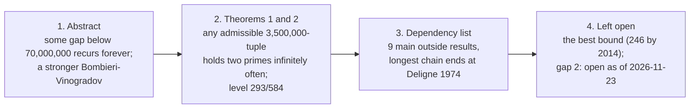
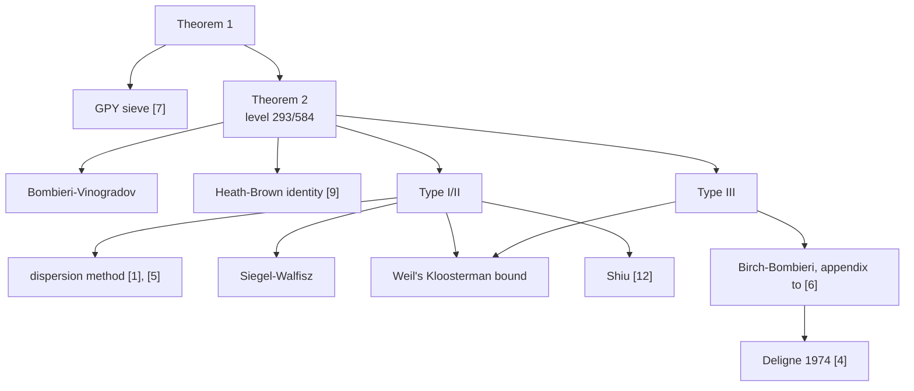

# Reading a paper: find the theorem, compare it with the abstract, trace what it depends on

[Syllabus](../../../SYLLABUS.md) → [Frontier](../README.md) → [How Research Works](../README.md#s01) → Reading a paper

---

## General Overview

On 2013-04-17 the *Annals of Mathematics* received a paper by Yitang Zhang called "Bounded gaps between primes". It was accepted on 2013-05-21 and printed in 2014 on pages 1121 to 1174. Its abstract makes two mathematical claims. The headline: some gap below 70,000,000 between neighbouring primes occurs infinitely often. The second names the proof's main ingredient: a stronger form of the Bombieri-Vinogradov theorem, valid only when the moduli (the numbers divided by) have no large prime factor. That theorem says primes spread evenly over remainder classes, on average over many moduli.

A research paper is not read front to back like a story. It is read in four passes, each with one question:

1. **The abstract.** What does the paper say it proves?
2. **The main theorem.** What does it actually prove? Find the numbered statement and compare it with the abstract.
3. **The dependency list.** Which outside results does the proof use without proving them?
4. **What is left open.** What does the paper say it does not do, and what is still unknown today?

Zhang's paper rewards the second pass at once. The abstract's headline states only a consequence. The main theorem, Theorem 1 on page 1122, is stronger: *any* admissible set of 3,500,000 offsets catches two primes infinitely often. A set of offsets is **admissible** when, for every prime p, it leaves at least one remainder on division by p unused, so no prime rules the set out for good. The number 70,000,000 comes from one such set and a prime count, which the code on this card repeats. There are 4,118,064 primes below 70,000,000 and 250,150 below 3,500,000. The difference, 3,867,914, is more than 3,500,000.

**A paper is read by finding its main theorem, checking it against the abstract's claims, listing every outside result the proof leans on, and recording what the paper leaves open.**

**What kind of fact this is:** a method, a way of reading, so it has no truth value of its own. The facts it records about Zhang's paper are dated and sourced. Zhang's theorem is proved: refereed in the *Annals*, then reworked and improved by the Polymath project in 2014. The twin prime conjecture (gap 2) is open as of 2026-11-23.

### The picture: the four passes on Zhang's paper



Each box is one pass. The arrow means "read after". Each pass writes one line of the reading record (Step 4 lays it out).

---

## The formula

The abstract's first claim, word for word in symbols:

```math
\liminf_{n \to \infty}\, (p_{n+1} - p_n) < 7 \times 10^7
```

**Read it aloud:** the gap between the n-th prime and the next one drops below seventy million again and again, forever.

Here $`p_n`$ is the n-th prime ($`p_1 = 2`$, $`p_2 = 3`$). As on [Bounded gaps](../../21-Algebraic%20and%20analytic%20number%20theory/04-Sieves%20and%20Prime%20Gaps/05-bounded-gaps-zhang-maynard.md), the lim inf is the smallest value a sequence keeps coming back to, infinitely often. It does not say every gap is small.

The main theorem is about tuples. A **tuple** $`\mathcal{H} = \{h_1, \dots, h_{k_0}\}`$ is a fixed set of $`k_0`$ whole-number offsets, admissible (as defined on the same card) when, for every prime p, at least one remainder class mod p (remainder on division by p) holds no offset. In the paper's notation, $`\nu_p(\mathcal{H}) < p`$, where $`\nu_p(\mathcal{H})`$ counts the classes mod p the offsets occupy. Theorem 1 says, in Zhang's terms: suppose $`\mathcal{H}`$ is admissible with $`k_0 \ge 3.5 \times 10^6`$. Then infinitely many n make the set $`n + h_1, \dots, n + h_{k_0}`$ contain at least two primes.

The bridge from Theorem 1 to the abstract is one sentence in the paper. Written out, with $`m = \pi(k_0)`$:

```math
\pi(7 \times 10^7) - \pi(3.5 \times 10^6) > 3.5 \times 10^6 \;\Longrightarrow\; \liminf_{n \to \infty}\, (p_{n+1} - p_n) \le p_{m + k_0} - p_{m+1} < 7 \times 10^7
```

**Read it aloud:** more than three and a half million primes lie between three and a half million and seventy million. The first three and a half million of them form an admissible tuple narrower than seventy million, and Theorem 1 applied to it gives the abstract.

The tuple is admissible for a short reason. Every entry is a prime above $`k_0`$, so no entry is a multiple of any prime $`p \le k_0`$: class 0 is empty. A prime $`p > k_0`$ has more classes than there are entries, so one is always empty.

| Symbol | Plain meaning | In our example | Push it up and the answer… |
| --- | --- | --- | --- |
| $`p_n`$ | the n-th prime | $`p_{250151} = 3{,}500{,}017`$ | gaps grow on average |
| $`\liminf`$ | the smallest value a sequence returns to forever | below 70,000,000 | — |
| $`\mathcal{H}`$, $`h_i`$ | a tuple of offsets, and its i-th offset | the primes from 3,500,017 to 63,374,611 | a wider tuple, a weaker bound |
| $`k_0`$ | how many offsets the theorem needs | 3,500,000 | the tuple, and the bound, get wider |
| $`\nu_p(\mathcal{H})`$ | how many classes mod p the offsets occupy | class 0 is empty for every $`p \le k_0`$ | equal to p: not admissible |
| $`\pi(x)`$ | how many primes are at most x | $`\pi(7 \times 10^7) = 4{,}118{,}064`$ | — |
| $`m`$ | $`\pi(k_0)`$, so $`p_{m+1}`$ is the first prime above $`k_0`$ | 250,150 | — |
| $`\theta`$ | level of distribution: how far, on average over moduli, primes are proved to spread evenly over remainder classes | 1/2 is known | more room for the sieve |
| $`\varpi`$ | Zhang's small gain over 1/2, written "varpi" | 1/1168 | a stronger Theorem 2 |
| $`x`$, $`D`$ | the size of the numbers counted, and the sieve's cut-off | $`D = x^{1/4 + \varpi}`$ | — |
| $`n`$ | the start of a shifted tuple | infinitely many work | — |
| $`\varepsilon`$ | any small positive constant | the margin below 1/2 in Bombieri-Vinogradov | a weaker range of moduli |

The level of distribution $`\theta`$ and the sieve are taught on [Bounded gaps](../../21-Algebraic%20and%20analytic%20number%20theory/04-Sieves%20and%20Prime%20Gaps/05-bounded-gaps-zhang-maynard.md). This card needs only their names and what each one supplies.

### When it holds

- **The paper states its result as a numbered theorem.** An announcement, a talk or a news story has no Theorem 1 to compare. Its claim stays "claimed" until a paper states it ([Kinds of claim](02-theorem-conjecture-model-approximation.md)).
- **The abstract is read as a summary, not as the result.** Zhang's abstract gives the consequence, 70,000,000. Read alone, it hides that the theorem works for every admissible tuple of that size.
- **The dependency list is built from the proof, not from the bibliography.** Zhang uses Bombieri-Vinogradov, Siegel-Walfisz and Weil's bound by name, with no reference number. A list copied from the references misses 3 of the 9 main outside results.
- **Every dependency is marked proved or assumed.** A result resting on a conjecture is conditional. GPY (Goldston, Pintz and Yıldırım, 2009) reached bounded gaps only *if* $`\theta > 1/2`$; Zhang's proof assumes nothing unproved.
- **The reading stops at the paper's own level.** The list says where trust is placed. It does not ask the reader to re-prove Deligne's 1974 theorem.

---

## Why it works

### Step 0: a proof is a chain, so trust can be audited link by link

A theorem is a conditional: hypotheses in, conclusion out ([Reading a statement](04-reading-a-mathematical-statement.md)). A paper proves some links of a chain and borrows the rest. So the paper is right exactly when its own steps are right *and* every borrowed result is proved and applied within its hypotheses.

The four passes split that question into pieces a reader can check one at a time. Pass 2 fixes *what* is claimed. Pass 3 fixes *what it rests on*. Pass 4 fixes *where it stops*.

### Step 1: find the theorem and quote it exactly

Numbered statements carry the weight. In Zhang's paper, Section 1 ends with Theorem 1 and the bound (1.5). Section 2 states Theorem 2, the new estimate, and says the rest of the paper proves it.

Copy each statement word for word into the reading record. Then mark its parts:

- **Hypothesis:** $`\mathcal{H}`$ admissible, $`k_0 \ge 3.5 \times 10^6`$.
- **Conclusion:** infinitely many n with at least two primes among $`n + h_i`$.
- **Domain:** positive integers n; a fixed tuple of nonnegative offsets.
- **Boundary case:** the theorem says nothing about *which* two offsets succeed, so it says nothing about gap 2.

### Step 2: compare the theorem with the abstract

The comparison has three possible outcomes:

| Outcome | What it means | Zhang's paper |
| --- | --- | --- |
| Theorem equals abstract | the summary is the result | no |
| Theorem stronger than abstract | the abstract states a consequence | **yes** |
| Abstract stronger than theorem | the summary overclaims: a warning sign | no |

Each claim in the abstract is matched to its numbered statement:

| Abstract's claim | Numbered statement | Outcome |
| --- | --- | --- |
| some gap below 70,000,000 recurs forever | Theorem 1, with the bound (1.5) | theorem stronger: it covers every admissible 3,500,000-tuple |
| a stronger Bombieri-Vinogradov, for moduli free from large prime divisors | Theorem 2: level $`1/2 + 2\varpi = 293/584`$ for such moduli | theorem stronger: it gives the exact level and the exact condition on the moduli |

For the first claim, the gap between the two is a short counting argument. The code checks it two ways. A sieve of Eratosthenes counts 4,118,064 primes up to 70,000,000. Lucy's recursion, which counts primes without listing them, gets the same number. So the paper's inequality holds: 3,867,914 > 3,500,000.

The tuple it builds runs from 3,500,017 to 63,374,611. Its width is 59,874,594, with 10,125,406 to spare under the abstract's bound. The abstract rounds up; the theorem is sharper than its headline.

### Step 3: trace what the proof depends on

This card introduces the **dependency list**: every result the proof uses but does not prove, with where it is used, its source, and its status on a date. Building it means reading the proof sketch (Zhang's Section 2) and each lemma's "Proof. See [n]".

Zhang's route, in outline. The weighted count of GPY shows two primes in a tuple if a certain error is small. Theorem 2 bounds that error for moduli up to $`x^{1/2 + 2\varpi}`$ that have no large prime factor. With $`\varpi = 1/1168`$ that is a level of 293/584 = 0.501712: just past the 1/2 that Bombieri-Vinogradov gives. A combinatorial identity splits the error into three types of sum. Each type needs its own tool.

| Outside result | Used for | Source in the paper | Status on 2026-11-23 |
| --- | --- | --- | --- |
| GPY weighted sieve | the criterion and the main terms | reference [7], 2009 | proved |
| Bombieri-Vinogradov | moduli below $`x^{1/2 - \varepsilon}`$ | by name only | proved |
| Heath-Brown's identity | splitting the error into Types I, II, III (Lemma 6) | reference [9], 1982 | proved |
| Dispersion method | Type I and II sums | references [1] and [5] | proved |
| Siegel-Walfisz theorem | the "Siegel-Walfisz assumption" (A2) on the Type I and II pieces (Section 6) | by name only | proved |
| Shiu's bound | an upper bound for divisor functions summed over a progression (Lemma 8) | reference [12], 1980 | proved |
| Weil's bound for Kloosterman sums | Types I and II (Lemma 11), and one case of Lemma 12 | by name only | proved |
| Birch-Bombieri | Type III (Lemma 12) | appendix to reference [6], 1985 | proved |
| Deligne's proof of the Weil conjectures | under Birch-Bombieri | reference [4], 1974 | proved |

Here $`\varepsilon`$ is any small positive constant. A **Kloosterman sum** ([Kloosterman sums](../../21-Algebraic%20and%20analytic%20number%20theory/03-Characters%20and%20L-functions/11-kloosterman-sums.md)) is a sum of complex roots of unity over the remainders mod q; Weil's bound says it is far smaller than its number of terms. The **Siegel-Walfisz theorem** says primes spread evenly over the remainder classes of each small modulus.

The table keeps the main outside results. Two smaller standard tools are left out: the truncated Poisson formula (Lemma 7, stated with no proof or reference) and the incomplete Kloosterman estimate (3.13), which the paper calls "well known" and points to reference [2]. A full list adds them as two more rows of the same kind.



An arrow means "uses". Four boxes are proved in the paper: Theorems 1 and 2 and the two estimates. The other nine are the main outside results. The longest chain has 5 results, found the same by depth-first search and by Kahn's queue (two ways to order a graph):

Theorem 1 ← Theorem 2 ← Type III ← Birch-Bombieri ← Deligne 1974.

So an elementary-looking statement about primes rests, at the end of a chain of five results, on deep algebraic geometry. That is worth knowing before trusting, extending or formalising it.

### Step 4: record what the paper leaves open, and date it

Zhang says it himself, on page 1123. The result "is, of course, not optimal", and the condition on $`k_0`$ "is also crude". Making the bound as small as possible "is an open problem that will not be discussed in this paper".

The reading record then gets one line per open question, each with a status and a date ([Kinds of claim](02-theorem-conjecture-model-approximation.md) gives the four statuses):

| Field | Entry for Zhang 2014 |
| --- | --- |
| Statement | Theorem 1, quoted; consequence (1.5) |
| Kind and status | theorem; proved (refereed, accepted 2013-05-21; reworked independently by Polymath, 2014) |
| Dependencies | the nine rows above, all proved, plus the two smaller tools |
| Left open in the paper | the smallest bound; a smaller $`k_0`$ |
| Status of that today | 246, proved by Polymath in 2014; below 246 open as of 2026-11-23 |
| Further open | gap 2 (twin primes): open as of 2026-11-23 |
| Later change of route | Maynard (2013) reached 600 with a new sieve and level 1/2 alone, so bounded gaps no longer needs Theorem 2 or Deligne |

The last row shows why dependencies are recorded, not just read. A later paper can remove a dependency entirely.

<details>
<summary>Deep-dive: how Polymath checked the hardest link</summary>

Polymath's 2014 paper on Zhang-type estimates proved a level of distribution for smooth moduli of

$`\displaystyle \frac{1}{2} + \frac{7}{300} = \frac{157}{300} \approx 0.523333,`$

against Zhang's 293/584 ≈ 0.501712. It reproves the Type I, II and III estimates with explicit constants, so it re-derives Theorem 2 rather than citing it. That is the independent check behind "proved" in the record. The code prints both numbers; the 7/300 is quoted from the paper's abstract, not re-proved.

</details>

---

## Worked numbers, by hand

Follow the paper's bridge from Theorem 1 to the abstract.

| Step | Arithmetic | Value |
| --- | --- | --- |
| Offsets the theorem needs | $`k_0`$ | 3,500,000 |
| Primes up to $`k_0`$ | $`m = \pi(3{,}500{,}000)`$ | 250,150 |
| Primes up to the bound | $`\pi(70{,}000{,}000)`$ | 4,118,064 |
| Primes in between | 4,118,064 − 250,150 | 3,867,914 |
| Enough for the tuple? | 3,867,914 > 3,500,000 | yes |
| First entry | $`p_{250151}`$ | 3,500,017 |
| Last entry | $`p_{3750150}`$ | 63,374,611 |
| Width | 63,374,611 − 3,500,017 | 59,874,594 |
| Bound in the abstract | width < 70,000,000 | **some gap below 70,000,000 recurs forever** |

The abstract's 70,000,000 is a round number above a width of 59,874,594 that Theorem 1 already gives.

### What breaks if you drop a piece

| Mistake | Comes out at | What went wrong |
| --- | --- | --- |
| Reading the abstract as twin primes | 321,466 twin pairs below 70,000,000 | evidence only; the theorem allows any gap below 70,000,000 and never names 2 |
| Reading lim inf as "every gap" | widest gap below 70,000,000 is 220, after 47,326,693; yet 10! + 2 to 10! + 10 are all composite | lim inf means "infinitely often"; runs of composites grow without bound |
| Dropping "each prime above $`k_0`$" | the first k primes are not admissible, failing at p = 2, for k = 10, 50 and 300 | 2 and 3 fill both classes mod 2 |
| Building the list from the bibliography | 6 of the 9 main outside results | Bombieri-Vinogradov, Siegel-Walfisz and Weil's bound are named, not numbered |

The code prints all four.

```
log10 of the proved bound on a gap that recurs forever
Zhang 2013, abstract ############################### 7.85
Zhang's own tuple    ############################### 7.78
Maynard 2013         ###########                     2.78
Polymath 2014        ##########                      2.39
twin primes, open    #                               0.30
```

The last bar is the conjecture, not a result. The jump from Zhang's bars to Maynard's is the change of route in the reading record.

---

## Code, from first principles, and it actually runs

The code checks every number the reading record uses, by four roads. A sieve of Eratosthenes to 70,000,000 counts primes and builds the paper's own tuple. Lucy's recursion counts the same primes without listing them. Admissibility is tested by the paper's shortcut and by the full definition, class by class. The dependency list is stored as a graph, and its longest chain is found by depth-first search and by Kahn's queue.

### Python

```python
# Reading a paper: Zhang's bounded gaps, abstract against Theorem 1 -- the check behind the card.
# Standard library only.  Four roads:
# 1. a sieve of Eratosthenes to 7 x 10^7 counts primes and builds the paper's own 3,500,000-tuple;
# 2. Lucy's prime-counting recursion finds pi(x) with no sieve, for the paper's inequality;
# 3. admissibility, by the paper's shortcut against the full residue-class definition;
# 4. the dependency list as a graph: longest chain by Kahn's queue and by depth-first search.
from fractions import Fraction as Fr
from itertools import compress
from math import isqrt, log10

X, K0 = 70_000_000, 3_500_000
s = bytearray([1]) * (X + 1); s[0] = s[1] = 0
for i in range(2, isqrt(X) + 1):
    if s[i]: s[i * i::i] = bytearray(len(range(i * i, X + 1, i)))
ps = list(compress(range(X + 1), s))
pi_x, pi_k = len(ps), s[:K0 + 1].count(1)

def lucy(n):                          # pi(n) by Lucy's recursion: no list of primes is kept
    r = isqrt(n); V = [n // i for i in range(1, r + 1)]; V += list(range(V[-1] - 1, 0, -1))
    S = {v: v - 1 for v in V}
    for p in range(2, r + 1):
        if S[p] > S[p - 1]:
            sp, p2 = S[p - 1], p * p
            for v in V:
                if v < p2: break
                S[v] -= S[v // p] - sp
    return S[n]

print("Road 1 and 2: the paper's inequality pi(7 x 10^7) - pi(3.5 x 10^6) > 3.5 x 10^6")
print(f"pi(70,000,000) = {pi_x:,} by sieve, {lucy(X):,} by Lucy's recursion")
print(f"pi(3,500,000) = {pi_k:,} by sieve, {lucy(K0):,} by Lucy's recursion")
print(f"difference = {pi_x - pi_k:,}, needed > {K0:,}: {pi_x - pi_k > K0}")
H = ps[pi_k:pi_k + K0]                # the k0 primes just above k0: the paper's admissible set
print(f"the tuple: primes {H[0]:,} (prime number {pi_k + 1:,}) to {H[-1]:,} (prime number {pi_k + K0:,})")
print(f"width h_k0 - h_1 = {H[-1] - H[0]:,}; abstract's bound 70,000,000; slack {X - (H[-1] - H[0]):,}")
print(f"shortcut: every entry prime and above k0, so class 0 mod each p <= k0 is empty: {H[0] > K0}")

def admissible(T):                    # the definition: fewer than p classes met, for every prime p
    for p in range(2, len(T) + 1):    # a prime p > k cannot be filled by k entries
        if s[p] and len({h % p for h in T}) == p: return False, p
    return True, None

print("Road 3: admissibility, shortcut against the full residue check")
for k in (10, 50, 300):
    T = [p for p in ps if p > k][:k]; F = ps[:k]
    print(f"k = {k}: primes above k from {T[0]} to {T[-1]}, admissible {admissible(T)[0]}; "
          f"first k primes from {F[0]} to {F[-1]}, admissible {admissible(F)[0]}, fails at p = {admissible(F)[1]}")
    assert admissible(T)[0] == (T[0] > k) and not admissible(F)[0]
print(f"(0, 2, 4): classes mod 3 met = {len({0 % 3, 2 % 3, 4 % 3})} of 3, so not admissible")

print("What the theorem does not say")
tw = sum(1 for p in ps if p + 2 <= X and s[p + 2])
g, at = max((q - p, p) for p, q in zip(ps, ps[1:]))
print(f"twin pairs below 70,000,000: {tw:,} (evidence only; gap 2 is not claimed)")
print(f"widest gap below 70,000,000: {g}, after {at:,} (true of this range, not 'infinitely often')")
f10 = 3_628_800                       # 10!: 10! + 2, ..., 10! + 10 are all composite
print(f"10! + 2 to 10! + 10 composite: {all(not s[f10 + j] for j in range(2, 11))}; gaps are unbounded")

w = Fr(1, 1168)
print(f"Theorem 2: varpi = {w}, level 1/2 + 2 varpi = {Fr(1, 2) + 2 * w} = {float(Fr(1, 2) + 2 * w):.6f}")
print(f"cut-off D = x^(1/4 + varpi) = x^({Fr(1, 4) + w}); excess over Bombieri-Vinogradov 2 varpi = {2 * w}")
q = Fr(1, 2) + Fr(7, 300)               # Polymath 2014, smooth moduli: quoted, not proved here
print(f"Polymath 2014 exponent (quoted): 1/2 + 7/300 = {q} = {float(q):.6f}")

print("Road 4: the dependency list (A <- B means A uses B)")
uses = {"Theorem 1": ["GPY sieve [7]", "Theorem 2"],
        "Theorem 2": ["Bombieri-Vinogradov", "Heath-Brown identity [9]", "Type I/II", "Type III"],
        "Type I/II": ["dispersion method [1], [5]", "Siegel-Walfisz", "Weil's Kloosterman bound", "Shiu [12]"],
        "Type III": ["Birch-Bombieri, appendix to [6]", "Weil's Kloosterman bound"],
        "Birch-Bombieri, appendix to [6]": ["Deligne 1974 [4]"]}
nodes = sorted(set(uses) | {b for v in uses.values() for b in v})
outside = [n for n in nodes if n not in uses or n.startswith("Birch")]
print(f"proved in the paper: {', '.join(n for n in nodes if n not in outside)}")
byname = [n for n in outside if "[" not in n]
print(f"main outside results: {len(outside)}, of which {len(outside) - len(byname)} carry a reference number")
print(f"cited by name only: {', '.join(byname)}")
def depth(n): return 1 + max((depth(b) for b in uses.get(n, [])), default=0)
indeg = {n: 0 for n in nodes}
for a in uses:
    for b in uses[a]: indeg[b] += 1
level, queue, longest = {n: 1 for n in nodes}, [n for n in nodes if indeg[n] == 0], 0
while queue:
    a = queue.pop(); longest = max(longest, level[a])
    for b in uses.get(a, []):
        level[b] = max(level[b], level[a] + 1); indeg[b] -= 1
        if indeg[b] == 0: queue.append(b)
print(f"longest chain: {depth('Theorem 1')} results by depth-first search, {longest} by Kahn's queue")
print("Theorem 1 <- Theorem 2 <- Type III <- Birch-Bombieri <- Deligne 1974")
assert depth("Theorem 1") == longest and all(v == 0 for v in indeg.values())

print("bars: proved bound on a gap that recurs forever, log10")
for lab, v in [("Zhang 2013, abstract", X), ("Zhang's own tuple", H[-1] - H[0]),
               ("Maynard 2013", 600), ("Polymath 2014", 246), ("twin primes, open", 2)]:
    print(f"{lab:<21}{'#' * round(4 * log10(v)):<32}{log10(v):.2f}")
assert pi_x == lucy(X) and pi_k == lucy(K0) and pi_x - pi_k > K0
assert len(H) == K0 and lucy(H[-1]) == pi_k + K0 == lucy(H[-1] - 1) + 1 and lucy(H[0] - 1) == pi_k
print("ALL CHECKS PASS")
```

**Ran 2026-11-23 on macOS, Python 3.14.10, standard library only. All checks passed. Output, pasted from the run:**

```
Road 1 and 2: the paper's inequality pi(7 x 10^7) - pi(3.5 x 10^6) > 3.5 x 10^6
pi(70,000,000) = 4,118,064 by sieve, 4,118,064 by Lucy's recursion
pi(3,500,000) = 250,150 by sieve, 250,150 by Lucy's recursion
difference = 3,867,914, needed > 3,500,000: True
the tuple: primes 3,500,017 (prime number 250,151) to 63,374,611 (prime number 3,750,150)
width h_k0 - h_1 = 59,874,594; abstract's bound 70,000,000; slack 10,125,406
shortcut: every entry prime and above k0, so class 0 mod each p <= k0 is empty: True
Road 3: admissibility, shortcut against the full residue check
k = 10: primes above k from 11 to 43, admissible True; first k primes from 2 to 29, admissible False, fails at p = 2
k = 50: primes above k from 53 to 313, admissible True; first k primes from 2 to 229, admissible False, fails at p = 2
k = 300: primes above k from 307 to 2441, admissible True; first k primes from 2 to 1987, admissible False, fails at p = 2
(0, 2, 4): classes mod 3 met = 3 of 3, so not admissible
What the theorem does not say
twin pairs below 70,000,000: 321,466 (evidence only; gap 2 is not claimed)
widest gap below 70,000,000: 220, after 47,326,693 (true of this range, not 'infinitely often')
10! + 2 to 10! + 10 composite: True; gaps are unbounded
Theorem 2: varpi = 1/1168, level 1/2 + 2 varpi = 293/584 = 0.501712
cut-off D = x^(1/4 + varpi) = x^(293/1168); excess over Bombieri-Vinogradov 2 varpi = 1/584
Polymath 2014 exponent (quoted): 1/2 + 7/300 = 157/300 = 0.523333
Road 4: the dependency list (A <- B means A uses B)
proved in the paper: Theorem 1, Theorem 2, Type I/II, Type III
main outside results: 9, of which 6 carry a reference number
cited by name only: Bombieri-Vinogradov, Siegel-Walfisz, Weil's Kloosterman bound
longest chain: 5 results by depth-first search, 5 by Kahn's queue
Theorem 1 <- Theorem 2 <- Type III <- Birch-Bombieri <- Deligne 1974
bars: proved bound on a gap that recurs forever, log10
Zhang 2013, abstract ############################### 7.85
Zhang's own tuple    ############################### 7.78
Maynard 2013         ###########                     2.78
Polymath 2014        ##########                      2.39
twin primes, open    #                               0.30
ALL CHECKS PASS
```

### Rust

```rust
// Reading a paper: Zhang's bounded gaps, abstract against Theorem 1 -- the check behind the card.
// Standard library only.  Four roads:
// 1. a sieve of Eratosthenes to 7 x 10^7 counts primes and builds the paper's own 3,500,000-tuple;
// 2. Lucy's prime-counting recursion finds pi(x) with no sieve, for the paper's inequality;
// 3. admissibility, by the paper's shortcut against the full residue-class definition;
// 4. the dependency list as a graph: longest chain by Kahn's queue and by depth-first search.
use std::collections::{BTreeMap, BTreeSet, HashSet};

fn c(n: usize) -> String { // thousands commas
    let d = n.to_string(); let mut o = String::new();
    for (i, ch) in d.chars().enumerate() { if i > 0 && (d.len() - i) % 3 == 0 { o.push(','); } o.push(ch); }
    o
}
fn gcd(a: i64, b: i64) -> i64 { if b == 0 { a } else { gcd(b, a % b) } }
fn fr(n: i64, d: i64) -> String { let g = gcd(n, d); format!("{}/{}", n / g, d / g) }
fn isqrt(n: usize) -> usize { let mut r = (n as f64).sqrt() as usize; while r * r > n { r -= 1; } while (r + 1) * (r + 1) <= n { r += 1; } r }

fn lucy(n: usize) -> usize { // pi(n) by Lucy's recursion: no list of primes is kept
    let r = isqrt(n);
    let mut v: Vec<usize> = (1..=r).map(|i| n / i).collect();
    let last = *v.last().unwrap();
    for x in (1..last).rev() { v.push(x); }
    let mut s: BTreeMap<usize, i64> = v.iter().map(|&x| (x, x as i64 - 1)).collect();
    for p in 2..=r {
        if s[&p] > s[&(p - 1)] {
            let (sp, p2) = (s[&(p - 1)], p * p);
            for &x in &v {
                if x < p2 { break; }
                let sub = s[&(x / p)] - sp;
                *s.get_mut(&x).unwrap() -= sub;
            }
        }
    }
    s[&n] as usize
}

fn admissible(t: &[usize], s: &[bool]) -> (bool, Option<usize>) { // the definition, prime by prime
    for p in 2..=t.len() {
        if s[p] && t.iter().map(|h| h % p).collect::<HashSet<_>>().len() == p { return (false, Some(p)); }
    }
    (true, None)
}

fn main() {
    let (x, k0) = (70_000_000usize, 3_500_000usize);
    let mut s = vec![true; x + 1]; s[0] = false; s[1] = false;
    for i in 2..=isqrt(x) { if s[i] { let mut j = i * i; while j <= x { s[j] = false; j += i; } } }
    let ps: Vec<usize> = (0..=x).filter(|&i| s[i]).collect();
    let (pi_x, pi_k) = (ps.len(), s[..=k0].iter().filter(|&&b| b).count());
    let (lx, lk) = (lucy(x), lucy(k0));
    println!("Road 1 and 2: the paper's inequality pi(7 x 10^7) - pi(3.5 x 10^6) > 3.5 x 10^6");
    println!("pi(70,000,000) = {} by sieve, {} by Lucy's recursion", c(pi_x), c(lx));
    println!("pi(3,500,000) = {} by sieve, {} by Lucy's recursion", c(pi_k), c(lk));
    println!("difference = {}, needed > {}: {}", c(pi_x - pi_k), c(k0), if pi_x - pi_k > k0 { "True" } else { "False" });
    let h = &ps[pi_k..pi_k + k0]; // the k0 primes just above k0: the paper's admissible set
    let (h1, hk) = (h[0], h[k0 - 1]);
    println!("the tuple: primes {} (prime number {}) to {} (prime number {})", c(h1), c(pi_k + 1), c(hk), c(pi_k + k0));
    println!("width h_k0 - h_1 = {}; abstract's bound 70,000,000; slack {}", c(hk - h1), c(x - (hk - h1)));
    println!("shortcut: every entry prime and above k0, so class 0 mod each p <= k0 is empty: {}", if h1 > k0 { "True" } else { "False" });

    println!("Road 3: admissibility, shortcut against the full residue check");
    let tf = |b: bool| if b { "True" } else { "False" };
    for &k in &[10usize, 50, 300] {
        let t: Vec<usize> = ps.iter().cloned().filter(|&p| p > k).take(k).collect();
        let f = &ps[..k];
        let (at, af) = (admissible(&t, &s), admissible(f, &s));
        println!("k = {}: primes above k from {} to {}, admissible {}; first k primes from {} to {}, admissible {}, fails at p = {}",
                 k, t[0], t[k - 1], tf(at.0), f[0], f[k - 1], tf(af.0), af.1.unwrap());
        assert!(at.0 == (t[0] > k) && !af.0);
    }
    println!("(0, 2, 4): classes mod 3 met = {} of 3, so not admissible", [0usize, 2, 4].iter().map(|v| v % 3).collect::<HashSet<_>>().len());

    println!("What the theorem does not say");
    let tw = ps.iter().filter(|&&p| p + 2 <= x && s[p + 2]).count();
    let (mut g, mut at) = (0, 0);
    for w in ps.windows(2) { if w[1] - w[0] > g { g = w[1] - w[0]; at = w[0]; } }
    println!("twin pairs below 70,000,000: {} (evidence only; gap 2 is not claimed)", c(tw));
    println!("widest gap below 70,000,000: {}, after {} (true of this range, not 'infinitely often')", g, c(at));
    let f10 = 3_628_800usize; // 10!: 10! + 2, ..., 10! + 10 are all composite
    println!("10! + 2 to 10! + 10 composite: {}; gaps are unbounded", tf((2..11).all(|j| !s[f10 + j])));

    println!("Theorem 2: varpi = {}, level 1/2 + 2 varpi = {} = {:.6}", fr(1, 1168), fr(584 + 2, 1168), 293.0f64 / 584.0);
    println!("cut-off D = x^(1/4 + varpi) = x^({}); excess over Bombieri-Vinogradov 2 varpi = {}", fr(292 + 1, 1168), fr(2, 1168));
    println!("Polymath 2014 exponent (quoted): 1/2 + 7/300 = {} = {:.6}", fr(150 + 7, 300), 157.0f64 / 300.0); // quoted, not proved here

    println!("Road 4: the dependency list (A <- B means A uses B)");
    let uses: BTreeMap<&str, Vec<&str>> = [
        ("Theorem 1", vec!["GPY sieve [7]", "Theorem 2"]),
        ("Theorem 2", vec!["Bombieri-Vinogradov", "Heath-Brown identity [9]", "Type I/II", "Type III"]),
        ("Type I/II", vec!["dispersion method [1], [5]", "Siegel-Walfisz", "Weil's Kloosterman bound", "Shiu [12]"]),
        ("Type III", vec!["Birch-Bombieri, appendix to [6]", "Weil's Kloosterman bound"]),
        ("Birch-Bombieri, appendix to [6]", vec!["Deligne 1974 [4]"]),
    ].into_iter().collect();
    let mut nodes: BTreeSet<&str> = uses.keys().cloned().collect();
    for v in uses.values() { for b in v { nodes.insert(b); } }
    let outside: Vec<&str> = nodes.iter().cloned().filter(|n| !uses.contains_key(n) || n.starts_with("Birch")).collect();
    let inside: Vec<&str> = nodes.iter().cloned().filter(|n| !outside.contains(n)).collect();
    println!("proved in the paper: {}", inside.join(", "));
    let byname: Vec<&str> = outside.iter().cloned().filter(|n| !n.contains('[')).collect();
    println!("main outside results: {}, of which {} carry a reference number", outside.len(), outside.len() - byname.len());
    println!("cited by name only: {}", byname.join(", "));
    fn depth(n: &str, u: &BTreeMap<&str, Vec<&str>>) -> usize {
        1 + u.get(n).map_or(0, |v| v.iter().map(|b| depth(b, u)).max().unwrap_or(0))
    }
    let mut indeg: BTreeMap<&str, usize> = nodes.iter().map(|&n| (n, 0)).collect();
    for v in uses.values() { for b in v { *indeg.get_mut(b).unwrap() += 1; } }
    let mut level: BTreeMap<&str, usize> = nodes.iter().map(|&n| (n, 1)).collect();
    let mut queue: Vec<&str> = nodes.iter().cloned().filter(|n| indeg[n] == 0).collect();
    let mut longest = 0;
    while let Some(a) = queue.pop() {
        longest = longest.max(level[a]);
        if let Some(v) = uses.get(a) { for &b in v {
            let la = level[a]; let lb = level.get_mut(b).unwrap(); *lb = (*lb).max(la + 1);
            let d = indeg.get_mut(b).unwrap(); *d -= 1; if *d == 0 { queue.push(b); }
        } }
    }
    let dt = depth("Theorem 1", &uses);
    println!("longest chain: {} results by depth-first search, {} by Kahn's queue", dt, longest);
    println!("Theorem 1 <- Theorem 2 <- Type III <- Birch-Bombieri <- Deligne 1974");
    assert!(dt == longest && indeg.values().all(|&v| v == 0));

    println!("bars: proved bound on a gap that recurs forever, log10");
    for (lab, v) in [("Zhang 2013, abstract", x), ("Zhang's own tuple", hk - h1), ("Maynard 2013", 600), ("Polymath 2014", 246), ("twin primes, open", 2)] {
        let l = (v as f64).log10();
        println!("{:<21}{:<32}{:.2}", lab, "#".repeat((4.0 * l).round() as usize), l);
    }
    assert!(pi_x == lx && pi_k == lk && pi_x - pi_k > k0);
    assert!(h.len() == k0 && lucy(hk) == pi_k + k0 && lucy(hk - 1) + 1 == pi_k + k0 && lucy(h1 - 1) == pi_k);
    println!("ALL CHECKS PASS");
}
```

**Ran 2026-11-23 on macOS, rustc 1.98.1, no crates. All checks passed. Output, pasted from the run:**

```
Road 1 and 2: the paper's inequality pi(7 x 10^7) - pi(3.5 x 10^6) > 3.5 x 10^6
pi(70,000,000) = 4,118,064 by sieve, 4,118,064 by Lucy's recursion
pi(3,500,000) = 250,150 by sieve, 250,150 by Lucy's recursion
difference = 3,867,914, needed > 3,500,000: True
the tuple: primes 3,500,017 (prime number 250,151) to 63,374,611 (prime number 3,750,150)
width h_k0 - h_1 = 59,874,594; abstract's bound 70,000,000; slack 10,125,406
shortcut: every entry prime and above k0, so class 0 mod each p <= k0 is empty: True
Road 3: admissibility, shortcut against the full residue check
k = 10: primes above k from 11 to 43, admissible True; first k primes from 2 to 29, admissible False, fails at p = 2
k = 50: primes above k from 53 to 313, admissible True; first k primes from 2 to 229, admissible False, fails at p = 2
k = 300: primes above k from 307 to 2441, admissible True; first k primes from 2 to 1987, admissible False, fails at p = 2
(0, 2, 4): classes mod 3 met = 3 of 3, so not admissible
What the theorem does not say
twin pairs below 70,000,000: 321,466 (evidence only; gap 2 is not claimed)
widest gap below 70,000,000: 220, after 47,326,693 (true of this range, not 'infinitely often')
10! + 2 to 10! + 10 composite: True; gaps are unbounded
Theorem 2: varpi = 1/1168, level 1/2 + 2 varpi = 293/584 = 0.501712
cut-off D = x^(1/4 + varpi) = x^(293/1168); excess over Bombieri-Vinogradov 2 varpi = 1/584
Polymath 2014 exponent (quoted): 1/2 + 7/300 = 157/300 = 0.523333
Road 4: the dependency list (A <- B means A uses B)
proved in the paper: Theorem 1, Theorem 2, Type I/II, Type III
main outside results: 9, of which 6 carry a reference number
cited by name only: Bombieri-Vinogradov, Siegel-Walfisz, Weil's Kloosterman bound
longest chain: 5 results by depth-first search, 5 by Kahn's queue
Theorem 1 <- Theorem 2 <- Type III <- Birch-Bombieri <- Deligne 1974
bars: proved bound on a gap that recurs forever, log10
Zhang 2013, abstract ############################### 7.85
Zhang's own tuple    ############################### 7.78
Maynard 2013         ###########                     2.78
Polymath 2014        ##########                      2.39
twin primes, open    #                               0.30
ALL CHECKS PASS
```

### Lean

Lean proves the bridge from Theorem 1 to the abstract, the admissibility shortcut and the runs of composites in general, and checks the card's numbers.

- Suppose Theorem 1 holds for $`k_0`$, and an admissible tuple has at least $`k_0`$ offsets. Then a gap between neighbouring primes, at most the tuple's width, recurs forever. Theorem 1 itself is Zhang's result, taken as given, not proved.
- Suppose every entry of a tuple is a prime above the number of entries. Then the tuple is admissible.
- Take whole numbers n and j with $`2 \le j \le n`$. Then $`n! + j`$ is composite.
- The paper's inequality holds: 4,118,064 − 250,150 = 3,867,914, which is more than 3,500,000.
- The tuple's width is 63,374,611 − 3,500,017 = 59,874,594, with 10,125,406 to spare under 70,000,000. Its first entry, 3,500,017, is prime.
- The first 10 primes fill both classes mod 2, so they are not admissible. The 10 primes from 11 to 43 leave class 0 empty mod 2, 3, 5 and 7.
- (0, 2, 4) meets all 3 classes mod 3, so it is not admissible.
- 10! = 3,628,800, and 10! + 2 to 10! + 10 are all composite.
- Take $`\varpi = 1/1168`$. Then the level $`1/2 + 2\varpi`$ is 293/584, and the cut-off exponent $`1/4 + \varpi`$ is 293/1168.
- The excess $`2\varpi`$ is 1/584, and Polymath's quoted $`1/2 + 7/300`$ is 157/300.

The prime counts, the twin pairs, the widest gap and the dependency list's longest chain are left to the Python and Rust checks.

```lean
-- Reading a paper: Zhang's Theorem 1 applied to one admissible tuple gives the abstract's bound on a gap that recurs forever, a tuple of primes above its own size is admissible, and the card's whole-number checks are exact.
import Mathlib.NumberTheory.PrimeCounting
import Mathlib.Data.Nat.Factorial.Basic
import Mathlib.Order.Filter.AtTopBot.Basic
import Mathlib.Tactic.NormNum.Prime
import Mathlib.Tactic.NormNum.DivMod
import Mathlib.Tactic.IntervalCases

open Filter

/-- A tuple of offsets H is admissible when, for every prime p, the offsets occupy fewer than p
remainder classes mod p: ν_p(H) < p, so at least one class mod p holds no offset. -/
def Admissible (H : Finset ℕ) : Prop :=
  ∀ p : ℕ, p.Prime → (H.image (· % p)).card < p

/-- Zhang's Theorem 1 for a size k₀ (the card quotes it; it is the paper's result, not proved
here): every admissible tuple of at least k₀ offsets has infinitely many shifts n for which at
least two of n + h₁, …, n + h_k₀ are prime. -/
def ZhangTheoremOne (k₀ : ℕ) : Prop :=
  ∀ H : Finset ℕ, Admissible H → k₀ ≤ H.card →
    {n : ℕ | 2 ≤ (H.filter (fun h => (n + h).Prime)).card}.Infinite

/-- The bridge from Theorem 1 to the abstract: if Theorem 1 holds for k₀, and H is an admissible
tuple of at least k₀ offsets whose entries all lie within w of each other, then the gap
p_(n+1) − p_n between neighbouring primes is at most w for infinitely many n. (With k₀ =
3,500,000 and H the primes from 3,500,017 to 63,374,611, w = 59,874,594 < 70,000,000.) -/
theorem gap_le_width_infinitely_often_of_theorem_one {k₀ w : ℕ} (hT1 : ZhangTheoremOne k₀)
    {H : Finset ℕ} (hH : Admissible H) (hk : k₀ ≤ H.card)
    (hw : ∀ a ∈ H, ∀ b ∈ H, b - a ≤ w) :
    ∃ᶠ n in atTop, Nat.nth Nat.Prime (n + 1) - Nat.nth Nat.Prime n ≤ w := by
  have hinf : (Set.ofPred Nat.Prime).Infinite := Nat.infinite_setOfPred_prime
  rw [Filter.frequently_atTop]
  intro N
  obtain ⟨n, hnS, hnN⟩ := (hT1 H hH hk).exists_gt (Nat.nth Nat.Prime N)
  have hS : 1 < (H.filter (fun h => (n + h).Prime)).card := hnS
  obtain ⟨a, ha, b, hb, hab⟩ := Finset.one_lt_card.mp hS
  rw [Finset.mem_filter] at ha hb
  -- order the two offsets
  obtain ⟨h1, h2, hh1, hh2, hlt, hp1, hp2⟩ :
      ∃ h1 h2, h1 ∈ H ∧ h2 ∈ H ∧ h1 < h2 ∧ (n + h1).Prime ∧ (n + h2).Prime := by
    rcases lt_or_gt_of_ne hab with h | h
    · exact ⟨a, b, ha.1, hb.1, h, ha.2, hb.2⟩
    · exact ⟨b, a, hb.1, ha.1, h, hb.2, ha.2⟩
  set m := Nat.count Nat.Prime (n + h1) with hm
  have hq1 : Nat.nth Nat.Prime m = n + h1 := Nat.nth_count hp1
  have hmN : N ≤ m := by
    by_contra hcon
    push Not at hcon
    have := Nat.nth_strictMono hinf hcon
    omega
  have hcount : m + 1 ≤ Nat.count Nat.Prime (n + h2) := by
    have h1' : Nat.count Nat.Prime (n + h1 + 1) = m + 1 := by
      rw [Nat.count_succ, ite_eq_left_of_eq_true _ _ (eq_true hp1)]
    rw [← h1']
    exact Nat.count_monotone _ (by omega)
  have hq2 : Nat.nth Nat.Prime (m + 1) ≤ n + h2 := by
    calc Nat.nth Nat.Prime (m + 1) ≤ Nat.nth Nat.Prime (Nat.count Nat.Prime (n + h2)) :=
          Nat.nth_monotone hinf hcount
      _ = n + h2 := Nat.nth_count hp2
  refine ⟨m, hmN, ?_⟩
  have := hw h1 hh1 h2 hh2
  omega

/-- The admissibility shortcut: a tuple whose entries are all primes larger than the number of
entries is admissible. For p no larger than the size, class 0 mod p is empty; for p larger
than the size, there are more classes than entries. -/
theorem admissible_of_primes_above_card {H : Finset ℕ}
    (hH : ∀ h ∈ H, h.Prime ∧ H.card < h) : Admissible H := by
  intro p hp
  by_cases hpc : p ≤ H.card
  · have hsub : H.image (· % p) ⊆ (Finset.range p).erase 0 := by
      intro r hr
      rw [Finset.mem_image] at hr
      obtain ⟨h, hh, rfl⟩ := hr
      rw [Finset.mem_erase, Finset.mem_range]
      refine ⟨?_, Nat.mod_lt _ hp.pos⟩
      intro h0
      have hdvd : p ∣ h := Nat.dvd_of_mod_eq_zero h0
      obtain ⟨hhp, hhc⟩ := hH h hh
      rcases (Nat.prime_dvd_prime_iff_eq hp hhp).mp hdvd with rfl
      omega
    calc (H.image (· % p)).card ≤ ((Finset.range p).erase 0).card := Finset.card_le_card hsub
      _ = p - 1 := by rw [Finset.card_erase_of_mem (by simp [hp.pos]), Finset.card_range]
      _ < p := by have := hp.two_le; omega
  · push Not at hpc
    exact lt_of_le_of_lt Finset.card_image_le hpc

/-- Gaps between primes are unbounded, so lim inf is not a bound on every gap: for every
j from 2 to n, the number n! + j is composite (n! + j is divisible by j and larger than j). -/
theorem factorial_add_not_prime {n j : ℕ} (h2 : 2 ≤ j) (hj : j ≤ n) :
    ¬ (Nat.factorial n + j).Prime := by
  intro hprime
  have hj0 : 0 < j := by omega
  have hdvd : j ∣ Nat.factorial n + j :=
    (Nat.dvd_add_right (Nat.dvd_factorial hj0 hj)).mpr dvd_rfl
  have hpos : 0 < Nat.factorial n := Nat.factorial_pos n
  rcases hprime.eq_one_or_self_of_dvd j hdvd with h | h <;> omega

-- The paper's inequality, from the card's prime counts: 4,118,064 − 250,150 = 3,867,914 > 3,500,000.
example : 4118064 - 250150 = 3867914 ∧ 3500000 < 3867914 := by norm_num
-- The tuple runs from 3,500,017 to 63,374,611: width 59,874,594, slack 10,125,406 under 70,000,000.
example : 63374611 - 3500017 = 59874594 ∧ 70000000 - 59874594 = 10125406 ∧
    59874594 < 70000000 := by norm_num
-- Its first entry is the first prime above k₀ = 3,500,000.
example : Nat.Prime 3500017 ∧ 3500000 < 3500017 := by norm_num
-- The first 10 primes are not admissible: they fill both classes mod 2.
example : (({2, 3, 5, 7, 11, 13, 17, 19, 23, 29} : Finset ℕ).image (· % 2)).card = 2 := by
  decide
-- The 10 primes above 10, from 11 to 43, leave class 0 empty mod 2, 3, 5 and 7.
example : ∀ p ∈ ({2, 3, 5, 7} : Finset ℕ),
    ∀ h ∈ ({11, 13, 17, 19, 23, 29, 31, 37, 41, 43} : Finset ℕ), h % p ≠ 0 := by decide
-- (0, 2, 4) meets all 3 classes mod 3, so it is not admissible.
example : (({0, 2, 4} : Finset ℕ).image (· % 3)).card = 3 := by decide
example : ¬ Admissible {0, 2, 4} := by
  intro h; have := h 3 Nat.prime_three; revert this; decide
-- 10! = 3,628,800, and 10! + 2 to 10! + 10 are all composite.
example : Nat.factorial 10 = 3628800 := by decide
example : ∀ j ∈ Finset.Icc 2 10, ¬ (3628800 + j).Prime := by
  intro j hj; rw [Finset.mem_Icc] at hj; obtain ⟨h1, h2⟩ := hj
  interval_cases j <;> norm_num
-- Theorem 2's level: ϖ = 1/1168, 1/2 + 2ϖ = 293/584, cut-off exponent 1/4 + ϖ = 293/1168, excess 2ϖ = 1/584.
example : (1 / 2 + 2 * (1 / 1168) : ℚ) = 293 / 584 ∧ (1 / 4 + 1 / 1168 : ℚ) = 293 / 1168 ∧
    (2 * (1 / 1168) : ℚ) = 1 / 584 := by norm_num
-- Polymath 2014's exponent, quoted: 1/2 + 7/300 = 157/300.
example : (1 / 2 + 7 / 300 : ℚ) = 157 / 300 := by norm_num

#print axioms gap_le_width_infinitely_often_of_theorem_one
#print axioms admissible_of_primes_above_card
#print axioms factorial_add_not_prime
```

**Checked 2026-11-23 on macOS, Lean 4.36.0-rc2, Mathlib v4.36.0-rc2. Every proof is complete and uses only Lean's standard axioms. Output, pasted from the run:**

```
'gap_le_width_infinitely_often_of_theorem_one' depends on axioms: [propext, Classical.choice, Quot.sound]
'admissible_of_primes_above_card' depends on axioms: [propext, Classical.choice, Quot.sound]
'factorial_add_not_prime' depends on axioms: [propext, Quot.sound]
```

> [!TIP]
> **Try changing**
> Guess first, then run it. An assert is a line that stops the program if a number comes out wrong.
> - **Guess first: a smaller $`k_0`$.** Set `K0 = 1_000_000`. The tuple runs from 1,000,003 to 16,787,713, width 15,787,710. All checks still pass: a smaller $`k_0`$ would give a smaller bound, which is why Zhang called his condition crude. (The labels still say 3,500,000; only the numbers move.)
> - **Guess first: a tighter bound.** Set `X = 60_000_000`. Only 3,311,965 primes lie between 3,500,000 and 60,000,000, short of 3,500,000, so the first final assert stops it. The paper's inequality fails below 63,374,611.
> - **Guess first: start the tuple at 3.** Change `F = ps[:k]` to `F = ps[1:k + 1]`. The tuple of odd primes still fails, now at p = 3: it contains 3, and the other primes fill classes 1 and 2.
> - **Guess first: drop Deligne.** In `uses`, change `["Deligne 1974 [4]"]` to `[]`. The main outside results fall to 8, the longest chain from 5 results to 4, and both roads agree. The printed chain line is fixed text, so it does not change.

---

## The usual mistake

> [!warning]
> **Taking the abstract for the theorem.** The abstract is a summary written to be short. Zhang's says "below 70,000,000"; his Theorem 1 says something stronger, about every admissible tuple of 3,500,000 offsets. In other papers the error runs the other way: an abstract that claims more than any numbered statement proves is a warning sign. Always find the numbered statement and quote it.
>
> Smaller traps:
> - **Reading "bounded gaps" as "twin primes".** 321,466 twin pairs below 70,000,000 is evidence, not proof, and the theorem never mentions gap 2.
> - **Taking lim inf for a bound on every gap.** Gaps are unbounded: 10! + 2 to 10! + 10 are all composite, and the same trick with larger factorials makes any run. The widest gap below 70,000,000, 220, says nothing beyond that range.
> - **Copying the dependency list from the references.** That finds 6 of the 9 main outside results and misses Bombieri-Vinogradov, Siegel-Walfisz and Weil's bound.
> - **Recording "open" without a date.** "The best bound is open" was true in 2013 at 70,000,000. By 2014 the bound was 246. A status line without its date goes stale silently.

---

## Where you meet it in real life

- **Refereeing.** A journal referee checks exactly these passes: is the theorem stated, does the abstract match it, is every borrowed result cited and applied within its hypotheses.
- **Formal proof projects.** Before a theorem is formalised, its dependency list becomes a work plan: each outside result must be formalised first or taken as an axiom ([Machines in proofs](06-computer-assistance-and-formal-verification.md)).
- **The four-colour theorem.** Its 1976 proof depended on a computer program. A reading record lists that program as a dependency, like any lemma. In 2005 the whole proof was checked in Coq, a proof assistant.
- **Literature searches.** A reading record with dated status lines is the start of a working file on an open problem ([Working on a problem](07-how-to-work-on-an-open-problem.md)).

> **Say it back**
> Read a paper in four passes: the abstract's claims, the main theorem, the dependency list, and what is left open. Zhang's abstract makes two claims, and his Theorems 1 and 2 state each one more strongly; the code repeats the prime count that joins the bound to Theorem 1. His proof borrows nine main outside results, and its longest chain ends at Deligne's 1974 theorem. The paper itself names the bound's optimisation as open; the bound reached 246 in 2014, and gap 2 is open as of 2026-11-23.

---

## What this builds on

- [Reading a statement](04-reading-a-mathematical-statement.md): hypothesis, conclusion, domain and boundary case, the parts each quoted theorem is split into in Step 1.
- [Bounded gaps](../../21-Algebraic%20and%20analytic%20number%20theory/04-Sieves%20and%20Prime%20Gaps/05-bounded-gaps-zhang-maynard.md): Zhang's 70,000,000 theorem and the GPY-Maynard sieve itself, which this card reads rather than re-teaches.

## Where this goes next

- [Machines in proofs](06-computer-assistance-and-formal-verification.md): the next card on this shelf. When a dependency is a computer search or a formal proof, the reading record needs the audit list taught there.

Sibling cards: [Proof](01-what-counts-as-a-proof.md), [Kinds of claim](02-theorem-conjecture-model-approximation.md), [Counterexamples](03-how-a-counterexample-works.md), [Reading a statement](04-reading-a-mathematical-statement.md), [Machines in proofs](06-computer-assistance-and-formal-verification.md) and [Working on a problem](07-how-to-work-on-an-open-problem.md).

The question this card leaves open: when a dependency is itself a long paper, as Deligne's is, how deep must a reader go before trusting the result?

---

## Sources

Verified 2026-11-23: every link below resolves to the publisher's page.

- Zhang, Yitang. "Bounded gaps between primes." *Annals of Mathematics* 179 (2014): 1121–1174. [doi:10.4007/annals.2014.179.3.7](https://doi.org/10.4007/annals.2014.179.3.7). The paper read on this card: the abstract, Theorem 1, the bridge inequality, Theorem 2 and its reference list.
- Goldston, Daniel A., János Pintz, and Cem Y. Yıldırım. "Primes in tuples I." *Annals of Mathematics* 170 (2009): 819–862. [doi:10.4007/annals.2009.170.819](https://doi.org/10.4007/annals.2009.170.819). The weighted sieve Zhang builds on, and the "level above 1/2" condition he meets.
- Deligne, Pierre. "La conjecture de Weil. I." *Publications Mathématiques de l'IHÉS* 43 (1974): 273–307. [doi:10.1007/BF02684373](https://doi.org/10.1007/BF02684373). The deepest link in the dependency chain.
- Castryck, Wouter, et al. (D. H. J. Polymath). "New equidistribution estimates of Zhang type." *Algebra & Number Theory* 8 (2014): 2067–2199. [doi:10.2140/ant.2014.8.2067](https://doi.org/10.2140/ant.2014.8.2067). The independent rework of Theorem 2, with exponent 1/2 + 7/300.
- Polymath, D. H. J. "Variants of the Selberg sieve, and bounded intervals containing many primes." *Research in the Mathematical Sciences* 1 (2014): article 12. [doi:10.1186/s40687-014-0012-7](https://doi.org/10.1186/s40687-014-0012-7). The bound 246, the current record.
