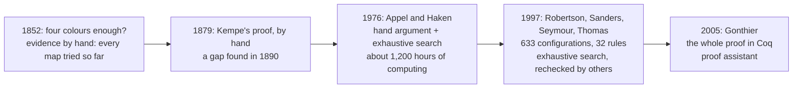

# Machines in proofs: numerical evidence, symbolic computation, exhaustive search, and proof assistants

[Syllabus](../../../SYLLABUS.md) → [Frontier](../README.md) → [How Research Works](../README.md#s01) → Machines in proofs

---

## General Overview

In 1852 Francis Guthrie, colouring a map of the counties of England, noticed that four colours were enough to keep every pair of neighbouring counties different. He asked whether four colours are enough for every map. The question stayed open until 1976.

In 1976 Kenneth Appel and Wolfgang Haken answered yes. Part of their proof was a computer run of about 1,200 hours. No person has checked that part by hand. In 1997 a second team rebuilt the proof with new programs and a shorter list of cases. In 2005 Georges Gonthier wrote the whole proof in Coq, a proof assistant: a program that checks every step of a proof against fixed rules.

So "the computer proved it" meant different things at different dates. This card separates the four kinds of machine help and what each certifies.

**Each kind of machine help certifies something narrower than "the theorem is true": some cases, one calculation, a finite list, or a formal statement; none of them certifies that the statement says what was meant.**

**What kind of fact this is:** the four kinds and the audit list are definitions, a way to sort claims. The small facts the code checks are theorems about small cases. Status line: four colour theorem, proved (1976; rebuilt 1997; formal proof in Coq 2005), as of 2026-11-23.

### The picture: one theorem, four kinds of help



The first two stages were by hand, with no machine. Each later box names the kind of machine help that stage used. Only the last stage has a machine check of every step, including the human parts.

---

## The formula

This card has no single equation. Its central object is a record with four fields, the **audit list**. Fill it in for any claim that leans on a computer:

```math
\text{audit}(c) = \big(\,\text{statement},\ \text{artifact},\ \text{independent check},\ \text{status}\,\big)
```

**Read it aloud:** to audit a claim c, write down exactly what it says, what was run or written, who or what checked it apart from the authors, and its dated status.

The four fields, in plain words:

- **Statement:** the exact claim, with its hypotheses and its domain. [Reading a statement](04-reading-a-mathematical-statement.md) gives the parts.
- **Artifact:** the thing a machine produced or checked: a table of values, a program and its output, a search log, or a formal proof file.
- **Independent check:** a second program, a second team, or a proof-assistant kernel that rechecked the artifact without trusting the first run.
- **Status:** open, claimed, proved or refuted, with a date. [Kinds of claim](02-theorem-conjecture-model-approximation.md) defines the four words.

The Lean lemma read on this card proves one formula, the degree-sum formula. It is Step 1 of the five-colour proof on [Colouring maps](../../04-Combinatorics%20and%20graphs/12-Planarity%20and%20Colouring/05-five-and-four-colour-theorems.md):

```math
\lvert D \rvert = \sum_{v} \deg(v) = 2E
```

**Read it aloud:** the number of darts equals the sum of all the degrees, and also equals twice the number of edges.

A **dart** is an edge with a direction: an ordered pair of neighbouring vertices. Every edge gives exactly two darts, one each way.

| Symbol | Plain meaning | In our example | Push it up and the answer… |
| --- | --- | --- | --- |
| $`c`$ | a claim that leans on a computer | the four colour theorem | — |
| statement | the exact claim | `four_color m : simple_map m -> colorable_with 4 m` | a broader statement needs a broader check |
| artifact | what was run or written | the Coq library with 633 reducibility checks | a bigger artifact is harder for people to read |
| independent check | a recheck that does not trust the first run | Coq's kernel; in 1997, other people's programs | — |
| status | open, claimed, proved or refuted, with a date | proved, as of 2026-11-23 | — |
| $`G`$ | a graph: dots (vertices) joined by lines (edges) | the wheel: a hub and a ring of 5 | — |
| $`\deg(v)`$ | the degree of vertex $`v`$: edges at $`v`$ | hub 5, rim vertices 3 | the degree sum rises by 2 per new edge |
| $`E`$ | the number of edges | 10 | — |
| $`D`$ | the set of darts; $`\lvert D \rvert`$ counts them | 20 | — |
| $`k`$ | the number of colours allowed | 3 or 4 | more colourings |
| $`P_G(k)`$ | the chromatic polynomial: proper colourings of $`G`$ with $`k`$ colours | $`P(3) = 0`$, $`P(4) = 120`$ | — |
| `sorry` | a Lean placeholder that accepts an unproved step, with a warning | none in the quoted lemma | — |

A **proper colouring** gives the two ends of every edge different colours.

### When it holds

- **Evidence certifies only the cases checked.** $`n^2 + n + 41`$ is prime for $`n = 0`$ to 39. At $`n = 40`$ it is 1,681, which is 41 × 41.
- **A bare floating-point answer certifies nothing exact.** Floating point is the computer's rounded binary arithmetic: each result is rounded to a fixed number of binary digits. It makes $`1782^{12} + 1841^{12}`$ and $`1922^{12}`$ agree to ten digits. Exact integers show they differ. Rounded arithmetic can still prove an exact inequality when its error is bounded rigorously, as interval arithmetic does: each answer is an interval guaranteed to contain the true value.
- **A search certifies the finite list it was given.** It proves a theorem only if a human argument shows that the list covers every case. Search the wrong object and the answer is about the wrong object: drop one line of the wheel and 3-colourings appear.
- **A proof assistant certifies the formal statement, from its axioms, if the kernel is sound.** The **trusted kernel** is the small core program that checks each step. A `sorry` in the file, an unsound kernel, or a formal statement that differs from the intended one breaks the guarantee.

---

## Why it works

### Step 0: sort machine help by what a "yes" certifies

A computer can help in four ways. They differ in what a "yes" from the machine actually certifies.

| Kind | What the machine does | A "yes" certifies | Four colour stage |
| --- | --- | --- | --- |
| Numerical evidence | computes many cases, often in floating point | those cases, at that precision | none by machine: from 1852, maps tried by hand, no failure found |
| Symbolic (exact) computation | manipulates exact integers, fractions and formulas | one calculation, if the program is right | the colour counts inside each check |
| Exhaustive search | tries every member of a finite list | the list, if the program is right | 1976 and 1997: every configuration |
| Proof assistant | checks every step of a written proof | the formal statement follows from the axioms | 2005: the whole proof |

The first three trust the program's code. The fourth trusts only a small kernel.

### Step 1: numerical evidence

Evidence is a pile of checked cases. [Counterexamples](03-how-a-counterexample-works.md) shows why a pile never proves a claim about all cases.

The code checks $`n^2 + n + 41`$ for $`n = 0`$ to 39 two ways, by trial division and by a sieve. Both say prime, 40 times. Then $`n = 40`$ gives $`1600 + 40 + 41 = 1681 = 41 \times 41`$. The honest record is "checked for $`n \le 39`$", never "true".

Precision is a second limit. In floating point, $`(1782^{12} + 1841^{12}) / 1922^{12} - 1`$ comes out at about $`-2.755 \times 10^{-10}`$. A ten-digit calculator shows both sides as $`2.541210259 \times 10^{39}`$, so it "confirms" a counterexample to Fermat's last theorem. It is evidence of nearness only.

### Step 2: symbolic (exact) computation

Exact computation keeps every digit, or keeps a formula as a formula. Computer algebra systems do this at scale.

- **Exact integers.** Both sides are about $`2.541210259 \times 10^{39}`$. Their exact difference is −700,212,234,530,608,691,501,223,040,959. A second road confirms it. The difference taken modulo 2, 3, 5, 7, 11 and 13 (its remainder on division by each prime) matches residues computed from the bases. Parity settles it in one line. 1782 is even and 1841 is odd, so the left side is odd. 1922 is even, so the right side is even.
- **A formula for every k at once.** The **chromatic polynomial** $`P_G(k)`$ counts proper colourings of a graph $`G`$ with $`k`$ colours. The code computes it for the wheel by deletion–contraction: colourings of $`G`$ equal colourings of $`G`$ minus one edge, less colourings of $`G`$ with that edge's ends merged. It gets $`k^6 - 10k^5 + 40k^4 - 80k^3 + 79k^2 - 30k`$. The closed form $`k\big((k-2)^5 - (k-2)\big)`$ expands to the same coefficients.

The **wheel** here is a hub joined to a ring of 5. It is the pattern at the heart of the colouring card: a region with five neighbours in a ring.

From the formula, $`P(3) = 3 \times (1 - 1) = 0`$ and $`P(4) = 4 \times (2^5 - 2) = 4 \times 30 = 120`$. The answer covers every $`k`$ at once, which no finite table of cases does. But the answer is only as good as the program that produced it. That is why the code takes two roads.

### Step 3: exhaustive search

A search turns a finite question into a list and tries every member. The code tries all 4,096 ways to give the wheel's 6 vertices 4 colours: 120 are proper. It tries all 729 ways with 3 colours: none is proper. Both counts agree with the polynomial.

The two answers differ in kind.

- **A "yes" carries a certificate.** One proper 4-colouring, hub colour 3 and rim colours 2, 1, 0, 1, 0, is checked in 10 edge tests. Anyone can recheck it without trusting the search.
- **A "no" carries only the search.** The search's "none of 729" comes with no certificate: checking it means running a search again. A short human argument can still exist, and here it does. The rim is a ring of 5, and two colours cannot alternate around a ring of odd length, so the rim needs 3. The hub touches all 5 rim vertices, so it needs a fourth. The formula's $`P(3) = 0`$ is a second proof. Whether every graph that cannot be 3-coloured has such a short certificate is open: it is the question whether NP equals coNP (coNP: the problems whose "no" answers have short certificates).

A search proves an infinite claim only with a human theorem that reduces it to a finite list. The four colour proof has that shape: a hand argument shows that every map contains one of a finite list of configurations, and a machine checks each configuration.

<details>
<summary>The shape of the 1976 and 1997 proofs: unavoidable and reducible</summary>

A **configuration** is a small patch of map: a ring of regions and what lies inside it.

Suppose some map needs five colours, and take one with the fewest regions: a minimal counterexample. Two facts finish the proof.

**Unavoidable.** Every map of the relevant kind contains at least one configuration from the list. In 1997 this part used a counting method called discharging, with 32 rules; Appel and Haken's version used 487.

**Reducible.** No configuration on the list can sit inside a minimal counterexample. For each one, a machine checks that every 4-colouring of the ring around it extends inside, possibly after swapping two colours along a chain of regions.

So a minimal counterexample contains a configuration it cannot contain. No counterexample exists.

Appel and Haken's list, in the final version of their proof, had 1,476 configurations. The 1997 list has 633. In 1997 both parts were machine checked, in integer arithmetic only, and other people wrote independent programs that confirmed them.

</details>

### Step 4: proof assistants

[Proof assistants](../../24-Computability%20and%20complexity/02-Computability%20and%20Logic/08-proof-assistants-and-formal-verification.md) shows a small kernel checking a short proof that root 2 is irrational, and what that check does and does not guarantee. Here is what is new.

A proof assistant checks the human parts too. In Gonthier's Coq proof, the discharging argument, the reducibility checks and the topology that turns a drawn map into a graph are all formal. The library holds the 633 reducibility checks as Coq files named `job001to106.v` to `job623to633.v`, and Coq's kernel rechecks them every time the library is built. Coq is now called Rocq.

The final theorem in the library's file `fourcolor.v` reads:

```
Theorem four_color m : simple_map m -> colorable_with 4 m.
```

In words: every simple map m in the plane can be coloured with 4 colours. The file's own comment says the plane is built on an arbitrary model of the real numbers, and that assuming such a model amounts to assuming the classical law of excluded middle. That is part of the statement's fine print.

### Step 5: reading one Lean lemma, line by line

Lean is another proof assistant. Its library of mathematics is called Mathlib. Here are three results from Mathlib's file `Mathlib/Combinatorics/SimpleGraph/DegreeSum.lean`, quoted unchanged. The version is Mathlib v4.36.0-rc2, for Lean 4.36.0-rc2, read on 2026-11-23.

```
theorem dart_card_eq_sum_degrees : Fintype.card G.Dart = ∑ v, G.degree v := by
  have := Classical.decEq V
  simp only [← card_univ, ← dart_fst_fiber_card_eq_degree]
  exact card_eq_sum_card_fiberwise (by simp)

theorem dart_card_eq_twice_card_edges : Fintype.card G.Dart = 2 * #G.edgeFinset := by
  classical
  rw [← card_univ]
  rw [@card_eq_sum_card_fiberwise _ _ _ Dart.edge _ G.edgeFinset fun d _h =>
      by rw [mem_coe, mem_edgeFinset]; apply Dart.edge_mem]
  rw [← mul_comm, sum_const_nat]
  intro e h
  apply G.dart_edge_fiber_card e
  rwa [← mem_edgeFinset]

/-- The degree-sum formula.  This is also known as the handshaking lemma, which might
more specifically refer to `SimpleGraph.even_card_odd_degree_vertices`. -/
theorem sum_degrees_eq_twice_card_edges : ∑ v, G.degree v = 2 * #G.edgeFinset :=
  G.dart_card_eq_sum_degrees.symm.trans G.dart_card_eq_twice_card_edges
```

This excerpt was compiled for this card on 2026-11-23 against the pinned Mathlib, copied into a scratch file. It is not one of the card's checks; the Python and Rust below are.

How to read it. Each result has the shape `theorem name : claim := proof`. Three names carry the statements: `Fintype.card G.Dart` is the number of darts of the graph $`G`$, $`\lvert D \rvert`$; `∑ v, G.degree v` is the sum of $`\deg(v)`$ over all vertices; `#G.edgeFinset` is the number of edges, $`E`$.

The middle result, `dart_card_eq_twice_card_edges`, read line by line:

| Line | What it does |
| --- | --- |
| `theorem dart_card_eq_twice_card_edges : … := by` | states that the darts number 2 × the edges; `by` starts the proof, a list of tactics (commands that build proof steps) |
| `classical` | switches on classical logic, so any two edges can be tested for equality, which sorting into piles needs |
| `rw [← card_univ]` | rewrites "the number of darts" as "the size of the set of all darts" |
| `rw [@card_eq_sum_card_fiberwise _ _ _ Dart.edge _ G.edgeFinset fun d _h =>` | sorts the darts into piles, one pile per edge (`Dart.edge` is a dart's edge): the count becomes a sum, over the edges, of the pile sizes |
| `by rw [mem_coe, mem_edgeFinset]; apply Dart.edge_mem]` | proves the side condition: every dart's edge is an edge of the graph |
| `rw [← mul_comm, sum_const_nat]` | turns 2 × edges into edges × 2, then uses "a sum of equal piles is the number of piles times the pile size"; what is left to prove: every pile has 2 darts |
| `intro e h` | takes any edge e, with h the fact that e is in the finite set of edges, `edgeFinset` |
| `apply G.dart_edge_fiber_card e` | applies the library fact that exactly 2 darts lie on an edge; it asks for proof that e is in the graph's edge set, `edgeSet` |
| `rwa [← mem_edgeFinset]` | restates h, membership of `edgeFinset`, as membership of `edgeSet`, the form that fact asks for, and finishes |

The first result counts the same darts by start vertex: `dart_fst_fiber_card_eq_degree` says the pile of darts that start at $`v`$ has $`\deg(v)`$ darts. The third sets the two counts equal: `.symm.trans` turns the first equation round, then chains it to the second. This is double counting, written so that a kernel can check every step.

The code runs the same double count on the wheel: 20 darts by start vertex, 20 by edge, and 2 × 10 edges. On the icosahedron, a solid with 12 corners and 30 edges and five edges at every corner, it gets 60 each way.

`#print axioms` reports what a theorem rests on. For the degree-sum formula the scratch run printed only Lean's three standard axioms: `propext`, `Classical.choice` and `Quot.sound`. A `sorry` anywhere in the chain would show up there as `sorryAx`.

### Step 6: what a formalisation guarantees

A formal proof, rerun by the kernel, guarantees one thing: the formal statement follows from the system's axioms by valid steps. It does not guarantee the rest.

- **That the formal statement means the intended one.** A person must read `simple_map` and `colorable_with` and agree that they say "a map" and "coloured with 4 colours".
- **That the kernel, the machine and the axioms are sound.** [Proof assistants](../../24-Computability%20and%20complexity/02-Computability%20and%20Logic/08-proof-assistants-and-formal-verification.md) covers this trust.
- **That the proof is readable.** The Coq proof certifies the theorem. It does not explain why four colours suffice.

Here is the audit list for the four colour theorem, filled in.

| Field | 1976 | 1997 | 2005 |
| --- | --- | --- | --- |
| Statement | every planar map is 4-colourable | the same | `four_color`, in Coq |
| Artifact | two papers, programs; 1,476 configurations in the final version | 633 configurations, 32 rules, programs | the Coq library |
| Independent check | partial: Schmidt checked part of the hand argument; as of 1998 the hand part had not been checked in full by others, and the computer part cannot be checked by hand | independent programs by other people | Coq's kernel, rerun on every build |
| Status | proved, accepted | proved | proved, formally |

---

## Worked numbers, by hand

| Step | Arithmetic | Value |
| --- | --- | --- |
| evidence, $`n = 40`$ | $`40 \times 40 + 40 + 41`$ | 1,681 = 41 × 41 |
| floats, the near miss | $`(1782^{12} + 1841^{12}) / 1922^{12} - 1`$ | about $`-2.755 \times 10^{-10}`$ |
| exact, parity | odd + even, against even | odd ≠ even |
| exact, the difference | left side minus right side | −700,212,234,530,608,691,501,223,040,959 |
| symbolic, 3 colours | $`3 \times (1 - 1)`$ | 0 |
| symbolic, 4 colours | $`4 \times (2^5 - 2) = 4 \times 30`$ | 120 |
| search | 4,096 tried; 729 tried | **120 proper; 0 proper** |
| degree sum, wheel | hub 5 + rim 5 × 3 | 20 = 2 × 10 |
| degree sum, icosahedron | 12 × 5 | 60 = 2 × 30 |

The wheel needs four colours: the formula, the search and the certificate agree. The "none with three" rests on the search, on $`P(3) = 0`$, and on the odd-ring argument of Step 3.

### What breaks if you drop a piece

| Mistake | Comes out at | What went wrong |
| --- | --- | --- |
| Trusting 40 checked cases | 1,681 = 41 × 41 at $`n = 40`$ | evidence covers only the cases checked |
| Trusting floating point | equal to 10 digits, yet the exact difference is −700,212,234,530,608,691,501,223,040,959 | rounding hid a difference that parity shows |
| Searching the wrong map | 6 proper 3-colourings | the rim line 1–2 was left out, so the search answered a different question |
| Counting each edge once | degree sum 20 against 10 edges | each edge has two darts, one per end |

The code prints all four.

---

## Code, from first principles, and it actually runs

The code runs one small case of each kind of machine help, with no imported mathematics. It takes independent roads at every step: trial division against a sieve; exact integers against residues modulo six primes; deletion–contraction against the expanded closed form; the polynomial against an exhaustive search; and darts counted by start vertex against darts counted by edge. The Rust writes out its own bignum, since the near-miss numbers are too big for its built-in integers. No proof assistant runs in the checks.

### Python

```python
# Machines in proofs -- the check behind the card.  Nothing is imported.
# The four kinds of computer help, each on a case small enough to run here:
# numerical evidence, exact (symbolic) computation, exhaustive search, and the
# double count that the quoted Lean lemma proves, redone on two small graphs.
def yn(claim): return "yes" if claim else "no"

def is_prime(n):                         # road one: trial division
    if n < 2: return False
    d = 2
    while d * d <= n:
        if n % d == 0: return False
        d += 1
    return True

def sieve(limit):                        # road two: the sieve of Eratosthenes
    mark = [True] * (limit + 1)
    mark[0] = mark[1] = False
    for i in range(2, limit + 1):
        if mark[i]:
            for j in range(i * i, limit + 1, i): mark[j] = False
    return mark

def ten_digits(n):                       # an exact integer, rounded to 10 digits
    s = str(n)
    head = int(s[:10]) + (1 if s[10] >= "5" else 0)
    return f"{str(head)[0]}.{str(head)[1:]} x 10^{len(s) - 1}"

def pmul(p, q):                          # polynomials as coefficient lists, lowest first
    out = [0] * (len(p) + len(q) - 1)
    for i, x in enumerate(p):
        for j, y in enumerate(q): out[i + j] += x * y
    return out

def padd(p, q, sign=1):
    n = max(len(p), len(q))
    p, q = p + [0] * (n - len(p)), q + [0] * (n - len(q))
    return [x + sign * y for x, y in zip(p, q)]

def chromatic(n, edges):                 # deletion-contraction: P(G) = P(G - e) - P(G / e)
    if not edges: return [0] * n + [1]   # no lines: k^n
    (u, v), rest = edges[0], edges[1:]
    merged = set()                       # contract: v becomes u, the last vertex becomes v
    for x, y in rest:
        x, y = (u if x == v else x), (u if y == v else y)
        x, y = (v if x == n - 1 else x), (v if y == n - 1 else y)
        if x != y: merged.add((min(x, y), max(x, y)))
    return padd(chromatic(n, rest), chromatic(n - 1, sorted(merged)), -1)

def colourings(n, edges, k):             # exhaustive search over all k^n assignments
    found = []
    for code in range(k ** n):
        c = [code // k ** i % k for i in range(n)]
        if all(c[x] != c[y] for x, y in edges): found.append(c)
    return found

def darts(n, edges):                     # the lemma's double count, done both ways
    d = [(x, y) for x, y in edges] + [(y, x) for x, y in edges]
    by_start = sum(sum(1 for s, _ in d if s == v) for v in range(n))
    by_edge = sum(sum(1 for s, t in d if {s, t} == {x, y}) for x, y in edges)
    return len(d), by_start, by_edge

print("1. numerical evidence")
K = 41                                   # the constant in n*n + n + K
vals = [n * n + n + K for n in range(41)]
run = 0
while is_prime(vals[run]): run += 1
mark = sieve(vals[-1])
low = next(d for d in range(2, vals[run]) if vals[run] % d == 0)   # its smallest factor
print(f"  n*n + n + {K} is prime for n = 0 to {run - 1}: checked for {run} values by trial division")
print(f"  the sieve agrees on all {run}: {yn(all(mark[v] for v in vals[:run]))}")
print(f"  n = {run}: {vals[run]} = {low} x {vals[run] // low}, composite")
a, b, c, e = 1782, 1841, 1922, 12
fa = fb = fc = 1.0
for _ in range(e): fa, fb, fc = fa * a, fb * b, fc * c
rel = (fa + fb) / fc - 1.0
print(f"  floats: (1782^12 + 1841^12) / 1922^12 - 1 = {rel:.3e}")
print("2. exact computation")
lhs, rhs = a ** e + b ** e, c ** e
print(f"  1782^12 + 1841^12 = {lhs}")
print(f"  1922^12           = {rhs}")
print(f"  to 10 digits both are {ten_digits(lhs)}: {yn(ten_digits(lhs) == ten_digits(rhs))}")
print(f"  exact difference: {lhs - rhs}")
primes = [2, 3, 5, 7, 11, 13]
res = [(pow(a, e, p) + pow(b, e, p) - pow(c, e, p)) % p for p in primes]
print(f"  difference mod 2, 3, 5, 7, 11, 13 by residues: {res}; from the exact number: {[(lhs - rhs) % p for p in primes]}")
print(f"  parity: 1782^12 + 1841^12 is {'odd' if lhs % 2 else 'even'}, 1922^12 is {'odd' if rhs % 2 else 'even'}")
WHEEL = [(0, i) for i in range(1, 6)] + [(i, i % 5 + 1) for i in range(1, 6)]   # hub 0, rim 1 to 5
poly = chromatic(6, WHEEL)
x2 = [-2, 1]                                                     # k - 2
closed = pmul([0, 1], padd(pmul(pmul(x2, x2), pmul(pmul(x2, x2), x2)), x2, -1))
print(f"  wheel (hub + ring of 5), P(k) coefficients k^0..k^6 by deletion-contraction: {poly}")
print(f"  the same from k((k-2)^5 - (k-2)): {closed}; equal: {yn(poly == closed)}")
ev = lambda p, k: sum(cf * k ** i for i, cf in enumerate(p))
print(f"  P(3) = {ev(poly, 3)}, P(4) = {ev(poly, 4)}, P(5) = {ev(poly, 5)}")
print(f"  by hand: P(3) = 3 x (1 - 1) = {3 * (1 - 1)}; P(4) = 4 x (2^5 - 2) = 4 x {2 ** 5 - 2} = {4 * (2 ** 5 - 2)}")
print("3. exhaustive search")
four, three = colourings(6, WHEEL, 4), colourings(6, WHEEL, 3)
print(f"  wheel: {4 ** 6} assignments of 4 colours tried, {len(four)} proper; {3 ** 6} of 3 tried, {len(three)} proper")
cert = four[0]
print(f"  certificate for 'four suffice': {cert}, rechecked in {len(WHEEL)} edge tests: {yn(all(cert[x] != cert[y] for x, y in WHEEL))}")
holed = [ed for ed in WHEEL if ed != (1, 2)]
print(f"  search run on the wrong map (rim line 1-2 left out): {len(colourings(6, holed, 3))} proper 3-colourings")
print("4. the quoted lemma's double count")
ICO = ([(0, i) for i in range(1, 6)] + [(i, i % 5 + 1) for i in range(1, 6)] + [(11, i) for i in range(6, 11)]
       + [(i, (i - 5) % 5 + 6) for i in range(6, 11)] + [(i, i + 5) for i in range(1, 6)]
       + [(i, i % 5 + 6) for i in range(1, 6)])
deg = lambda n, ed, v: sum(v in pair for pair in ed)
for name, n, ed in (("wheel", 6, WHEEL), ("icosahedron", 12, ICO)):
    total, by_start, by_edge = darts(n, ed)
    degs = sorted({deg(n, ed, v) for v in range(n)})
    print(f"  {name}: {n} vertices, {len(ed)} edges, degrees {degs}; darts {total}: "
          f"by start vertex {by_start}, by edge {by_edge}, 2 x edges {2 * len(ed)}")
print(f"  by hand, wheel degree sum: hub 5 + rim 5 x 3 = {5 + 5 * 3}; icosahedron: 12 x 5 = {12 * 5}")
print(f"  mistake, edges counted once: wheel degree sum {sum(deg(6, WHEEL, v) for v in range(6))} against {len(WHEEL)} edges")
print("quoted, not computed: 1852, the question; 1879, Kempe, gap found 1890; 1976, about 1200 hours, 1476 configurations in the final version; 1997, 633 configurations, "
      "32 rules (487 before); 2005, the whole proof in Coq")
assert run == 40 and vals[run] == 41 * 41 and all(mark[v] for v in vals[:run]) and not mark[vals[run]]
assert lhs != rhs and ten_digits(lhs) == ten_digits(rhs) and res == [(lhs - rhs) % p for p in primes]
assert res[0] == 1 and abs(rel - float(lhs - rhs) / fc) < 1e-15 and rel < 0
assert poly == closed and ev(poly, 3) == len(three) == 0 and ev(poly, 4) == len(four) == 120
assert len(colourings(6, holed, 3)) == 6 == ev(chromatic(6, holed), 3)
assert darts(6, WHEEL) == (20, 20, 20) and darts(12, ICO) == (60, 60, 60) and len(set(ICO)) == 30
print("ALL CHECKS PASS")
```

**Ran 2026-11-23 on macOS, Python 3.14.10, standard library only. All checks passed. Output, pasted from the run:**

```
1. numerical evidence
  n*n + n + 41 is prime for n = 0 to 39: checked for 40 values by trial division
  the sieve agrees on all 40: yes
  n = 40: 1681 = 41 x 41, composite
  floats: (1782^12 + 1841^12) / 1922^12 - 1 = -2.755e-10
2. exact computation
  1782^12 + 1841^12 = 2541210258614589176288669958142428526657
  1922^12           = 2541210259314801410819278649643651567616
  to 10 digits both are 2.541210259 x 10^39: yes
  exact difference: -700212234530608691501223040959
  difference mod 2, 3, 5, 7, 11, 13 by residues: [1, 0, 1, 0, 7, 1]; from the exact number: [1, 0, 1, 0, 7, 1]
  parity: 1782^12 + 1841^12 is odd, 1922^12 is even
  wheel (hub + ring of 5), P(k) coefficients k^0..k^6 by deletion-contraction: [0, -30, 79, -80, 40, -10, 1]
  the same from k((k-2)^5 - (k-2)): [0, -30, 79, -80, 40, -10, 1]; equal: yes
  P(3) = 0, P(4) = 120, P(5) = 1200
  by hand: P(3) = 3 x (1 - 1) = 0; P(4) = 4 x (2^5 - 2) = 4 x 30 = 120
3. exhaustive search
  wheel: 4096 assignments of 4 colours tried, 120 proper; 729 of 3 tried, 0 proper
  certificate for 'four suffice': [3, 2, 1, 0, 1, 0], rechecked in 10 edge tests: yes
  search run on the wrong map (rim line 1-2 left out): 6 proper 3-colourings
4. the quoted lemma's double count
  wheel: 6 vertices, 10 edges, degrees [3, 5]; darts 20: by start vertex 20, by edge 20, 2 x edges 20
  icosahedron: 12 vertices, 30 edges, degrees [5]; darts 60: by start vertex 60, by edge 60, 2 x edges 60
  by hand, wheel degree sum: hub 5 + rim 5 x 3 = 20; icosahedron: 12 x 5 = 60
  mistake, edges counted once: wheel degree sum 20 against 10 edges
quoted, not computed: 1852, the question; 1879, Kempe, gap found 1890; 1976, about 1200 hours, 1476 configurations in the final version; 1997, 633 configurations, 32 rules (487 before); 2005, the whole proof in Coq
ALL CHECKS PASS
```

### Rust

Same numbers, same labels, built with `rustc --edition 2021 -O`.

```rust
// Machines in proofs -- the same check as the Python, in Rust.  No crates.
// The four kinds of computer help, each on a case small enough to run here:
// numerical evidence, exact (symbolic) computation, exhaustive search, and the
// double count that the quoted Lean lemma proves, redone on two small graphs.
use std::collections::BTreeSet;
type Edges = Vec<(usize, usize)>;
fn yn(claim: bool) -> &'static str { if claim { "yes" } else { "no" } }

fn is_prime(n: u64) -> bool {               // road one: trial division
    if n < 2 { return false }
    let mut d = 2;
    while d * d <= n { if n % d == 0 { return false } d += 1 }
    true
}
fn sieve(limit: usize) -> Vec<bool> {       // road two: the sieve of Eratosthenes
    let mut mark = vec![true; limit + 1];
    mark[0] = false; mark[1] = false;
    for i in 2..=limit {
        if mark[i] { let mut j = i * i; while j <= limit { mark[j] = false; j += i } }
    }
    mark
}
// A small written-out bignum: base 10^9 limbs, lowest first, for numbers past u128.
const BASE: u64 = 1_000_000_000;
fn big_pow(b: u64, e: u32) -> Vec<u64> {
    let mut v = vec![1u64];
    for _ in 0..e {
        let mut carry = 0;
        for limb in v.iter_mut() { let t = *limb * b + carry; *limb = t % BASE; carry = t / BASE }
        while carry > 0 { v.push(carry % BASE); carry /= BASE }
    }
    v
}
fn big_add(a: &[u64], b: &[u64]) -> Vec<u64> {
    let (mut out, mut carry) = (Vec::new(), 0);
    for i in 0..a.len().max(b.len()) {
        let t = a.get(i).unwrap_or(&0) + b.get(i).unwrap_or(&0) + carry;
        out.push(t % BASE); carry = t / BASE;
    }
    if carry > 0 { out.push(carry) }
    out
}
fn big_str(v: &[u64]) -> String {
    let mut s = format!("{}", v[v.len() - 1]);
    for limb in v.iter().rev().skip(1) { s.push_str(&format!("{:09}", limb)) }
    s
}
fn str_sub(a: &str, b: &str) -> i128 {      // a - b, both 40 digits: subtract in 20-digit halves
    let (ah, al): (i128, i128) = (a[..20].parse().unwrap(), a[20..].parse().unwrap());
    let (bh, bl): (i128, i128) = (b[..20].parse().unwrap(), b[20..].parse().unwrap());
    (ah - bh) * 100_000_000_000_000_000_000 + (al - bl)
}
fn ten_digits(s: &str) -> String {          // an exact integer, rounded to 10 digits
    let head: u64 = s[..10].parse::<u64>().unwrap() + if &s[10..11] >= "5" { 1 } else { 0 };
    let h = head.to_string();
    format!("{}.{} x 10^{}", &h[..1], &h[1..], s.len() - 1)
}
fn pow_mod(b: u64, e: u32, p: u64) -> u64 { (0..e).fold(1, |acc, _| acc * b % p) }
fn pmul(p: &[i64], q: &[i64]) -> Vec<i64> {  // polynomials as coefficient lists, lowest first
    let mut out = vec![0; p.len() + q.len() - 1];
    for (i, x) in p.iter().enumerate() { for (j, y) in q.iter().enumerate() { out[i + j] += x * y } }
    out
}
fn padd(p: &[i64], q: &[i64], sign: i64) -> Vec<i64> {
    (0..p.len().max(q.len())).map(|i| p.get(i).unwrap_or(&0) + sign * q.get(i).unwrap_or(&0)).collect()
}
fn chromatic(n: usize, edges: &[(usize, usize)]) -> Vec<i64> {   // P(G) = P(G - e) - P(G / e)
    if edges.is_empty() { let mut p = vec![0; n + 1]; p[n] = 1; return p }
    let ((u, v), rest) = (edges[0], &edges[1..]);
    let mut merged = BTreeSet::new();       // contract: v becomes u, the last vertex becomes v
    for &(x, y) in rest {
        let (x, y) = (if x == v { u } else { x }, if y == v { u } else { y });
        let (x, y) = (if x == n - 1 { v } else { x }, if y == n - 1 { v } else { y });
        if x != y { merged.insert((x.min(y), x.max(y))); }
    }
    let m: Edges = merged.into_iter().collect();
    padd(&chromatic(n, rest), &chromatic(n - 1, &m), -1)
}
fn colourings(n: usize, edges: &[(usize, usize)], k: usize) -> Vec<Vec<usize>> {   // all k^n
    let mut found = Vec::new();
    for code in 0..k.pow(n as u32) {
        let c: Vec<usize> = (0..n).map(|i| code / k.pow(i as u32) % k).collect();
        if edges.iter().all(|&(x, y)| c[x] != c[y]) { found.push(c) }
    }
    found
}
fn darts(n: usize, edges: &[(usize, usize)]) -> (usize, usize, usize) {   // counted both ways
    let mut d: Edges = edges.to_vec();
    d.extend(edges.iter().map(|&(x, y)| (y, x)));
    let by_start: usize = (0..n).map(|v| d.iter().filter(|&&(s, _)| s == v).count()).sum();
    let by_edge: usize = edges.iter().map(|&(x, y)| d.iter()
        .filter(|&&(s, t)| (s == x && t == y) || (s == y && t == x)).count()).sum();
    (d.len(), by_start, by_edge)
}
fn deg(e: &[(usize, usize)], v: usize) -> usize { e.iter().filter(|&&(x, y)| x == v || y == v).count() }
fn ev(p: &[i64], k: i64) -> i64 { p.iter().enumerate().map(|(i, c)| c * k.pow(i as u32)).sum() }

fn main() {
    println!("1. numerical evidence");
    let k = 41u64;                                                // the constant in n*n + n + k
    let vals: Vec<u64> = (0..41).map(|n| n * n + n + k).collect();
    let mut run = 0;
    while is_prime(vals[run]) { run += 1 }
    let (mark, low) = (sieve(vals[40] as usize), (2..vals[run]).find(|d| vals[run] % d == 0).unwrap());
    let sieve_ok = vals[..run].iter().all(|&v| mark[v as usize]);
    println!("  n*n + n + {} is prime for n = 0 to {}: checked for {} values by trial division", k, run - 1, run);
    println!("  the sieve agrees on all {}: {}", run, yn(sieve_ok));
    println!("  n = {}: {} = {} x {}, composite", run, vals[run], low, vals[run] / low);
    let (a, b, c, e) = (1782u64, 1841u64, 1922u64, 12u32);
    let (mut fa, mut fb, mut fc) = (1.0f64, 1.0f64, 1.0f64);  for _ in 0..e { fa *= a as f64; fb *= b as f64; fc *= c as f64 }
    let rel = (fa + fb) / fc - 1.0;
    println!("  floats: (1782^12 + 1841^12) / 1922^12 - 1 = {:.3e}", rel);
    println!("2. exact computation");
    let lhs = big_str(&big_add(&big_pow(a, e), &big_pow(b, e)));
    let rhs = big_str(&big_pow(c, e));
    let diff = str_sub(&lhs, &rhs);
    println!("  1782^12 + 1841^12 = {}", lhs);
    println!("  1922^12           = {}", rhs);
    println!("  to 10 digits both are {}: {}", ten_digits(&lhs), yn(ten_digits(&lhs) == ten_digits(&rhs)));
    println!("  exact difference: {}", diff);
    let primes = [2u64, 3, 5, 7, 11, 13];
    let res: Vec<u64> = primes.iter().map(|&p| (pow_mod(a, e, p) + pow_mod(b, e, p) + p - pow_mod(c, e, p)) % p).collect();
    let from_exact: Vec<u64> = primes.iter().map(|&p| diff.rem_euclid(p as i128) as u64).collect();
    println!("  difference mod 2, 3, 5, 7, 11, 13 by residues: {:?}; from the exact number: {:?}", res, from_exact);
    let odd = |s: &str| if (s.as_bytes()[s.len() - 1] - b'0') % 2 == 1 { "odd" } else { "even" };
    println!("  parity: 1782^12 + 1841^12 is {}, 1922^12 is {}", odd(&lhs), odd(&rhs));
    let mut wheel: Edges = (1..6).map(|i| (0, i)).collect();     // hub 0, rim 1 to 5
    wheel.extend((1..6).map(|i| (i, i % 5 + 1)));
    let poly = chromatic(6, &wheel);
    let x2 = [-2i64, 1];                                          // k - 2
    let closed = pmul(&[0, 1], &padd(&pmul(&pmul(&x2, &x2), &pmul(&pmul(&x2, &x2), &x2)), &x2, -1));
    println!("  wheel (hub + ring of 5), P(k) coefficients k^0..k^6 by deletion-contraction: {:?}", poly);
    println!("  the same from k((k-2)^5 - (k-2)): {:?}; equal: {}", closed, yn(poly == closed));
    println!("  P(3) = {}, P(4) = {}, P(5) = {}", ev(&poly, 3), ev(&poly, 4), ev(&poly, 5));
    println!("  by hand: P(3) = 3 x (1 - 1) = {}; P(4) = 4 x (2^5 - 2) = 4 x {} = {}", 3 * (1 - 1), 2i64.pow(5) - 2, 4 * (2i64.pow(5) - 2));
    println!("3. exhaustive search");
    let (four, three) = (colourings(6, &wheel, 4), colourings(6, &wheel, 3));
    println!("  wheel: {} assignments of 4 colours tried, {} proper; {} of 3 tried, {} proper",
             4usize.pow(6), four.len(), 3usize.pow(6), three.len());
    let cert = &four[0];
    println!("  certificate for 'four suffice': {:?}, rechecked in {} edge tests: {}",
             cert, wheel.len(), yn(wheel.iter().all(|&(x, y)| cert[x] != cert[y])));
    let holed: Edges = wheel.iter().copied().filter(|&ed| ed != (1, 2)).collect();
    let holed3 = colourings(6, &holed, 3).len();
    println!("  search run on the wrong map (rim line 1-2 left out): {} proper 3-colourings", holed3);
    println!("4. the quoted lemma's double count");
    let mut ico: Edges = (1..6).map(|i| (0, i)).collect();
    ico.extend((1..6).map(|i| (i, i % 5 + 1))); ico.extend((6..11).map(|i| (11, i)));
    ico.extend((6..11).map(|i| (i, (i - 5) % 5 + 6))); ico.extend((1..6).map(|i| (i, i + 5)));
    ico.extend((1..6).map(|i| (i, i % 5 + 6)));
    for (name, n, ed) in [("wheel", 6, &wheel), ("icosahedron", 12, &ico)] {
        let (total, by_start, by_edge) = darts(n, ed);
        let degs: BTreeSet<usize> = (0..n).map(|v| deg(ed, v)).collect();
        println!("  {}: {} vertices, {} edges, degrees {:?}; darts {}: by start vertex {}, by edge {}, 2 x edges {}",
                 name, n, ed.len(), degs.iter().collect::<Vec<_>>(), total, by_start, by_edge, 2 * ed.len());
    }
    println!("  by hand, wheel degree sum: hub 5 + rim 5 x 3 = {}; icosahedron: 12 x 5 = {}", 5 + 5 * 3, 12 * 5);
    println!("  mistake, edges counted once: wheel degree sum {} against {} edges",
             (0..6).map(|v| deg(&wheel, v)).sum::<usize>(), wheel.len());
    println!("quoted, not computed: 1852, the question; 1879, Kempe, gap found 1890; 1976, about 1200 hours, 1476 configurations in the final version; 1997, 633 configurations, \
              32 rules (487 before); 2005, the whole proof in Coq");
    assert!(run == 40 && vals[run] == 41 * 41 && sieve_ok && !mark[vals[run] as usize]);
    assert!(diff != 0 && ten_digits(&lhs) == ten_digits(&rhs) && res == from_exact);
    assert!(res[0] == 1 && (rel - diff as f64 / fc).abs() < 1e-15 && rel < 0.0);
    assert!(poly == closed && ev(&poly, 3) == 0 && three.is_empty() && ev(&poly, 4) == 120 && four.len() == 120);
    assert!(holed3 == 6 && ev(&chromatic(6, &holed), 3) == 6);
    let ico_set: BTreeSet<(usize, usize)> = ico.iter().copied().collect();
    assert!(darts(6, &wheel) == (20, 20, 20) && darts(12, &ico) == (60, 60, 60) && ico_set.len() == 30);
    println!("ALL CHECKS PASS");
}
```

**Ran 2026-11-23 on macOS, rustc 1.98.1, no crates. All checks passed. Output, pasted from the run:**

```
1. numerical evidence
  n*n + n + 41 is prime for n = 0 to 39: checked for 40 values by trial division
  the sieve agrees on all 40: yes
  n = 40: 1681 = 41 x 41, composite
  floats: (1782^12 + 1841^12) / 1922^12 - 1 = -2.755e-10
2. exact computation
  1782^12 + 1841^12 = 2541210258614589176288669958142428526657
  1922^12           = 2541210259314801410819278649643651567616
  to 10 digits both are 2.541210259 x 10^39: yes
  exact difference: -700212234530608691501223040959
  difference mod 2, 3, 5, 7, 11, 13 by residues: [1, 0, 1, 0, 7, 1]; from the exact number: [1, 0, 1, 0, 7, 1]
  parity: 1782^12 + 1841^12 is odd, 1922^12 is even
  wheel (hub + ring of 5), P(k) coefficients k^0..k^6 by deletion-contraction: [0, -30, 79, -80, 40, -10, 1]
  the same from k((k-2)^5 - (k-2)): [0, -30, 79, -80, 40, -10, 1]; equal: yes
  P(3) = 0, P(4) = 120, P(5) = 1200
  by hand: P(3) = 3 x (1 - 1) = 0; P(4) = 4 x (2^5 - 2) = 4 x 30 = 120
3. exhaustive search
  wheel: 4096 assignments of 4 colours tried, 120 proper; 729 of 3 tried, 0 proper
  certificate for 'four suffice': [3, 2, 1, 0, 1, 0], rechecked in 10 edge tests: yes
  search run on the wrong map (rim line 1-2 left out): 6 proper 3-colourings
4. the quoted lemma's double count
  wheel: 6 vertices, 10 edges, degrees [3, 5]; darts 20: by start vertex 20, by edge 20, 2 x edges 20
  icosahedron: 12 vertices, 30 edges, degrees [5]; darts 60: by start vertex 60, by edge 60, 2 x edges 60
  by hand, wheel degree sum: hub 5 + rim 5 x 3 = 20; icosahedron: 12 x 5 = 60
  mistake, edges counted once: wheel degree sum 20 against 10 edges
quoted, not computed: 1852, the question; 1879, Kempe, gap found 1890; 1976, about 1200 hours, 1476 configurations in the final version; 1997, 633 configurations, 32 rules (487 before); 2005, the whole proof in Coq
ALL CHECKS PASS
```

The two outputs match line for line.

### Lean

Lean proves the degree-sum formula for every finite graph and the wheel's colour counts for every $`k`$, and checks the card's small cases.

- Take any finite graph $`G`$. Then $`\lvert D \rvert = \sum_{v} \deg(v) = 2E`$.
- The wheel, a hub joined to a ring of 5, needs exactly four colours: it has a proper colouring with 4 and none with 3.
- Take any number of colours $`k`$. Then the wheel has exactly $`P(k) = k((k-2)^5 - (k-2))`$ proper colourings with $`k`$ colours.
- Take $`n`$ from 0 to 39. Then $`n^2 + n + 41`$ is prime. At $`n = 40`$ it is 1,681 = 41 × 41.
- Take the near miss, $`1782^{12} + 1841^{12}`$ against $`1922^{12}`$. Then both are 2.541210259 × 10^39 to ten digits, yet differ by exactly −700,212,234,530,608,691,501,223,040,959.
- The left side is odd and the right side even. The difference modulo 2, 3, 5, 7, 11 and 13 matches the residues from the bases.
- Take the closed form $`k((k-2)^5 - (k-2))`$. Then it expands to $`k^6 - 10k^5 + 40k^4 - 80k^3 + 79k^2 - 30k`$.
- From the formula, $`P(3) = 0`$, $`P(4) = 120`$ and $`P(5)`$ = 1,200.
- The search finds 120 proper colourings among 4,096 with 4 colours, and none among 729 with 3.
- The certificate, hub colour 3 and rim colours 2, 1, 0, 1, 0, passes all 10 edge tests.
- With the rim line 1–2 left out, the search finds 6 proper 3-colourings.
- The darts number 20 on the wheel and 60 on the icosahedron, counted by start vertex and by edge.
- Counting each edge once gives a degree sum of 20 against 10 edges, not equal.

The floating-point ratio, the sieve and the deletion–contraction run are left to the Python and Rust checks.

```lean
-- Machines in proofs: in every finite graph the darts, the degree sum and twice the edge count agree, the wheel (a hub and a ring of 5) needs exactly four colours with k(k - 2)^5 - k(k - 2) proper k-colourings, and the card's small cases check out exactly.
import Mathlib.Combinatorics.SimpleGraph.DegreeSum
import Mathlib.Combinatorics.SimpleGraph.Coloring.Vertex
import Mathlib.Data.Nat.Prime.Basic
import Mathlib.Tactic.NormNum.Prime
import Mathlib.Tactic.IntervalCases
import Mathlib.Tactic.Ring
import Mathlib.Data.Fin.VecNotation

open SimpleGraph Finset

/-- The degree-sum formula, read as a double count of darts (the card's quoted Lean lemma):
in every finite graph, the number of darts (edges given a direction) equals the sum of all the
degrees, and also equals twice the number of edges: |D| = ∑ deg(v) = 2E. -/
theorem card_darts_eq_sum_degrees_eq_twice_card_edges {V : Type*} [Fintype V]
    (G : SimpleGraph V) [DecidableRel G.Adj] :
    Fintype.card G.Dart = ∑ v, G.degree v ∧ ∑ v, G.degree v = 2 * #G.edgeFinset := by
  exact ⟨G.dart_card_eq_sum_degrees, G.sum_degrees_eq_twice_card_edges⟩

/-! The card's wheel: hub `0` joined to a ring of 5, rim vertices `1` to `5` in order. -/

/-- The wheel's neighbour lists. -/
def wheelNbrs : Fin 6 → List (Fin 6)
  | 0 => [1, 2, 3, 4, 5]
  | 1 => [0, 2, 5]
  | 2 => [0, 1, 3]
  | 3 => [0, 2, 4]
  | 4 => [0, 3, 5]
  | 5 => [0, 4, 1]

/-- The wheel: a hub and a ring of 5, the pattern of a region with five neighbours in a ring. -/
def wheel : SimpleGraph (Fin 6) where
  Adj u v := v ∈ wheelNbrs u
  symm := ⟨by decide⟩
  loopless := ⟨by decide⟩

instance : DecidableRel wheel.Adj := fun u v => inferInstanceAs (Decidable (v ∈ wheelNbrs u))

/-- The indicator of equality, as an integer. -/
def dlt {β : Type*} [DecidableEq β] (x y : β) : ℤ := if x = y then 1 else 0

/-- Summing against the equality indicator picks out one value. -/
lemma sum_dlt_mul_left {β : Type*} [Fintype β] [DecidableEq β] (x : β) (f : β → ℤ) :
    ∑ y, dlt x y * f y = f x := by
  simp [dlt]
#print axioms sum_dlt_mul_left

/-- The same, with the indicator's arguments the other way round. -/
lemma sum_dlt_mul_right {β : Type*} [Fintype β] [DecidableEq β] (x : β) (f : β → ℤ) :
    ∑ y, dlt y x * f y = f x := by
  simp [dlt]
#print axioms sum_dlt_mul_right

/-- Paths of length 2 from `a` to `c` with no repeated colour: m - 2, plus 1 when a = c. -/
lemma sum_one_sub_dlt_mul {β : Type*} [Fintype β] [DecidableEq β] (a c : β) :
    ∑ b, (1 - dlt a b) * (1 - dlt b c) = ((Fintype.card β : ℤ) - 2) + dlt a c := by
  have h : ∀ b, (1 - dlt a b) * (1 - dlt b c)
      = 1 - dlt a b * 1 - dlt b c * 1 + dlt a b * dlt b c := fun b => by ring
  simp only [h, sum_add_distrib, sum_sub_distrib, sum_dlt_mul_left, sum_dlt_mul_right]
  simp [dlt]
  ring
#print axioms sum_one_sub_dlt_mul

/-- A ring of 5 has (m - 1)^5 - (m - 1) proper colourings with m colours. -/
lemma card_cycle_five {β : Type*} [Fintype β] [DecidableEq β] :
    (Fintype.card {t : β × β × β × β × β // t.1 ≠ t.2.1 ∧ t.2.1 ≠ t.2.2.1 ∧
      t.2.2.1 ≠ t.2.2.2.1 ∧ t.2.2.2.1 ≠ t.2.2.2.2 ∧ t.2.2.2.2 ≠ t.1} : ℤ)
      = ((Fintype.card β : ℤ) - 1) ^ 5 - ((Fintype.card β : ℤ) - 1) := by
  set m : ℤ := (Fintype.card β : ℤ) with hm
  rw [Fintype.card_subtype, card_filter]
  push_cast
  simp only [Fintype.sum_prod_type]
  have key : ∀ a b c d e : β, (if a ≠ b ∧ b ≠ c ∧ c ≠ d ∧ d ≠ e ∧ e ≠ a then (1 : ℤ) else 0)
      = ((1 - dlt a b) * (1 - dlt b c)) * (((1 - dlt c d) * (1 - dlt d e)) * (1 - dlt e a)) := by
    intro a b c d e
    by_cases h1 : a = b
    · subst h1; simp [dlt]
    by_cases h2 : b = c
    · subst h2; simp [dlt]
    by_cases h3 : c = d
    · subst h3; simp [dlt]
    by_cases h4 : d = e
    · subst h4; simp [dlt]
    by_cases h5 : e = a
    · subst h5; simp [dlt]
    simp [dlt, h1, h2, h3, h4, h5]
  simp only [key]
  simp_rw [← Finset.mul_sum]
  have h2 : ∀ a c : β, ∑ d, ∑ e, ((1 - dlt c d) * (1 - dlt d e)) * (1 - dlt e a)
      = ∑ e, ((m - 2) + dlt c e) * (1 - dlt e a) := by
    intro a c
    rw [Finset.sum_comm]
    simp_rw [← Finset.sum_mul, sum_one_sub_dlt_mul]
    rfl
  simp_rw [h2]
  have h1 : ∀ a : β, ∑ b, ∑ c, ((1 - dlt a b) * (1 - dlt b c)) *
      ∑ e, ((m - 2) + dlt c e) * (1 - dlt e a)
      = ∑ c, ((m - 2) + dlt a c) * ∑ e, ((m - 2) + dlt c e) * (1 - dlt e a) := by
    intro a
    rw [Finset.sum_comm]
    simp_rw [← Finset.sum_mul, sum_one_sub_dlt_mul]
    rfl
  simp_rw [h1]
  have h3 : ∀ a c : β, ∑ e, ((m - 2) + dlt c e) * (1 - dlt e a)
      = (m - 2) * (m - 1) + (1 - dlt c a) := by
    intro a c
    have h : ∀ e, ((m - 2) + dlt c e) * (1 - dlt e a)
        = (m - 2) - (m - 2) * dlt e a + dlt c e * (1 - dlt e a) := fun e => by ring
    simp only [h, sum_add_distrib, sum_sub_distrib, sum_dlt_mul_left, ← mul_sum]
    simp [dlt, hm]
    ring
  simp_rw [h3]
  have h4 : ∀ a : β, ∑ c, ((m - 2) + dlt a c) * ((m - 2) * (m - 1) + (1 - dlt c a))
      = (m - 2) * (m * ((m - 2) * (m - 1)) + (m - 1)) + (m - 2) * (m - 1) := by
    intro a
    have h : ∀ c, ((m - 2) + dlt a c) * ((m - 2) * (m - 1) + (1 - dlt c a))
        = (m - 2) * ((m - 2) * (m - 1)) + (m - 2) - (m - 2) * dlt c a
          + dlt a c * ((m - 2) * (m - 1) + (1 - dlt c a)) := fun c => by ring
    simp only [h, sum_add_distrib, sum_sub_distrib, sum_dlt_mul_left, ← mul_sum]
    simp [dlt, hm]
    ring
  simp_rw [h4]
  simp [hm]
  ring
#print axioms card_cycle_five

/-- A colouring of the wheel is a hub colour `h` and a proper colouring of the 5-cycle rim
by colours other than `h`. -/
def wheelColoringEquiv (α : Type*) :
    wheel.Coloring α ≃ Σ h : α, {t : {x // x ≠ h} × {x // x ≠ h} × {x // x ≠ h} × {x // x ≠ h} ×
      {x // x ≠ h} // t.1 ≠ t.2.1 ∧ t.2.1 ≠ t.2.2.1 ∧ t.2.2.1 ≠ t.2.2.2.1 ∧
        t.2.2.2.1 ≠ t.2.2.2.2 ∧ t.2.2.2.2 ≠ t.1} where
  toFun C :=
    have hv : ∀ u v : Fin 6, wheel.Adj u v → C u ≠ C v := fun _ _ h => C.valid h
    ⟨C 0, ⟨(⟨C 1, hv 1 0 (by decide)⟩, ⟨C 2, hv 2 0 (by decide)⟩, ⟨C 3, hv 3 0 (by decide)⟩,
      ⟨C 4, hv 4 0 (by decide)⟩, ⟨C 5, hv 5 0 (by decide)⟩),
      fun e => hv 1 2 (by decide) (congrArg Subtype.val e),
      fun e => hv 2 3 (by decide) (congrArg Subtype.val e),
      fun e => hv 3 4 (by decide) (congrArg Subtype.val e),
      fun e => hv 4 5 (by decide) (congrArg Subtype.val e),
      fun e => hv 5 1 (by decide) (congrArg Subtype.val e)⟩⟩
  invFun p :=
    Coloring.mk ![p.1, p.2.1.1.1, p.2.1.2.1.1, p.2.1.2.2.1.1, p.2.1.2.2.2.1.1, p.2.1.2.2.2.2.1]
      (by
        obtain ⟨h, ⟨⟨a, b, c, d, e⟩, h1, h2, h3, h4, h5⟩⟩ := p
        intro u v huv
        have n1 := a.2; have n2 := b.2; have n3 := c.2; have n4 := d.2; have n5 := e.2
        have m1 : a.1 ≠ b.1 := fun x => h1 (Subtype.ext x)
        have m2 : b.1 ≠ c.1 := fun x => h2 (Subtype.ext x)
        have m3 : c.1 ≠ d.1 := fun x => h3 (Subtype.ext x)
        have m4 : d.1 ≠ e.1 := fun x => h4 (Subtype.ext x)
        have m5 : e.1 ≠ a.1 := fun x => h5 (Subtype.ext x)
        fin_cases u <;> fin_cases v <;>
          first
          | exact absurd huv (by decide)
          | simpa using n1 | simpa using n2 | simpa using n3 | simpa using n4 | simpa using n5
          | simpa using n1.symm | simpa using n2.symm | simpa using n3.symm | simpa using n4.symm
          | simpa using n5.symm
          | simpa using m1 | simpa using m2 | simpa using m3 | simpa using m4 | simpa using m5
          | simpa using m1.symm | simpa using m2.symm | simpa using m3.symm | simpa using m4.symm
          | simpa using m5.symm)
  left_inv C := by
    apply RelHom.ext
    intro v
    fin_cases v <;> rfl
  right_inv p := by
    obtain ⟨h, ⟨⟨a, b, c, d, e⟩, hc⟩⟩ := p
    rfl

/-- The wheel's colouring count: k hub colours, each with the ring count for k - 1 colours. -/
lemma wheel_card_colorings_formula (k : ℕ) :
    (Fintype.card (wheel.Coloring (Fin k)) : ℤ) = k * (((k : ℤ) - 2) ^ 5 - ((k : ℤ) - 2)) := by
  rw [Fintype.card_congr (wheelColoringEquiv (Fin k)), Fintype.card_sigma]
  push_cast
  have hR : ∀ h : Fin k, (Fintype.card {x // x ≠ h} : ℤ) = (k : ℤ) - 1 := by
    intro h
    have hk : 1 ≤ k := h.pos
    rw [Fintype.card_subtype_compl, Fintype.card_subtype_eq, Fintype.card_fin]
    push_cast [hk]
    ring
  simp only [card_cycle_five, hR]
  simp
  ring
#print axioms wheel_card_colorings_formula

/-- The wheel needs four colours: it has a proper colouring with 4 colours and none with 3
(the odd rim takes three colours and the hub, touching all five, a fourth). -/
theorem wheel_chromaticNumber_eq_four : wheel.chromaticNumber = 4 := by
  rw [show (4 : ℕ∞) = ((3 : ℕ) : ℕ∞) + 1 by norm_num, chromaticNumber_eq_iff_colorable_not_colorable]
  have h4 : (Fintype.card (wheel.Coloring (Fin 4)) : ℤ) = 120 := by
    rw [wheel_card_colorings_formula]; norm_num
  have h3 : (Fintype.card (wheel.Coloring (Fin 3)) : ℤ) = 0 := by
    rw [wheel_card_colorings_formula]; norm_num
  refine ⟨Fintype.card_pos_iff.mp ?_, ?_⟩
  · have : (0 : ℤ) < Fintype.card (wheel.Coloring (Fin 4)) := by rw [h4]; norm_num
    exact_mod_cast this
  · rw [Colorable, not_nonempty_iff]
    exact Fintype.card_eq_zero_iff.mp (by exact_mod_cast h3)

/-- The wheel's chromatic polynomial, a formula for every number of colours k at once: the
wheel has exactly P(k) = k((k - 2)^5 - (k - 2)) proper colourings with k colours. -/
theorem card_wheel_colorings (k : ℕ) :
    (Fintype.card (wheel.Coloring (Fin k)) : ℤ) = k * (((k : ℤ) - 2) ^ 5 - ((k : ℤ) - 2)) := by
  exact wheel_card_colorings_formula k

/-! The card's worked numbers. -/

/-- The card's search, as in its code: colour list number `code` gives vertex `i` the colour
`code / k^i % k`, so the codes `0` to `k^6 - 1` run through all `k^6` assignments. -/
def colourOf (k code : ℕ) (i : Fin 6) : ℕ := code / k ^ i.val % k

/-- The number of assignments of `k` colours to the 6 vertices that give the two ends of every
edge of `G` different colours, found by trying all `k^6`. -/
def searchCount (G : SimpleGraph (Fin 6)) [DecidableRel G.Adj] (k : ℕ) : ℕ :=
  ((range (k ^ 6)).filter fun code => ∀ u v, G.Adj u v → colourOf k code u ≠ colourOf k code v).card

-- Evidence: n^2 + n + 41 is prime for n = 0 to 39, checked for 40 values.
example : ∀ n < 40, Nat.Prime (n ^ 2 + n + 41) := by
  intro n hn
  interval_cases n <;> norm_num
-- What breaks: n = 40 gives 1600 + 40 + 41 = 1681 = 41 × 41, composite.
example : 40 ^ 2 + 40 + 41 = 1681 ∧ 1681 = 41 * 41 ∧ ¬ Nat.Prime 1681 := by norm_num

-- Exact computation: the two sides of the near miss, digit for digit.
example : (1782 : ℕ) ^ 12 + 1841 ^ 12 = 2541210258614589176288669958142428526657 ∧
    (1922 : ℕ) ^ 12 = 2541210259314801410819278649643651567616 := by norm_num
-- To 10 digits both are 2.541210259 × 10^39: both lie in [25412102585, 25412102595) × 10^29.
example : 25412102585 * 10 ^ 29 ≤ (1782 : ℕ) ^ 12 + 1841 ^ 12 ∧
    (1782 : ℕ) ^ 12 + 1841 ^ 12 < 25412102595 * 10 ^ 29 ∧
    25412102585 * 10 ^ 29 ≤ (1922 : ℕ) ^ 12 ∧ (1922 : ℕ) ^ 12 < 25412102595 * 10 ^ 29 := by
  norm_num
-- The exact difference, so the near miss is no counterexample to Fermat's last theorem.
example : ((1782 : ℤ) ^ 12 + 1841 ^ 12) - 1922 ^ 12 = -700212234530608691501223040959 := by
  norm_num
example : (1782 : ℕ) ^ 12 + 1841 ^ 12 ≠ 1922 ^ 12 := by norm_num
-- Parity: the left side is odd, the right side even.
example : (1782 ^ 12 + 1841 ^ 12) % 2 = 1 ∧ 1922 ^ 12 % 2 = 0 := by norm_num
-- The difference modulo 2, 3, 5, 7, 11, 13 from residues of the bases, and from the exact number.
example : [2, 3, 5, 7, 11, 13].map (fun p : ℕ => (1782 ^ 12 % p + 1841 ^ 12 % p + p - 1922 ^ 12 % p) % p)
      = [1, 0, 1, 0, 7, 1] ∧
    [2, 3, 5, 7, 11, 13].map (fun p : ℤ => (-700212234530608691501223040959 : ℤ) % p)
      = [1, 0, 1, 0, 7, 1] := by
  decide +kernel

-- Symbolic: k((k - 2)^5 - (k - 2)) expands to k^6 - 10k^5 + 40k^4 - 80k^3 + 79k^2 - 30k.
example (k : ℤ) : k * ((k - 2) ^ 5 - (k - 2)) =
    k ^ 6 - 10 * k ^ 5 + 40 * k ^ 4 - 80 * k ^ 3 + 79 * k ^ 2 - 30 * k := by ring
-- P(3) = 3 × (1 - 1) = 0, P(4) = 4 × (2^5 - 2) = 4 × 30 = 120, P(5) = 1200.
example : (3 : ℤ) * ((3 - 2) ^ 5 - (3 - 2)) = 0 ∧ (4 : ℤ) * ((4 - 2) ^ 5 - (4 - 2)) = 120 ∧
    4 * (2 ^ 5 - 2) = 4 * 30 ∧ (5 : ℤ) * ((5 - 2) ^ 5 - (5 - 2)) = 1200 := by norm_num

-- The wheel: 6 vertices, 10 edges, degrees hub 5 and rim 3.
example : wheel.edgeFinset.card = 10 ∧ wheel.degree 0 = 5 ∧
    ∀ v : Fin 6, v ≠ 0 → wheel.degree v = 3 := by
  decide
-- Exhaustive search: of 4^6 = 4,096 assignments of 4 colours, 120 are proper;
-- of 3^6 = 729 assignments of 3 colours, none is.
example : 4 ^ 6 = 4096 ∧ searchCount wheel 4 = 120 := by decide +kernel
example : 3 ^ 6 = 729 ∧ searchCount wheel 3 = 0 := by decide +kernel
-- The certificate for "four suffice": hub 3, rim 2, 1, 0, 1, 0, rechecked edge by edge.
example : ∀ u v, wheel.Adj u v → (![3, 2, 1, 0, 1, 0] : Fin 6 → ℕ) u ≠ (![3, 2, 1, 0, 1, 0] : Fin 6 → ℕ) v := by
  decide

/-- The wrong map: the wheel with the rim line 1–2 left out. -/
def holedNbrs : Fin 6 → List (Fin 6)
  | 0 => [1, 2, 3, 4, 5]
  | 1 => [0, 5]
  | 2 => [0, 3]
  | 3 => [0, 2, 4]
  | 4 => [0, 3, 5]
  | 5 => [0, 4, 1]

/-- The wheel with the rim line 1–2 left out, as a graph. -/
def holedWheel : SimpleGraph (Fin 6) where
  Adj u v := v ∈ holedNbrs u
  symm := ⟨by decide⟩
  loopless := ⟨by decide⟩

instance : DecidableRel holedWheel.Adj := fun u v =>
  inferInstanceAs (Decidable (v ∈ holedNbrs u))

-- It is the wheel minus exactly that one line.
example : holedWheel = wheel.deleteEdges {s(1, 2)} := by
  ext u v
  simp only [deleteEdges_adj, Set.mem_singleton_iff]
  revert u v
  decide
-- Searching the wrong map: 6 proper 3-colourings appear, and P = 6 there too.
example : searchCount holedWheel 3 = 6 := by decide +kernel

-- Darts on the wheel: 20 by start vertex (hub 5 + rim 5 × 3) and 20 = 2 × 10 by edge.
example : Fintype.card wheel.Dart = 20 ∧ ∑ v, wheel.degree v = 20 ∧ 5 + 5 * 3 = 20 ∧
    2 * wheel.edgeFinset.card = 20 := by
  decide +kernel

/-! The icosahedron: 12 corners, 30 edges, five edges at every corner. Corner `0` on top,
`1` to `5` an upper ring, `6` to `10` a lower ring, `11` at the bottom, as in the card's code. -/

/-- The icosahedron's 30 edges, as listed in the card's code. -/
def icoEdges : List (Fin 12 × Fin 12) :=
  [(0, 1), (0, 2), (0, 3), (0, 4), (0, 5), (1, 2), (2, 3), (3, 4), (4, 5), (5, 1),
   (11, 6), (11, 7), (11, 8), (11, 9), (11, 10), (6, 7), (7, 8), (8, 9), (9, 10), (10, 6),
   (1, 6), (2, 7), (3, 8), (4, 9), (5, 10), (1, 7), (2, 8), (3, 9), (4, 10), (5, 6)]

/-- The icosahedron as a graph: two corners are joined when the pair is on the edge list. -/
def icosahedron : SimpleGraph (Fin 12) where
  Adj u v := u ≠ v ∧ ((u, v) ∈ icoEdges ∨ (v, u) ∈ icoEdges)
  symm := ⟨fun _ _ h => ⟨h.1.symm, h.2.symm⟩⟩
  loopless := ⟨fun _ h => h.1 rfl⟩

instance : DecidableRel icosahedron.Adj := fun u v =>
  inferInstanceAs (Decidable (u ≠ v ∧ ((u, v) ∈ icoEdges ∨ (v, u) ∈ icoEdges)))

-- The icosahedron: 30 edges, degree 5 everywhere, 60 darts = 12 × 5 = 2 × 30.
example : icoEdges.length = 30 ∧ icoEdges.Nodup ∧ icosahedron.edgeFinset.card = 30 ∧
    (∀ v, icosahedron.degree v = 5) := by
  decide +kernel
example : Fintype.card icosahedron.Dart = 60 ∧ ∑ v, icosahedron.degree v = 60 ∧
    12 * 5 = 60 ∧ 2 * icosahedron.edgeFinset.card = 60 := by
  decide +kernel

-- The mistake, edges counted once: degree sum 20 against 10 edges, not equal.
example : ∑ v, wheel.degree v ≠ wheel.edgeFinset.card := by decide +kernel

#print axioms card_darts_eq_sum_degrees_eq_twice_card_edges
#print axioms wheel_chromaticNumber_eq_four
#print axioms card_wheel_colorings
```

**Checked 2026-11-23 on macOS, Lean 4.36.0-rc2, Mathlib v4.36.0-rc2. Every proof is complete and uses only Lean's standard axioms. Output, pasted from the run:**

```
'sum_dlt_mul_left' depends on axioms: [propext, Classical.choice, Quot.sound]
'sum_dlt_mul_right' depends on axioms: [propext, Classical.choice, Quot.sound]
'sum_one_sub_dlt_mul' depends on axioms: [propext, Classical.choice, Quot.sound]
'card_cycle_five' depends on axioms: [propext, Classical.choice, Quot.sound]
'wheel_card_colorings_formula' depends on axioms: [propext, Classical.choice, Quot.sound]
'card_darts_eq_sum_degrees_eq_twice_card_edges' depends on axioms: [propext, Classical.choice, Quot.sound]
'wheel_chromaticNumber_eq_four' depends on axioms: [propext, Classical.choice, Quot.sound]
'card_wheel_colorings' depends on axioms: [propext, Classical.choice, Quot.sound]
```

> [!TIP]
> **Try changing**
> Guess first, then run it. The asserts are pinned to the card's numbers, so expect one to stop the program.
> - **Another lucky constant.** Change `K = 41` to `K = 17`. Guess first: where does it fail? At $`n = 16`$: 289 = 17 × 17. The first assert stops it.
> - **Five colours.** Change `colourings(6, WHEEL, 4)` to `colourings(6, WHEEL, 5)`. Guess first: the search finds 1,200, matching $`P(5)`$, and the fourth assert stops it.
> - **A different missing line.** Change `(1, 2)` to `(3, 4)`. Guess first: still 6 proper 3-colourings, since every rim line plays the same part, and every assert passes.

---

## The usual mistake

> [!warning]
> **Reading "checked by computer" as one guarantee.** It can mean four different things. A table of cases certifies those cases. An exact computation certifies one calculation. A search certifies a finite list, and proves a theorem only with the human argument that built the list. Only a proof assistant checks every step, and even then only of the statement as written.
>
> - **Evidence read as proof.** 40 primes in a row from $`n^2 + n + 41`$, then 1,681 = 41 × 41.
> - **Rounding read as equality.** Ten matching digits, and an exact difference of −700,212,234,530,608,691,501,223,040,959.
> - **A search of the wrong object.** Leave out one line of the wheel and the search reports 6 proper 3-colourings.
> - **A formal proof read as an explanation.** The Coq proof certifies four colours. It does not say why, and it does not check that `simple_map` means what a mapmaker means.

---

## Where you meet it in real life

- **The four colour theorem.** The case on this card: an exhaustive search in 1976 and 1997, then a full formal proof in 2005. See [Colouring maps](../../04-Combinatorics%20and%20graphs/12-Planarity%20and%20Colouring/05-five-and-four-colour-theorems.md) for the mathematics.
- **Sphere packing and operating systems.** The Kepler conjecture and the seL4 operating-system kernel both have machine-checked proofs, described on [Proof assistants](../../24-Computability%20and%20complexity/02-Computability%20and%20Logic/08-proof-assistants-and-formal-verification.md).
- **Mathlib.** Lean's library holds a large body of checked definitions and theorems, the degree-sum formula among them.
- **Reading new claims.** A paper that says "verified by computer" should say which kind. [Reading a paper](05-reading-a-research-paper.md) traces such a claim to its dependencies; the audit list records what was found.

> **Say it back**
> A computer can help a proof in four ways: numerical evidence, exact computation, exhaustive search and a proof assistant. Evidence certifies only the cases checked: $`n^2 + n + 41`$ fails at 40. A search proves a theorem only with a human argument that reduces it to a finite list, as in 1976 and 1997. A proof assistant checks every step, as in the 2005 Coq proof. None of them checks that the statement says what was meant, so the audit list asks for the statement, the artifact, an independent check and a dated status.

---

## What this builds on

- [Reading a paper](05-reading-a-research-paper.md): a paper's dependency list, where machine steps appear as dependencies to audit.
- [Proof assistants](../../24-Computability%20and%20complexity/02-Computability%20and%20Logic/08-proof-assistants-and-formal-verification.md): the kernel, a short machine-checked proof, and what such a check does and does not guarantee.
- [Colouring maps](../../04-Combinatorics%20and%20graphs/12-Planarity%20and%20Colouring/05-five-and-four-colour-theorems.md): the four colour story, the five-colour proof and the degree-sum step the Lean lemma proves.

## Where this goes next

- [Working on a problem](07-how-to-work-on-an-open-problem.md): small cases by machine, a status ledger that uses the audit list, and knowing when a computation has misled you.

Left open: whether every machine-checked proof can be turned into an argument that a person can read and understand.

---

## Sources

Verified 2026-11-23: every link below resolves to the publisher's page.

- Appel, K., and W. Haken. "Every planar map is four colorable. Part I: Discharging." *Illinois Journal of Mathematics* 21, no. 3 (1977): 429–490. [doi:10.1215/ijm/1256049011](https://doi.org/10.1215/ijm/1256049011). The 1976 proof, with its hand-checked discharging part.
- Robertson, Neil, Daniel Sanders, Paul Seymour, and Robin Thomas. "The Four-Colour Theorem." *Journal of Combinatorial Theory, Series B* 70, no. 1 (1997): 2–44. [doi:10.1006/jctb.1997.1750](https://doi.org/10.1006/jctb.1997.1750). The rebuilt proof: 633 configurations, both parts by machine.
- Thomas, Robin. "An Update on the Four-Color Theorem." *Notices of the American Mathematical Society* 45, no. 7 (1998): 848–859. [Author's copy](https://thomas.math.gatech.edu/PAP/update.pdf). The 1852 question, Kempe's 1879 attempt, the 1,200 hours, 1,476 against 633 configurations, 487 against 32 rules, Schmidt's partial check of the 1976 hand argument, and the independent checks of 1997.
- Gonthier, Georges, and maintainers. *The Four Color Theorem*, formal proof in Coq (Rocq). [Library and full source](https://github.com/rocq-community/fourcolor). The formal proof, its final statement in `fourcolor.v`, and the 633 reducibility files.
- The Mathlib community. `Mathlib/Combinatorics/SimpleGraph/DegreeSum.lean`, at the commit pinned for v4.36.0-rc2. [Source file](https://github.com/leanprover-community/mathlib4/blob/9d581dfff2e41de989072ea63abf3daf69311520/Mathlib/Combinatorics/SimpleGraph/DegreeSum.lean). The three results quoted and read in Step 5.
