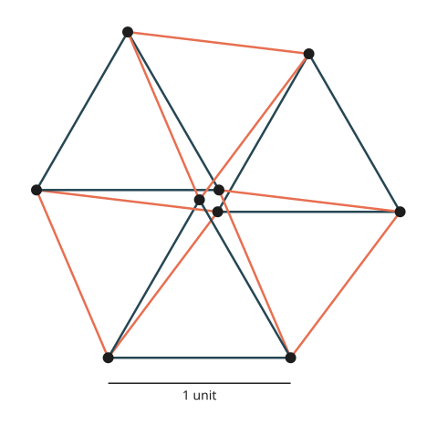
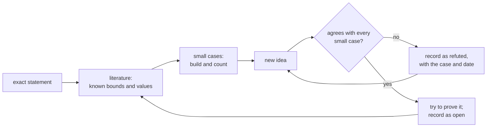

# Working on a problem: small cases, the literature, the status ledger, and knowing when you are wrong

[Syllabus](../../../SYLLABUS.md) → [Frontier](../README.md) → [How Research Works](../README.md#s01) → Working on a problem

---

## General Overview

Put nine dots on a 3 by 3 square grid, one unit apart. Twelve pairs of dots sit at distance exactly 1: six across, six down. Can nine points in the plane do better?

They can. Take a triangle with sides of length 1, then add to it a copy of itself turned through about 53 degrees. The result is nine points with 18 pairs at distance exactly 1 (the picture below). Nobody can do better: 18 is the most for nine points. Schade proved this in a 1993 thesis, and a 2024 computer search confirmed it.

That question, asked for every number of points, is the **unit-distance problem**. Paul Erdős posed it in 1946. Write u(n) for the most pairs at distance exactly 1 among n points. Eighty years later, nobody knows how fast u(n) grows. Erdős guessed that it grows only slightly faster than n; on 2026-05-20 a disproof of that guess was posted, checked by nine mathematicians outside the original announcement but not yet refereed. The problem itself has its own card on the geometry shelf, The unit-distance problem.

This card is about the working method, with that problem as the example. A **working file** is one document per problem. It holds the exact statement, the known results, the small cases computed, the ideas tried, and the date of every check. Its **status ledger** is the part that lists each claim with its kind, its status and the date that status was set, the date it was checked, its artifact and independent check, and its source.

The file earns its keep in two ways. Small cases test every idea cheaply before it costs a month. Dated, sourced entries keep a guess from turning into a "fact" in the writer's head.

**A working file squeezes a problem between what has been built and what has been proved, records each piece with its kind, status, date and source, and tests every new idea against the small cases before trusting it.**

**What kind of fact this is:** a method, not a theorem. Inside it, the growth rate of u(n) is open as of 2026-11-23, and Erdős's conjecture about it has been refuted since 2026-05-20 (a checked preprint). The counting bound in The formula is a theorem, proved on this card in Why it works. The small-case counts are theorems about specific point sets, checked by this card's code.

### The picture: nine points, eighteen unit pairs

<p align="center"></p>

Drawn to scale. The dark segments are three copies of the first unit triangle. The orange segments are three copies of the turned triangle. Each copy contributes 3 unit pairs, so 6 copies give 18.

---

## The formula

The exact statement comes first. Here P is a set of n distinct points in the plane, and $`\lvert p - q\rvert`$ is the ordinary straight-line distance between points p and q ([Distance and midpoint](../../05-Geometry%20and%20trig/04-Coordinates%20and%20Curves/01-distance-and-midpoint.md)).

```math
u(n) = \max_{P} \#\big\{ \{p, q\} \subseteq P : \lvert p - q\rvert = 1 \big\}
```

**Read it aloud:** over every way of placing n distinct points in the plane, the largest number of pairs that are exactly one unit apart.

The known results squeeze u(n) between constructions and a proof. Here log is the natural log, and log log n means the log of log n.

```math
n^{1 + c/\log\log n} \;\le\; u(n) \;\le\; C\, n^{4/3}, \qquad u(n) > n^{1.014} \text{ for infinitely many } n
```

**Read it aloud:** u(n) is always at least n times a factor that creeps up very slowly, never more than a fixed multiple of n to the power four-thirds, and, by a 2026 preprint, more than n to the power 1.014 for infinitely many n.

This card proves a weaker upper bound itself. Write d(v) for the **degree** of a point v: how many points of P are at distance 1 from it. Then

```math
\sum_{v \in P} \binom{d(v)}{2} \;\le\; 2\binom{n}{2}, \quad\text{so}\quad u(n) \;\le\; \frac{n\,(1 + \sqrt{8n - 7})}{4}
```

**Read it aloud:** the pairs of unit neighbours, summed over every point, are at most twice the pairs of points; that caps the number of unit pairs at about n to the power three-halves.

For n = 9 the cap is 20.39, so at most 20 unit pairs. The truth is 18.

| Symbol | Plain meaning | In our example | Push it up and the answer… |
| --- | --- | --- | --- |
| $`n`$ | how many points | 9 | u(n) grows |
| $`P`$ | the set of points | the nine points in the picture | — |
| $`p`$, $`q`$, $`v`$ | single points of $`P`$ | any two of the nine | — |
| $`\lvert p - q\rvert`$ | straight-line distance from p to q | exactly 1 for 18 pairs | — |
| $`u(n)`$ | the most unit pairs n points allow | $`u(9) = 18`$ | — |
| $`d(v)`$ | degree: unit neighbours of $`v`$ | 4 for every point of the picture | more cherries to count |
| $`\binom{m}{2}`$ | pairs among m things: $`m(m-1)/2`$ | $`\binom{9}{2} = 36`$ | — |
| $`\#`$ | how many members a set has | 18 | — |
| $`c`$, $`C`$ | fixed positive constants, not given exactly here | best published $`C`$: 1.94, proved | the bound loosens |
| $`\varepsilon`$ | any small positive number, in Erdős's conjecture | the 2026 preprint beats it for every $`\varepsilon`$ up to 0.014 | a weaker claim |
| $`\log\log n`$ | the natural log, taken twice | barely moves: the factor creeps up slowly | — |

### When it holds

- **Distinct points.** Repeated points make nonsense counts. After the Try changing edit `turned = tri`, the second triangle sits on top of the first: the code lists 9 entries but only 6 distinct points, and counts 24 "pairs".
- **Exactly 1, not about 1.** A computer that rounds will find false unit pairs. The checks use exact arithmetic in numbers of the form $`(a + b\sqrt{3})/10`$ with whole a and b.
- **The plane.** In four dimensions the answer changes completely. Put n/2 points on each of two circles of radius $`1/\sqrt{2}`$ in perpendicular planes: every point of one circle is at distance $`\sqrt{1/2 + 1/2} = 1`$ from every point of the other, giving $`n^2/4`$ unit pairs. With 5 points on each circle the code finds 25 such pairs among 10 points, more than the plane's u(10) = 20.
- **Ordinary distance.** The counting bound uses one fact about circles: two different unit circles meet in at most 2 points. With another way to measure distance, that fact can fail.

---

## Why it works

### Step 0: squeeze the problem, and date every piece

An open problem has two edges. A **construction** is a specific point set; counting its unit pairs gives a lower bound on u(n). An **argument** is a proof that no point set can do better than some number; it gives an upper bound. The gap between the edges is the problem.

The working file keeps both edges, with dates. Its loop looks like this:



Each test of an idea against the small cases is cheap. Each skipped test can cost weeks.

### Step 1: state the problem exactly

[Reading a statement](04-reading-a-mathematical-statement.md) gives the four parts to fix. Here they are:

- **Domain:** the plane, with ordinary distance.
- **Hypothesis:** n distinct points, placed anywhere.
- **Conclusion:** the number u(n), the largest count of pairs at distance exactly 1.
- **Boundary cases:** u(1) = 0 and u(2) = 1. The unit is arbitrary: scaling a point set by any factor turns one distance into another, so "distance 1" means "any one fixed distance".

The scaling remark matters later. It is what lets Erdős use a grid and a long distance in Step 4.

### Step 2: build small cases and count them exactly

The code builds four point sets and counts unit pairs in exact arithmetic.

- **The 3 by 3 square grid:** 9 points, 12 unit pairs.
- **The triangular lattice**, the pattern of equal triangles that tiles the plane. A brute-force search tries every n-point subset of a 19-point hexagonal patch. The best counts for n = 2 to 9 are 1, 3, 5, 7, 9, 12, 14, 16.
- **The cube shadow:** all sums of the unit vectors (1, 0), (0, 1) and (3/5, 4/5). It gives 8 points and 12 unit pairs.
- **Two triangles summed:** every point of a unit triangle plus every point of the same triangle turned so that its first side runs along (3/5, 4/5). It gives 9 points and 18 unit pairs.

The last one works for a reason. Moving all three points of a triangle by the same step keeps its three unit sides. Fix one point of the turned triangle and add it to the first triangle: that gives a copy of the first triangle, 3 unit pairs. Three such copies, plus three copies of the turned triangle, make 18.

No extra pairs appear by accident. A step from one copy to another adds one side of each triangle. Two unit steps add to length 1 only when they meet at 120 degrees. The sides of the first triangle point at multiples of 60 degrees. The turned triangle's sides point at multiples of 60 degrees plus about 53.13 degrees. No pair is 120 degrees apart.

### Step 3: the upper bound, from two circles

Take two points a and b. A point at distance 1 from both lies on the unit circle around a and on the unit circle around b. Two different circles meet in at most 2 points. So any two points of P share at most 2 unit neighbours.

Now count **cherries**: a point v together with two of its unit neighbours. Point v has d(v) neighbours, so it sits at the middle of $`\binom{d(v)}{2}`$ cherries. Each pair of points is the ends of at most 2 cherries. Counting cherries by middle and by ends gives the first inequality of The formula.

Spreading the degrees evenly makes the cherry count smallest. So the most unit pairs allowed is the largest total for which even degrees still pass the test. The code finds that number two ways: by trying degrees directly and by the closed formula. For n = 9 both say 20. They agree for every n from 2 to 21.

<details>
<summary>Detailed proof: from cherries to the formula</summary>

Let the n points have degrees $`d(v)`$ and u unit pairs, so the degrees add to 2u. Write a = 2u/n, the average degree.

The function $`x(x-1)/2`$ curves upward, so its average over the points is at least its value at the average degree (Jensen's inequality). With the cherry count:

$`\displaystyle n\cdot\frac{a(a-1)}{2} \;\le\; \sum_{v \in P}\binom{d(v)}{2} \;\le\; 2\binom{n}{2} = n(n-1)`$

Divide by n/2: $`a^2 - a - 2(n-1) \le 0`$. The quadratic formula gives the largest allowed a:

$`\displaystyle a \;\le\; \frac{1 + \sqrt{8n - 7}}{2}, \qquad u = \frac{na}{2} \;\le\; \frac{n\,(1 + \sqrt{8n - 7})}{4}`$

At n = 9, $`\sqrt{65} \approx 8.062`$, so u ≤ 9 × 9.062 / 4 ≈ 20.39, and u ≤ 20. A count of pairs also never exceeds $`\binom{n}{2}`$, which is the smaller cap for n = 2.

</details>

The cherry bound grows like $`n^{3/2}`$. Erdős gave this argument in his 1946 paper.

### Step 4: what the literature adds

The ledger records each of these as a separate entry, with its source. The proofs are outlined here, not given.

- **The lower bound, Erdős 1946.** Take a square grid and a distance that many grid vectors share. Squared distance 65 is reached by 16 grid directions, such as (1, 8) and (4, 7). On a 30 by 30 grid the code counts 4,944 pairs at squared distance 65, against 1,740 at distance 1. Scale the grid so that $`\sqrt{65}`$ becomes 1. Choosing the distance to suit the grid size gives $`n^{1 + c/\log\log n}`$.
- **The upper bound, $`C\,n^{4/3}`$.** Spencer, Szemerédi and Trotter first proved it in 1984. Székely's 1997 paper, cited here, gives a short proof by counting crossings in a drawing of the points and their unit segments.
- **The constant.** Ágoston and Pálvölgyi proved $`u(n) \le 1.94\,n^{4/3}`$: posted in 2020, refereed and published in 2022. The same paper settles u(15) = 37.
- **Exact values.** Schade's 1993 thesis found u(n) for n ≤ 14, as Ágoston and Pálvölgyi report. A 2024 preprint by Alexeev, Mixon and Parshall, revised in 2025, reports exact values for n ≤ 21 by computer search.
- **The conjecture, refuted.** Erdős conjectured that his grid is near the truth: that u(n) grows only slightly faster than n, below $`n^{1+\varepsilon}`$ for every $`\varepsilon > 0`$ once n is large. The 2025 preprint reports that he offered a prize of 500 US dollars for settling it. A team at an AI lab announced a counterexample. On 2026-05-20 nine mathematicians posted a short version they had checked, with exponent about $`1 + 6.24 \times 10^{-38}`$. The same day Sawin posted point sets with more than $`n^{1.014}`$ unit pairs, for infinitely many n. Both are preprints, not yet refereed.
- **The open part.** The true growth rate: the best exponent lies somewhere between 1.014, if the 2026 preprint stands, and 4/3.

A small-case run puts these in proportion. At n = 21 the bound $`1.94\,n^{4/3}`$ is 112.4, while the cherry bound is 71 and the truth is 57. The $`n^{4/3}`$ bound only beats the cherry bound from n = 386 on. Better growth and a better small-n number are different things.

### Step 5: knowing when you are wrong

Every idea gets tested against the small-case table before anyone trusts it. Three tests catch most mistakes.

- **A guessed pattern must match every small case.** The best lattice counts fit the pattern $`\lfloor 3n - \sqrt{12n - 3}\rfloor`$ (the whole-number part) for n = 2 to 9. Guessing that this is u(n) agrees with the literature up to n = 8 and fails at n = 9: 16 against 18. [Counterexamples](03-how-a-counterexample-works.md) explains why one failure is enough.
- **A proved bound must sit above every known value.** The code checks the literature's table against the cherry bound for every n ≤ 21. Every value passes. A table entry above a proved bound would mean one of them is wrong.
- **A proof must use something the plane has.** The four-dimensional example in When it holds has $`n^2/4`$ unit pairs. An argument that never uses the plane would prove the same bound in four dimensions, which is false. Such an argument is wrong before anyone checks its details.

The same discipline applies to sources. A preprint's table is **claimed** until refereed or independently confirmed. The 9-point construction here is independent: it reaches 18 without using the preprint.

### Step 6: the working file, set up

Here is the file for this problem as it stands on 2026-11-23. It has five parts.

1. **Statement:** the formula for u(n) above, with the four parts from Step 1.
2. **Known results:** the status ledger below.
3. **Small cases:** the code's output, kept with the date it ran.
4. **Ideas tried:** each idea, the case that tested it, and the verdict.
5. **Next checks:** what to re-read or re-run, and when.

The status ledger. Kind and status are separate fields, as [Kinds of claim](02-theorem-conjecture-model-approximation.md) sets out. "Since" is the date of the source that set the status; "Checked" is the date this file last re-read it. The artifact and independent-check column carries the rest of the audit list from [Machines in proofs](06-computer-assistance-and-formal-verification.md).

| Claim | Kind | Status | Since | Checked | Artifact; independent check | Source |
| --- | --- | --- | --- | --- | --- | --- |
| u(9) = 18 | theorem | proved | 1993 | 2026-11-23 | Schade's thesis; confirmed by the 2024 computer search, and the 18 rebuilt by this card's code | Schade, as reported by Ágoston and Pálvölgyi |
| u(n) ≤ cherry bound, 20 at n = 9 | theorem | proved | 1946 | 2026-11-23 | the proof in Step 3; two roads in this card's code agree for n ≤ 21 | Erdős 1946 |
| $`u(n) \ge n^{1 + c/\log\log n}`$ | theorem | proved | 1946 | 2026-11-23 | refereed paper; this card's grid counts show the idea | Erdős 1946 |
| $`u(n) \le 1.94\,n^{4/3}`$ | theorem | proved | 2022 | 2026-11-23 | refereed paper | Ágoston and Pálvölgyi |
| u(n) for 16 ≤ n ≤ 21, up to u(21) = 57 | theorem | claimed: preprint, not yet refereed | 2024-12-16 | 2026-11-23 | their computer search; this card's code checks the table against the cherry bound, which is not a rerun | Alexeev, Mixon and Parshall |
| $`u(n) > n^{1.014}`$ for infinitely many n | theorem | claimed: preprint, not yet refereed | 2026-05-20 | 2026-11-23 | an explicit construction; no independent check recorded here | Sawin, [arXiv:2605.20579](https://arxiv.org/abs/2605.20579) |
| u(n) grows only slightly faster than n | conjecture | refuted | 2026-05-20 | 2026-11-23 | a counterexample announced by an AI lab; a write-up checked by nine mathematicians outside the announcement, preprint | Alon and eight others |

The ideas-tried log, from Step 5 and What breaks:

| Idea | Tested on | Verdict, 2026-11-23 |
| --- | --- | --- |
| u(n) follows the lattice pattern | n = 2 to 9 | refuted at n = 9: 16 against 18 |
| the cherry bound is the value | n = 2 to 21 | refuted at n = 4: 6 against 5 |
| squared distance 65 beats distance 1 | 3 by 3 and 30 by 30 grids | true only on the big grid: 0 against 12, then 4,944 against 1,740 |

---

## Worked numbers, by hand

| Step | Arithmetic | Value |
| --- | --- | --- |
| 3 by 3 square grid | 3 rows × 2 + 3 columns × 2 | 12 unit pairs |
| best 9 lattice points | brute force over the 19-point patch | 16 unit pairs |
| two triangles summed | 6 triangle copies × 3 sides | **18 unit pairs** |
| cherry bound at n = 9 | 9 × (1 + √65) / 4 = 9 × 9.062 / 4 | 20.39, so at most 20 |
| literature value | Schade 1993, confirmed by search 2024 | u(9) = 18 |
| gap at n = 9 | 20 − 18 | 2 |
| gap at n = 21 | 71 − 57 | 14 |
| Erdős's idea, 30 by 30 grid | squared distance 65 against 1 | 4,944 against 1,740 |

At nine points the file is closed: a construction reaches 18 and the literature says nothing does better. As n grows, the gap between the cherry bound and the known values widens from 2 to 14. That gap measures how loose the cherry bound is, since u(n) itself is known or claimed up to n = 21. The open question is the growth exponent for large n.

### What breaks if you drop a piece

| Mistake | Comes out at | What went wrong |
| --- | --- | --- |
| The lattice pattern guessed as u(n) | 16 at n = 9, not 18 | A pattern that fits n = 2 to 8 is evidence, not a proof |
| The cherry bound read as u(n) | 6 at n = 4, not 5 | A bound is a ceiling; four points cannot all be one apart |
| Erdős's distance used on a small grid | 0 pairs at squared distance 65 on the 3 by 3 grid | The trick needs room: a vector (1, 8) does not fit |
| The cube shadow taken as best for 8 points | 12, not 14 | One construction is one lower bound, not the answer |

The code prints all four.

---

## Code, from first principles, and it actually runs

The script builds every point set in exact arithmetic and counts unit pairs. It takes four independent roads. The best lattice subsets come from brute force and are matched against the guessed pattern. The cherry bound comes from trying degrees and from the closed formula. Erdős's grid counts come from a direction formula and from checking every pair. Finally the literature's table is tested from both sides: no construction may beat it, and it may not exceed the proved bound.

### Python

```python
# Working on a problem -- the check behind the card.  Standard library only.
# The problem: u(n), the most pairs among n points in the plane at distance
# exactly 1.  The working file needs lower bounds (point sets, counted here in
# exact arithmetic), upper bounds (a counting argument, done two ways), and the
# literature's table, tested against both.  A point is (xa, xb, ya, yb):
# x = (xa + xb*sqrt3)/10 and y = (ya + yb*sqrt3)/10, so no rounding ever enters.
from itertools import combinations
from math import atan2, degrees, isqrt, sqrt

def is_unit(p, q):                      # squared distance exactly 1, in Z[sqrt3]/100
    a, b, c, d = (p[i] - q[i] for i in range(4))
    return a * a + 3 * b * b + c * c + 3 * d * d == 100 and a * b + c * d == 0

def pairs(pts):
    return [(i, j) for i, j in combinations(range(len(pts)), 2) if is_unit(pts[i], pts[j])]

def most_common_neighbours(pts):        # two unit circles meet in at most 2 points
    nb = [{j for j in range(len(pts)) if j != i and is_unit(pts[i], pts[j])} for i in range(len(pts))]
    return max(len(nb[i] & nb[j]) for i, j in combinations(range(len(pts)), 2))

def lattice(a, b):                      # a + b*omega, omega at 60 degrees
    return (10 * a + 5 * b, 0, 0, 5 * b)

# ---- lower bounds: point sets, counted exactly ----
grid = [(10 * i, 0, 10 * j, 0) for i in range(3) for j in range(3)]
patch = [lattice(a, b) for a in range(-2, 3) for b in range(-2, 3) if abs(a + b) <= 2]
adj = [sum(1 << j for j in range(len(patch)) if j != i and is_unit(patch[i], patch[j]))
       for i in range(len(patch))]
best = {}                               # best subset of the 19-point patch, by brute force
for n in range(2, 10):
    best[n] = max(sum(bin(adj[i] & sum(1 << j for j in s)).count("1") for i in s) // 2
                  for s in combinations(range(len(patch)), n))
harborth = {n: 3 * n - isqrt(12 * n - 3) - (0 if isqrt(12 * n - 3) ** 2 == 12 * n - 3 else 1)
            for n in range(2, 10)}      # floor(3n - sqrt(12n - 3)), in integers
tri = [(0, 0, 0, 0), (10, 0, 0, 0), (5, 0, 0, 5)]          # a unit triangle
turned = [(0, 0, 0, 0), (6, 0, 8, 0), (3, -4, 4, 3)]       # the same, turned by (3/5, 4/5)
mink = [tuple(x + y for x, y in zip(a, b)) for a in tri for b in turned]
cube = [tuple(sum(v[k] for v, bit in zip([(10, 0, 0, 0), (0, 0, 10, 0), (6, 0, 8, 0)], m) if bit)
              for k in range(4)) for m in [(i & 1, i >> 1 & 1, i >> 2 & 1) for i in range(8)]]

# ---- upper bound: each pair of points has at most 2 common neighbours ----
def bound_degrees(n):                   # largest e whose most even degrees pass the count
    e = 0
    while True:
        q, r = divmod(2 * (e + 1), n)
        if r * (q + 1) * q // 2 + (n - r) * q * (q - 1) // 2 > n * (n - 1) or e == n * (n - 1) // 2:
            return e
        e += 1

def bound_formula(n):                   # u <= n(1 + sqrt(8n - 7))/4, and never above n(n - 1)/2
    return min(int(n * (1 + sqrt(8 * n - 7)) / 4), n * (n - 1) // 2)

known = [0, 0, 1, 3, 5, 7, 9, 12, 14, 18, 20, 23, 27, 30, 33, 37, 41, 43, 46, 50, 54, 57]

def erdos_grid(side, m):                # pairs at squared distance m in a side x side grid
    vecs = [(dx, dy) for dx in range(0, side) for dy in range(-side + 1, side)
            if dx * dx + dy * dy == m and (dx > 0 or dy > 0)]
    return len(vecs), sum((side - abs(dx)) * (side - abs(dy)) for dx, dy in vecs)

def erdos_brute(side, m):
    pts = [(i, j) for i in range(side) for j in range(side)]
    return sum((p[0] - q[0]) ** 2 + (p[1] - q[1]) ** 2 == m for p, q in combinations(pts, 2))

print("statement: u(n) = most pairs at distance exactly 1 among n distinct points in the plane")
print(f"3 x 3 square grid: {len(grid)} points, {len(pairs(grid))} unit pairs")
print(f"triangular patch: {len(patch)} points; best n-point subsets by brute force:")
for n in range(2, 10):
    print(f"  n = {n}: lattice best {best[n]}, formula floor(3n - sqrt(12n - 3)) = {harborth[n]}, known u(n) = {known[n]}")
print(f"two triangles summed: {len(set(mink))} points, {len(pairs(mink))} unit pairs")
degs = [sum(is_unit(p, q) for q in mink if q != p) for p in mink]
print(f"  degrees {degs}; cherries {sum(d * (d - 1) // 2 for d in degs)} <= 2 x {9 * 8 // 2} = {9 * 8}; "
      f"second triangle turned {degrees(atan2(8, 6)):.2f} degrees")
print(f"cube shadow from (1,0), (0,1), (3/5,4/5): {len(set(cube))} points, {len(pairs(cube))} unit pairs, known u(8) = {known[8]}")
print(f"most common neighbours of a pair: grid {most_common_neighbours(grid)}, patch "
      f"{most_common_neighbours(patch)}, two triangles {most_common_neighbours(mink)}")
print("upper bound from common neighbours, against the literature (n <= 21):")
for n in range(2, 22):
    print(f"  n = {n}: by degrees {bound_degrees(n)}, by formula {bound_formula(n)}, known {known[n]}, gap {bound_degrees(n) - known[n]}")
print(f"cherry bound at n = 9: sqrt(65) = {sqrt(65):.3f}, 9 x {1 + sqrt(65):.3f} / 4 = {9 * (1 + sqrt(65)) / 4:.2f}")
ring = [(1, 7), (5, 5), (7, 1), (7, -1), (5, -5)]        # on x^2 + y^2 = 50: radius 1/sqrt2, scaled by 10
four = [(a, b, 0, 0) for a, b in ring] + [(0, 0, a, b) for a, b in ring]
def unit4(p, q):
    return sum((x - y) ** 2 for x, y in zip(p, q)) == 100
across = sum(unit4(p, q) for p in four[:5] for q in four[5:])
print(f"four dimensions, two circles of 5 points: {sum(unit4(p, q) for p, q in combinations(four, 2))} "
      f"unit pairs among 10 points, {across} across the circles; the plane allows u(10) = {known[10]}")
cross = next(n for n in range(2, 10 ** 6) if 1.94 * n ** (4 / 3) < n * (1 + sqrt(8 * n - 7)) / 4)
print(f"1.94 n^(4/3) at n = 21: {1.94 * 21 ** (4 / 3):.1f}; it first beats the counting bound at n = {cross}")
print("quoted, not computed: u(n) > n^1.014 for infinitely many n (preprint, 2026-05-20); checked write-up exponent 1 + 6.24e-38")
SIDE, SQUARES = 30, (1, 25, 65)           # Erdos's idea: a big grid and a well-chosen distance
for m in SQUARES:
    dirs, count = erdos_grid(SIDE, m)
    print(f"{SIDE} x {SIDE} grid, squared distance {m}: {2 * dirs} directions, {count} pairs (brute force {erdos_brute(SIDE, m)})")
print(f"same idea on the 3 x 3 grid, squared distance 65: {erdos_grid(3, 65)[1]} pairs")
wrong = [n for n in range(2, 10) if harborth[n] != known[n]]
print(f"lattice pattern guessed as u(n): first fails at n = {wrong[0]}, {harborth[wrong[0]]} against {known[wrong[0]]}")
print(f"counting bound read as u(n): first fails at n = {next(n for n in range(2, 22) if bound_degrees(n) != known[n])}")
f = [((p[0] + p[1] * sqrt(3)) / 10, (p[2] + p[3] * sqrt(3)) / 10) for p in mink]
print("figure," + ",".join(f"({x:.3f} {y:.3f})" for x, y in f))
assert all(best[n] == harborth[n] for n in range(2, 10))        # brute force against formula
assert len(set(mink)) == 9 and len(pairs(mink)) == known[9]   # construction meets the table
assert all(bound_degrees(n) == bound_formula(n) for n in range(2, 22))   # two roads to the bound
assert all(known[n] <= bound_degrees(n) for n in range(2, 22))  # literature passes the proved bound
assert all(best[n] <= known[n] for n in range(2, 10))           # constructions never beat the table
assert all(erdos_grid(SIDE, m)[1] == erdos_brute(SIDE, m) for m in SQUARES)
assert across == 25 and across > known[10]                      # 4D beats the plane's table
assert max(most_common_neighbours(s) for s in (grid, patch, mink, cube)) <= 2
print("ALL CHECKS PASS")
```

**Ran 2026-11-23 on macOS, Python 3.14.10, standard library only. All checks passed. Output, pasted from the run:**

```
statement: u(n) = most pairs at distance exactly 1 among n distinct points in the plane
3 x 3 square grid: 9 points, 12 unit pairs
triangular patch: 19 points; best n-point subsets by brute force:
  n = 2: lattice best 1, formula floor(3n - sqrt(12n - 3)) = 1, known u(n) = 1
  n = 3: lattice best 3, formula floor(3n - sqrt(12n - 3)) = 3, known u(n) = 3
  n = 4: lattice best 5, formula floor(3n - sqrt(12n - 3)) = 5, known u(n) = 5
  n = 5: lattice best 7, formula floor(3n - sqrt(12n - 3)) = 7, known u(n) = 7
  n = 6: lattice best 9, formula floor(3n - sqrt(12n - 3)) = 9, known u(n) = 9
  n = 7: lattice best 12, formula floor(3n - sqrt(12n - 3)) = 12, known u(n) = 12
  n = 8: lattice best 14, formula floor(3n - sqrt(12n - 3)) = 14, known u(n) = 14
  n = 9: lattice best 16, formula floor(3n - sqrt(12n - 3)) = 16, known u(n) = 18
two triangles summed: 9 points, 18 unit pairs
  degrees [4, 4, 4, 4, 4, 4, 4, 4, 4]; cherries 54 <= 2 x 36 = 72; second triangle turned 53.13 degrees
cube shadow from (1,0), (0,1), (3/5,4/5): 8 points, 12 unit pairs, known u(8) = 14
most common neighbours of a pair: grid 2, patch 2, two triangles 2
upper bound from common neighbours, against the literature (n <= 21):
  n = 2: by degrees 1, by formula 1, known 1, gap 0
  n = 3: by degrees 3, by formula 3, known 3, gap 0
  n = 4: by degrees 6, by formula 6, known 5, gap 1
  n = 5: by degrees 8, by formula 8, known 7, gap 1
  n = 6: by degrees 11, by formula 11, known 9, gap 2
  n = 7: by degrees 14, by formula 14, known 12, gap 2
  n = 8: by degrees 17, by formula 17, known 14, gap 3
  n = 9: by degrees 20, by formula 20, known 18, gap 2
  n = 10: by degrees 23, by formula 23, known 20, gap 3
  n = 11: by degrees 27, by formula 27, known 23, gap 4
  n = 12: by degrees 31, by formula 31, known 27, gap 4
  n = 13: by degrees 35, by formula 35, known 30, gap 5
  n = 14: by degrees 39, by formula 39, known 33, gap 6
  n = 15: by degrees 43, by formula 43, known 37, gap 6
  n = 16: by degrees 48, by formula 48, known 41, gap 7
  n = 17: by degrees 52, by formula 52, known 43, gap 9
  n = 18: by degrees 57, by formula 57, known 46, gap 11
  n = 19: by degrees 61, by formula 61, known 50, gap 11
  n = 20: by degrees 66, by formula 66, known 54, gap 12
  n = 21: by degrees 71, by formula 71, known 57, gap 14
cherry bound at n = 9: sqrt(65) = 8.062, 9 x 9.062 / 4 = 20.39
four dimensions, two circles of 5 points: 29 unit pairs among 10 points, 25 across the circles; the plane allows u(10) = 20
1.94 n^(4/3) at n = 21: 112.4; it first beats the counting bound at n = 386
quoted, not computed: u(n) > n^1.014 for infinitely many n (preprint, 2026-05-20); checked write-up exponent 1 + 6.24e-38
30 x 30 grid, squared distance 1: 4 directions, 1740 pairs (brute force 1740)
30 x 30 grid, squared distance 25: 12 directions, 4308 pairs (brute force 4308)
30 x 30 grid, squared distance 65: 16 directions, 4944 pairs (brute force 4944)
same idea on the 3 x 3 grid, squared distance 65: 0 pairs
lattice pattern guessed as u(n): first fails at n = 9, 16 against 18
counting bound read as u(n): first fails at n = 4
figure,(0.000 0.000),(0.600 0.800),(-0.393 0.920),(1.000 0.000),(1.600 0.800),(0.607 0.920),(0.500 0.866),(1.100 1.666),(0.107 1.786)
ALL CHECKS PASS
```

### Rust

Same numbers, same labels, built with `rustc --edition 2021 -O`.

```rust
// Working on a problem -- the same check as the Python, in Rust.  No crates.
// The problem: u(n), the most pairs among n points in the plane at distance
// exactly 1.  The working file needs lower bounds (point sets, counted here in
// exact arithmetic), upper bounds (a counting argument, done two ways), and the
// literature's table, tested against both.  A point is (xa, xb, ya, yb):
// x = (xa + xb*sqrt3)/10 and y = (ya + yb*sqrt3)/10, so no rounding ever enters.
type P = [i64; 4];

fn is_unit(p: &P, q: &P) -> bool {           // squared distance exactly 1, in Z[sqrt3]/100
    let (a, b, c, d) = (p[0] - q[0], p[1] - q[1], p[2] - q[2], p[3] - q[3]);
    a * a + 3 * b * b + c * c + 3 * d * d == 100 && a * b + c * d == 0
}

fn pairs(pts: &[P]) -> usize {
    let mut k = 0;
    for i in 0..pts.len() { for j in i + 1..pts.len() { if is_unit(&pts[i], &pts[j]) { k += 1 } } }
    k
}

fn most_common_neighbours(pts: &[P]) -> usize { // two unit circles meet in at most 2 points
    let n = pts.len();
    let mut best = 0;
    for i in 0..n { for j in i + 1..n {
        let c = (0..n).filter(|&k| k != i && k != j && is_unit(&pts[i], &pts[k]) && is_unit(&pts[j], &pts[k])).count();
        best = best.max(c);
    } }
    best
}

fn distinct(pts: &[P]) -> usize {
    let mut v = pts.to_vec();
    v.sort();
    v.dedup();
    v.len()
}

fn lattice(a: i64, b: i64) -> P { [10 * a + 5 * b, 0, 0, 5 * b] } // a + b*omega, omega at 60 degrees

fn isqrt(x: i64) -> i64 { let mut r = 0; while (r + 1) * (r + 1) <= x { r += 1 } r }

fn bound_degrees(n: i64) -> i64 {           // largest e whose most even degrees pass the count
    let mut e = 0;
    loop {
        let (q, r) = (2 * (e + 1) / n, 2 * (e + 1) % n);
        if r * (q + 1) * q / 2 + (n - r) * q * (q - 1) / 2 > n * (n - 1) || e == n * (n - 1) / 2 { return e }
        e += 1;
    }
}

fn bound_formula(n: i64) -> i64 {           // u <= n(1 + sqrt(8n - 7))/4, and never above n(n - 1)/2
    ((n as f64 * (1.0 + ((8 * n - 7) as f64).sqrt()) / 4.0) as i64).min(n * (n - 1) / 2)
}

fn erdos_grid(side: i64, m: i64) -> (usize, i64) { // pairs at squared distance m in a side x side grid
    let mut vecs = Vec::new();
    for dx in 0..side { for dy in -side + 1..side {
        if dx * dx + dy * dy == m && (dx > 0 || dy > 0) { vecs.push((dx, dy)) }
    } }
    (vecs.len(), vecs.iter().map(|&(dx, dy)| (side - dx.abs()) * (side - dy.abs())).sum())
}

fn erdos_brute(side: i64, m: i64) -> i64 {
    let pts: Vec<(i64, i64)> = (0..side).flat_map(|i| (0..side).map(move |j| (i, j))).collect();
    let mut k = 0;
    for a in 0..pts.len() { for b in a + 1..pts.len() {
        let (dx, dy) = (pts[a].0 - pts[b].0, pts[a].1 - pts[b].1);
        if dx * dx + dy * dy == m { k += 1 }
    } }
    k
}

fn main() {
    let grid: Vec<P> = (0..3).flat_map(|i| (0..3).map(move |j| [10 * i, 0, 10 * j, 0])).collect();
    let mut patch: Vec<P> = Vec::new();
    for a in -2..3i64 { for b in -2..3i64 { if (a + b).abs() <= 2 { patch.push(lattice(a, b)) } } }
    let np = patch.len();
    let adj: Vec<u32> = (0..np).map(|i| (0..np).filter(|&j| j != i && is_unit(&patch[i], &patch[j]))
        .map(|j| 1u32 << j).sum()).collect();
    let mut best = [0i64; 10];              // best subset of the 19-point patch, by brute force
    for s in 0u32..(1 << np) {
        let n = s.count_ones() as usize;
        if n < 2 || n > 9 { continue }
        let e: u32 = (0..np).filter(|&i| s >> i & 1 == 1).map(|i| (adj[i] & s).count_ones()).sum();
        best[n] = best[n].max(e as i64 / 2);
    }
    let harborth = |n: i64| { let t = 12 * n - 3; let r = isqrt(t); 3 * n - r - if r * r == t { 0 } else { 1 } };
    let tri: [P; 3] = [[0, 0, 0, 0], [10, 0, 0, 0], [5, 0, 0, 5]];       // a unit triangle
    let turned: [P; 3] = [[0, 0, 0, 0], [6, 0, 8, 0], [3, -4, 4, 3]];    // the same, turned by (3/5, 4/5)
    let mut mink: Vec<P> = Vec::new();
    for a in &tri { for b in &turned { mink.push([a[0] + b[0], a[1] + b[1], a[2] + b[2], a[3] + b[3]]) } }
    let gens: [P; 3] = [[10, 0, 0, 0], [0, 0, 10, 0], [6, 0, 8, 0]];
    let cube: Vec<P> = (0..8).map(|m: usize| {
        let mut p = [0i64; 4];
        for (g, v) in gens.iter().enumerate() { if m >> g & 1 == 1 { for k in 0..4 { p[k] += v[k] } } }
        p }).collect();
    let known: [i64; 22] = [0, 0, 1, 3, 5, 7, 9, 12, 14, 18, 20, 23, 27, 30, 33, 37, 41, 43, 46, 50, 54, 57];

    println!("statement: u(n) = most pairs at distance exactly 1 among n distinct points in the plane");
    println!("3 x 3 square grid: {} points, {} unit pairs", grid.len(), pairs(&grid));
    println!("triangular patch: {} points; best n-point subsets by brute force:", np);
    for n in 2..10 {
        println!("  n = {}: lattice best {}, formula floor(3n - sqrt(12n - 3)) = {}, known u(n) = {}", n, best[n], harborth(n as i64), known[n]);
    }
    println!("two triangles summed: {} points, {} unit pairs", distinct(&mink), pairs(&mink));
    let degs: Vec<usize> = mink.iter().map(|p| mink.iter().filter(|q| *q != p && is_unit(p, q)).count()).collect();
    println!("  degrees {:?}; cherries {} <= 2 x {} = {}; second triangle turned {:.2} degrees",
             degs, degs.iter().map(|d| d * (d - 1) / 2).sum::<usize>(), 9 * 8 / 2, 9 * 8, 8f64.atan2(6.0).to_degrees());
    println!("cube shadow from (1,0), (0,1), (3/5,4/5): {} points, {} unit pairs, known u(8) = {}", distinct(&cube), pairs(&cube), known[8]);
    println!("most common neighbours of a pair: grid {}, patch {}, two triangles {}",
             most_common_neighbours(&grid), most_common_neighbours(&patch), most_common_neighbours(&mink));
    println!("upper bound from common neighbours, against the literature (n <= 21):");
    for n in 2..22i64 {
        println!("  n = {}: by degrees {}, by formula {}, known {}, gap {}", n, bound_degrees(n), bound_formula(n), known[n as usize], bound_degrees(n) - known[n as usize]);
    }
    println!("cherry bound at n = 9: sqrt(65) = {:.3}, 9 x {:.3} / 4 = {:.2}", 65f64.sqrt(), 1.0 + 65f64.sqrt(), 9.0 * (1.0 + 65f64.sqrt()) / 4.0);
    let ring = [(1i64, 7i64), (5, 5), (7, 1), (7, -1), (5, -5)]; // on x^2 + y^2 = 50: radius 1/sqrt2, scaled by 10
    let four: Vec<P> = ring.iter().map(|&(a, b)| [a, b, 0, 0]).chain(ring.iter().map(|&(a, b)| [0, 0, a, b])).collect();
    let unit4 = |p: &P, q: &P| (0..4).map(|k| (p[k] - q[k]) * (p[k] - q[k])).sum::<i64>() == 100;
    let all4 = (0..10).map(|i| (i + 1..10).filter(|&j| unit4(&four[i], &four[j])).count()).sum::<usize>();
    let across = (0..5).map(|i| (5..10).filter(|&j| unit4(&four[i], &four[j])).count()).sum::<usize>();
    println!("four dimensions, two circles of 5 points: {} unit pairs among 10 points, {} across the circles; the plane allows u(10) = {}", all4, across, known[10]);
    let cross = (2..1_000_000i64).find(|&n| 1.94 * (n as f64).powf(4.0 / 3.0) < n as f64 * (1.0 + ((8 * n - 7) as f64).sqrt()) / 4.0).unwrap();
    println!("1.94 n^(4/3) at n = 21: {:.1}; it first beats the counting bound at n = {}", 1.94 * 21f64.powf(4.0 / 3.0), cross);
    println!("quoted, not computed: u(n) > n^1.014 for infinitely many n (preprint, 2026-05-20); checked write-up exponent 1 + 6.24e-38");
    let (side, squares) = (30, [1, 25, 65]);   // Erdos's idea: a big grid and a well-chosen distance
    for m in squares {
        let (dirs, count) = erdos_grid(side, m);
        println!("{} x {} grid, squared distance {}: {} directions, {} pairs (brute force {})", side, side, m, 2 * dirs, count, erdos_brute(side, m));
    }
    println!("same idea on the 3 x 3 grid, squared distance 65: {} pairs", erdos_grid(3, 65).1);
    let wrong = (2..10).find(|&n| harborth(n) != known[n as usize]).unwrap();
    println!("lattice pattern guessed as u(n): first fails at n = {}, {} against {}", wrong, harborth(wrong), known[wrong as usize]);
    println!("counting bound read as u(n): first fails at n = {}", (2..22).find(|&n| bound_degrees(n) != known[n as usize]).unwrap());
    let s3 = 3f64.sqrt();
    let f: Vec<String> = mink.iter().map(|p| format!("({:.3} {:.3})",
        (p[0] as f64 + p[1] as f64 * s3) / 10.0, (p[2] as f64 + p[3] as f64 * s3) / 10.0)).collect();
    println!("figure,{}", f.join(","));
    assert!((2..10).all(|n| best[n] == harborth(n as i64)));           // brute force against formula
    assert!(distinct(&mink) == 9 && pairs(&mink) as i64 == known[9]); // construction meets the table
    assert!((2..22).all(|n| bound_degrees(n) == bound_formula(n)));     // two roads to the bound
    assert!((2..22).all(|n| known[n as usize] <= bound_degrees(n)));    // literature passes the proved bound
    assert!((2..10).all(|n| best[n] <= known[n]));                      // constructions never beat the table
    assert!(squares.iter().all(|&m| erdos_grid(side, m).1 == erdos_brute(side, m)));
    assert!(across == 25 && across as i64 > known[10]);              // 4D beats the plane's table
    assert!([&grid, &patch, &mink, &cube].iter().map(|s| most_common_neighbours(s)).max().unwrap() <= 2);
    println!("ALL CHECKS PASS");
}
```

**Ran 2026-11-23 on macOS, rustc 1.98.1, no crates. All checks passed. Output, pasted from the run:**

```
statement: u(n) = most pairs at distance exactly 1 among n distinct points in the plane
3 x 3 square grid: 9 points, 12 unit pairs
triangular patch: 19 points; best n-point subsets by brute force:
  n = 2: lattice best 1, formula floor(3n - sqrt(12n - 3)) = 1, known u(n) = 1
  n = 3: lattice best 3, formula floor(3n - sqrt(12n - 3)) = 3, known u(n) = 3
  n = 4: lattice best 5, formula floor(3n - sqrt(12n - 3)) = 5, known u(n) = 5
  n = 5: lattice best 7, formula floor(3n - sqrt(12n - 3)) = 7, known u(n) = 7
  n = 6: lattice best 9, formula floor(3n - sqrt(12n - 3)) = 9, known u(n) = 9
  n = 7: lattice best 12, formula floor(3n - sqrt(12n - 3)) = 12, known u(n) = 12
  n = 8: lattice best 14, formula floor(3n - sqrt(12n - 3)) = 14, known u(n) = 14
  n = 9: lattice best 16, formula floor(3n - sqrt(12n - 3)) = 16, known u(n) = 18
two triangles summed: 9 points, 18 unit pairs
  degrees [4, 4, 4, 4, 4, 4, 4, 4, 4]; cherries 54 <= 2 x 36 = 72; second triangle turned 53.13 degrees
cube shadow from (1,0), (0,1), (3/5,4/5): 8 points, 12 unit pairs, known u(8) = 14
most common neighbours of a pair: grid 2, patch 2, two triangles 2
upper bound from common neighbours, against the literature (n <= 21):
  n = 2: by degrees 1, by formula 1, known 1, gap 0
  n = 3: by degrees 3, by formula 3, known 3, gap 0
  n = 4: by degrees 6, by formula 6, known 5, gap 1
  n = 5: by degrees 8, by formula 8, known 7, gap 1
  n = 6: by degrees 11, by formula 11, known 9, gap 2
  n = 7: by degrees 14, by formula 14, known 12, gap 2
  n = 8: by degrees 17, by formula 17, known 14, gap 3
  n = 9: by degrees 20, by formula 20, known 18, gap 2
  n = 10: by degrees 23, by formula 23, known 20, gap 3
  n = 11: by degrees 27, by formula 27, known 23, gap 4
  n = 12: by degrees 31, by formula 31, known 27, gap 4
  n = 13: by degrees 35, by formula 35, known 30, gap 5
  n = 14: by degrees 39, by formula 39, known 33, gap 6
  n = 15: by degrees 43, by formula 43, known 37, gap 6
  n = 16: by degrees 48, by formula 48, known 41, gap 7
  n = 17: by degrees 52, by formula 52, known 43, gap 9
  n = 18: by degrees 57, by formula 57, known 46, gap 11
  n = 19: by degrees 61, by formula 61, known 50, gap 11
  n = 20: by degrees 66, by formula 66, known 54, gap 12
  n = 21: by degrees 71, by formula 71, known 57, gap 14
cherry bound at n = 9: sqrt(65) = 8.062, 9 x 9.062 / 4 = 20.39
four dimensions, two circles of 5 points: 29 unit pairs among 10 points, 25 across the circles; the plane allows u(10) = 20
1.94 n^(4/3) at n = 21: 112.4; it first beats the counting bound at n = 386
quoted, not computed: u(n) > n^1.014 for infinitely many n (preprint, 2026-05-20); checked write-up exponent 1 + 6.24e-38
30 x 30 grid, squared distance 1: 4 directions, 1740 pairs (brute force 1740)
30 x 30 grid, squared distance 25: 12 directions, 4308 pairs (brute force 4308)
30 x 30 grid, squared distance 65: 16 directions, 4944 pairs (brute force 4944)
same idea on the 3 x 3 grid, squared distance 65: 0 pairs
lattice pattern guessed as u(n): first fails at n = 9, 16 against 18
counting bound read as u(n): first fails at n = 4
figure,(0.000 0.000),(0.600 0.800),(-0.393 0.920),(1.000 0.000),(1.600 0.800),(0.607 0.920),(0.500 0.866),(1.100 1.666),(0.107 1.786)
ALL CHECKS PASS
```

The two outputs match line for line.

### Lean

Lean proves the cherry count and the counting bound for any finite set of points in the plane, and checks the small cases.

- Take n distinct points in the plane. Then the cherries, summed over every point, number at most $`2\binom{n}{2}`$.
- Take n distinct points in the plane. Then they have at most $`n(1 + \sqrt{8n - 7})/4`$ unit pairs.
- Some nine distinct points in the plane have exactly 18 unit pairs. Lean turns the second triangle a quarter turn, not 53 degrees; the count is the same.
- The 3 by 3 square grid has 12 unit pairs, and none at squared distance 65.
- Take nine points of degree 4, as in the picture. Then they give 54 cherries, within the cap of 72.
- Take the cherry bound at n = 9. Then it allows 20 unit pairs but not 21.
- Take the lattice pattern at n = 9. Then it gives 16, fewer than the picture's 18.
- Take 5 points on each of two circles in four dimensions. Then all 25 pairs across the circles are unit pairs.

The lattice search, the literature's table and the 30 by 30 grid counts are left to the Python and Rust checks.

```lean
-- Working on a problem: in the plane, n distinct points have at most n(1 + sqrt(8n - 7))/4 pairs at distance exactly 1, because the unit neighbours of every point, taken two at a time, number at most 2 · C(n, 2), and nine points do reach 18 such pairs.
import Mathlib.Analysis.InnerProductSpace.PiL2
import Mathlib.Analysis.SpecialFunctions.Sqrt
import Mathlib.Geometry.Euclidean.Basic
import Mathlib.Data.Int.Interval
import Mathlib.Combinatorics.Enumerative.DoubleCounting
import Mathlib.Algebra.Order.Chebyshev
import Mathlib.Data.Nat.Choose.Cast

open Finset

/-- The plane, with ordinary straight-line distance. -/
abbrev Plane := EuclideanSpace ℝ (Fin 2)

/-- The unit neighbours of `v` in `P`: the points of `P` at distance exactly 1 from `v`.
Their number is the degree d(v). -/
noncomputable def unitNeighbours (P : Finset Plane) (v : Plane) : Finset Plane :=
  {w ∈ P | dist v w = 1}

/-- The unit pairs of `P`: the unordered pairs {p, q} of distinct points of `P` with
|p − q| = 1. -/
noncomputable def unitPairs (P : Finset Plane) : Finset (Finset Plane) :=
  {s ∈ P.powersetCard 2 | ∀ p ∈ s, ∀ q ∈ s, p ≠ q → dist p q = 1}

/-- Two common unit neighbours at most: two distinct points `a`, `b` of the plane have at most
two points of `P` at distance 1 from both (two unit circles with different centres meet at most
twice). -/
lemma card_common_unit_neighbours_le_two (P : Finset Plane) {a b : Plane} (hab : a ≠ b) :
    (P.filter (fun v => dist v a = 1 ∧ dist v b = 1)).card ≤ 2 := by
  by_contra h
  push Not at h
  obtain ⟨x, hx, y, hy, z, hz, hxy, hxz, hyz⟩ := Finset.two_lt_card.mp h
  simp only [Finset.mem_filter] at hx hy hz
  have hd : Module.finrank ℝ (EuclideanSpace ℝ (Fin 2)) = 2 := by simp
  rcases EuclideanGeometry.eq_of_dist_eq_of_dist_eq_of_finrank_eq_two hd hab hxy hx.2.1 hy.2.1
      hz.2.1 hx.2.2 hy.2.2 hz.2.2 with h | h
  · exact hxz h.symm
  · exact hyz h.symm

/-- The cherry count, as a helper (the theorem below restates it): summing C(d(v), 2) over the
points gives at most 2 · C(n, 2). -/
lemma sum_choose_degree_le (P : Finset Plane) :
    ∑ v ∈ P, (unitNeighbours P v).card.choose 2 ≤ 2 * P.card.choose 2 := by
  classical
  have h1 : ∀ v ∈ P, (unitNeighbours P v).card.choose 2 =
      ((P.powersetCard 2).bipartiteAbove (fun v s => s ⊆ unitNeighbours P v) v).card := by
    intro v _
    rw [← Finset.card_powersetCard]
    congr 1
    ext s
    simp only [Finset.bipartiteAbove, Finset.mem_filter, Finset.mem_powersetCard]
    constructor
    · rintro ⟨hs, hc⟩
      exact ⟨⟨hs.trans (Finset.filter_subset _ _), hc⟩, hs⟩
    · rintro ⟨⟨_, hc⟩, hs⟩
      exact ⟨hs, hc⟩
  rw [Finset.sum_congr rfl h1, Finset.sum_card_bipartiteAbove_eq_sum_card_bipartiteBelow]
  have h2 : ∀ s ∈ P.powersetCard 2,
      (P.bipartiteBelow (fun v s => s ⊆ unitNeighbours P v) s).card ≤ 2 := by
    intro s hs
    rw [Finset.mem_powersetCard] at hs
    obtain ⟨a, b, hab, rfl⟩ := Finset.card_eq_two.mp hs.2
    refine le_trans (Finset.card_le_card ?_) (card_common_unit_neighbours_le_two P hab)
    intro v hv
    simp only [Finset.bipartiteBelow, Finset.mem_filter, Finset.insert_subset_iff,
      Finset.singleton_subset_iff, unitNeighbours] at hv ⊢
    exact ⟨hv.1, hv.2.1.2, hv.2.2.2⟩
  calc ∑ s ∈ P.powersetCard 2, (P.bipartiteBelow (fun v s => s ⊆ unitNeighbours P v) s).card
      ≤ (P.powersetCard 2).card • 2 := Finset.sum_le_card_nsmul _ _ _ h2
    _ = 2 * P.card.choose 2 := by rw [Finset.card_powersetCard, smul_eq_mul, mul_comm]

/-- Each point lies in at most d(v) unit pairs: every unit pair through `v` is `{v, w}` for a
unit neighbour `w` of `v`. -/
lemma card_unitPairs_through_le (P : Finset Plane) (v : Plane) :
    ((unitPairs P).filter (fun s => v ∈ s)).card ≤ (unitNeighbours P v).card := by
  classical
  calc ((unitPairs P).filter (fun s => v ∈ s)).card
      ≤ ((unitNeighbours P v).image (fun w => ({v, w} : Finset Plane))).card := by
        apply Finset.card_le_card
        intro s hs
        simp only [unitPairs, Finset.mem_filter, Finset.mem_powersetCard] at hs
        obtain ⟨⟨⟨hsP, hs2⟩, hunit⟩, hv⟩ := hs
        obtain ⟨a, b, hab, rfl⟩ := Finset.card_eq_two.mp hs2
        simp only [Finset.mem_image, unitNeighbours, Finset.mem_filter]
        simp only [Finset.mem_insert, Finset.mem_singleton] at hv
        have ha : a ∈ P := hsP (by simp)
        have hb : b ∈ P := hsP (by simp)
        rcases hv with rfl | rfl
        · exact ⟨b, ⟨hb, hunit v (by simp) b (by simp) hab⟩, rfl⟩
        · exact ⟨a, ⟨ha, hunit v (by simp) a (by simp) (Ne.symm hab)⟩, Finset.pair_comm _ _⟩
    _ ≤ (unitNeighbours P v).card := Finset.card_image_le

/-- The handshake count, as an inequality: twice the number of unit pairs is at most the sum of
the degrees. -/
lemma two_mul_card_unitPairs_le_sum_degree (P : Finset Plane) :
    2 * (unitPairs P).card ≤ ∑ v ∈ P, (unitNeighbours P v).card := by
  classical
  have h1 : 2 * (unitPairs P).card =
      ∑ s ∈ unitPairs P, (P.bipartiteBelow (fun v s => v ∈ s) s).card := by
    rw [mul_comm, ← smul_eq_mul, ← Finset.sum_const]
    apply Finset.sum_congr rfl
    intro s hs
    simp only [unitPairs, Finset.mem_filter, Finset.mem_powersetCard] at hs
    simp only [Finset.bipartiteBelow, Finset.filter_mem_eq_inter, Finset.inter_eq_right.mpr hs.1.1,
      hs.1.2]
  rw [h1, ← Finset.sum_card_bipartiteAbove_eq_sum_card_bipartiteBelow]
  exact Finset.sum_le_sum (fun v _ => card_unitPairs_through_le P v)

/-- The nine points of the two-triangle picture: `t i + r j`, where `t` is a unit equilateral
triangle and `r` is the same triangle turned a quarter turn. -/
noncomputable def twoTriangles (x : Fin 3 × Fin 3) : Plane :=
  !₂[![0, 1, 1 / 2] x.1 + ![0, 0, -(Real.sqrt 3 / 2)] x.2,
     ![0, 0, Real.sqrt 3 / 2] x.1 + ![0, 1, 1 / 2] x.2]

/-- The squared distances in the two-triangle picture: 0 for a point and itself, 1 for two points
sharing a triangle, and 2 or 2 ± sqrt 3 otherwise. -/
lemma twoTriangles_sq_dist (x y : Fin 3 × Fin 3) :
    (x = y → (dist (twoTriangles x) (twoTriangles y)) ^ 2 = 0) ∧
    (x ≠ y ∧ (x.1 = y.1 ∨ x.2 = y.2) → (dist (twoTriangles x) (twoTriangles y)) ^ 2 = 1) ∧
    (x.1 ≠ y.1 ∧ x.2 ≠ y.2 → (dist (twoTriangles x) (twoTriangles y)) ^ 2 = 2 ∨
      (dist (twoTriangles x) (twoTriangles y)) ^ 2 = 2 + Real.sqrt 3 ∨
      (dist (twoTriangles x) (twoTriangles y)) ^ 2 = 2 - Real.sqrt 3) := by
  have h3 : Real.sqrt 3 ^ 2 = 3 := Real.sq_sqrt (by norm_num)
  rw [EuclideanSpace.dist_eq, Real.sq_sqrt (Finset.sum_nonneg (fun _ _ => sq_nonneg _))]
  simp only [twoTriangles, Fin.sum_univ_two, Real.dist_eq, sq_abs]
  obtain ⟨a, b⟩ := x
  obtain ⟨c, d⟩ := y
  fin_cases a <;> fin_cases b <;> fin_cases c <;> fin_cases d <;>
    simp <;> ring_nf <;> simp [h3] <;> ring_nf <;> norm_num

/-- In the two-triangle picture, two points are at distance 1 exactly when they are different
and share a triangle. -/
lemma twoTriangles_dist_eq_one_iff (x y : Fin 3 × Fin 3) :
    dist (twoTriangles x) (twoTriangles y) = 1 ↔ x ≠ y ∧ (x.1 = y.1 ∨ x.2 = y.2) := by
  obtain ⟨h0, h1, h2⟩ := twoTriangles_sq_dist x y
  have hs1 : 1 < Real.sqrt 3 := by
    rw [show (1 : ℝ) = Real.sqrt 1 by simp]
    exact Real.sqrt_lt_sqrt (by norm_num) (by norm_num)
  have hd := dist_nonneg (x := twoTriangles x) (y := twoTriangles y)
  constructor
  · intro h
    by_cases hxy : x = y
    · have := h0 hxy; rw [h] at this; norm_num at this
    · refine ⟨hxy, ?_⟩
      by_contra hc
      push Not at hc
      rcases h2 hc with h' | h' | h' <;> rw [h] at h' <;> nlinarith
  · intro h
    have := h1 h
    nlinarith

/-- The nine points of the two-triangle picture are distinct. -/
lemma twoTriangles_injective : Function.Injective twoTriangles := by
  intro x y hxy
  by_contra hne
  obtain ⟨_, h1, h2⟩ := twoTriangles_sq_dist x y
  have hs1 : Real.sqrt 3 < 2 := by
    rw [show (2 : ℝ) = Real.sqrt 4 by
      rw [show (4 : ℝ) = 2 ^ 2 by norm_num, Real.sqrt_sq (by norm_num)]]
    exact Real.sqrt_lt_sqrt (by norm_num) (by norm_num)
  rw [hxy, dist_self] at h1 h2
  by_cases hc : x.1 = y.1 ∨ x.2 = y.2
  · exact absurd (h1 ⟨hne, hc⟩) (by norm_num)
  · push Not at hc
    have hs0 := Real.sqrt_nonneg 3
    rcases h2 hc with h' | h' | h' <;> nlinarith

/-- The rook's pairs of the 3 by 3 board: 18 pairs of squares share a row or a column. -/
lemma card_rook_pairs :
    ((Finset.univ.powersetCard 2).filter (fun s : Finset (Fin 3 × Fin 3) =>
      ∀ a ∈ s, ∀ b ∈ s, a ≠ b → (a.1 = b.1 ∨ a.2 = b.2))).card = 18 := by
  decide

/-- The counting bound (Erdős 1946): any n distinct points in the plane have at most
n(1 + sqrt(8n − 7))/4 pairs at distance exactly 1, so u(n) ≤ n(1 + sqrt(8n − 7))/4. -/
theorem unit_pairs_le_counting_bound (P : Finset Plane) :
    ((unitPairs P).card : ℝ) ≤ (P.card : ℝ) * (1 + Real.sqrt (8 * (P.card : ℝ) - 7)) / 4 := by
  classical
  rcases Nat.eq_zero_or_pos P.card with h0 | hpos
  · have hP : P = ∅ := Finset.card_eq_zero.mp h0
    subst hP
    simp [unitPairs]
  set n : ℝ := (P.card : ℝ) with hn
  set D : ℝ := ∑ v ∈ P, ((unitNeighbours P v).card : ℝ) with hD
  set Q : ℝ := ∑ v ∈ P, ((unitNeighbours P v).card : ℝ) ^ 2 with hQ
  set u : ℝ := ((unitPairs P).card : ℝ) with hu
  -- the cherry count, over the reals: Q − D ≤ 2 n (n − 1)
  have hcherry : Q - D ≤ 2 * n * (n - 1) := by
    have h := sum_choose_degree_le P
    have h' : ((∑ v ∈ P, (unitNeighbours P v).card.choose 2 : ℕ) : ℝ) ≤
        ((2 * P.card.choose 2 : ℕ) : ℝ) := by exact_mod_cast h
    push_cast [Nat.cast_choose_two] at h'
    have hs : ∑ v ∈ P, ((unitNeighbours P v).card : ℝ) * (((unitNeighbours P v).card : ℝ) - 1) / 2
        = (Q - D) / 2 := by
      rw [hQ, hD, ← Finset.sum_sub_distrib, Finset.sum_div]
      apply Finset.sum_congr rfl
      intro v _
      ring
    rw [hs] at h'
    linarith
  -- the handshake count: 2u ≤ D
  have hhand : 2 * u ≤ D := by
    have h := two_mul_card_unitPairs_le_sum_degree P
    rw [hu, hD]
    exact_mod_cast h
  -- Cauchy–Schwarz: D² ≤ n Q
  have hcs : D ^ 2 ≤ n * Q := sq_sum_le_card_mul_sum_sq
  have hu0 : 0 ≤ u := Nat.cast_nonneg _
  · have hn1 : (1 : ℝ) ≤ n := by rw [hn]; exact_mod_cast hpos
    set r : ℝ := Real.sqrt (8 * n - 7) with hr
    have hr2 : r ^ 2 = 8 * n - 7 := Real.sq_sqrt (by linarith)
    have hr0 : 0 ≤ r := Real.sqrt_nonneg _
    have hquad : D ^ 2 - n * D - 2 * n ^ 2 * (n - 1) ≤ 0 := by nlinarith
    have hDle : D ≤ n * (1 + r) / 2 := by
      by_contra hc
      push Not at hc
      have hpos1 : 0 < D - n * (1 + r) / 2 := by linarith
      have hpos2 : 0 < D - n * (1 - r) / 2 := by nlinarith
      have hprod := mul_pos hpos1 hpos2
      have hexp : (D - n * (1 + r) / 2) * (D - n * (1 - r) / 2) =
          D ^ 2 - n * D - 2 * n ^ 2 * (n - 1) := by
        have : (D - n * (1 + r) / 2) * (D - n * (1 - r) / 2) =
            D ^ 2 - n * D + n ^ 2 * (1 - r ^ 2) / 4 := by ring
        rw [this, hr2]
        ring
      linarith
    linarith

/-- The cherry count: for n distinct points in the plane, summing C(d(v), 2) over every point v
gives at most 2 · C(n, 2), because two points share at most 2 unit neighbours. -/
theorem sum_choose_degree_le_two_mul_choose (P : Finset Plane) :
    ∑ v ∈ P, (unitNeighbours P v).card.choose 2 ≤ 2 * P.card.choose 2 := by
  exact sum_choose_degree_le P

/-- Two triangles summed: some nine distinct points in the plane have exactly 18 pairs at
distance exactly 1 (so u(9) ≥ 18). -/
theorem exists_nine_points_eighteen_unit_pairs :
    ∃ P : Finset Plane, P.card = 9 ∧ (unitPairs P).card = 18 := by
  refine ⟨Finset.univ.map ⟨twoTriangles, twoTriangles_injective⟩, by simp, ?_⟩
  unfold unitPairs
  rw [Finset.powersetCard_map, Finset.filter_map, Finset.card_map, ← card_rook_pairs]
  congr 1
  apply Finset.filter_congr
  intro s _
  simp only [Function.comp_apply, RelEmbedding.coe_toEmbedding, Finset.mapEmbedding_apply,
    Finset.mem_map,
    Function.Embedding.coeFn_mk, forall_exists_index, and_imp, forall_apply_eq_imp_iff₂,
    twoTriangles_injective.ne_iff, twoTriangles_dist_eq_one_iff]
  constructor
  · intro h a ha b hb hab
    exact (h a ha b hb hab).2
  · intro h a ha b hb hab
    exact ⟨hab, h a ha b hb hab⟩

/-- The 3 by 3 square grid: 12 unit pairs among its 9 points (squared distance 1). -/
example :
    ((((Finset.Icc (0 : ℤ) 2) ×ˢ (Finset.Icc (0 : ℤ) 2)).powersetCard 2).filter
      (fun s => ∀ p ∈ s, ∀ q ∈ s, p ≠ q → (p.1 - q.1) ^ 2 + (p.2 - q.2) ^ 2 = 1)).card = 12 := by
  decide

/-- Erdős's distance on a grid too small for it: no pair of the 3 by 3 grid is at squared
distance 65. -/
example :
    ((((Finset.Icc (0 : ℤ) 2) ×ˢ (Finset.Icc (0 : ℤ) 2)).powersetCard 2).filter
      (fun s => ∀ p ∈ s, ∀ q ∈ s, p ≠ q → (p.1 - q.1) ^ 2 + (p.2 - q.2) ^ 2 = 65)).card = 0 := by
  decide

/-- The nine points of the picture all have degree 4: 9 · C(4, 2) = 54 cherries,
at most 2 · C(9, 2) = 72. -/
example : 9 * Nat.choose 4 2 = 54 ∧ 2 * Nat.choose 9 2 = 72 ∧ 54 ≤ 72 := by decide

/-- The counting bound at n = 9 allows 20 unit pairs but not 21: with u = 20,
4u − n = 71 and 71² ≤ 9² · 65; with u = 21, 4u − n = 75 and 75² > 9² · 65. -/
example : (4 * 20 - 9) ^ 2 ≤ 9 ^ 2 * (8 * 9 - 7) ∧ 9 ^ 2 * (8 * 9 - 7) < (4 * 21 - 9) ^ 2 := by
  norm_num

/-- The lattice pattern floor(3n − sqrt(12n − 3)) gives 16 at n = 9: 12 · 9 − 3 = 105 lies
strictly between 10² and 11², so its square root has whole part 10 and floor(27 − sqrt 105) = 16,
against u(9) = 18. -/
example : 12 * 9 - 3 = 105 ∧ 10 ^ 2 < 105 ∧ 105 < 11 ^ 2 ∧ 3 * 9 - 10 - 1 = 16 ∧ 16 < 18 := by
  decide

/-- Four dimensions, scaled by 10: five points on each of two circles of squared radius 50 in
perpendicular planes; all 5 × 5 = 25 pairs across the circles are at squared distance 100,
more than the plane's u(10) = 20. -/
example :
    (((({(1, 7), (5, 5), (7, 1), (7, -1), (5, -5)} : Finset (ℤ × ℤ)) ×ˢ
      ({(1, 7), (5, 5), (7, 1), (7, -1), (5, -5)} : Finset (ℤ × ℤ))).filter
      (fun x => x.1.1 ^ 2 + x.1.2 ^ 2 + x.2.1 ^ 2 + x.2.2 ^ 2 = 100)).card = 25) ∧ 20 < 25 := by
  decide

#print axioms card_common_unit_neighbours_le_two
#print axioms sum_choose_degree_le
#print axioms card_unitPairs_through_le
#print axioms two_mul_card_unitPairs_le_sum_degree
#print axioms twoTriangles_sq_dist
#print axioms twoTriangles_dist_eq_one_iff
#print axioms twoTriangles_injective
#print axioms card_rook_pairs
#print axioms unit_pairs_le_counting_bound
#print axioms sum_choose_degree_le_two_mul_choose
#print axioms exists_nine_points_eighteen_unit_pairs
```

**Checked 2026-11-23 on macOS, Lean 4.36.0-rc2, Mathlib v4.36.0-rc2. Every proof is complete and uses only Lean's standard axioms. Output, pasted from the run:**

```
'card_common_unit_neighbours_le_two' depends on axioms: [propext, Classical.choice, Quot.sound]
'sum_choose_degree_le' depends on axioms: [propext, Classical.choice, Quot.sound]
'card_unitPairs_through_le' depends on axioms: [propext, Classical.choice, Quot.sound]
'two_mul_card_unitPairs_le_sum_degree' depends on axioms: [propext, Classical.choice, Quot.sound]
'twoTriangles_sq_dist' depends on axioms: [propext, Classical.choice, Quot.sound]
'twoTriangles_dist_eq_one_iff' depends on axioms: [propext, Classical.choice, Quot.sound]
'twoTriangles_injective' depends on axioms: [propext, Classical.choice, Quot.sound]
'card_rook_pairs' depends on axioms: [propext, Classical.choice, Quot.sound]
'unit_pairs_le_counting_bound' depends on axioms: [propext, Classical.choice, Quot.sound]
'sum_choose_degree_le_two_mul_choose' depends on axioms: [propext, Classical.choice, Quot.sound]
'exists_nine_points_eighteen_unit_pairs' depends on axioms: [propext, Classical.choice, Quot.sound]
```

> [!TIP]
> **Try changing**
> - Guess first: does a longer distance always win on a grid? Add 325 to `SQUARES`, a squared distance with 24 directions. On the 30 by 30 grid it gives 3,840 pairs, fewer than the 4,944 for 65: its long vectors, such as (1, 18), do not fit. Set `SIDE` to 100 and 325 wins, 94,280 against 72,144 (about half a minute in Python).
> - Guess first: what if the second triangle is not turned? Set `turned = tri`. The list still has 9 entries but only 6 distinct points, the count reads 24, and an assert stops the run. The statement's word "distinct" is doing work.
> - Guess first: what if a table entry is wrong? Change the 18 in `known` to 17. The construction now beats the "literature", and the assert on the two-triangle count stops the run. In a working file, that is the moment to recheck the source.
> - Guess first: is the guessed lattice pattern ever exactly u(n) again? Compare the lattice rows with the known column in the output: they agree up to n = 8, and the code reports the first failure at n = 9.

---

## The usual mistake

> [!warning]
> **Promoting evidence to fact in the working file.** A pattern that matches eight small cases goes into the ledger as a conjecture, with the date and the cases checked. Written down as "u(n) = ⌊3n − √(12n − 3)⌋", it fails at n = 9: 16 against the true 18.
>
> - **Reading a bound as a value.** The cherry bound gives 6 at n = 4; the true value is 5, since four points cannot all be one unit apart.
> - **Trusting a construction too far.** The cube shadow gives 12 unit pairs for 8 points; the literature value is 14.
> - **Using a big-n idea at small n.** Erdős's squared distance 65 gives 0 pairs on the 3 by 3 grid, against 12 at distance 1.
> - **Dropping the source and date.** "u(21) = 57" without "preprint, 2024, revised 2025, checked 2026-11-23" reads as settled. It is claimed until refereed or independently confirmed.

---

## Where you meet it in real life

- **Research notebooks.** Mathematicians keep exactly this kind of file per problem: statement, references, small cases, failed attempts. The dated attempts stop the same dead end being explored twice.
- **Formal proof projects.** A large formalisation tracks every lemma with a status: stated, proved, or still open. That is a status ledger kept by a machine ([Machines in proofs](06-computer-assistance-and-formal-verification.md)).
- **Bug tracking in software.** A good bug report has an exact statement, a smallest failing case, what was tried, and a dated status. The habits are the same.
- **Laboratory notebooks.** Science labs date every measurement and record failed runs. A result with no date and no method is not evidence.

> **Say it back**
> A working file holds one problem: its exact statement, the known results with sources, small cases computed, ideas tried, and the date of every check. The status ledger records each claim's kind and status separately. For the unit-distance problem, constructions give lower bounds, such as 18 pairs for 9 points, and arguments give upper bounds, such as the cherry bound of 20. Every new idea is tested against the small cases first: the lattice pattern fails at 9 points. The gap between bounds that no small case closes is the open problem.

---

## What this builds on

- [Machines in proofs](06-computer-assistance-and-formal-verification.md): the audit list of statement, artifact, independent check and status, which the ledger applies to every entry.
- [Erdos problems](../../21-Algebraic%20and%20analytic%20number%20theory/08-Additive%20Combinatorics%20and%20Probabilistic%20Number%20Theory/07-erdos-problems-and-computer-search.md): one open problem attacked by a bounded search, and what a clean range proves. This card keeps the whole file around such a search.
- [Distance and midpoint](../../05-Geometry%20and%20trig/04-Coordinates%20and%20Curves/01-distance-and-midpoint.md): the distance formula behind every unit pair counted here.

The rest of this shelf supplies the ledger's fields: [Kinds of claim](02-theorem-conjecture-model-approximation.md) for kind and status, [Reading a statement](04-reading-a-mathematical-statement.md) for the exact statement, [Counterexamples](03-how-a-counterexample-works.md) for why one failed case is enough, [Reading a paper](05-reading-a-research-paper.md) for extracting known results, and [Proof](01-what-counts-as-a-proof.md) for what an upper-bound argument must be.

## Where this goes next

- [The unit-distance problem](../04-Geometry%20and%20Combinatorics/01-unit-distance-problem.md): the geometry shelf of this wing, with the problem's full status and the unit-distance graph.
- [The status register](../07-Physics%2C%20Finance%20and%20Machines/05-the-status-register.md): the wing-wide register that keeps the same fields as this card's ledger for every problem.

The question this card leaves open: what is the true growth exponent of u(n), somewhere between 1.014 and 4/3?

---

## Sources

Verified 2026-11-23: every link below resolves to the publisher's page.

- Erdős, P. "On Sets of Distances of n Points." *The American Mathematical Monthly* 53, no. 5 (1946): 248–250. [doi:10.1080/00029890.1946.11991674](https://doi.org/10.1080/00029890.1946.11991674). The problem, the grid lower bound and the $`n^{3/2}`$ upper bound.
- Székely, László A. "Crossing Numbers and Hard Erdős Problems in Discrete Geometry." *Combinatorics, Probability and Computing* 6, no. 3 (1997): 353–358. [doi:10.1017/S0963548397002976](https://doi.org/10.1017/S0963548397002976). The short proof of the $`n^{4/3}`$ upper bound.
- Ágoston, Péter, and Dömötör Pálvölgyi. "An Improved Constant Factor for the Unit Distance Problem." *Studia Scientiarum Mathematicarum Hungarica* 59, no. 1 (2022): 40–57. [doi:10.1556/012.2022.01517](https://doi.org/10.1556/012.2022.01517). The constant 1.94, the value u(15) = 37, improved small-n bounds, and Schade's 1993 exact values for n ≤ 14, u(9) = 18 among them.
- Alexeev, Boris, Dustin G. Mixon, and Hans Parshall. "The Erdős unit distance problem for small point sets." arXiv preprint, 2024, revised 2025. [doi:10.48550/arXiv.2412.11914](https://doi.org/10.48550/arXiv.2412.11914). The table of exact values for n ≤ 21 used in the checks, with Schade's 1993 values for n ≤ 14.
- Alon, Noga, Thomas F. Bloom, W. T. Gowers, Daniel Litt, Will Sawin, Arul Shankar, Jacob Tsimerman, Victor Wang, and Melanie Matchett Wood. "Remarks on the disproof of the unit distance conjecture." arXiv preprint, 2026-05-20. [doi:10.48550/arXiv.2605.20695](https://doi.org/10.48550/arXiv.2605.20695). The checked write-up of the counterexample to Erdős's conjecture, with exponent about $`1 + 6.24 \times 10^{-38}`$; the ledger's "refuted" rests on it.
