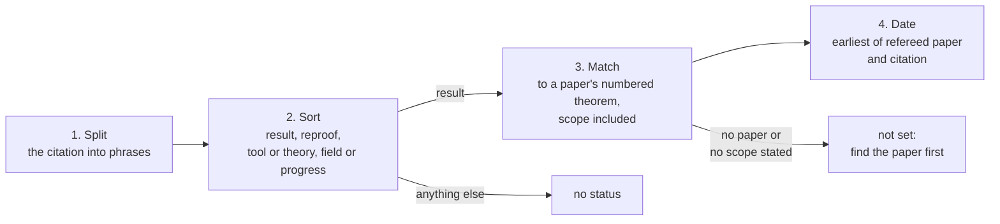

# Prize citations: what a Fields, Abel or Breakthrough citation says was proved, and what it does not

[Syllabus](../../../SYLLABUS.md) → [Frontier](../README.md) → [How Research Works](../README.md#s01) → Prize citations

---

## General Overview

On 2026-03-19 the Norwegian Academy of Science and Letters gave the 2026 Abel Prize to Gerd Faltings. Its one-sentence citation reads: "for introducing powerful tools in arithmetic geometry and resolving long-standing diophantine conjectures of Mordell and Lang."

That sentence names two results. **Mordell's conjecture** (1922) says that a curve of genus 2 or more has only finitely many rational points. Genus is the number of holes in the curve's complex surface, and a rational point is one whose coordinates are fractions. Faltings proved it in 1983. **Lang's conjecture** for abelian varieties (higher-dimensional objects whose points can be added, as on an elliptic curve) followed in papers of 1991 and 1994; it is now called the Mordell–Lang conjecture. The phrase "powerful tools" names no result at all.

A **prize citation** is the committee's written statement of why it gave the prize: a short sentence, and often a longer page. This wing's status rule counts a result as proved once a source independent of the authors accepts it ([Kinds of claim](02-theorem-conjecture-model-approximation.md)), and the wing counts a prize as such a source. But a citation is written to praise, so it mixes three things: results proved, tools built, and fields worked in. Only the first kind can carry a status.

Other recent citations read differently. The one-sentence citations of Michel Talagrand (Abel 2024) and Masaki Kashiwara (Abel 2025) name fields and theories, zero results; their long citations name proved results. June Huh (Fields 2022) is cited for three proofs, and his short and long citations give one of them different scopes. Dennis Gaitsgory (Breakthrough 2025) is cited for one, the geometric Langlands conjecture (a predicted one-to-one match, for a curve, between ways its loops can act on vectors and sheaves, rules attaching vector spaces to points), with a stated limit. Hong Wang (Fields 2026) is cited for "major advances on the Kakeya problem in three dimensions" (whether a set in space holding a unit segment in every direction must be fully three-dimensional): progress, not a proof.

**A prize citation counts as acceptance only for the results it names as proved, with the scope it names; everything else in it is praise and moves no status.**

**What kind of fact this is:** a method, a way of reading, so it has no truth value of its own. The facts it records are dated and sourced. The results named are theorems, proved in the papers matched here; their research proofs are outlined in words, not checked. The small cases (genus counts and point searches) are computed and checked by the code.

### The picture: four passes over a citation



Each box is one pass. Only a phrase sorted as a result goes on to a paper and a date.

---

## The formula

For one result $`c`$ and one citation $`C`$ dated $`d_C`$:

```math
a(c) = \min\bigl(d_{\mathrm{ref}}(c),\ d_{\mathrm{prize}}(c)\bigr), \qquad d_{\mathrm{prize}}(c) = \begin{cases} d_C & \text{if } C \text{ names a proof of } c \text{, scope included} \\ \infty & \text{otherwise} \end{cases}
```

**Read it aloud:** a result counts as proved from the first date that either a refereed paper proved it or a prize citation named its proof, scope and all; a citation that does not name it adds no date.

Worked once on each of three citations:

| Result $`c`$ | $`d_{\mathrm{ref}}(c)`$ | $`d_{\mathrm{prize}}(c)`$ | $`a(c)`$ | Set by |
| --- | --- | --- | --- | --- |
| Mordell's conjecture | 1983-10 | 2026-03-19 | 1983-10 | the paper |
| Geometric Langlands, characteristic 0 | none ($`\infty`$) | 2025-04-05 | 2025-04-05 | the citation |
| Kakeya, three dimensions | 2026-11-06 | none ($`\infty`$): "major advances" | 2026-11-06 | the paper |

Pass 2 sorts each phrase by its verb. The four types:

| Type | Typical words | Carries a status? |
| --- | --- | --- |
| result | "resolving", "the proof of", "proved" | yes, once matched to a paper |
| reproof | "a new proof of" | no: the result was already proved |
| tool or theory | "introducing", "the development of", "the discovery of", "constructed" | no: a construction is not a claim |
| field or progress | "contributions to", "work in", "major advances on" | no |

The result Faltings is best known for, Mordell's conjecture, reads in symbols:

```math
g(X) \ge 2 \;\Longrightarrow\; X(\mathbb{Q}) \text{ is finite}
```

**Read it aloud:** if a curve has genus 2 or more, it has only finitely many rational points. The same holds over any number field (the fractions with finitely many roots of whole-number polynomials, such as $`\sqrt{2}`$, added in), which is how Faltings stated it.

| Symbol | Plain meaning | In our example | Push it up and the answer… |
| --- | --- | --- | --- |
| $`c`$ | one result, as stated in its paper | Mordell's conjecture | — |
| $`C`$ | one prize citation, short sentence and long text | Abel 2026 | more phrases to sort |
| $`d_C`$ | the date of the citation | 2026-03-19 | a later date never changes an earlier acceptance |
| $`d_{\mathrm{ref}}(c)`$ | the date of the first refereed proof of $`c`$, or $`\infty`$ if none | 1983-10 | — |
| $`d_{\mathrm{prize}}(c)`$ | $`d_C`$ if $`C`$ names a proof of $`c`$ with its scope, else $`\infty`$ | 2026-03-19 | — |
| $`a(c)`$ | the acceptance date: from then, while no dispute or gap stands, the status is "proved" | 1983-10 | — |
| $`X`$, $`X(\mathbb{Q})`$ | a curve, and its set of rational points | $`x^4 + y^4 = 1`$ | — |
| $`g`$ | the genus: number of holes in the curve's complex surface | 3 for $`x^4 + y^4 = 1`$ | from 2 up: finitely many points |
| $`n`$ | the degree of a plane curve | 4 | genus grows as $`(n-1)(n-2)/2`$ |
| $`H`$ | the height bound: the larger of the numerator and denominator of $`x`$ | 10, 100, 1000 | more points found, if any exist |
| $`P`$, $`kP`$ | the point (1, 1) on $`y^2 = x^3 - x + 1`$, and $`P`$ added to itself $`k`$ times | heights 1, 1, 1, 3, 5, 4, … | heights grow without end |
| $`\infty`$ | "never, as far as the sources show" | Kakeya's prize date | — |

### When it holds

- **The phrase says "proved", not "advanced".** "Major advances on the Kakeya problem" is praise for progress, and moves no status.
- **The scope is copied with the result.** "An important case of a conjecture of Tate" covers one case. Drop "an important case of" and an open conjecture is listed as proved. When the short sentence and the long text give different scopes, as Huh's do for Dowling–Wilson, each scope is its own result, with its own paper and date.
- **The result is matched to a paper.** A citation gives a name and sometimes a year, not a theorem. Without the paper, nobody can say exactly what was accepted. Faltings's "proofs of the main conjectures formulated by Tate and … Fontaine" gets its scope from the next sentence but names no paper, and those conjectures were proved across several papers, so this card sets no status for the phrase.
- **The citation is independent of the authors.** A prize committee is. A press release by the authors' own institute is not; it is the authors' claim, retold.
- **The date is the earliest acceptance, and it holds only while no dispute or gap stands.** A prize after the paper adds a source and changes nothing. A refereed paper with a published objection standing is not acceptance: abc's 2021 journal paper leaves it claimed. A gap found later moves the status back, since the status is read off the latest dated event ([Kinds of claim](02-theorem-conjecture-model-approximation.md)).

---

## Why it works

### Step 0: a citation is an independent sentence, written to praise

The wing's rule moves a claim from "claimed" to "proved" on acceptance by someone other than the authors. A prize committee qualifies: it takes expert advice and signs a public sentence. But that sentence must sum up a career in one line, so it mixes results with praise. It is evidence only where it makes a checkable claim, "X proved Y". The four passes pull those claims out and drop the rest.

### Step 1: sort the phrases by their verbs

A citation's grammar gives the type away. "Resolving", "the proof of" and "proved" attach to a statement that is either true or not. "Contributions to", "work in" and "advances on" attach to an area. "The development of" and "the discovery of" attach to a theory or an object, which is built, not proved.

The code holds 35 phrases from eight citation texts, each sorted by hand. It then sorts them again with nothing but the keyword lists in the table above, and the two readings agree on all 35. That is a fit, not a test: the keyword lists were written from these phrases, so the scan only writes down the hand reading. Outside them it fails: Talagrand's long citation says he "answered a longstanding question by von Neumann and Maharam in the negative", a refutation, and the scan calls it a field. The verbs guide the reading; the reader decides.

The code takes ten phrases from the Abel 2026 long citation: six results, one reproof (a new proof of Roth's theorem, with Gisbert Wüstholz, of a result proved in 1955), two tools and one field. Its "product theorem", a step inside the Mordell–Lang proof, is counted with Mordell–Lang. The short sentence has three phrases, of which two are results.

### Step 2: match each result to its paper

A result phrase names a result. The paper states it. Reading the paper fixes three things the phrase leaves loose: the exact statement, its scope, and its date ([Reading a paper](05-reading-a-research-paper.md)).

| Phrase in the citation | Paper | What it proves | Refereed |
| --- | --- | --- | --- |
| "the Mordell conjecture … proved by Faltings in 1983" | *Inventiones Mathematicae* 73 (1983) 349–366 | genus at least 2: finitely many rational points, over any number field | 1983-10 |
| "an important case of a conjecture of John Tate" | the same paper | Tate's conjecture only for maps between abelian varieties over number fields | 1983-10 |
| "a conjecture of Igor Shafarevich" | the same paper | finitely many abelian varieties of a given type with bad behaviour at a fixed finite set of primes | 1983-10 |
| "the Mordell–Lang conjecture on subvarieties of abelian varieties", dated 1991 | *Annals of Mathematics* 133 (1991) 549–576, [doi:10.2307/2944319](https://doi.org/10.2307/2944319); general case in the Barsotti Symposium volume (1994) 175–182, [doi:10.1016/B978-0-12-197270-7.50012-7](https://doi.org/10.1016/B978-0-12-197270-7.50012-7) | the rational points of a subvariety lie in finitely many shifted copies of abelian subvarieties inside it | 1994 |
| "the finiteness of integral points on affine subvarieties of abelian varieties" | *Annals* 133 (1991) | finitely many integral points (whole-number coordinates) on an abelian variety with an ample divisor removed: a hypersurface whose removal leaves no points at infinity | 1991-05 |
| "proofs of the main conjectures formulated by Tate and … Fontaine" | none named; Tate's is in *Journal of the AMS* 1 (1988), [doi:10.1090/S0894-0347-1988-0924705-1](https://doi.org/10.1090/S0894-0347-1988-0924705-1), Fontaine's in other papers | from the next sentence: comparisons of p-adic étale and de Rham cohomology, two ways of counting a variety's holes; which count as "main" is not said | not set here |

Three patterns show up, and each is a trap for a reader who skips this pass:

1. **One paper, three results.** The 1983 paper proves Shafarevich's conjecture and the Tate case, and then Mordell's conjecture from them.
2. **One phrase, two papers.** The citation dates Mordell–Lang 1991. The 1991 paper proves the case where the subvariety contains no shifted abelian subvariety: then its rational points are finite. The general statement is the 1994 paper.
3. **A phrase with a limit.** "An important case of" and "in characteristic 0" are part of the result. A characteristic is a property of the number system the geometry is done over; characteristic 0 covers the complex numbers and the fractions, and leaves out the finite-field settings.

### Step 3: apply the rule, and see who set each date

The formula takes the earlier date. For each of Faltings's five matched results the refereed paper came first, decades before the prize. The 2026 prize adds a second independent source to rows that were already "proved".

The three comparison citations split three ways:

- **Huh, Fields 2022.** A matroid lists which subsets of a finite set count as independent, by the rules vectors obey; it is realizable if actual vectors give it. Every matroid has a geometric lattice, the family of points, lines, planes and so on that it spans, so "for geometric lattices" means for all matroids. Heron–Rota–Welsh for matroids (2018) and strong Mason (2020) were refereed before the prize, so the papers set their dates. Dowling–Wilson, that a geometric lattice has at least as many hyperplanes as points and likewise up the ranks, splits in two. The long text says Huh and Botong Wang proved it "for realizable matroids", refereed in 2017. The short sentence says "for geometric lattices": that is a later paper by five authors, Huh and Wang among them, posted 2020-10-13 and refereed only on 2026-07-01. For that row the prize of 2022-07-05 came first, so, on the short sentence's words, the citation set the date. Matching the short phrase to the long text's 2017 paper would cut its scope.
- **Gaitsgory, Breakthrough 2025.** One result, with no refereed paper found: the first paper of the proof, posted 2024-05-06, still had no journal reference on arXiv on 2026-11-24. The prize of 2025-04-05 is the acceptance. Its scope is characteristic 0, so that is all it accepts.
- **Wang, Fields 2026.** The long citation names one result, the local smoothing conjecture for the planar wave equation (that waves in the plane, averaged over a stretch of time, are smoother than the single-instant bounds allow), refereed in 2020. For Kakeya it says "major advances", so the status "proved" rests on the refereed proof of 2026-11-06 ([Kakeya](../04-Geometry%20and%20Combinatorics/02-kakeya-and-restriction.md)), not on the medal.

Of the thirteen result rows in the code, two have their dates set by a citation: Dowling–Wilson for all geometric lattices, and geometric Langlands. Prizes mostly confirm.

### Step 4: what the named theorem says, on small cases

A citation never states a theorem's hypotheses. Mordell's conjecture needs genus 2 or more, and the small cases show why that hypothesis matters.

The degree–genus formula ([Genus](../../22-Algebraic%20geometry/03-Plane%20Curves/06-genus-and-the-degree-genus-formula.md)) gives a smooth plane curve of degree $`n`$ the genus $`(n-1)(n-2)/2`$. A second theorem, Baker's, proved in general by Khovanskii ([doi:10.1007/BF01077562](https://doi.org/10.1007/BF01077562)), counts points instead: the genus is the number of whole-number points strictly inside the curve's Newton polygon (the smallest convex polygon holding the exponent pair $`(i, j)`$ of every term), provided the curve is non-degenerate: neither it nor the part of its equation on any edge of the polygon has a singular zero with both coordinates non-zero. For $`x^n + y^n = 1`$ the polygon is the triangle (0, 0), (n, 0), (0, n), whose interior points, counted row by row, give the same formula: there the two roads do the same arithmetic, 1, 3, 6 and 10 for $`n = 3, 4, 5, 6`$. For $`y^2 = x^3 - x + 1`$ the triangle (0, 0), (3, 0), (0, 2) holds one point, and the degree formula for this smooth cubic also gives genus 1.

- **Genus 3: $`x^4 + y^4 = 1`$.** A search of every fraction with height up to 1,000 finds four points, (±1, 0) and (0, ±1), and no more. Faltings's theorem says the list is finite. Fermat's descent proves it is exactly these four ([Fermat's last theorem](../../21-Algebraic%20and%20analytic%20number%20theory/07-Diophantine%20and%20Modular/04-fermats-last-theorem-history-and-descent.md)).
- **Genus 1: $`y^2 = x^3 - x + 1`$.** The search finds 12, 18 and 24 points up to heights 10, 100 and 1,000. A second road adds $`P = (1, 1)`$ to itself by the chord rule ([Rational points on a cubic](../../21-Algebraic%20and%20analytic%20number%20theory/07-Diophantine%20and%20Modular/05-elliptic-curves-over-q-and-mordell-weil.md)). The points $`\pm kP`$ with height up to $`H`$ number exactly 12, 18 and 24 too, and the heights of $`kP`$ keep growing: 784, 5,665, 26,239, 49,729, 350,701. Points without end: the hypothesis "genus at least 2" is doing real work.

What the citation does not say: Faltings's proof gives no bound on how large the points' numerators and denominators can be. So no search can be shown to have found every point. The four points of $`x^4 + y^4 = 1`$ are "checked for height at most 1,000"; the descent makes the list complete.

<details>
<summary>Faltings's 1983 proof, outlined in words (not checked here)</summary>

The proof does not look for points at all. It runs through three statements about abelian varieties.

1. **Parshin's reduction (1968).** To each rational point of a curve of genus at least 2, attach a new curve, built so that it behaves badly only at a fixed finite set of primes. Different points give different curves, up to finitely many repeats. So if only finitely many such curves exist, only finitely many points exist.
2. **Shafarevich's conjecture.** Faltings proved that only finitely many abelian varieties of a given type behave badly only at a fixed finite set of primes. Applied to the curves of step 1, through their Jacobians (the abelian variety attached to each curve), this gives Mordell's conjecture.
3. **Tate's conjecture, the case of abelian varieties.** To prove step 2, Faltings showed that maps between two abelian varieties over a number field are read off from how the symmetries of the number field act on their points of finite order. His tool was a new height: a number measuring the size of an abelian variety, now called the Faltings height.

Source: Faltings, *Inventiones Mathematicae* 73 (1983) 349–366. The 1991 Mordell–Lang proof follows a different road, Vojta's 1989 method of approximation, as the Abel citation itself says.

</details>

---

## Worked numbers, by hand

The Abel 2026 citation, read in four passes.

| Step | Arithmetic | Value |
| --- | --- | --- |
| Short sentence | 3 phrases: 1 tool, 2 results | 2 results |
| Long citation | 10 phrases: 6 results, 1 reproof, 2 tools, 1 field | 6 results |
| Matched to papers | 5 of the 6; Tate–Fontaine spans several papers and names none | 5 matched |
| Mordell | $`\min(\text{1983-10},\ \text{2026-03-19})`$ | 1983-10 |
| Mordell–Lang | citation says 1991; the general case is the 1994 paper | 1994 |
| Statuses the prize set | all five already refereed, 1983 to 1994 | 0 |
| Instance: genus of $`x^4 + y^4 = 1`$ | $`(4-1)(4-2)/2 = 3`$; interior points: 3 | 3 |
| Points with height up to 1,000 | search | **4** |

The Abel citation names six results and matches five to refereed papers of 1983 to 1994, so the 2026 prize sets no status; it confirms. The four points are an instance of Mordell's conjecture, checked to height 1,000, which proves nothing beyond.

### What breaks if you drop a piece

| Mistake | Comes out at | What went wrong |
| --- | --- | --- |
| Read only the short sentence | 2 results, against the long citation's 6 | the short sentence compresses; Shafarevich, Tate's case, integral points and Tate–Fontaine vanish |
| Drop "an important case of" | Tate's conjecture listed as proved; in general it is open as of 2026-11-24 | the scope was cut off the result |
| Read "major advances on the Kakeya problem" as a proof | proved from 2026-07-23, 106 days before the refereed proof of 2026-11-06 | a progress phrase was read as a result |
| Date Mordell–Lang from the citation | 1991, for a general case first proved in 1994 | the citation dates only the first paper |
| Drop "genus at least 2" | $`y^2 = x^3 - x + 1`$ has 12, 18 and 24 points by heights 10, 100 and 1,000, without end | the theorem's hypothesis; genus 1 can have infinitely many points |

The code prints every number in this table.

---

## How a citation moves a status

Three citations, three different effects. Each row is one result, traced through its events.

| Date | Mordell's conjecture | Geometric Langlands, characteristic 0 | Kakeya, three dimensions |
| --- | --- | --- | --- |
| 1922 | Mordell asks: open | — | — |
| 1983-10 | refereed proof: **proved** | — | — |
| 2024-05-06 | proved | first paper of the proof posted: **claimed** | — |
| 2025-02-24 | proved | claimed | Wang and Zahl's preprint: **claimed** |
| 2025-04-05 | proved | Breakthrough Prize names the proof: **proved** | claimed |
| 2026-03-19 | Abel Prize: proved, a second source | proved | claimed |
| 2026-07-23 | proved | proved | Fields citation, "major advances": still claimed |
| 2026-11-06 | proved | proved | refereed proof: **proved** |

The prize did nothing to Mordell's row, everything to Langlands', and nothing to Kakeya's. The citation's verb and the paper's date decide which.

How many results each citation names in the text the code holds, long or short as labelled, one mark per result:

```
Abel 2026 Faltings, long      ###### 6
Fields 2022 Huh, short        ###    3
Breakthrough 2025 Gaitsgory   #      1
Fields 2026 Wang, long        #      1
Abel 2024 Talagrand, short           0
Abel 2025 Kashiwara, short           0
```

The two zeros are short sentences, set against Faltings's long text. Their long citations name proved results: Talagrand's Parisi formula (the free energy of a model of disordered magnets) and a negative answer to a question of von Neumann and Maharam; Kashiwara's general Riemann–Hilbert correspondence (between systems of differential equations and sheaves) and, with Jean-Luc Brylinski, the Kazhdan–Lusztig conjecture (on characters of representations). A zero on a short sentence means: read the long text.

---

## Code, from first principles, and it actually runs

The code holds 35 phrases from eight citation texts and sorts them twice, by hand and by a keyword rule written from those phrases, which summarizes the hand reading rather than checking it; it prints one phrase outside them that the rule gets wrong. It then applies the status rule to thirteen matched results and counts the 106 days of the Kakeya misreading by two calendars (a date formula and a month table). Last, it computes the small cases: the genus by the degree formula and by counting interior points, and the rational points of $`y^2 = x^3 - x + 1`$ by brute-force search and by the chord rule from $`P = (1, 1)`$. The calendars and the two point counts are independent pairs of roads; the genus pair rests on two different theorems but, for $`x^n + y^n = 1`$, does the same arithmetic. Fractions are exact; nothing imported knows any of the answers.

### Python

```python
# Prize citations -- the check behind the card.  Standard library only.
# Sort a citation's phrases, match results to papers, apply the status rule, compute small cases.
from math import isqrt, gcd
R, K, T, F = "result", "reproof", "tool", "field"
CITATIONS = [  # (citation, [(phrase, type read by hand)])
    ("Abel 2026 Faltings, short", [("introducing powerful tools in arithmetic geometry", T),
        ("resolving long-standing diophantine conjectures of Mordell", R),
        ("resolving long-standing diophantine conjectures of ... Lang", R)]),
    ("Abel 2026 Faltings, long", [("the Mordell conjecture ... proved by Faltings in 1983", R),
        ("resolving an important case of a conjecture of John Tate", R),
        ("resolving ... a conjecture of Igor Shafarevich", R),
        ("adapted this approach to prove ... the Mordell-Lang conjecture", R),
        ("also proved the finiteness of integral points on affine subvarieties of abelian varieties", R),
        ("gave a new proof of Roth's theorem and ... the Schmidt subspace theorem", K),
        ("major contributions to p-adic Hodge theory", F), ("tools introduced by Faltings ... the purity theorem", T),
        ("giving proofs of the main conjectures formulated by Tate and ... Fontaine", R),
        ("constructed an arithmetic compactification of these varieties", T)]),
    ("Fields 2022 Huh, short", [("bringing the ideas of Hodge theory to combinatorics", F),
        ("the proof of the Dowling-Wilson conjecture for geometric lattices", R),
        ("the proof of the Heron-Rota-Welsh conjecture for matroids", R),
        ("the development of the theory of Lorentzian polynomials", T),
        ("the proof of the strong Mason conjecture", R)]),
    ("Abel 2024 Talagrand, short", [("groundbreaking contributions to probability theory and functional analysis", F),
        ("outstanding applications in mathematical physics and statistics", F)]),
    ("Abel 2025 Kashiwara, short", [("fundamental contributions to algebraic analysis and representation theory", F),
        ("the development of the theory of D-modules", T), ("the discovery of crystal graphs", T)]),
    ("Breakthrough 2025 Gaitsgory", [("breakthrough contributions to the geometric Langlands program", F),
        ("the development of the derived algebraic geometry approach", T),
        ("the proof of the geometric Langlands conjecture in characteristic 0", R)]),
    ("Fields 2026 Wang, short", [("her work in harmonic analysis and geometric measure theory", F),
        ("applications of multiscale and decoupling techniques to the local smoothing conjecture", F),
        ("major advances in ... the Kakeya problem in three dimensions", F)]),
    ("Fields 2026 Wang, long", [("decoupling and multiscale arguments to resolve the local smoothing conjecture", R),
        ("fundamental progress in Fourier restriction theory", F), ("obtained major results on the Falconer distance set problem", F),
        ("breakthrough contributions to the theory of Furstenberg sets", F), ("major advances on the Kakeya problem in three dimensions", F),
        ("developed new bounds and structural techniques for collections of thin tubes", T)]),
]
def scan(phrase):                        # road two: the reading rule as keywords
    p = phrase.lower()
    if "new proof" in p: return K
    if any(w in p for w in ("proof of", "proofs of", "prove", "resolv")): return R
    if any(w in p for w in ("develop", "introduc", "discover", "construct")): return T
    return F
RESULTS = [  # (result as matched to its paper, refereed date, citation date if it names the proof)
    ("Mordell: genus >= 2, finitely many points", "1983-10", "2026-03-19"),
    ("Tate, maps of abelian varieties only", "1983-10", "2026-03-19"),
    ("Shafarevich, abelian varieties", "1983-10", "2026-03-19"),
    ("Mordell-Lang, general case (1994 paper)", "1994", "2026-03-19"),
    ("Lang, integral points (1991 paper)", "1991-05", "2026-03-19"),
    ("Tate-Fontaine, no single paper", None, None),
    ("Dowling-Wilson, realizable matroids", "2017", "2022-07-05"),
    ("Dowling-Wilson, all geometric lattices", "2026-07-01", "2022-07-05"),  # the short sentence's scope
    ("Heron-Rota-Welsh, matroids", "2018-09", "2022-07-05"), ("strong Mason", "2020-11", "2022-07-05"),
    ("geometric Langlands, characteristic 0", None, "2025-04-05"),
    ("local smoothing, planar wave", "2020-09", "2026-07-23"),
    ("Kakeya, three dimensions", "2026-11-06", None),
]
def accepted(ref, prize):                # the status rule: the earliest acceptance
    return min([d for d in (ref, prize) if d], default=None)
def days_civil(y, m, d):                 # road one: days since 1970-01-01, by formula
    y -= m <= 2; era = y // 400; yoe = y - era * 400
    doy = (153 * (m + (-3 if m > 2 else 9)) + 2) // 5 + d - 1
    return era * 146097 + yoe * 365 + yoe // 4 - yoe // 100 + doy - 719468
def days_table(m1, d1, m2, d2):          # road two: walk the month lengths of 2026
    return sum([31, 28, 31, 30, 31, 30, 31, 31, 30, 31, 30, 31][m1 - 1:m2 - 1]) - d1 + d2
def genus_formula(n): return (n - 1) * (n - 2) // 2
def interior(a, b):                      # lattice points strictly inside the triangle (0,0),(a,0),(0,b)
    return sum(1 for i in range(1, a) for j in range(1, b) if b * i + a * j < a * b)
HMAX = 1000                              # height: larger of the numerator and denominator of x
def elliptic_search():                   # road one: y^2 = x^3 - x + 1, x = a/e^2, y = b/e^3
    pts = []
    for e in range(1, isqrt(HMAX) + 1):
        for a in range(-HMAX, HMAX + 1):
            r = a ** 3 - a * e ** 4 + e ** 6
            if gcd(a, e) == 1 and r >= 0 and isqrt(r) ** 2 == r:
                pts += [max(abs(a), e * e)] * (2 if r else 1)
    return pts
def q(n, d):                             # an exact fraction n/d, in lowest terms
    g = gcd(n, d) * (1 if d > 0 else -1); return (n // g, d // g)
def sub(a, b): return q(a[0] * b[1] - b[0] * a[1], a[1] * b[1])
def mul(a, b): return q(a[0] * b[0], a[1] * b[1])
def div(a, b): return q(a[0] * b[1], a[1] * b[0])
def multiples(k_max):                    # road two: kP by the chord rule, P = (1, 1)
    one = (1, 1); x, y, hs = (-1, 1), (1, 1), [1, 1]   # 2P, from the tangent at P, slope 1
    for _ in range(3, k_max + 1):        # (k+1)P = kP + P, through the chord
        m = div(sub(y, one), sub(x, one))
        x3 = sub(sub(mul(m, m), x), one)
        x, y = x3, sub(mul(m, sub(one, x3)), one)
        hs.append(max(abs(x[0]), x[1]))
    return hs
def quartic_search():                    # x^4 + y^4 = 1 with x = a/c, y = b/c: a^4 + b^4 = c^4
    pts = []
    for c in range(1, HMAX + 1):
        for a in range(0, c + 1):
            r = c ** 4 - a ** 4; b = isqrt(isqrt(r))
            if b ** 4 == r and gcd(gcd(a, b), c) == 1:
                pts += [c] * ((2 if a else 1) * (2 if b else 1))
    return pts

print("phrases by type: result, reproof, tool or theory, field or progress")
counts = {cit: [sum(1 for _, t in ph if t == k) for k in (R, K, T, F)] for cit, ph in CITATIONS}
for cit, _ in CITATIONS: print(f"  {cit:30}" + "".join(f"{c:4}" for c in counts[cit]))
agree, total = sum(1 for _, ph in CITATIONS for text, t in ph if scan(text) == t), sum(len(ph) for _, ph in CITATIONS)
print(f"hand reading = keyword scan: {agree} of {total} phrases")
print(f"outside them, a refutation: 'answered ... in the negative' scans as {scan('he answered a longstanding question ... in the negative')}")
print("results matched to papers; status rule applied 2026-11-24")
print(f"  {'result':42}{'refereed':11}{'citation':12}{'accepted':12}by")
by_prize = []
for name, ref, prize in RESULTS:
    acc = accepted(ref, prize)
    who = "not set here" if acc is None else "citation" if acc == prize and acc != ref else "paper"
    if who == "citation": by_prize.append(name)
    print(f"  {name:42}{ref or '-':11}{prize or '-':12}{acc or '-':12}{who}")
print(f"accepted by the citation itself: {len(by_prize)} ({'; '.join(by_prize)})")
d_formula, d_table = days_civil(2026, 11, 6) - days_civil(2026, 7, 23), days_table(7, 23, 11, 6)
print(f"Kakeya read off the citation: 2026-07-23, refereed proof 2026-11-06: {d_formula} days early (formula), {d_table} (month table)")
print("genus of x^n + y^n = 1 by formula / by interior points: " +
      ", ".join(f"n={n} {genus_formula(n)}/{interior(n, n)}" for n in range(3, 7)))
print(f"genus of y^2 = x^3 - x + 1 by interior points: {interior(3, 2)}")
hs = multiples(16)
print("heights of kP, k = 1..16: " + " ".join(str(h) for h in hs))
ell, quart, HS = elliptic_search(), quartic_search(), (10, 100, 1000)
row_s = [sum(1 for h in ell if h <= H) for H in HS]
row_m = [2 * sum(1 for h in hs if h <= H) for H in HS]
row_q = [sum(1 for h in quart if h <= H) for H in HS]
print("rational points with height <= H:        H=10  H=100  H=1000")
print("  y^2 = x^3 - x + 1, genus 1, by search  " + "".join(f"{c:6}" for c in row_s))
print("  y^2 = x^3 - x + 1, as +-kP             " + "".join(f"{c:6}" for c in row_m))
print("  x^4 + y^4 = 1, genus 3, by search      " + "".join(f"{c:6}" for c in row_q))
print("results named per citation (# = one):")
for cit in [CITATIONS[i][0] for i in (1, 2, 5, 7, 3, 4)]:
    print(f"  {cit:30}{'#' * counts[cit][0]:7}{counts[cit][0]}")
assert agree == total == 35                                # two readings of every phrase agree
assert counts["Abel 2026 Faltings, short"][0] == 2 and counts["Abel 2026 Faltings, long"][0] == 6
assert by_prize == ["Dowling-Wilson, all geometric lattices", "geometric Langlands, characteristic 0"]  # set by a prize
assert d_formula == d_table == 106                         # two calendars, one gap
assert all(genus_formula(n) == interior(n, n) for n in range(3, 7)) and interior(3, 2) == 1
assert row_s == row_m == [12, 18, 24]                      # search and chord rule agree, no end
assert row_q == [4, 4, 4]                                  # genus 3: (+-1, 0), (0, +-1) only, checked for H <= 1000
print("ALL CHECKS PASS")
```

**Ran 2026-11-24 on macOS, Python 3.14.10, standard library only. All checks passed. Output, pasted from the run:**

```
phrases by type: result, reproof, tool or theory, field or progress
  Abel 2026 Faltings, short        2   0   1   0
  Abel 2026 Faltings, long         6   1   2   1
  Fields 2022 Huh, short           3   0   1   1
  Abel 2024 Talagrand, short       0   0   0   2
  Abel 2025 Kashiwara, short       0   0   2   1
  Breakthrough 2025 Gaitsgory      1   0   1   1
  Fields 2026 Wang, short          0   0   0   3
  Fields 2026 Wang, long           1   0   1   4
hand reading = keyword scan: 35 of 35 phrases
outside them, a refutation: 'answered ... in the negative' scans as field
results matched to papers; status rule applied 2026-11-24
  result                                    refereed   citation    accepted    by
  Mordell: genus >= 2, finitely many points 1983-10    2026-03-19  1983-10     paper
  Tate, maps of abelian varieties only      1983-10    2026-03-19  1983-10     paper
  Shafarevich, abelian varieties            1983-10    2026-03-19  1983-10     paper
  Mordell-Lang, general case (1994 paper)   1994       2026-03-19  1994        paper
  Lang, integral points (1991 paper)        1991-05    2026-03-19  1991-05     paper
  Tate-Fontaine, no single paper            -          -           -           not set here
  Dowling-Wilson, realizable matroids       2017       2022-07-05  2017        paper
  Dowling-Wilson, all geometric lattices    2026-07-01 2022-07-05  2022-07-05  citation
  Heron-Rota-Welsh, matroids                2018-09    2022-07-05  2018-09     paper
  strong Mason                              2020-11    2022-07-05  2020-11     paper
  geometric Langlands, characteristic 0     -          2025-04-05  2025-04-05  citation
  local smoothing, planar wave              2020-09    2026-07-23  2020-09     paper
  Kakeya, three dimensions                  2026-11-06 -           2026-11-06  paper
accepted by the citation itself: 2 (Dowling-Wilson, all geometric lattices; geometric Langlands, characteristic 0)
Kakeya read off the citation: 2026-07-23, refereed proof 2026-11-06: 106 days early (formula), 106 (month table)
genus of x^n + y^n = 1 by formula / by interior points: n=3 1/1, n=4 3/3, n=5 6/6, n=6 10/10
genus of y^2 = x^3 - x + 1 by interior points: 1
heights of kP, k = 1..16: 1 1 1 3 5 4 11 25 56 159 361 784 5665 26239 49729 350701
rational points with height <= H:        H=10  H=100  H=1000
  y^2 = x^3 - x + 1, genus 1, by search      12    18    24
  y^2 = x^3 - x + 1, as +-kP                 12    18    24
  x^4 + y^4 = 1, genus 3, by search           4     4     4
results named per citation (# = one):
  Abel 2026 Faltings, long      ###### 6
  Fields 2022 Huh, short        ###    3
  Breakthrough 2025 Gaitsgory   #      1
  Fields 2026 Wang, long        #      1
  Abel 2024 Talagrand, short           0
  Abel 2025 Kashiwara, short           0
ALL CHECKS PASS
```

### Rust

```rust
// Prize citations -- the check behind the card.  std only, no crates.
// Sort a citation's phrases, match results to papers, apply the status rule, compute small cases.
const R: &str = "result"; const K: &str = "reproof"; const T: &str = "tool"; const F: &str = "field";
type Cit = (&'static str, &'static [(&'static str, &'static str)]);
const CITATIONS: [Cit; 8] = [  // (citation, [(phrase, type read by hand)])
    ("Abel 2026 Faltings, short", &[("introducing powerful tools in arithmetic geometry", T),
        ("resolving long-standing diophantine conjectures of Mordell", R),
        ("resolving long-standing diophantine conjectures of ... Lang", R)]),
    ("Abel 2026 Faltings, long", &[("the Mordell conjecture ... proved by Faltings in 1983", R),
        ("resolving an important case of a conjecture of John Tate", R),
        ("resolving ... a conjecture of Igor Shafarevich", R),
        ("adapted this approach to prove ... the Mordell-Lang conjecture", R),
        ("also proved the finiteness of integral points on affine subvarieties of abelian varieties", R),
        ("gave a new proof of Roth's theorem and ... the Schmidt subspace theorem", K),
        ("major contributions to p-adic Hodge theory", F), ("tools introduced by Faltings ... the purity theorem", T),
        ("giving proofs of the main conjectures formulated by Tate and ... Fontaine", R),
        ("constructed an arithmetic compactification of these varieties", T)]),
    ("Fields 2022 Huh, short", &[("bringing the ideas of Hodge theory to combinatorics", F),
        ("the proof of the Dowling-Wilson conjecture for geometric lattices", R),
        ("the proof of the Heron-Rota-Welsh conjecture for matroids", R),
        ("the development of the theory of Lorentzian polynomials", T),
        ("the proof of the strong Mason conjecture", R)]),
    ("Abel 2024 Talagrand, short", &[("groundbreaking contributions to probability theory and functional analysis", F),
        ("outstanding applications in mathematical physics and statistics", F)]),
    ("Abel 2025 Kashiwara, short", &[("fundamental contributions to algebraic analysis and representation theory", F),
        ("the development of the theory of D-modules", T), ("the discovery of crystal graphs", T)]),
    ("Breakthrough 2025 Gaitsgory", &[("breakthrough contributions to the geometric Langlands program", F),
        ("the development of the derived algebraic geometry approach", T),
        ("the proof of the geometric Langlands conjecture in characteristic 0", R)]),
    ("Fields 2026 Wang, short", &[("her work in harmonic analysis and geometric measure theory", F),
        ("applications of multiscale and decoupling techniques to the local smoothing conjecture", F),
        ("major advances in ... the Kakeya problem in three dimensions", F)]),
    ("Fields 2026 Wang, long", &[("decoupling and multiscale arguments to resolve the local smoothing conjecture", R),
        ("fundamental progress in Fourier restriction theory", F), ("obtained major results on the Falconer distance set problem", F),
        ("breakthrough contributions to the theory of Furstenberg sets", F), ("major advances on the Kakeya problem in three dimensions", F),
        ("developed new bounds and structural techniques for collections of thin tubes", T)]),
];
fn scan(phrase: &str) -> &'static str {  // road two: the reading rule as keywords
    let p = phrase.to_lowercase();
    if p.contains("new proof") { return K; }
    if ["proof of", "proofs of", "prove", "resolv"].iter().any(|w| p.contains(w)) { return R; }
    if ["develop", "introduc", "discover", "construct"].iter().any(|w| p.contains(w)) { return T; }
    F
}
const RESULTS: [(&str, Option<&str>, Option<&str>); 13] = [  // (result as matched to its paper, refereed, citation)
    ("Mordell: genus >= 2, finitely many points", Some("1983-10"), Some("2026-03-19")),
    ("Tate, maps of abelian varieties only", Some("1983-10"), Some("2026-03-19")),
    ("Shafarevich, abelian varieties", Some("1983-10"), Some("2026-03-19")),
    ("Mordell-Lang, general case (1994 paper)", Some("1994"), Some("2026-03-19")),
    ("Lang, integral points (1991 paper)", Some("1991-05"), Some("2026-03-19")),
    ("Tate-Fontaine, no single paper", None, None),
    ("Dowling-Wilson, realizable matroids", Some("2017"), Some("2022-07-05")),
    ("Dowling-Wilson, all geometric lattices", Some("2026-07-01"), Some("2022-07-05")),  // the short sentence's scope
    ("Heron-Rota-Welsh, matroids", Some("2018-09"), Some("2022-07-05")), ("strong Mason", Some("2020-11"), Some("2022-07-05")),
    ("geometric Langlands, characteristic 0", None, Some("2025-04-05")),
    ("local smoothing, planar wave", Some("2020-09"), Some("2026-07-23")),
    ("Kakeya, three dimensions", Some("2026-11-06"), None),
];
// the status rule: the earliest acceptance
fn accepted(r: Option<&'static str>, p: Option<&'static str>) -> Option<&'static str> { [r, p].into_iter().flatten().min() }
fn days_civil(y: i64, m: i64, d: i64) -> i64 {  // road one: days since 1970-01-01, by formula
    let y = if m <= 2 { y - 1 } else { y };
    let era = y.div_euclid(400); let yoe = y - era * 400;
    let doy = (153 * (m + if m > 2 { -3 } else { 9 }) + 2) / 5 + d - 1;
    era * 146097 + yoe * 365 + yoe / 4 - yoe / 100 + doy - 719468
}
fn days_table(m1: usize, d1: i64, m2: usize, d2: i64) -> i64 {  // road two: month lengths of 2026
    [31i64, 28, 31, 30, 31, 30, 31, 31, 30, 31, 30, 31][m1 - 1..m2 - 1].iter().sum::<i64>() - d1 + d2
}
fn genus_formula(n: i64) -> i64 { (n - 1) * (n - 2) / 2 }
fn interior(a: i64, b: i64) -> i64 {     // lattice points strictly inside the triangle (0,0),(a,0),(0,b)
    (1..a).map(|i| (1..b).filter(|j| b * i + a * j < a * b).count() as i64).sum()
}
fn gcd(a: i128, b: i128) -> i128 { if b == 0 { a.abs() } else { gcd(b, a % b) } }
fn isqrt(n: i128) -> i128 {
    if n < 2 { return n; }
    let mut x = (n as f64).sqrt() as i128;
    while x * x > n { x -= 1; }
    while (x + 1) * (x + 1) <= n { x += 1; }
    x
}
const HMAX: i128 = 1000;                 // height: larger of the numerator and denominator of x
fn elliptic_search() -> Vec<i128> {      // road one: y^2 = x^3 - x + 1, x = a/e^2, y = b/e^3
    let mut pts = vec![];
    for e in 1..=isqrt(HMAX) { for a in -HMAX..=HMAX {
        let r = a * a * a - a * e.pow(4) + e.pow(6);
        if gcd(a, e) == 1 && r >= 0 && isqrt(r).pow(2) == r {
            for _ in 0..(if r != 0 { 2 } else { 1 }) { pts.push(a.abs().max(e * e)); }
        }
    } }
    pts
}
type Q = (i128, i128);
fn q(n: i128, d: i128) -> Q {            // an exact fraction n/d, in lowest terms
    let g = gcd(n, d) * if d > 0 { 1 } else { -1 }; (n / g, d / g)
}
fn sub(a: Q, b: Q) -> Q { q(a.0 * b.1 - b.0 * a.1, a.1 * b.1) }
fn mul(a: Q, b: Q) -> Q { q(a.0 * b.0, a.1 * b.1) }
fn div(a: Q, b: Q) -> Q { q(a.0 * b.1, a.1 * b.0) }
fn multiples(k_max: usize) -> Vec<i128> {  // road two: kP by the chord rule, P = (1, 1)
    let one = (1, 1); let (mut x, mut y, mut hs): (Q, Q, Vec<i128>) = ((-1, 1), (1, 1), vec![1, 1]);
    for _ in 3..=k_max {                 // (k+1)P = kP + P, through the chord
        let m = div(sub(y, one), sub(x, one));
        let x3 = sub(sub(mul(m, m), x), one);
        y = sub(mul(m, sub(one, x3)), one); x = x3;
        hs.push(x.0.abs().max(x.1));
    }
    hs
}
fn quartic_search() -> Vec<i128> {       // x^4 + y^4 = 1 with x = a/c, y = b/c: a^4 + b^4 = c^4
    let mut pts = vec![];
    for c in 1..=HMAX { for a in 0..=c {
        let r = c.pow(4) - a.pow(4); let b = isqrt(isqrt(r));
        if b.pow(4) == r && gcd(gcd(a, b), c) == 1 {
            for _ in 0..(if a != 0 { 2 } else { 1 }) * (if b != 0 { 2 } else { 1 }) { pts.push(c); }
        }
    } }
    pts
}
fn main() {
    println!("phrases by type: result, reproof, tool or theory, field or progress");
    let counts: Vec<Vec<usize>> = CITATIONS.iter().map(|(_, ph)|
        [R, K, T, F].iter().map(|k| ph.iter().filter(|(_, t)| t == k).count()).collect()).collect();
    for (i, (cit, _)) in CITATIONS.iter().enumerate() {
        println!("  {:<30}{}", cit, counts[i].iter().map(|c| format!("{:>4}", c)).collect::<String>());
    }
    let agree = CITATIONS.iter().flat_map(|(_, ph)| ph.iter()).filter(|(x, t)| scan(x) == *t).count();
    let total: usize = CITATIONS.iter().map(|(_, ph)| ph.len()).sum();
    println!("hand reading = keyword scan: {} of {} phrases", agree, total);
    println!("outside them, a refutation: 'answered ... in the negative' scans as {}", scan("he answered a longstanding question ... in the negative"));
    println!("results matched to papers; status rule applied 2026-11-24");
    println!("  {:<42}{:<11}{:<12}{:<12}by", "result", "refereed", "citation", "accepted");
    let mut by_prize = vec![];
    for (name, r, p) in RESULTS.iter() {
        let acc = accepted(*r, *p);
        let who = if acc.is_none() { "not set here" } else if acc == *p && acc != *r { "citation" } else { "paper" };
        if who == "citation" { by_prize.push(*name); }
        println!("  {:<42}{:<11}{:<12}{:<12}{}", name, r.unwrap_or("-"), p.unwrap_or("-"), acc.unwrap_or("-"), who);
    }
    println!("accepted by the citation itself: {} ({})", by_prize.len(), by_prize.join("; "));
    let (d_formula, d_table) = (days_civil(2026, 11, 6) - days_civil(2026, 7, 23), days_table(7, 23, 11, 6));
    println!("Kakeya read off the citation: 2026-07-23, refereed proof 2026-11-06: {} days early (formula), {} (month table)", d_formula, d_table);
    println!("genus of x^n + y^n = 1 by formula / by interior points: {}",
        (3..7).map(|n| format!("n={} {}/{}", n, genus_formula(n), interior(n, n))).collect::<Vec<_>>().join(", "));
    println!("genus of y^2 = x^3 - x + 1 by interior points: {}", interior(3, 2));
    let hs = multiples(16);
    println!("heights of kP, k = 1..16: {}", hs.iter().map(|h| h.to_string()).collect::<Vec<_>>().join(" "));
    let (ell, quart, hb) = (elliptic_search(), quartic_search(), [10i128, 100, 1000]);
    let cnt = |v: &Vec<i128>, h: i128, w: usize| w * v.iter().filter(|&&x| x <= h).count();
    let row_s: Vec<usize> = hb.iter().map(|&h| cnt(&ell, h, 1)).collect();
    let row_m: Vec<usize> = hb.iter().map(|&h| cnt(&hs, h, 2)).collect();
    let row_q: Vec<usize> = hb.iter().map(|&h| cnt(&quart, h, 1)).collect();
    let fmt = |v: &Vec<usize>| v.iter().map(|c| format!("{:>6}", c)).collect::<String>();
    println!("rational points with height <= H:        H=10  H=100  H=1000");
    println!("  y^2 = x^3 - x + 1, genus 1, by search  {}", fmt(&row_s));
    println!("  y^2 = x^3 - x + 1, as +-kP             {}", fmt(&row_m));
    println!("  x^4 + y^4 = 1, genus 3, by search      {}", fmt(&row_q));
    println!("results named per citation (# = one):");
    for i in [1usize, 2, 5, 7, 3, 4] {
        println!("  {:<30}{:<7}{}", CITATIONS[i].0, "#".repeat(counts[i][0]), counts[i][0]);
    }
    assert!(agree == total && total == 35);                  // two readings of every phrase agree
    assert!(counts[0][0] == 2 && counts[1][0] == 6);
    assert!(by_prize == vec!["Dowling-Wilson, all geometric lattices", "geometric Langlands, characteristic 0"]);  // set by a prize
    assert!(d_formula == 106 && d_table == 106);             // two calendars, one gap
    assert!((3..7).all(|n| genus_formula(n) == interior(n, n)) && interior(3, 2) == 1);
    assert!(row_s == row_m && row_s == vec![12, 18, 24]);    // search and chord rule agree, no end
    assert!(row_q == vec![4, 4, 4]);                         // genus 3: (+-1, 0), (0, +-1) only, checked for H <= 1000
    println!("ALL CHECKS PASS");
}
```

**Ran 2026-11-24 on macOS, rustc 1.98.1, no crates. All checks passed. Output, pasted from the run:**

```
phrases by type: result, reproof, tool or theory, field or progress
  Abel 2026 Faltings, short        2   0   1   0
  Abel 2026 Faltings, long         6   1   2   1
  Fields 2022 Huh, short           3   0   1   1
  Abel 2024 Talagrand, short       0   0   0   2
  Abel 2025 Kashiwara, short       0   0   2   1
  Breakthrough 2025 Gaitsgory      1   0   1   1
  Fields 2026 Wang, short          0   0   0   3
  Fields 2026 Wang, long           1   0   1   4
hand reading = keyword scan: 35 of 35 phrases
outside them, a refutation: 'answered ... in the negative' scans as field
results matched to papers; status rule applied 2026-11-24
  result                                    refereed   citation    accepted    by
  Mordell: genus >= 2, finitely many points 1983-10    2026-03-19  1983-10     paper
  Tate, maps of abelian varieties only      1983-10    2026-03-19  1983-10     paper
  Shafarevich, abelian varieties            1983-10    2026-03-19  1983-10     paper
  Mordell-Lang, general case (1994 paper)   1994       2026-03-19  1994        paper
  Lang, integral points (1991 paper)        1991-05    2026-03-19  1991-05     paper
  Tate-Fontaine, no single paper            -          -           -           not set here
  Dowling-Wilson, realizable matroids       2017       2022-07-05  2017        paper
  Dowling-Wilson, all geometric lattices    2026-07-01 2022-07-05  2022-07-05  citation
  Heron-Rota-Welsh, matroids                2018-09    2022-07-05  2018-09     paper
  strong Mason                              2020-11    2022-07-05  2020-11     paper
  geometric Langlands, characteristic 0     -          2025-04-05  2025-04-05  citation
  local smoothing, planar wave              2020-09    2026-07-23  2020-09     paper
  Kakeya, three dimensions                  2026-11-06 -           2026-11-06  paper
accepted by the citation itself: 2 (Dowling-Wilson, all geometric lattices; geometric Langlands, characteristic 0)
Kakeya read off the citation: 2026-07-23, refereed proof 2026-11-06: 106 days early (formula), 106 (month table)
genus of x^n + y^n = 1 by formula / by interior points: n=3 1/1, n=4 3/3, n=5 6/6, n=6 10/10
genus of y^2 = x^3 - x + 1 by interior points: 1
heights of kP, k = 1..16: 1 1 1 3 5 4 11 25 56 159 361 784 5665 26239 49729 350701
rational points with height <= H:        H=10  H=100  H=1000
  y^2 = x^3 - x + 1, genus 1, by search      12    18    24
  y^2 = x^3 - x + 1, as +-kP                 12    18    24
  x^4 + y^4 = 1, genus 3, by search           4     4     4
results named per citation (# = one):
  Abel 2026 Faltings, long      ###### 6
  Fields 2022 Huh, short        ###    3
  Breakthrough 2025 Gaitsgory   #      1
  Fields 2026 Wang, long        #      1
  Abel 2024 Talagrand, short           0
  Abel 2025 Kashiwara, short           0
ALL CHECKS PASS
```

### Lean

Lean proves the status rule for every date and phrase type, and the interior-point count for every $`n`$, then checks the card's rows.

- A citation sets an acceptance date earlier than the refereed paper exactly when it names the result as proved and comes first. Every other phrase moves no date.
- A prize dated on or after the refereed paper changes nothing: the acceptance date stays the paper's date.
- Take the triangle (0, 0), (n, 0), (0, n), for any whole number $`n`$. Then the whole-number points strictly inside it number $`(n-1)(n-2)/2`$, the degree formula's genus.
- The rule gives the table's dates: Mordell 1983-10, geometric Langlands 2025-04-05, Kakeya 2026-11-06.
- For Dowling–Wilson on all geometric lattices, the prize of 2022-07-05 comes first and sets the date.
- Read "major advances" as a result, and Kakeya's date would be 2026-07-23, 106 days early.
- Take $`x^n + y^n = 1`$ for $`n = 3, 4, 5, 6`$. Then the interior points give genus 1, 3, 6 and 10.
- Take $`y^2 = x^3 - x + 1`$. Then its triangle (0, 0), (3, 0), (0, 2) holds one interior point.
- The six points (1, 1), (−1, 1), (0, −1), (3, −5), (5, 11) and (1/4, 7/8) lie on that curve.

The phrase sorting, the chord rule and the point searches are left to the Python and Rust checks; Mordell's conjecture itself is not proved here.

```lean
-- Prize citations: the status rule takes the earlier of the refereed date and the prize date, and a citation that does not name a result's proof moves no date.
import Mathlib.Order.WithBot
import Mathlib.Order.Interval.Finset.Nat
import Mathlib.Data.Finset.Prod
import Mathlib.Data.Rat.Defs
import Mathlib.Tactic.NormNum
import Mathlib.Algebra.BigOperators.Intervals
import Mathlib.Tactic.Linarith

/-! Dates are whole numbers written YYYYMMDD (day 00 when the source gives only a month),
so their order is the calendar order. `⊤` means "never, as far as the sources show". -/

/-- The four types of phrase in a prize citation (pass 2 on the card). -/
inductive PhraseType
  | result
  | reproof
  | tool
  | field
  deriving DecidableEq, Repr

/-- The prize date `d_prize(c)`: the citation's date `dC` if the citation names a proof of
the result, scope included (its phrase is of type `result`), and `⊤` otherwise. -/
def prizeDate (t : PhraseType) (dC : WithTop ℕ) : WithTop ℕ :=
  if t = PhraseType.result then dC else ⊤

/-- The acceptance date `a(c) = min (d_ref(c), d_prize(c))`. -/
def acceptance (dRef : WithTop ℕ) (t : PhraseType) (dC : WithTop ℕ) : WithTop ℕ :=
  min dRef (prizeDate t dC)

/-- A prize citation sets a result's acceptance date earlier than its refereed paper
exactly when it names the proof as a result, scope included, and is dated before the paper;
every other phrase (reproof, tool, field or progress) is praise and moves no date. -/
theorem citation_sets_date_iff_names_result_before_paper
    (dRef : WithTop ℕ) (t : PhraseType) (dC : WithTop ℕ) :
    acceptance dRef t dC < dRef ↔ t = PhraseType.result ∧ dC < dRef := by
  unfold acceptance prizeDate
  cases t <;> simp [min_lt_iff]

/-- A prize dated after the refereed paper adds a source and changes nothing:
the acceptance date stays the paper's date. -/
theorem prize_after_paper_changes_nothing
    (dRef : WithTop ℕ) (t : PhraseType) (dC : WithTop ℕ) (h : dRef ≤ dC) :
    acceptance dRef t dC = dRef := by
  unfold acceptance prizeDate
  apply min_eq_left
  split
  · exact h
  · exact le_top

/-- The two roads to the genus of `x^n + y^n = 1` agree: the whole-number points strictly
inside the triangle (0, 0), (n, 0), (0, n) number `(n - 1)(n - 2)/2`. -/
theorem interior_points_eq_degree_genus (n : ℕ) :
    ((Finset.Ioo 0 n ×ˢ Finset.Ioo 0 n).filter
        (fun p : ℕ × ℕ => n * p.1 + n * p.2 < n * n)).card = (n - 1) * (n - 2) / 2 := by
  rcases Nat.eq_zero_or_pos n with rfl | hn
  · simp
  have hinner : ∀ a ∈ Finset.Ioo 0 n,
      ((Finset.Ioo 0 n).filter (fun b => n * a + n * b < n * n)).card = n - 2 - (a - 1) := by
    intro a ha
    rw [Finset.mem_Ioo] at ha
    have : (Finset.Ioo 0 n).filter (fun b => n * a + n * b < n * n) = Finset.Ioo 0 (n - a) := by
      ext b
      simp only [Finset.mem_filter, Finset.mem_Ioo]
      constructor
      · rintro ⟨⟨h1, h2⟩, h3⟩
        have : a + b < n := by
          by_contra h
          have h' : n ≤ a + b := by omega
          have := Nat.mul_le_mul_left n h'
          nlinarith
        omega
      · rintro ⟨h1, h2⟩
        refine ⟨⟨h1, by omega⟩, ?_⟩
        have : a + b < n := by omega
        nlinarith
    rw [this, Nat.card_Ioo]
    omega
  rw [Finset.card_filter, Finset.sum_product]
  have e1 : ∀ a ∈ Finset.Ioo 0 n,
      (∑ b ∈ Finset.Ioo 0 n, if n * (a, b).1 + n * (a, b).2 < n * n then 1 else 0) = n - 2 - (a - 1) := by
    intro a ha
    rw [← hinner a ha, Finset.card_filter]
  rw [Finset.sum_congr rfl e1]
  have hI : Finset.Ioo 0 n = Finset.Ico 1 n := by
    ext x; simp only [Finset.mem_Ioo, Finset.mem_Ico]; omega
  rw [hI, Finset.sum_Ico_eq_sum_range]
  have e2 : ∀ k ∈ Finset.range (n - 1), n - 2 - (1 + k - 1) = n - 1 - 1 - k := by
    intro k _; omega
  rw [Finset.sum_congr rfl e2]
  have h2 := Finset.sum_range_reflect (fun k => k) (n - 1)

  rw [h2]
  have h3 := Finset.sum_range_id_mul_two (n - 1)
  have : n - 1 - 1 = n - 2 := by omega
  rw [this] at h3
  omega

-- The status rule on the card's three rows.
-- Mordell: refereed 1983-10, Abel 2026-03-19 names it: the paper sets the date.
example : acceptance (19831000 : ℕ) PhraseType.result (20260319 : ℕ) = (19831000 : ℕ) := by decide
-- Geometric Langlands, characteristic 0: no refereed paper, Breakthrough 2025-04-05 names it.
example : acceptance ⊤ PhraseType.result (20250405 : ℕ) = (20250405 : ℕ) := by decide
-- Kakeya, three dimensions: "major advances" is progress; the refereed proof of 2026-11-06 sets it.
example : acceptance (20261106 : ℕ) PhraseType.field (20260723 : ℕ) = (20261106 : ℕ) := by decide
-- The misreading: "major advances" read as a result would date it 2026-07-23.
example : acceptance (20261106 : ℕ) PhraseType.result (20260723 : ℕ) = (20260723 : ℕ) := by decide
-- Dowling-Wilson for all geometric lattices: refereed 2026-07-01, Fields 2022-07-05 came first.
example : acceptance (20260701 : ℕ) PhraseType.result (20220705 : ℕ) = (20220705 : ℕ) := by decide

-- 106 days from 2026-07-23 to 2026-11-06, by the month table of 2026 (July to October).
example : ((([31, 28, 31, 30, 31, 30, 31, 31, 30, 31, 30, 31] : List ℕ).drop 6).take 4).sum
    - 23 + 6 = 106 := by decide

-- Genus by the degree formula: 1, 3, 6, 10 for n = 3, 4, 5, 6; x^4 + y^4 = 1 has genus 3.
example : (4 - 1) * (4 - 2) / 2 = 3 := by decide
example : ((Finset.Ioo 0 3 ×ˢ Finset.Ioo 0 3).filter
    (fun p : ℕ × ℕ => 3 * p.1 + 3 * p.2 < 3 * 3)).card = 1 := by decide
example : ((Finset.Ioo 0 4 ×ˢ Finset.Ioo 0 4).filter
    (fun p : ℕ × ℕ => 4 * p.1 + 4 * p.2 < 4 * 4)).card = 3 := by decide
example : ((Finset.Ioo 0 5 ×ˢ Finset.Ioo 0 5).filter
    (fun p : ℕ × ℕ => 5 * p.1 + 5 * p.2 < 5 * 5)).card = 6 := by decide
example : ((Finset.Ioo 0 6 ×ˢ Finset.Ioo 0 6).filter
    (fun p : ℕ × ℕ => 6 * p.1 + 6 * p.2 < 6 * 6)).card = 10 := by decide
-- y^2 = x^3 - x + 1: the triangle (0, 0), (3, 0), (0, 2) holds one interior point, genus 1.
example : ((Finset.Ioo 0 3 ×ˢ Finset.Ioo 0 2).filter
    (fun p : ℕ × ℕ => 2 * p.1 + 3 * p.2 < 3 * 2)).card = 1 := by decide

-- The points kP on y^2 = x^3 - x + 1 from P = (1, 1), heights 1, 1, 1, 3, 5, 4.
example : ((1 : ℚ)) ^ 2 = (1 : ℚ) ^ 3 - 1 + 1 := by norm_num
example : ((1 : ℚ)) ^ 2 = (-1 : ℚ) ^ 3 - (-1) + 1 := by norm_num
example : ((-1 : ℚ)) ^ 2 = (0 : ℚ) ^ 3 - 0 + 1 := by norm_num
example : ((-5 : ℚ)) ^ 2 = (3 : ℚ) ^ 3 - 3 + 1 := by norm_num
example : ((11 : ℚ)) ^ 2 = (5 : ℚ) ^ 3 - 5 + 1 := by norm_num
example : ((7 / 8 : ℚ)) ^ 2 = (1 / 4 : ℚ) ^ 3 - 1 / 4 + 1 := by norm_num

#print axioms citation_sets_date_iff_names_result_before_paper
#print axioms prize_after_paper_changes_nothing
#print axioms interior_points_eq_degree_genus
```

**Checked 2026-11-24 on macOS, Lean 4.36.0-rc2, Mathlib v4.36.0-rc2. Every proof is complete and uses only Lean's standard axioms. Output, pasted from the run:**

```
'citation_sets_date_iff_names_result_before_paper' depends on axioms: [propext, Classical.choice, Quot.sound]
'prize_after_paper_changes_nothing' depends on axioms: [propext, Classical.choice, Quot.sound]
'interior_points_eq_degree_genus' depends on axioms: [propext, Classical.choice, Quot.sound]
```

> [!TIP]
> **Try changing**
> Guess first, then run it. The asserts are pinned to this card's numbers, so expect some to stop the program.
> - **Guess first: what if the Kakeya citation had said "the proof of"?** Change the Kakeya row's prize date from `None` to `"2026-07-23"`. Kakeya's acceptance moves to 2026-07-23, set by the citation, and the assert on the prize-set rows stops the run.
> - **Guess first: does a refereed paper for Langlands change the picture?** Give the Langlands row a refereed date of `"2026-01"`. The paper comes after the prize, so the prize still sets the date and the run passes. Make it `"2024-12"` and the paper wins: only Dowling–Wilson is left set by a citation, and the assert on the prize-set rows stops the run.
> - **Guess first: does the keyword rule catch "established"?** Add the citation's phrase `("established a diophantine approximation result", R)` to the long Faltings citation. The scan sorts it as a field, the hand reading says result, and the first assert stops the run. The keywords fit the phrases they were written from, not every citation.
> - **Guess first: when does the genus-1 curve gain its next point?** Set `HMAX = 6000` and change `(10, 100, 1000)` to `(10, 100, 6000)`. The last column becomes 26 on both roads (the point $`13P`$, height 5,665) and still 4 for the quartic; the point assert stops the run, since it expects 24.

---

## The usual mistake

> [!warning]
> **Reading a citation's praise as a list of theorems.** "Powerful tools", "major advances" and "fundamental contributions" name no statement that could be true or false, so they cannot be proved. Only a phrase that says a named result was proved can carry a status, and only once it is matched to its paper. Read "major advances on the Kakeya problem" as a proof and the row is "proved" 106 days early.
>
> - **Dropping the scope.** "An important case of a conjecture of Tate" becomes "Tate's conjecture: proved", and an open problem is listed as settled.
> - **Taking the citation's date.** Mordell–Lang is dated 1991 in the citation; its general case is the 1994 paper.
> - **Taking the prize date as the proof date.** Mordell's conjecture was proved in 1983, decades before the 2026 prize. The prize set none of the five matched Faltings statuses.
> - **Reading finiteness as a list.** "Finitely many points" gives no way to find them. The search finds 4 points on $`x^4 + y^4 = 1`$ up to height 1,000, and only Fermat's descent proves there are no more.

---

## Where you meet it in real life

- **Prize announcements.** Abel, Fields and Breakthrough citations each have a short sentence, and the Abel and Fields ones a longer page. The longer page usually names more results and more years, and can narrow a scope, as Huh's does.
- **Science news.** A headline often turns "major advances on" into "solves". The citation's own verb is the check.
- **Status registers.** A row "accepted by a prize" should quote the citation's phrase, so a reader sees that the prize named the result.
- **References in papers.** A paper that writes "by Faltings's theorem" means one numbered statement in one paper. Matching the phrase to that statement is the same pass as Step 2.

> **Say it back**
> A prize citation is an independent sentence about someone's work, so it can count as acceptance. It counts only for the results it names as proved, with the scope it names; tools, theories, fields and "advances" carry no status. Each named result is matched to the paper that states it, which fixes its exact scope and date. The acceptance date is the earlier of the refereed paper and the citation, so most prizes confirm results already proved, as the 2026 Abel Prize did for Faltings. A recent prize can be the acceptance itself, as the 2025 Breakthrough Prize was for geometric Langlands in characteristic 0.

---

## What this builds on

- [Kinds of claim](02-theorem-conjecture-model-approximation.md): the status words, the rule that a result is proved once a source independent of the authors accepts it, and the latest-event rule that lets a status move back. The wing counts a prize as such a source; this card fixes how much a prize accepts.
- [Reading a paper](05-reading-a-research-paper.md): finding the numbered theorem a paper proves and comparing it with a summary. Here the summary is a citation instead of an abstract.
- [Proof](01-what-counts-as-a-proof.md): a search up to a bound is evidence, not proof. The four points of $`x^4 + y^4 = 1`$ are checked, and the descent proves them complete.
- [Rational points on a cubic](../../21-Algebraic%20and%20analytic%20number%20theory/07-Diophantine%20and%20Modular/05-elliptic-curves-over-q-and-mordell-weil.md): the chord rule and the genus-1 curve $`y^2 = x^3 - x + 1`$ with points without end, the case Mordell's conjecture leaves out.

## Where this goes next

- [The status register](../07-Physics%2C%20Finance%20and%20Machines/05-the-status-register.md): every problem in the wing with its status, date and source. As of 2026-11-24 its row KAK3 still takes its "proved" date from the Fields citation of 2026-07-23; by this card's rule that date is the refereed proof of 2026-11-06, since the citation says "major advances".
- [Kakeya](../04-Geometry%20and%20Combinatorics/02-kakeya-and-restriction.md): the three-dimensional proof, its preprint and its refereed version, which carry the status the Fields citation does not.

The question this card leaves open: when the short sentence and the long text of one citation give a result different scopes, as Huh's do for Dowling–Wilson, which scope did the committee mean to accept?

---

## Sources

Verified 2026-11-24: every link below resolves to the publisher's page.

- Norwegian Academy of Science and Letters. [Abel Prize 2026 citation for Gerd Faltings](https://abelprize.no/sites/default/files/2026-03/fv_citation_english.pdf). The short sentence and the long citation read in Worked numbers. The [press release](https://abelprize.no/sites/default/files/2026-03/pressrelease_english__Abelprize%202026.pdf) dates the announcement: press room open from 2026-03-19. Talagrand's and Kashiwara's short sentences are on the [2024](https://abelprize.no/abel-prize-laureates/2024) and [2025](https://abelprize.no/abel-prize-laureates/2025) laureate pages, their long citations on the [2024](https://abelprize.no/citation/citation-2024-eng) and [2025](https://abelprize.no/citation/citation-xxx) citation pages.
- Faltings, G. "Endlichkeitssätze für abelsche Varietäten über Zahlkörpern." *Inventiones Mathematicae* 73 (1983): 349–366. [doi:10.1007/BF01388432](https://doi.org/10.1007/BF01388432). The refereed proof of Mordell's conjecture, Shafarevich's conjecture and the Tate case. Also Faltings, "Diophantine Approximation on Abelian Varieties", *Annals of Mathematics* 133 (1991): 549–576, [doi:10.2307/2944319](https://doi.org/10.2307/2944319): the first case of Mordell–Lang, and the integral points. And Faltings, "p-adic Hodge theory", *Journal of the AMS* 1 (1988): 255–299, [doi:10.1090/S0894-0347-1988-0924705-1](https://doi.org/10.1090/S0894-0347-1988-0924705-1): the Hodge–Tate decomposition, Tate's part of the Tate–Fontaine row, confirmed on Crossref and zbMATH.
- International Mathematical Union. [Fields Medal 2026, Hong Wang, short and long citation](https://www.mathunion.org/fileadmin/documents/2026-07/Hong_Wang_Citations.pdf). "Major advances on the Kakeya problem in three dimensions", and "to resolve the local smoothing conjecture", refereed as Guth, Wang and Zhang, *Annals of Mathematics* 192 (2020) 551–581, [doi:10.4007/annals.2020.192.2.6](https://doi.org/10.4007/annals.2020.192.2.6). The medals were awarded at the Congress of 23–30 July 2026 ([ICM 2026](https://www.mathunion.org/icm/icm-2026)), dated here from its first day, 2026-07-23. The Kakeya proof: Wang and Zahl, [arXiv:2502.17655](https://arxiv.org/abs/2502.17655), posted 2025-02-24, refereed in streamlined form by Guth, Wang and Zahl, *Mathematika*, online 2026-11-06, [doi:10.1112/mtk.70138](https://doi.org/10.1112/mtk.70138).
- International Mathematical Union. [Fields Medal 2022, June Huh, short and long citation](https://www.mathunion.org/fileadmin/IMU/Prizes/Fields/2022/IMU_Fields22_Huh_citation.pdf): "for geometric lattices" in the short sentence, "for realizable matroids" in the long one; awarded on 2022-07-05 ([ICM 2022](https://www.mathunion.org/icm/icm-2022)). The papers: Huh and Wang, *Acta Mathematica* 218 (2017), [doi:10.4310/ACTA.2017.v218.n2.a2](https://doi.org/10.4310/ACTA.2017.v218.n2.a2), for realizable matroids; Braden, Huh, Matherne, Proudfoot and Wang, [arXiv:2010.06088](https://arxiv.org/abs/2010.06088) of 2020-10-13, refereed in the *Journal of the AMS*, [doi:10.1090/jams/1083](https://doi.org/10.1090/jams/1083), 2026-07-01 on Crossref, for all matroids; [doi:10.4007/annals.2018.188.2.1](https://doi.org/10.4007/annals.2018.188.2.1) for Heron–Rota–Welsh and [doi:10.4007/annals.2020.192.3.4](https://doi.org/10.4007/annals.2020.192.3.4) for strong Mason.
- Breakthrough Prize Foundation. [Dennis Gaitsgory, 2025 Breakthrough Prize in Mathematics](https://breakthroughprize.org/Laureates/3/L3979). The citation naming "the proof of the geometric Langlands conjecture in characteristic 0"; the [announcement](https://breakthroughprize.org/News/91) is dated 2025-04-05. The first paper of the proof is Gaitsgory and Raskin, [arXiv:2405.03599](https://arxiv.org/abs/2405.03599), posted 2024-05-06, version 3 of 2025-09-30, with no journal reference.
