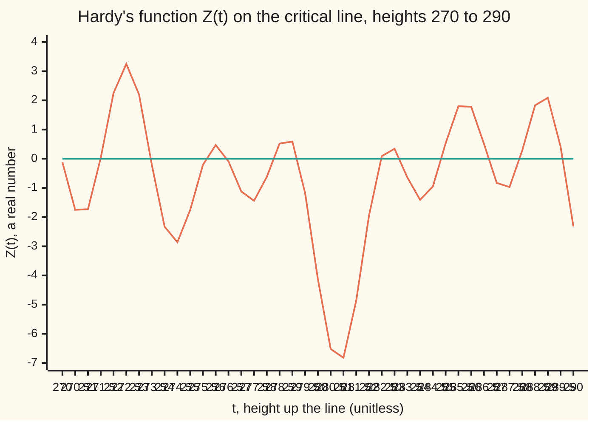

# The Riemann hypothesis: every nontrivial zero of zeta has real part one half

[Syllabus](../../../SYLLABUS.md) → [Frontier](../README.md) → [The Millennium Problems](../README.md#s02) → The Riemann hypothesis

---

## General Overview

On 2000-05-24, in Paris, the Clay Mathematics Institute named seven Millennium Prize Problems, with 1,000,000 US dollars offered for each. Clay counts one as solved: [The Poincare conjecture, solved](07-poincare-conjecture-solved.md). The oldest of the seven is the Riemann hypothesis, from Riemann's paper of 1859.

The hypothesis is about where the zeta function is zero. Zeta has easy zeros at −2, −4, −6 and so on, called the trivial zeros. Every other zero, a nontrivial zero, lies in the critical strip: the band of complex numbers whose real part is between 0 and 1. The middle of that band, real part exactly one half, is the critical line.

Zeta's first nontrivial zero sits at the complex number $`\tfrac12 + 14.134725\,i`$, where $`i`$ is the square root of −1. Its real part is exactly one half, so it is on the critical line. The hypothesis says that every nontrivial zero is like this one.

In 1925 J. I. Hutchinson checked the first 138 zeros, up to height 300, by hand. The checks on this card repeat his count in under a second, two independent ways. In 2021 Dave Platt and Tim Trudgian checked every zero up to height 3,000,175,332,800, just above $`3 \times 10^{12}`$: 12,363,153,437,138 zeros, all on the line. That is evidence, not a proof.

The proof came in 2026, as a formal proof. On 2026-11-20 Levent Alpöge released a proof of the hypothesis as a library of about 17 million lines for Lean, a proof assistant (a program that checks every step of a proof). On 2026-11-21 the Lean FRO, which develops Lean, and the Mathlib Initiative, which maintains its mathematics library Mathlib, certified it: the theorem proved is exactly Mathlib's statement of the hypothesis, and several independently written proof checkers accept the proof. No refereed paper exists yet, and Clay still lists the problem as "Active".

**The Riemann hypothesis says that every zero of zeta inside the critical strip lies on the line of real part one half; computers checked it to height $`3 \times 10^{12}`$, and a formal proof released on 2026-11-20 and certified by others on 2026-11-21 covers every height.**

**What kind of fact this is:** kind: a conjecture, stated by Riemann in 1859. Status: proved, since 2026-11-21, under this wing's rule that a formal proof rerun by others and matched to the statement counts as proved ([Kinds of claim](../01-How%20Research%20Works/02-theorem-conjecture-model-approximation.md)). No refereed paper exists yet, and Clay's word, "Active", is quoted as theirs. Row RH of [The status register](../07-Physics%2C%20Finance%20and%20Machines/05-the-status-register.md) holds the same entry. The results around it (the critical strip, the zero-free region, the share of zeros on the line, the verified height) are theorems or rigorous computations, quoted here with dates and sources. The counts on this card are computations in floating point, not proofs.

### The status, field by field

The audit list of [Machines in proofs](../01-How%20Research%20Works/06-computer-assistance-and-formal-verification.md) keeps four questions apart:

| Field | The Riemann hypothesis, as of 2026-11-23 |
| --- | --- |
| Statement | Mathlib's `RiemannHypothesis`, below: every zero of zeta other than −2, −4, −6, … has real part 1/2. With the three facts of Step 1, this says the same as Clay's statement. |
| Artifact | the Lean library released on 2026-11-20: about 17 million lines, depending directly only on Mathlib. It also proves the same statement for Dirichlet L-functions. |
| Independent check | the joint statement of 2026-11-21 certifies the statement and the proof. Two independent tools matched the theorem to Mathlib's statement, and Lean's own kernel and independently written checkers accepted the exported proof. A public verification page, updated 2026-11-23, lists every run. |
| Status | proved, 2026-11-21, under this wing's rule. Refereed paper: none yet. Clay: "Active", their word; its prize also needs journal publication, two years and general acceptance. |

The statement, as the verification page quotes it on 2026-11-23 (Lean v4.33.1, Mathlib v4.33.1; not compiled here):

```lean4
def RiemannHypothesis : Prop := ∀ (s : ℂ) (_ : riemannZeta s = 0) (_ : ¬∃ n : ℕ, s = -2 * (n + 1)) (_ : s ≠ 1), s.re = 1 / 2
```

The condition `s ≠ 1` is there because Mathlib gives zeta a conventional value at its pole.

### The picture: where Gram's rule first breaks



Orange: Hardy's function $`Z(t)`$, which is zeta on the critical line turned so that it is a real number. Green: the level 0. Each crossing of the green line is a zero of zeta on the line. Gram points $`g_n`$ are the heights where the Riemann–Siegel angle $`\vartheta(t)`$ (the turn that makes zeta real, defined under The formula) reaches a whole multiple of $`\pi`$; zeros are expected roughly one per Gram interval. Between the Gram points $`g_{125} = 280.802429`$ and $`g_{126} = 282.454721`$ the curve stays below 0: no zero. The next interval, up to $`g_{127} = 284.104476`$, holds two zeros, at heights 282.465115 and 283.211186. This is the first place where the rule of thumb "one zero between consecutive Gram points" fails, as Hutchinson found in 1925.

---

## The formula

Notation first, in words. A complex number is $`s = \sigma + it`$, with real part $`\sigma`$ ("sigma") and height $`t`$; here $`i`$ is the square root of −1. Zeta, $`\zeta(s)`$, is the function of [Zeta's zeros and the primes](../../07-Complex%20analysis/09-Special%20Functions%20and%20the%20Zeta%20Function/09-zeros-of-zeta-and-the-primes.md), continued to the whole plane except a pole at 1. A zero of zeta in the strip is written $`\rho`$ ("rho").

Zeta is zero at −2, −4, −6 and so on: the **trivial zeros**. Every other zero lies in the **critical strip**, the band $`0 < \sigma < 1`$. The **critical line** is the middle of that band, $`\sigma = \tfrac12`$.

The statement, as the Clay problem description gives it:

```math
\zeta(\rho) = 0 \ \text{ and } \ 0 < \mathrm{Re}\,\rho < 1 \quad \Longrightarrow \quad \mathrm{Re}\,\rho = \tfrac12
```

**Read it aloud:** if rho is a zero of zeta inside the critical strip, then the real part of rho is exactly one half.

In the four parts of a statement taught on shelf 01:

| Part | For the Riemann hypothesis |
| --- | --- |
| Hypothesis | $`\rho`$ is a zero of zeta and is not a trivial zero |
| Domain | all complex numbers, at every height, with no upper limit |
| Conclusion | $`\mathrm{Re}\,\rho = \tfrac12`$ |
| Boundary case | zeros on the edges $`\sigma = 0`$ and $`\sigma = 1`$: proved not to exist (1896) |

What it does **not** claim:

- that every zero is simple (a zero of order one); that is a separate open question;
- anything about the spacing of the zeros along the line;
- the same statement for other zeta-like functions, the Dirichlet L-functions; that is the generalized Riemann hypothesis, a separate conjecture.

What it would give for primes: the prime count $`\pi(x)`$, the number of primes up to $`x`$, would stay within $`\sqrt{x}\,\log x / (8\pi)`$ of the logarithmic integral $`\mathrm{li}(x)`$ for every $`x \ge 2657`$ (Schoenfeld, 1976). [The Riemann hypothesis](../../21-Algebraic%20and%20analytic%20number%20theory/02-The%20Zeta%20Function%20and%20the%20Prime%20Number%20Theorem/09-riemann-hypothesis-statement-and-equivalents.md) on wing 21 proves that this bound and the hypothesis are equivalent, up to the constant.

The tool behind every check is a pair of formulas. Hardy's function turns zeta on the line into a real number, and the Riemann–von Mangoldt formula counts every zero in the strip:

```math
Z(t) = e^{i\vartheta(t)}\,\zeta\!\left(\tfrac12 + it\right), \qquad N(T) = \frac{\vartheta(T)}{\pi} + 1 + S(T)
```

**Read it aloud:** zed of t is zeta on the critical line, turned by the angle theta of t; the number of zeros up to height T is theta of T over pi, plus one, plus a small wobble S of T.

"Checked up to height $`T`$" means: the number of sign changes of $`Z(t)`$ between 0 and $`T`$ equals $`N(T)`$.

| Symbol | Plain meaning | In our example | Push it up and the answer… |
| --- | --- | --- | --- |
| $`s = \sigma + it`$ | a complex input: real part $`\sigma`$, height $`t`$ | $`\sigma = \tfrac12`$, $`t = 14.134725`$ | higher $`t`$: zeros crowd closer |
| $`\zeta(s)`$ | the Riemann zeta function | size 0.326213 at $`1 + 14.134725\,i`$ | — |
| $`\rho`$, $`\mathrm{Re}\,\rho`$ | a zero in the strip; its real part | $`\tfrac12 + 14.134725\,i`$; $`\tfrac12`$ | RH: always $`\tfrac12`$ |
| $`\vartheta(t)`$ | the Riemann–Siegel angle that makes zeta real on the line ("curly theta") | $`\vartheta(300) = 429.4932`$ | grows like $`\tfrac{t}{2}\log\tfrac{t}{2\pi}`$ |
| $`Z(t)`$ | Hardy's function: real, same size as zeta on the line | $`Z(g_{126}) = -0.027629`$ | each sign change is a zero on the line |
| $`T`$ | the height we count up to | 300 | more zeros to count |
| $`N(T)`$ | number of zeros in the strip with height from 0 to $`T`$ | 138 at 300 | about $`\tfrac{T}{2\pi}\log\tfrac{T}{2\pi e}`$, with $`e`$ the base of the natural log |
| $`S(T)`$ | the wobble of $`N(T)`$ about its smooth part: the angle of $`\zeta(\tfrac12 + iT)`$ over $`\pi`$ | +0.2881 at 300 | stays small; grows at most like $`\log T`$ |
| $`g_n`$ | Gram point: the height where $`\vartheta(g_n) = n\pi`$ | $`g_{126} = 282.454721`$ | one Gram point per expected zero |
| $`m`$ | number of waves in the Riemann–Siegel sum, the whole part of $`\sqrt{t/2\pi}`$ | 6 at height 300 | grows like $`\sqrt{t}`$ |
| $`a`$, $`p`$, $`C_k`$, $`\Psi`$, $`z`$ | in the fold: $`\sqrt{t/2\pi}`$, its fractional part, the correction terms, the function they come from, and a complex step around $`p`$ | — | — |
| $`\pi(x)`$, $`\mathrm{li}(x)`$ | primes up to $`x`$; the logarithmic integral, the area under $`1/\log t`$ from 0 to $`x`$ | bound $`\sqrt{x}\log x/(8\pi)`$ | RH: the two stay close |

### When it holds

- **"Nontrivial" is part of the statement.** Zeta is 0 at −2, which has real part −2. Drop the word and the statement is false at once.
- **The hypothesis is about zeta only.** The same claim for Dirichlet L-functions is the generalized Riemann hypothesis. A proof of one does not give the other.
- **"Checked up to T" needs an exact count of all zeros.** Sign changes of $`Z(t)`$ only see zeros on the line. Without $`N(T)`$, a zero off the line is invisible.
- **The fast formula is an approximation.** The Riemann–Siegel formula, with three correction terms, misplaces the first zero by 0.000098. At height 282 it differs by 0.000000341 from the slow road: the Euler–Maclaurin sum of about $`t/2`$ terms that the code uses as its reference.
- **A check is not a proof.** Every height checked is a finite range. The statement covers all heights.

---

## Why it works

The 2026 proof is a formal library of about 17 million lines, and no refereed account of it exists yet, so this card does not outline it. This section shows how "checked up to $`T`$" works, why it says nothing beyond $`T`$, and what was proved for all heights before 2026-11-20.

### Step 0: on the line, a zero is a sign change, and an exact count catches any zero off it

Zeta takes complex values. On the critical line, one known rotation turns it into a real number, $`Z(t)`$. A real function that changes sign has a zero in between. So each sign change of $`Z`$ proves one zero on the line.

Sign changes cannot see a zero off the line. So a second count is needed: the number of zeros anywhere in the strip, up to height $`T`$. If the two counts agree, no zero below $`T`$ is off the line.

### Step 1: the zeros live in the strip (proved)

Three facts confine the nontrivial zeros, all on earlier cards:

1. The Euler product writes zeta as a product over primes. A convergent product of nonzero factors is not zero, so zeta has no zero with $`\sigma > 1`$.
2. The functional equation ties $`\zeta(s)`$ to $`\zeta(1 - s)`$. It carries the first fact to $`\sigma < 0`$, except for the trivial zeros.
3. Hadamard and de la Vallée Poussin proved in 1896 that zeta has no zero on the edge $`\sigma = 1`$. The checks find $`\lvert\zeta(1 + 14.134725\,i)\rvert = 0.326213`$, far from 0. [The zero-free region](../../21-Algebraic%20and%20analytic%20number%20theory/02-The%20Zeta%20Function%20and%20the%20Prime%20Number%20Theorem/03-the-zero-free-region.md) proves this edge result.

The same equation gives a mirror. If $`\rho`$ is a zero, so is $`1 - \bar\rho`$, its reflection across the critical line. So a zero off the line would come with a partner at the same height, on the other side.

### Step 2: the exact count, by following zeta's angle

The argument principle counts the zeros inside a closed path by how many times the function's value turns around 0 along the path. Applied to a rectangle over the strip, with the mirror of Step 1 halving the work, it gives the formula for $`N(T)`$.

The only hard part is $`S(T)`$: the angle of $`\zeta(\tfrac12 + iT)`$, divided by $`\pi`$. The checks follow that angle step by step, from $`2 + iT`$, where zeta is close to 1, left to $`\tfrac12 + iT`$. At $`T = 300`$:

- the smooth part $`\vartheta(300)/\pi + 1`$ is 137.7119;
- the wobble $`S(300)`$ is +0.2881;
- the total is 138.0000, a whole number, as a count must be.

### Step 3: the sign count, and the comparison

The checks sample $`Z(t)`$ every 0.02 from height 1 to 300 and count sign changes: 138. The exact count is also 138. So all 138 zeros up to height 300 lie on the line, and each is simple (a double zero would not change sign).

This repeats Hutchinson's 1925 result. It is a floating-point computation, so it is strong evidence, not a proof. A proof-grade check uses interval arithmetic, which carries a guaranteed error bound through every step. The 2021 check to $`3 \times 10^{12}`$ did that. It also used Turing's method, which fixes $`N(T)`$ from the sign changes of $`Z(t)`$ just above $`T`$ plus a proved bound on the average of $`S(t)`$, instead of following the angle at every height.

### Step 4: why big checks are possible at all: Riemann–Siegel

A direct sum for zeta needs about $`t/(2\pi)`$ terms at height $`t`$. The Riemann–Siegel formula needs only about $`\sqrt{t/(2\pi)}`$, plus a short correction:

```math
Z(t) \approx 2\sum_{n=1}^{m} \frac{\cos\bigl(\vartheta(t) - t\log n\bigr)}{\sqrt{n}} + \text{correction}, \qquad m = \Bigl\lfloor \sqrt{t/2\pi} \Bigr\rfloor
```

**Read it aloud:** zed of t is about twice a sum of m cosine waves, one for each whole number n up to the square root of t over two pi, each shrunk by the square root of n, plus a correction.

At height 300 that is 6 terms. At height $`3 \times 10^{12}`$ it is 690,988 terms, not hundreds of billions. The formula is asymptotic: each correction term is smaller than the one before by a factor of about $`1/a`$ (the fold defines $`a`$), so the part left out shrinks as $`t`$ grows. At any one height the error also depends on the fractional part $`p`$, so the sample errors below do not fall in order:

| Height | Riemann–Siegel, three correction terms, against the slow road |
| --- | --- |
| first zero, 14.13 | 14.134823 against 14.134725: off by 0.000098 |
| 50 | off by 0.000000935 |
| 100 | off by 0.000001561 |
| 282 | off by 0.000000341 |

<details>
<summary>The correction terms, as coded</summary>

Write $`a = \sqrt{t/2\pi}`$, $`m`$ its whole part and $`p = a - m`$ its fractional part. The correction is $`(-1)^{m-1} a^{-1/2}\,(C_0 + C_1/a + C_2/a^2)`$, with

$`\displaystyle C_0 = \Psi(p) = \frac{\cos\bigl(2\pi(p^2 - p - 1/16)\bigr)}{\cos(2\pi p)}, \qquad C_1 = -\frac{\Psi'''(p)}{96\pi^2}, \qquad C_2 = \frac{\Psi''(p)}{64\pi^2} + \frac{\Psi^{(6)}(p)}{18432\pi^4}.`$

$`\Psi`$ has no poles in the complex plane, so the code takes its derivatives exactly, by Cauchy's integral formula: the $`k`$-th derivative at $`p`$ is $`k!`$ times the average of $`\Psi(p + z)/z^k`$ around the circle $`\lvert z\rvert = \tfrac12`$, summed at 64 points. The main sum alone puts the first zero at 14.517920; with $`C_0`$ it is 14.137196; with all three terms, 14.134823. At height 14 the sum has only one wave, so the series is at its weakest there.

</details>

### Step 5: what was proved for all heights before 2026-11-20

No check reaches every height, so these results mattered. Each is a theorem from a refereed source, except the row marked claimed.

| Result | What it says | Status, with date |
| --- | --- | --- |
| Critical strip | no nontrivial zero with $`\sigma \le 0`$ or $`\sigma \ge 1`$ | proved, 1896 |
| Zero-free region | no zero with $`\sigma \ge 1 - 1/(5.558691\,\log t)`$, for $`t \ge 2`$ | proved; constant from 2024, quoted in [The zero-free region](../../21-Algebraic%20and%20analytic%20number%20theory/02-The%20Zeta%20Function%20and%20the%20Prime%20Number%20Theorem/03-the-zero-free-region.md) |
| Share on the line | more than 41.73% of the zeros up to $`T`$ lie on the line, for large $`T`$ (the theorem's constant is 0.417293) | proved, 2020; the last refereed bound |
| Share simple and on the line | at least 67.25% | claimed, 2026-08-13 ([arXiv:2608.13637](https://arxiv.org/abs/2608.13637)); second proof 2026-09-02 ([arXiv:2609.02882](https://arxiv.org/abs/2609.02882)); not refereed; see [The August 2026 zeta-zeros claim](../05-Analysis%20and%20Dynamics/03-zeta-zero-proportion-2026.md) |
| Zero density | the zeros with real part at least $`\sigma`$ number at most $`T^{30(1-\sigma)/13 + o(1)}`$ | proved; published 2026 |
| Verified range | every zero with height up to $`3 \times 10^{12}`$ is on the line | proved by rigorous computation, 2021 |

In the zero-density row, $`o(1)`$ is a quantity that shrinks to 0 as $`T`$ grows. [Zeros on the line](../../21-Algebraic%20and%20analytic%20number%20theory/02-The%20Zeta%20Function%20and%20the%20Prime%20Number%20Theorem/10-zeros-on-the-critical-line-and-proportion-results.md) gives the history of the share, from Hardy's infinitely many zeros (1914) to the 2020 bound.

Why none of these is the hypothesis:

- A share above 41.73%, or the claimed 67.25%, leaves the rest unplaced. Even a share of 100% would allow a thin set of exceptions.
- The zero-free region gets thinner as the height grows. It never reaches a band of fixed width.
- A density bound says zeros far from the line are rare. It does not say there are none.

The formal proof of 2026-11-20 gets past all three limits. The joint statement of 2026-11-21 looks forward to work that will explain its new ideas.

---

## Worked numbers, by hand

The count at height $`T = 300`$, the height Hutchinson reached in 1925.

| Step | Arithmetic | Value |
| --- | --- | --- |
| $`T/(2\pi)`$ | $`300 / (2\pi)`$ | 47.7465 |
| $`\log\bigl(T/(2\pi e)\bigr)`$ | $`\log 47.7465 - 1`$ | 2.8659 |
| smooth count, $`\tfrac{T}{2\pi}\log\tfrac{T}{2\pi e} + \tfrac78`$ | $`47.7465 \times 2.8659 + 0.875`$ | 137.7119 |
| same, from the angle: $`\vartheta(300)/\pi + 1`$ | $`429.4932 / \pi + 1`$ | 137.7119 |
| wobble $`S(300)`$ | angle of $`\zeta(\tfrac12 + 300i)`$, over $`\pi`$ | +0.2881 |
| exact count $`N(300)`$ | $`137.7119 + 0.2881`$ | 138.0000 |
| sign changes of $`Z(t)`$, step 0.02 | counted from height 1 to 300 | 138 |
| **zeros off the line, up to height 300** | $`138 - 138`$ | **0** |

So every zero up to height 300 lies on the critical line, in this floating-point check. That is the status line "checked for $`T \le 300`$", and it says nothing about height 301.

### What breaks if you drop a piece

| Mistake | Comes out at | What went wrong |
| --- | --- | --- |
| Sample $`Z(t)`$ every 2 units instead of every 0.02 | 91 sign changes, not 138 | Two zeros inside one step cancel, so the sign looks unchanged |
| Drop the wobble $`S(T)`$ from the count | 137.7119, not a whole number | The smooth part is an average; only $`S(T)`$ makes the count exact |
| Trust Gram's law: one zero between consecutive Gram points | 0 zeros between $`g_{125}`$ and $`g_{126}`$, then 2 | Gram's law holds for $`g_0`$ to $`g_{125}`$ and fails at $`g_{126}`$; a pattern, not a theorem |
| Use the fast formula low on the line | first zero at 14.134823, off by 0.000098 | Riemann–Siegel is asymptotic; at height 14 it has one wave |

Gram's law here means $`(-1)^n Z(g_n) > 0`$. It fails 7 times for $`n < 300`$. The first five failures are at $`n = 126`$, 134, 195, 211 and 232.

---

## Code, from first principles, and it actually runs

The script computes zeta on the line two independent ways: the Euler–Maclaurin sum (a head sum, a tail integral and end corrections) and the Riemann–Siegel formula. It locates the first zero both ways. It then counts zeros up to heights 100, 200 and 300 two independent ways: sign changes of $`Z(t)`$, and the exact count from following zeta's angle. It finds the Gram points by Newton's method and prints where Gram's law first fails. Nothing imported knows zeta.

### Python

```python
# The Riemann hypothesis -- the check behind the Clay status card.  Standard library only.
# Zeta on the critical line two ways: the Euler-Maclaurin sum, and the Riemann-Siegel
# formula used by the big verifications.  The zeros below a height counted two ways: sign
# changes of Hardy's Z(t), and the exact count N(T) from the argument principle.
import math, cmath
PI = math.pi

def theta(t):            # Riemann-Siegel angle, Stirling series (good for t > 1)
    return t / 2 * math.log(t / (2 * PI)) - t / 2 - PI / 8 + 1 / (48 * t) + 7 / (5760 * t**3) + 31 / (80640 * t**5)

def npow(n, s):          # n^(-s) = exp(-s log n)
    return cmath.exp(-s * math.log(n))

B2K = [1 / 6, -1 / 30, 1 / 42, -1 / 30, 5 / 66, -691 / 2730, 7 / 6, -3617 / 510]

def zeta(s):             # road 1: head sum + tail integral + Bernoulli end corrections
    N = int(abs(s.imag) / 2) + 30
    tot = sum(npow(n, s) for n in range(1, N))
    tot += npow(N, s) * N / (s - 1) + 0.5 * npow(N, s)
    poch, fact = s, 2.0
    for k in range(1, 9):
        tot += B2K[k - 1] / fact * poch * npow(N, s) / N**(2 * k - 1)
        poch *= (s + 2 * k - 1) * (s + 2 * k)
        fact *= (2 * k + 1) * (2 * k + 2)
    return tot

def Z_em(t):             # Hardy's Z: zeta on the line, turned by theta(t) to be real
    return (cmath.exp(1j * theta(t)) * zeta(complex(0.5, t))).real

def psi(p):              # complex p allowed; real on the real line
    return cmath.cos(2 * PI * (p * p - p - 1 / 16)) / cmath.cos(2 * PI * p)

def deriv(k, p):         # k-th derivative of psi, exactly: Cauchy's integral on a circle of radius 1/2
    us = [2 * PI * (j + 0.5) / 64 for j in range(64)]
    return (math.factorial(k) / 0.5**k * sum(psi(p + 0.5 * cmath.exp(1j * u)) * cmath.exp(-1j * k * u) for u in us) / 64).real

def Z_rs(t, terms=3):    # road 2: Riemann-Siegel, main sum plus up to three correction terms
    a = math.sqrt(t / (2 * PI)); m = int(a); p = a - m
    main = sum(math.cos(theta(t) - t * math.log(n)) / math.sqrt(n) for n in range(1, m + 1))
    c0 = psi(p).real
    c1 = -deriv(3, p) / (96 * PI**2)
    c2 = deriv(2, p) / (64 * PI**2) + deriv(6, p) / (18432 * PI**4)
    corr = [c0, c1 / a, c2 / a**2][:terms]
    return 2 * main + (-1)**(m - 1) * sum(corr) / math.sqrt(a)

def bisect(f, a, b):
    fa = f(a)
    for _ in range(60):
        c = (a + b) / 2; fc = f(c)
        if (fc < 0) == (fa < 0): a, fa = c, fc
        else: b = c
    return (a + b) / 2

def sign_changes(lo, hi, step):
    n, prev, k = 0, Z_em(lo), 1
    while lo + k * step <= hi + 1e-9:
        v = Z_em(lo + k * step)
        if (v < 0) != (prev < 0): n += 1
        prev, k = v, k + 1
    return n

def count_by_argument(T):  # N(T) = theta(T)/pi + 1 + S(T), arg followed from 2 + iT to 1/2 + iT
    z = zeta(complex(2, T)); arg = cmath.phase(z); worst = 0.0
    for j in range(1, 601):
        w = zeta(complex(2 - 1.5 * j / 600, T)); d = cmath.phase(w / z)
        worst = max(worst, abs(d)); arg += d; z = w
    assert worst < 0.5                     # steps small enough to follow the angle
    return theta(T) / PI + 1, arg / PI

print("Riemann hypothesis: zeros of zeta on the critical line, checked by two roads")
z1, z2 = bisect(Z_em, 14, 15), bisect(Z_rs, 14, 15)
print(f"first zero, Euler-Maclaurin road: 1/2 + {z1:.6f} i")
print(f"first zero, Riemann-Siegel road:  1/2 + {z2:.6f} i   (gap {abs(z1 - z2):.6f})")
assert abs(z1 - 14.134725) < 1e-6 and abs(z1 - z2) < 3e-4
print(f"zeta(1 + {z1:.6f} i) has size {abs(zeta(complex(1, z1))):.6f}   (edge of the strip: not 0)")
for t in (50.0, 100.0, 282.0):
    a, b = Z_em(t), Z_rs(t)
    print(f"Z({t:.0f}): Euler-Maclaurin {a:.8f}, Riemann-Siegel {b:.8f}, gap {abs(a - b):.9f}")
    assert abs(a - b) < 2e-6                 # three correction terms: error of order 1e-6 here

print("count of zeros up to height T: smooth part, wobble S(T), exact N(T), sign changes of Z")
for T in (100.0, 200.0, 300.0):
    smooth, S = count_by_argument(T); N = smooth + S
    sc = sign_changes(1.0, T, 0.02)
    print(f"T = {T:.0f}: smooth {smooth:.4f}, S(T) {S:+.4f}, N(T) {N:.4f}, sign changes {sc}")
    assert abs(N - round(N)) < 0.01 and sc == round(N)   # every zero below T is on the line
sm = 300 / (2 * PI) * math.log(300 / (2 * PI * math.e)) + 7 / 8
print(f"by hand, T = 300: T/(2 pi) = {300 / (2 * PI):.4f}, log(T/(2 pi e)) = {math.log(300 / (2 * PI * math.e)):.4f}, "
      f"product + 7/8 = {sm:.4f}; theta(300) = {theta(300):.4f}")
print(f"Riemann-Siegel terms: {int(math.sqrt(300 / (2 * PI)))} at height 300, {int(math.sqrt(3e12 / (2 * PI)))} at height 3e12")
print("checked: all 138 zeros with height up to 300 lie on the critical line (checked for T <= 300 only)")

def gram(n):              # Gram point: theta(g_n) = n pi, by Newton's method
    g = 20.0 + 2 * n
    for _ in range(30): g -= (theta(g) - n * PI) / (0.5 * math.log(g / (2 * PI)))
    return g
fails = [n for n in range(0, 140) if (-1)**n * Z_em(gram(n)) <= 0]
g = [gram(n) for n in (125, 126, 127)]
print(f"Gram's law (-1)^n Z(g_n) > 0: holds for n = 0 to {fails[0] - 1}; first failure n = {fails[0]}")
print(f"g_125 = {g[0]:.6f}, g_126 = {g[1]:.6f}, g_127 = {g[2]:.6f}")
print(f"Z(g_126): Euler-Maclaurin {Z_em(g[1]):.6f}, Riemann-Siegel {Z_rs(g[1]):.6f}")
inside = [sign_changes(g[0], g[1], (g[1] - g[0]) / 200), sign_changes(g[1], g[2], (g[2] - g[1]) / 200)]
zs = [bisect(Z_em, a, a + 0.25) for a in [g[0] + 0.25 * k for k in range(int((g[2] - g[0]) / 0.25) + 1)]
      if (Z_em(a) < 0) != (Z_em(a + 0.25) < 0)]
print(f"zeros in [g_125, g_126]: {inside[0]}; in [g_126, g_127]: {inside[1]}, at " + ", ".join(f"{x:.6f}" for x in zs))
assert fails[0] == 126 and Z_em(g[1]) < 0 and inside == [0, 2] and len(zs) == 2

print("what breaks, below height 300:")
print(f"  sample Z every 2 units instead of 0.02: {sign_changes(1.0, 300.0, 2.0)} sign changes, not 138")
smooth, S = count_by_argument(300.0)
print(f"  drop the wobble S(300): count {smooth:.4f}, not a whole number")
print(f"  trust Gram's law past g_125: the interval [g_125, g_126] should hold one zero, holds {inside[0]}")
assert sign_changes(1.0, 300.0, 2.0) < 138

print("try changing:")
smooth, S = count_by_argument(400.0)
print(f"  T = 400: N(T) {smooth + S:.4f}, sign changes {sign_changes(1.0, 400.0, 0.02)}")
print(f"  sample every 0.5 below 300: {sign_changes(1.0, 300.0, 0.5)} sign changes")
r0, r1 = bisect(lambda t: Z_rs(t, 0), 14, 15), bisect(lambda t: Z_rs(t, 1), 14, 15)
print(f"  Riemann-Siegel first zero, main sum alone: {r0:.6f}; with the first correction: {r1:.6f}")
more = [n for n in range(0, 300) if (-1)**n * Z_em(gram(n)) <= 0]
print(f"  Gram's law failures for n < 300: {len(more)}, first five " + ", ".join(str(n) for n in more[:5]))
assert abs(r0 - z1) > abs(r1 - z1) > abs(z2 - z1)          # the corrections help
print("chart: Z(t) for t = 270 to 290 in steps of 0.5")
pts = [Z_em(270 + 0.5 * k) for k in range(41)]
print("  " + ", ".join(f"{v:.2f}" for v in pts))
print("quoted, not computed: verified height 3000175332800 (2021), zeros up to it 12363153437138")
print("quoted, not computed: share on the line > 41.73% (0.417293, 2020); claimed 67.25% (2026-08-13, second proof 2026-09-02)")
print("quoted, not computed: Lean proof of 2026-11-20, about 17 million lines; certified 2026-11-21 against Mathlib's RiemannHypothesis")
print("quoted, not computed: Clay list of 2000-05-24, 7 problems, 1 solved, 1000000 US dollars each, paid 2 years after publication")
print("quoted, not computed: zero density exponent 30/13 (2026)")
print("quoted, not computed: if RH, |pi(x) - li(x)| < sqrt(x) log x / (8 pi) for x >= 2657 (1976); zero-free constant 5.558691 (2024)")
print("ALL CHECKS PASS")
```

**Ran 2026-11-23 on macOS, Python 3.14.10, standard library only. All checks passed. Output, pasted from the run:**

```
Riemann hypothesis: zeros of zeta on the critical line, checked by two roads
first zero, Euler-Maclaurin road: 1/2 + 14.134725 i
first zero, Riemann-Siegel road:  1/2 + 14.134823 i   (gap 0.000098)
zeta(1 + 14.134725 i) has size 0.326213   (edge of the strip: not 0)
Z(50): Euler-Maclaurin -0.34073501, Riemann-Siegel -0.34073594, gap 0.000000935
Z(100): Euler-Maclaurin 2.69269706, Riemann-Siegel 2.69269550, gap 0.000001561
Z(282): Euler-Maclaurin -1.95254988, Riemann-Siegel -1.95255022, gap 0.000000341
count of zeros up to height T: smooth part, wobble S(T), exact N(T), sign changes of Z
T = 100: smooth 29.0024, S(T) -0.0024, N(T) 29.0000, sign changes 29
T = 200: smooth 79.1933, S(T) -0.1933, N(T) 79.0000, sign changes 79
T = 300: smooth 137.7119, S(T) +0.2881, N(T) 138.0000, sign changes 138
by hand, T = 300: T/(2 pi) = 47.7465, log(T/(2 pi e)) = 2.8659, product + 7/8 = 137.7119; theta(300) = 429.4932
Riemann-Siegel terms: 6 at height 300, 690988 at height 3e12
checked: all 138 zeros with height up to 300 lie on the critical line (checked for T <= 300 only)
Gram's law (-1)^n Z(g_n) > 0: holds for n = 0 to 125; first failure n = 126
g_125 = 280.802429, g_126 = 282.454721, g_127 = 284.104476
Z(g_126): Euler-Maclaurin -0.027629, Riemann-Siegel -0.027630
zeros in [g_125, g_126]: 0; in [g_126, g_127]: 2, at 282.465115, 283.211186
what breaks, below height 300:
  sample Z every 2 units instead of 0.02: 91 sign changes, not 138
  drop the wobble S(300): count 137.7119, not a whole number
  trust Gram's law past g_125: the interval [g_125, g_126] should hold one zero, holds 0
try changing:
  T = 400: N(T) 202.0000, sign changes 202
  sample every 0.5 below 300: 138 sign changes
  Riemann-Siegel first zero, main sum alone: 14.517920; with the first correction: 14.137196
  Gram's law failures for n < 300: 7, first five 126, 134, 195, 211, 232
chart: Z(t) for t = 270 to 290 in steps of 0.5
  -0.12, -1.75, -1.73, 0.03, 2.25, 3.25, 2.20, -0.21, -2.33, -2.86, -1.76, -0.21, 0.47, -0.09, -1.12, -1.44, -0.62, 0.52, 0.59, -1.18, -4.13, -6.52, -6.82, -4.86, -1.95, 0.09, 0.34, -0.64, -1.41, -0.95, 0.53, 1.80, 1.78, 0.51, -0.83, -0.97, 0.29, 1.83, 2.09, 0.41, -2.32
quoted, not computed: verified height 3000175332800 (2021), zeros up to it 12363153437138
quoted, not computed: share on the line > 41.73% (0.417293, 2020); claimed 67.25% (2026-08-13, second proof 2026-09-02)
quoted, not computed: Lean proof of 2026-11-20, about 17 million lines; certified 2026-11-21 against Mathlib's RiemannHypothesis
quoted, not computed: Clay list of 2000-05-24, 7 problems, 1 solved, 1000000 US dollars each, paid 2 years after publication
quoted, not computed: zero density exponent 30/13 (2026)
quoted, not computed: if RH, |pi(x) - li(x)| < sqrt(x) log x / (8 pi) for x >= 2657 (1976); zero-free constant 5.558691 (2024)
ALL CHECKS PASS
```

### Rust

```rust
// The Riemann hypothesis -- the check behind the Clay status card.  std only.
// Zeta on the critical line two ways: the Euler-Maclaurin sum, and the Riemann-Siegel
// formula used by the big verifications.  The zeros below a height counted two ways: sign
// changes of Hardy's Z(t), and the exact count N(T) from the argument principle.
use std::f64::consts::PI;
use std::ops::{Add, Mul, Sub, Div};

#[derive(Clone, Copy)]
struct C { re: f64, im: f64 }
impl Add for C { type Output = C; fn add(self, o: C) -> C { C { re: self.re + o.re, im: self.im + o.im } } }
impl Sub for C { type Output = C; fn sub(self, o: C) -> C { C { re: self.re - o.re, im: self.im - o.im } } }
impl Mul for C { type Output = C; fn mul(self, o: C) -> C { C { re: self.re * o.re - self.im * o.im, im: self.re * o.im + self.im * o.re } } }
impl Div for C { type Output = C; fn div(self, o: C) -> C { let d = o.re * o.re + o.im * o.im;
    C { re: (self.re * o.re + self.im * o.im) / d, im: (self.im * o.re - self.re * o.im) / d } } }
fn c(re: f64, im: f64) -> C { C { re, im } }
fn r(x: f64) -> C { c(x, 0.0) }
fn cexp(z: C) -> C { let m = z.re.exp(); c(m * z.im.cos(), m * z.im.sin()) }
fn abs(z: C) -> f64 { z.re.hypot(z.im) }
fn phase(z: C) -> f64 { z.im.atan2(z.re) }

fn theta(t: f64) -> f64 { // Riemann-Siegel angle, Stirling series (good for t > 1)
    t / 2.0 * (t / (2.0 * PI)).ln() - t / 2.0 - PI / 8.0 + 1.0 / (48.0 * t) + 7.0 / (5760.0 * t.powi(3)) + 31.0 / (80640.0 * t.powi(5))
}
fn npow(n: f64, s: C) -> C { cexp(r(-n.ln()) * s) } // n^(-s) = exp(-s log n)
const B2K: [f64; 8] = [1.0 / 6.0, -1.0 / 30.0, 1.0 / 42.0, -1.0 / 30.0, 5.0 / 66.0, -691.0 / 2730.0, 7.0 / 6.0, -3617.0 / 510.0];

fn zeta(s: C) -> C { // road 1: head sum + tail integral + Bernoulli end corrections
    let n = (s.im.abs() / 2.0) as usize + 30;
    let nf = n as f64;
    let mut tot = r(0.0);
    for k in 1..n { tot = tot + npow(k as f64, s); }
    tot = tot + npow(nf, s) * r(nf) / (s - r(1.0)) + r(0.5) * npow(nf, s);
    let (mut poch, mut fact) = (s, 2.0);
    for k in 1..9 {
        tot = tot + r(B2K[k - 1] / fact) * poch * npow(nf, s) / r(nf.powi(2 * k as i32 - 1));
        poch = poch * (s + r((2 * k - 1) as f64)) * (s + r((2 * k) as f64));
        fact *= ((2 * k + 1) * (2 * k + 2)) as f64;
    }
    tot
}
fn z_em(t: f64) -> f64 { (cexp(c(0.0, theta(t))) * zeta(c(0.5, t))).re } // Hardy's Z
fn ccos(z: C) -> C { (cexp(c(-z.im, z.re)) + cexp(c(z.im, -z.re))) * r(0.5) } // cos z = (e^(iz) + e^(-iz)) / 2
fn psi(p: C) -> C { ccos(r(2.0 * PI) * (p * p - p - r(1.0 / 16.0))) / ccos(r(2.0 * PI) * p) } // complex p allowed
fn deriv(k: i32, p: f64) -> f64 { // k-th derivative of psi, exactly: Cauchy's integral on a circle of radius 1/2
    let mut s = r(0.0);
    for j in 0..64 { let u = 2.0 * PI * (j as f64 + 0.5) / 64.0; s = s + psi(r(p) + r(0.5) * cexp(c(0.0, u))) * cexp(c(0.0, -(k as f64) * u)); }
    (1..=k).map(|i| i as f64).product::<f64>() / 0.5f64.powi(k) * s.re / 64.0
}
fn z_rs_n(t: f64, terms: usize) -> f64 { // road 2: Riemann-Siegel, main sum plus up to three correction terms
    let a = (t / (2.0 * PI)).sqrt(); let m = a as usize; let p = a - m as f64;
    let mut main = 0.0;
    for n in 1..=m { main += (theta(t) - t * (n as f64).ln()).cos() / (n as f64).sqrt(); }
    let c0 = psi(r(p)).re;
    let c1 = -deriv(3, p) / (96.0 * PI.powi(2));
    let c2 = deriv(2, p) / (64.0 * PI.powi(2)) + deriv(6, p) / (18432.0 * PI.powi(4));
    let sg = if m % 2 == 1 { 1.0 } else { -1.0 };
    let corr = [c0, c1 / a, c2 / (a * a)];
    2.0 * main + sg * corr[..terms].iter().sum::<f64>() / a.sqrt()
}
fn z_rs(t: f64) -> f64 { z_rs_n(t, 3) }
fn z_rs0(t: f64) -> f64 { z_rs_n(t, 0) }
fn z_rs1(t: f64) -> f64 { z_rs_n(t, 1) }
fn bisect(f: fn(f64) -> f64, mut a: f64, mut b: f64) -> f64 {
    let mut fa = f(a);
    for _ in 0..60 { let cm = (a + b) / 2.0; let fc = f(cm); if (fc < 0.0) == (fa < 0.0) { a = cm; fa = fc; } else { b = cm; } }
    (a + b) / 2.0
}
fn sign_changes(lo: f64, hi: f64, step: f64) -> usize {
    let (mut n, mut prev, mut k) = (0, z_em(lo), 1.0);
    while lo + k * step <= hi + 1e-9 { let v = z_em(lo + k * step); if (v < 0.0) != (prev < 0.0) { n += 1; } prev = v; k += 1.0; }
    n
}
fn count_by_argument(t: f64) -> (f64, f64) { // N(T) = theta(T)/pi + 1 + S(T)
    let mut z = zeta(c(2.0, t)); let mut arg = phase(z); let mut worst: f64 = 0.0;
    for j in 1..=600 {
        let w = zeta(c(2.0 - 1.5 * j as f64 / 600.0, t)); let d = phase(w / z);
        worst = worst.max(d.abs()); arg += d; z = w;
    }
    assert!(worst < 0.5); // steps small enough to follow the angle
    (theta(t) / PI + 1.0, arg / PI)
}
fn gram(n: i32) -> f64 { // Gram point: theta(g_n) = n pi, by Newton's method
    let mut g = 20.0 + 2.0 * n as f64;
    for _ in 0..30 { g -= (theta(g) - n as f64 * PI) / (0.5 * (g / (2.0 * PI)).ln()); }
    g
}

fn main() {
    println!("Riemann hypothesis: zeros of zeta on the critical line, checked by two roads");
    let (z1, z2) = (bisect(z_em, 14.0, 15.0), bisect(z_rs, 14.0, 15.0));
    println!("first zero, Euler-Maclaurin road: 1/2 + {:.6} i", z1);
    println!("first zero, Riemann-Siegel road:  1/2 + {:.6} i   (gap {:.6})", z2, (z1 - z2).abs());
    assert!((z1 - 14.134725).abs() < 1e-6 && (z1 - z2).abs() < 3e-4);
    println!("zeta(1 + {:.6} i) has size {:.6}   (edge of the strip: not 0)", z1, abs(zeta(c(1.0, z1))));
    for t in [50.0, 100.0, 282.0] {
        let (a, b) = (z_em(t), z_rs(t));
        println!("Z({:.0}): Euler-Maclaurin {:.8}, Riemann-Siegel {:.8}, gap {:.9}", t, a, b, (a - b).abs());
        assert!((a - b).abs() < 2e-6); // three correction terms: error of order 1e-6 here
    }
    println!("count of zeros up to height T: smooth part, wobble S(T), exact N(T), sign changes of Z");
    for t in [100.0, 200.0, 300.0] {
        let (smooth, s) = count_by_argument(t); let n = smooth + s;
        let sc = sign_changes(1.0, t, 0.02);
        println!("T = {:.0}: smooth {:.4}, S(T) {:+.4}, N(T) {:.4}, sign changes {}", t, smooth, s, n, sc);
        assert!((n - n.round()).abs() < 0.01 && sc as f64 == n.round()); // every zero below T is on the line
    }
    let (a300, l300) = (300.0 / (2.0 * PI), (300.0 / (2.0 * PI * std::f64::consts::E)).ln());
    println!("by hand, T = 300: T/(2 pi) = {:.4}, log(T/(2 pi e)) = {:.4}, product + 7/8 = {:.4}; theta(300) = {:.4}",
        a300, l300, a300 * l300 + 7.0 / 8.0, theta(300.0));
    println!("Riemann-Siegel terms: {} at height 300, {} at height 3e12", (300.0 / (2.0 * PI)).sqrt() as usize, (3e12 / (2.0 * PI)).sqrt() as usize);
    println!("checked: all 138 zeros with height up to 300 lie on the critical line (checked for T <= 300 only)");
    let fails: Vec<i32> = (0..140).filter(|&n| (if n % 2 == 0 { 1.0 } else { -1.0 }) * z_em(gram(n)) <= 0.0).collect();
    let g = [gram(125), gram(126), gram(127)];
    println!("Gram's law (-1)^n Z(g_n) > 0: holds for n = 0 to {}; first failure n = {}", fails[0] - 1, fails[0]);
    println!("g_125 = {:.6}, g_126 = {:.6}, g_127 = {:.6}", g[0], g[1], g[2]);
    println!("Z(g_126): Euler-Maclaurin {:.6}, Riemann-Siegel {:.6}", z_em(g[1]), z_rs(g[1]));
    let inside = [sign_changes(g[0], g[1], (g[1] - g[0]) / 200.0), sign_changes(g[1], g[2], (g[2] - g[1]) / 200.0)];
    let mut zs = Vec::new();
    for k in 0..=(((g[2] - g[0]) / 0.25) as usize) {
        let a = g[0] + 0.25 * k as f64;
        if (z_em(a) < 0.0) != (z_em(a + 0.25) < 0.0) { zs.push(bisect(z_em, a, a + 0.25)); }
    }
    let zl: Vec<String> = zs.iter().map(|x| format!("{:.6}", x)).collect();
    println!("zeros in [g_125, g_126]: {}; in [g_126, g_127]: {}, at {}", inside[0], inside[1], zl.join(", "));
    assert!(fails[0] == 126 && z_em(g[1]) < 0.0 && inside == [0, 2] && zs.len() == 2);

    println!("what breaks, below height 300:");
    let coarse = sign_changes(1.0, 300.0, 2.0);
    println!("  sample Z every 2 units instead of 0.02: {} sign changes, not 138", coarse);
    let (smooth, _) = count_by_argument(300.0);
    println!("  drop the wobble S(300): count {:.4}, not a whole number", smooth);
    println!("  trust Gram's law past g_125: the interval [g_125, g_126] should hold one zero, holds {}", inside[0]);
    assert!(coarse < 138);

    println!("try changing:");
    let (smooth, s) = count_by_argument(400.0);
    println!("  T = 400: N(T) {:.4}, sign changes {}", smooth + s, sign_changes(1.0, 400.0, 0.02));
    println!("  sample every 0.5 below 300: {} sign changes", sign_changes(1.0, 300.0, 0.5));
    let (r0, r1) = (bisect(z_rs0, 14.0, 15.0), bisect(z_rs1, 14.0, 15.0));
    println!("  Riemann-Siegel first zero, main sum alone: {:.6}; with the first correction: {:.6}", r0, r1);
    let more: Vec<i32> = (0..300).filter(|&n| (if n % 2 == 0 { 1.0 } else { -1.0 }) * z_em(gram(n)) <= 0.0).collect();
    let m5: Vec<String> = more[..5].iter().map(|n| n.to_string()).collect();
    println!("  Gram's law failures for n < 300: {}, first five {}", more.len(), m5.join(", "));
    assert!((r0 - z1).abs() > (r1 - z1).abs() && (r1 - z1).abs() > (z2 - z1).abs()); // the corrections help
    println!("chart: Z(t) for t = 270 to 290 in steps of 0.5");
    let pts: Vec<String> = (0..41).map(|k| format!("{:.2}", z_em(270.0 + 0.5 * k as f64))).collect();
    println!("  {}", pts.join(", "));
    println!("quoted, not computed: verified height 3000175332800 (2021), zeros up to it 12363153437138");
    println!("quoted, not computed: share on the line > 41.73% (0.417293, 2020); claimed 67.25% (2026-08-13, second proof 2026-09-02)");
    println!("quoted, not computed: Lean proof of 2026-11-20, about 17 million lines; certified 2026-11-21 against Mathlib's RiemannHypothesis");
    println!("quoted, not computed: Clay list of 2000-05-24, 7 problems, 1 solved, 1000000 US dollars each, paid 2 years after publication");
    println!("quoted, not computed: zero density exponent 30/13 (2026)");
    println!("quoted, not computed: if RH, |pi(x) - li(x)| < sqrt(x) log x / (8 pi) for x >= 2657 (1976); zero-free constant 5.558691 (2024)");
    println!("ALL CHECKS PASS");
}
```

**Ran 2026-11-23 on macOS, rustc 1.98.1, no crates. All checks passed. Output, pasted from the run:**

```
Riemann hypothesis: zeros of zeta on the critical line, checked by two roads
first zero, Euler-Maclaurin road: 1/2 + 14.134725 i
first zero, Riemann-Siegel road:  1/2 + 14.134823 i   (gap 0.000098)
zeta(1 + 14.134725 i) has size 0.326213   (edge of the strip: not 0)
Z(50): Euler-Maclaurin -0.34073501, Riemann-Siegel -0.34073594, gap 0.000000935
Z(100): Euler-Maclaurin 2.69269706, Riemann-Siegel 2.69269550, gap 0.000001561
Z(282): Euler-Maclaurin -1.95254988, Riemann-Siegel -1.95255022, gap 0.000000341
count of zeros up to height T: smooth part, wobble S(T), exact N(T), sign changes of Z
T = 100: smooth 29.0024, S(T) -0.0024, N(T) 29.0000, sign changes 29
T = 200: smooth 79.1933, S(T) -0.1933, N(T) 79.0000, sign changes 79
T = 300: smooth 137.7119, S(T) +0.2881, N(T) 138.0000, sign changes 138
by hand, T = 300: T/(2 pi) = 47.7465, log(T/(2 pi e)) = 2.8659, product + 7/8 = 137.7119; theta(300) = 429.4932
Riemann-Siegel terms: 6 at height 300, 690988 at height 3e12
checked: all 138 zeros with height up to 300 lie on the critical line (checked for T <= 300 only)
Gram's law (-1)^n Z(g_n) > 0: holds for n = 0 to 125; first failure n = 126
g_125 = 280.802429, g_126 = 282.454721, g_127 = 284.104476
Z(g_126): Euler-Maclaurin -0.027629, Riemann-Siegel -0.027630
zeros in [g_125, g_126]: 0; in [g_126, g_127]: 2, at 282.465115, 283.211186
what breaks, below height 300:
  sample Z every 2 units instead of 0.02: 91 sign changes, not 138
  drop the wobble S(300): count 137.7119, not a whole number
  trust Gram's law past g_125: the interval [g_125, g_126] should hold one zero, holds 0
try changing:
  T = 400: N(T) 202.0000, sign changes 202
  sample every 0.5 below 300: 138 sign changes
  Riemann-Siegel first zero, main sum alone: 14.517920; with the first correction: 14.137196
  Gram's law failures for n < 300: 7, first five 126, 134, 195, 211, 232
chart: Z(t) for t = 270 to 290 in steps of 0.5
  -0.12, -1.75, -1.73, 0.03, 2.25, 3.25, 2.20, -0.21, -2.33, -2.86, -1.76, -0.21, 0.47, -0.09, -1.12, -1.44, -0.62, 0.52, 0.59, -1.18, -4.13, -6.52, -6.82, -4.86, -1.95, 0.09, 0.34, -0.64, -1.41, -0.95, 0.53, 1.80, 1.78, 0.51, -0.83, -0.97, 0.29, 1.83, 2.09, 0.41, -2.32
quoted, not computed: verified height 3000175332800 (2021), zeros up to it 12363153437138
quoted, not computed: share on the line > 41.73% (0.417293, 2020); claimed 67.25% (2026-08-13, second proof 2026-09-02)
quoted, not computed: Lean proof of 2026-11-20, about 17 million lines; certified 2026-11-21 against Mathlib's RiemannHypothesis
quoted, not computed: Clay list of 2000-05-24, 7 problems, 1 solved, 1000000 US dollars each, paid 2 years after publication
quoted, not computed: zero density exponent 30/13 (2026)
quoted, not computed: if RH, |pi(x) - li(x)| < sqrt(x) log x / (8 pi) for x >= 2657 (1976); zero-free constant 5.558691 (2024)
ALL CHECKS PASS
```

### Lean

Lean proves two facts this card uses, listed below; it does not reproduce the 2026 proof of the hypothesis.

- Take a nontrivial zero of zeta, one other than −2, −4, −6 and so on. Then it lies in the critical strip, $`0 < \sigma < 1`$ (Step 1).
- Mathlib's `RiemannHypothesis` says the same as Clay's statement: every zero inside the critical strip has real part one half.
- Zeta is 0 at −2, and −2 has real part −2, not one half. So the word "nontrivial" cannot be dropped.

The zero counts, the Gram points and the Riemann–Siegel formula are left to the Python and Rust checks.

```lean
-- The Riemann hypothesis: this file proves that every zero of zeta other than -2, -4, -6, ... lies in the critical strip, and that Mathlib's statement RiemannHypothesis says the same as Clay's; the 2026 proof itself (about 17 million lines) is not reproduced here.
import Mathlib.NumberTheory.LSeries.Nonvanishing

/-- The critical strip (Hadamard and de la Vallée Poussin, 1896): every zero of zeta other than
the trivial zeros `-2, -4, -6, ...` has real part strictly between 0 and 1. -/
theorem nontrivial_zeros_in_critical_strip (s : ℂ) (hzero : riemannZeta s = 0)
    (hnontrivial : ¬∃ n : ℕ, s = -2 * (n + 1)) : 0 < s.re ∧ s.re < 1 := by
  constructor
  · by_contra hle
    push Not at hle
    exact hnontrivial ((riemannZeta_eq_zero_iff_of_re_nonpos hle).mp hzero)
  · by_contra hle
    push Not at hle
    exact riemannZeta_ne_zero_of_one_le_re hle hzero

/-- Mathlib's statement `RiemannHypothesis` says the same as Clay's statement: every zero of zeta
inside the critical strip `0 < Re s < 1` lies on the line `Re s = 1/2`. -/
theorem riemann_hypothesis_iff_clay_statement :
    RiemannHypothesis ↔
      ∀ s : ℂ, riemannZeta s = 0 → 0 < s.re → s.re < 1 → s.re = 1 / 2 := by
  constructor
  · intro h s hz h0 h1
    refine h s hz ?_ ?_
    · rintro ⟨n, rfl⟩
      have : (0 : ℝ) ≤ n := n.cast_nonneg
      simp at h0
      linarith
    · rintro rfl
      simp at h1
  · intro h s hz hnt _
    obtain ⟨h0, h1⟩ := nontrivial_zeros_in_critical_strip s hz hnt
    exact h s hz h0 h1

/-- Why "nontrivial" is part of the statement: zeta is 0 at -2, whose real part is -2, not 1/2. -/
example : riemannZeta (-2) = 0 ∧ (-2 : ℂ).re ≠ 1 / 2 := by
  refine ⟨?_, ?_⟩
  · simpa using riemannZeta_neg_two_mul_nat_add_one 0
  · norm_num

#print axioms nontrivial_zeros_in_critical_strip
#print axioms riemann_hypothesis_iff_clay_statement
```

**Checked 2026-11-23 on macOS, Lean 4.36.0-rc2, Mathlib v4.36.0-rc2. Every proof is complete and uses only Lean's standard axioms. Output, pasted from the run:**

```
'nontrivial_zeros_in_critical_strip' depends on axioms: [propext, Classical.choice, Quot.sound]
'riemann_hypothesis_iff_clay_statement' depends on axioms: [propext, Classical.choice, Quot.sound]
```

> [!TIP]
> **Try changing**
> - Guess first: how many zeros up to height 400? Change `300.0` to `400.0` in the loop `for T in (100.0, 200.0, 300.0)`. The exact count is 202, and $`Z(t)`$ changes sign 202 times.
> - Guess first: is a step of 0.5 fine enough below 300? Change the step `0.02` to `0.5`. It still finds all 138; a step of 2 finds only 91.
> - Guess first: how much do the Riemann–Siegel corrections matter at the first zero? Call `Z_rs(t, 0)`. The main sum alone puts the zero at 14.517920; with one correction term, 14.137196.
> - Guess first: is $`g_{126}`$ the only failure of Gram's law? Run the Gram test up to $`n = 300`$. It fails 7 times: 126, 134, 195, 211, 232 and two more.

---

## The usual mistake

> [!warning]
> **Reading "checked to $`3 \times 10^{12}`$" as "true".** Over twelve trillion zeros on the line prove nothing about the next one. Number theory has conjectures that held far out and then failed, such as the Mertens bound covered in [The Riemann hypothesis](../../21-Algebraic%20and%20analytic%20number%20theory/02-The%20Zeta%20Function%20and%20the%20Prime%20Number%20Theorem/09-riemann-hypothesis-statement-and-equivalents.md). The status is "checked", never "true".
>
> Smaller traps:
> - **Reading the share as a measurement.** "More than 41.73% on the line" (2020), like the claimed 67.25% (2026), is a lower bound. It does not mean the rest are off the line; every zero ever checked is on it.
> - **Forgetting "nontrivial".** Zeta is 0 at −2, real part −2. The statement is only about zeros in the strip.
> - **Counting sign changes alone.** At step 2 the sign count is 91 below height 300, against 138 zeros. Without the exact count $`N(T)`$, missing zeros and zeros off the line look the same.
> - **Collapsing three statuses into one.** The release of 2026-11-20, alone, was an announcement: claimed. The certification of 2026-11-21, a rerun by others matched to Mathlib's statement, makes it proved under this wing's rule. Clay's prize needs more: publication in a qualifying journal, 2 years of waiting and general acceptance, and on 2026-11-23 Clay still lists the problem as "Active". Each word is right about its own field.

---

## Where you meet it in real life

- **Explicit prime tables.** Bounds on $`\pi(x) - \mathrm{li}(x)`$ with every constant written out use the verified height: below $`3 \times 10^{12}`$, every zero is known to be on the line.
- **Conditional theorems.** Many papers prove a result "assuming RH" (the Riemann hypothesis). Since 2026-11-21 those results rest on the formal proof, under this wing's rule.
- **Primality testing.** A deterministic version of the Miller–Rabin test is proved correct under the generalized Riemann hypothesis, the L-function version.
- **Rigorous computing.** The verification to $`3 \times 10^{12}`$ is a model for proof by computer: interval arithmetic, an exact count, and a published method that others can rerun.
- **Random matrices.** Zeros found high on the line have spacings that match the eigenvalues of large random matrices, a pattern seen in data and not proved.

> **Say it back**
> The Riemann hypothesis says every zero of zeta in the critical strip has real part one half; it is one of Clay's seven problems of 2000. A Lean proof released on 2026-11-20 was certified by others on 2026-11-21, so its status here is proved, while no refereed paper exists and Clay's word is still "Active". On the line, Hardy's $`Z(t)`$ is real, so a sign change proves a zero, and the exact count $`N(T)`$ shows whether any zero is missing. Up to height 300 both give 138, so all 138 are on the line, as Hutchinson found in 1925; Gram's rule of thumb first fails there, at $`g_{126}`$, and the rigorous check reaches $`3 \times 10^{12}`$. Before the formal proof, the results for all heights were the critical strip, a thin zero-free region, a share above 41.73% on the line, and a bound on zeros far from it, none of which is the hypothesis.

---

## What this builds on

- [The Riemann hypothesis](../../21-Algebraic%20and%20analytic%20number%20theory/02-The%20Zeta%20Function%20and%20the%20Prime%20Number%20Theorem/09-riemann-hypothesis-statement-and-equivalents.md): the exact statement and its proved equivalents for the prime count and the Mertens function.
- [Zeros on the line](../../21-Algebraic%20and%20analytic%20number%20theory/02-The%20Zeta%20Function%20and%20the%20Prime%20Number%20Theorem/10-zeros-on-the-critical-line-and-proportion-results.md): Hardy's function, Gram points, the share results of Hardy, Selberg, Levinson and Conrey, and the 29 zeros below height 100.
- [The zero-free region](../../21-Algebraic%20and%20analytic%20number%20theory/02-The%20Zeta%20Function%20and%20the%20Prime%20Number%20Theorem/03-the-zero-free-region.md): the proof that no zero sits on the edge $`\sigma = 1`$, and the widened region quoted in Step 5.
- [Zeta's zeros and the primes](../../07-Complex%20analysis/09-Special%20Functions%20and%20the%20Zeta%20Function/09-zeros-of-zeta-and-the-primes.md): the critical strip, the first zero found two ways, and how each zero adds a wave to the prime count.

## Where this goes next

- [Birch and Swinnerton-Dyer](02-birch-and-swinnerton-dyer.md): the next card on this shelf. Another L-function, another Clay problem; there the question is how the function behaves at one point, not where its zeros lie.
- [The Poincare conjecture, solved](07-poincare-conjecture-solved.md): the one Clay problem that is solved, and what acceptance looked like.
- [P versus NP](03-p-versus-np.md), [Navier-Stokes](04-navier-stokes-existence-and-smoothness.md), [The Hodge conjecture](05-hodge-conjecture.md) and [Yang-Mills existence and mass gap](06-yang-mills-and-the-mass-gap.md): the rest of Clay's list, each with its own status.
- [The August 2026 zeta-zeros claim](../05-Analysis%20and%20Dynamics/03-zeta-zero-proportion-2026.md): the claimed rise of the share on the line to 67.25%, and why it is not the hypothesis.
- [The status register](../07-Physics%2C%20Finance%20and%20Machines/05-the-status-register.md): the wing's table, whose row RH records the status, date and sources given here.

The question this card leaves open: which new idea carries the 2026 formal proof past the three limits of Step 5, and will a written account of it pass referees and Clay's rules?

---

## Sources

Verified 2026-11-23: every link below resolves to the publisher's page.

- Clay Mathematics Institute. "Riemann Hypothesis", Millennium Prize Problems page, with the official problem description by E. Bombieri. [Problem page](https://www.claymath.org/millennium/riemann-hypothesis/) and [problem description (PDF)](https://www.claymath.org/wp-content/uploads/2022/05/riemann.pdf); prize conditions in the [rules](https://www.claymath.org/millennium-problems/rules/). The exact statement, the custodian's status "Active", and the publication, two-year and acceptance conditions.
- Edwards, H. M. *Riemann's Zeta Function*. Dover. [Publisher page](https://store.doverpublications.com/products/9780486417400). The Riemann–Siegel formula and its correction terms, Gram points, and the history of the early checks, including Hutchinson's 138 zeros and the failure of Gram's law at $`g_{126}`$.
- Lean FRO and Mathlib Initiative. "Lean verification of the Riemann Hypothesis", joint statement, 2026-11-21. [Statement](https://leanprover-community.github.io/blog/posts/riemann-hypothesis/), with the public [verification files](https://math.mit.edu/~drew/grh/), updated 2026-11-23. The release of 2026-11-20 and its size, the certification of statement and proof, Mathlib's `RiemannHypothesis`, and the independent checker runs.
- Platt, Dave, and Tim Trudgian. "The Riemann hypothesis is true up to 3·10^12." *Bulletin of the London Mathematical Society* 53 (2021), 792–797. [doi:10.1112/blms.12460](https://doi.org/10.1112/blms.12460). The rigorous verified height, 3,000,175,332,800, and its count of 12,363,153,437,138 zeros.
- Pratt, Kyle, Nicolas Robles, Alexandru Zaharescu, and Dirk Zeindler. "More than five-twelfths of the zeros of ζ are on the critical line." *Research in the Mathematical Sciences* 7 (2020), article 2. [doi:10.1007/s40687-019-0199-8](https://doi.org/10.1007/s40687-019-0199-8). The last refereed share on the line, 0.417293. With Guth, Larry, and James Maynard. "New large value estimates for Dirichlet polynomials." *Annals of Mathematics* 203, no. 2 (2026), 623–675. [doi:10.4007/annals.2026.203.2.6](https://doi.org/10.4007/annals.2026.203.2.6). The zero-density bound with exponent 30/13.
