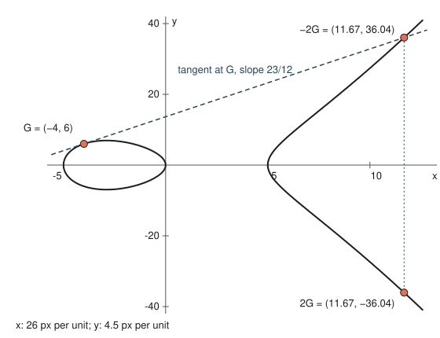
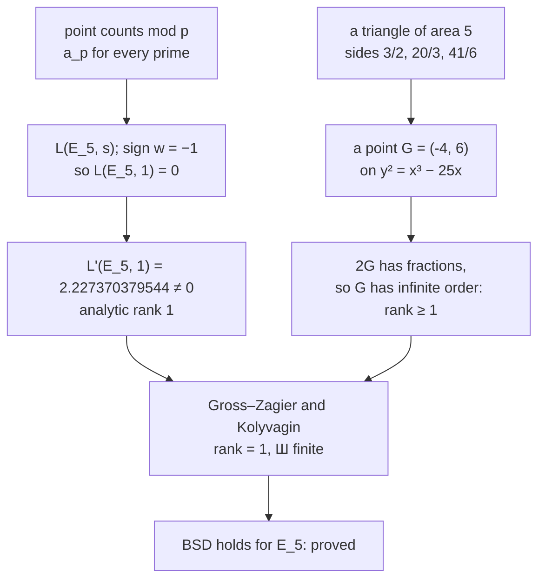

# Birch and Swinnerton-Dyer: the rank of an elliptic curve equals the order of vanishing of its L-function

[Syllabus](../../../SYLLABUS.md) → [Frontier](../README.md) → [The Millennium Problems](../README.md#s02) → Birch and Swinnerton-Dyer

---

## General Overview

On 2000-05-24, in Paris, the Clay Mathematics Institute named seven Millennium Prize Problems, with $1 million for each. One of them, the Poincaré conjecture, is solved. The Birch and Swinnerton-Dyer conjecture (BSD) is one of the six still on Clay's list.

BSD is about every elliptic curve over the rationals. One old problem it would settle is about right triangles, and Clay's official description tells the story: in the court of the emperor Frederick II, Fibonacci was challenged to find a right triangle with fraction sides and area 5. He found one. Its sides are 3/2, 20/3 and 41/6.

Check it. The two short sides squared and added give 1681/36, and the long side squared is also 1681/36. Half the product of the short sides is 5. A whole number that is the area of such a triangle is called a **congruent number**. So 5 is congruent.

The triangle hides a point on a curve. The curve $`y^2 = x^3 - 25x`$ passes through $`(-4, 6)`$, because $`6^2 = 36 = -64 + 100`$. Two lines of algebra turn that point into Fibonacci's triangle. One point gives infinitely many more, and each new point gives a new triangle of area 5.

BSD says how to tell, without searching, whether such a curve has infinitely many fraction points. Count its points modulo each prime, pack the counts into one function (its **L-function**), and look at that function at the number 1. For the area-5 curve it vanishes (equals 0) there exactly once: it crosses 0 with a non-zero slope. That case is a theorem. Where it vanishes twice or more, nobody has a proof.

<p align="center"></p>

*The curve $`y^2 = x^3 - 25x`$, drawn to the marked scales, which differ on the two axes. The tangent at $`G = (-4, 6)`$ meets the curve again at $`-2G`$; flipping it across the x-axis gives $`2G`$, a second point and a second triangle.*

**The Birch and Swinnerton-Dyer conjecture says that the number of independent rational (fraction) points on an elliptic curve equals the number of times its L-function vanishes at s = 1; for the area-5 curve both numbers are 1, and that case is proved.**

**What kind of fact this is:** kind: a conjecture. Status 2026-11-23: open; Clay lists it as unsolved. It is proved when the L-function vanishes to order 0 or 1 (Coates and Wiles 1977, Gross and Zagier 1986, Kolyvagin 1989, extended to every curve by modularity in 2001). Later results are dated in Step 6. For the area-5 curve the conjecture is therefore a theorem, and this card's code computes the facts the theorem needs.

---

## The formula

The number-theory wing's [Birch-Swinnerton-Dyer](../../21-Algebraic%20and%20analytic%20number%20theory/07-Diophantine%20and%20Modular/06-birch-swinnerton-dyer-and-the-congruent-number-problem.md) states the conjecture and its link to triangles. The algebraic-geometry wing's [Birch and Swinnerton-Dyer](../../22-Algebraic%20geometry/04-Elliptic%20Curves/08-birch-and-swinnerton-dyer-statement.md) states the weak and strong forms and names every term. This card states the version Clay set as the prize problem, and records what is proved.

**The curve.** An **elliptic curve over the rationals** is a curve $`E: y^2 = x^3 + Ax + B`$ with whole-number $`A`$ and $`B`$ and no cusp or self-crossing. Its fraction points, with one extra point $`O`$ "at infinity", form a group $`E(\mathbb{Q})`$ under the chord-and-tangent rule (the line through two points meets the curve at a third). Mordell proved in 1922 that a finite list of points generates the whole group. The **rank** $`r`$ is the smallest number of points of infinite order (points whose multiples never return to $`O`$) that, with the finitely many points of finite order, generate the group. The curve of this card is $`E_5: y^2 = x^3 - 25x`$.

**The counts.** For a prime $`p`$, let $`N_p`$ be the number of points of $`E`$ modulo $`p`$, with $`O`$ included, and put $`a_p = p + 1 - N_p`$. For $`E_5`$ at $`p = 13`$: $`N_{13} = 20`$ and $`a_{13} = -6`$. (Clay's description counts without $`O`$ and writes $`a_p = p - N_p`$, which gives the same $`a_p`$.)

**The L-function.** The counts are packed into one function of a variable $`s`$:

```math
L(E, s) = \prod_{p \nmid 2\Delta} \frac{1}{1 - a_p\, p^{-s} + p^{1 - 2s}}
```

Here $`\Delta`$ is the discriminant of the cubic, and the product runs over primes that do not divide $`2\Delta`$. The product converges only for $`s`$ above 3/2. Modularity, proved for every curve over the rationals by 2001, extends $`L(E, s)`$ to every $`s`$, including $`s = 1`$.

**The prize problem, as Clay states it:**

```math
L(E, s) = \frac{L^{(r)}(E, 1)}{r!}\, (s - 1)^{r} + \text{higher-order terms}, \qquad L^{(r)}(E, 1) \ne 0, \qquad r = \mathrm{rank}\, E(\mathbb{Q})
```

**Read it aloud:** near s = 1 the L-function behaves like a non-zero constant times (s − 1) to the power r, and r is exactly the rank of the curve.

So the conjecture says: the order of vanishing of $`L(E, s)`$ at $`s = 1`$ (its **analytic rank**) equals the rank. Clay writes the leading coefficient as $`c`$. This card writes $`L^{(r)}(E, 1)/r!`$, the $`r`$-th derivative at 1 over $`r`$ factorial, since $`c`$ is the triangle's side and Clay's $`L^{*}`$ is the completed L-series. In particular, $`L(E, 1) = 0`$ exactly when $`E(\mathbb{Q})`$ is infinite.

For $`E_5`$ the code finds

```math
L(E_5, s) = 2.227370379544\,(s - 1) + \text{higher-order terms}
```

so the analytic rank is 1, and the point $`(-4, 6)`$ shows the rank is at least 1.

| Symbol | Plain meaning | In our example | Push it up and the answer… |
| --- | --- | --- | --- |
| $`n`$ | the candidate area, a square-free whole number (no square above 1 divides it) | 5 | — |
| $`E_n`$; $`E`$, $`A`$, $`B`$; $`O`$ | the curve $`y^2 = x^3 - n^2 x`$; any elliptic curve $`y^2 = x^3 + Ax + B`$ over the rationals, and its whole-number coefficients; its point at infinity, the zero of the group | $`E_5: y^2 = x^3 - 25x`$ | — |
| $`a`$, $`b`$, $`c`$ | (in the code's output) the two short sides and the long side of the triangle | 3/2, 20/3, 41/6 | — |
| $`x`$, $`y`$; $`G`$; $`2G`$ | coordinates; the generator point; its double, by the tangent rule | $`G = (-4, 6)`$; $`2G = (1681/144, -62279/1728)`$ | each doubling roughly quadruples the digits |
| $`E(\mathbb{Q})`$; $`r`$ | the group of fraction points; its rank | contains every multiple of $`G`$ and 4 torsion points; $`r = 1`$ | each extra independent point raises the predicted order of vanishing by 1 |
| $`p`$; $`N_p`$; $`a_p`$; $`\Delta`$ | a prime; points modulo $`p`$ with $`O`$; $`p + 1 - N_p`$; the discriminant | $`N_{13} = 20`$, $`a_{13} = -6`$ | more points mod $`p`$ means smaller $`a_p`$ |
| $`s`$; $`L(E, s)`$; $`L^{(r)}(E, 1)/r!`$ | the variable; the L-function; its leading coefficient at $`s = 1`$, the $`r`$-th derivative over $`r`$ factorial | $`L'(E_5, 1)`$, since $`r = 1`$ | — |
| $`N`$; $`w`$ | the conductor, a number built from the bad primes ($`32n^2`$ for odd $`n`$, $`16n^2`$ for even $`n`$); the sign $`\pm 1`$ in the functional equation | 800; $`-1`$ | $`w = -1`$ forces $`L(E, 1) = 0`$ |
| $`L'(E, 1)`$ | the slope of $`L(E, s)`$ at $`s = 1`$ | 2.227370379544 | — |
| $`A_n`$, $`B_n`$ | Tunnell's counts of whole solutions of $`2x^2 + y^2 + 8z^2 = n`$ and of $`2x^2 + y^2 + 32z^2 = n`$, for odd $`n`$; for even $`n`$, of $`4x^2 + y^2 + 8z^2 = n/2`$ and $`4x^2 + y^2 + 32z^2 = n/2`$ | 0 and 0 | $`A_n \ne 2B_n`$ means $`L(E_n, 1) \ne 0`$ |
| $`\#\text{Ш}`$; $`\Omega_E`$, $`\mathrm{Reg}_E`$, $`c_p`$, $`\#E(\mathbb{Q})_{\mathrm{tors}}`$ | the size of the Tate–Shafarevich group: curves that pass every local test yet have no rational point; in the strong form, the real period, the regulator (built from the heights of the generators), the local correction factors at the bad primes (Tamagawa numbers) and the number of torsion points | not computed on this card, except torsion: 4 | — |
| $`a_k`$; $`f(iy)`$; $`\Gamma(0, z)`$; $`\Lambda(s)`$; $`K`$, $`D`$, $`E^D`$ | the L-function's coefficients ($`a_p`$ at primes, built from them at other $`k`$); the modular form $`\sum a_k e^{-2\pi k y}`$ on the imaginary axis; the tail integral of $`e^{-t}/t`$ from $`z`$ to infinity; $`L(E, s)`$ times its known factors; in Step 5, an imaginary quadratic field, its discriminant, and $`E`$ twisted by it | used in Steps 4 and 5 | — |

### When it holds

- **The curve is over the rationals.** Clay's prize statement is over $`\mathbb{Q}`$. Without modularity, $`L(E, s)`$ has no value at $`s = 1`$ and the statement has no meaning.
- **The order of vanishing is exact.** A computed value of 0.0000000000 is not a zero. An exact zero needs a reason: the sign $`w = -1`$, or Tunnell's counts with $`A_n = 2B_n`$.
- **The sign fixes only the parity.** $`w = -1`$ forces an odd order, $`w = +1`$ an even one. For $`n = 41`$, $`w = +1`$, yet $`L(E_{41}, 1) = 0`$ and 41 is congruent.
- **Rank counts infinite order only.** $`E_5`$ also has four torsion points: $`O`$, $`(0, 0)`$, $`(5, 0)`$ and $`(-5, 0)`$. They give no triangle and add nothing to $`r`$.

### What the problem does not ask

- **Not the strong form.** Clay's Remark 1 describes a refined version, which predicts the leading coefficient itself. In the notation of the algebraic-geometry wing's [Birch and Swinnerton-Dyer](../../22-Algebraic%20geometry/04-Elliptic%20Curves/08-birch-and-swinnerton-dyer-statement.md), which names every term:

  ```math
  \lim_{s \to 1} \frac{L(E, s)}{(s - 1)^r} = \frac{\Omega_E \cdot \mathrm{Reg}_E \cdot \prod_p c_p \cdot \#\text{Ш}(E)}{\left(\#E(\mathbb{Q})_{\mathrm{tors}}\right)^2}
  ```

  In words: period, regulator, Tamagawa numbers and the size of Ш multiplied, over the number of torsion points squared. Here $`L(E, s)`$ is Clay's completed L-series, with the Euler factors at primes dividing $`2\Delta`$ put back. The prize statement is the rank equation alone.
- **Not number fields or abelian varieties.** Clay's Remark 2 notes the conjecture can be stated there too. The prize statement is for elliptic curves over $`\mathbb{Q}`$.
- **Not an algorithm.** The problem asks for a proof of the equation. Clay's Remark 4 notes that the strong form would give an effective way to find generators, but that is a consequence, not the question.
- **A disproof counts.** Clay's rules (dated 2018-09-26) say a proposed counterexample is evaluated like a proposed solution. Any award needs publication in a refereed outlet, two years of waiting and general acceptance. See [Counterexamples](../01-How%20Research%20Works/03-how-a-counterexample-works.md) for what one failure does to a universal claim.

---

## Why it works

Nothing proves BSD in general. This section shows why the conjecture is believed, and why the rank-1 case for $`E_5`$ is a theorem. Steps 1 to 4 are proved and computed here. Step 5 outlines a research proof, with statement, key steps and source, and says so.



### Step 0: many rational points mean extra points modulo every prime

A curve with infinitely many rational points tends to have extra points modulo each prime. At $`s = 1`$ the factor for $`p`$ is $`p/N_p`$. So extra points make $`N_p`$ larger and each factor smaller, pushing the function toward 0 there. Birch and Swinnerton-Dyer saw this in computations on the EDSAC computer at Cambridge in the early 1960s, and published the conjecture in 1965.

### Step 1: a point with y ≠ 0 is a triangle

From a point $`(x, y)`$ on $`E_n`$ with $`y \ne 0`$, build three numbers:

```math
a = \frac{x^2 - n^2}{y}, \qquad b = \frac{2nx}{y}, \qquad c = \frac{x^2 + n^2}{y}
```

They form a right triangle of area $`n`$, with signs dropped. For $`G = (-4, 6)`$ and $`n = 5`$: $`a = -9/6 = -3/2`$, $`b = -40/6 = -20/3`$ and $`c = 41/6`$. That is Fibonacci's triangle. [Birch-Swinnerton-Dyer](../../21-Algebraic%20and%20analytic%20number%20theory/07-Diophantine%20and%20Modular/06-birch-swinnerton-dyer-and-the-congruent-number-problem.md) proves the map, and that it runs backwards: $`n`$ is congruent exactly when $`E_n`$ has a point with $`y \ne 0`$.

### Step 2: G has infinite order, so the rank is at least 1

The tangent at $`G`$ has slope $`(3x^2 - 25)/(2y) = 23/12`$. It meets the curve again at $`-2G`$, and flipping that gives

```math
2G = \left(\frac{1681}{144},\ -\frac{62279}{1728}\right)
```

The [Torsion points](../../22-Algebraic%20geometry/04-Elliptic%20Curves/04-torsion-and-nagell-lutz.md) card proves the Nagell–Lutz theorem: on a curve like this one, a point of finite order has whole-number coordinates. $`2G`$ has fractions, so $`2G`$ has infinite order, and so does $`G`$. The rank is at least 1. Step 1 turns $`2G`$ into a second triangle of area 5, with sides 1519/492, 4920/1519 and 3344161/747348.

### Step 3: the L-function is exactly 0 at s = 1

$`L(E_5, s)`$ obeys a mirror rule, the functional equation: it relates the value at $`s`$ to the value at $`2 - s`$, times the sign $`w`$. At $`s = 1`$ the mirror rule reads $`L(E_5, 1) = w \cdot L(E_5, 1)`$. The code finds $`w = -1`$, so $`L(E_5, 1) = -L(E_5, 1)`$, and the value is exactly 0.

A second road agrees. Tunnell proved that, for odd square-free $`n`$, $`L(E_n, 1)`$ is a known non-zero multiple of $`(A_n - 2B_n)^2`$. For $`n = 5`$, neither $`2x^2 + y^2 + 8z^2 = 5`$ nor $`2x^2 + y^2 + 32z^2 = 5`$ has a whole-number solution, so $`A_5 = B_5 = 0`$, and $`L(E_5, 1) = 0`$ exactly. For even $`n`$ the same holds with the counts for $`n/2`$ in the symbol table; the code uses both.

### Step 4: the slope is not 0, so the analytic rank is 1

The slope comes from the coefficients $`a_k`$ of the L-function, which the code builds from point counts. Two formulas give it, and they share only the coefficients:

```math
L'(E_5, 1) = 2 \sum_{k \ge 1} \frac{a_k}{k}\, \Gamma\!\left(0, \frac{2\pi k}{\sqrt{N}}\right) = 4\pi \int_{1/\sqrt{N}}^{\infty} f(iy) \log\!\left(\sqrt{N} y\right) dy
```

Both print 2.227370379544. The slope is far from 0, so $`L(E_5, s)`$ vanishes to order exactly 1.

<details>
<summary>Where the two formulas come from</summary>

The completed function $`\Lambda(s) = (\sqrt{N}/2\pi)^s\, \Gamma(s)\, L(E, s)`$ is an integral of the modular form $`f(iy) = \sum_k a_k e^{-2\pi k y}`$. Split the integral at $`y = 1/\sqrt{N}`$ and fold the lower piece onto the upper one with the mirror rule $`f(i/(Ny)) = w N y^2 f(iy)`$:

$`\displaystyle \Lambda(s) = \int_{1/\sqrt{N}}^{\infty} f(iy) \left[ (\sqrt{N} y)^{s} + w\, (\sqrt{N} y)^{2 - s} \right] \frac{dy}{y}`$

With $`w = -1`$ the bracket is 0 at $`s = 1`$. Its derivative there is $`2\sqrt{N} y \log(\sqrt{N} y)`$, which gives the integral form. Integrating each term $`e^{-2\pi k y} \log(\sqrt{N} y)`$ by parts gives $`\Gamma(0, 2\pi k / \sqrt{N}) / (2\pi k)`$, which gives the series. The code evaluates the integral by Simpson's rule after putting $`y = e^{u}/\sqrt{N}`$.

</details>

### Step 5: Gross, Zagier and Kolyvagin turn analytic rank 1 into rank 1

This step is a research proof, outlined here with its statement and key steps.

- **Statement.** For an elliptic curve over $`\mathbb{Q}`$: if $`L(E, 1) \ne 0`$, the rank is 0; if $`L(E, 1) = 0`$ and $`L'(E, 1) \ne 0`$, the rank is 1. In both cases Ш is finite.
- **Coates and Wiles (1977).** For curves with complex multiplication, a family that includes every $`E_n`$: $`L(E, 1) \ne 0`$ implies a finite $`E(\mathbb{Q})`$.
- **Gross and Zagier (1986).** A special point built from the modular curve over an imaginary quadratic field $`K`$, a **Heegner point**, has a height (a measure of the size of its coordinates) equal to a known non-zero constant times $`L'(E, 1) \cdot L(E^D, 1)`$. Here $`E^D`$ is the twist of $`E`$ by $`K`$'s discriminant $`D`$. With $`K`$ chosen so that $`L(E^D, 1) \ne 0`$, a non-zero slope gives a point of non-zero height. Such a point has infinite order, so the rank is at least 1.
- **Kolyvagin (1989).** Heegner points over a tower of larger fields bound the group of "candidate" points. When the Heegner point has infinite order, the bound gives rank exactly 1 and a finite Ш.
- **Modularity (2001).** Breuil, Conrad, Diamond and Taylor proved every elliptic curve over $`\mathbb{Q}`$ modular, so the theorem covers every such curve. The $`E_n`$ were known to be modular long before.

For $`E_5`$, Step 4 gives analytic rank 1, so the theorem gives rank 1. Step 2 agrees: $`G`$ has infinite order. **BSD holds for $`E_5`$, as a theorem.**

### Step 6: the status ledger since 2001, and what stays open

Each proved row is from a refereed paper, listed in Sources.

| Date | Result, with its conditions | Status |
| --- | --- | --- |
| 2014 | Tian: for every $`k \ge 0`$ there are infinitely many square-free congruent numbers with exactly $`k + 1`$ odd prime factors, in each of the classes 5, 6 and 7 modulo 8 | proved |
| 2015 | Bhargava and Shankar: with curves ordered by the size of their coefficients, the average rank is below 1.17; a positive proportion of curves have rank 0, and, with work of Skinner and Urban, a positive proportion have analytic rank 0 and so satisfy BSD | proved |
| 2020 | Skinner: a converse at rank 1. For a semistable curve (every bad prime of the mildest, multiplicative kind) with suitable reduction at odd primes, rank 1 and a finite Ш give analytic rank 1. | proved |
| — | the converse without conditions; analytic rank 2 or more, in general; the strong form in general | open as of 2026-11-23 |

- **Analytic rank 2 or more.** No general method produces a point from a double zero. Found points can settle one curve at a time, never the family.
- **Ш.** Clay's description says Ш "is not known in general to be finite". Kolyvagin's bound needs analytic rank 0 or 1, and Skinner's converse assumes Ш finite.
- **The strong form.** It is open in general, even at analytic rank 0 and 1.

---

## Worked numbers, by hand

Everything here is about $`n = 5`$ and the curve $`E_5: y^2 = x^3 - 25x`$.

| Step | Arithmetic | Value |
| --- | --- | --- |
| Pythagoras | $`(3/2)^2 + (20/3)^2`$ against $`(41/6)^2`$ | 1681/36 = 1681/36 |
| Area | $`\tfrac12 \cdot \tfrac32 \cdot \tfrac{20}{3}`$ | 5 |
| G on the curve | $`(-4)^3 - 25 \cdot (-4) = -64 + 100`$ | 36 = $`6^2`$ |
| Triangle from G | $`(16 - 25)/6`$, $`10 \cdot (-4)/6`$, $`(16 + 25)/6`$ | −3/2, −20/3, 41/6 |
| Tangent slope at G | $`(3 \cdot 16 - 25)/(2 \cdot 6)`$ | 23/12 |
| x of 2G | $`(23/12)^2 - 2 \cdot (-4)`$ | 1681/144, not whole: rank ≥ 1 |
| Points mod 13 | count, then $`13 + 1 - 20`$ | $`N_{13} = 20`$, $`a_{13} = -6`$ |
| Sign and counts | functional equation; Tunnell for 5 | $`w = -1`$; $`A_5 = B_5 = 0`$ |
| Slope at 1 | series, and the integral | 2.227370379544 both ways |
| Theorem | analytic rank 1 ⇒ rank 1 | **rank 1 = analytic rank 1** |

The answer means that BSD is true for this one curve, and so 5 is congruent for two independent reasons: Fibonacci's triangle, and the theorem.

### Every square-free n up to 100

The same machinery sorts every square-free $`n`$ from 1 to 100, 61 numbers in all. Tunnell's counts decide $`L(E_n, 1) \ne 0`$ exactly. For the rest, the code computes $`w`$ and, when $`w = -1`$, the slope. A triangle search over Pythagorean seeds up to 400 runs beside it.

```
rank 0, proved (L(E_n, 1) ≠ 0)          █████████████████████████  25
rank 1, proved (w = −1, L′(E_n, 1) ≠ 0)  █████████████████████████████████  33
order 2 or more, no general theorem      ███  3   (34, 41, 65)
rank 1 proved, no triangle from seeds    ████████████████  16
```

- **Rank 0.** By Coates and Wiles, these 25 numbers are not congruent. The search finds no triangle for any of them, as it must.
- **Rank 1.** By Gross, Zagier and Kolyvagin, these 33 numbers are congruent. For 16 of them, starting with 23, 29 and 31, the search finds no triangle: the theorem proves that a triangle exists before anyone writes it down.
- **Order 2 or more.** For 34, 41 and 65, the sign is $`+1`$ and the counts balance, so $`L(E_n, 1) = 0`$ and the order is even, at least 2. The seeds find triangles for all three. No general theorem says their rank equals their analytic rank.

### What breaks if you drop a piece

| Mistake | Comes out at | What went wrong |
| --- | --- | --- |
| Call 157 not congruent because a search fails | no triangle from seeds up to 400, yet $`w = -1`$ and $`L'(E_{157}, 1) = 11.4259445007`$ | a failed search proves nothing; analytic rank 1 proves rank 1, so 157 is congruent |
| Forget the sign for $`n = 5`$ | the $`w = +1`$ formula gives 1.4534882189, not 0 | that formula is valid only when $`w = +1`$; with $`w = -1`$ the value is exactly 0 |
| Read $`w = +1`$ as rank 0 for $`n = 41`$ | counts (32, 16), so $`L(E_{41}, 1) = 0`$; seeds (25, 16) give a triangle | the sign fixes only the parity of the order; 41 has an even order of at least 2 |

---

## Code, from first principles, and it actually runs

The code computes every number on this card with exact fractions and plain sums, by **four independent roads**. Road 1 checks the triangle, the point $`G`$, the map between them and the fractions of $`2G`$. Road 2 counts points modulo each prime by brute force, against the twist rule $`a_p(E_n) = (n/p)\, a_p(E_1)`$; here $`(n/p)`$ is $`+1`$ or $`-1`$ as $`n`$ is or is not a square modulo $`p`$. Road 3 finds the sign, the slope by a series and by an integral, and the exact zero by Tunnell's counts. Road 4 sorts every square-free $`n`$ up to 100, checks the sign against the rule "$`w = -1`$ exactly when $`n`$ is 5, 6 or 7 modulo 8", and runs the seed search. The `figure,` line prints the figure's points.

### Python

```python
# Birch and Swinnerton-Dyer, the Millennium problem -- the check behind the card.  Standard library only.
# E_n is the curve y^2 = x^3 - n^2 x; n is congruent (a rational right triangle has area n) exactly when
# E_n has rank at least 1.  The card's curve is E_5.  Fractions are exact; L-values are summed here.
from fractions import Fraction as F
from math import gcd, isqrt, sqrt, exp, log, pi

def on(n, x, y): return y * y == x ** 3 - n * n * x
def tri(n, x, y): return ((x * x - n * n) / y, 2 * n * x / y, (x * x + n * n) / y)   # point -> triangle
def dbl(n, x, y):                                                       # tangent rule: 2(x, y)
    m = (3 * x * x - n * n) / (2 * y); x2 = m * m - 2 * x
    return m, x2, m * (x - x2) - y

# Road 1: Fibonacci's number 5, a point, a triangle, and a second point that proves infinite order
a, b, c = F(3, 2), F(20, 3), F(41, 6)
print(f"triangle {a}, {b}, {c}: a^2 + b^2 = {a * a + b * b}, c^2 = {c * c}, area {a * b / 2}")
G = (F(-4), F(6))
print(f"G = (-4, 6) on y^2 = x^3 - 25x: {'yes' if on(5, *G) else 'no'} (36 = -64 + 100)")
t = tri(5, *G)
print(f"triangle from G: {t[0]}, {t[1]}, {t[2]}")
assert a * a + b * b == c * c and a * b / 2 == 5 and on(5, *G) and tuple(abs(v) for v in t) == (a, b, c)
tor = [(F(0), F(0)), (F(5), F(0)), (F(-5), F(0))]
print(f"torsion points O, (0, 0), (5, 0), (-5, 0) on the curve: {'yes' if all(on(5, *T) for T in tor) else 'no'}; 4 in all, no triangle (y = 0)")
assert all(on(5, *T) for T in tor) and not on(5, F(4), F(0))
m, x2, y2 = dbl(5, *G)
t2 = tri(5, x2, y2)
print(f"tangent slope at G {m}; 2G = ({x2}, {y2}); whole numbers: {'yes' if x2.denominator == 1 else 'no'}")
print(f"triangle from 2G: {abs(t2[0])}, {abs(t2[1])}, {abs(t2[2])}; area {abs(t2[0] * t2[1]) / 2}")
assert on(5, x2, y2) and x2.denominator > 1 and t2[0] ** 2 + t2[1] ** 2 == t2[2] ** 2 and abs(t2[0] * t2[1]) / 2 == 5
print("figure,G,-4,6,2G,%.4f,%.4f,-2G,%.4f,%.4f,slope,%.4f" % (x2, y2, x2, -y2, m))

# Road 2: count E_5 mod p by brute force, and by the twist rule a_p(E_n) = (n/p) a_p(E_1)
def leg(v, p):
    v %= p
    return 0 if v == 0 else (1 if pow(v, (p - 1) // 2, p) == 1 else -1)
X = 6000
sv = bytearray([1]) * (X + 1)
for i in range(2, 80):
    if sv[i]: sv[i * i::i] = bytearray(len(sv[i * i::i]))
P = [p for p in range(3, X + 1) if sv[p]]
a1 = {p: -sum(leg(u * u * u - u, p) for u in range(p)) for p in P}
def ap(n, p): return 0 if n % p == 0 else leg(n, p) * a1[p]
rows = []
for p in (3, 7, 11, 13, 17, 19, 23, 29):
    Np = 1 + sum((v * v - u ** 3 + 25 * u) % p == 0 for u in range(p) for v in range(p))
    rows.append(f"{p}:{Np}/{p + 1 - Np}")
    assert p + 1 - Np == ap(5, p) and (p + 1 - Np) ** 2 <= 4 * p
print("E_5 mod p, p:N_p/a_p (brute force = twist rule, Hasse holds):", ", ".join(rows))

# Road 3: the L-function at s = 1 from the a_k: its sign, its value, its slope (two ways)
def coeffs(n, M):
    am = [0, 1] + [0] * (M - 1)
    for k in range(2, M + 1):
        p = next(q for q in [2] + P if k % q == 0)
        e, r = 0, k
        while r % p == 0: r //= p; e += 1
        bad = (2 * n) % p == 0
        pk = [1, 0 if bad else ap(n, p)]
        for _ in range(e - 1): pk.append(pk[-1] * pk[1] - (0 if bad else p) * pk[-2])
        am[k] = pk[e] * am[r]
    return am
def E1(z):                                     # exponential integral: series below 1, continued fraction above
    if z < 1: return -0.5772156649015329 - log(z) - sum((-z) ** k / (k * fac[k]) for k in range(1, 40))
    bb, cc, dd = z + 1, 1e300, 1 / (z + 1); hh = dd
    for i in range(1, 200):
        an = -i * i; bb += 2; dd = 1 / (an * dd + bb); cc = bb + an / cc; hh *= cc * dd
    return hh * exp(-z)
fac = [1]
for k in range(1, 41): fac.append(fac[-1] * k)
def lfun(n):
    N = 32 * n * n if n % 2 else 16 * n * n
    sN = sqrt(N); M = int(6 * sN) + 20; am = coeffs(n, M)
    f = lambda y: sum(am[k] * exp(-2 * pi * k * y) for k in range(1, M + 1))
    t = 1.1 / sN; w = f(1 / (N * t)) / (N * t * t * f(t))           # functional equation gives the sign
    Lp = 2 * sum(am[k] / k * exp(-2 * pi * k / sN) for k in range(1, M + 1))   # the value if w = +1
    dL = 2 * sum(am[k] / k * E1(2 * pi * k / sN) for k in range(1, M + 1))    # the slope if w = -1
    return N, w, Lp, dL, f
def tunnell(n):
    k, q = (n, 2) if n % 2 else (n // 2, 4)
    r = isqrt(k) + 1
    cnt = lambda c: sum(q * u * u + v * v + c * z * z == k for u in range(-r, r + 1) for v in range(-r, r + 1) for z in range(-r, r + 1))
    return cnt(8), cnt(32)
N, w, Lp, dL, f = lfun(5)
A, B = tunnell(5)
print(f"E_5: conductor {N}, sign w = {w:+.9f}; Tunnell counts {A}, {B}, so L(E_5, 1) = 0 exactly")
K, y0 = 3000, 1 / sqrt(N); U = log(8 / y0); h = U / K               # slope again, as an integral, Simpson
quad = 4 * pi * (h / 3) * sum((1 if j in (0, K) else 4 if j % 2 else 2) * f(y0 * exp(j * h)) * j * h * y0 * exp(j * h) for j in range(K + 1))
print(f"L'(E_5, 1) by the E1 series {dL:.12f}, by the integral {quad:.12f}: not 0, analytic rank 1")
assert abs(abs(w) - 1) < 1e-9 and w < 0 and A == 2 * B and abs(dL - quad) < 1e-10 and dL > 0.5

# Road 4: the status of every square-free n up to 100, by the proved theorems; triangles from seeds up to 400
def sfree(k):
    s, d = 1, 2
    while d * d <= k:
        while k % (d * d) == 0: k //= d * d
        if k % d == 0: s *= d; k //= d
        d += 1
    return s * k
sf = [0] + [sfree(k) for k in range(1, 801)]
seeds = {}
for mm in range(2, 401):
    for kk in range(1, mm):
        if (mm - kk) % 2 and gcd(mm, kk) == 1:
            s = 1
            for v in (mm, kk, mm - kk, mm + kk): g = gcd(s, sf[v]); s = s * sf[v] // (g * g)
            seeds.setdefault(s, (mm, kk))
cls = {"rank 0, proved": [], "rank 1, proved": [], "order 2 or more, no general theorem": []}
for n in [k for k in range(1, 101) if sf[k] == k]:
    A, B = tunnell(n)
    if A != 2 * B: cls["rank 0, proved"].append(n); continue
    N, w, Lp, dL, f = lfun(n)
    assert abs(abs(w) - 1) < 1e-9 and ((w < 0) == (n % 8 in (5, 6, 7)))      # sign, two ways
    if w < 0 and abs(dL) > 0.01: cls["rank 1, proved"].append(n)
    else: cls["order 2 or more, no general theorem"].append(n)
count = sum(all(k % (d * d) for d in range(2, 11)) for k in range(1, 101))         # square-free, recounted
print(f"square-free n from 1 to 100: {count}")
for k, v in cls.items(): print(f"{k}: {len(v)} numbers: " + " ".join(map(str, v)))
miss = [n for n in cls["rank 1, proved"] + cls["order 2 or more, no general theorem"] if n not in seeds]
print(f"L(E_n, 1) = 0 but no triangle from seeds up to 400: {len(miss)} numbers: " + " ".join(map(str, miss)))
assert all(n not in seeds for n in cls["rank 0, proved"])                   # no triangle where L(E_n, 1) != 0
assert set(miss) <= set(cls["rank 1, proved"]) and sum(map(len, cls.values())) == count == 61
print(f"seeds for 5: {seeds[5]}, for 41: {seeds[41]}, for 65: {seeds[65]}")

# What breaks
N, w, Lp, dL, f = lfun(157)
print(f"157: seeds up to 400 give a triangle: {'yes' if 157 in seeds else 'no'}; sign {w:+.0f}, L'(E_157, 1) = {dL:.10f}")
assert 157 not in seeds and w < 0 and dL > 0.5
print(f"sign forgotten for n = 5: the w = +1 formula gives {lfun(5)[2]:.10f}, not 0")
print(f"41 = 1 mod 8, sign +1, counts {tunnell(41)}: L(E_41, 1) = 0, yet seeds {seeds[41]} give a triangle")
assert tunnell(41)[0] == 2 * tunnell(41)[1] and lfun(41)[1] > 0
print("ALL CHECKS PASS")
```

**Ran 2026-11-23 on macOS, Python 3.14.10, standard library only. All checks passed. Output, pasted from the run:**

```
triangle 3/2, 20/3, 41/6: a^2 + b^2 = 1681/36, c^2 = 1681/36, area 5
G = (-4, 6) on y^2 = x^3 - 25x: yes (36 = -64 + 100)
triangle from G: -3/2, -20/3, 41/6
torsion points O, (0, 0), (5, 0), (-5, 0) on the curve: yes; 4 in all, no triangle (y = 0)
tangent slope at G 23/12; 2G = (1681/144, -62279/1728); whole numbers: no
triangle from 2G: 1519/492, 4920/1519, 3344161/747348; area 5
figure,G,-4,6,2G,11.6736,-36.0411,-2G,11.6736,36.0411,slope,1.9167
E_5 mod p, p:N_p/a_p (brute force = twist rule, Hasse holds): 3:4/0, 7:8/0, 11:12/0, 13:20/-6, 17:20/-2, 19:20/0, 23:24/0, 29:40/-10
E_5: conductor 800, sign w = -1.000000000; Tunnell counts 0, 0, so L(E_5, 1) = 0 exactly
L'(E_5, 1) by the E1 series 2.227370379544, by the integral 2.227370379544: not 0, analytic rank 1
square-free n from 1 to 100: 61
rank 0, proved: 25 numbers: 1 2 3 10 11 17 19 26 33 35 42 43 51 57 58 59 66 67 73 74 82 83 89 91 97
rank 1, proved: 33 numbers: 5 6 7 13 14 15 21 22 23 29 30 31 37 38 39 46 47 53 55 61 62 69 70 71 77 78 79 85 86 87 93 94 95
order 2 or more, no general theorem: 3 numbers: 34 41 65
L(E_n, 1) = 0 but no triangle from seeds up to 400: 16 numbers: 23 29 31 37 38 47 53 61 62 71 77 79 87 93 94 95
seeds for 5: (5, 4), for 41: (25, 16), for 65: (9, 4)
157: seeds up to 400 give a triangle: no; sign -1, L'(E_157, 1) = 11.4259445007
sign forgotten for n = 5: the w = +1 formula gives 1.4534882189, not 0
41 = 1 mod 8, sign +1, counts (32, 16): L(E_41, 1) = 0, yet seeds (25, 16) give a triangle
ALL CHECKS PASS
```

### Rust

Same numbers, same labels, built with `rustc --edition 2021 -O`.

```rust
// Birch and Swinnerton-Dyer, the Millennium problem -- the same check as the Python, in Rust.  No crates.
// E_n is the curve y^2 = x^3 - n^2 x; n is congruent exactly when E_n has rank at least 1.  The card's
// curve is E_5.  A small exact-fraction struct stands in for Fraction; L-values are summed here.
use std::collections::HashMap;
use std::f64::consts::PI;
#[derive(Clone, Copy, PartialEq)]
struct Q { n: i128, d: i128 }
fn g(a: i128, b: i128) -> i128 { if b == 0 { a.abs() } else { g(b, a % b) } }
fn q(n: i128, d: i128) -> Q { let k = g(n, d) * d.signum(); Q { n: n / k, d: d / k } }
fn add(a: Q, b: Q) -> Q { q(a.n.checked_mul(b.d).unwrap() + b.n.checked_mul(a.d).unwrap(), a.d.checked_mul(b.d).unwrap()) }
fn sub(a: Q, b: Q) -> Q { add(a, Q { n: -b.n, d: b.d }) }
fn mul(a: Q, b: Q) -> Q { q(a.n.checked_mul(b.n).unwrap(), a.d.checked_mul(b.d).unwrap()) }
fn div(a: Q, b: Q) -> Q { q(a.n.checked_mul(b.d).unwrap(), a.d.checked_mul(b.n).unwrap()) }
fn w(k: i128) -> Q { Q { n: k, d: 1 } }
fn ab(a: Q) -> Q { Q { n: a.n.abs(), d: a.d } }
fn fl(a: Q) -> f64 { a.n as f64 / a.d as f64 }
fn sh(r: Q) -> String { if r.d == 1 { format!("{}", r.n) } else { format!("{}/{}", r.n, r.d) } }
fn on(n: i128, x: Q, y: Q) -> bool { mul(y, y) == sub(mul(mul(x, x), x), mul(w(n * n), x)) }
fn tri(n: i128, x: Q, y: Q) -> (Q, Q, Q) {
    (div(sub(mul(x, x), w(n * n)), y), div(mul(w(2 * n), x), y), div(add(mul(x, x), w(n * n)), y))
}
fn dbl(n: i128, x: Q, y: Q) -> (Q, Q, Q) {
    let m = div(sub(mul(w(3), mul(x, x)), w(n * n)), mul(w(2), y)); let x2 = sub(mul(m, m), mul(w(2), x));
    (m, x2, sub(mul(m, sub(x, x2)), y))
}
fn mpow(mut b: u64, mut e: u64, m: u64) -> u64 { let mut r = 1; b %= m; while e > 0 { if e & 1 == 1 { r = r * b % m } b = b * b % m; e >>= 1 } r }
fn leg(v: i64, p: i64) -> i64 { let v = v.rem_euclid(p); if v == 0 { 0 } else if mpow(v as u64, (p as u64 - 1) / 2, p as u64) == 1 { 1 } else { -1 } }
fn e1(z: f64, fac: &[f64]) -> f64 {
    if z < 1.0 { return -0.5772156649015329 - z.ln() - (1..40).map(|k| (-z).powi(k as i32) / (k as f64 * fac[k])).sum::<f64>() }
    let (mut bb, mut cc, mut dd) = (z + 1.0, 1e300, 1.0 / (z + 1.0)); let mut hh = dd;
    for i in 1..200 { let an = -((i * i) as f64); bb += 2.0; dd = 1.0 / (an * dd + bb); cc = bb + an / cc; hh *= cc * dd }
    hh * (-z).exp()
}
struct Ctx { p: Vec<i64>, a1: HashMap<i64, i64>, fac: Vec<f64> }
struct Lf { nn: i64, w: f64, lp: f64, dl: f64, am: Vec<i64> }
fn fsum(am: &[i64], y: f64) -> f64 { (1..am.len()).map(|k| am[k] as f64 * (-2.0 * PI * k as f64 * y).exp()).sum() }
impl Ctx {
    fn ap(&self, n: i64, p: i64) -> i64 { if n % p == 0 { 0 } else { leg(n, p) * self.a1[&p] } }
    fn coeffs(&self, n: i64, m: usize) -> Vec<i64> {
        let mut am = vec![0i64; m + 1]; am[1] = 1;
        for k in 2..=m as i64 {
            let p = *std::iter::once(&2).chain(self.p.iter()).find(|&&q| k % q == 0).unwrap();
            let (mut e, mut r) = (0, k); while r % p == 0 { r /= p; e += 1 }
            let bad = (2 * n) % p == 0;
            let mut pk = vec![1, if bad { 0 } else { self.ap(n, p) }];
            for _ in 0..e - 1 { let l = pk.len(); pk.push(pk[l - 1] * pk[1] - (if bad { 0 } else { p }) * pk[l - 2]) }
            am[k as usize] = pk[e] * am[r as usize];
        }
        am
    }
    fn lfun(&self, n: i64) -> Lf {
        let nn = if n % 2 == 1 { 32 * n * n } else { 16 * n * n }; let nf = nn as f64; let sn = nf.sqrt();
        let m = (6.0 * sn) as usize + 20; let am = self.coeffs(n, m);
        let t = 1.1 / sn; let wv = fsum(&am, 1.0 / (nf * t)) / (nf * t * t * fsum(&am, t));
        let lp = 2.0 * (1..=m).map(|k| am[k] as f64 / k as f64 * (-2.0 * PI * k as f64 / sn).exp()).sum::<f64>();
        let dl = 2.0 * (1..=m).map(|k| am[k] as f64 / k as f64 * e1(2.0 * PI * k as f64 / sn, &self.fac)).sum::<f64>();
        Lf { nn, w: wv, lp, dl, am }
    }
}
fn tunnell(n: i64) -> (i64, i64) {
    let (k, qq) = if n % 2 == 1 { (n, 2) } else { (n / 2, 4) };
    let r = (k as f64).sqrt() as i64 + 1;
    let cnt = |c: i64| { let mut s = 0; for u in -r..=r { for v in -r..=r { for z in -r..=r { if qq * u * u + v * v + c * z * z == k { s += 1 } } } } s };
    (cnt(8), cnt(32))
}
fn gi(a: i64, b: i64) -> i64 { if b == 0 { a } else { gi(b, a % b) } }
fn sfree(mut k: i64) -> i64 {
    let (mut s, mut d) = (1, 2);
    while d * d <= k { while k % (d * d) == 0 { k /= d * d } if k % d == 0 { s *= d; k /= d } d += 1 }
    s * k
}
fn join(v: &[i64]) -> String { v.iter().map(|x| x.to_string()).collect::<Vec<_>>().join(" ") }
fn main() {
    // Road 1: Fibonacci's number 5, a point, a triangle, and a second point that proves infinite order
    let (a, b, c) = (q(3, 2), q(20, 3), q(41, 6));
    println!("triangle {}, {}, {}: a^2 + b^2 = {}, c^2 = {}, area {}", sh(a), sh(b), sh(c), sh(add(mul(a, a), mul(b, b))), sh(mul(c, c)), sh(div(mul(a, b), w(2))));
    let (gx, gy) = (w(-4), w(6));
    println!("G = (-4, 6) on y^2 = x^3 - 25x: {} (36 = -64 + 100)", if on(5, gx, gy) { "yes" } else { "no" });
    let t = tri(5, gx, gy);
    println!("triangle from G: {}, {}, {}", sh(t.0), sh(t.1), sh(t.2));
    assert!(add(mul(a, a), mul(b, b)) == mul(c, c) && div(mul(a, b), w(2)) == w(5) && on(5, gx, gy) && (ab(t.0), ab(t.1), ab(t.2)) == (a, b, c));
    let tor = [(w(0), w(0)), (w(5), w(0)), (w(-5), w(0))]; let tok = tor.iter().all(|&(x, y)| on(5, x, y));
    println!("torsion points O, (0, 0), (5, 0), (-5, 0) on the curve: {}; 4 in all, no triangle (y = 0)", if tok { "yes" } else { "no" });
    assert!(tok && !on(5, w(4), w(0)));
    let (m, x2, y2) = dbl(5, gx, gy);
    let t2 = tri(5, x2, y2);
    println!("tangent slope at G {}; 2G = ({}, {}); whole numbers: {}", sh(m), sh(x2), sh(y2), if x2.d == 1 { "yes" } else { "no" });
    let ar2 = div(ab(mul(t2.0, t2.1)), w(2));
    println!("triangle from 2G: {}, {}, {}; area {}", sh(ab(t2.0)), sh(ab(t2.1)), sh(ab(t2.2)), sh(ar2));
    assert!(on(5, x2, y2) && x2.d > 1 && add(mul(t2.0, t2.0), mul(t2.1, t2.1)) == mul(t2.2, t2.2) && ar2 == w(5));
    println!("figure,G,-4,6,2G,{:.4},{:.4},-2G,{:.4},{:.4},slope,{:.4}", fl(x2), fl(y2), fl(x2), -fl(y2), fl(m));

    // Road 2: count E_5 mod p by brute force, and by the twist rule a_p(E_n) = (n/p) a_p(E_1)
    let x = 6000usize; let mut sv = vec![true; x + 1];
    for i in 2..80 { if sv[i] { let mut j = i * i; while j <= x { sv[j] = false; j += i } } }
    let p: Vec<i64> = (3..=x).filter(|&k| sv[k]).map(|k| k as i64).collect();
    let mut a1 = HashMap::new();
    for &pp in &p { a1.insert(pp, -(0..pp).map(|u| leg(u * u * u - u, pp)).sum::<i64>()); }
    let mut fac = vec![1.0f64]; for k in 1..41 { let l = fac[k - 1]; fac.push(l * k as f64) }
    let cx = Ctx { p, a1, fac };
    let mut rows = vec![];
    for &pp in &[3i64, 7, 11, 13, 17, 19, 23, 29] {
        let mut np = 1; for u in 0..pp { for v in 0..pp { if (v * v - u * u * u + 25 * u).rem_euclid(pp) == 0 { np += 1 } } }
        rows.push(format!("{}:{}/{}", pp, np, pp + 1 - np));
        assert!(pp + 1 - np == cx.ap(5, pp) && (pp + 1 - np) * (pp + 1 - np) <= 4 * pp);
    }
    println!("E_5 mod p, p:N_p/a_p (brute force = twist rule, Hasse holds): {}", rows.join(", "));

    // Road 3: the L-function at s = 1 from the a_k: its sign, its value, its slope (two ways)
    let l5 = cx.lfun(5); let (aa, bb) = tunnell(5);
    println!("E_5: conductor {}, sign w = {:+.9}; Tunnell counts {}, {}, so L(E_5, 1) = 0 exactly", l5.nn, l5.w, aa, bb);
    let (kk, y0) = (3000usize, 1.0 / (l5.nn as f64).sqrt()); let u = (8.0 / y0).ln(); let h = u / kk as f64;
    let quad = 4.0 * PI * (h / 3.0) * (0..=kk).map(|j| {
        let wt = if j == 0 || j == kk { 1.0 } else if j % 2 == 1 { 4.0 } else { 2.0 };
        let jf = j as f64; wt * fsum(&l5.am, y0 * (jf * h).exp()) * jf * h * y0 * (jf * h).exp()
    }).sum::<f64>();
    println!("L'(E_5, 1) by the E1 series {:.12}, by the integral {:.12}: not 0, analytic rank 1", l5.dl, quad);
    assert!(((l5.w).abs() - 1.0).abs() < 1e-9 && l5.w < 0.0 && aa == 2 * bb && (l5.dl - quad).abs() < 1e-10 && l5.dl > 0.5);

    // Road 4: the status of every square-free n up to 100, by the proved theorems; triangles from seeds up to 400
    let sf: Vec<i64> = (0..=800).map(|k| if k == 0 { 0 } else { sfree(k) }).collect();
    let mut seeds: HashMap<i64, (i64, i64)> = HashMap::new();
    for mm in 2..401i64 { for kq in 1..mm {
        if (mm - kq) % 2 == 1 && gi(mm, kq) == 1 {
            let mut s = 1; for v in [mm, kq, mm - kq, mm + kq] { let gg = gi(s, sf[v as usize]); s = s * sf[v as usize] / (gg * gg) }
            seeds.entry(s).or_insert((mm, kq));
        }
    } }
    let names = ["rank 0, proved", "rank 1, proved", "order 2 or more, no general theorem"];
    let mut cls: Vec<Vec<i64>> = vec![vec![], vec![], vec![]];
    for n in (1..101i64).filter(|&k| sf[k as usize] == k) {
        let (a, b) = tunnell(n);
        if a != 2 * b { cls[0].push(n); continue }
        let l = cx.lfun(n);
        assert!((l.w.abs() - 1.0).abs() < 1e-9 && ((l.w < 0.0) == [5, 6, 7].contains(&(n % 8))));
        if l.w < 0.0 && l.dl.abs() > 0.01 { cls[1].push(n) } else { cls[2].push(n) }
    }
    let count = (1..101i64).filter(|k| (2..11).all(|d| k % (d * d) != 0)).count();
    println!("square-free n from 1 to 100: {}", count);
    for i in 0..3 { println!("{}: {} numbers: {}", names[i], cls[i].len(), join(&cls[i])) }
    let miss: Vec<i64> = cls[1].iter().chain(cls[2].iter()).cloned().filter(|n| !seeds.contains_key(n)).collect();
    println!("L(E_n, 1) = 0 but no triangle from seeds up to 400: {} numbers: {}", miss.len(), join(&miss));
    assert!(cls[0].iter().all(|n| !seeds.contains_key(n)));
    assert!(miss.iter().all(|n| cls[1].contains(n)) && cls.iter().map(|v| v.len()).sum::<usize>() == count && count == 61);
    println!("seeds for 5: {:?}, for 41: {:?}, for 65: {:?}", seeds[&5], seeds[&41], seeds[&65]);

    // What breaks
    let l = cx.lfun(157);
    println!("157: seeds up to 400 give a triangle: {}; sign {:+.0}, L'(E_157, 1) = {:.10}", if seeds.contains_key(&157) { "yes" } else { "no" }, l.w, l.dl);
    assert!(!seeds.contains_key(&157) && l.w < 0.0 && l.dl > 0.5);
    println!("sign forgotten for n = 5: the w = +1 formula gives {:.10}, not 0", l5.lp);
    let t41 = tunnell(41);
    println!("41 = 1 mod 8, sign +1, counts {:?}: L(E_41, 1) = 0, yet seeds {:?} give a triangle", t41, seeds[&41]);
    assert!(t41.0 == 2 * t41.1 && cx.lfun(41).w > 0.0);
    println!("ALL CHECKS PASS");
}
```

**Ran 2026-11-23 on macOS, rustc 1.98.1, no crates. All checks passed. Output, pasted from the run:**

```
triangle 3/2, 20/3, 41/6: a^2 + b^2 = 1681/36, c^2 = 1681/36, area 5
G = (-4, 6) on y^2 = x^3 - 25x: yes (36 = -64 + 100)
triangle from G: -3/2, -20/3, 41/6
torsion points O, (0, 0), (5, 0), (-5, 0) on the curve: yes; 4 in all, no triangle (y = 0)
tangent slope at G 23/12; 2G = (1681/144, -62279/1728); whole numbers: no
triangle from 2G: 1519/492, 4920/1519, 3344161/747348; area 5
figure,G,-4,6,2G,11.6736,-36.0411,-2G,11.6736,36.0411,slope,1.9167
E_5 mod p, p:N_p/a_p (brute force = twist rule, Hasse holds): 3:4/0, 7:8/0, 11:12/0, 13:20/-6, 17:20/-2, 19:20/0, 23:24/0, 29:40/-10
E_5: conductor 800, sign w = -1.000000000; Tunnell counts 0, 0, so L(E_5, 1) = 0 exactly
L'(E_5, 1) by the E1 series 2.227370379544, by the integral 2.227370379544: not 0, analytic rank 1
square-free n from 1 to 100: 61
rank 0, proved: 25 numbers: 1 2 3 10 11 17 19 26 33 35 42 43 51 57 58 59 66 67 73 74 82 83 89 91 97
rank 1, proved: 33 numbers: 5 6 7 13 14 15 21 22 23 29 30 31 37 38 39 46 47 53 55 61 62 69 70 71 77 78 79 85 86 87 93 94 95
order 2 or more, no general theorem: 3 numbers: 34 41 65
L(E_n, 1) = 0 but no triangle from seeds up to 400: 16 numbers: 23 29 31 37 38 47 53 61 62 71 77 79 87 93 94 95
seeds for 5: (5, 4), for 41: (25, 16), for 65: (9, 4)
157: seeds up to 400 give a triangle: no; sign -1, L'(E_157, 1) = 11.4259445007
sign forgotten for n = 5: the w = +1 formula gives 1.4534882189, not 0
41 = 1 mod 8, sign +1, counts (32, 16): L(E_41, 1) = 0, yet seeds (25, 16) give a triangle
ALL CHECKS PASS
```

### Lean

Lean proves the sign's parity rule for any function with a mirror rule, Step 1 for every $`E_n`$, and Step 2 on $`E_5`$.

- Take any function $`L(s)`$ that, near $`s = 1`$, has the shape of Clay's formula and obeys the mirror rule with sign $`w`$. Then its order of vanishing at $`s = 1`$ is odd when $`w = -1`$, and even when $`w = +1`$.
- Take a fraction point $`(x, y)`$ on $`E_n`$ with $`y \ne 0`$. Then the $`a`$, $`b`$, $`c`$ of Step 1 satisfy $`a^2 + b^2 = c^2`$ and $`ab/2 = n`$.
- Take $`G = (-4, 6)`$ on $`E_5`$, with the chord-and-tangent rule. Then $`G + G = 2G = (1681/144, -62279/1728)`$.
- Take $`T`$ to be $`(0, 0)`$, $`(5, 0)`$ or $`(-5, 0)`$ on $`E_5`$. Then $`T + T = O`$, so each is a torsion point.
- It checks Fibonacci's triangle, and the second triangle of area 5 that Step 1 builds from $`2G`$.
- It counts $`N_p`$ for $`E_5`$ at the code's eight primes, and checks Tunnell's counts for 5 and 41.
- It counts the 61 square-free numbers from 1 to 100.

The slope of $`L(E_5, s)`$, the sign $`w`$, and the sorting of the 61 numbers are left to the Python and Rust checks.

```lean
-- Birch and Swinnerton-Dyer: the sign of the functional equation fixes the parity of the order of vanishing at s = 1, a point with y ≠ 0 on y^2 = x^3 - n^2 x gives a right triangle of area n, and on the area-5 curve G = (-4, 6) doubles to (1681/144, -62279/1728) while the three points with y = 0 have order 2.
import Mathlib.AlgebraicGeometry.EllipticCurve.Affine.Point
import Mathlib.Analysis.Analytic.Order
import Mathlib.Analysis.SpecialFunctions.Gamma.Basic
import Mathlib.Analysis.SpecialFunctions.Gamma.Deriv
import Mathlib.Analysis.SpecialFunctions.Pow.Complex
import Mathlib.Data.Nat.Squarefree
import Mathlib.Data.ZMod.Basic
import Mathlib.Data.Int.Interval
import Mathlib.Tactic

namespace BirchSwinnertonDyerMillennium

open Finset WeierstrassCurve

/-- The curve `E_n : y^2 = x^3 - n^2 x` as a Mathlib Weierstrass curve over a commutative ring `R`
(`a₄ = -n^2`, every other coefficient `0`). The card's curve is `E_5 : y^2 = x^3 - 25x`. -/
def E (R : Type*) [CommRing R] (n : ℤ) : WeierstrassCurve R :=
  ⟨0, 0, 0, -((n : R) ^ 2), 0⟩

/-- `N_p` for `E_n`: the pairs `(x, y)` modulo `p` with `y^2 = x^3 - n^2 x`, plus 1 for the
point `O` at infinity. Then `a_p = p + 1 - N_p`. -/
def Np (p : ℕ) [NeZero p] (n : ℤ) : ℕ :=
  #(univ.filter (fun q : ZMod p × ZMod p => q.2 ^ 2 = q.1 ^ 3 - (n : ZMod p) ^ 2 * q.1)) + 1

/-- The whole numbers `x` with `|x| ≤ m` and `a x^2 ≤ m`: the only values a coordinate with
coefficient `a ≥ 1` can take in a solution of `a x^2 + b y^2 + c z^2 = m`. -/
def coordRange (a m : ℕ) : Finset ℤ :=
  (Icc (-(m : ℤ)) m).filter (fun x => (a : ℤ) * x ^ 2 ≤ m)

/-- The number of whole solutions `(x, y, z)` of `a x^2 + b y^2 + c z^2 = m`, for `a, b, c ≥ 1`. -/
def formCount (a b c m : ℕ) : ℕ :=
  #((coordRange a m ×ˢ coordRange b m ×ˢ coordRange c m).filter
    (fun t : ℤ × ℤ × ℤ => (a : ℤ) * t.1 ^ 2 + b * t.2.1 ^ 2 + c * t.2.2 ^ 2 = m))

/-- Tunnell's count `A_n`: solutions of `2x^2 + y^2 + 8z^2 = n` for odd `n`; for even `n`,
of `4x^2 + y^2 + 8z^2 = n/2`. -/
def tunnellA (n : ℕ) : ℕ := if n % 2 = 1 then formCount 2 1 8 n else formCount 4 1 8 (n / 2)

/-- Tunnell's count `B_n`: solutions of `2x^2 + y^2 + 32z^2 = n` for odd `n`; for even `n`,
of `4x^2 + y^2 + 32z^2 = n/2`. -/
def tunnellB (n : ℕ) : ℕ := if n % 2 = 1 then formCount 2 1 32 n else formCount 4 1 32 (n / 2)

/-- The sign fixes only the parity. Let `L(s)` be analytic at `s = 1` and not identically zero
near 1, and let its completed function `Λ(s) = N^(s/2) (2π)^(-s) Γ(s) L(s)`, with conductor
`N > 0`, obey the mirror rule `Λ(2 - s) = w Λ(s)` near `s = 1`, with sign `w = ±1`. Then the
order of vanishing of `L` at `s = 1` is odd when `w = -1` and even when `w = +1`. In particular
`w = -1` forces `L(1) = 0`, as for `E_5`, and `w = +1` does not force `L(1) ≠ 0`, as for `E_41`. -/
theorem sign_fixes_parity_of_order_of_vanishing (N : ℕ) (hN : 0 < N) (L : ℂ → ℂ) (w : ℂ)
    (hw : w = 1 ∨ w = -1) (hL : AnalyticAt ℂ L 1) (hnz : analyticOrderAt L 1 ≠ ⊤)
    (hfe : ∀ᶠ s in nhds (1 : ℂ),
      (N : ℂ) ^ ((2 - s) / 2) * ((2 * Real.pi : ℝ) : ℂ) ^ (-(2 - s)) * Complex.Gamma (2 - s) *
          L (2 - s) =
        w * ((N : ℂ) ^ (s / 2) * ((2 * Real.pi : ℝ) : ℂ) ^ (-s) * Complex.Gamma s * L s)) :
    (w = -1 → Odd (analyticOrderNatAt L 1)) ∧ (w = 1 → Even (analyticOrderNatAt L 1)) := by
  set k := analyticOrderNatAt L 1 with hk
  have hord : analyticOrderAt L 1 = (k : ℕ∞) := (Nat.cast_analyticOrderNatAt hnz).symm
  obtain ⟨h, hha, hh1, hLh⟩ := hL.analyticOrderAt_eq_natCast.mp hord
  obtain ⟨g, hg⟩ : ∃ g : ℂ → ℂ, g = fun s =>
      (N : ℂ) ^ (s / 2) * ((2 * Real.pi : ℝ) : ℂ) ^ (-s) * Complex.Gamma s := ⟨_, rfl⟩
  have hN0 : (N : ℂ) ≠ 0 := by exact_mod_cast hN.ne'
  have hpi0 : ((2 * Real.pi : ℝ) : ℂ) ≠ 0 := by
    have : (2 * Real.pi : ℝ) ≠ 0 := by positivity
    exact_mod_cast this
  have hgc : ContinuousAt g 1 := by
    rw [hg]
    have hG : ContinuousAt Complex.Gamma 1 := Complex.differentiableAt_Gamma_one.continuousAt
    have h1 : ContinuousAt (fun s : ℂ => (N : ℂ) ^ (s / 2)) 1 :=
      ContinuousAt.const_cpow (by fun_prop) (Or.inl hN0)
    have h2 : ContinuousAt (fun s : ℂ => ((2 * Real.pi : ℝ) : ℂ) ^ (-s)) 1 :=
      ContinuousAt.const_cpow (by fun_prop) (Or.inl hpi0)
    exact (h1.mul h2).mul hG
  have hg1 : g 1 ≠ 0 := by
    rw [hg]
    simp only [Complex.Gamma_one, mul_one]
    exact mul_ne_zero (Complex.cpow_ne_zero_iff.mpr (Or.inl hN0))
      (Complex.cpow_ne_zero_iff.mpr (Or.inl hpi0))
  have hfe' : ∀ᶠ s in nhds (1 : ℂ), g (2 - s) * L (2 - s) = w * (g s * L s) := by
    filter_upwards [hfe] with s hs
    rw [hg]
    beta_reduce
    linear_combination hs
  have hrefl : ContinuousAt (fun s : ℂ => 2 - s) 1 := by fun_prop
  have hT : Filter.Tendsto (fun s : ℂ => 2 - s) (nhds 1) (nhds 1) := by
    have := hrefl.tendsto
    rwa [show (2 : ℂ) - 1 = 1 by norm_num] at this
  have hLh' : ∀ᶠ s in nhds (1 : ℂ), L (2 - s) = (2 - s - 1) ^ k • h (2 - s) := hT.eventually hLh
  have hφ : ContinuousAt (fun s => (-1 : ℂ) ^ k * (g (2 - s) * h (2 - s))) 1 := by
    have hg2 : ContinuousAt (fun s => g (2 - s)) 1 :=
      ContinuousAt.comp_of_eq (g := g) (f := fun s : ℂ => 2 - s) hgc hrefl (by norm_num)
    have hh2 : ContinuousAt (fun s => h (2 - s)) 1 :=
      ContinuousAt.comp_of_eq (g := h) (f := fun s : ℂ => 2 - s) hha.continuousAt hrefl
        (by norm_num)
    exact continuousAt_const.mul (hg2.mul hh2)
  have hψ : ContinuousAt (fun s => w * (g s * h s)) 1 :=
    continuousAt_const.mul (hgc.mul hha.continuousAt)
  have hev : (fun s => (-1 : ℂ) ^ k * (g (2 - s) * h (2 - s))) =ᶠ[nhdsWithin 1 {1}ᶜ]
      (fun s => w * (g s * h s)) := by
    have hall := hfe'.and (hLh.and hLh')
    filter_upwards [nhdsWithin_le_nhds hall, self_mem_nhdsWithin] with s hs hs1
    obtain ⟨h1, h2, h3⟩ := hs
    rw [h2, h3] at h1
    have hs' : (s - 1) ^ k ≠ 0 := pow_ne_zero _ (sub_ne_zero.mpr hs1)
    have e : (2 - s - 1) ^ k = (-1 : ℂ) ^ k * (s - 1) ^ k := by
      rw [← mul_pow]; ring_nf
    rw [e] at h1
    simp only [smul_eq_mul] at h1
    apply mul_left_cancel₀ hs'
    linear_combination h1
  have key := tendsto_nhds_unique
    ((hφ.tendsto.mono_left nhdsWithin_le_nhds).congr' hev)
    (hψ.tendsto.mono_left nhdsWithin_le_nhds)
  simp only [show (2 : ℂ) - 1 = 1 by norm_num] at key
  have hne : g 1 * h 1 ≠ 0 := mul_ne_zero hg1 hh1
  have hsign : (-1 : ℂ) ^ k = w := by
    apply mul_right_cancel₀ hne
    linear_combination key
  constructor
  · intro hw1
    rw [hw1] at hsign
    rcases Nat.even_or_odd k with he | ho
    · rw [he.neg_one_pow] at hsign; norm_num at hsign
    · exact ho
  · intro hw1
    rw [hw1] at hsign
    rcases Nat.even_or_odd k with he | ho
    · exact he
    · rw [ho.neg_one_pow] at hsign; norm_num at hsign

/-- Step 1: a point with `y ≠ 0` is a triangle. For a rational point `(x, y)` on
`E_n : y^2 = x^3 - n^2 x` with `y ≠ 0`, the numbers `a = (x^2 - n^2)/y`, `b = 2nx/y` and
`c = (x^2 + n^2)/y` satisfy `a^2 + b^2 = c^2` and `a b / 2 = n`: with signs dropped, a right
triangle of area `n`. -/
theorem point_with_y_ne_zero_gives_triangle_of_area_n (n : ℕ) (x y : ℚ)
    (hE : (E ℚ n).toAffine.Equation x y) (hy : y ≠ 0) :
    let a := (x ^ 2 - (n : ℚ) ^ 2) / y
    let b := 2 * (n : ℚ) * x / y
    let c := (x ^ 2 + (n : ℚ) ^ 2) / y
    a ^ 2 + b ^ 2 = c ^ 2 ∧ a * b / 2 = n := by
  intro a b c
  have hE' : y ^ 2 = x ^ 3 - (n : ℚ) ^ 2 * x := by
    rw [WeierstrassCurve.Affine.equation_iff] at hE
    simp only [E] at hE
    push_cast at hE
    linear_combination hE
  refine ⟨?_, ?_⟩
  · simp only [a, b, c]
    field_simp
    ring
  · simp only [a, b]
    field_simp
    linear_combination (-(n : ℚ)) * hE'

/-- Step 2 and the torsion points, in Mathlib's chord-and-tangent group on `E_5 : y^2 = x^3 - 25x`
over `ℚ`. `G = (-4, 6)` is a nonsingular point and `G + G = 2G = (1681/144, -62279/1728)`; each of
`(0, 0)`, `(5, 0)` and `(-5, 0)` is a nonsingular point `T` with `T + T = O`. -/
theorem area_five_curve_doubling_and_two_torsion :
    (∃ (hG : (E ℚ 5).toAffine.Nonsingular (-4) 6)
        (h2G : (E ℚ 5).toAffine.Nonsingular (1681 / 144) (-62279 / 1728)),
        Affine.Point.some (-4) 6 hG + Affine.Point.some (-4) 6 hG =
          Affine.Point.some (1681 / 144) (-62279 / 1728) h2G) ∧
      ∀ t ∈ ({0, 5, -5} : Finset ℚ), ∃ hT : (E ℚ 5).toAffine.Nonsingular t 0,
        Affine.Point.some t 0 hT + Affine.Point.some t 0 hT = 0 := by
  refine ⟨⟨by rw [WeierstrassCurve.Affine.nonsingular_iff, WeierstrassCurve.Affine.equation_iff]; norm_num [E],
    by rw [WeierstrassCurve.Affine.nonsingular_iff, WeierstrassCurve.Affine.equation_iff]; norm_num [E], ?_⟩, ?_⟩
  · rw [Affine.Point.add_self_of_Y_ne (by norm_num [E])]
    simp only [Affine.Point.some.injEq]
    norm_num [E, WeierstrassCurve.Affine.addY, WeierstrassCurve.Affine.slope]
  · intro t ht
    simp only [Finset.mem_insert, Finset.mem_singleton] at ht
    rcases ht with rfl | rfl | rfl <;>
    exact ⟨by rw [WeierstrassCurve.Affine.nonsingular_iff, WeierstrassCurve.Affine.equation_iff]; norm_num [E],
      Affine.Point.add_self_of_Y_eq (by norm_num [E])⟩

/-! ## The card's worked numbers -/

-- Fibonacci's triangle: (3/2)^2 + (20/3)^2 = 1681/36 = (41/6)^2, and the area is 5.
example : ((3 : ℚ) / 2) ^ 2 + (20 / 3) ^ 2 = 1681 / 36 ∧ ((41 : ℚ) / 6) ^ 2 = 1681 / 36 ∧
    (3 : ℚ) / 2 * (20 / 3) / 2 = 5 := by norm_num
-- G = (-4, 6) lies on y^2 = x^3 - 25x: 36 = -64 + 100.
example : (6 : ℤ) ^ 2 = 36 ∧ (-4 : ℤ) ^ 3 - 25 * (-4) = -64 + 100 ∧ (-64 : ℤ) + 100 = 36 := by norm_num
example : (E ℚ 5).toAffine.Equation (-4) 6 := by
  norm_num [E, WeierstrassCurve.Affine.equation_iff]
-- The triangle from G: (16 - 25)/6 = -3/2, 10 * (-4)/6 = -20/3, (16 + 25)/6 = 41/6.
example : ((16 : ℚ) - 25) / 6 = -3 / 2 ∧ (10 : ℚ) * (-4) / 6 = -20 / 3 ∧ ((16 : ℚ) + 25) / 6 = 41 / 6 := by
  norm_num
-- The torsion points (0, 0), (5, 0), (-5, 0) lie on the curve; (4, 0) does not.
example : (E ℚ 5).toAffine.Equation 0 0 ∧ (E ℚ 5).toAffine.Equation 5 0 ∧
    (E ℚ 5).toAffine.Equation (-5) 0 ∧ ¬ (E ℚ 5).toAffine.Equation 4 0 := by
  norm_num [E, WeierstrassCurve.Affine.equation_iff]
-- Tangent slope at G: (3 * 16 - 25)/(2 * 6) = 23/12; x(2G) = (23/12)^2 - 2(-4) = 1681/144;
-- y(2G) = (23/12)(-4 - 1681/144) - 6 = -62279/1728.
example : ((3 : ℚ) * 16 - 25) / (2 * 6) = 23 / 12 ∧ ((23 : ℚ) / 12) ^ 2 - 2 * (-4) = 1681 / 144 ∧
    (23 : ℚ) / 12 * (-4 - 1681 / 144) - 6 = -62279 / 1728 := by norm_num
-- 2G lies on the curve, and its x-coordinate 1681/144 is not a whole number.
example : (E ℚ 5).toAffine.Equation (1681 / 144) (-62279 / 1728) := by
  norm_num [E, WeierstrassCurve.Affine.equation_iff]
example : ((1681 : ℚ) / 144).den = 144 := by norm_num
-- The triangle from 2G: sides 1519/492, 4920/1519, 3344161/747348, right, with area 5.
example :
    let x : ℚ := 1681 / 144
    let y : ℚ := -62279 / 1728
    |(x ^ 2 - 25) / y| = 1519 / 492 ∧ |2 * 5 * x / y| = 4920 / 1519 ∧
      |(x ^ 2 + 25) / y| = 3344161 / 747348 := by norm_num
example : ((1519 : ℚ) / 492) ^ 2 + (4920 / 1519) ^ 2 = (3344161 / 747348) ^ 2 ∧
    (1519 : ℚ) / 492 * (4920 / 1519) / 2 = 5 := by norm_num
-- Points of E_5 modulo p, O included: 3:4, 7:8, 11:12, 13:20, 17:20, 19:20, 23:24, 29:40.
example : Np 3 5 = 4 := by decide
example : Np 7 5 = 8 := by decide
example : Np 11 5 = 12 := by decide
example : Np 13 5 = 20 := by decide
example : Np 17 5 = 20 := by decide
example : Np 19 5 = 20 := by decide
example : Np 23 5 = 24 := by decide
example : Np 29 5 = 40 := by decide
-- a_13 = 13 + 1 - 20 = -6, and Hasse's bound a_p^2 ≤ 4p holds on the table.
example : (13 : ℤ) + 1 - 20 = -6 := by norm_num
example : [((3 : ℤ), (0 : ℤ)), (7, 0), (11, 0), (13, -6), (17, -2), (19, 0), (23, 0), (29, -10)].all
    (fun q => q.2 ^ 2 ≤ 4 * q.1) = true := by decide
-- The conductor of E_5 is 32 * 5^2 = 800.
example : 32 * 5 ^ 2 = 800 := by norm_num
-- Tunnell's counts: A_5 = B_5 = 0, so L(E_5, 1) = 0; for 41 they are (32, 16), and 32 = 2 * 16.
example : tunnellA 5 = 0 ∧ tunnellB 5 = 0 := by decide
example : tunnellA 41 = 32 ∧ tunnellB 41 = 16 := by decide
-- The sign rule w = -1 exactly when n is 5, 6 or 7 modulo 8: 5 and 157 give 5, 41 gives 1.
example : 5 % 8 = 5 ∧ 157 % 8 = 5 ∧ 41 % 8 = 1 := by decide
-- There are 61 square-free numbers from 1 to 100.
example : #((Icc 1 100).filter Squarefree) = 61 := by decide +kernel
-- The three classes hold 25 + 33 + 3 = 61 numbers.
example : 25 + 33 + 3 = 61 := by norm_num

#print axioms sign_fixes_parity_of_order_of_vanishing
#print axioms point_with_y_ne_zero_gives_triangle_of_area_n
#print axioms area_five_curve_doubling_and_two_torsion

end BirchSwinnertonDyerMillennium
```

**Checked 2026-11-23 on macOS, Lean 4.36.0-rc2, Mathlib v4.36.0-rc2. Every proof is complete and uses only Lean's standard axioms. Output, pasted from the run:**

```
'BirchSwinnertonDyerMillennium.sign_fixes_parity_of_order_of_vanishing' depends on axioms: [propext, Classical.choice, Quot.sound]
'BirchSwinnertonDyerMillennium.point_with_y_ne_zero_gives_triangle_of_area_n' depends on axioms: [propext, Classical.choice, Quot.sound]
'BirchSwinnertonDyerMillennium.area_five_curve_doubling_and_two_torsion' depends on axioms: [propext, Classical.choice, Quot.sound]
```

> [!TIP]
> **Try changing**
> - **Guess first:** do larger seeds find the 16 missing triangles? Change `range(2, 401)` to `range(2, 1201)` and `range(1, 801)` to `range(1, 2401)`. The same 16 numbers are still missing: their smallest triangles have very large numerators and denominators.
> - **Guess first:** how many Simpson steps does the integral need? Change `K, y0 = 3000` to `K, y0 = 30`. The integral prints 2.227370379601, which still agrees with the series to ten digits, because the integrand is smooth after the change of variable.
> - **Guess first:** what is the slope for the area-6 curve? Change `lfun(5)` and `tunnell(5)` at the start of Road 3 to `lfun(6)` and `tunnell(6)`. The conductor becomes 576 and the slope 1.902460049018, the value the number-theory wing finds for the 3-4-5 triangle's curve (the labels still say E_5).
> - **Guess first:** what if the curve in the brute-force count is wrong? Change `+ 25 * u` to `+ 24 * u`. The counts stop matching the twist rule, and the assert in Road 2 stops the run.

---

## The usual mistake

> [!warning]
> **Reading "proved for rank 0 and 1" as "proved for curves of rank 0 and 1".** The theorem's hypothesis is about the L-function, not the rank. It says: if the analytic rank is 0 or 1, then the rank equals it. It says nothing about a curve known to have rank 1 whose L-function might vanish to order 3. That converse is proved only with extra conditions: Skinner's 2020 theorem needs a semistable curve and a finite Ш, and Ш is not known to be finite in general, so the converse without conditions is open.
>
> - **Treating a printed zero as a zero.** A computed value such as 0.0000000000 is no proof. For $`L(E_{41}, 1)`$ the exact zero comes from Tunnell's counts (32, 16); for $`E_5`$ it comes from the sign $`-1`$.
> - **Treating a failed search as a "no".** Seeds up to 400 find no triangle for 157, yet $`L'(E_{157}, 1) = 11.4259445007`$ proves rank 1.
> - **Reading the sign as the rank.** $`w = +1`$ for $`n = 41`$, yet 41 is congruent, with order at least 2.
> - **Calling the strong form the prize problem.** Clay's prize statement is the rank equation; the formula with $`\#\text{Ш}`$ is Remark 1, the refined version.

---

## Where you meet it in real life

- **The Clay list.** BSD is one of the six Millennium Prize Problems still on Clay's list as of 2026-11-23, with $1 million attached.
- **Right triangles with fraction sides.** Which areas are possible is an ancient question; Clay's description traces it to Arabic manuscripts of the 10th century. A proof of BSD would settle every case through Tunnell's counts.
- **Finding ranks in practice.** Software computes the analytic rank first, because it is fast, then searches for that many independent points. For analytic rank 1, the Heegner point of Step 5 supplies a point even when a naive search fails, as for 157.
- **Points on surfaces.** Clay's description recounts how a point of infinite order on a genus-1 curve, found in 1988, refuted Euler's 1769 conjecture about fourth powers. Curves of positive rank are a main tool for finding rational points on larger shapes.

> **Say it back**
> An elliptic curve's rank is how many independent fraction points of infinite order it has. Its L-function is built from point counts modulo primes, and BSD says the rank equals the order of vanishing of that function at s = 1. The area-5 curve y² = x³ − 25x has the point (−4, 6), which is Fibonacci's triangle 3/2, 20/3, 41/6, and its L-function vanishes exactly once, with slope 2.227370379544. Gross, Zagier and Kolyvagin proved that analytic rank 0 or 1 forces the rank to match, so BSD holds for this curve. For analytic rank 2 or more, and for the strong form in general, the problem is open as of 2026-11-23.

---

## What this builds on

- [Birch and Swinnerton-Dyer](../../22-Algebraic%20geometry/04-Elliptic%20Curves/08-birch-and-swinnerton-dyer-statement.md): the weak and strong forms with every term named, and the table of what is proved for rank 0 and 1. This card adds Clay's framing and the dated status.
- [Rational points on a cubic](../../21-Algebraic%20and%20analytic%20number%20theory/07-Diophantine%20and%20Modular/05-elliptic-curves-over-q-and-mordell-weil.md): the group of fraction points, Mordell's theorem and the rank, the left side of the equation.
- [Birch-Swinnerton-Dyer](../../21-Algebraic%20and%20analytic%20number%20theory/07-Diophantine%20and%20Modular/06-birch-swinnerton-dyer-and-the-congruent-number-problem.md): the congruent-number link, Tunnell's test and the L-value computation, worked on the 3-4-5 triangle.

## Where this goes next

- [The Riemann hypothesis](01-riemann-hypothesis.md): another Millennium problem about where a function built from primes vanishes, there on a vertical line rather than at one point.
- [The Hodge conjecture](05-hodge-conjecture.md): Clay's Remark 2 places BSD inside larger conjectures that relate algebraic cycles to the orders of zeros of L-functions; the Hodge conjecture is a sibling about which classes come from geometry.
- [The Poincare conjecture, solved](07-poincare-conjecture-solved.md): the one Millennium problem that is solved, and the route a proof took to Clay's acceptance.

The question this card leaves open: when an L-function vanishes twice at s = 1, where do the two independent points come from?

---

## Sources

Verified 2026-11-23: every link below resolves to the publisher's page.

- Clay Mathematics Institute. [The Birch and Swinnerton-Dyer problem page](https://www.claymath.org/millennium/birch-and-swinnerton-dyer-conjecture/), listing it as unsolved; Andrew Wiles, [official problem description](https://www.claymath.org/wp-content/uploads/2022/05/birchswin.pdf); and the [Millennium Prize rules](https://www.claymath.org/wp-content/uploads/2022/03/millennium_prize_rules_0.pdf), dated 2018-09-26. The prize statement, Remarks 1 to 4, the history (Fibonacci and 5, Tunnell, the 2001 modularity theorem), and the rules on counterexamples.
- Birch, B. J., and H. P. F. Swinnerton-Dyer. "Notes on elliptic curves. II." *Journal für die reine und angewandte Mathematik* 218 (1965): 79–108. [doi:10.1515/crll.1965.218.79](https://doi.org/10.1515/crll.1965.218.79). The conjecture, from machine computations of point counts.
- The rank 0 and 1 theorem, in three papers. Coates, J., and A. Wiles. "On the conjecture of Birch and Swinnerton-Dyer." *Inventiones Mathematicae* 39 (1977): 223–251. [doi:10.1007/BF01402975](https://doi.org/10.1007/BF01402975): complex multiplication and $`L(E, 1) \ne 0`$ give finitely many points. Gross, Benedict H., and Don B. Zagier. "Heegner points and derivatives of L-series." *Inventiones Mathematicae* 84 (1986): 225–320. [doi:10.1007/BF01388809](https://doi.org/10.1007/BF01388809): the height of a Heegner point is a non-zero multiple of $`L'(E, 1) \cdot L(E^D, 1)`$. Kolyvagin, V. A. "Finiteness of E(Q) and Ш(E, Q) for a subclass of Weil curves." *Mathematics of the USSR-Izvestiya* 32, no. 3 (1989): 523–541. [doi:10.1070/IM1989v032n03ABEH000779](https://doi.org/10.1070/IM1989v032n03ABEH000779): rank exactly 0 or 1, and Ш finite, when the analytic rank is 0 or 1.
- Results since 2001. Bhargava, Manjul, and Arul Shankar. "Ternary cubic forms having bounded invariants, and the existence of a positive proportion of elliptic curves having rank 0." *Annals of Mathematics* 181, no. 2 (2015): 587–621. [doi:10.4007/annals.2015.181.2.4](https://doi.org/10.4007/annals.2015.181.2.4): average rank below 1.17, and a positive proportion of curves satisfying BSD. Skinner, Christopher. "A converse to a theorem of Gross, Zagier, and Kolyvagin." *Annals of Mathematics* 191, no. 2 (2020): 329–354. [doi:10.4007/annals.2020.191.2.1](https://doi.org/10.4007/annals.2020.191.2.1): the rank-1 converse for semistable curves with a finite Ш.
- Tian, Ye. "Congruent numbers and Heegner points." *Cambridge Journal of Mathematics* 2, no. 1 (2014): 117–161. [doi:10.4310/CJM.2014.v2.n1.a4](https://doi.org/10.4310/CJM.2014.v2.n1.a4). Infinitely many square-free congruent numbers with any given number of odd prime factors, in each of the classes 5, 6 and 7 modulo 8.
