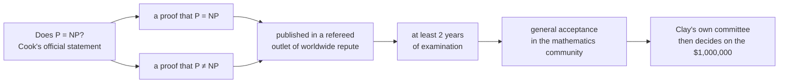

# P versus NP: is checking a solution really easier than finding one

[Syllabus](../../../SYLLABUS.md) → [Frontier](../README.md) → [The Millennium Problems](../README.md#s02) → P versus NP

---

## General Overview

A wholesaler has 20 unpaid invoices from one customer, worth $26,553.55 in total. One bank transfer arrives for **$8,325.30**, with no note saying which invoices it pays.

Two tasks follow, and they cost very different amounts.

- **Checking a claimed answer.** The customer's clerk phones and says "invoices 1, 4, 6, 9, 13, 16 and 18". Seven additions confirm it.
- **Finding the answer with no help.** Each invoice is either in the payment or not, so there are $`2^{20}`$ = 1,048,576 possible lists. With 60 invoices there are about $`1.15 \times 10^{18}`$: 36.5 years at a billion lists a second.

This search is **subset sum**: given whole numbers and a target, does some selection of the numbers add up to exactly the target? Cleverer methods than trying every list exist, and the card runs three of them. None is known to stay fast on every input as the list grows.

On 2000-05-24, in Paris, the Clay Mathematics Institute named seven Millennium Prize Problems, with $1,000,000 for each. One, the Poincaré conjecture, is solved. P versus NP is the one that asks about the gap above: when checking an answer is fast, must finding one be fast too?

Here fast has a precise meaning, **polynomial time**: the number of steps is at most a fixed power of the input's length, such as its square or cube.

**P versus NP asks whether every yes-or-no problem whose yes-answers can be checked in polynomial time can also be solved in polynomial time; most researchers expect no, but nobody has a proof.**

**What kind of fact this is:** a precise open question. Its kind: P ≠ NP is a conjecture. Its status: open as of 2026-11-23, with no accepted proof in either direction; the Clay Institute lists it as "Unsolved".

### The picture: what Clay would pay for, and how



Clay's 2018 rules name P versus NP as one of two problems where a resolution "in either direction" is judged the same way. The question has two possible answers, and either one, proved, wins. For the other five problems, the rules add a separate clause for a proposed counterexample.

---

## The formula

[P and NP](../../24-Computability%20and%20complexity/03-Time%20Complexity/02-p-and-np.md) defines both classes on sudoku, and [P versus NP](../../24-Computability%20and%20complexity/04-Beyond%20Worst%20Case/08-p-versus-np-what-is-known.md) states the question and what is proved around it. This card uses the wording of Stephen Cook's official problem description for Clay, because that is the statement the prize is paid on.

Notation first, in words. An **alphabet** Σ is a finite set of symbols with at least two members, such as 0 and 1. A **language** L is a set of strings over Σ: the inputs whose answer is yes. A **Turing machine** M is the standard model of a step-by-step computer. $`L(M)`$ is the language M **accepts**: the strings on which it stops in its yes state. $`T_M(n)`$ is its **worst-case running time**, the most steps it takes on any input of length n.

```math
\mathrm{P} = \{\, L : L = L(M) \text{ for some Turing machine } M \text{ and some } k \text{ with } T_M(n) \le n^k + k \text{ for all } n \,\}
```

**Read it aloud:** P is the set of languages that some machine decides, never taking more than n to a fixed power k, plus k, steps on inputs of length n.

A **checking relation** R(w, y) is a yes-or-no test on an input w and a proposed **certificate** y (the evidence, such as the clerk's list). It is polynomial-time when the pairs it accepts form a language in P.

```math
L \in \mathrm{NP} \iff \text{for some } k \text{ and some polynomial-time } R: \quad w \in L \iff \exists\, y \,\big(\, \lvert y\rvert \le \lvert w\rvert^k \text{ and } R(w, y) \,\big)
```

**Read it aloud:** a language is in NP when a fast checking test exists such that an input is a yes exactly when some certificate, not much longer than the input, passes the test.

```math
\text{Problem: does } \mathrm{P} = \mathrm{NP}\,?
```

**Read it aloud:** is every problem with fast-checkable yes-answers also fast to solve?

Every language in P is in NP: the test ignores y and decides w itself. So the question is whether the inclusion P ⊆ NP is strict.

| Symbol | Plain meaning | In our example | Push it up and the answer… |
| --- | --- | --- | --- |
| Σ | the alphabet: at least two symbols | the digits 0 to 9 and a separator | any fixed size gives the same question |
| $`w`$ | an input string | the 20 invoice amounts and the payment, written out | — |
| $`n = \lvert w\rvert`$ | input length, in symbols | the digits of all 21 numbers, plus separators | every cost is measured against it |
| $`L`$ | a language: the set of yes-inputs | SUBSET SUM: lists that have a selection hitting the target | — |
| $`M`$, $`L(M)`$, $`T_M(n)`$ | a machine; the language it accepts; its worst-case steps on inputs of length n | the brute-force search; about $`2^m`$ subsets | P needs one M with a polynomial bound |
| $`k`$ | the fixed power in a polynomial bound | checking the clerk's list: a small fixed k | a bigger fixed k is still polynomial |
| $`y`$ | a certificate: proposed evidence for a yes | invoices 1, 4, 6, 9, 13, 16, 18 | its length is capped at $`\lvert w\rvert^k`$ |
| $`R(w, y)`$ | the checking relation | add the 7 amounts, compare with $8,325.30 | — |
| P | languages decided in polynomial time | checking a claimed list | — |
| NP | languages with polynomial-time-checkable certificates | SUBSET SUM | — |
| $`m`$ | the number of invoices | 20 | brute force doubles per invoice |
| $`S`$ | the payment, the target sum | 832,530 cents | the amount table grows with its value |

### When it holds

What the official statement assumes, and what it does not claim:

- **Worst case on every input.** P asks for one machine fast on all inputs. A method fast on typical invoice ledgers but slow on a rare few proves nothing either way.
- **Any fixed power counts.** A proof that P = NP with an algorithm taking $`n^{100}`$ steps still answers the question. Cook's description notes such a program could never run even at n = 10. The question is mathematical, not a promise of practical software.
- **Length in symbols, not size of numbers.** A method whose work grows with the payment's value, not its number of digits, is not polynomial. The amount table below is exactly this case.
- **Two or more symbols.** With a one-symbol alphabet, numbers are written as tally marks; Cook's description says that version is a separate open question.
- **Ordinary machines.** Quantum computers are outside the statement. No NP-complete problem is known to be fast on one ([BQP](../../24-Computability%20and%20complexity/05-Algebraic%2C%20Interactive%20and%20Quantum/06-quantum-computation-and-bqp.md)).

---

## Why it works

This section explains why most researchers believe P ≠ NP, and why that belief is not a proof.

### Step 0: one problem carries the whole question

A problem is **NP-complete** when it is in NP and every NP problem reduces to it: a polynomial-time translation turns each instance into one of its instances with the same answer ([Reductions](../../24-Computability%20and%20complexity/03-Time%20Complexity/03-polynomial-reductions-and-np-completeness.md)). [Cook-Levin](../../24-Computability%20and%20complexity/03-Time%20Complexity/04-cook-levin-theorem.md) proves satisfiability is NP-complete, and Karp showed in 1972 that subset sum is too ([Karp's list](../../24-Computability%20and%20complexity/03-Time%20Complexity/05-karps-problems-and-hardness-recipes.md)).

So a polynomial-time method for the invoice problem, on every input, would prove P = NP. A proof that the invoice problem has no such method would prove P ≠ NP. The prize sits on one problem, and on each of the hundreds of others equivalent to it.

### Step 1: checking is cheap

The clerk's list is a certificate. Checking it means 7 additions and one comparison. In general, a list of m invoices takes at most m additions: polynomial, in fact linear. That puts SUBSET SUM in NP.

### Step 2: the best searches stay exponential

Three ways to find the list, all run by the code:

1. **Brute force.** Try all $`2^m`$ selections. At m = 20: 1,048,576 selections, exactly 1 matching.
2. **Meet in the middle.** Horowitz and Sahni (1974): list the 1,024 sums of the first 10 invoices and the 1,024 sums of the last 10. Sort one list, and look up the missing amount for each sum in the other. That is about $`2^{m/2}`$ sums per list, and the sort and the lookups multiply the work by about $`m/2`$: the exponent is halved, not removed.
3. **The amount table.** Mark every total from 0 to S cents that some selection reaches. That is 20 rows of 832,531 columns: 16,650,620 cells. Its work grows with the value of S, not its number of digits ([Pseudo-polynomial time](../../24-Computability%20and%20complexity/03-Time%20Complexity/06-pseudo-polynomial-time-and-numbers-in-the-input.md)). Make every invoice 1,000 times larger and the table needs 16,650,600,020 cells, while the input grows by only 3 digits per number.

A fourth road shows why the yes-or-no form loses nothing. Ask a yes-or-no solver, one invoice at a time, "can the rest still pay what is left without this invoice?" Twenty questions rebuild the list 1, 4, 6, 9, 13, 16, 18. Cook's description makes the same point: if P = NP, every NP search problem is also fast.

No known method for subset sum removes the exponent on every input. Cook's description, first written for the 2000 launch, gave about $`1.5^n`$ as the best proved bound for 3-SAT (satisfiability with three-literal clauses) on n variables. Faster exponentials, but exponentials.

### Step 3: the five reasons most researchers expect P ≠ NP

| Reason | What it is | Kind of support |
| --- | --- | --- |
| **The search has failed everywhere at once** | Hundreds of NP-complete problems, from scheduling and routing to chip design, are one problem in disguise. Cook's description notes that "a vast number of programmers and engineers" have looked for fast methods for decades, without success. A fast method for any one would solve all. | evidence: many independent failures |
| **The consequences look too strong** | If P = NP with a usable method, finding a formal proof of reasonable length would cost about as much as checking one. Cook's description says this "would transform mathematics", possibly including the other Clay problems. | plausibility, not evidence |
| **Hardness is proved in weaker models** | Exponential lower bounds are proved for monotone circuits (only AND and OR gates) and for constant-depth circuits ([Circuit lower bounds](../../24-Computability%20and%20complexity/04-Beyond%20Worst%20Case/07-circuit-complexity-and-lower-bounds.md)). Shannon proved in 1949 that most Boolean functions need about $`2^n/n`$ gates. | theorems, about models other than the real one |
| **Relative to a generic oracle, P ≠ NP** | An oracle is a set a machine may ask about in one step. For a generic oracle, a technical notion of an oracle with no special structure, the two classes differ (Cook's description cites this). | theorems about altered worlds |
| **Experts mostly say so** | Of people polled, mostly researchers, 61 of 100 said P ≠ NP in 2002, 126 of 152 (82.9%) in 2012, and 109 of 124 (87.9%) in 2019. | opinion: a measure of belief, never of truth |

The minority view has history behind it. Deciding whether a number is prime was in NP for decades before a 2004 paper, cited in Cook's description, put it in P. In the 2019 poll, 15 of 124 (12.1%) said P = NP.

### Step 4: why no one has turned the belief into a proof

A proof of P ≠ NP must beat every possible machine, including ones nobody has imagined. Three families of proof method are proved unable to do it. [P versus NP](../../24-Computability%20and%20complexity/04-Beyond%20Worst%20Case/08-p-versus-np-what-is-known.md) states and outlines all three; in one line each:

| Barrier | Year | What it rules out |
| --- | --- | --- |
| Relativisation (Baker, Gill, Solovay) | 1975 | any proof that still works when every machine gets the same oracle, such as simulation and diagonalisation, because oracles exist on both sides |
| Natural proofs (Razborov, Rudich) | 1997 | the usual circuit lower-bound arguments, if pseudorandom functions exist, as factoring's hardness suggests |
| Algebrisation (Aaronson, Wigderson) | 2009 | the polynomial tricks that got past relativisation in IP = PSPACE |

Cook's description, in the version Clay posts (it cites work up to 2004), adds a sharper fact: the best lower bound then proved for unrestricted circuits computing an explicit function of n input bits was "about 4n" gates, far below what P ≠ NP needs. Bounds proved since are still linear in n; [Circuit lower bounds](../../24-Computability%20and%20complexity/04-Beyond%20Worst%20Case/07-circuit-complexity-and-lower-bounds.md) gives the current figure and its source.

### Step 5: what each answer would and would not give

| If proved | It gives | It does not give |
| --- | --- | --- |
| P = NP | a polynomial-time method for subset sum, satisfiability and every NP search, in principle | a fast program: the power k might be 100, or the proof might not exhibit the method |
| P ≠ NP | some NP problem needs more than polynomial time on its worst inputs | hardness on typical inputs, so it would not by itself make encryption safe ([Average-case hardness](../../24-Computability%20and%20complexity/04-Beyond%20Worst%20Case/06-average-case-and-cryptographic-hardness.md)) |

Clay's rules say nothing about a proof that the question is independent of the usual axioms. Whether that could even happen is itself open.

---

## Worked numbers, by hand

The example: the $8,325.30 transfer against 20 open invoices.

| Step | Arithmetic | Value |
| --- | --- | --- |
| certificate check | add the 7 claimed amounts, compare with $8,325.30 | 7 additions, match |
| brute force | $`2^{20}`$ selections, each compared with the payment | 1,048,576 selections, 1 match |
| meet in the middle | $`2^{10} + 2^{10}`$ half-sums, then lookups | 1,024 + 1,024 half-sums, 1 match |
| amount table | 20 rows × (832,530 + 1) columns | 16,650,620 cells |
| search from decision | one yes-or-no question per invoice | 20 questions, same 7 invoices |
| 60 invoices, brute force | $`2^{60} \div 10^9`$ s ÷ 31,557,600 s per year | **36.5 years** |

At 20 invoices every method is instant. At 60, brute force takes 36.5 years, while meet in the middle builds two lists of 1,073,741,824 half-sums and sorts one: about a minute of work at the same speed. The open question is whether some method stays polynomial forever, not whether one wins at a fixed size.

The counts as powers of ten at m = 60:

```
brute force, all subsets   ██████████████████  18
meet in the middle         █████████           9
checking the clerk's list  █                   1
```

Each bar is the number of digits minus one: $`2^{60}`$ has 19 digits, $`2^{30}`$ has 10, and checking at most 60 additions has 2.

### What breaks if you drop a piece

| Mistake | Comes out at | What went wrong |
| --- | --- | --- |
| Calling the amount table polynomial | 16,650,620 cells becomes 16,650,600,020 when every invoice is 1,000 times larger | its work tracks the payment's value, which grows exponentially with its digits |
| Judging from a small case | 0.001 s at 20 invoices; 1,152,921,504.606 s, or 36.5 years, at 60 | P is about growth on every input, not one instance |
| Treating a halved exponent as a fix | at 100 invoices, 1,125,899,906,842,624 half-sums against 1,267,650,600,228,229,401,496,703,205,376 subsets | $`2^{m/2}`$ is still exponential |
| Reading the poll as a proof | 87.9% said P ≠ NP in 2019 | belief counts people; only a proof settles a conjecture |

---

## Code, from first principles, and it actually runs

The code checks the clerk's list, then finds it by four independent roads: brute force over all 1,048,576 selections, meet in the middle, the amount table, and a yes-or-no oracle asked once per invoice. Asserts compare the roads with each other. It then grows the costs to 60 and 100 invoices and turns the poll counts into percentages.

### Python

```python
# P versus NP, the Clay problem -- the check behind the card.  Standard library only.
# One payment, twenty open invoices: which invoices does it pay?  That is SUBSET SUM,
# an NP-complete problem.  Checking a claimed answer is a few additions; finding one
# is a search.  Four roads find the same answer; then the costs are grown to 60 and
# 100 invoices, and the poll counts behind "most believe" are turned into percentages.
from bisect import bisect_left, bisect_right

def c(x): return f"{x:,}"
def cash(cents): return f"${cents // 100:,}.{cents % 100:02d}"

A = [48215, 112040, 23999, 375010, 89950, 154281, 61830, 298000, 17465, 205590,
     73320, 131085, 44700, 260415, 98760, 186230, 35580, 142900, 67125, 228860]
S, m = 832530, len(A)                    # the payment, in cents; m invoices
print(f"invoices: m = {m}, open total {cash(sum(A))}; payment S = {cash(S)}")

# 0. The verifier: a claimed list of invoices is checked by adding them up.
claim = [1, 4, 6, 9, 13, 16, 18]          # invoice numbers counted from 0
total, adds = 0, 0
for i in claim:
    total, adds = total + A[i], adds + 1
print(f"certificate check: {len(claim)} invoices, {adds} additions, sum {cash(total)}, matches {total == S}")

# 1. Brute force: every subset.  sums[mask] is the total of the invoices whose bits are set.
sums = [0]
for a in A:
    sums += [s + a for s in sums]
brute = [mask for mask, s in enumerate(sums) if s == S]
print(f"brute force: {c(len(sums))} subsets, {len(brute)} match; "
      f"invoices {[i for i in range(m) if brute[0] >> i & 1]}")

# 2. Meet in the middle (1974): all sums of each half, sorted, then matched.
def half_sums(xs):
    out = [0]
    for a in xs:
        out += [s + a for s in out]
    return out
left, right = half_sums(A[:m // 2]), sorted(half_sums(A[m // 2:]))
mitm = sum(bisect_right(right, S - s) - bisect_left(right, S - s) for s in left)
print(f"meet in the middle: {c(len(left))} + {c(len(right))} half-sums, {mitm} match")

# 3. The amount table (pseudo-polynomial): bit t of reach is 1 when t cents can be made.
reach, mask_s = 1, (1 << (S + 1)) - 1
for a in A:
    reach = (reach | (reach << a)) & mask_s
cells = m * (S + 1)
print(f"amount table: {c(S + 1)} columns x {m} rows = {c(cells)} cells, payable {bool(reach >> S & 1)}")
print(f"every invoice 1,000 times larger: {c(m * (1000 * S + 1))} cells; brute force still {c(len(sums))}")

# 4. Search from decision: a yes/no oracle, asked once per invoice, recovers the list.
def decide(xs, t):                       # yes/no only, by meet in the middle
    h = len(xs) // 2
    r = set(half_sums(xs[h:]))
    return any(t - s in r for s in half_sums(xs[:h]))
keep, rest, asks = [], S, 0
for i in range(m):
    asks += 1
    if not decide(A[i + 1:], rest):      # the rest cannot pay it without invoice i
        keep.append(i)
        rest -= A[i]
print(f"search from decision: {asks} yes/no questions, invoices {keep}, left over {rest}")

# 5. Growth: brute force against meet in the middle, at a billion subsets a second.
YEAR = 31557600                          # seconds in a year of 365.25 days
for k in (20, 40, 60, 100):
    ms, tenths = 2 ** k // 10 ** 6, 10 * 2 ** k // (10 ** 9 * YEAR)
    print(f"m = {k}: subsets {c(2 ** k)}; half-sums {c(2 ** (k // 2))}; at 1e9 subsets/s "
          f"{ms // 1000:,}.{ms % 1000:03d} s = {tenths // 10:,}.{tenths % 10} years")
print(f"bars, log10 of work at m = 60: brute {len(str(2 ** 60)) - 1}, half-sums {len(str(2 ** 30)) - 1}, check {len(str(60)) - 1}")

# 6. Opinion is not proof: three polls of researchers, P != NP answers over all answers.
polls = [(2002, 61, 9, 100), (2012, 126, 12, 152), (2019, 109, 15, 124)]
for year, ne, eq, n in polls:
    pct = lambda x: f"{(1000 * x + n // 2) // n // 10}.{(1000 * x + n // 2) // n % 10}%"
    print(f"poll {year}: {ne} of {n} say P != NP ({pct(ne)}), {eq} say P = NP ({pct(eq)})")
print(f"Clay fund: 7 problems x $1,000,000 = ${7 * 1000000:,}; solved 1, open {7 - 1}")

assert total == S and brute == [sum(1 << i for i in claim)]  # verifier against brute force
assert mitm == len(brute) == 1                               # two searches agree
sumset = set(sums)                                           # table against brute force:
assert all((reach >> t & 1) == (t in sumset) for t in range(0, S + 1, 997)) and reach >> S & 1
assert keep == claim and rest == 0                           # decision oracle rebuilds the list
assert 2 ** 60 // (10 ** 9 * YEAR) == 36                    # by hand: 1.15e18 s / 3.16e16
print("ALL CHECKS PASS")
```

**Ran 2026-11-23 on macOS, Python 3.14.10, standard library only. All checks passed. Output, pasted from the run:**

```
invoices: m = 20, open total $26,553.55; payment S = $8,325.30
certificate check: 7 invoices, 7 additions, sum $8,325.30, matches True
brute force: 1,048,576 subsets, 1 match; invoices [1, 4, 6, 9, 13, 16, 18]
meet in the middle: 1,024 + 1,024 half-sums, 1 match
amount table: 832,531 columns x 20 rows = 16,650,620 cells, payable True
every invoice 1,000 times larger: 16,650,600,020 cells; brute force still 1,048,576
search from decision: 20 yes/no questions, invoices [1, 4, 6, 9, 13, 16, 18], left over 0
m = 20: subsets 1,048,576; half-sums 1,024; at 1e9 subsets/s 0.001 s = 0.0 years
m = 40: subsets 1,099,511,627,776; half-sums 1,048,576; at 1e9 subsets/s 1,099.511 s = 0.0 years
m = 60: subsets 1,152,921,504,606,846,976; half-sums 1,073,741,824; at 1e9 subsets/s 1,152,921,504.606 s = 36.5 years
m = 100: subsets 1,267,650,600,228,229,401,496,703,205,376; half-sums 1,125,899,906,842,624; at 1e9 subsets/s 1,267,650,600,228,229,401,496.703 s = 40,169,423,537,538.6 years
bars, log10 of work at m = 60: brute 18, half-sums 9, check 1
poll 2002: 61 of 100 say P != NP (61.0%), 9 say P = NP (9.0%)
poll 2012: 126 of 152 say P != NP (82.9%), 12 say P = NP (7.9%)
poll 2019: 109 of 124 say P != NP (87.9%), 15 say P = NP (12.1%)
Clay fund: 7 problems x $1,000,000 = $7,000,000; solved 1, open 6
ALL CHECKS PASS
```

### Rust

Same numbers, same labels, built with `rustc --edition 2021 -O`.

```rust
// P versus NP, the Clay problem -- the same check as the Python, in Rust.  No crates.
// One payment, twenty open invoices: which invoices does it pay?  That is SUBSET SUM,
// an NP-complete problem.  Checking a claimed answer is a few additions; finding one
// is a search.  Four roads find the same answer; then the costs are grown to 60 and
// 100 invoices, and the poll counts behind "most believe" are turned into percentages.
use std::collections::HashSet;

fn c(x: u128) -> String {
    let s = x.to_string();
    let mut out = String::new();
    for (i, ch) in s.chars().enumerate() {
        if i > 0 && (s.len() - i) % 3 == 0 { out.push(',') }
        out.push(ch);
    }
    out
}
fn cash(cents: u64) -> String { format!("${}.{:02}", c((cents / 100) as u128), cents % 100) }
fn tf(b: bool) -> &'static str { if b { "True" } else { "False" } }

fn half_sums(xs: &[u64]) -> Vec<u64> {
    let mut out = vec![0u64];
    for &a in xs {
        let more: Vec<u64> = out.iter().map(|s| s + a).collect();
        out.extend(more);
    }
    out
}
fn decide(xs: &[u64], t: u64) -> bool {           // yes/no only, by meet in the middle
    let h = xs.len() / 2;
    let r: HashSet<u64> = half_sums(&xs[h..]).into_iter().collect();
    half_sums(&xs[..h]).iter().any(|&s| s <= t && r.contains(&(t - s)))
}

fn main() {
    let a: [u64; 20] = [48215, 112040, 23999, 375010, 89950, 154281, 61830, 298000, 17465, 205590,
                        73320, 131085, 44700, 260415, 98760, 186230, 35580, 142900, 67125, 228860];
    let (s, m) = (832530u64, a.len());            // the payment, in cents; m invoices
    println!("invoices: m = {}, open total {}; payment S = {}", m, cash(a.iter().sum()), cash(s));

    // 0. The verifier: a claimed list of invoices is checked by adding them up.
    let claim = vec![1usize, 4, 6, 9, 13, 16, 18];
    let (mut total, mut adds) = (0u64, 0);
    for &i in &claim { total += a[i]; adds += 1; }
    println!("certificate check: {} invoices, {} additions, sum {}, matches {}", claim.len(), adds, cash(total), tf(total == s));

    // 1. Brute force: every subset.  sums[mask] is the total of the invoices whose bits are set.
    let sums = half_sums(&a);
    let brute: Vec<usize> = (0..sums.len()).filter(|&k| sums[k] == s).collect();
    let picked: Vec<usize> = (0..m).filter(|&i| brute[0] >> i & 1 == 1).collect();
    println!("brute force: {} subsets, {} match; invoices {:?}", c(sums.len() as u128), brute.len(), picked);

    // 2. Meet in the middle (1974): all sums of each half, sorted, then matched.
    let left = half_sums(&a[..m / 2]);
    let mut right = half_sums(&a[m / 2..]);
    right.sort();
    let mut mitm = 0;
    for &l in &left {
        if l > s { continue }
        let t = s - l;
        mitm += right.partition_point(|&x| x <= t) - right.partition_point(|&x| x < t);
    }
    println!("meet in the middle: {} + {} half-sums, {} match", c(left.len() as u128), c(right.len() as u128), mitm);

    // 3. The amount table (pseudo-polynomial): bit t of reach is 1 when t cents can be made.
    let words = (s as usize + 1 + 63) / 64;
    let mut reach = vec![0u64; words];
    reach[0] = 1;
    for &x in &a {
        let (ws, bs) = ((x / 64) as usize, (x % 64) as u32);
        let old = reach.clone();
        for i in ws..words {
            let mut v = old[i - ws] << bs;
            if bs > 0 && i > ws { v |= old[i - ws - 1] >> (64 - bs) }
            reach[i] |= v;
        }
    }
    let bit = |t: u64| reach[(t / 64) as usize] >> (t % 64) & 1 == 1;
    let cells = m as u128 * (s as u128 + 1);
    println!("amount table: {} columns x {} rows = {} cells, payable {}", c(s as u128 + 1), m, c(cells), tf(bit(s)));
    println!("every invoice 1,000 times larger: {} cells; brute force still {}", c(m as u128 * (1000 * s as u128 + 1)), c(sums.len() as u128));

    // 4. Search from decision: a yes/no oracle, asked once per invoice, recovers the list.
    let (mut keep, mut rest, mut asks) = (Vec::new(), s, 0);
    for i in 0..m {
        asks += 1;
        if !decide(&a[i + 1..], rest) { keep.push(i); rest -= a[i]; }
    }
    println!("search from decision: {} yes/no questions, invoices {:?}, left over {}", asks, keep, rest);

    // 5. Growth: brute force against meet in the middle, at a billion subsets a second.
    let year: u128 = 31557600;                    // seconds in a year of 365.25 days
    for k in [20u32, 40, 60, 100] {
        let p = 1u128 << k;
        let (ms, tenths) = (p / 1_000_000, 10 * p / (1_000_000_000 * year));
        println!("m = {}: subsets {}; half-sums {}; at 1e9 subsets/s {}.{:03} s = {}.{} years",
                 k, c(p), c(1u128 << (k / 2)), c(ms / 1000), ms % 1000, c(tenths / 10), tenths % 10);
    }
    let lg = |x: u128| x.to_string().len() - 1;
    println!("bars, log10 of work at m = 60: brute {}, half-sums {}, check {}", lg(1 << 60), lg(1 << 30), lg(60));

    // 6. Opinion is not proof: three polls of researchers, P != NP answers over all answers.
    for (yr, ne, eq, n) in [(2002u64, 61u64, 9u64, 100u64), (2012, 126, 12, 152), (2019, 109, 15, 124)] {
        let pct = |x: u64| { let r = (1000 * x + n / 2) / n; format!("{}.{}%", r / 10, r % 10) };
        println!("poll {}: {} of {} say P != NP ({}), {} say P = NP ({})", yr, ne, n, pct(ne), eq, pct(eq));
    }
    println!("Clay fund: 7 problems x $1,000,000 = ${}; solved 1, open {}", c(7 * 1000000), 7 - 1);

    let mask: usize = claim.iter().map(|&i| 1usize << i).sum();
    assert!(total == s && brute == vec![mask]);                 // verifier against brute force
    assert!(mitm == brute.len() && mitm == 1);                  // two searches agree
    let sumset: HashSet<u64> = sums.iter().copied().collect();  // table against brute force:
    assert!((0..=s).step_by(997).all(|t| bit(t) == sumset.contains(&t)) && bit(s));
    assert!(keep == claim && rest == 0);                        // decision oracle rebuilds the list
    assert!((1u128 << 60) / (1_000_000_000 * year) == 36);      // by hand: 1.15e18 s / 3.16e16
    println!("ALL CHECKS PASS");
}
```

**Ran 2026-11-23 on macOS, rustc 1.98.1, no crates. All checks passed. Output, pasted from the run:**

```
invoices: m = 20, open total $26,553.55; payment S = $8,325.30
certificate check: 7 invoices, 7 additions, sum $8,325.30, matches True
brute force: 1,048,576 subsets, 1 match; invoices [1, 4, 6, 9, 13, 16, 18]
meet in the middle: 1,024 + 1,024 half-sums, 1 match
amount table: 832,531 columns x 20 rows = 16,650,620 cells, payable True
every invoice 1,000 times larger: 16,650,600,020 cells; brute force still 1,048,576
search from decision: 20 yes/no questions, invoices [1, 4, 6, 9, 13, 16, 18], left over 0
m = 20: subsets 1,048,576; half-sums 1,024; at 1e9 subsets/s 0.001 s = 0.0 years
m = 40: subsets 1,099,511,627,776; half-sums 1,048,576; at 1e9 subsets/s 1,099.511 s = 0.0 years
m = 60: subsets 1,152,921,504,606,846,976; half-sums 1,073,741,824; at 1e9 subsets/s 1,152,921,504.606 s = 36.5 years
m = 100: subsets 1,267,650,600,228,229,401,496,703,205,376; half-sums 1,125,899,906,842,624; at 1e9 subsets/s 1,267,650,600,228,229,401,496.703 s = 40,169,423,537,538.6 years
bars, log10 of work at m = 60: brute 18, half-sums 9, check 1
poll 2002: 61 of 100 say P != NP (61.0%), 9 say P = NP (9.0%)
poll 2012: 126 of 152 say P != NP (82.9%), 12 say P = NP (7.9%)
poll 2019: 109 of 124 say P != NP (87.9%), 15 say P = NP (12.1%)
Clay fund: 7 problems x $1,000,000 = $7,000,000; solved 1, open 6
ALL CHECKS PASS
```

### Lean

Lean proves three of the code's four roads right for any invoices and any payment, and checks the worked numbers.

- Take any invoices and a payment S that some selection makes. Then asking the yes-or-no question once per invoice rebuilds a list paying exactly S.
- That rebuilt list names each invoice at most once, and nothing is left over.
- Meet in the middle agrees with brute force. Split the invoices into two parts. Then the pairs of half-sums adding to S are as many as the selections adding to S.
- Take any total from 0 to S cents. Then the amount table marks it exactly when some selection of the invoices reaches it.
- The worked totals check: 20 invoices worth $26,553.55, the clerk's 7 invoices paying $8,325.30, and the one-cent-more list paying $8,325.31.
- The table sizes check: 16,650,620 cells, then 16,650,600,020 at 1,000 times larger, and 166,506,020 at 10 times larger.
- The growth numbers check: 1,048,576 selections, 2,097,152 with a 21st invoice, 36.5 years at 60 invoices, and 40,169,423,537,538.6 years at 100.
- The bars 18 and 9 check, and so do the polls: 61.0%, 82.9%, 87.9%, and 12.1% for P = NP.

Finding the clerk's list, and that it is the only match, is left to the Python and Rust checks; P versus NP stays open.

```lean
-- P versus NP: a yes-or-no payability oracle asked once per invoice rebuilds a list paying exactly the target, meet in the middle counts the same matching selections as brute force, the amount table marks exactly the payable totals, and the card's whole-number examples are exact.
import Mathlib.Data.List.Sublists
import Mathlib.Data.List.ProdSigma
import Mathlib.Data.Finset.Image
import Mathlib.Tactic.NormNum

/-! The open question itself, P = NP, is not stated here: it is open as of 2026-11-23 and
no theorem settles it. This file states what the card proves around its invoice example,
SUBSET SUM: amounts `A` (in cents) and a payment `S`. -/

namespace PVersusNP

/-- SUBSET SUM, the yes-or-no question: some selection of the amounts, each used at most
once, adds up to exactly `t`. -/
def Payable (xs : List ℕ) (t : ℕ) : Prop := ∃ s ∈ xs.sublists, s.sum = t

instance (xs : List ℕ) (t : ℕ) : Decidable (Payable xs t) := by
  unfold Payable; infer_instance

/-- Search from decision (road 4 of the code). Walk the invoices in order, with `rest` left
to pay and `i` the current invoice number. Ask the yes-or-no oracle "can the invoices after
this one still pay `rest` without it?". On no, keep invoice `i` and take its amount off
`rest`. Returns the kept invoice numbers and what is left over. -/
def rebuild : List ℕ → ℕ → ℕ → List ℕ × ℕ
  | [], rest, _ => ([], rest)
  | a :: tl, rest, i =>
      if Payable tl rest then rebuild tl rest (i + 1)
      else
        let r := rebuild tl (rest - a) (i + 1)
        (i :: r.1, r.2)

theorem payable_nil_iff (t : ℕ) : Payable [] t ↔ t = 0 := by
  simp [Payable, eq_comm]

theorem payable_cons_iff (a : ℕ) (tl : List ℕ) (t : ℕ) :
    Payable (a :: tl) t ↔ Payable tl t ∨ (a ≤ t ∧ Payable tl (t - a)) := by
  simp only [Payable, List.mem_sublists, List.sublist_cons_iff]
  constructor
  · rintro ⟨s, hs | ⟨r, rfl, hr⟩, hsum⟩
    · exact Or.inl ⟨s, hs, hsum⟩
    · simp only [List.sum_cons] at hsum
      exact Or.inr ⟨by omega, r, hr, by omega⟩
  · rintro (⟨s, hs, hsum⟩ | ⟨ha, r, hr, hsum⟩)
    · exact ⟨s, Or.inl hs, hsum⟩
    · exact ⟨a :: r, Or.inr ⟨r, rfl, hr⟩, by simp only [List.sum_cons]; omega⟩

theorem rebuild_spec (xs : List ℕ) (rest i : ℕ) (f : ℕ → ℕ)
    (hf : ∀ k < xs.length, f (i + k) = xs.getD k 0) (h : Payable xs rest) :
    (rebuild xs rest i).2 = 0 ∧
    ((rebuild xs rest i).1.map f).sum = rest ∧
    (rebuild xs rest i).1.Pairwise (· < ·) ∧
    ∀ j ∈ (rebuild xs rest i).1, i ≤ j ∧ j < i + xs.length := by
  induction xs generalizing rest i with
  | nil =>
    rw [payable_nil_iff] at h
    subst h
    simp [rebuild]
  | cons a tl ih =>
    have hf' : ∀ k < tl.length, f (i + 1 + k) = tl.getD k 0 := by
      intro k hk
      have := hf (k + 1) (by simp; omega)
      rw [show i + 1 + k = i + (k + 1) by omega, this]
      simp
    by_cases hp : Payable tl rest
    · obtain ⟨h1, h2, h3, h4⟩ := ih rest (i + 1) hf' hp
      simp only [rebuild, hp, ↓reduceIte]
      refine ⟨h1, h2, h3, fun j hj => ?_⟩
      have := h4 j hj
      simp only [List.length_cons]
      omega
    · have hp' : a ≤ rest ∧ Payable tl (rest - a) := by
        rcases (payable_cons_iff a tl rest).1 h with h' | h'
        · exact absurd h' hp
        · exact h'
      obtain ⟨h1, h2, h3, h4⟩ := ih (rest - a) (i + 1) hf' hp'.2
      have hfi : f i = a := by
        have := hf 0 (by simp)
        simpa using this
      simp only [rebuild, hp, ↓reduceIte]
      refine ⟨h1, ?_, ?_, ?_⟩
      · simp only [List.map_cons, List.sum_cons, hfi, h2]
        omega
      · refine List.Pairwise.cons (fun j hj => ?_) h3
        have := h4 j hj
        omega
      · intro j hj
        simp only [List.mem_cons] at hj
        simp only [List.length_cons]
        rcases hj with rfl | hj
        · omega
        · have := h4 j hj
          omega

/-- The yes-or-no form loses nothing: when the payment `S` can be made from the invoices `A`
at all, asking the yes-or-no question once per invoice rebuilds an actual list. The kept
invoice numbers are distinct (strictly increasing), each names a real invoice, their amounts
add up to exactly `S`, and nothing is left over. -/
theorem search_from_decision_rebuilds_list (A : List ℕ) (S : ℕ) (h : Payable A S) :
    (rebuild A S 0).2 = 0 ∧
    ((rebuild A S 0).1.map fun i => A.getD i 0).sum = S ∧
    (rebuild A S 0).1.Pairwise (· < ·) ∧
    ∀ i ∈ (rebuild A S 0).1, i < A.length := by
  obtain ⟨h1, h2, h3, h4⟩ :=
    rebuild_spec A S 0 (fun i => A.getD i 0) (fun k _ => by simp) h
  refine ⟨h1, h2, h3, fun i hi => ?_⟩
  have := h4 i hi
  omega

/-- All totals of selections from a list: the half-sums of meet in the middle. -/
def halfSums (xs : List ℕ) : List ℕ := xs.sublists.map List.sum

theorem sum_map_add_nat {β : Type*} (Y : List β) (g h : β → ℕ) :
    (Y.map fun b => g b + h b).sum = (Y.map g).sum + (Y.map h).sum := by
  induction Y with
  | nil => simp
  | cons y Y ih =>
    simp only [List.map_cons, List.sum_cons, ih]
    omega

theorem sum_map_sum_map_comm {α β : Type*} (X : List α) (Y : List β) (f : α → β → ℕ) :
    (X.map fun a => (Y.map fun b => f a b).sum).sum =
      (Y.map fun b => (X.map fun a => f a b).sum).sum := by
  induction X with
  | nil => simp
  | cons x X ih =>
    simp only [List.map_cons, List.sum_cons, ih, sum_map_add_nat]

theorem countP_eq_sum_ite {α : Type*} (l : List α) (p : α → Bool) :
    l.countP p = (l.map fun x => if p x then 1 else 0).sum := by
  induction l with
  | nil => simp
  | cons x l ih =>
    rw [List.countP_cons, ih, List.map_cons, List.sum_cons]
    omega

theorem countP_product_eq {α β : Type*} (X : List α) (Y : List β) (q : α → β → Bool) :
    (X.product Y).countP (fun p => q p.1 p.2) =
      (X.map fun a => (Y.map fun b => if q a b then 1 else 0).sum).sum := by
  induction X with
  | nil => simp [List.product]
  | cons x X ih =>
    have : (x :: X).product Y = Y.map (Prod.mk x) ++ X.product Y := by
      simp [List.product]
    rw [this, List.countP_append, List.countP_map, ih, List.map_cons, List.sum_cons,
      countP_eq_sum_ite]
    rfl

/-- Meet in the middle (Horowitz and Sahni, 1974) agrees with brute force. Split the invoices
into a first part `L` and a second part `R`. The pairs (left half-sum, right half-sum) adding
to `S` are exactly as many as the selections of all the invoices adding to `S`. -/
theorem meet_in_the_middle_counts_matches (L R : List ℕ) (S : ℕ) :
    ((halfSums L).product (halfSums R)).countP (fun p => p.1 + p.2 = S) =
      (L ++ R).sublists.countP (fun s => s.sum = S) := by
  rw [countP_product_eq (halfSums L) (halfSums R) (fun a b => a + b = S)]
  rw [List.sublists_append, List.bind_eq_flatMap, List.countP_flatMap]
  simp only [halfSums, List.map_map, Function.comp_def, countP_eq_sum_ite,
    List.sum_append]
  exact sum_map_sum_map_comm _ _ _

/-- The amount table (road 3): start with the total 0 marked; for each invoice `a`, also
mark every marked total plus `a`, keeping only totals from 0 to `S`. -/
def amountTable (A : List ℕ) (S : ℕ) : Finset ℕ :=
  A.foldl (fun r a => r ∪ (r.image (· + a)).filter (· ≤ S)) {0}

theorem foldl_spec (A : List ℕ) (S : ℕ) (r : Finset ℕ) (t : ℕ) (ht : t ≤ S) :
    t ∈ A.foldl (fun r a => r ∪ (r.image (· + a)).filter (· ≤ S)) r ↔
      ∃ u ∈ r, ∃ s ∈ A.sublists, u + s.sum = t := by
  induction A generalizing r with
  | nil => simp
  | cons a tl ih =>
    rw [List.foldl_cons, ih]
    simp only [Finset.mem_union, Finset.mem_filter, Finset.mem_image, List.mem_sublists,
      List.sublist_cons_iff]
    constructor
    · rintro ⟨u, hu | ⟨⟨v, hv, rfl⟩, _⟩, s, hs, hsum⟩
      · exact ⟨u, hu, s, Or.inl hs, hsum⟩
      · exact ⟨v, hv, a :: s, Or.inr ⟨s, rfl, hs⟩, by simp only [List.sum_cons]; omega⟩
    · rintro ⟨u, hu, s, hs | ⟨s', rfl, hs'⟩, hsum⟩
      · exact ⟨u, Or.inl hu, s, hs, hsum⟩
      · simp only [List.sum_cons] at hsum
        exact ⟨u + a, Or.inr ⟨⟨u, hu, rfl⟩, by omega⟩, s', hs', by omega⟩

/-- The amount table is right: a total `t` from 0 to `S` is marked exactly when some selection
of the invoices adds up to `t`. -/
theorem amount_table_marks_payable (A : List ℕ) (S t : ℕ) (ht : t ≤ S) :
    t ∈ amountTable A S ↔ Payable A t := by
  rw [amountTable, foldl_spec A S {0} t ht]
  simp [Payable]

/-! ### The card's worked numbers -/

/-- The twenty open invoices, in cents, numbered from 0. -/
def invoices : List ℕ :=
  [48215, 112040, 23999, 375010, 89950, 154281, 61830, 298000, 17465, 205590,
   73320, 131085, 44700, 260415, 98760, 186230, 35580, 142900, 67125, 228860]

-- 20 invoices, $26,553.55 open in total.
example : invoices.length = 20 ∧ invoices.sum = 2655355 := by decide
-- The clerk's list 1, 4, 6, 9, 13, 16, 18: 7 amounts adding to $8,325.30.
example : ([1, 4, 6, 9, 13, 16, 18].map fun i => invoices.getD i 0).sum = 832530 := by decide
-- The clerk's list is a selection of the invoices, so the payment is payable.
example : List.Sublist [112040, 89950, 61830, 205590, 260415, 35580, 67125] invoices ∧
    [112040, 89950, 61830, 205590, 260415, 35580, 67125].sum = 832530 := by decide
-- One cent more: invoices 1, 4, 5, 6, 10, 11, 17, 18 pay $8,325.31.
example : ([1, 4, 5, 6, 10, 11, 17, 18].map fun i => invoices.getD i 0).sum = 832531 := by decide
-- Brute force: 1,048,576 selections; meet in the middle: 1,024 + 1,024 half-sums.
example : 2 ^ 20 = 1048576 ∧ 2 ^ 10 = 1024 := by norm_num
-- The amount table: 20 rows × 832,531 columns = 16,650,620 cells.
example : 20 * (832530 + 1) = 16650620 := by norm_num
-- Every invoice 1,000 times larger: 16,650,600,020 cells.
example : 20 * (1000 * 832530 + 1) = 16650600020 := by norm_num
-- Every amount 10 times larger: 166,506,020 cells.
example : 20 * (10 * 832530 + 1) = 166506020 := by norm_num
-- A 21st invoice: 2,097,152 selections, 1,024 + 2,048 half-sums.
example : 2 ^ 21 = 2097152 ∧ 2 ^ 11 = 2048 := by norm_num
-- 60 invoices at a billion selections a second: 36.5 years of 31,557,600 s.
example : 2 ^ 60 = 1152921504606846976 ∧ 2 ^ 30 = 1073741824 := by norm_num
example : 2 ^ 60 / 10 ^ 6 = 1152921504606 := by norm_num
example : 2 ^ 60 / (10 ^ 9 * 31557600) = 36 ∧ 10 * 2 ^ 60 / (10 ^ 9 * 31557600) = 365 := by
  norm_num
-- 100 invoices: 2^100 subsets against 2^50 half-sums, and 40,169,423,537,538.6 years.
example : 2 ^ 100 = 1267650600228229401496703205376 ∧ 2 ^ 50 = 1125899906842624 := by norm_num
example : 10 * 2 ^ 100 / (10 ^ 9 * 31557600) = 401694235375386 := by norm_num
-- The bars: 2^60 has 19 digits, 2^30 has 10, and 60 has 2.
example : 10 ^ 18 ≤ 2 ^ 60 ∧ 2 ^ 60 < 10 ^ 19 ∧ 10 ^ 9 ≤ 2 ^ 30 ∧ 2 ^ 30 < 10 ^ 10 := by norm_num
-- The polls, in tenths of a percent, rounded: 61.0%, 82.9%, 87.9%, and 12.1% for P = NP.
example : (1000 * 61 + 50) / 100 = 610 ∧ (1000 * 126 + 76) / 152 = 829 ∧
    (1000 * 109 + 62) / 124 = 879 ∧ (1000 * 15 + 62) / 124 = 121 := by norm_num
-- The poll counts: 109 + 15 = 124 answers in 2019.
example : 109 + 15 = 124 := by norm_num
-- Clay's fund: 7 problems × $1,000,000.
example : 7 * 1000000 = 7000000 := by norm_num

#print axioms search_from_decision_rebuilds_list
#print axioms meet_in_the_middle_counts_matches
#print axioms amount_table_marks_payable
#print axioms payable_nil_iff
#print axioms payable_cons_iff
#print axioms rebuild_spec
#print axioms sum_map_add_nat
#print axioms sum_map_sum_map_comm
#print axioms countP_eq_sum_ite
#print axioms countP_product_eq
#print axioms foldl_spec

end PVersusNP
```

**Checked 2026-11-23 on macOS, Lean 4.36.0-rc2, Mathlib v4.36.0-rc2. Every proof is complete and uses only Lean's standard axioms. Output, pasted from the run:**

```
'PVersusNP.search_from_decision_rebuilds_list' depends on axioms: [propext, Classical.choice, Quot.sound]
'PVersusNP.meet_in_the_middle_counts_matches' depends on axioms: [propext, Quot.sound]
'PVersusNP.amount_table_marks_payable' depends on axioms: [propext, Classical.choice, Quot.sound]
'PVersusNP.payable_nil_iff' depends on axioms: [propext, Quot.sound]
'PVersusNP.payable_cons_iff' depends on axioms: [propext, Quot.sound]
'PVersusNP.rebuild_spec' depends on axioms: [propext, Classical.choice, Quot.sound]
'PVersusNP.sum_map_add_nat' depends on axioms: [propext, Quot.sound]
'PVersusNP.sum_map_sum_map_comm' depends on axioms: [propext, Quot.sound]
'PVersusNP.countP_eq_sum_ite' depends on axioms: [propext, Quot.sound]
'PVersusNP.countP_product_eq' depends on axioms: [propext, Quot.sound]
'PVersusNP.foldl_spec' depends on axioms: [propext, Classical.choice, Quot.sound]
```

> [!TIP]
> **Try changing**
> - **Guess first:** set `S = 832531`, one cent more. Brute force finds 1 match, a different list: invoices 1, 4, 5, 6, 10, 11, 17 and 18. The asserts then fail, because the clerk's list no longer pays it.
> - **Guess first:** multiply every amount and `S` by 10. Brute force still tries 1,048,576 selections; the amount table needs 166,506,020 cells, ten times more.
> - **Guess first:** add a 21st invoice of 1 cent. Brute force doubles to 2,097,152 selections; meet in the middle goes to 1,024 + 2,048 half-sums.
> - **Guess first:** in the growth loop, add k = 80. Brute force needs about 38 million years at a billion a second.

---

## The usual mistake

> [!warning]
> **"Most experts believe P ≠ NP, so it is basically true."** It is not. Belief is evidence about people, not about machines. P ≠ NP stays a conjecture until a proof is published and accepted, and the 12.1% who said P = NP in 2019 are not wrong by vote.
>
> - **"NP means not polynomial."** It means nondeterministic polynomial time. Every problem in P is in NP: checking the clerk's list is both.
> - **"The amount table solves it."** 16,650,620 cells looks polynomial, but the table grows with the payment's value. Make every invoice 1,000 times larger and it needs 16,650,600,020 cells.
> - **"P = NP would break all encryption tomorrow."** Only with a usable method. A proof with an $`n^{100}`$ algorithm, or no algorithm at all, would win the prize and change nothing in practice.
> - **"P ≠ NP would make encryption safe."** It gives worst-case hardness only. Encryption needs hardness on typical keys.

---

## Where you meet it in real life

- **Accounts receivable.** Matching one payment to open invoices is subset sum. Software does it fast on real ledgers with typical sizes, and asks a person when the search blows up.
- **Public-key encryption.** Every scheme in use assumes some NP search problem is hard on typical inputs. A practical proof of P = NP would end that assumption; P ≠ NP alone would not confirm it.
- **Chip and software verification.** "Can this circuit reach a bad state in 50 clock steps?" is an NP question. Its yes-answer comes with a certificate, the failing run, that an engineer checks quickly.
- **Mathematics itself.** "Does this statement have a formal proof under a set length?" is in NP, because a proof checker runs in polynomial time. P = NP with a usable method would make finding such proofs about as cheap as checking them.

> **Say it back**
> P is the set of yes-or-no problems a machine solves in polynomial time; NP is the set whose yes-answers have short certificates a polynomial-time test checks. The Clay Institute pays $1,000,000 for a proof either way, under rules that need publication, two years and general acceptance. Matching a payment to invoices is NP-complete: checking takes 7 additions, while the best known searches stay exponential. Most researchers expect P ≠ NP because of decades of failed searches, proved hardness in weaker models and the implausible power P = NP would give. Three barriers explain why the usual proof methods cannot decide it, and it is open as of 2026-11-23.

---

## What this builds on

- [P versus NP](../../24-Computability%20and%20complexity/04-Beyond%20Worst%20Case/08-p-versus-np-what-is-known.md): the exact statement, what is proved around it, and the three barriers with their proofs outlined; this card cites them and adds the Clay framing.
- [Cook-Levin](../../24-Computability%20and%20complexity/03-Time%20Complexity/04-cook-levin-theorem.md): satisfiability is NP-complete, which makes one problem carry the whole question.
- [P and NP](../../24-Computability%20and%20complexity/03-Time%20Complexity/02-p-and-np.md): both classes defined and placed on sudoku, solving against checking.

## Where this goes next

- [Navier-Stokes](04-navier-stokes-existence-and-smoothness.md): the next card on this shelf, the other Clay problem where a resolution in either direction wins.
- [Fine-grained complexity](../../24-Computability%20and%20complexity/06-Data%2C%20Learning%20and%20Fine-Grained%20Complexity/06-fine-grained-complexity-and-seth.md): what the exponential time hypothesis, a stronger guess than P ≠ NP, says about exact running times.

Other cards on this shelf: [The Riemann hypothesis](01-riemann-hypothesis.md), [Birch and Swinnerton-Dyer](02-birch-and-swinnerton-dyer.md), [The Hodge conjecture](05-hodge-conjecture.md), [Yang-Mills existence and mass gap](06-yang-mills-and-the-mass-gap.md) and [The Poincare conjecture, solved](07-poincare-conjecture-solved.md), the one prize problem already settled.

The question this card leaves open: what kind of argument could get past all three barriers at once and still separate P from NP?

---

## Sources

Verified 2026-11-23: every link below resolves to the publisher's page.

- Clay Mathematics Institute. [The Millennium Prize Problems](https://www.claymath.org/millennium-problems/) and [P vs NP](https://www.claymath.org/millennium/p-vs-np/). The 2000-05-24 Paris announcement, $1,000,000 per problem, Poincaré as the solved problem, and P versus NP listed as "Unsolved".
- Cook, Stephen. "The P versus NP problem." Official problem description for the Clay Mathematics Institute. [Publisher PDF](https://www.claymath.org/wp-content/uploads/2022/06/pvsnp.pdf). The exact statement used here, the unary-alphabet remark, search from decision, the 3-SAT bound of about $`1.5^n`$, the 4n circuit bound of its time, and the reasons for believing P ≠ NP.
- Clay Mathematics Institute. "Millennium Prize Description and Rules", adopted 2018-09-26. [Publisher PDF](https://www.claymath.org/wp-content/uploads/2022/03/millennium_prize_rules_0.pdf). Publication, the two-year wait, general acceptance, and resolution "in either direction" for P versus NP.
- Horowitz, Ellis, and Sartaj Sahni. "Computing partitions with applications to the knapsack problem." *Journal of the ACM* 21(2), 1974, 277–292. [doi:10.1145/321812.321823](https://doi.org/10.1145/321812.321823). The meet-in-the-middle method, road 2 in the code.
- Gasarch, William I. "Guest Column: The Third P =? NP Poll." *ACM SIGACT News* 50(1), 2019, 38–59. [doi:10.1145/3319627.3319636](https://doi.org/10.1145/3319627.3319636). The 2002, 2012 and 2019 poll counts.
