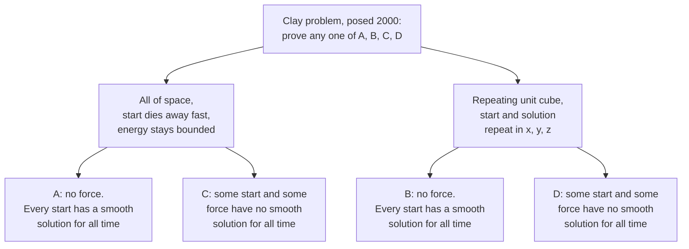
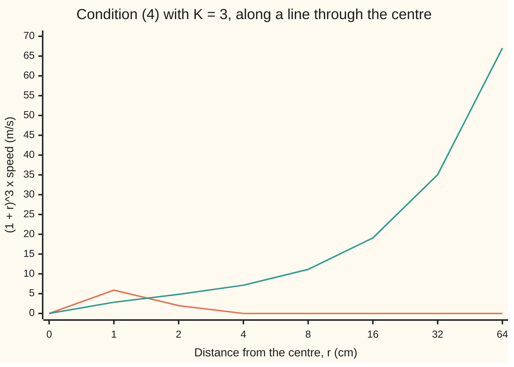

# Navier-Stokes: do smooth solutions of the fluid equations exist for all time in three dimensions

[Syllabus](../../../SYLLABUS.md) → [Frontier](../README.md) → [The Millennium Problems](../README.md#s02) → Navier-Stokes

---

## General Overview

In 2000 the Clay Mathematics Institute posted seven problems, each with a prize of one million US dollars. Clay counts one as solved: [The Poincare conjecture, solved](07-poincare-conjecture-solved.md). The other six are still on its list. This card states one of them exactly: the Navier-Stokes problem, in the official wording written by Charles Fefferman.

Take a swirl of water about 1 cm in radius, turning about a vertical axis. Its fastest water moves at 0.8578 m/s, 0.7071 cm from the axis, and the motion dies away quickly with distance. The Navier-Stokes equations (Newton's law for a fluid with friction, from [Leray's weak solutions](../../19-Partial%20differential%20equations/07-Nonlinear%20PDE%20and%20Fluids/02-leray-weak-solutions-of-navier-stokes.md)) say how the swirl moves next. Nobody knows whether the swirl's motion stays smooth forever.

The question is not about this swirl. Version A of the problem asks: for **every** smooth starting flow that dies away fast, with no outside force, does a smooth solution exist for all time? A yes for one swirl proves nothing. A single start that breaks down would settle the problem the other way.

**The Clay problem asks for a proof of any one of four statements: smooth solutions exist for all time from every admissible start (A on all of space, B in a repeating cube), or some admissible start and force produce no such solution (C on all of space, D in a repeating cube).**

**What kind of fact this is:** a problem statement. Its kind is an open question, with two possible answers. Its status, as of 2026-11-23, splits by version. A and B: open. C and D: claimed since 2026-09-08, when a proof that a designed smooth force makes a flow break down was announced with a manuscript and Lean files; it is not refereed ([The September 2026 Navier-Stokes claim](../05-Analysis%20and%20Dynamics/01-navier-stokes-blow-up-claim-2026.md)). No proof of any version has been accepted, and Clay's own page lists the problem as "Active", in their word.

### The picture: four versions, one prize



A and B say "always smooth". C and D say "sometimes not". The left side is the whole of space; the right side is a cube of side 1 whose faces wrap around, so water leaving one face comes back in at the opposite face.

---

## The formula

The Navier-Stokes symbols come from wing 19, one line each. $`u = (u_1, u_2, u_3)`$ is the velocity at position $`x`$ and time $`t`$. $`p`$ is the pressure divided by the density. $`\nu > 0`$ is the kinematic viscosity, how fast friction spreads motion. $`f`$ is an outside force per unit mass. $`\Delta`$ is the Laplacian, the sum of the three second derivatives.

The equations, numbered as in the official statement:

```math
\frac{\partial u_i}{\partial t} + \sum_{j=1}^{3} u_j \frac{\partial u_i}{\partial x_j} = \nu\,\Delta u_i - \frac{\partial p}{\partial x_i} + f_i(x,t) \quad (1), \qquad \nabla\cdot u = 0 \quad (2), \qquad u(x,0) = u^\circ(x) \quad (3)
```

**Read it aloud:** each piece of water speeds up as pressure, friction and the outside force push it (1); no water is made or lost anywhere (2); the flow starts from the given field $`u^\circ`$ (3).

On all of space, $`\mathbb{R}^3`$, the start and the force must die away faster than any power of the distance, and the solution must be smooth with bounded energy:

```math
\lvert\partial_x^\alpha u^\circ(x)\rvert \le C_{\alpha K}\,(1+\lvert x\rvert)^{-K} \quad (4), \qquad \lvert\partial_x^\alpha\partial_t^m f(x,t)\rvert \le C_{\alpha m K}\,(1+\lvert x\rvert+t)^{-K} \quad (5)
```

```math
p,\ u \in C^\infty(\mathbb{R}^3\times[0,\infty)) \quad (6), \qquad \int_{\mathbb{R}^3} \lvert u(x,t)\rvert^2\,dx < C \ \text{ for all } t \ge 0 \quad (7)
```

In the repeating cube, written $`\mathbb{R}^3/\mathbb{Z}^3`$, the start, force and pressure repeat when $`x`$ moves by one unit along an axis, (8); the force dies away in time, (9); the solution repeats, (10), and is smooth, (11).

Version A, the card's example, in one line:

```math
\forall\,\nu>0,\ \ \forall\,u^\circ \text{ smooth with } \nabla\cdot u^\circ = 0 \text{ and (4)}:\ \ \exists\,p,\,u \text{ satisfying (1), (2), (3) with } f = 0, \text{ and (6), (7)}
```

**Read it aloud:** for every viscosity and every smooth, incompressible start that dies away fast, there is a smooth solution with bounded energy that lasts for all time.

| Version | Where | Force | Claim |
| --- | --- | --- | --- |
| A | all of space | none | every start with (4) has a solution with (6), (7) |
| B | repeating cube | none | every smooth repeating start has a solution with (10), (11) |
| C | all of space | allowed, with (5) | some start with (4) and some force have no solution with (6), (7) |
| D | repeating cube | allowed, with (9) | some repeating start and force have no solution with (10), (11) |

| Symbol | Plain meaning | In our example | Push it up and the answer… |
| --- | --- | --- | --- |
| $`u`$, $`u_i`$; $`u^\circ`$ | velocity and its components; the starting velocity | the swirl, peak 0.8578 m/s | — |
| $`p`$; $`f`$, $`f_i`$ | pressure per unit density; outside force per unit mass | $`f = 0`$ in A and B | C and D allow it |
| $`\nu`$ | kinematic viscosity | water, $`1.0\times10^{-6}`$ m²/s, which is $`1.0\times10^{-4}`$ in cm and m/s units | friction damps faster |
| $`x`$, $`t`$; $`\Delta`$, $`\nabla\cdot`$ | position (cm) and time; the Laplacian (sum of the three second derivatives) and the divergence (net outflow from a point) | $`t`$ in units of 0.01 s; the swirl's divergence is 0 | — |
| $`\mathbb{R}^3`$; $`\mathbb{R}^3/\mathbb{Z}^3`$ | all of space; the cube of side 1 whose faces wrap around | 1 cm cube | — |
| $`\partial_x^\alpha`$, $`\partial_t^m`$ | any derivative in space, of any order; $`m`$ derivatives in time | — | — |
| $`K`$; $`C_{\alpha K}`$, $`C`$ | the decay power, any whole number; constants that may depend on it | $`K`$ = 3, 6, 10 | the condition gets stricter |
| $`C^\infty`$ | smooth: every derivative exists and is continuous | — | — |
| $`r`$; $`g(r)`$ | distance from the swirl's centre; how fast the water turns at that distance | $`g = 2e^{-r^2}`$, or $`(1+r^2)^{-3/2}`$ for the slow swirl | — |
| $`E_0`$; $`\omega`$ | starting energy, $`\tfrac12\int\lvert u^\circ\rvert^2 dx`$; the vorticity $`\nabla\times u`$, the local spin | $`E_0`$ = 1.968701 | — |
| $`\lVert u^\circ\rVert\,\lVert\nabla u^\circ\rVert`$; $`c`$ | Leray's small-start size: the energy size $`\lVert u^\circ\rVert = \sqrt{2E_0}`$ times the slope size $`\lVert\nabla u^\circ\rVert`$, the square root of all squared slopes added over space; a pure number in his theorem | $`8.8043\times10^{8}\,\nu^2`$ | further from Leray's guarantee |
| $`T`$ | blow-up time: the first time a smooth solution stops existing | unknown for the swirl | — |

### When it holds

These are the hypotheses that make the problem well posed. Each one, dropped, changes the question.

- **The start dies away faster than any power, (4).** The slow swirl has finite energy, 2.467401, yet $`(1+r)^3`$ times its speed reaches 67.023 at 64 cm and keeps rising. It is not a version A start.
- **The energy stays bounded, (7).** Without it, energy could arrive from infinity, and a "solution" could be driven from outside the region of interest.
- **The force is zero in A and B.** An outside force pumps energy in and might break a flow. Whether some smooth, fading force can is what C and D ask: claimed on 2026-09-08, not accepted as of 2026-11-23. To ask about the equations alone, A and B set $`f = 0`$.
- **Three dimensions.** In two dimensions the analogues of A and B are theorems, known for a long time (Ladyzhenskaya, per the official statement).
- **Viscosity is positive.** With $`\nu = 0`$ the equations are Euler's. The official description, in the version Clay posts (it cites work up to 2002), says the same questions are open there; they are not a prize problem.

---

## Why it works

This card states a problem rather than proving a theorem, so "why it works" means why the statement has this shape, and what is proved around it.

### Step 0: the idea

A smooth solution that lasts forever is the most a physicist could want: the flow is defined everywhere, at every time, with every derivative. The problem asks whether the equations always deliver that. The side conditions exist so that the answer depends on the equations, not on bad data or on what happens at infinity.

The one new term here is **finite-time blow-up**: a smooth solution that exists up to some time $`T`$ and cannot be continued smoothly past it. The official statement notes that if a Navier-Stokes solution blows up at $`T`$, its velocity becomes unbounded near $`T`$. Versions C and D ask for such a breakdown.

### Step 1: why the start must die away fast

Both swirls on this card have the form $`u = (-y, x, 0)\,g(r)`$: water turning about the vertical axis, with turning rate $`g`$ at distance $`r`$ from the centre. Any such field has divergence zero, so both are incompressible.

| $`r`$ (cm) | 0 | 1 | 2 | 4 | 8 | 16 | 32 | 64 |
| --- | ---: | ---: | ---: | ---: | ---: | ---: | ---: | ---: |
| Gaussian swirl, $`(1+r)^3`$ × speed | 0.000 | 5.886 | 1.978 | 0.000 | 0.000 | 0.000 | 0.000 | 0.000 |
| slow swirl, $`(1+r)^3`$ × speed | 0.000 | 2.828 | 4.830 | 7.133 | 11.129 | 19.080 | 35.043 | 67.023 |



Orange: the Gaussian swirl, $`g = 2e^{-r^2}`$. Green: the slow swirl, $`g = (1+r^2)^{-3/2}`$, whose speed falls only like $`1/r^2`$. The tick marks are not evenly spaced. Both checks print every point.

Condition (4) asks that $`(1+r)^K`$ times the speed stays bounded for every $`K`$. The Gaussian swirl passes: on a 0.01 cm grid up to 64 cm, the largest value is 6.0921 for $`K`$ = 3, 77.2472 for $`K`$ = 6 and 4343.9018 for $`K`$ = 10, each reached near the centre. The slow swirl fails at $`K`$ = 3. Leray's theorem still covers it, because its energy is finite. Version A does not.

### Step 2: two settings, and neither contains the other

The repeating cube removes infinity altogether. Its test case is the Taylor-Green flow, $`u = (\sin 2\pi x\cos 2\pi y,\ -\cos 2\pi x\sin 2\pi y,\ 0)\,e^{-8\pi^2\nu t}`$, an exact smooth solution for all time. The checks confirm it solves (1) at three points; with the pressure's sign flipped the error is 6.2708.

Read on all of space, the same flow is not a version A start. Each unit cell holds energy 0.25, so $`100^3`$ cells hold 250,000, and the total is infinite. Going the other way, the Gaussian swirl does not repeat: its speed at 1.5 cm differs from its speed at 0.5 cm by 0.4626 m/s. The two settings have different starts, so the official statement lists them as separate versions.

### Step 3: four statements, not two opposites

A says "never breaks, without force". C says "breaks for some start and some force". Zero is an allowed force in (5). So a start that breaks without force proves C at once: not-A implies C. The reverse fails. A forced breakdown says nothing about unforced flows, so A and C could both be true.

The checks count this in a toy world: 2 starts, 2 forces (one of them zero), and every way of marking each pair "breaks" or "smooth". Of the 16 worlds, 3 have A and C both true, 1 has A only, 12 have C only, and **none** has neither. Checked for up to 3 starts and 3 forces. So in every world at least one of A and C is true, and the same holds for B and D. The problem always has a true answer to prove.

### Step 4: what Leray proved in 1934, and what is known since

[Leray's weak solutions](../../19-Partial%20differential%20equations/07-Nonlinear%20PDE%20and%20Fluids/02-leray-weak-solutions-of-navier-stokes.md) gives the theorem: every finite-energy start on all of space has a weak solution for all time, meaning one that satisfies the equations only after averaging against smooth test fields, with uniqueness and smoothness unproved. In the same 1934 paper Leray proved two things version A needs:

- **Short time.** A smooth start has a smooth solution up to some time that depends on the start.
- **Small starts.** If $`\lVert u^\circ\rVert\,\lVert\nabla u^\circ\rVert < c\,\nu^2`$ for a pure number $`c`$, the smooth solution lasts forever.

For the swirl in water, $`\lVert u^\circ\rVert\,\lVert\nabla u^\circ\rVert`$ is $`8.8043\times10^{8}\,\nu^2`$. The product scales as the square of the speed. Leray's $`c`$ is a fixed small number that this card does not compute; taking $`c = 1`$ for scale, the swirl's speed must be multiplied by $`3.3702\times10^{-5}`$ to reach the threshold. Leray's theorem covers only very slow swirls; version A asks about all of them.

| Result | Kind and status | Source |
| --- | --- | --- |
| Two dimensions: analogues of A and B | theorem: proved | Ladyzhenskaya, per the official statement |
| Weak solutions for all time; smooth for short time and for small starts | theorem: proved, 1934 | Leray |
| The rough points of a suitable weak solution cannot contain the path of a moving point over any stretch of time | theorem: proved, 1982 | Caffarelli, Kohn and Nirenberg, per the official statement |
| A weak solution whose size measured by $`\int\lvert u\rvert^3dx`$ stays bounded stays smooth | theorem: proved, 2003 | Escauriaza, Seregin and Šverák |
| An averaged equation with the same energy law blows up in finite time | theorem: proved, 2016 | Tao |
| With a specially built force, two different Leray weak solutions share one start | theorem: proved, 2022 | Albritton, Brué and Colombo |
| A designed smooth force makes a flow at rest reach infinite speed in finite time, with bounded energy: the shape of versions C and D | theorem: claimed, 2026-09-08; not refereed | a manuscript and Lean files, read through the expositions [arXiv:2609.35406](https://arxiv.org/abs/2609.35406) and [arXiv:2611.06869](https://arxiv.org/abs/2611.06869) and the critique [arXiv:2610.08144](https://arxiv.org/abs/2610.08144); see [The September 2026 Navier-Stokes claim](../05-Analysis%20and%20Dynamics/01-navier-stokes-blow-up-claim-2026.md) |
| Versions A and B | open as of 2026-11-23 | the official statement; Clay lists the problem "Active" |

The 2003 result says how a blow-up would have to look: the size $`\int\lvert u\rvert^3dx`$ must become unbounded. The 2016 result says what a proof of A must use: something about the exact nonlinear term beyond the energy law, because an equation with the same energy law can blow up.

### Step 5: why energy alone does not decide it

[The energy inequality, and the gap it leaves in three dimensions](../../19-Partial%20differential%20equations/07-Nonlinear%20PDE%20and%20Fluids/03-energy-inequality-and-the-regularity-question.md) states the regularity problem in the repeating box and shows why it is hard. In one line: a copy of an eddy made 10 times smaller and faster costs one tenth of the energy, so the energy bound charges almost nothing for a cascade toward a point.

<details>
<summary>The status ledger for this problem, in the shelf's fields</summary>

**Statement:** versions A to D in Fefferman's official problem description, with the erratum that the pressure also repeats in (8).

**Artifact:** for C and D, a manuscript and a repository of Lean files, announced 2026-09-08, claiming a forced finite-time blow-up. For A and B, none.

**Independent check:** two expositions on arXiv by other mathematicians, 2026-09-28 and 2026-11-04, which follow the manuscript; one critique, 2026-10-06, showing that the Lean files do not mirror the written proof. No referee report or prize decision.

**Status:** as of 2026-11-23, A and B open; C and D claimed since 2026-09-08. Clay's word for the problem: "Active". Kind: an open question whose answer is either a theorem (A or B) or a counterexample (C or D).

</details>

---

## Worked numbers, by hand

Version A, the Gaussian swirl $`u^\circ = (-y, x, 0)\,2e^{-r^2}`$: lengths in cm, speeds in m/s, water's $`\nu = 1.0\times10^{-4}`$ in these units.

| Step | Arithmetic | Value |
| --- | --- | --- |
| peak speed, at $`r = 1/\sqrt2`$ cm in the middle plane | $`2 \times 0.7071 \times e^{-0.5}`$ | 0.8578 m/s |
| starting energy $`E_0`$ | closed form $`(\pi/2)^{3/2}`$; grid sum agrees | 1.968701 (m/s)² cm³ |
| in joules | × 1000 kg/m³ × $`10^{-6}`$ m³/cm³ | $`1.9687\times10^{-3}`$ J |
| slope size squared, $`\lVert\nabla u^\circ\rVert^2`$ | grid sum of squared slopes; equals $`\lVert\omega\rVert^2`$ | 19.687012 (m/s)² cm |
| small-start size | $`\sqrt{2 \times 1.968701 \times 19.687012}`$ | 8.8043 |
| against $`\nu^2`$ | $`8.8043 / (1.0\times10^{-4})^2`$ | $`8.8043\times10^{8}\,\nu^2`$ |
| condition (4), $`K`$ = 3 | largest $`(1+r)^3`$ × speed | 6.0921: passes |
| verdict | smooth, incompressible, fast decay, $`f = 0`$ | **a valid version A start; whether it stays smooth forever is unknown** |

The swirl meets every hypothesis of version A, and it is far outside Leray's small-start guarantee. Version A asks whether this start, and every other one like it, has a smooth solution for all time.

### What breaks if you drop a piece

| Mistake | Comes out at | What went wrong |
| --- | --- | --- |
| Prove it for one start | Taylor-Green solves (1) exactly, for all time | the problem quantifies over every start; one instance is evidence, not proof |
| Feed the slow swirl to version A | $`(1+r)^3`$ × speed = 67.023 at 64 cm, rising | finite energy (2.467401) is not enough; (4) needs decay faster than every power |
| Read a repeating flow as an all-of-space start | energy 250,000 in $`100^3`$ cells, unbounded | it breaks (4) and (7); it belongs to version B |
| Read C as "A is false" | 3 of 16 toy worlds have A and C both true | C allows a force; a forced breakdown leaves A untouched |
| Drop incompressibility | the squeezing field $`(xe^{-x^2}, 0, 0)`$ has divergence 1.0000 at the origin | (2) fails, so it is not an admissible start at all |

---

## Code, from first principles, and it actually runs

The script tests the hypotheses of the four versions on concrete fields. It cannot test the conjecture. It takes five pairs of independent roads: the swirl's energy by a grid sum against its closed form; its slope size by finite differences against the vorticity worked by hand; the slow swirl's energy by Simpson's rule against $`\pi^2/4`$; the Taylor-Green flow checked in (1) by finite differences against its hand-derived pressure; and the toy-world counts by enumeration against a counting formula.

### Python

```python
# Navier-Stokes existence and smoothness -- the check behind the card.  Standard
# library only.  It tests the hypotheses of the Clay versions A to D on concrete
# data; it does not, and cannot, test the conjecture itself.
# Units: lengths in cm, speeds in m/s, so time is in units of 0.01 s and water's
# kinematic viscosity 1.0e-6 m^2/s becomes NU = 1.0e-4.
import math
NU = 1.0e-6 / (0.01 * 1.0)

def en(x, p=4):                     # e-notation written the way Rust writes it
    m, ex = f"{x:.{p}e}".split("e")
    return f"{m}e{int(ex)}"

def swirl(x, y, z, g):             # u = (-y, x, 0) g(r): water turning about the z-axis
    r = math.sqrt(x * x + y * y + z * z)
    s = g(r)
    return (-y * s, x * s, 0.0)

GAUSS = lambda r: 2.0 * math.exp(-r * r)          # version A datum: dies off fast
SLOW = lambda r: (1.0 + r * r) ** -1.5              # smooth, finite energy, slow tail

def div(f, x, y, z, d=1e-4):                        # divergence by central differences
    return ((f(x + d, y, z)[0] - f(x - d, y, z)[0]) + (f(x, y + d, z)[1] - f(x, y - d, z)[1])
            + (f(x, y, z + d)[2] - f(x, y, z - d)[2])) / (2 * d)

# ---- road 1: grid sums over the cube [-6, 6]^3, spacing 0.25 ----
h, n, d = 0.25, 24, 1e-4
E = Y = W = 0.0
for i in range(-n, n + 1):
    for j in range(-n, n + 1):
        for k in range(-n, n + 1):
            x, y, z = i * h, j * h, k * h
            u = swirl(x, y, z, GAUSS)
            E += 0.5 * sum(c * c for c in u)
            for e in ((d, 0, 0), (0, d, 0), (0, 0, d)):       # gradient by differences
                up = swirl(x + e[0], y + e[1], z + e[2], GAUSS)
                um = swirl(x - e[0], y - e[1], z - e[2], GAUSS)
                Y += sum(((up[c] - um[c]) / (2 * d)) ** 2 for c in range(3))
            ex = math.exp(-(x * x + y * y + z * z))            # vorticity, by hand
            W += (4 * x * z * ex) ** 2 + (4 * y * z * ex) ** 2 + ((4 - 4 * (x * x + y * y)) * ex) ** 2
E, Y, W = E * h ** 3, Y * h ** 3, W * h ** 3
E_exact = (math.pi / 2) ** 1.5                      # 1/2 * 4 * 2 * (sqrt(pi)/(2*2^1.5)) * (pi/2)
print(f"house: Clay list 7 problems, 1 solved (Poincare), 6 open; nu = {en(NU, 1)} in cm, m/s units")
print(f"swirl peak speed {2 * math.sqrt(0.5) * math.exp(-0.5):.4f} m/s at {math.sqrt(0.5):.4f} cm from the axis")
print(f"swirl energy E0: grid {E:.6f}, closed form (pi/2)^1.5 = {E_exact:.6f}")
print(f"swirl in joules (x 1000 kg/m^3 x 1e-6 m^3/cm^3): {en(E * 1e-3)} J")
print(f"swirl enstrophy: grad u squared {Y:.6f}; vorticity squared {W:.6f}")
divs = [div(lambda a, b, c: swirl(a, b, c, GAUSS), *p) for p in ((0.3, -0.7, 0.5), (1.1, 0.4, -0.9))]
print("swirl divergence at two points ~0:", "yes" if max(abs(v) for v in divs) < 1e-6 else "no")
squeeze = lambda a, b, c: (a * math.exp(-a * a), 0.0, 0.0)
print(f"a squeezing field (x e^(-x^2), 0, 0) at x = 0: divergence {div(squeeze, 0.0, 0.0, 0.0):.4f}")
prod = math.sqrt(2 * E) * math.sqrt(Y)
print(f"small-start size |u0| |grad u0| = {prod:.4f} = {en(prod / NU ** 2)} nu^2")
print(f"speed scale that brings it to 1 nu^2: {en(1 / math.sqrt(prod / NU ** 2))} of the swirl's")

# ---- the decay condition (4) along the x-axis: (1 + r)^3 |u(r, 0, 0)| ----
rs = [0, 1, 2, 4, 8, 16, 32, 64]
fa = [(1 + r) ** 3 * r * GAUSS(r) for r in rs]
fs = [(1 + r) ** 3 * r * SLOW(r) for r in rs]
print("chart, r (cm):", ", ".join(str(r) for r in rs))
print("chart, Gaussian swirl (1+r)^3 |u|:", ", ".join(f"{v:.3f}" for v in fa))
print("chart, slow swirl (1+r)^3 |u|:", ", ".join(f"{v:.3f}" for v in fs))
for K in (3, 6, 10):                                 # largest value of (1+r)^K |u| on the grid
    mx, at = max(((1 + q / 100) ** K * (q / 100) * GAUSS(q / 100), q / 100) for q in range(6401))
    print(f"Gaussian swirl: largest (1+r)^{K} |u| on a 0.01 cm grid to r = 64 is {mx:.4f}, at r = {at:.2f}")
    assert (1 + 64) ** K * 64 * GAUSS(64) < 1e-100 < mx
# slow swirl energy: (4 pi / 3) int r^4 SLOW(r)^2 dr; put r = tan(t), so dr = (1 + r^2) dt
m, rt = 2000, lambda q: math.tan(q * math.pi / 2 / m)
simp = sum((1 if q in (0, m) else 4 if q % 2 else 2) * rt(q) ** 4 * SLOW(rt(q)) ** 2 * (1 + rt(q) ** 2)
           for q in range(m + 1)) * (math.pi / 2 / m) / 3
print(f"slow swirl energy: Simpson {4 * math.pi / 3 * simp:.6f}, closed form pi^2/4 = {math.pi ** 2 / 4:.6f}")

# ---- the periodic case: Taylor-Green flow in the unit cube, an exact solution ----
kw = 2 * math.pi
def tg(x, y, t):
    f = math.exp(-2 * kw * kw * NU * t)
    return (math.sin(kw * x) * math.cos(kw * y) * f, -math.cos(kw * x) * math.sin(kw * y) * f)
def tgp(x, y, t):
    return 0.25 * (math.cos(2 * kw * x) + math.cos(2 * kw * y)) * math.exp(-4 * kw * kw * NU * t)
def residual(x, y, t, P, e=1e-4):                    # Navier-Stokes, term by term, by differences
    u, out = tg(x, y, t), []
    for c in range(2):
        dt = (tg(x, y, t + e)[c] - tg(x, y, t - e)[c]) / (2 * e)
        dx = (tg(x + e, y, t)[c] - tg(x - e, y, t)[c]) / (2 * e)
        dy = (tg(x, y + e, t)[c] - tg(x, y - e, t)[c]) / (2 * e)
        lap = (tg(x + e, y, t)[c] + tg(x - e, y, t)[c] + tg(x, y + e, t)[c] + tg(x, y - e, t)[c] - 4 * u[c]) / e ** 2
        gp = ((P(x + e, y, t) - P(x - e, y, t)) if c == 0 else (P(x, y + e, t) - P(x, y - e, t))) / (2 * e)
        out.append(abs(dt + u[0] * dx + u[1] * dy + gp - NU * lap))
    return max(out)
pts = [(0.13, 0.71, 0.0), (0.42, 0.05, 50.0), (0.88, 0.37, 400.0)]
res = max(residual(*p, tgp) for p in pts)
bad = max(residual(*p, lambda a, b, c: -tgp(a, b, c)) for p in pts)
print(f"Taylor-Green: residual below 1e-5 at 3 points: {'yes' if res < 1e-5 else 'no'}; "
      f"pressure sign flipped: residual {bad:.4f}")
cell = sum(0.5 * sum(c * c for c in tg(i / 8, j / 8, 0.0)) for i in range(8) for j in range(8)) / 64
print(f"Taylor-Green energy per unit cell: grid {cell:.6f}, by hand 1/4 = {0.25:.6f}")
for N in (1, 10, 100):
    print(f"same flow read on all of space: energy in {N}^3 cells = {cell * N ** 3:.2f}")
half = math.log(2) / (4 * kw * kw * NU)
print(f"half-life of its energy: ln 2 / (4 k^2 nu) = {half:.4f} units = {half * 0.01:.4f} s")
print(f"Gaussian swirl is not periodic: |u(1.5,0,0) - u(0.5,0,0)| = "
      f"{abs(swirl(1.5, 0, 0, GAUSS)[1] - swirl(0.5, 0, 0, GAUSS)[1]):.4f}")

# ---- A against C: a toy world with D data and F forces (one of them zero) ----
D, F = 2, 2
tally = {}
for w in range(2 ** (D * F)):                       # bit (d, f) set: that pair breaks down
    a = all(not (w >> (d * F + 0)) & 1 for d in range(D))     # force 0 never breaks
    c = w != 0                                                  # some pair breaks
    tally[(a, c)] = tally.get((a, c), 0) + 1
print(f"toy worlds {2 ** (D * F)}: A and C {tally.get((True, True), 0)}, A only {tally.get((True, False), 0)}, "
      f"C only {tally.get((False, True), 0)}, neither {tally.get((False, False), 0)}")
print("checked for D, F <= 3: 'neither' never happens")
assert [tally.get(k, 0) for k in ((False, False), (False, True), (True, False), (True, True))] == \
       [0, 2 ** (D * F) - 2 ** (D * (F - 1)), 1, 2 ** (D * (F - 1)) - 1]   # the printed tally, against the formula
for D2 in range(1, 4):
    for F2 in range(1, 4):
        cnt = [0, 0, 0, 0]
        for w in range(2 ** (D2 * F2)):
            a = all(not (w >> (d * F2)) & 1 for d in range(D2))
            cnt[2 * a + (w != 0)] += 1
        assert cnt == [0, 2 ** (D2 * F2) - 2 ** (D2 * (F2 - 1)), 1, 2 ** (D2 * (F2 - 1)) - 1]
assert abs(E - E_exact) < 1e-9 and abs(Y - W) < 1e-6 * W        # two roads, twice
assert abs(4 * math.pi / 3 * simp - math.pi ** 2 / 4) < 1e-9
assert max(abs(v) for v in divs) < 1e-6 and abs(div(squeeze, 0, 0, 0) - 1) < 1e-6
assert res < 1e-5 and bad > 0.1 and abs(cell - 0.25) < 1e-12
assert fs[-1] > fs[-2] > fs[-3] > fs[-4] and fs[-1] > 60 and fa[-1] < 1e-100
print("ALL CHECKS PASS")
```

**Ran 2026-11-23 on macOS, Python 3.14.10, standard library only. All checks passed. Output, pasted from the run:**

```
house: Clay list 7 problems, 1 solved (Poincare), 6 open; nu = 1.0e-4 in cm, m/s units
swirl peak speed 0.8578 m/s at 0.7071 cm from the axis
swirl energy E0: grid 1.968701, closed form (pi/2)^1.5 = 1.968701
swirl in joules (x 1000 kg/m^3 x 1e-6 m^3/cm^3): 1.9687e-3 J
swirl enstrophy: grad u squared 19.687012; vorticity squared 19.687012
swirl divergence at two points ~0: yes
a squeezing field (x e^(-x^2), 0, 0) at x = 0: divergence 1.0000
small-start size |u0| |grad u0| = 8.8043 = 8.8043e8 nu^2
speed scale that brings it to 1 nu^2: 3.3702e-5 of the swirl's
chart, r (cm): 0, 1, 2, 4, 8, 16, 32, 64
chart, Gaussian swirl (1+r)^3 |u|: 0.000, 5.886, 1.978, 0.000, 0.000, 0.000, 0.000, 0.000
chart, slow swirl (1+r)^3 |u|: 0.000, 2.828, 4.830, 7.133, 11.129, 19.080, 35.043, 67.023
Gaussian swirl: largest (1+r)^3 |u| on a 0.01 cm grid to r = 64 is 6.0921, at r = 1.14
Gaussian swirl: largest (1+r)^6 |u| on a 0.01 cm grid to r = 64 is 77.2472, at r = 1.52
Gaussian swirl: largest (1+r)^10 |u| on a 0.01 cm grid to r = 64 is 4343.9018, at r = 1.95
slow swirl energy: Simpson 2.467401, closed form pi^2/4 = 2.467401
Taylor-Green: residual below 1e-5 at 3 points: yes; pressure sign flipped: residual 6.2708
Taylor-Green energy per unit cell: grid 0.250000, by hand 1/4 = 0.250000
same flow read on all of space: energy in 1^3 cells = 0.25
same flow read on all of space: energy in 10^3 cells = 250.00
same flow read on all of space: energy in 100^3 cells = 250000.00
half-life of its energy: ln 2 / (4 k^2 nu) = 43.8941 units = 0.4389 s
Gaussian swirl is not periodic: |u(1.5,0,0) - u(0.5,0,0)| = 0.4626
toy worlds 16: A and C 3, A only 1, C only 12, neither 0
checked for D, F <= 3: 'neither' never happens
ALL CHECKS PASS
```

### Rust

Same numbers, same labels, built with `rustc --edition 2021 -O`.

```rust
// Navier-Stokes existence and smoothness -- the same check as the Python, in Rust.
// No crates.  It tests the hypotheses of the Clay versions A to D on concrete
// data; it does not, and cannot, test the conjecture itself.
// Units: lengths in cm, speeds in m/s, so time is in units of 0.01 s and water's
// kinematic viscosity 1.0e-6 m^2/s becomes NU = 1.0e-4.
use std::f64::consts::PI;
const NU: f64 = 1.0e-6 / (0.01 * 1.0);
type Field = dyn Fn(f64, f64, f64) -> [f64; 3];

fn swirl(x: f64, y: f64, z: f64, g: fn(f64) -> f64) -> [f64; 3] {
    let s = g((x * x + y * y + z * z).sqrt()); // u = (-y, x, 0) g(r): water turning about z
    [-y * s, x * s, 0.0]
}
fn gauss(r: f64) -> f64 { 2.0 * (-r * r).exp() } // version A datum: dies off fast
fn slow(r: f64) -> f64 { (1.0 + r * r).powf(-1.5) } // smooth, finite energy, slow tail
fn div(f: &Field, x: f64, y: f64, z: f64) -> f64 { // divergence by central differences
    let d = 1e-4;
    ((f(x + d, y, z)[0] - f(x - d, y, z)[0]) + (f(x, y + d, z)[1] - f(x, y - d, z)[1])
        + (f(x, y, z + d)[2] - f(x, y, z - d)[2])) / (2.0 * d)
}
fn tg(x: f64, y: f64, t: f64) -> [f64; 2] { // Taylor-Green flow in the unit cube
    let kw = 2.0 * PI;
    let f = (-2.0 * kw * kw * NU * t).exp();
    [(kw * x).sin() * (kw * y).cos() * f, -(kw * x).cos() * (kw * y).sin() * f]
}
fn tgp(x: f64, y: f64, t: f64) -> f64 {
    let kw = 2.0 * PI;
    0.25 * ((2.0 * kw * x).cos() + (2.0 * kw * y).cos()) * (-4.0 * kw * kw * NU * t).exp()
}
fn residual(x: f64, y: f64, t: f64, p: &dyn Fn(f64, f64, f64) -> f64) -> f64 {
    let (e, u) = (1e-4, tg(x, y, t)); // Navier-Stokes, term by term, by differences
    let mut out: f64 = 0.0;
    for c in 0..2 {
        let dt = (tg(x, y, t + e)[c] - tg(x, y, t - e)[c]) / (2.0 * e);
        let dx = (tg(x + e, y, t)[c] - tg(x - e, y, t)[c]) / (2.0 * e);
        let dy = (tg(x, y + e, t)[c] - tg(x, y - e, t)[c]) / (2.0 * e);
        let lap = (tg(x + e, y, t)[c] + tg(x - e, y, t)[c] + tg(x, y + e, t)[c] + tg(x, y - e, t)[c] - 4.0 * u[c]) / (e * e);
        let gp = (if c == 0 { p(x + e, y, t) - p(x - e, y, t) } else { p(x, y + e, t) - p(x, y - e, t) }) / (2.0 * e);
        out = out.max((dt + u[0] * dx + u[1] * dy + gp - NU * lap).abs());
    }
    out
}
fn yn(b: bool) -> &'static str { if b { "yes" } else { "no" } }
fn join(v: &[f64]) -> String { v.iter().map(|x| format!("{:.3}", x)).collect::<Vec<_>>().join(", ") }

fn main() {
    // ---- road 1: grid sums over the cube [-6, 6]^3, spacing 0.25 ----
    let (h, n, d) = (0.25f64, 24i32, 1e-4f64);
    let (mut e0, mut y0, mut w0) = (0.0f64, 0.0f64, 0.0f64);
    for i in -n..=n { for j in -n..=n { for k in -n..=n {
        let (x, y, z) = (i as f64 * h, j as f64 * h, k as f64 * h);
        let u = swirl(x, y, z, gauss);
        e0 += 0.5 * (u[0] * u[0] + u[1] * u[1] + u[2] * u[2]);
        for s in [[d, 0.0, 0.0], [0.0, d, 0.0], [0.0, 0.0, d]] { // gradient by differences
            let up = swirl(x + s[0], y + s[1], z + s[2], gauss);
            let um = swirl(x - s[0], y - s[1], z - s[2], gauss);
            y0 += (0..3).map(|c| ((up[c] - um[c]) / (2.0 * d)).powi(2)).sum::<f64>();
        }
        let ex = (-(x * x + y * y + z * z)).exp(); // vorticity, by hand
        w0 += (4.0 * x * z * ex).powi(2) + (4.0 * y * z * ex).powi(2) + ((4.0 - 4.0 * (x * x + y * y)) * ex).powi(2);
    } } }
    let (e0, y0, w0) = (e0 * h.powi(3), y0 * h.powi(3), w0 * h.powi(3));
    let e_exact = (PI / 2.0).powf(1.5);
    println!("house: Clay list 7 problems, 1 solved (Poincare), 6 open; nu = {:.1e} in cm, m/s units", NU);
    println!("swirl peak speed {:.4} m/s at {:.4} cm from the axis", 2.0 * 0.5f64.sqrt() * (-0.5f64).exp(), 0.5f64.sqrt());
    println!("swirl energy E0: grid {:.6}, closed form (pi/2)^1.5 = {:.6}", e0, e_exact);
    println!("swirl in joules (x 1000 kg/m^3 x 1e-6 m^3/cm^3): {:.4e} J", e0 * 1e-3);
    println!("swirl enstrophy: grad u squared {:.6}; vorticity squared {:.6}", y0, w0);
    let sw: &Field = &|a, b, c| swirl(a, b, c, gauss);
    let divs = [div(sw, 0.3, -0.7, 0.5), div(sw, 1.1, 0.4, -0.9)];
    let dmax = divs[0].abs().max(divs[1].abs());
    println!("swirl divergence at two points ~0: {}", yn(dmax < 1e-6));
    let squeeze: &Field = &|a, _b, _c| [a * (-a * a).exp(), 0.0, 0.0];
    println!("a squeezing field (x e^(-x^2), 0, 0) at x = 0: divergence {:.4}", div(squeeze, 0.0, 0.0, 0.0));
    let prod = (2.0 * e0).sqrt() * y0.sqrt();
    println!("small-start size |u0| |grad u0| = {:.4} = {:.4e} nu^2", prod, prod / (NU * NU));
    println!("speed scale that brings it to 1 nu^2: {:.4e} of the swirl's", 1.0 / (prod / (NU * NU)).sqrt());

    // ---- the decay condition (4) along the x-axis: (1 + r)^3 |u(r, 0, 0)| ----
    let rs = [0.0f64, 1.0, 2.0, 4.0, 8.0, 16.0, 32.0, 64.0];
    let fa: Vec<f64> = rs.iter().map(|&r| (1.0 + r).powi(3) * r * gauss(r)).collect();
    let fs: Vec<f64> = rs.iter().map(|&r| (1.0 + r).powi(3) * r * slow(r)).collect();
    println!("chart, r (cm): {}", rs.iter().map(|r| format!("{}", r)).collect::<Vec<_>>().join(", "));
    println!("chart, Gaussian swirl (1+r)^3 |u|: {}", join(&fa));
    println!("chart, slow swirl (1+r)^3 |u|: {}", join(&fs));
    for kk in [3i32, 6, 10] { // largest value of (1+r)^K |u| on the grid
        let (mut mx, mut at) = (-1.0f64, 0.0f64);
        for q in 0..=6400 {
            let r = q as f64 / 100.0;
            let v = (1.0 + r).powi(kk) * r * gauss(r);
            if v > mx { mx = v; at = r; }
        }
        println!("Gaussian swirl: largest (1+r)^{} |u| on a 0.01 cm grid to r = 64 is {:.4}, at r = {:.2}", kk, mx, at);
        assert!(65f64.powi(kk) * 64.0 * gauss(64.0) < 1e-100 && 1e-100 < mx);
    }
    // slow swirl energy: (4 pi / 3) int r^4 SLOW(r)^2 dr; put r = tan(t), so dr = (1 + r^2) dt
    let m = 2000;
    let simp = (0..=m).map(|q| {
        let wq = if q == 0 || q == m { 1.0 } else if q % 2 == 1 { 4.0 } else { 2.0 };
        let rt = (q as f64 * PI / 2.0 / m as f64).tan();
        wq * rt.powi(4) * slow(rt).powi(2) * (1.0 + rt * rt)
    }).sum::<f64>() * (PI / 2.0 / m as f64) / 3.0;
    println!("slow swirl energy: Simpson {:.6}, closed form pi^2/4 = {:.6}", 4.0 * PI / 3.0 * simp, PI * PI / 4.0);

    // ---- the periodic case: Taylor-Green flow in the unit cube, an exact solution ----
    let pts = [(0.13, 0.71, 0.0), (0.42, 0.05, 50.0), (0.88, 0.37, 400.0)];
    let res = pts.iter().map(|&(x, y, t)| residual(x, y, t, &tgp)).fold(0.0, f64::max);
    let flip = |a: f64, b: f64, c: f64| -tgp(a, b, c);
    let bad = pts.iter().map(|&(x, y, t)| residual(x, y, t, &flip)).fold(0.0, f64::max);
    println!("Taylor-Green: residual below 1e-5 at 3 points: {}; pressure sign flipped: residual {:.4}", yn(res < 1e-5), bad);
    let mut cell = 0.0;
    for i in 0..8 { for j in 0..8 {
        let u = tg(i as f64 / 8.0, j as f64 / 8.0, 0.0);
        cell += 0.5 * (u[0] * u[0] + u[1] * u[1]);
    } }
    cell /= 64.0;
    println!("Taylor-Green energy per unit cell: grid {:.6}, by hand 1/4 = {:.6}", cell, 0.25);
    for nn in [1i32, 10, 100] {
        println!("same flow read on all of space: energy in {}^3 cells = {:.2}", nn, cell * (nn as f64).powi(3));
    }
    let half = 2f64.ln() / (4.0 * 4.0 * PI * PI * NU);
    println!("half-life of its energy: ln 2 / (4 k^2 nu) = {:.4} units = {:.4} s", half, half * 0.01);
    println!("Gaussian swirl is not periodic: |u(1.5,0,0) - u(0.5,0,0)| = {:.4}",
             (swirl(1.5, 0.0, 0.0, gauss)[1] - swirl(0.5, 0.0, 0.0, gauss)[1]).abs());

    // ---- A against C: a toy world with D data and F forces (one of them zero) ----
    let tally = |dd: u32, ff: u32| -> [u64; 4] { // bit (d, f) set: that pair breaks down
        let mut cnt = [0u64; 4];
        for w in 0u64..(1 << (dd * ff)) {
            let a = (0..dd).all(|d| (w >> (d * ff)) & 1 == 0); // force 0 never breaks
            cnt[2 * a as usize + (w != 0) as usize] += 1; // C: some pair breaks
        }
        cnt
    };
    let t = tally(2, 2);
    println!("toy worlds 16: A and C {}, A only {}, C only {}, neither {}", t[3], t[2], t[1], t[0]);
    println!("checked for D, F <= 3: 'neither' never happens");
    for d2 in 1..4u32 { for f2 in 1..4u32 {
        let (all, a_true) = (1u64 << (d2 * f2), 1u64 << (d2 * (f2 - 1)));
        assert_eq!(tally(d2, f2), [0, all - a_true, 1, a_true - 1]);
    } }
    assert!((e0 - e_exact).abs() < 1e-9 && (y0 - w0).abs() < 1e-6 * w0); // two roads, twice
    assert!((4.0 * PI / 3.0 * simp - PI * PI / 4.0).abs() < 1e-9);
    assert!(dmax < 1e-6 && (div(squeeze, 0.0, 0.0, 0.0) - 1.0).abs() < 1e-6);
    assert!(res < 1e-5 && bad > 0.1 && (cell - 0.25f64).abs() < 1e-12);
    assert!(fs[7] > fs[6] && fs[6] > fs[5] && fs[5] > fs[4] && fs[7] > 60.0 && fa[7] < 1e-100);
    println!("ALL CHECKS PASS");
}
```

**Ran 2026-11-23 on macOS, rustc 1.98.1, no crates. All checks passed. Output, pasted from the run:**

```
house: Clay list 7 problems, 1 solved (Poincare), 6 open; nu = 1.0e-4 in cm, m/s units
swirl peak speed 0.8578 m/s at 0.7071 cm from the axis
swirl energy E0: grid 1.968701, closed form (pi/2)^1.5 = 1.968701
swirl in joules (x 1000 kg/m^3 x 1e-6 m^3/cm^3): 1.9687e-3 J
swirl enstrophy: grad u squared 19.687012; vorticity squared 19.687012
swirl divergence at two points ~0: yes
a squeezing field (x e^(-x^2), 0, 0) at x = 0: divergence 1.0000
small-start size |u0| |grad u0| = 8.8043 = 8.8043e8 nu^2
speed scale that brings it to 1 nu^2: 3.3702e-5 of the swirl's
chart, r (cm): 0, 1, 2, 4, 8, 16, 32, 64
chart, Gaussian swirl (1+r)^3 |u|: 0.000, 5.886, 1.978, 0.000, 0.000, 0.000, 0.000, 0.000
chart, slow swirl (1+r)^3 |u|: 0.000, 2.828, 4.830, 7.133, 11.129, 19.080, 35.043, 67.023
Gaussian swirl: largest (1+r)^3 |u| on a 0.01 cm grid to r = 64 is 6.0921, at r = 1.14
Gaussian swirl: largest (1+r)^6 |u| on a 0.01 cm grid to r = 64 is 77.2472, at r = 1.52
Gaussian swirl: largest (1+r)^10 |u| on a 0.01 cm grid to r = 64 is 4343.9018, at r = 1.95
slow swirl energy: Simpson 2.467401, closed form pi^2/4 = 2.467401
Taylor-Green: residual below 1e-5 at 3 points: yes; pressure sign flipped: residual 6.2708
Taylor-Green energy per unit cell: grid 0.250000, by hand 1/4 = 0.250000
same flow read on all of space: energy in 1^3 cells = 0.25
same flow read on all of space: energy in 10^3 cells = 250.00
same flow read on all of space: energy in 100^3 cells = 250000.00
half-life of its energy: ln 2 / (4 k^2 nu) = 43.8941 units = 0.4389 s
Gaussian swirl is not periodic: |u(1.5,0,0) - u(0.5,0,0)| = 0.4626
toy worlds 16: A and C 3, A only 1, C only 12, neither 0
checked for D, F <= 3: 'neither' never happens
ALL CHECKS PASS
```

The two outputs match line for line.

### Lean

Lean proves Step 3's claim for every viscosity, the toy-world counts for every size, and the Taylor-Green flow exactly.

- Take any viscosity $`\nu > 0`$. Then A or C is true, and B or D is true, because zero is an allowed force.
- Take a toy world with `D` starts and `F` forces, the first force zero. Then none of its $`2^{DF}`$ worlds has neither A nor C.
- Take the same toy world. Then one world has A only, and $`2^{D(F-1)} - 1`$ have A and C both true.
- Take the same toy world. Then $`2^{DF} - 2^{D(F-1)}`$ worlds have C only.
- With 2 starts and 2 forces this gives the card's 16 worlds: 3, 1, 12 and 0. With 3 and 3 it gives 512 worlds and 63.
- Take any viscosity $`\nu > 0`$. Then the Taylor-Green flow and its pressure solve (1), (2) and (3) with no force, at every point and time.
- Its start is a valid version B start, and the flow repeats and is smooth, (10) and (11).
- Lean also checks the sum for $`100^3`$ cells at energy 1/4 each: 250,000.

No version is proved here. The swirls, condition (4), Leray's small-start size and the grid sums are left to the Python and Rust checks.

```lean
-- Navier-Stokes: for every viscosity Clay's version A or C is true and version B or D is true, the card's toy-world counts hold, and the Taylor-Green flow solves the equations exactly.
import Mathlib.Analysis.InnerProductSpace.Laplacian
import Mathlib.Analysis.InnerProductSpace.PiL2
import Mathlib.Analysis.Calculus.Gradient.Basic
import Mathlib.Analysis.SpecialFunctions.Trigonometric.Deriv
import Mathlib.Analysis.SpecialFunctions.ExpDeriv
import Mathlib.MeasureTheory.Integral.Bochner.Basic
import Mathlib.MeasureTheory.Measure.Haar.OfBasis
import Mathlib.Analysis.Normed.Lp.MeasurableSpace
import Mathlib.LinearAlgebra.Trace
import Mathlib.Data.Fintype.Powerset
import Mathlib.Analysis.InnerProductSpace.Trace
import Mathlib.Analysis.Calculus.FDeriv.WithLp
import Mathlib.Analysis.Calculus.ContDiff.WithLp

open MeasureTheory Laplacian Gradient
open scoped ContDiff

namespace NavierStokesClay

/-- Three-dimensional space `ℝ³`. -/
abbrev E3 := EuclideanSpace ℝ (Fin 3)

/-- The unit vector `e_j` along axis `j`. -/
noncomputable abbrev unitVec (j : Fin 3) : E3 := EuclideanSpace.single j 1

/-- The closed half-space `ℝ³ × [0, ∞)` where time is not negative. -/
def halfSpace : Set (E3 × ℝ) := {q | 0 ≤ q.2}

/-- The divergence `∇ · v` of a vector field: the trace of its derivative. -/
noncomputable def divergence (v : E3 → E3) (x : E3) : ℝ := LinearMap.trace ℝ E3 (fderiv ℝ v x)

/-- Equations (1), (2), (3) with viscosity `ν`, start `u0`, force `f`, pressure `p` and
velocity `u`: (1) `∂u/∂t + (u · ∇) u = ν Δu − ∇p + f` for `t > 0`; (2) `∇ · u = 0` for
`t ≥ 0`; (3) `u(x, 0) = u0(x)`. -/
def SolvesNS (ν : ℝ) (u0 : E3 → E3) (f : E3 → ℝ → E3) (p : E3 → ℝ → ℝ) (u : E3 → ℝ → E3) :
    Prop :=
  (∀ x t, 0 < t →
      deriv (fun s => u x s) t + fderiv ℝ (fun y => u y t) x (u x t)
        = ν • Δ (fun y => u y t) x - ∇ (fun y => p y t) x + f x t) ∧
  (∀ x t, 0 ≤ t → divergence (fun y => u y t) x = 0) ∧
  (∀ x, u x 0 = u0 x)

/-- Condition (6): `p` and `u` are smooth on `ℝ³ × [0, ∞)`. -/
def SmoothOnHalfSpace (p : E3 → ℝ → ℝ) (u : E3 → ℝ → E3) : Prop :=
  ContDiffOn ℝ ∞ (fun q : E3 × ℝ => p q.1 q.2) halfSpace ∧
  ContDiffOn ℝ ∞ (fun q : E3 × ℝ => u q.1 q.2) halfSpace

/-- Condition (7): the energy `∫ |u(x, t)|² dx` stays below one constant for all `t ≥ 0`. -/
def BoundedEnergy (u : E3 → ℝ → E3) : Prop :=
  ∃ C : ℝ, ∀ t, 0 ≤ t → Integrable (fun x => ‖u x t‖ ^ 2) ∧ ∫ x, ‖u x t‖ ^ 2 < C

/-- An admissible start on all of space: smooth, divergence free, and (4): every derivative
dies away faster than every power, `|∂^α u0(x)| ≤ C_{αK} (1 + |x|)^(−K)`. -/
def AdmissibleStartR3 (u0 : E3 → E3) : Prop :=
  ContDiff ℝ ∞ u0 ∧ (∀ x, divergence u0 x = 0) ∧
  ∀ α K : ℕ, ∃ C : ℝ, ∀ x, ‖iteratedFDeriv ℝ α u0 x‖ ≤ C / (1 + ‖x‖) ^ K

/-- An admissible force on all of space: smooth on `ℝ³ × [0, ∞)`, and (5): every derivative in
space and time satisfies `|∂_x^α ∂_t^m f(x, t)| ≤ C_{αmK} (1 + |x| + t)^(−K)`. -/
def AdmissibleForceR3 (f : E3 → ℝ → E3) : Prop :=
  ContDiffOn ℝ ∞ (fun q : E3 × ℝ => f q.1 q.2) halfSpace ∧
  ∀ n K : ℕ, ∃ C : ℝ, ∀ x t, 0 ≤ t →
    ‖iteratedFDerivWithin ℝ n (fun q : E3 × ℝ => f q.1 q.2) halfSpace (x, t)‖
      ≤ C / (1 + ‖x‖ + t) ^ K

/-- An admissible start in the repeating cube `ℝ³/ℤ³`: smooth, divergence free, and (8): it
repeats when `x` moves by one unit along an axis. -/
def AdmissibleStartT3 (u0 : E3 → E3) : Prop :=
  ContDiff ℝ ∞ u0 ∧ (∀ x, divergence u0 x = 0) ∧ ∀ x j, u0 (x + unitVec j) = u0 x

/-- An admissible force in the repeating cube: smooth on `ℝ³ × [0, ∞)`, repeating in each axis
(8), and (9): `|∂_x^α ∂_t^m f(x, t)| ≤ C_{αmK} (1 + t)^(−K)`. -/
def AdmissibleForceT3 (f : E3 → ℝ → E3) : Prop :=
  ContDiffOn ℝ ∞ (fun q : E3 × ℝ => f q.1 q.2) halfSpace ∧
  (∀ x t j, f (x + unitVec j) t = f x t) ∧
  ∀ n K : ℕ, ∃ C : ℝ, ∀ x t, 0 ≤ t →
    ‖iteratedFDerivWithin ℝ n (fun q : E3 × ℝ => f q.1 q.2) halfSpace (x, t)‖ ≤ C / (1 + t) ^ K

/-- Conditions (10) and (11): the solution repeats in each axis (the pressure too, as in the
erratum) and is smooth on `ℝ³ × [0, ∞)`. -/
def PeriodicSmooth (p : E3 → ℝ → ℝ) (u : E3 → ℝ → E3) : Prop :=
  SmoothOnHalfSpace p u ∧
  ∀ x t j, 0 ≤ t → u (x + unitVec j) t = u x t ∧ p (x + unitVec j) t = p x t

/-- Version A: with no force, every admissible start on all of space has a smooth solution
with bounded energy for all time. -/
def VersionA (ν : ℝ) : Prop :=
  ∀ u0, AdmissibleStartR3 u0 →
    ∃ p u, SolvesNS ν u0 (fun _ _ => 0) p u ∧ SmoothOnHalfSpace p u ∧ BoundedEnergy u

/-- Version B: with no force, every admissible start in the repeating cube has a smooth
repeating solution for all time. -/
def VersionB (ν : ℝ) : Prop :=
  ∀ u0, AdmissibleStartT3 u0 → ∃ p u, SolvesNS ν u0 (fun _ _ => 0) p u ∧ PeriodicSmooth p u

/-- Version C: some admissible start and force on all of space have no smooth solution with
bounded energy for all time. -/
def VersionC (ν : ℝ) : Prop :=
  ∃ u0 f, AdmissibleStartR3 u0 ∧ AdmissibleForceR3 f ∧
    ¬∃ p u, SolvesNS ν u0 f p u ∧ SmoothOnHalfSpace p u ∧ BoundedEnergy u

/-- Version D: some admissible start and force in the repeating cube have no smooth repeating
solution for all time. -/
def VersionD (ν : ℝ) : Prop :=
  ∃ u0 f, AdmissibleStartT3 u0 ∧ AdmissibleForceT3 f ∧
    ¬∃ p u, SolvesNS ν u0 f p u ∧ PeriodicSmooth p u

/-- The Clay problem always has a true answer to prove: for every positive viscosity, version A
or version C is true on all of space, and version B or version D is true in the repeating cube.
The reason is that zero is an allowed force, so a start that breaks down with no force already
proves C (or D). -/
theorem clay_versions_A_or_C_and_B_or_D (ν : ℝ) (hν : 0 < ν) :
    (VersionA ν ∨ VersionC ν) ∧ (VersionB ν ∨ VersionD ν) := by
  have hz : ∀ (n K : ℕ) (x : E3) (t : ℝ),
      ‖iteratedFDerivWithin ℝ n (fun q : E3 × ℝ => (fun _ _ => (0 : E3)) q.1 q.2) halfSpace (x, t)‖
        ≤ 0 / (1 + ‖x‖ + t) ^ K ∧
      ‖iteratedFDerivWithin ℝ n (fun q : E3 × ℝ => (fun _ _ => (0 : E3)) q.1 q.2) halfSpace (x, t)‖
        ≤ 0 / (1 + t) ^ K := by
    intro n K x t
    rcases n with _ | n
    · simp
    · simp [iteratedFDerivWithin_const_of_ne (Nat.succ_ne_zero n)]
  have zR : AdmissibleForceR3 (fun _ _ => 0) :=
    ⟨contDiffOn_const, fun n K => ⟨0, fun x t _ => (hz n K x t).1⟩⟩
  have zT : AdmissibleForceT3 (fun _ _ => 0) :=
    ⟨contDiffOn_const, fun _ _ _ => rfl, fun n K => ⟨0, fun x t _ => (hz n K x t).2⟩⟩
  constructor
  · by_cases hA : VersionA ν
    · exact Or.inl hA
    · right
      obtain ⟨u0, h⟩ := not_forall.mp hA
      obtain ⟨hu0, hno⟩ := not_imp.mp h
      exact ⟨u0, fun _ _ => 0, hu0, zR, hno⟩
  · by_cases hB : VersionB ν
    · exact Or.inl hB
    · right
      obtain ⟨u0, h⟩ := not_forall.mp hB
      obtain ⟨hu0, hno⟩ := not_imp.mp h
      exact ⟨u0, fun _ _ => 0, hu0, zT, hno⟩

/-- The toy world: `D` starts, `F` forces with force `0` the zero force, and a world is the set
of (start, force) pairs that break down. `A` holds when no start breaks with force `0`. -/
abbrev toyA {D F : ℕ} [NeZero F] (W : Finset (Fin D × Fin F)) : Prop :=
  ∀ d : Fin D, (d, (0 : Fin F)) ∉ W

/-- In the toy world, `C` holds when some (start, force) pair breaks down. -/
abbrev toyC {D F : ℕ} (W : Finset (Fin D × Fin F)) : Prop := W.Nonempty

/-- In the toy world, `A` holds exactly when no broken pair uses force `0`. -/
theorem toyA_iff_subset {D F : ℕ} [NeZero F] (W : Finset (Fin D × Fin F)) :
    toyA W ↔ W ⊆ (Finset.univ : Finset (Fin D)) ×ˢ (Finset.univ.erase (0 : Fin F)) := by
  constructor
  · intro h p hp
    simp only [Finset.mem_product, Finset.mem_univ, Finset.mem_erase, ne_eq, and_true, true_and]
    intro h0
    have hp' : (p.1, (0 : Fin F)) = p := Prod.ext rfl h0.symm
    exact h p.1 (hp'.symm ▸ hp)
  · intro h d hd
    have := h hd
    simp at this

/-- The toy-world count: of the `2^(D F)` worlds, none has both A and C false, one has A only,
`2^(D F) − 2^(D (F − 1))` have C only, and `2^(D (F − 1)) − 1` have A and C both true. -/
theorem toy_world_counts (D F : ℕ) [NeZero F] :
    (Finset.univ.filter fun W : Finset (Fin D × Fin F) => ¬toyA W ∧ ¬toyC W).card = 0 ∧
    (Finset.univ.filter fun W : Finset (Fin D × Fin F) => toyA W ∧ ¬toyC W).card = 1 ∧
    (Finset.univ.filter fun W : Finset (Fin D × Fin F) => ¬toyA W ∧ toyC W).card
      = 2 ^ (D * F) - 2 ^ (D * (F - 1)) ∧
    (Finset.univ.filter fun W : Finset (Fin D × Fin F) => toyA W ∧ toyC W).card
      = 2 ^ (D * (F - 1)) - 1 := by
  set T : Finset (Fin D × Fin F) := (Finset.univ : Finset (Fin D)) ×ˢ (Finset.univ.erase 0)
    with hTdef
  have hT : T.card = D * (F - 1) := by
    simp [hTdef, Finset.card_product, Finset.card_erase_of_mem]
  have hAll : Fintype.card (Finset (Fin D × Fin F)) = 2 ^ (D * F) := by
    simp [Fintype.card_finset, Fintype.card_prod]
  refine ⟨?_, ?_, ?_, ?_⟩
  · rw [Finset.card_eq_zero, Finset.filter_eq_empty_iff]
    rintro W - ⟨hA, hC⟩
    rw [Finset.not_nonempty_iff_eq_empty] at hC
    subst hC
    exact hA fun d hd => by simp at hd
  · rw [Finset.card_eq_one]
    refine ⟨∅, ?_⟩
    ext W
    simp only [Finset.mem_filter, Finset.mem_univ, true_and, Finset.mem_singleton,
      Finset.not_nonempty_iff_eq_empty]
    constructor
    · exact fun h => h.2
    · rintro rfl
      exact ⟨fun d hd => by simp at hd, rfl⟩
  · have hset : (Finset.univ.filter fun W : Finset (Fin D × Fin F) => ¬toyA W ∧ toyC W)
        = Finset.univ \ T.powerset := by
      ext W
      simp only [Finset.mem_filter, Finset.mem_univ, true_and, Finset.mem_sdiff,
        Finset.mem_powerset, toyA_iff_subset]
      constructor
      · exact fun h => h.1
      · intro h
        refine ⟨h, ?_⟩
        show W.Nonempty
        rw [Finset.nonempty_iff_ne_empty]
        rintro rfl
        exact h (Finset.empty_subset _)
    rw [hset, Finset.card_univ_sdiff, Finset.card_powerset, hT, hAll]
  · have hset : (Finset.univ.filter fun W : Finset (Fin D × Fin F) => toyA W ∧ toyC W)
        = T.powerset.erase ∅ := by
      ext W
      simp only [Finset.mem_filter, Finset.mem_univ, true_and, Finset.mem_erase,
        Finset.mem_powerset, toyA_iff_subset, Finset.nonempty_iff_ne_empty]
      exact and_comm
    rw [hset, Finset.card_erase_of_mem (Finset.empty_mem_powerset _), Finset.card_powerset, hT]

/-- The Taylor-Green velocity `u = (sin 2πx cos 2πy, −cos 2πx sin 2πy, 0) e^(−8π²νt)`. -/
noncomputable def tgU (ν : ℝ) (v : E3) (t : ℝ) : E3 :=
  !₂[Real.sin (2 * Real.pi * v 0) * Real.cos (2 * Real.pi * v 1) *
        Real.exp (-8 * Real.pi ^ 2 * ν * t),
     -(Real.cos (2 * Real.pi * v 0) * Real.sin (2 * Real.pi * v 1)) *
        Real.exp (-8 * Real.pi ^ 2 * ν * t),
     0]

/-- The Taylor-Green pressure `p = ¼ (cos 4πx + cos 4πy) e^(−16π²νt)`. -/
noncomputable def tgP (ν : ℝ) (v : E3) (t : ℝ) : ℝ :=
  (1 / 4) * (Real.cos (4 * Real.pi * v 0) + Real.cos (4 * Real.pi * v 1)) *
    Real.exp (-16 * Real.pi ^ 2 * ν * t)

/-- Derivative of `v ↦ φ(v₀) ψ(v₁)`. -/
theorem hasFDerivAt_prodForm {φ φ' ψ ψ' : ℝ → ℝ}
    (hφ : ∀ a, HasDerivAt φ (φ' a) a) (hψ : ∀ b, HasDerivAt ψ (ψ' b) b) (x : E3) :
    HasFDerivAt (fun v : E3 => φ (v 0) * ψ (v 1))
      ((φ' (x 0) * ψ (x 1)) • (EuclideanSpace.proj (0 : Fin 3) : E3 →L[ℝ] ℝ) +
        (φ (x 0) * ψ' (x 1)) • (EuclideanSpace.proj (1 : Fin 3) : E3 →L[ℝ] ℝ)) x := by
  have h0 : HasFDerivAt (fun v : E3 => φ (v 0))
      (φ' (x 0) • (EuclideanSpace.proj (0 : Fin 3) : E3 →L[ℝ] ℝ)) x :=
    (hφ (x 0)).comp_hasFDerivAt x (PiLp.hasFDerivAt_apply 2 x 0)
  have h1 : HasFDerivAt (fun v : E3 => ψ (v 1))
      (ψ' (x 1) • (EuclideanSpace.proj (1 : Fin 3) : E3 →L[ℝ] ℝ)) x :=
    (hψ (x 1)).comp_hasFDerivAt x (PiLp.hasFDerivAt_apply 2 x 1)
  convert h0.fun_mul h1 using 1
  ext w
  simp
  ring

/-- Derivative of `v ↦ φ(v₀) + ψ(v₁)`. -/
theorem hasFDerivAt_sumForm {φ φ' ψ ψ' : ℝ → ℝ}
    (hφ : ∀ a, HasDerivAt φ (φ' a) a) (hψ : ∀ b, HasDerivAt ψ (ψ' b) b) (x : E3) :
    HasFDerivAt (fun v : E3 => φ (v 0) + ψ (v 1))
      (φ' (x 0) • (EuclideanSpace.proj (0 : Fin 3) : E3 →L[ℝ] ℝ) +
        ψ' (x 1) • (EuclideanSpace.proj (1 : Fin 3) : E3 →L[ℝ] ℝ)) x :=
  ((hφ (x 0)).comp_hasFDerivAt x (PiLp.hasFDerivAt_apply 2 x 0)).fun_add
    ((hψ (x 1)).comp_hasFDerivAt x (PiLp.hasFDerivAt_apply 2 x 1))

theorem fderiv_prodForm {φ φ' ψ ψ' : ℝ → ℝ}
    (hφ : ∀ a, HasDerivAt φ (φ' a) a) (hψ : ∀ b, HasDerivAt ψ (ψ' b) b) (x w : E3) :
    fderiv ℝ (fun v : E3 => φ (v 0) * ψ (v 1)) x w
      = φ' (x 0) * ψ (x 1) * w 0 + φ (x 0) * ψ' (x 1) * w 1 := by
  rw [(hasFDerivAt_prodForm hφ hψ x).fderiv]
  simp

theorem fderiv_sumForm {φ φ' ψ ψ' : ℝ → ℝ}
    (hφ : ∀ a, HasDerivAt φ (φ' a) a) (hψ : ∀ b, HasDerivAt ψ (ψ' b) b) (x w : E3) :
    fderiv ℝ (fun v : E3 => φ (v 0) + ψ (v 1)) x w = φ' (x 0) * w 0 + ψ' (x 1) * w 1 := by
  rw [(hasFDerivAt_sumForm hφ hψ x).fderiv]
  simp

theorem laplacian_prodForm {φ φ' φ'' ψ ψ' ψ'' : ℝ → ℝ}
    (hφ : ∀ a, HasDerivAt φ (φ' a) a) (hφ' : ∀ a, HasDerivAt φ' (φ'' a) a)
    (hψ : ∀ b, HasDerivAt ψ (ψ' b) b) (hψ' : ∀ b, HasDerivAt ψ' (ψ'' b) b) (x : E3) :
    Δ (fun v : E3 => φ (v 0) * ψ (v 1)) x = φ'' (x 0) * ψ (x 1) + φ (x 0) * ψ'' (x 1) := by
  rw [InnerProductSpace.laplacian_eq_iteratedFDeriv_orthonormalBasis _
    (EuclideanSpace.basisFun (Fin 3) ℝ)]
  simp only [iteratedFDeriv_two_apply]
  have hD : fderiv ℝ (fun v : E3 => φ (v 0) * ψ (v 1)) = fun y =>
      (φ' (y 0) * ψ (y 1)) • (EuclideanSpace.proj (0 : Fin 3) : E3 →L[ℝ] ℝ) +
        (φ (y 0) * ψ' (y 1)) • (EuclideanSpace.proj (1 : Fin 3) : E3 →L[ℝ] ℝ) := by
    funext y
    exact (hasFDerivAt_prodForm hφ hψ y).fderiv
  have hDD := ((hasFDerivAt_prodForm hφ' hψ x).smul_const
      (EuclideanSpace.proj (0 : Fin 3) : E3 →L[ℝ] ℝ)).fun_add
    ((hasFDerivAt_prodForm hφ hψ' x).smul_const (EuclideanSpace.proj (1 : Fin 3) : E3 →L[ℝ] ℝ))
  rw [hD, hDD.fderiv]
  simp [Fin.sum_univ_three, EuclideanSpace.basisFun_apply]

theorem fderiv_apply_coord {f : E3 → E3} {x : E3} (hf : DifferentiableAt ℝ f x) (w : E3)
    (i : Fin 3) : fderiv ℝ f x w i = fderiv ℝ (fun y => f y i) x w := by
  have h := ((EuclideanSpace.proj i : E3 →L[ℝ] ℝ).hasFDerivAt.comp x hf.hasFDerivAt).fderiv
  have h2 : (⇑(EuclideanSpace.proj i : E3 →L[ℝ] ℝ) ∘ f) = fun y => f y i := rfl
  rw [h2] at h
  rw [h]
  rfl

theorem laplacian_apply_coord {f : E3 → E3} {x : E3} (hf : ContDiffAt ℝ 2 f x) (i : Fin 3) :
    Δ f x i = Δ (fun y => f y i) x :=
  (hf.laplacian_CLM_comp_left (l := (EuclideanSpace.proj i : E3 →L[ℝ] ℝ))).symm

theorem gradient_apply_coord (g : E3 → ℝ) (x : E3) (i : Fin 3) :
    ∇ g x i = fderiv ℝ g x (EuclideanSpace.single i 1) := by
  rw [← inner_gradient_left, EuclideanSpace.inner_single_right]
  simp

theorem deriv_apply_coord {f : ℝ → E3} {t : ℝ} (hf : DifferentiableAt ℝ f t) (i : Fin 3) :
    deriv f t i = deriv (fun s => f s i) t :=
  ((EuclideanSpace.proj i : E3 →L[ℝ] ℝ).hasFDerivAt.comp_hasDerivAt t hf.hasDerivAt).deriv.symm

theorem divergence_eq_sum {f : E3 → E3} {x : E3} (hf : DifferentiableAt ℝ f x) :
    divergence f x = ∑ i, fderiv ℝ (fun y => f y i) x (EuclideanSpace.single i 1) := by
  unfold divergence
  rw [LinearMap.trace_eq_sum_inner _ (EuclideanSpace.basisFun (Fin 3) ℝ)]
  refine Finset.sum_congr rfl fun i _ => ?_
  rw [EuclideanSpace.basisFun_apply, EuclideanSpace.inner_single_left]
  simp [fderiv_apply_coord hf]

theorem hasDerivAt_sinForm (c k a : ℝ) :
    HasDerivAt (fun a => c * Real.sin (k * a)) ((c * k) * Real.cos (k * a)) a := by
  have := (((hasDerivAt_id' a).const_mul k).sin).const_mul c
  convert this using 1
  ring

theorem hasDerivAt_cosForm (c k a : ℝ) :
    HasDerivAt (fun a => c * Real.cos (k * a)) (-(c * k) * Real.sin (k * a)) a := by
  have := (((hasDerivAt_id' a).const_mul k).cos).const_mul c
  convert this using 1
  ring

theorem hasDerivAt_expForm (c r s : ℝ) :
    HasDerivAt (fun s => c * Real.exp (r * s)) (c * r * Real.exp (r * s)) s := by
  have := (((hasDerivAt_id' s).const_mul r).exp).const_mul c
  convert this using 1
  ring

theorem tgU_contDiff (ν : ℝ) : ContDiff ℝ ∞ (fun q : E3 × ℝ => tgU ν q.1 q.2) := by
  rw [contDiff_piLp]
  intro i
  fin_cases i <;> simp [tgU] <;> fun_prop

theorem tgP_contDiff (ν : ℝ) : ContDiff ℝ ∞ (fun q : E3 × ℝ => tgP ν q.1 q.2) := by
  unfold tgP
  fun_prop

theorem tgU_space_contDiff (ν t : ℝ) : ContDiff ℝ ∞ (fun y => tgU ν y t) := by
  rw [contDiff_piLp]
  intro i
  fin_cases i <;> simp [tgU] <;> fun_prop

theorem tgU_time_contDiff (ν : ℝ) (x : E3) : ContDiff ℝ ∞ (fun s => tgU ν x s) := by
  rw [contDiff_piLp]
  intro i
  fin_cases i <;> simp [tgU] <;> fun_prop

theorem tgU_coord0 (ν t : ℝ) : (fun y => tgU ν y t 0) = fun y =>
    (Real.exp (-8 * Real.pi ^ 2 * ν * t) * Real.sin (2 * Real.pi * y 0)) *
      (1 * Real.cos (2 * Real.pi * y 1)) := by
  funext y
  simp [tgU]
  ring

theorem tgU_coord1 (ν t : ℝ) : (fun y => tgU ν y t 1) = fun y =>
    (-Real.exp (-8 * Real.pi ^ 2 * ν * t) * Real.cos (2 * Real.pi * y 0)) *
      (1 * Real.sin (2 * Real.pi * y 1)) := by
  funext y
  simp [tgU]
  ring

theorem tgU_coord2 (ν t : ℝ) : (fun y => tgU ν y t 2) = fun _ => 0 := by
  funext y
  simp [tgU]

theorem tgP_sumForm (ν t : ℝ) : (fun y => tgP ν y t) = fun y =>
    (1 / 4 * Real.exp (-16 * Real.pi ^ 2 * ν * t)) * Real.cos (4 * Real.pi * y 0) +
      (1 / 4 * Real.exp (-16 * Real.pi ^ 2 * ν * t)) * Real.cos (4 * Real.pi * y 1) := by
  funext y
  simp [tgP]
  ring

theorem tgU_divergence (ν t : ℝ) (x : E3) : divergence (fun y => tgU ν y t) x = 0 := by
  rw [divergence_eq_sum ((tgU_space_contDiff ν t).differentiable (by simp) x),
    Fin.sum_univ_three, tgU_coord0, tgU_coord1, tgU_coord2,
    fderiv_prodForm (hasDerivAt_sinForm _ _) (hasDerivAt_cosForm _ _),
    fderiv_prodForm (hasDerivAt_cosForm _ _) (hasDerivAt_sinForm _ _)]
  simp
  ring

theorem sin_two_pi_add_one (a : ℝ) :
    Real.sin (2 * Real.pi * (a + 1)) = Real.sin (2 * Real.pi * a) := by
  rw [mul_add, mul_one, Real.sin_add_two_pi]

theorem cos_two_pi_add_one (a : ℝ) :
    Real.cos (2 * Real.pi * (a + 1)) = Real.cos (2 * Real.pi * a) := by
  rw [mul_add, mul_one, Real.cos_add_two_pi]

theorem cos_four_pi_add_one (a : ℝ) :
    Real.cos (4 * Real.pi * (a + 1)) = Real.cos (4 * Real.pi * a) := by
  have h : 4 * Real.pi * (a + 1) = 4 * Real.pi * a + (2 : ℕ) * (2 * Real.pi) := by
    push_cast; ring
  rw [h, Real.cos_add_nat_mul_two_pi]

theorem tgU_periodic (ν t : ℝ) (x : E3) (j : Fin 3) :
    tgU ν (x + unitVec j) t = tgU ν x t := by
  ext i
  fin_cases i <;> fin_cases j <;>
    simp [tgU, unitVec, sin_two_pi_add_one, cos_two_pi_add_one]

theorem tgP_periodic (ν t : ℝ) (x : E3) (j : Fin 3) :
    tgP ν (x + unitVec j) t = tgP ν x t := by
  fin_cases j <;> simp [tgP, unitVec, cos_four_pi_add_one]

theorem tgU_time0 (ν : ℝ) (x : E3) : (fun s => tgU ν x s 0) = fun s =>
    (Real.sin (2 * Real.pi * x 0) * Real.cos (2 * Real.pi * x 1)) *
      Real.exp ((-8 * Real.pi ^ 2 * ν) * s) := by
  funext s
  simp [tgU]

theorem tgU_time1 (ν : ℝ) (x : E3) : (fun s => tgU ν x s 1) = fun s =>
    (-(Real.cos (2 * Real.pi * x 0) * Real.sin (2 * Real.pi * x 1))) *
      Real.exp ((-8 * Real.pi ^ 2 * ν) * s) := by
  funext s
  simp [tgU]

theorem tgU_time2 (ν : ℝ) (x : E3) : (fun s => tgU ν x s 2) = fun _ => 0 := by
  funext s
  simp [tgU]

theorem tgU_momentum (ν t : ℝ) (x : E3) :
    deriv (fun s => tgU ν x s) t + fderiv ℝ (fun y => tgU ν y t) x (tgU ν x t)
      = ν • Δ (fun y => tgU ν y t) x - ∇ (fun y => tgP ν y t) x + (fun _ _ => (0 : E3)) x t := by
  have hdt := (tgU_time_contDiff ν x).differentiable (by simp) t
  have hdx := (tgU_space_contDiff ν t).differentiable (by simp) x
  have hcx : ContDiffAt ℝ 2 (fun y => tgU ν y t) x :=
    ((tgU_space_contDiff ν t).of_le (by simp)).contDiffAt
  have hE2 : Real.exp (-16 * Real.pi ^ 2 * ν * t) = Real.exp (-8 * Real.pi ^ 2 * ν * t) ^ 2 := by
    rw [← Real.exp_nat_mul]
    congr 1
    push_cast
    ring
  have hs4 : ∀ a : ℝ, Real.sin (4 * Real.pi * a)
      = 2 * Real.sin (2 * Real.pi * a) * Real.cos (2 * Real.pi * a) := by
    intro a
    rw [← Real.sin_two_mul]
    ring_nf
  ext i
  simp only [PiLp.add_apply, PiLp.sub_apply, PiLp.smul_apply, smul_eq_mul, PiLp.zero_apply]
  rw [deriv_apply_coord hdt, fderiv_apply_coord hdx, laplacian_apply_coord hcx,
    gradient_apply_coord, tgP_sumForm,
    fderiv_sumForm (hasDerivAt_cosForm _ _) (hasDerivAt_cosForm _ _)]
  fin_cases i
  · simp only [Fin.zero_eta, Fin.isValue]
    rw [tgU_coord0, tgU_time0, (hasDerivAt_expForm _ _ t).deriv,
      fderiv_prodForm (hasDerivAt_sinForm _ _) (hasDerivAt_cosForm _ _),
      laplacian_prodForm (hasDerivAt_sinForm _ _) (hasDerivAt_cosForm _ _)
        (hasDerivAt_cosForm _ _) (hasDerivAt_sinForm _ _)]
    rw [hE2]
    simp [tgU, hs4]
    linear_combination (2 * Real.pi * Real.sin (2 * Real.pi * x 0) * Real.cos (2 * Real.pi * x 0) *
      Real.exp (-(8 * Real.pi ^ 2 * ν * t)) ^ 2) * Real.sin_sq_add_cos_sq (2 * Real.pi * x 1)
  · simp only [Fin.mk_one, Fin.isValue]
    rw [tgU_coord1, tgU_time1, (hasDerivAt_expForm _ _ t).deriv,
      fderiv_prodForm (hasDerivAt_cosForm _ _) (hasDerivAt_sinForm _ _),
      laplacian_prodForm (hasDerivAt_cosForm _ _) (hasDerivAt_sinForm _ _)
        (hasDerivAt_sinForm _ _) (hasDerivAt_cosForm _ _)]
    rw [hE2]
    simp [tgU, hs4]
    linear_combination (2 * Real.pi * Real.sin (2 * Real.pi * x 1) * Real.cos (2 * Real.pi * x 1) *
      Real.exp (-(8 * Real.pi ^ 2 * ν * t)) ^ 2) * Real.sin_sq_add_cos_sq (2 * Real.pi * x 0)
  · simp only [Fin.reduceFinMk, Fin.isValue]
    rw [tgU_coord2, tgU_time2]
    simp

/-- The Taylor-Green flow is an exact smooth solution for all time in the repeating cube: its
start is an admissible version B start, and with no force it solves (1), (2), (3) and
satisfies (10), (11). One solved start is evidence, not a proof of version B. -/
theorem taylor_green_solves_navier_stokes (ν : ℝ) (hν : 0 < ν) :
    AdmissibleStartT3 (fun v => tgU ν v 0) ∧
    SolvesNS ν (fun v => tgU ν v 0) (fun _ _ => 0) (tgP ν) (tgU ν) ∧
    PeriodicSmooth (tgP ν) (tgU ν) := by
  refine ⟨⟨tgU_space_contDiff ν 0, fun x => tgU_divergence ν 0 x, fun x j => tgU_periodic ν 0 x j⟩,
    ⟨fun x t _ => tgU_momentum ν t x, fun x t _ => tgU_divergence ν t x, fun x => rfl⟩,
    ⟨⟨(tgP_contDiff ν).contDiffOn, (tgU_contDiff ν).contDiffOn⟩,
      fun x t j _ => ⟨tgU_periodic ν t x j, tgP_periodic ν t x j⟩⟩⟩

end NavierStokesClay

open NavierStokesClay

/-- The card's toy world with 2 starts and 2 forces: of 16 worlds, 3 have A and C both true,
1 has A only, 12 have C only, and none has neither. -/
example :
    Fintype.card (Finset (Fin 2 × Fin 2)) = 16 ∧
    (Finset.univ.filter fun W : Finset (Fin 2 × Fin 2) => toyA W ∧ toyC W).card = 3 ∧
    (Finset.univ.filter fun W : Finset (Fin 2 × Fin 2) => toyA W ∧ ¬toyC W).card = 1 ∧
    (Finset.univ.filter fun W : Finset (Fin 2 × Fin 2) => ¬toyA W ∧ toyC W).card = 12 ∧
    (Finset.univ.filter fun W : Finset (Fin 2 × Fin 2) => ¬toyA W ∧ ¬toyC W).card = 0 := by
  decide

/-- With 3 starts and 3 forces there are 512 worlds, and `2^6 − 1 = 63` have A and C both true
(the formula of `toy_world_counts`). -/
example : 2 ^ (3 * 3) = 512 ∧ 2 ^ (3 * (3 - 1)) - 1 = 63 := by norm_num

/-- The Taylor-Green flow read on all of space: energy 1/4 per unit cell, so 250,000 in
`100^3` cells. -/
example : (100 : ℚ) ^ 3 * (1 / 4) = 250000 := by norm_num

namespace NavierStokesClay

#print axioms toyA_iff_subset
#print axioms hasFDerivAt_prodForm
#print axioms hasFDerivAt_sumForm
#print axioms fderiv_prodForm
#print axioms fderiv_sumForm
#print axioms laplacian_prodForm
#print axioms fderiv_apply_coord
#print axioms laplacian_apply_coord
#print axioms gradient_apply_coord
#print axioms deriv_apply_coord
#print axioms divergence_eq_sum
#print axioms hasDerivAt_sinForm
#print axioms hasDerivAt_cosForm
#print axioms hasDerivAt_expForm
#print axioms tgU_contDiff
#print axioms tgP_contDiff
#print axioms tgU_space_contDiff
#print axioms tgU_time_contDiff
#print axioms tgU_coord0
#print axioms tgU_coord1
#print axioms tgU_coord2
#print axioms tgP_sumForm
#print axioms tgU_divergence
#print axioms sin_two_pi_add_one
#print axioms cos_two_pi_add_one
#print axioms cos_four_pi_add_one
#print axioms tgU_periodic
#print axioms tgP_periodic
#print axioms tgU_time0
#print axioms tgU_time1
#print axioms tgU_time2
#print axioms tgU_momentum
#print axioms clay_versions_A_or_C_and_B_or_D
#print axioms toy_world_counts
#print axioms taylor_green_solves_navier_stokes

end NavierStokesClay
```

**Checked 2026-11-23 on macOS, Lean 4.36.0-rc2, Mathlib v4.36.0-rc2. Every proof is complete and uses only Lean's standard axioms. Output, pasted from the run:**

```
'NavierStokesClay.toyA_iff_subset' depends on axioms: [propext, Classical.choice, Quot.sound]
'NavierStokesClay.hasFDerivAt_prodForm' depends on axioms: [propext, Classical.choice, Quot.sound]
'NavierStokesClay.hasFDerivAt_sumForm' depends on axioms: [propext, Classical.choice, Quot.sound]
'NavierStokesClay.fderiv_prodForm' depends on axioms: [propext, Classical.choice, Quot.sound]
'NavierStokesClay.fderiv_sumForm' depends on axioms: [propext, Classical.choice, Quot.sound]
'NavierStokesClay.laplacian_prodForm' depends on axioms: [propext, Classical.choice, Quot.sound]
'NavierStokesClay.fderiv_apply_coord' depends on axioms: [propext, Classical.choice, Quot.sound]
'NavierStokesClay.laplacian_apply_coord' depends on axioms: [propext, Classical.choice, Quot.sound]
'NavierStokesClay.gradient_apply_coord' depends on axioms: [propext, Classical.choice, Quot.sound]
'NavierStokesClay.deriv_apply_coord' depends on axioms: [propext, Classical.choice, Quot.sound]
'NavierStokesClay.divergence_eq_sum' depends on axioms: [propext, Classical.choice, Quot.sound]
'NavierStokesClay.hasDerivAt_sinForm' depends on axioms: [propext, Classical.choice, Quot.sound]
'NavierStokesClay.hasDerivAt_cosForm' depends on axioms: [propext, Classical.choice, Quot.sound]
'NavierStokesClay.hasDerivAt_expForm' depends on axioms: [propext, Classical.choice, Quot.sound]
'NavierStokesClay.tgU_contDiff' depends on axioms: [propext, Classical.choice, Quot.sound]
'NavierStokesClay.tgP_contDiff' depends on axioms: [propext, Classical.choice, Quot.sound]
'NavierStokesClay.tgU_space_contDiff' depends on axioms: [propext, Classical.choice, Quot.sound]
'NavierStokesClay.tgU_time_contDiff' depends on axioms: [propext, Classical.choice, Quot.sound]
'NavierStokesClay.tgU_coord0' depends on axioms: [propext, Classical.choice, Quot.sound]
'NavierStokesClay.tgU_coord1' depends on axioms: [propext, Classical.choice, Quot.sound]
'NavierStokesClay.tgU_coord2' depends on axioms: [propext, Classical.choice, Quot.sound]
'NavierStokesClay.tgP_sumForm' depends on axioms: [propext, Classical.choice, Quot.sound]
'NavierStokesClay.tgU_divergence' depends on axioms: [propext, Classical.choice, Quot.sound]
'NavierStokesClay.sin_two_pi_add_one' depends on axioms: [propext, Classical.choice, Quot.sound]
'NavierStokesClay.cos_two_pi_add_one' depends on axioms: [propext, Classical.choice, Quot.sound]
'NavierStokesClay.cos_four_pi_add_one' depends on axioms: [propext, Classical.choice, Quot.sound]
'NavierStokesClay.tgU_periodic' depends on axioms: [propext, Classical.choice, Quot.sound]
'NavierStokesClay.tgP_periodic' depends on axioms: [propext, Classical.choice, Quot.sound]
'NavierStokesClay.tgU_time0' depends on axioms: [propext, Classical.choice, Quot.sound]
'NavierStokesClay.tgU_time1' depends on axioms: [propext, Classical.choice, Quot.sound]
'NavierStokesClay.tgU_time2' depends on axioms: [propext, Classical.choice, Quot.sound]
'NavierStokesClay.tgU_momentum' depends on axioms: [propext, Classical.choice, Quot.sound]
'NavierStokesClay.clay_versions_A_or_C_and_B_or_D' depends on axioms: [propext, Classical.choice, Quot.sound]
'NavierStokesClay.toy_world_counts' depends on axioms: [propext, Classical.choice, Quot.sound]
'NavierStokesClay.taylor_green_solves_navier_stokes' depends on axioms: [propext, Classical.choice, Quot.sound]
```

> [!TIP]
> **Try changing**
> - Guess first: set `SLOW` to `(1.0 + r * r) ** -2.0`, so the slow swirl's speed falls like $`1/r^3`$. Does it now pass condition (4) at $`K`$ = 3? Answer: yes at $`K`$ = 3, where the line levels off near 1. It fails at $`K`$ = 4. The asserts on the slow swirl, which expect a rising line above 60, stop the run.
> - Guess first: set `NU` to `1.0e-5`, ten times less friction. The small-start size grows 100 times, and the Taylor-Green half-life grows 10 times. The run still passes.
> - Guess first: set `D, F = 3, 3` in the toy world. There are now 512 worlds; "neither" still never happens, and "A and C" counts $`2^6 - 1 = 63`$.
> - Guess first: flip the sign of the pressure in `tgp`. The Taylor-Green flow no longer solves (1), and the residual assert stops the run.

---

## The usual mistake

> [!warning]
> **"Leray already proved existence, so only smoothness is open."** The problem asks for a solution that is smooth and lasts forever. Leray's weak solutions last forever but are not known to be smooth or unique. A weak solution does not answer A, and a non-unique weak solution does not answer C.
>
> - **"Simulations show no blow-up, so A is true."** A computer follows one start for a finite time at finite resolution. The swirl's small-start size, $`8.8043\times10^{8}\,\nu^2`$, is far beyond Leray's small-start guarantee.
> - **"C is the opposite of A."** Not-A implies C, but C does not imply not-A. In the toy world, 3 of 16 worlds make both true.
> - **"A proof in the repeating cube proves A."** The settings have different starts: a repeating flow has energy 250,000 in $`100^3`$ cells, and the Gaussian swirl does not repeat.
> - **"The 2022 forced non-uniqueness, or the 2016 averaged blow-up, settles it."** The first is about weak solutions with a built force; the second is about a different equation. Both are theorems; neither is A, B, C or D.
> - **"The 2026 blow-up claim settles the problem."** It is claimed, not accepted, and it is about C and D, with a designed force. It says nothing about A or B, where no force acts.

---

## Where you meet it in real life

- **Flow simulation.** Weather, aircraft and pipe-flow codes solve these equations on a grid. Proofs that a finer grid converges to the true flow assume the true flow is smooth; a blow-up would leave no smooth flow to converge to.
- **Turbulence research.** Vortex stretching, the mechanism that could cause blow-up, is the same mechanism that carries energy to small eddies in real turbulence.
- **The Clay Millennium Prize.** A proof of any one of A, B, C or D is eligible for one million US dollars, under Clay's rules.
- **Reading a claim.** When a paper announces a solution, the first check is which version it proves, and whether its starts, forces and solutions meet conditions (4) to (11) exactly.

> **Say it back**
> The Clay problem asks for a proof of one of four statements about the three-dimensional Navier-Stokes equations. A and B say every admissible start, with no force, has a smooth solution for all time, on all of space or in a repeating cube. C and D say some admissible start and force have no such solution. Leray proved in 1934 that weak solutions exist for all time, and that smooth ones exist for a short time or for small starts. Whether smooth solutions last forever from every start, A and B, is open as of 2026-11-23; a forced breakdown, the shape of C and D, was claimed on 2026-09-08 and is not refereed.

---

## What this builds on

- [Leray's weak solutions](../../19-Partial%20differential%20equations/07-Nonlinear%20PDE%20and%20Fluids/02-leray-weak-solutions-of-navier-stokes.md): the 1934 theorem, weak solutions for all time, and exactly what it fails to give.
- [The energy inequality, and the gap it leaves in three dimensions](../../19-Partial%20differential%20equations/07-Nonlinear%20PDE%20and%20Fluids/03-energy-inequality-and-the-regularity-question.md): why the energy bound settles two dimensions and not three, and the repeating-box form of the question.
- [Kinds of claim](../01-How%20Research%20Works/02-theorem-conjecture-model-approximation.md), on shelf 01: the separate fields for a claim's kind and its dated status, used in the ledger above.

## Where this goes next

- [The September 2026 Navier-Stokes claim](../05-Analysis%20and%20Dynamics/01-navier-stokes-blow-up-claim-2026.md): the forced blow-up claimed for versions C and D, read through its expositions and one critique.
- [Yang-Mills existence and mass gap](06-yang-mills-and-the-mass-gap.md): the other Millennium problem that asks for a physical theory to exist rigorously.
- [The Poincare conjecture, solved](07-poincare-conjecture-solved.md): what an accepted solution of a Millennium problem looked like, from posted preprints to the 2010 award.
- [P versus NP](03-p-versus-np.md): another problem where known methods are proved too weak, as Tao's averaged equation is here.

The question this card leaves open is the problem itself: does every smooth, fast-decaying start in three dimensions keep a smooth solution forever, or does some start blow up?

---

## Sources

Verified 2026-11-23: every link below resolves to the publisher's page.

- Fefferman, Charles L. "Existence and smoothness of the Navier-Stokes equation." Clay Mathematics Institute, official problem description. [PDF](https://www.claymath.org/wp-content/uploads/2022/06/navierstokes.pdf). Equations (1) to (11), versions A to D, the erratum on the pressure, and the known partial results. Clay's [problem page](https://www.claymath.org/millennium/navier-stokes-equation/) lists the problem as "Active".
- Leray, J. "Sur le mouvement d'un liquide visqueux emplissant l'espace." *Acta Mathematica* 63 (1934): 193–248. [doi:10.1007/BF02547354](https://doi.org/10.1007/BF02547354). Weak solutions for all time, smoothness for a short time and for small starts.
- Escauriaza, L., G. A. Seregin and V. Šverák. "L3,∞-solutions of the Navier-Stokes equations and backward uniqueness." *Russian Mathematical Surveys* 58 (2003): 211–250. [doi:10.1070/RM2003v058n02ABEH000609](https://doi.org/10.1070/RM2003v058n02ABEH000609). A solution bounded in the $`\int\lvert u\rvert^3dx`$ size stays smooth.
- Tao, Terence. "Finite time blowup for an averaged three-dimensional Navier-Stokes equation." *Journal of the American Mathematical Society* 29 (2016): 601–674. [doi:10.1090/jams/838](https://doi.org/10.1090/jams/838). Blow-up for an equation with the same energy law, a barrier for energy-only methods.
- Albritton, D., E. Brué and M. Colombo. "Non-uniqueness of Leray solutions of the forced Navier-Stokes equations." *Annals of Mathematics* 196 (2022): 415–455. [doi:10.4007/annals.2022.196.1.3](https://doi.org/10.4007/annals.2022.196.1.3). Two weak solutions from one start, with a built force.
