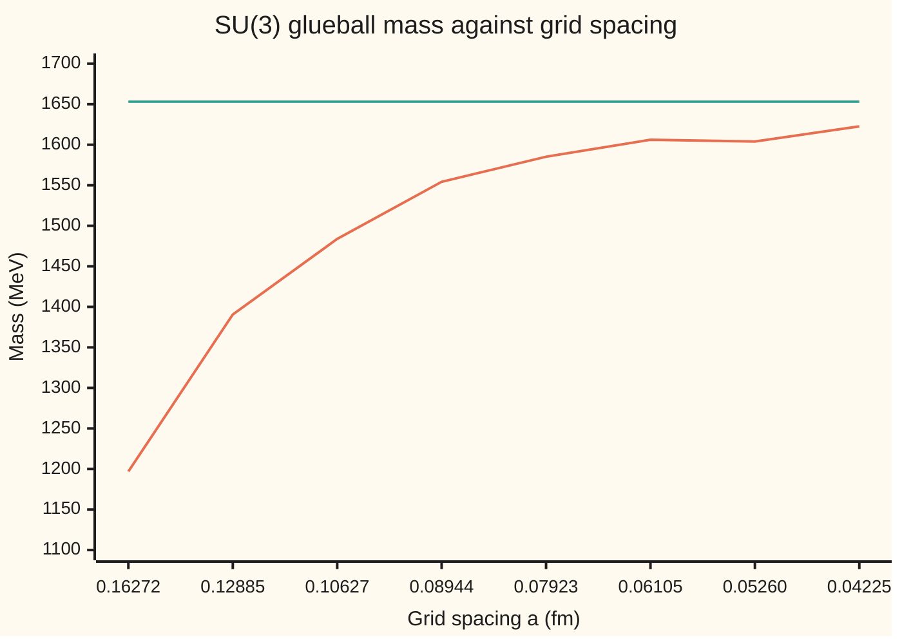
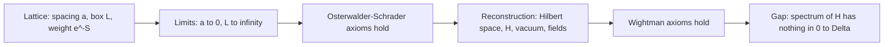

# Yang-Mills existence and mass gap: build the quantum theory rigorously and show its lightest particle has positive mass

[Syllabus](../../../SYLLABUS.md) → [Frontier](../README.md) → [The Millennium Problems](../README.md#s02) → Yang-Mills existence and mass gap

---

## General Overview

In 2000 the Clay Mathematics Institute named seven problems and offered one million dollars for each. One is solved: [The Poincare conjecture, solved](07-poincare-conjecture-solved.md). Arthur Jaffe and Edward Witten wrote the statement of this one.

The [Mass gap](../../23-Differential%20geometry%20and%20Lie%20groups/07-Geometric%20Analysis%20and%20Physics/04-the-mass-gap-statement.md) card already states the two demands. **Existence:** for every compact simple gauge group (the symmetry group of the field, such as SU(3)), build a non-trivial (not free) quantum Yang-Mills theory on four-dimensional spacetime, $`\mathbb{R}^4`$. **Mass gap:** show that every state except the vacuum has energy at least some Δ > 0. This card covers what "build" means and what computers have seen. The computer evidence below is for SU(3), one such group.

Computers already see the gap. In 2020 Andreas Athenodorou and Michael Teper simulated pure SU(3) gauge theory (the strong force without quarks) on eight grids. The finest grid was 38 points on each side. Measured in grid units, the lightest glueball (a bound lump of gluon field) got lighter as the grid got finer: 0.9870, then down to 0.3474. Converted to physical units, it settled near 1,650 MeV (mega-electronvolts). Our fit of their numbers gives 1653.1 MeV.

That number is evidence. It is not a proof. Every grid had a nonzero spacing and a finite box. The prize asks for a theory with no grid and no box, built to an agreed standard of rigour.

**A solution must construct quantum Yang-Mills theory on four-dimensional spacetime, for every compact simple gauge group, so that it obeys the Wightman axioms (or the Osterwalder-Schrader axioms, which rebuild them), and prove a gap Δ > 0; lattice computations measure that gap at about 1,650 MeV for SU(3), one such group, but only at finite spacing and in a finite box.**

**What kind of fact this is:** a conjecture: that such a theory exists and has a gap. Status: open as of 2026-11-23. Clay's problem page labels it "Unsolved". No refereed or independently accepted claim of a solution was found as of 2026-11-23. The card proves small facts only: a finite lattice model has a positive transfer matrix and a gap, computed two ways.

### The picture: the gap in MeV settles as the grid gets finer



Orange: the lightest glueball on each of the eight grids, converted to MeV. Green: our zero-spacing fit, 1653.1 MeV. Spacing is in femtometres (1 fm = 10⁻¹⁵ m). The spacing shrinks to the right.

---

## The formula

A lattice computation reads energies off a **transfer matrix** T. T is the matrix that steps the system forward by one grid spacing a in imaginary time. Its eigenvalues are $`\lambda_0 > \lambda_1 \ge \lambda_2 \ge \dots`$. Each energy level k sits above the vacuum by

```math
a\,E_k = \ln\frac{\lambda_0}{\lambda_k}, \qquad \frac{m}{\sqrt{\sigma}} = c_0 + c_1\,(a\sqrt{\sigma})^2, \qquad \Delta = c_0\,\sqrt{\sigma}
```

**Read it aloud:** the energy of a level, in grid units, is the log of how much faster the vacuum survives a step; the glueball mass over a reference scale drifts with the grid spacing squared, and its value at zero spacing, times the scale, is the gap.

Here the reference scale is $`\sqrt{\sigma}`$, the square root of the **string tension**: the energy per unit length of the flux tube between two static colour charges. A mass divided by $`\sqrt{\sigma}`$ has no units, so it can be compared between grids.

| Symbol | Plain meaning | In our example | Push it up and the answer… |
| --- | --- | --- | --- |
| $`T`$, $`Z`$, $`N_t`$ | transfer matrix, one step in imaginary time; the partition function (total weight); the number of time steps | T is 32 by 32 for the Z2 toy; $`\ln Z`$ = 17.752860697 at $`N_t`$ = 2, β = 0.3 | — |
| $`\lambda_0`$, $`\lambda_k`$ | T's largest eigenvalue (the vacuum) and its k-th | all positive | larger $`\lambda_k`$: lower level k |
| $`a`$, $`L`$ | grid spacing, in fm; box width in grid points | SU(3): 0.16272 to 0.04225 fm, L = 10 to 38; toy: L = 2 | grid-unit masses grow; finite-box states move up |
| $`E_k`$, $`H`$, $`\Omega`$ | energy of level k above the vacuum; the energy operator; the vacuum | toy: $`aE`$ = 4.323899 at β = 0.3 | — |
| $`\beta`$, $`u`$ | lattice coupling (larger β: weaker coupling, finer grid); $`u = \tanh\beta`$ | SU(3): 5.6924 to 6.50; toy: 0.1 to 0.5 | $`aE`$ falls |
| $`\tau`$, $`C(\tau)`$, $`t`$, $`i`$ | imaginary-time separation in grid steps; the correlation at that separation; real time, with $`t = -i\tau`$; the square root of −1 | effective mass 4.465594 at τ = 0 | — |
| $`m`$, $`\Delta`$ | mass of the lightest glueball; the mass gap, which it equals | 1653.1 MeV | — |
| $`\sigma`$, $`\sqrt{\sigma}`$ | string tension; its square root, an energy scale | $`\sqrt{\sigma}`$ = 484.956 MeV | Δ in MeV grows |
| $`c_0`$, $`c_1`$ | fit constants: the zero-spacing ratio, and the drift | 3.408833, −4.667644 | — |
| $`r_0`$, $`\hbar c`$ | a reference length set by the force between static charges (the Sommer scale; on the Mass gap card $`r_0`$ is the range ħc/Δ instead); the unit converter | 0.472 fm; 197.326980 MeV fm | larger $`r_0`$: smaller Δ |
| $`S`$, $`U_p`$, $`F`$ | the action; a plaquette, ±1 in the toy; the curvature | — | — |
| $`s`$, $`P(s)`$, $`V`$, $`W`$, $`G_g`$ | a slice's link settings; the sum of its four plaquettes; the in-slice and linking parts of T; a gauge change g | 256 settings, 32 invariant states | — |

### When it holds

- **T must be positive.** Positive eigenvalues make the log real. This is reflection positivity, one of the axioms (Step 2). Without it the energies are not real numbers, and there is no quantum theory.
- **The level must be the right one.** In a small box the lowest level can be a flux loop wrapped round the box. In the toy at β = 0.3 it sits at 2.262915, below the glueball's 4.323899.
- **The spacing must go to zero.** Masses in grid units shrink toward 0 as a does. Only the ratio $`m/\sqrt{\sigma}`$ settles. Averaging the ratio over grids without extrapolating gives 3.104278 instead of 3.408833.
- **The box must go to infinity.** No computation does this. The SU(3) boxes are all between 1.488 and 1.627 fm wide.
- **The scale must be measured.** $`\sqrt{\sigma}`$ in MeV comes from $`r_0`$. Take $`r_0`$ = 0.500 fm instead of 0.472 fm and the gap reads 1560.6 MeV.

---

## Why it works

### Step 0: "rigorous" means a list of properties that a constructed object must pass

Physics textbooks describe quantum fields at a physical level of precision. A mathematician needs an object and a checklist. In the 1950s Lars Gårding and Arthur Wightman wrote the checklist for real (Minkowski) spacetime. Jaffe and Witten require "axiomatic properties at least as strong as" these.

| Wightman axiom | Plain meaning | Without it |
| --- | --- | --- |
| States | a Hilbert space (vectors with lengths and angles) of states | no probabilities |
| Symmetry | shifts, rotations and boosts (changes to a steady velocity) of spacetime act on the states | the theory picks a favoured frame |
| Positive energy | the energy H is never negative | the vacuum could decay forever |
| Unique vacuum | exactly one state Ω, up to phase, is unchanged by every symmetry | the "empty" state is ambiguous |
| Fields | fields are operators smeared over small regions, acting on the states | nothing to measure |
| Locality | fields at points no light signal can join commute | signals faster than light |

Existence for Yang-Mills adds two demands. The local fields must match the gauge-invariant combinations of the curvature F, such as $`\mathrm{Tr}\,F_{ij}F_{kl}`$. Their short-distance behaviour must match asymptotic freedom (the coupling weakens at short distance). That rules out a free theory, which passes every row above.

### Step 1: the imaginary-time axioms, and why they are easier to build

Replace real time t by imaginary time, $`t = -i\tau`$. Oscillations become decays, and quantum averages become averages over random field configurations with weight $`e^{-S}`$, where S is the action. This is the form a lattice computes.

In 1973 Konrad Osterwalder and Robert Schrader listed what these imaginary-time averages (Schwinger functions) must satisfy:

1. **Regularity:** the averages are well-behaved generalised functions.
2. **Euclidean symmetry:** shifts and rotations of four-dimensional space leave them unchanged.
3. **Reflection positivity:** reflect any observable in the plane τ = 0; its average with its own reflection is never negative.
4. **Symmetry:** for bosonic fields (fields like the gluon's, whose particles can share a state), the order of the points does not matter.
5. **Clustering:** observables far apart become independent.

They then showed how to rebuild the Hilbert space, the energy operator and the Wightman fields from such averages. The 1973 argument had a gap; their 1975 sequel closed it by adding a growth condition on the averages. Jaffe and Witten cite both papers and describe the result as an equivalence between the two schemes. So a builder may work in imaginary time, on a lattice, and pass to real time at the end.



### Step 2: on a lattice, reflection positivity is a positive transfer matrix

Cut the lattice between two time slices. The weight $`e^{-S}`$ splits into the part inside each slice and the part linking neighbours. Write the linking part as a matrix T between slice configurations. Then the partition function (the total weight) on $`N_t`$ periodic time steps is a trace (the sum of the diagonal entries) over the gauge-invariant states, $`\mathrm{Tr}_{\mathrm{inv}}\,T^{N_t}`$, times a count of gauge choices. For the toy below, $`Z = 16^{N_t}\,\mathrm{Tr}_{\mathrm{inv}}\,T^{N_t}`$.

If T is positive, define the energy operator by $`T = e^{-aH}`$. Then H is a real, non-negative operator above its vacuum, and $`aE_k = \ln(\lambda_0/\lambda_k)`$. Reflection positivity is exactly what makes T positive. So on the lattice, the Osterwalder-Schrader route is concrete linear algebra.

The toy here is **Z2 lattice gauge theory** (Wegner, 1971). Each link carries +1 or −1, the simplest gauge group. Space is a 2 by 2 box with 8 links, and time is the third direction. A plaquette (the product of the four links round a unit square, defined on [Yang-Mills](../../23-Differential%20geometry%20and%20Lie%20groups/07-Geometric%20Analysis%20and%20Physics/03-yang-mills-fields-and-gauge-theory.md)) adds β times its value to the exponent of the weight.

The code builds T on the 256 link configurations of one slice. A gauge change flips the four links at a site. Grouping configurations by gauge changes leaves 32 gauge-invariant states. Every eigenvalue of T is positive, at every β tried. The code also sums every link configuration of the 2 by 2 box with 1 and 2 time steps, and finds the same Z as the trace formula.

<details>
<summary>Detailed proof: T is positive, and Z equals 16 to the power N_t times the trace on invariant states</summary>

First set every timelike link to +1. A timelike plaquette then equals $`s_l(\tau)\,s_l(\tau+1)`$ for the spatial link l below it. Let $`P(s)`$ be the sum of the four spatial plaquettes of slice configuration s. The weight of the whole lattice is a product over time steps of

$`\displaystyle T(s, s') = e^{\beta P(s)/2}\;\prod_{l} e^{\beta s_l s'_l}\; e^{\beta P(s')/2}.`$

So $`T = V^{1/2} W V^{1/2}`$, with V diagonal and positive. W is a product, one 2 by 2 matrix per link with $`e^{\beta}`$ on the diagonal and $`e^{-\beta}`$ off it. Its eigenvalues are $`2\cosh\beta`$ and $`2\sinh\beta`$, both positive for β > 0. So W is positive, and so is $`V^{1/2}WV^{1/2}`$: for any vector x, $`x^{\mathsf T} V^{1/2} W V^{1/2} x = y^{\mathsf T} W y > 0`$ with $`y = V^{1/2}x`$.

Now free the timelike links. Each layer of them acts as a gauge change g between two neighbouring slices, $`G_g`$, and T commutes with every gauge change. A gauge change and its opposite act the same way, so a layer's 16 settings give 8 distinct changes, each twice. The 8 changes average to the projection onto invariant states, so summing one layer gives 16 times that projection. There are $`N_t`$ layers. Hence $`Z = 16^{N_t}\,\mathrm{Tr}_{\mathrm{inv}}\,T^{N_t} = 16^{N_t}\sum_k \lambda_k^{N_t}`$. Fixing every layer but one to +1 (temporal gauge) would leave a single factor 16.

</details>

### Step 3: the toy's gap, and which level counts

| β | lowest level | plaquette level | $`-4\ln u`$ |
| --- | --- | --- | --- |
| 0.1 | 4.591373 | 8.962749 | 9.223643 |
| 0.3 | 2.262915 | 4.323899 | 4.933433 |
| 0.5 | 1.020219 | 2.539875 | 3.087747 |

The plaquette level is the lowest state that the sum of plaquettes creates from the vacuum. It plays the glueball. The lowest level overall is different. It is a loop of electric flux wrapped round the 2-site box. Its energy is close to $`-2\ln u`$, a sheet two plaquettes wide, so in a box of width L it grows like $`-L\ln u`$. It is a finite-box state, not a particle.

At strong coupling (small β) a hand estimate exists. Each plaquette's weight $`e^{\beta U_p}`$ can be written $`\cosh\beta\,(1 + u\,U_p)`$, because $`U_p`$ is ±1. A correlation between two plaquettes τ steps apart needs a tube of plaquettes joining them, four per step. So it decays like $`u^{4\tau}`$, and $`aE \approx -4\ln u`$. The exact level over the estimate is 0.9717 at β = 0.1 and 0.9886 at β = 0.05. It tends to 1 as β falls.

The effective mass is how lattice groups read a level from data: $`\ln(C(\tau)/C(\tau+1))`$, where C is the correlation at time separation τ. At β = 0.3 it runs 4.465594, 4.355283, 4.330391, 4.325221, 4.324167, 4.323953. It falls onto the plaquette level from above, as [Mass gap](../../23-Differential%20geometry%20and%20Lie%20groups/07-Geometric%20Analysis%20and%20Physics/04-the-mass-gap-statement.md) proves.

### Step 4: from grid units to MeV, with real data

Athenodorou and Teper ran SU(3) at eight values of β. At each, they measured the glueball mass and the string tension in grid units. The ratio $`m/\sqrt{\sigma}`$ has no units. It drifts with spacing like $`(a\sqrt{\sigma})^2`$, the leading lattice error of Wilson's action.

A straight-line fit through the six finest grids gives $`c_0`$ = 3.408833. Their own fit gives 3.405(21), the bracket being the error in the last digits. The two differ by 0.003833. To reach MeV, they take $`r_0`$ = 0.472 fm from lattice QCD with quarks. They obtain $`r_0\sqrt{\sigma}`$ = 1.160 by extrapolating published $`r_0`$ values to zero spacing. So $`\sqrt{\sigma}`$ = 484.956 MeV, against their quoted 485(6) MeV, and the gap is 1653.1 MeV (1651.3 MeV from their value). The [Mass gap](../../23-Differential%20geometry%20and%20Lie%20groups/07-Geometric%20Analysis%20and%20Physics/04-the-mass-gap-statement.md) card quotes a higher figure from Morningstar and Peardon (1999), an older computation on coarser grids; its quoted errors are larger than the difference, so the two agree.

The MeV figure borrows a scale from the real world, which has quarks. For the quark-free theory it is a convention; the unit-free ratio 3.408833 is the real result.

### Step 5: what is proved, in outline (constructive quantum field theory)

**Constructive quantum field theory** builds field theories as limits of approximate ones, with estimates that hold uniformly. Jaffe and Witten review its record:

- **Two and three dimensions.** Scalar fields with a quartic self-interaction were built in the 1970s and shown to satisfy the axioms. In two dimensions they have a mass gap at weak coupling. As the coupling rises to a critical value, that gap falls continuously to zero.
- **A gauge theory.** Brydges, Fröhlich and Seiler built a two-dimensional abelian Higgs model satisfying the Osterwalder-Schrader axioms. Jaffe and Witten call it the only complete example of an interacting gauge theory satisfying the axioms.
- **Yang-Mills on a lattice torus.** Balaban studied renormalisation (integrating out short wavelengths, then rescaling) for lattice Yang-Mills in three, then four, dimensions on a periodic box. His estimates are uniform in the spacing. This is a step toward the continuum limit on a compact spacetime, not a construction on $`\mathbb{R}^4`$.
- **Four dimensions.** No non-trivial relativistic field theory is known to satisfy the Wightman axioms. Jaffe and Witten add that no present idea gives a gap uniform in the volume.

---

## Worked numbers, by hand

| Step | Arithmetic | Value |
| --- | --- | --- |
| scale | 1.160 × 197.326980 ÷ 0.472 | 484.956 MeV |
| finest grid, spacing | 0.10383 × 197.326980 ÷ 484.956 | 0.04225 fm |
| finest grid, box | 38 × 0.04225 | 1.605 fm |
| finest grid, ratio | 0.3474 ÷ 0.10383 | 3.345854 |
| finest grid, mass | 3.345854 × 484.956 | 1622.6 MeV |
| coarsest grid, ratio | 0.9870 ÷ 0.39990 | 2.468117 |
| zero-spacing fit, 6 finest | $`c_0`$ | 3.408833 |
| **gap** | **3.408833 × 484.956** | **1653.1 MeV** |

On the finest grid the mass is already within 2% of the zero-spacing value. The extrapolation carries it from 1622.6 to 1653.1 MeV.

### What breaks if you drop a piece

| Mistake | Comes out at | What went wrong |
| --- | --- | --- |
| Take the toy's lowest level as the gap, β = 0.3 | 2.262915, not 4.323899 | it is a flux loop wrapped round the box |
| Average $`m/\sqrt{\sigma}`$ over grids | 3.104278, not 3.408833 | coarse grids pull it down; extrapolate instead |
| Read the effective mass at τ = 0 | 4.465594, not 4.323899 (3.3% high) | higher levels have not died away |
| Use the strong-coupling estimate at β = 0.5 | 3.087747, not 2.539875 | the tube picture holds only for small β |

---

## Code, from first principles, and it actually runs

The code takes **three independent roads and a consistency check**. Road 1 refits the published SU(3) data and compares with the paper's own fit. Road 2 builds the Z2 transfer matrix, diagonalises it with a written-out Jacobi rotation method, and checks Z against a sum over every configuration of the lattice. Road 3 checks the strong-coupling estimate as β falls. The consistency check computes the effective mass from road 2's eigenvalues and eigenvectors and watches it fall onto the eigenvalue gap. Every number on the card is printed.

### Python

```python
# Yang-Mills existence and mass gap -- the check behind the card.  Standard library only.
# Part 1 reads a published SU(3) lattice gap and extrapolates it to zero spacing.
# Part 2 builds a lattice transfer matrix (Z2 gauge theory, 2 by 2 box) and finds its gap.
from math import exp, log, tanh, sqrt

# ---- Part 1: Athenodorou and Teper 2020, Table 1: beta, box in sites, a*sqrt(sigma), a*m(0++)
DATA = [(5.6924, 10, 0.3999, 0.987), (5.80, 12, 0.31666, 0.908), (5.8941, 14, 0.26118, 0.7991),
        (5.99, 18, 0.21982, 0.7045), (6.0625, 20, 0.19472, 0.6365), (6.235, 26, 0.15003, 0.4969),
        (6.338, 30, 0.12928, 0.4276), (6.50, 38, 0.10383, 0.3474)]
HBARC, R0, R0SIG, PAPER, PAPER_ERR = 197.326980, 0.472, 1.160, 3.405, 0.021   # MeV fm, fm, -, -, -
SIG = R0SIG * HBARC / R0                                          # sqrt(string tension) in MeV
print("part 1: SU(3) glueball gap on the lattice (Athenodorou and Teper 2020)")
print("beta    box  a*sqrt(sig)  a*m     m/sqrt(sig)  a (fm)   box (fm)  m (MeV)")
for b, L, s, m in DATA:
    a = s * HBARC / SIG
    print(f"{b:<7.4f} {L:>3}  {s:.5f}      {m:.4f}  {m / s:.6f}     {a:.5f}  {L * a:.3f}     {m / s * SIG:.1f}")
print(f"scale: sqrt(sigma) = {R0SIG:.3f} x {HBARC:.6f} / {R0:.3f} = {SIG:.3f} MeV; paper: 485(6) MeV")
assert abs(SIG - 485) < 6                              # our conversion matches the paper's quoted scale

def fit(points):                     # least squares: m/sqrt(sig) = c0 + c1 (a sqrt(sig))^2
    xs = [s * s for _, _, s, _ in points]; ys = [m / s for _, _, s, m in points]
    n = len(xs); mx = sum(xs) / n; my = sum(ys) / n
    c1 = sum((x - mx) * (y - my) for x, y in zip(xs, ys)) / sum((x - mx) ** 2 for x in xs)
    return my - c1 * mx, c1
c0, c1 = fit(DATA[2:])
c0all, _ = fit(DATA)
mean = sum(m / s for _, _, s, m in DATA) / len(DATA)
print(f"continuum fit, 6 finest: m/sqrt(sig) = {c0:.6f} + ({c1:.6f}) (a sqrt(sig))^2")
print(f"paper's fit {PAPER:.3f}({PAPER_ERR * 1000:.0f}): difference {c0 - PAPER:.6f}")
print(f"continuum gap: {c0:.6f} x {SIG:.3f} = {c0 * SIG:.1f} MeV;  paper's: {PAPER * SIG:.1f} MeV")
assert abs(c0 - PAPER) < PAPER_ERR                     # our fit agrees with the paper's own fit
assert abs(DATA[-1][3] / DATA[-1][2] / c0 - 1) < 0.02     # the finest lattice sits within 2% of the limit

# ---- Part 2: Z2 lattice gauge theory in 2+1 dimensions on a 2 by 2 spatial box
def lid(x, y, d): return 2 * ((x % 2) + 2 * (y % 2)) + d      # link number: site (x,y), direction d
PLAQ = [(1 << lid(x, y, 0)) | (1 << lid(x + 1, y, 1)) | (1 << lid(x, y + 1, 0)) | (1 << lid(x, y, 1))
        for y in (0, 1) for x in (0, 1)]
def P(s): return sum(1 - 2 * ((s & m).bit_count() & 1) for m in PLAQ)   # sum of 4 plaquettes, +-1 each
FLIP = [(1 << lid(0, y, 0)) | (1 << lid(1, y, 0)) | (1 << lid(x, 0, 1)) | (1 << lid(x, 1, 1))
        for y in (0, 1) for x in (0, 1)]                        # gauge change at one site
GAUGE = sorted({(i & 1) * FLIP[0] ^ (i >> 1 & 1) * FLIP[1] ^ (i >> 2 & 1) * FLIP[2] ^ (i >> 3 & 1) * FLIP[3]
                for i in range(16)})
ORB, seen = [], set()
for s in range(256):                                            # gauge orbits = gauge-invariant states
    if s not in seen:
        ORB.append([s ^ g for g in GAUGE]); seen.update(ORB[-1])
def tmat(b):                                                    # transfer matrix on invariant states
    def T(s, t): return exp(b / 2 * (P(s) + P(t)) + b * (8 - 2 * (s ^ t).bit_count()))
    return [[sum(T(A[0], c) for c in B) for B in ORB] for A in ORB]

def jacobi(M):                                                  # all eigenvalues and eigenvectors
    n = len(M); A = [r[:] for r in M]; V = [[float(i == j) for j in range(n)] for i in range(n)]
    for _ in range(60):
        off = sum(A[i][j] ** 2 for i in range(n) for j in range(n) if i != j)
        if off < 1e-26 * sum(A[i][i] ** 2 for i in range(n)): break
        for p in range(n - 1):
            for q in range(p + 1, n):
                if A[p][q] == 0.0: continue
                th = (A[q][q] - A[p][p]) / (2 * A[p][q])
                t = (1.0 if th >= 0 else -1.0) / (abs(th) + sqrt(th * th + 1)); c = 1 / sqrt(t * t + 1); s = t * c
                for R in (A, V):
                    for k in range(n):
                        x, y = R[k][p], R[k][q]; R[k][p] = c * x - s * y; R[k][q] = s * x + c * y
                for k in range(n):
                    x, y = A[p][k], A[q][k]; A[p][k] = c * x - s * y; A[q][k] = s * x + c * y
    idx = sorted(range(n), key=lambda i: -A[i][i])
    return [A[i][i] for i in idx], [[V[k][i] for k in range(n)] for i in idx]

def spectrum(b):        # lowest level, level the plaquette sum creates, weights, eigenvalues
    lam, vec = jacobi(tmat(b))
    w = [sum(vec[n][i] * P(A[0]) * vec[0][i] for i, A in enumerate(ORB)) ** 2 for n in range(len(ORB))]
    first = next(n for n in range(1, len(ORB)) if w[n] > 1e-9 * max(w[1:]))
    return lam, w, log(lam[0] / lam[1]), log(lam[0] / lam[first])

print(f"part 2: Z2 gauge theory, 2+1 dimensions, 2x2 box: {len(GAUGE)} gauge changes, {len(ORB)} invariant states")
print("beta  lowest level  2(-ln tanh)  plaquette level  4(-ln tanh)  ratio  smallest eigenvalue")
ratios, store = [], {}
for b in (0.1, 0.2, 0.3, 0.4, 0.5):
    lam, w, low, gap = spectrum(b); u = -log(tanh(b)); store[b] = (lam, w, low, gap)
    ratios.append(gap / (4 * u))
    print(f"{b:.1f}   {low:.6f}      {2 * u:.6f}     {gap:.6f}         {4 * u:.6f}     {gap / (4 * u):.4f} {min(lam):.6f}")
    assert min(lam) > 0                                  # reflection positivity: T has no negative eigenvalue
assert ratios[0] > ratios[1] > ratios[2] and ratios[0] > 0.95   # strong coupling is right as beta -> 0

lam, w, low, gap = store[0.3]                            # effective mass from the exact correlator
C = [sum(w[n] * (lam[n] / lam[0]) ** t for n in range(1, len(lam))) for t in range(7)]
meff = [log(C[t] / C[t + 1]) for t in range(6)]
print("beta 0.3, effective mass ln(C(t)/C(t+1)), t = 0..5:", " ".join(f"{m:.6f}" for m in meff))
assert meff[0] > meff[2] > meff[5] > gap and meff[5] - gap < 1e-3      # falls onto the gap from above

def brute(nt, b):       # ln Z by summing every link configuration of a 2x2xnt periodic lattice
    masks = []
    for t in range(nt):
        tl = lambda x, y: 1 << (8 * nt + 4 * t + (x % 2) + 2 * (y % 2))   # timelike link, layer t
        for m in PLAQ: masks.append(m << 8 * t)
        for x, y, d in [(x, y, d) for y in (0, 1) for x in (0, 1) for d in (0, 1)]:
            l = lid(x, y, d)
            masks.append((1 << (l + 8 * t)) ^ (1 << (l + 8 * ((t + 1) % nt))) ^ tl(x, y) ^ tl(x + 1 - d, y + d))
    vec = lambda c: sum((((c & m).bit_count() & 1) << j) for j, m in enumerate(masks))
    lo = [vec(c) for c in range(256)]; hi = [vec(c << 8) for c in range(1 << (12 * nt - 8))]
    hist = [0] * (len(masks) + 1)
    for h in hi:
        for v in lo: hist[(h ^ v).bit_count()] += 1
    return log(sum(n * exp(b * (len(masks) - 2 * k)) for k, n in enumerate(hist)))
for nt in (1, 2):
    for b in (0.3, 0.5):
        lam = store[b][0]; zt = log(16 ** nt * sum(l ** nt for l in lam)); zb = brute(nt, b)
        print(f"ln Z, {nt} time step(s), beta {b:.1f}: every configuration {zb:.9f}  transfer matrix {zt:.9f}")
        assert abs(zb - zt) < 1e-9

print("what breaks:")
print(f"  lowest level in the box at beta 0.3: {store[0.3][2]:.6f}, not the plaquette's {store[0.3][3]:.6f}")
print(f"  plain average of m/sqrt(sig), no extrapolation: {mean:.6f}, not {c0:.6f}; all 8 points: {c0all:.6f}")
print(f"  effective mass at t = 0: {meff[0]:.6f}, not {gap:.6f} ({100 * (meff[0] / gap - 1):.1f}% high)")
print(f"  strong coupling at beta 0.5: {4 * -log(tanh(0.5)):.6f}, not {store[0.5][3]:.6f}")
sig5 = R0SIG * HBARC / 0.5; g05 = spectrum(0.05)[3]
print(f"try: r0 = 0.500 fm: sqrt(sigma) {sig5:.3f} MeV, gap {c0 * sig5:.1f} MeV;"
      f" beta 0.05: plaquette level {g05:.6f}, ratio to 4(-ln tanh) {g05 / (-4 * log(tanh(0.05))):.4f}")
print("ALL CHECKS PASS")
```

**Ran 2026-11-23 on macOS, Python 3.14.10, standard library only. All checks passed. Output, pasted from the run:**

```
part 1: SU(3) glueball gap on the lattice (Athenodorou and Teper 2020)
beta    box  a*sqrt(sig)  a*m     m/sqrt(sig)  a (fm)   box (fm)  m (MeV)
5.6924   10  0.39990      0.9870  2.468117     0.16272  1.627     1196.9
5.8000   12  0.31666      0.9080  2.867429     0.12885  1.546     1390.6
5.8941   14  0.26118      0.7991  3.059576     0.10627  1.488     1483.8
5.9900   18  0.21982      0.7045  3.204895     0.08944  1.610     1554.2
6.0625   20  0.19472      0.6365  3.268796     0.07923  1.585     1585.2
6.2350   26  0.15003      0.4969  3.312004     0.06105  1.587     1606.2
6.3380   30  0.12928      0.4276  3.307550     0.05260  1.578     1604.0
6.5000   38  0.10383      0.3474  3.345854     0.04225  1.605     1622.6
scale: sqrt(sigma) = 1.160 x 197.326980 / 0.472 = 484.956 MeV; paper: 485(6) MeV
continuum fit, 6 finest: m/sqrt(sig) = 3.408833 + (-4.667644) (a sqrt(sig))^2
paper's fit 3.405(21): difference 0.003833
continuum gap: 3.408833 x 484.956 = 1653.1 MeV;  paper's: 1651.3 MeV
part 2: Z2 gauge theory, 2+1 dimensions, 2x2 box: 8 gauge changes, 32 invariant states
beta  lowest level  2(-ln tanh)  plaquette level  4(-ln tanh)  ratio  smallest eigenvalue
0.1   4.591373      4.611821     8.962749         9.223643     0.9717 0.000003
0.2   3.159052      3.245296     6.021144         6.490593     0.9277 0.000637
0.3   2.262915      2.466717     4.323899         4.933433     0.8764 0.015689
0.4   1.572210      1.935437     3.218098         3.870873     0.8314 0.145964
0.5   1.020219      1.543874     2.539875         3.087747     0.8226 0.766677
beta 0.3, effective mass ln(C(t)/C(t+1)), t = 0..5: 4.465594 4.355283 4.330391 4.325221 4.324167 4.323953
ln Z, 1 time step(s), beta 0.3: every configuration 9.262754299  transfer matrix 9.262754299
ln Z, 1 time step(s), beta 0.5: every configuration 10.867944475  transfer matrix 10.867944475
ln Z, 2 time step(s), beta 0.3: every configuration 17.752860697  transfer matrix 17.752860697
ln Z, 2 time step(s), beta 0.5: every configuration 20.042458188  transfer matrix 20.042458188
what breaks:
  lowest level in the box at beta 0.3: 2.262915, not the plaquette's 4.323899
  plain average of m/sqrt(sig), no extrapolation: 3.104278, not 3.408833; all 8 points: 3.449327
  effective mass at t = 0: 4.465594, not 4.323899 (3.3% high)
  strong coupling at beta 0.5: 3.087747, not 2.539875
try: r0 = 0.500 fm: sqrt(sigma) 457.799 MeV, gap 1560.6 MeV; beta 0.05: plaquette level 11.850079, ratio to 4(-ln tanh) 0.9886
ALL CHECKS PASS
```

### Rust

```rust
// Yang-Mills existence and mass gap -- the check behind the card.  Rust std only, no crates.
// Part 1 reads a published SU(3) lattice gap and extrapolates it to zero spacing.
// Part 2 builds a lattice transfer matrix (Z2 gauge theory, 2 by 2 box) and finds its gap.

// ---- Part 1: Athenodorou and Teper 2020, Table 1: beta, box in sites, a*sqrt(sigma), a*m(0++)
const DATA: [(f64, u32, f64, f64); 8] = [(5.6924, 10, 0.3999, 0.987), (5.80, 12, 0.31666, 0.908),
    (5.8941, 14, 0.26118, 0.7991), (5.99, 18, 0.21982, 0.7045), (6.0625, 20, 0.19472, 0.6365),
    (6.235, 26, 0.15003, 0.4969), (6.338, 30, 0.12928, 0.4276), (6.50, 38, 0.10383, 0.3474)];
const HBARC: f64 = 197.326980; const R0: f64 = 0.472; const R0SIG: f64 = 1.160;
const PAPER: f64 = 3.405; const PAPER_ERR: f64 = 0.021;

fn fit(p: &[(f64, u32, f64, f64)]) -> (f64, f64) { // least squares: m/sqrt(sig) = c0 + c1 (a sqrt(sig))^2
    let xs: Vec<f64> = p.iter().map(|d| d.2 * d.2).collect();
    let ys: Vec<f64> = p.iter().map(|d| d.3 / d.2).collect();
    let n = xs.len() as f64;
    let mx = xs.iter().fold(0.0, |a, x| a + x) / n; let my = ys.iter().fold(0.0, |a, y| a + y) / n;
    let (mut num, mut den) = (0.0, 0.0);
    for i in 0..xs.len() { num += (xs[i] - mx) * (ys[i] - my); }
    for i in 0..xs.len() { den += (xs[i] - mx) * (xs[i] - mx); }
    let c1 = num / den;
    (my - c1 * mx, c1)
}

// ---- Part 2: Z2 lattice gauge theory in 2+1 dimensions on a 2 by 2 spatial box
fn lid(x: usize, y: usize, d: usize) -> usize { 2 * ((x % 2) + 2 * (y % 2)) + d }
fn plaqs() -> Vec<u64> {
    let mut v = vec![];
    for y in 0..2 { for x in 0..2 {
        v.push((1u64 << lid(x, y, 0)) | (1 << lid(x + 1, y, 1)) | (1 << lid(x, y + 1, 0)) | (1 << lid(x, y, 1)));
    } }
    v
}
fn psum(s: u64, pl: &[u64]) -> i64 { pl.iter().map(|m| 1 - 2 * (((s & m).count_ones() & 1) as i64)).sum() }

fn jacobi(m: &Vec<Vec<f64>>) -> (Vec<f64>, Vec<Vec<f64>>) {
    let n = m.len(); let mut a = m.clone();
    let mut v: Vec<Vec<f64>> = (0..n).map(|i| (0..n).map(|j| if i == j { 1.0 } else { 0.0 }).collect()).collect();
    for _ in 0..60 {
        let (mut off, mut dia) = (0.0, 0.0);
        for i in 0..n { for j in 0..n { if i != j { off += a[i][j] * a[i][j]; } } }
        for i in 0..n { dia += a[i][i] * a[i][i]; }
        if off < 1e-26 * dia { break; }
        for p in 0..n - 1 { for q in p + 1..n {
            if a[p][q] == 0.0 { continue; }
            let th = (a[q][q] - a[p][p]) / (2.0 * a[p][q]);
            let t = (if th >= 0.0 { 1.0 } else { -1.0 }) / (th.abs() + (th * th + 1.0).sqrt());
            let c = 1.0 / (t * t + 1.0).sqrt(); let s = t * c;
            for r in [&mut a, &mut v] {
                for k in 0..n { let (x, y) = (r[k][p], r[k][q]); r[k][p] = c * x - s * y; r[k][q] = s * x + c * y; }
            }
            for k in 0..n { let (x, y) = (a[p][k], a[q][k]); a[p][k] = c * x - s * y; a[q][k] = s * x + c * y; }
        } }
    }
    let mut idx: Vec<usize> = (0..n).collect();
    idx.sort_by(|&i, &j| a[j][j].partial_cmp(&a[i][i]).unwrap());
    (idx.iter().map(|&i| a[i][i]).collect(), idx.iter().map(|&i| (0..n).map(|k| v[k][i]).collect()).collect())
}

// lowest level, level the plaquette sum creates, weights, eigenvalues
fn spectrum(b: f64, orb: &Vec<Vec<u64>>, pl: &[u64]) -> (Vec<f64>, Vec<f64>, f64, f64) {
    let tf = |s: u64, t: u64| (b / 2.0 * ((psum(s, pl) + psum(t, pl)) as f64)
        + b * ((8 - 2 * ((s ^ t).count_ones() as i64)) as f64)).exp();
    let tm: Vec<Vec<f64>> = orb.iter().map(|a| orb.iter().map(|bb| bb.iter().fold(0.0, |acc, &c| acc + tf(a[0], c))).collect()).collect();
    let (lam, vec) = jacobi(&tm);
    let w: Vec<f64> = (0..orb.len()).map(|n| { let mut s = 0.0;
        for i in 0..orb.len() { s += vec[n][i] * (psum(orb[i][0], pl) as f64) * vec[0][i]; } s * s }).collect();
    let wmax = w[1..].iter().cloned().fold(0.0, f64::max);
    let first = (1..orb.len()).find(|&n| w[n] > 1e-9 * wmax).unwrap();
    let (low, gap) = ((lam[0] / lam[1]).ln(), (lam[0] / lam[first]).ln());
    (lam, w, low, gap)
}

// ln Z by summing every link configuration of a 2x2xnt periodic lattice
fn brute(nt: usize, b: f64, pl: &[u64]) -> f64 {
    let mut masks: Vec<u64> = vec![];
    for t in 0..nt {
        let tl = |x: usize, y: usize| 1u64 << (8 * nt + 4 * t + (x % 2) + 2 * (y % 2)); // timelike link, layer t
        for m in pl { masks.push(m << (8 * t)); }
        for y in 0..2 { for x in 0..2 { for d in 0..2 {
            let l = lid(x, y, d);
            masks.push((1u64 << (l + 8 * t)) ^ (1u64 << (l + 8 * ((t + 1) % nt))) ^ tl(x, y) ^ tl(x + 1 - d, y + d));
        } } }
    }
    let vecf = |c: u64| masks.iter().enumerate().fold(0u64, |acc, (j, m)| acc + ((((c & m).count_ones() & 1) as u64) << j));
    let lo: Vec<u64> = (0..256u64).map(|c| vecf(c)).collect();
    let hi: Vec<u64> = (0..(1u64 << (12 * nt - 8))).map(|c| vecf(c << 8)).collect();
    let mut hist = vec![0u64; masks.len() + 1];
    for h in &hi { for v in &lo { hist[(h ^ v).count_ones() as usize] += 1; } }
    let mut z = 0.0;
    for (k, &n) in hist.iter().enumerate() { z += (n as f64) * (b * ((masks.len() as f64) - 2.0 * (k as f64))).exp(); }
    z.ln()
}

fn main() {
    let sig = R0SIG * HBARC / R0; // sqrt(string tension) in MeV
    println!("part 1: SU(3) glueball gap on the lattice (Athenodorou and Teper 2020)");
    println!("beta    box  a*sqrt(sig)  a*m     m/sqrt(sig)  a (fm)   box (fm)  m (MeV)");
    for &(b, l, s, m) in DATA.iter() {
        let a = s * HBARC / sig;
        println!("{:<7.4} {:>3}  {:.5}      {:.4}  {:.6}     {:.5}  {:.3}     {:.1}", b, l, s, m, m / s, a, (l as f64) * a, m / s * sig);
    }
    println!("scale: sqrt(sigma) = {:.3} x {:.6} / {:.3} = {:.3} MeV; paper: 485(6) MeV", R0SIG, HBARC, R0, sig);
    assert!((sig - 485.0).abs() < 6.0);
    let (c0, c1) = fit(&DATA[2..]);
    let (c0all, _) = fit(&DATA);
    let mean = DATA.iter().fold(0.0, |a, d| a + d.3 / d.2) / (DATA.len() as f64);
    println!("continuum fit, 6 finest: m/sqrt(sig) = {:.6} + ({:.6}) (a sqrt(sig))^2", c0, c1);
    println!("paper's fit {:.3}({:.0}): difference {:.6}", PAPER, PAPER_ERR * 1000.0, c0 - PAPER);
    println!("continuum gap: {:.6} x {:.3} = {:.1} MeV;  paper's: {:.1} MeV", c0, sig, c0 * sig, PAPER * sig);
    assert!((c0 - PAPER).abs() < PAPER_ERR);
    assert!((DATA[7].3 / DATA[7].2 / c0 - 1.0).abs() < 0.02);

    let pl = plaqs();
    let mut flip = vec![];
    for y in 0..2 { for x in 0..2 { flip.push((1u64 << lid(0, y, 0)) | (1 << lid(1, y, 0)) | (1 << lid(x, 0, 1)) | (1 << lid(x, 1, 1))); } }
    let mut gauge: Vec<u64> = (0..16u64).map(|i| (i & 1) * flip[0] ^ (i >> 1 & 1) * flip[1] ^ (i >> 2 & 1) * flip[2] ^ (i >> 3 & 1) * flip[3]).collect();
    gauge.sort(); gauge.dedup();
    let mut orb: Vec<Vec<u64>> = vec![]; let mut seen = [false; 256];
    for s in 0..256u64 {
        if !seen[s as usize] { let o: Vec<u64> = gauge.iter().map(|g| s ^ g).collect(); for &c in &o { seen[c as usize] = true; } orb.push(o); }
    }
    println!("part 2: Z2 gauge theory, 2+1 dimensions, 2x2 box: {} gauge changes, {} invariant states", gauge.len(), orb.len());
    println!("beta  lowest level  2(-ln tanh)  plaquette level  4(-ln tanh)  ratio  smallest eigenvalue");
    let mut ratios = vec![]; let mut store = vec![];
    for &b in [0.1, 0.2, 0.3, 0.4, 0.5].iter() {
        let (lam, w, low, gap) = spectrum(b, &orb, &pl); let u = -(b.tanh()).ln();
        ratios.push(gap / (4.0 * u));
        let mn = lam.iter().cloned().fold(f64::INFINITY, f64::min);
        println!("{:.1}   {:.6}      {:.6}     {:.6}         {:.6}     {:.4} {:.6}", b, low, 2.0 * u, gap, 4.0 * u, gap / (4.0 * u), mn);
        assert!(mn > 0.0);
        store.push((b, lam, w, low, gap));
    }
    assert!(ratios[0] > ratios[1] && ratios[1] > ratios[2] && ratios[0] > 0.95);

    let (_, lam, w, _, gap) = &store[2];
    let cc: Vec<f64> = (0..7).map(|t| { let mut s = 0.0; for n in 1..lam.len() { s += w[n] * (lam[n] / lam[0]).powf(t as f64); } s }).collect();
    let meff: Vec<f64> = (0..6).map(|t| (cc[t] / cc[t + 1]).ln()).collect();
    let ms: Vec<String> = meff.iter().map(|m| format!("{:.6}", m)).collect();
    println!("beta 0.3, effective mass ln(C(t)/C(t+1)), t = 0..5: {}", ms.join(" "));
    assert!(meff[0] > meff[2] && meff[2] > meff[5] && meff[5] > *gap && meff[5] - gap < 1e-3);

    for nt in [1usize, 2] {
        for (bi, b) in [(2usize, 0.3), (4, 0.5)] {
            let lam = &store[bi].1;
            let zt = (16f64.powi(nt as i32) * lam.iter().fold(0.0, |a, l| a + l.powf(nt as f64))).ln(); let zb = brute(nt, b, &pl);
            println!("ln Z, {} time step(s), beta {:.1}: every configuration {:.9}  transfer matrix {:.9}", nt, b, zb, zt);
            assert!((zb - zt).abs() < 1e-9);
        }
    }

    println!("what breaks:");
    println!("  lowest level in the box at beta 0.3: {:.6}, not the plaquette's {:.6}", store[2].3, store[2].4);
    println!("  plain average of m/sqrt(sig), no extrapolation: {:.6}, not {:.6}; all 8 points: {:.6}", mean, c0, c0all);
    println!("  effective mass at t = 0: {:.6}, not {:.6} ({:.1}% high)", meff[0], gap, 100.0 * (meff[0] / gap - 1.0));
    println!("  strong coupling at beta 0.5: {:.6}, not {:.6}", 4.0 * -(0.5f64.tanh()).ln(), store[4].4);
    let sig5 = R0SIG * HBARC / 0.5; let g05 = spectrum(0.05, &orb, &pl).3;
    println!("try: r0 = 0.500 fm: sqrt(sigma) {:.3} MeV, gap {:.1} MeV; beta 0.05: plaquette level {:.6}, ratio to 4(-ln tanh) {:.4}",
        sig5, c0 * sig5, g05, g05 / (-4.0 * (0.05f64.tanh()).ln()));
    println!("ALL CHECKS PASS");
}
```

**Ran 2026-11-23 on macOS, rustc 1.98.1, no crates. All checks passed. Output, pasted from the run:**

```
part 1: SU(3) glueball gap on the lattice (Athenodorou and Teper 2020)
beta    box  a*sqrt(sig)  a*m     m/sqrt(sig)  a (fm)   box (fm)  m (MeV)
5.6924   10  0.39990      0.9870  2.468117     0.16272  1.627     1196.9
5.8000   12  0.31666      0.9080  2.867429     0.12885  1.546     1390.6
5.8941   14  0.26118      0.7991  3.059576     0.10627  1.488     1483.8
5.9900   18  0.21982      0.7045  3.204895     0.08944  1.610     1554.2
6.0625   20  0.19472      0.6365  3.268796     0.07923  1.585     1585.2
6.2350   26  0.15003      0.4969  3.312004     0.06105  1.587     1606.2
6.3380   30  0.12928      0.4276  3.307550     0.05260  1.578     1604.0
6.5000   38  0.10383      0.3474  3.345854     0.04225  1.605     1622.6
scale: sqrt(sigma) = 1.160 x 197.326980 / 0.472 = 484.956 MeV; paper: 485(6) MeV
continuum fit, 6 finest: m/sqrt(sig) = 3.408833 + (-4.667644) (a sqrt(sig))^2
paper's fit 3.405(21): difference 0.003833
continuum gap: 3.408833 x 484.956 = 1653.1 MeV;  paper's: 1651.3 MeV
part 2: Z2 gauge theory, 2+1 dimensions, 2x2 box: 8 gauge changes, 32 invariant states
beta  lowest level  2(-ln tanh)  plaquette level  4(-ln tanh)  ratio  smallest eigenvalue
0.1   4.591373      4.611821     8.962749         9.223643     0.9717 0.000003
0.2   3.159052      3.245296     6.021144         6.490593     0.9277 0.000637
0.3   2.262915      2.466717     4.323899         4.933433     0.8764 0.015689
0.4   1.572210      1.935437     3.218098         3.870873     0.8314 0.145964
0.5   1.020219      1.543874     2.539875         3.087747     0.8226 0.766677
beta 0.3, effective mass ln(C(t)/C(t+1)), t = 0..5: 4.465594 4.355283 4.330391 4.325221 4.324167 4.323953
ln Z, 1 time step(s), beta 0.3: every configuration 9.262754299  transfer matrix 9.262754299
ln Z, 1 time step(s), beta 0.5: every configuration 10.867944475  transfer matrix 10.867944475
ln Z, 2 time step(s), beta 0.3: every configuration 17.752860697  transfer matrix 17.752860697
ln Z, 2 time step(s), beta 0.5: every configuration 20.042458188  transfer matrix 20.042458188
what breaks:
  lowest level in the box at beta 0.3: 2.262915, not the plaquette's 4.323899
  plain average of m/sqrt(sig), no extrapolation: 3.104278, not 3.408833; all 8 points: 3.449327
  effective mass at t = 0: 4.465594, not 4.323899 (3.3% high)
  strong coupling at beta 0.5: 3.087747, not 2.539875
try: r0 = 0.500 fm: sqrt(sigma) 457.799 MeV, gap 1560.6 MeV; beta 0.05: plaquette level 11.850079, ratio to 4(-ln tanh) 0.9886
ALL CHECKS PASS
```

### Lean

Lean proves the Z2 toy's three facts for every coupling β > 0, and checks its small counts exactly.

- Take the 2 by 2 box and any β > 0. Then T on the 256 slice settings is symmetric, and every eigenvalue is positive.
- Take β > 0. Then each link's 2 by 2 factor of W has eigenvalues $`2\cosh\beta`$ and $`2\sinh\beta`$, both positive.
- Suppose a plaquette $`U_p`$ is +1 or −1. Then its weight $`e^{\beta U_p}`$ equals $`\cosh\beta\,(1 + u\,U_p)`$, with $`u = \tanh\beta`$.
- One slice has 256 link settings. A layer's 16 gauge settings give only 8 distinct gauge changes, each twice.
- Grouping the settings by gauge changes leaves 32 gauge-invariant states.
- With every link +1, all four plaquettes are +1, so P(s) = 4.

The eigenvalues themselves, the energy levels, ln Z and the SU(3) fit are left to the Python and Rust checks.

```lean
-- Yang-Mills existence and mass gap: in the card's Z2 lattice toy on a 2 by 2 box, the transfer matrix is positive definite for every coupling β > 0 (reflection positivity on the lattice), each link's 2 by 2 factor has eigenvalues 2 cosh β and 2 sinh β, and a ±1 plaquette weight splits as cosh β (1 + u U) with u = tanh β; the open Clay problem itself is not stated.
import Mathlib.LinearAlgebra.Matrix.PosDef
import Mathlib.Analysis.SpecialFunctions.Trigonometric.Deriv
import Mathlib.Analysis.SpecialFunctions.Arsinh

open Real Matrix

/-- A slice configuration of the 2 by 2 periodic box: each of its 8 spatial links carries a
value, `false` for +1 and `true` for −1. -/
abbrev Slice := Fin 8 → Bool

/-- The ±1 value a link carries. -/
def spin (b : Bool) : ℝ := if b then -1 else 1

/-- The card's link number: site `(x, y)`, direction `d` (0 along x, 1 along y). -/
def lid (x y d : Fin 2) : Fin 8 := ⟨2 * (x.val + 2 * y.val) + d.val, by omega⟩

/-- The plaquette at site `(x, y)`: the product of the four links round that unit square
(the box is periodic, so `x + 1` wraps round in `Fin 2`). -/
def plaq (s : Slice) (x y : Fin 2) : ℝ :=
  spin (s (lid x y 0)) * spin (s (lid (x + 1) y 1)) * spin (s (lid x (y + 1) 0)) *
    spin (s (lid x y 1))

/-- `P(s)`: the sum of the slice's four plaquettes. -/
def plaqSum (s : Slice) : ℝ := ∑ x : Fin 2, ∑ y : Fin 2, plaq s x y

/-- The card's transfer matrix on the 256 slice configurations, with every timelike link +1:
`T(s, s') = e^(β P(s)/2) · ∏ₗ e^(β sₗ s'ₗ) · e^(β P(s')/2)`. -/
noncomputable def transfer (β : ℝ) : Matrix Slice Slice ℝ :=
  Matrix.of fun s t =>
    Real.exp (β / 2 * plaqSum s) * (∏ l : Fin 8, Real.exp (β * spin (s l) * spin (t l))) *
      Real.exp (β / 2 * plaqSum t)

/-- One link's factor of `W`: `e^β` on the diagonal and `e^(−β)` off it. -/
noncomputable def linkMatrix (β : ℝ) : Matrix (Fin 2) (Fin 2) ℝ :=
  !![Real.exp β, Real.exp (-β); Real.exp (-β), Real.exp β]


lemma spin_mul_self (a : Bool) : spin a * spin a = 1 := by cases a <;> norm_num [spin]

lemma exp_spin_mul (β : ℝ) (a b : Bool) :
    Real.exp (β * spin a * spin b) = Real.cosh β + Real.sinh β * (spin a * spin b) := by
  cases a <;> cases b <;> simp [spin, Real.cosh_eq, Real.sinh_eq] <;> ring

lemma quad_expand (c d : ℝ) (y : Slice → ℝ) :
    ∑ s, ∑ t, y s * y t * ∏ l, (c + d * (spin (s l) * spin (t l))) =
      ∑ A ∈ (Finset.univ : Finset (Fin 8)).powerset,
        ((∏ _l ∈ A, d) * ∏ _l ∈ Finset.univ \ A, c) * (∑ s, y s * ∏ l ∈ A, spin (s l)) ^ 2 := by
  have key : ∀ s t : Slice, ∏ l, (c + d * (spin (s l) * spin (t l))) =
      ∑ A ∈ (Finset.univ : Finset (Fin 8)).powerset,
        ((∏ _l ∈ A, d) * ∏ _l ∈ Finset.univ \ A, c) *
          ((∏ l ∈ A, spin (s l)) * ∏ l ∈ A, spin (t l)) := by
    intro s t
    rw [show (fun l => c + d * (spin (s l) * spin (t l))) =
      fun l => d * (spin (s l) * spin (t l)) + c from by ext; ring]
    rw [Finset.prod_add]
    refine Finset.sum_congr rfl fun A _ => ?_
    rw [Finset.prod_mul_distrib, Finset.prod_mul_distrib]; ring
  simp_rw [key, Finset.mul_sum, sq, Finset.sum_mul_sum, Finset.mul_sum]
  rw [Finset.sum_congr rfl fun s _ => Finset.sum_comm, Finset.sum_comm]
  refine Finset.sum_congr rfl fun A _ => Finset.sum_congr rfl fun s _ =>
    Finset.sum_congr rfl fun t _ => by ring

lemma prod_one_add_spin (s t : Slice) :
    ∏ l, ((1 : ℝ) + spin (s l) * spin (t l)) = if s = t then 256 else 0 := by
  split_ifs with h
  · subst h; simp [spin_mul_self]; norm_num
  · obtain ⟨l, hl⟩ : ∃ l, s l ≠ t l := by
      by_contra h'; push Not at h'; exact h (funext h')
    apply Finset.prod_eq_zero (Finset.mem_univ l)
    cases hs : s l <;> cases ht : t l <;> simp_all [spin]

/-- Reflection positivity on the lattice: for every coupling β > 0 the toy's transfer matrix
T is positive definite (symmetric, with every eigenvalue positive), so each level's energy
`a E_k = ln(λ₀ / λ_k)` is a real number. -/
theorem transfer_matrix_pos_def {β : ℝ} (hβ : 0 < β) : (transfer β).PosDef := by
  refine Matrix.PosDef.of_dotProduct_mulVec_pos ?_ ?_
  · refine Matrix.IsHermitian.ext fun s t => ?_
    simp only [transfer, Matrix.of_apply, star_trivial]
    rw [show (∏ l, Real.exp (β * spin (t l) * spin (s l))) =
      ∏ l, Real.exp (β * spin (s l) * spin (t l)) from
        Finset.prod_congr rfl fun l _ => by ring_nf]
    ring
  · intro x hx
    set y : Slice → ℝ := fun s => Real.exp (β / 2 * plaqSum s) * x s with hy
    have hQ : star x ⬝ᵥ (transfer β *ᵥ x) = ∑ s, ∑ t, y s * y t *
        ∏ l, (Real.cosh β + Real.sinh β * (spin (s l) * spin (t l))) := by
      simp only [star_trivial, dotProduct, mulVec, transfer, Matrix.of_apply, y, exp_spin_mul,
        Finset.mul_sum]
      exact Finset.sum_congr rfl fun s _ => Finset.sum_congr rfl fun t _ => by ring
    rw [hQ, quad_expand]
    have h1 := quad_expand 1 1 y
    simp only [one_mul, Finset.prod_const_one, prod_one_add_spin] at h1
    have hy0 : y ≠ 0 := by
      intro h0; apply hx; funext s
      have := congrFun h0 s
      simp only [y, Pi.zero_apply, mul_eq_zero] at this
      rcases this with h | h
      · exact absurd h (Real.exp_pos _).ne'
      · exact h
    obtain ⟨s0, hs0⟩ : ∃ s, y s ≠ 0 := by
      by_contra h'; push Not at h'; exact hy0 (funext h')
    have hpos : (0 : ℝ) < ∑ s, y s * y s * 256 := by
      apply Finset.sum_pos' (fun s _ => by nlinarith [mul_self_nonneg (y s)])
      exact ⟨s0, Finset.mem_univ _, by have := mul_self_pos.mpr hs0; linarith⟩
    have hpos2 : (0 : ℝ) <
        ∑ A ∈ (Finset.univ : Finset (Fin 8)).powerset, (∑ s, y s * ∏ l ∈ A, spin (s l)) ^ 2 := by
      rw [← h1]
      simp only [mul_ite, mul_zero, Finset.sum_ite_eq, Finset.mem_univ, ite_true]
      exact hpos
    obtain ⟨A, hA, hApos⟩ := Finset.exists_lt_of_sum_lt (f := fun _ => (0 : ℝ))
      (g := fun A => (∑ s, y s * ∏ l ∈ A, spin (s l)) ^ 2)
      (by rw [Finset.sum_const_zero]; exact hpos2)
    have hc := Real.cosh_pos β
    have hs := Real.sinh_pos_iff.mpr hβ
    apply Finset.sum_pos' (fun B _ => by positivity)
    exact ⟨A, hA, mul_pos (by positivity) hApos⟩

/-- Each link's factor of `W` has eigenvector (1, 1) with eigenvalue `2 cosh β` and eigenvector
(1, −1) with eigenvalue `2 sinh β`, and both eigenvalues are positive when β > 0. -/
theorem link_matrix_eigenvalues {β : ℝ} (hβ : 0 < β) :
    linkMatrix β *ᵥ ![1, 1] = (2 * Real.cosh β) • ![1, 1] ∧
    linkMatrix β *ᵥ ![1, -1] = (2 * Real.sinh β) • ![1, -1] ∧
    0 < 2 * Real.cosh β ∧ 0 < 2 * Real.sinh β := by
  refine ⟨?_, ?_, by positivity, by linarith [Real.sinh_pos_iff.mpr hβ]⟩
  · ext i; fin_cases i <;>
      simp [linkMatrix, mulVec, dotProduct, Fin.sum_univ_two, Real.cosh_eq] <;> ring
  · ext i; fin_cases i <;>
      simp [linkMatrix, mulVec, dotProduct, Fin.sum_univ_two, Real.sinh_eq] <;> ring

/-- The strong-coupling rewrite: because a plaquette `U` is +1 or −1, its weight
`e^(β U)` equals `cosh β · (1 + u U)` with `u = tanh β`. -/
theorem plaquette_weight_strong_coupling (β U : ℝ) (hU : U = 1 ∨ U = -1) :
    Real.exp (β * U) = Real.cosh β * (1 + Real.tanh β * U) := by
  have hc := Real.cosh_pos β
  rw [Real.tanh_eq_sinh_div_cosh]
  rcases hU with rfl | rfl
  · field_simp; exact (Real.cosh_add_sinh β).symm
  · field_simp; rw [← sub_eq_add_neg, Real.cosh_sub_sinh]

/-- The links touching site `(x, y)`: both x-links of row `y` and both y-links of column `x`. -/
def siteLinks (x y : Fin 2) : Finset (Fin 8) :=
  {lid x y 0, lid (x + 1) y 0, lid x y 1, lid x (y + 1) 1}

/-- The links flipped by one setting `g` of a layer of timelike links (a gauge change): a link
flips when an odd number of the sites it touches have `g` set. -/
def gaugePattern (g : Fin 2 → Fin 2 → Bool) : Slice := fun l =>
  decide ((Finset.univ.filter fun p : Fin 2 × Fin 2 => g p.1 p.2 ∧ l ∈ siteLinks p.1 p.2).card
    % 2 = 1)

-- One slice has 2^8 = 256 link configurations.
example : Fintype.card Slice = 256 := by simp
-- A layer's 16 settings give only 8 distinct gauge changes, each twice.
example : (Finset.univ.image gaugePattern).card = 8 := by decide +kernel
example : (16 : ℕ) = 2 * 8 := by norm_num
-- Grouping the 256 configurations by gauge changes leaves 32 gauge-invariant states.
example : (Finset.univ.image fun s : Slice =>
    Finset.univ.image fun g => fun l => xor (s l) (gaugePattern g l)).card = 32 := by
  decide +kernel
-- With every link +1, all four plaquettes are +1, so P = 4.
example : plaqSum (fun _ => false) = 4 := by
  norm_num [plaqSum, plaq, spin, Fin.sum_univ_two]

#print axioms spin_mul_self
#print axioms exp_spin_mul
#print axioms quad_expand
#print axioms prod_one_add_spin
#print axioms transfer_matrix_pos_def
#print axioms link_matrix_eigenvalues
#print axioms plaquette_weight_strong_coupling
```

**Checked 2026-11-23 on macOS, Lean 4.36.0-rc2, Mathlib v4.36.0-rc2. Every proof is complete and uses only Lean's standard axioms. Output, pasted from the run:**

```
'spin_mul_self' depends on axioms: [propext, Classical.choice, Quot.sound]
'exp_spin_mul' depends on axioms: [propext, Classical.choice, Quot.sound]
'quad_expand' depends on axioms: [propext, Classical.choice, Quot.sound]
'prod_one_add_spin' depends on axioms: [propext, Classical.choice, Quot.sound]
'transfer_matrix_pos_def' depends on axioms: [propext, Classical.choice, Quot.sound]
'link_matrix_eigenvalues' depends on axioms: [propext, Classical.choice, Quot.sound]
'plaquette_weight_strong_coupling' depends on axioms: [propext, Classical.choice, Quot.sound]
```

> [!TIP]
> **Try changing**
> - Guess first: does the fit move if the two coarsest grids go back in? Change `fit(DATA[2:])` to `fit(DATA)`. The ratio rises to 3.449327, outside the paper's error.
> - Guess first: what does the scale do to the gap? Set `R0 = 0.500`. The scale drops to 457.799 MeV and the gap to 1560.6 MeV.
> - Guess first: does the strong-coupling estimate get better or worse at smaller β? Add 0.05 to the β list. The ratio is 0.9886, closer to 1.

---

## The usual mistake

> [!warning]
> **Treating the lattice number as the solution.** 1653.1 MeV comes from grids with spacing at least 0.04225 fm and boxes 1.488 to 1.627 fm wide, then a fitted line. The prize asks for a theory with no grid and no box, passing the axioms, with a gap proved to survive both limits. A computation, however careful, is evidence for the second demand and says nothing about the first.
>
> - **Taking the lowest level in a box.** In the toy at β = 0.3 it is 2.262915, a flux loop round the box, not the glueball at 4.323899.
> - **Skipping the extrapolation.** The plain average of the ratio is 3.104278, against 3.408833.
> - **Forgetting the scale is measured.** With $`r_0`$ = 0.500 fm the gap reads 1560.6 MeV.
> - **Counting self-posted claims as proofs.** A preprint is a claim until it is refereed or checked independently. No refereed claim for this problem was found as of 2026-11-23.

---

## Where you meet it in real life

- **Lattice gauge theory on supercomputers.** Glueball masses, the string tension and the strong coupling are all computed this way: transfer matrix, correlations, effective masses, extrapolation.
- **The strong force.** The gap explains why the nuclear force is short-ranged although gluons are massless in the classical equations. Jaffe and Witten give this as the physical reason the problem matters.
- **Statistical mechanics.** The transfer matrix is the same tool used for magnets and spin models, where a gap means correlations die exponentially.

> **Say it back**
> The Clay problem asks for two things, for every compact simple gauge group: a quantum Yang-Mills theory on four-dimensional spacetime that passes the Wightman axioms, and a mass gap Δ > 0. The Osterwalder-Schrader axioms let one build in imaginary time, and on a lattice their key condition, reflection positivity, is a positive transfer matrix. The gap is the log of the ratio of its top two eigenvalues, once the right level is picked. SU(3) lattice data, extrapolated to zero spacing, puts the glueball at about 1,650 MeV. That is strong evidence, but no one has built the theory without the grid and the box, so the problem is open as of 2026-11-23.

---

## What this builds on

- [Mass gap](../../23-Differential%20geometry%20and%20Lie%20groups/07-Geometric%20Analysis%20and%20Physics/04-the-mass-gap-statement.md): the two demands, the gap as a spectrum, and the proof that a gap makes correlations decay exponentially.
- [Yang-Mills](../../23-Differential%20geometry%20and%20Lie%20groups/07-Geometric%20Analysis%20and%20Physics/03-yang-mills-fields-and-gauge-theory.md): gauge fields, links, plaquettes and Wilson's lattice action.

---

## Where this goes next

- [The Poincare conjecture, solved](07-poincare-conjecture-solved.md): the next card, and the one Clay problem settled, showing what an accepted solution looks like.
- [Navier-Stokes](04-navier-stokes-existence-and-smoothness.md): the other Clay problem that asks first for existence of a solution with stated properties.

The question this card leaves open is the prize itself: can anyone build the theory to the axioms' standard and prove a gap that does not shrink as the box grows?

---

## Sources

Verified 2026-11-23: every link below resolves to the publisher's page.

- Arthur Jaffe and Edward Witten, [Quantum Yang-Mills Theory](https://www.claymath.org/wp-content/uploads/2022/06/yangmills.pdf), Clay Mathematics Institute: the official problem statement, the axioms it requires, and the review of constructive results.
- A. S. Wightman, [Quantum Field Theory in Terms of Vacuum Expectation Values](https://doi.org/10.1103/PhysRev.101.860), Physical Review 101 (1956) 860-866: the real-time axiom scheme.
- Konrad Osterwalder and Robert Schrader, [Axioms for Euclidean Green's Functions](https://doi.org/10.1007/BF01645738), Communications in Mathematical Physics 31 (1973) 83-112, and [Axioms for Euclidean Green's Functions II](https://doi.org/10.1007/BF01608978), 42 (1975) 281-305: the imaginary-time axioms, reflection positivity and the reconstruction, repaired in the second paper.
- F. J. Wegner, [Duality in Generalized Ising Models and Phase Transitions without Local Order Parameters](https://doi.org/10.1063/1.1665530), Journal of Mathematical Physics 12 (1971) 2259-2272: the Z2 lattice gauge theory used as the toy.
- Andreas Athenodorou and Michael Teper, [The glueball spectrum of SU(3) gauge theory in 3+1 dimensions](https://doi.org/10.1007/JHEP11(2020)172), Journal of High Energy Physics 2020, 172: the eight lattice data points, the fit 3.405(21), $`r_0`$ = 0.472 fm and $`r_0\sqrt{\sigma}`$ = 1.160.
