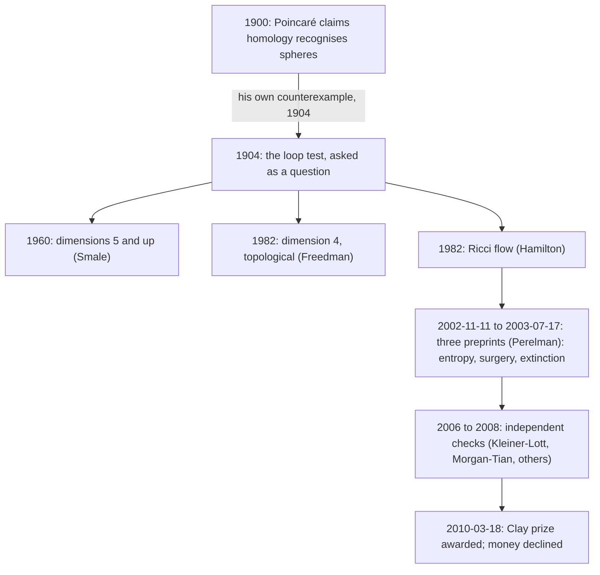

# The Poincare conjecture, solved: a simply connected closed three-manifold is a sphere

[Syllabus](../../../SYLLABUS.md) → [Frontier](../README.md) → [The Millennium Problems](../README.md#s02) → The Poincare conjecture, solved

---

## General Overview

In 2000 the Clay Mathematics Institute named seven Millennium Prize Problems, with $1,000,000 for each. On 2010-03-18 it awarded the first prize, for the Poincaré conjecture, to Grigoriy Perelman. He had posted the proof as three preprints between 2002-11-11 and 2003-07-17. He declined the prize money, as he had declined a Fields Medal in 2006.

The question is 98 years older than the first preprint. In 1904 Henri Poincaré asked how to recognise the **3-sphere**: the set of points at distance 1 from the centre in four-dimensional space. It is the three-dimensional version of a ball's skin. Nobody can see it whole, so the test has to work from inside the space.

His test was loops. Any closed loop of string in the 3-sphere can be pulled tight to a point without leaving the space ([Contractible and simply connected](../../17-Topology/04-Homotopy/02-contractible-and-simply-connected.md) explains this shrinking). Does this one property pick out the 3-sphere among all closed three-dimensional spaces? Yes.

**A closed three-dimensional space in which every loop shrinks to a point is the 3-sphere; Perelman proved it in 2002–2003 by letting Ricci flow smooth the space, cutting out the necks that pinch, and showing that everything dies out in pieces that are 3-spheres.**

**What kind of fact this is:** a theorem. Status as of 2026-11-23: proved, checked by independent teams (2006–2008) and recognised by Clay's prize. This card outlines the proof and proves none of it. The code checks instances only.

### The picture: the route to the proof



Dimension 3 was the last case of the topological question. The higher dimensions fell first because there is more room to move things apart. A smooth version in dimension 4 is still open (When it holds, last bullet).

---

## The formula

Reminders. A **loop** is a closed path in a space. The **fundamental group** $`\pi_1(M)`$ is the set of loops at a point, where two loops count as the same when one slides into the other ([The fundamental group](../../17-Topology/04-Homotopy/03-the-fundamental-group.md)). A **3-manifold** is a space where every point has a neighbourhood that looks like a piece of ordinary 3D space. **Closed** means finite in extent (compact) and with no edge (no boundary).

```math
M \text{ a closed, connected 3-manifold, and } \pi_1(M) = 1 \;\Longrightarrow\; M \cong S^3 = \{x \in \mathbb{R}^4 : x_1^2 + x_2^2 + x_3^2 + x_4^2 = 1\}
```

**Read it aloud:** if a closed three-dimensional space is in one piece and every loop in it shrinks to a point, then the space can be matched to the round 3-sphere point for point, continuously both ways.

| Symbol | Plain meaning | In our example | Push it up and the answer… |
| --- | --- | --- | --- |
| $`M`$ | the closed 3-manifold under test | the 3-sphere itself | — |
| $`S^3`$ | the 3-sphere: points of 4D space at distance 1 from the origin | the space the loop lives in | — |
| $`\pi_1(M) = 1`$ | the fundamental group has one member: every loop shrinks | true for the 3-sphere | a group with 2, 5 or 120 members means $`M`$ is not $`S^3`$ |
| $`\cong`$ | "is homeomorphic to": matched point for point, continuously both ways | — | — |
| $`\gamma(s)`$, $`s`$ | the loop; the time along it, 0 to 1 | $`(\cos 2\pi s, \sin 2\pi s, 0, 0)`$, length 6.283185 | — |
| $`t`$ | the shrinking's time: 0 is the loop, 1 is the point | two shrinkings, roads 1 and 2 | larger $`t`$: closer to a point |
| $`x`$, $`N`$, $`q`$ | a point of 4D space $`\mathbb{R}^4`$ (3D space is $`\mathbb{R}^3`$); the north pole $`(0, 0, 0, 1)`$; the south pole $`(0, 0, 0, -1)`$ | the loop shrinks to $`N`$ and misses $`q`$ | — |
| $`a`$, $`b`$; 2I | two members of a group, such as two loop classes; the binary icosahedral group of 120 quaternions | two of the 120 elements of 2I | — |
| $`\chi`$ | Euler characteristic: vertices − edges + faces − solids | 0 for $`S^3`$ | — |
| $`g`$, $`\mathrm{Ric}`$ | a metric, the rule for lengths; its Ricci curvature | a dumbbell-shaped 3-sphere | more curvature: faster shrinking |
| $`\tau`$ | Ricci flow time, in cm² | a neck pinches at $`\tau`$ = 0.125 cm² | — |
| $`\rho`$, $`R`$ | radius of a thin neck; radius of a round end | 0.5 cm; 2 cm | larger $`\rho`$: the neck lasts longer |

### When it holds

- **Closed.** Ordinary 3D space $`\mathbb{R}^3`$ has every loop shrinkable but runs on forever. It is not a sphere.
- **No boundary.** A solid ball is simply connected and finite, but it has a skin as its edge. Its Euler characteristic is 1, not the 3-sphere's 0.
- **Every loop, not just homology.** Homology, a coarser count of holes, is fooled. Poincaré's own 1904 example has homology like the 3-sphere's but 120 loop classes.
- **Dimension 3.** In dimension 4 loops are not enough: $`S^2 \times S^2`$ (pairs of points on two ordinary spheres) has every loop shrinkable, Euler characteristic 4, and is not the 4-sphere, whose characteristic is 2.
- **Up to deformation.** A dented, stretched 3-sphere counts as $`S^3`$. In dimension 3 the continuous and smooth versions of the answer agree (Milnor's problem description). The theorem claims nothing about the smooth question in dimension 4. Freedman's 1982 proof covers topological manifolds, and Milnor's description records that no one knows whether every smooth homotopy 4-sphere (a smooth 4-manifold with the same loops and holes, in every dimension, as the 4-sphere) is smoothly the standard one. That question is open as of 2026-11-23.

---

## Why it works

### Step 0: let geometry do the topology

The hypothesis is about loops. The conclusion is about the whole space. No argument from topology alone has been found that joins the two in dimension 3.

The proof brings in geometry. Put any metric (a rule for lengths) on $`M`$. Let it flow so that curvature evens out, like heat. A simply connected space then shrinks away in finite time, and every piece that vanishes is a 3-sphere: near-round, or a tube closed off by two caps. Reading the record backwards rebuilds $`M`$ from 3-spheres, so $`M`$ is a 3-sphere.

### Step 1: the 3-sphere passes the test

Take the loop $`\gamma(s) = (\cos 2\pi s, \sin 2\pi s, 0, 0)`$, a great circle of length $`2\pi`$ = 6.283185. Two different shrinkings take it to the north pole $`N`$.

1. **Road 1: slide straight, then push back to the sphere.** Mix the loop with $`N`$: $`(1 - t)\gamma(s) + tN`$. Its length is $`\sqrt{(1 - t)^2 + t^2}`$, never below $`\sqrt{1/2}`$ = 0.707107, so dividing by it is safe. Dividing puts every point back on $`S^3`$.
2. **Road 2: flatten, shrink, unflatten.** **Stereographic projection** from $`q`$ maps $`S^3`$ minus the point $`q`$ onto ordinary 3D space: $`x \mapsto (x_1, x_2, x_3)/(1 + x_4)`$. The loop becomes a circle of radius 1. Shrink it by $`(1 - t)`$ and map back.

Both roads work because the loop misses $`q`$, staying 1.414214 away. With one point removed, $`S^3`$ is a copy of 3D space, where every loop shrinks. Any loop can first be nudged off one point, so $`\pi_1(S^3) = 1`$.

This is the easy direction. The theorem is the converse: nothing else passes the test.

### Step 2: why loops, and not something cheaper

Two cheaper tests fail, and the code shows each.

- **The Euler characteristic.** For surfaces, $`\chi`$ sorts the sphere ($`\chi`$ = 2) from the rest. For closed 3-manifolds it is always 0, by Poincaré duality (a symmetry of a closed manifold's holes). The 3-sphere, built from 5 vertices, 10 edges, 10 triangles and 5 solid tetrahedra, gives 5 − 10 + 10 − 5 = 0. The 3-torus, a 3 by 3 by 3 block of cubes with opposite faces glued, also gives 0.
- **Homology.** The first homology group is the fundamental group made commutative: every **commutator** $`aba^{-1}b^{-1}`$ (the gap between $`ab`$ and $`ba`$) is set to 1. A group whose commutators generate all of it is **perfect**, and homology sees nothing of it.

Poincaré's 1904 counterexample is the second failure. **Quaternions** are 4D numbers that multiply like rotations. Those of size 1 form $`S^3`$, and 120 of them form a group, the **binary icosahedral group** 2I. Dividing $`S^3`$ by 2I gives the **Poincaré homology sphere**. Its loops fall into 120 classes. The commutators of 2I generate all 120 elements, so homology sees 120/120 = 1 class, exactly as for $`S^3`$.

| Space | Loop classes | Commutator subgroup | Homology sees |
| --- | ---: | ---: | ---: |
| Poincaré homology sphere | 120 | 120 | 1 |
| $`\mathbb{RP}^3`$, opposite points of $`S^3`$ glued | 2 | 1 | 2 |
| lens space $`L(5, 1)`$ | 5 | 1 | 5 |

Homology catches the last two, not the first. Only the loop test separates it from $`S^3`$.

### Step 3: Ricci flow, and why necks pinch

Ricci flow changes the metric by minus twice its Ricci curvature, $`\partial g / \partial\tau = -2\,\mathrm{Ric}(g)`$. Curved-in regions shrink and curvature spreads out like heat ([Ricci flow](../../23-Differential%20geometry%20and%20Lie%20groups/07-Geometric%20Analysis%20and%20Physics/01-ricci-flow-and-the-poincare-proof-in-outline.md) derives this and follows the outline).

Hamilton began this in 1982 and proved one case: with Ricci curvature positive everywhere, the flow rounds the space. In general the flow develops **singularities**, where curvature blows up in finite time. The typical one is a **neck pinch**: a thin tube with a 2-sphere cross-section shrinks to nothing.

A toy model uses two rates from the Ricci flow card: a thin neck's $`\rho^2`$ falls at 2 per unit time, and a round end's $`R^2`$ falls at 4. Take a dumbbell-shaped 3-sphere with a neck of radius 0.5 cm and two round ends of radius 2 cm.

| Event | Flow time $`\tau`$ | What is left |
| --- | ---: | --- |
| start | 0 | one dumbbell |
| neck pinches: $`0.5^2 / 2`$ | 0.125000 cm² | two ends, each of radius 1.870829 cm |
| surgery | 0.125000 cm² | two separate near-round 3-spheres |
| both ends vanish: $`2^2 / 4`$ | 1.000000 cm² | nothing: extinction |

At $`\tau`$ = 0.125 the flow has no next moment. Surgery gives it one.

### Step 4: surgery

**Surgery** is Perelman's way past a pinch. Just before the neck pinches, cut the tube along a 2-sphere, glue a round half-ball onto each cut end, and restart the flow on what results.

Surgery does three jobs.

1. **It keeps the flow going.** The pieces are smooth again.
2. **It keeps the bookkeeping exact.** $`M`$ is the **connected sum** of the pieces: the pieces joined back by thin tubes. Every loop on a 2-sphere shrinks, so by van Kampen's theorem (the rule for loops in spaces glued together) each piece's loop group sits inside $`M`$'s. If $`M`$ is simply connected, so is every piece.
3. **It happens only finitely often in any finite time.** This is the hard part. Perelman's entropy shows the space cannot collapse at small scales. That yields a full list of what very high curvature looks like: necks and caps. Surgery at a fixed scale then cannot pile up.

<details>
<summary>What the three preprints each supply, in outline</summary>

**Preprint 1 (2002-11-11), the entropy.** Perelman's entropy never decreases along the flow. It gives **non-collapsing**: a small ball of moderate curvature has at least a fixed fraction of a flat ball's volume. Magnifying near a singularity then gives limits with non-negative curvature, which are classified in dimension 3.

**Preprint 2 (2003-03-10), the surgery.** The classification gives **canonical neighbourhoods**: near high curvature the space looks like a long round neck, a cap, or a small round piece. Each surgery removes a definite volume, while volume grows at a bounded rate, so surgeries are finite before any given time.

**Preprint 3 (2003-07-17), finite extinction.** If $`\pi_1(M)`$ is trivial, the flow with surgery dies out. The argument follows the least area of discs spanning a family of loops that sweeps out the space. The flow drives this area down fast enough to reach zero in finite time.

**Reading the answer.** Each vanishing piece is a 3-sphere, a quotient of one, or a piece built from necks and caps, such as a neck closed into a ring. Simple connectivity leaves only the 3-sphere. Glued back, $`M`$ is a connected sum of 3-spheres: a 3-sphere.

</details>

### Step 5: how a proof is accepted

The audit list from [Machines in proofs](../01-How%20Research%20Works/06-computer-assistance-and-formal-verification.md), on shelf 01, has four parts.

- **Statement.** The Poincaré conjecture, and the stronger geometrisation conjecture of Thurston (1982): every closed 3-manifold cuts into pieces with one of 8 standard geometries. Geometrisation also shows that a closed 3-manifold with a finite loop group is $`S^3`$ divided by a group of rotations, like the three spaces in Step 2's table.
- **Artifact.** Three arXiv preprints, 2002–2003.
- **Independent checks.** Kleiner and Lott posted notes online as they checked each step: first arXiv version 2006-05-25, refereed in *Geometry & Topology* on 2008-11-06. Morgan and Tian posted a book-length proof of the Poincaré part on 2006-07-25 (arXiv math/0607607), published by the American Mathematical Society in 2007-08 (Clay's press release). Other teams published further accounts, listed in Clay's press release.
- **Status.** Proved. Clay awarded the prize on 2010-03-18, after review by a special advisory committee. Perelman declined the money.

From question to prize took 106 years. It was the first Millennium Prize awarded; the other six keep their status on their own cards.

---

## Worked numbers, by hand

The loop $`\gamma(s) = (\cos 2\pi s, \sin 2\pi s, 0, 0)`$ on $`S^3`$, followed at $`s = 0`$, the point $`(1, 0, 0, 0)`$.

| Step | Arithmetic | Value |
| --- | --- | --- |
| loop on the sphere | $`\cos^2 + \sin^2 + 0 + 0`$ | 1 |
| distance from $`q`$ | $`\sqrt{1 + 1}`$ | 1.414214 |
| road 1, mixed point at $`t = 1/2`$ | $`\tfrac12(1, 0, 0, 0) + \tfrac12(0, 0, 0, 1)`$ | $`(0.5, 0, 0, 0.5)`$ |
| its length | $`\sqrt{0.25 + 0.25}`$ | 0.707107 |
| road 1 point, pushed to the sphere | $`(0.5, 0, 0, 0.5) / 0.707107`$ | $`(0.707107, 0, 0, 0.707107)`$ |
| road 2, flattened | $`(1, 0, 0)/(1 + 0)`$ | $`(1, 0, 0)`$ |
| shrunk to $`t = 1/2`$ | $`\tfrac12 (1, 0, 0)`$, squared size 0.25 | $`(0.5, 0, 0)`$ |
| road 2 point, unflattened | $`(2 \times 0.5, 0, 0, 1 - 0.25) / (1 + 0.25)`$ | $`(0.8, 0, 0, 0.6)`$ |
| both roads at $`t = 1`$ | the mix is $`N`$; the flattened point is 0, which maps to $`N`$ | **$`N = (0, 0, 0, 1)`$** |

The two roads pass through different points at $`t = 1/2`$, yet both end at $`N`$: the loop shrinks to a point inside $`S^3`$.

### What breaks if you drop a piece

| Mistake | Comes out at | What went wrong |
| --- | --- | --- |
| Test homology, not loops (Poincaré, 1900) | homology sees 1 class; loops have 120 | 2I is perfect, so making it commutative leaves nothing |
| Test the Euler characteristic, the surface habit | 3-sphere 0, 3-torus 0 | every closed 3-manifold has $`\chi`$ = 0 |
| Drop "no boundary" | solid ball: simply connected, $`\chi`$ = 1 | a ball has an edge; the theorem needs none |
| Carry loops-only to dimension 4 | $`S^2 \times S^2`$: simply connected, $`\chi`$ = 4, not 2 | from dimension 4 up, homology is needed as well |
| Run the flow with no surgery | stops at 0.125 cm², ends still 1.870829 cm | a pinched neck leaves no smooth space to flow |

---

## Code, from first principles, and it actually runs

The code checks the card's instances, not the theorem. The loop shrinks by **two independent roads**, checked on a grid of 401 by 101 points, with the grid minimum matched to $`\sqrt{1/2}`$. The group 2I is reached two ways: listed from its 120 coordinates, and generated from two quaternions. Euler characteristics come from counting cells, checked against a second triangulation of the 2-sphere (the octahedron) and against hand sums of Betti numbers (the counts of independent holes in each dimension). The surgery clock's times are checked by stepping its two rates forward in small time steps. An edge-path count kills the 3-sphere's 6 loop generators using its triangles; the circle keeps its 1.

### Python

```python
# Poincare conjecture, solved -- the check behind the card.  Standard library only.
# Nothing here proves the theorem.  It checks the card's instances: one loop on the
# 3-sphere shrinks two ways, Euler counts, the 120-element group that fools homology,
# and the toy surgery clock.  Every number on the card is printed here.
from itertools import combinations, permutations, product
from math import cos, sin, pi, sqrt

print("status ledger")
for date, event in [("1900", "Poincare's homology version (false)"), ("1904", "Poincare asks about loops"),
                    ("1960", "dimensions 5 and up, announced (Smale)"), ("1982", "dimension 4, topological (Freedman)"),
                    ("1982", "Ricci flow introduced (Hamilton)"),
                    ("1982", "geometrisation conjecture, 8 geometries (Thurston)"), ("2000", "Clay names 7 problems, $1,000,000 each"),
                    ("2002-11-11", "Perelman preprint 1 (entropy)"), ("2003-03-10", "Perelman preprint 2 (surgery)"),
                    ("2003-07-17", "Perelman preprint 3 (finite extinction)"), ("2006-05-25", "Kleiner-Lott notes, first arXiv version"),
                    ("2006-07-25", "Morgan-Tian book posted"), ("2006", "Fields Medal, declined"),
                    ("2007-08", "Morgan-Tian book published"), ("2008-11-06", "Kleiner-Lott refereed paper"),
                    ("2010-03-18", "Clay Millennium Prize awarded; money later declined")]:
    print(f"  {date:<11}{event}")
print(f"years, question to first preprint  {2002 - 1904}\nyears, question to prize           {2010 - 1904}")

# 1. The loop gamma(s) = (cos 2 pi s, sin 2 pi s, 0, 0) on the unit 3-sphere.
N, q = (0.0, 0.0, 0.0, 1.0), (0.0, 0.0, 0.0, -1.0)
def gamma(s): return (cos(2*pi*s), sin(2*pi*s), 0.0, 0.0)
def norm(v): return sqrt(sum(x*x for x in v))
def road1(s, t):   # straight line toward N, then pushed back onto the sphere
    v = tuple((1-t)*a + t*b for a, b in zip(gamma(s), N)); n = norm(v)
    return tuple(x/n for x in v), n
def road2(s, t):   # stereographic projection from q, shrink in R^3, map back
    g = gamma(s); y = [(1-t)*x/(1+g[3]) for x in g[:3]]; r2 = sum(c*c for c in y)
    return tuple([2*c/(1+r2) for c in y] + [(1-r2)/(1+r2)])
S, T = 400, 100
L = sum(norm([a-b for a, b in zip(gamma((k+1)/S), gamma(k/S))]) for k in range(S))
minmix, offsphere, end_gap = 9.0, 0.0, 0.0
for i in range(S+1):
    for j in range(T+1):
        p1, n = road1(i/S, j/T); p2 = road2(i/S, j/T); minmix = min(minmix, n)
        offsphere = max(offsphere, abs(norm(p1)-1), abs(norm(p2)-1))
    end_gap = max(end_gap, norm([a-b for a, b in zip(road1(i/S, 1)[0], N)]),
                  norm([a-b for a, b in zip(road2(i/S, 1), N)]))
print(f"loop length, 400 chords      {L:.6f}   (2 pi = {2*pi:.6f})")
print(f"loop distance to q           {norm([a-b for a, b in zip(gamma(0.3), q)]):.6f}")
print(f"road 1 smallest mix length   {minmix:.6f}   (sqrt 1/2 = {sqrt(0.5):.6f})")
print("road 1 at s=0, t=1/2         (%.6f, %.6f, %.6f, %.6f)" % road1(0, 0.5)[0])
print("road 2 at s=0, t=1/2         (%.6f, %.6f, %.6f, %.6f)" % road2(0, 0.5))
print(f"both roads stay on S^3       {offsphere < 1e-12}  (grid 401 x 101)")
print(f"both roads end at N          {end_gap < 1e-12}")
assert abs(L - 2*pi) < 1e-4, "chords must approach the circle"
assert abs(minmix - sqrt(0.5)) < 1e-12, "grid minimum must match the hand value"
assert offsphere < 1e-12, "a road left the sphere"
assert end_gap < 1e-12, "a road missed N"

# 2. Euler characteristic by counting cells, and the edge-path group.
def faces(simplex, proper):
    k = len(simplex); top = k-1 if proper else k
    return [c for d in range(1, top+1) for c in combinations(simplex, d)]
def chi(cells): return sum((-1)**(len(c)-1) for c in cells)
S1, S2, S3 = faces(range(3), True), faces(range(4), True), faces(range(5), True)
B3, S4 = faces(range(4), False), faces(range(6), True)
octa = [c for c in faces(range(6), True) if len(c) < 4 and all(a//2 != b//2 for a, b in combinations(c, 2))]   # octahedron: +-e1, +-e2, +-e3
torus = [(x, y, z, m) for x in range(3) for y in range(3) for z in range(3) for m in range(8)]
chi_t = sum((-1)**bin(c[3]).count("1") for c in torus)
chi_22 = sum((-1)**(len(a)+len(b)) for a in S2 for b in S2)
for name, v in [("circle", chi(S1)), ("2-sphere", chi(S2)), ("2-sphere, octahedron", chi(octa)), ("solid ball", chi(B3)),
                ("3-sphere", chi(S3)), ("3-torus, 3x3x3 cubes", chi_t),
                ("4-sphere", chi(S4)), ("S^2 x S^2", chi_22)]:
    print(f"chi  {name:<22}{v:>3}")
print("3-sphere cells by dimension ", [sum(len(c) == d for c in S3) for d in range(1, 5)])
assert chi(S2) == chi(octa) == 2, "two triangulations of the 2-sphere disagree"
assert (chi(B3), chi(S4), chi_22) == (1, 1 + 1, 1 + 2 + 1), "Betti sums: ball 1; S^4 1+1; S^2 x S^2 1+2+1"
assert chi_t == chi(S3) == 0, "closed 3-manifolds have chi 0"
def edge_path(cells):
    gens = {c for c in cells if len(c) == 2 and 0 not in c}; total = len(gens)
    tris = [c for c in cells if len(c) == 3]; changed = True
    while changed:
        changed = False
        for a, b, c in tris:
            alive = [e for e in [(a, b), (b, c), (a, c)] if e in gens]
            if len(alive) == 1: gens.discard(alive[0]); changed = True
    return total, len(gens)
for name, cells in [("3-sphere", S3), ("circle", S1)]: print(f"edge-path {name:<9} generators %d, left after relations %d" % edge_path(cells))
assert edge_path(S3) == (6, 0), "the 3-sphere's loops must all die"

# 3. Unit quaternions: the binary icosahedral group, 120 elements.
def mul(a, b):
    return (a[0]*b[0]-a[1]*b[1]-a[2]*b[2]-a[3]*b[3], a[0]*b[1]+a[1]*b[0]+a[2]*b[3]-a[3]*b[2],
            a[0]*b[2]-a[1]*b[3]+a[2]*b[0]+a[3]*b[1], a[0]*b[3]+a[1]*b[2]-a[2]*b[1]+a[3]*b[0])
def inv(a): return (a[0], -a[1], -a[2], -a[3])
def key(a): return tuple(int(round(x*1e6)) for x in a)
def close(gens):
    one = (1.0, 0.0, 0.0, 0.0); seen = {key(one): one}; todo = [one]
    while todo:
        x = todo.pop()
        for g in gens:
            y = mul(x, g)
            if key(y) not in seen: seen[key(y)] = y; todo.append(y)
    return seen
phi = (1 + sqrt(5))/2; signs = list(product((1, -1), repeat=4))
listed = [tuple(float(i == k)*sg for i in range(4)) for k in range(4) for sg in (1, -1)]
listed += [tuple(x/2 for x in sg) for sg in signs]
even = [p for p in permutations(range(4))
        if sum(p[i] > p[j] for i in range(4) for j in range(i+1, 4)) % 2 == 0]
base = (0.0, 1.0, 1/phi, phi)
listed += [tuple(sg[i]*base[p[i]]/2 for i in range(4)) for p in even for sg in signs]
listed = {key(x): x for x in listed}
G = close([(0.5, 0.5, 0.5, 0.5), (phi/2, 1/(2*phi), 0.5, 0.0)])
closed = all(key(mul(a, b)) in listed for a in listed.values() for b in listed.values())
print(f"2I listed {len(listed)}, generated from two {len(G)}, same set {set(G) == set(listed)}, "
      f"closed {closed}")
def order(a):
    n, x = 1, a
    while key(x) != key((1.0, 0, 0, 0)): x = mul(x, a); n += 1
    return n
hist = {}
for a in G.values(): hist[order(a)] = hist.get(order(a), 0) + 1
print("2I element orders            ", dict(sorted(hist.items())))
def comm(grp):
    els = list(grp.values())
    cs = {key(mul(mul(a, b), mul(inv(a), inv(b)))): mul(mul(a, b), mul(inv(a), inv(b)))
          for a in els for b in els}
    return close(list(cs.values()))
w = 2*pi/5
for name, grp in [("Poincare sphere, 2I", G), ("RP^3, {+1,-1}", close([(-1.0, 0, 0, 0)])),
                  ("lens L(5,1)", close([(cos(w), sin(w), 0.0, 0.0)]))]:
    c = len(comm(grp))
    print(f"{name:<20} loop classes {len(grp):>3}, commutators {c:>3}, homology sees {len(grp)//c}")
assert set(G) == set(listed), "two roads to 2I disagree"
assert closed, "the listed set is not a group"
assert len(comm(G)) == 120, "2I must be perfect"

# 4. Toy surgery clock (rates from the Ricci flow card): thin neck rho^2 falls at 2,
#    round 3-sphere R^2 falls at 4.  Neck rho = 0.5 cm, two balls R = 2 cm.
rho = 0.5; pinch, extinct = rho**2/2, 2.0**2/4
print(f"neck pinches at tau          {pinch:.6f}\nball radius then             {sqrt(4 - 4*pinch):.6f} cm")
print(f"after 1 surgery, extinct at  {extinct:.6f}")
def life(x, rate, t=0.0):          # second road: step x^2 down at this rate, in steps of 1e-6, until x is gone
    while x > 1e-3: x, t = x - rate*1e-6/(2*x), t + 1e-6
    return t
assert abs(life(rho, 2) - pinch) < 1e-4 and abs(life(sqrt(4 - 4*pinch), 4, pinch) - extinct) < 1e-4, "clock vs stepping"
print("ALL CHECKS PASS")
```

**Ran 2026-11-23 on macOS, Python 3.14.10, standard library only. All checks passed. Output, pasted from the run:**

```
status ledger
  1900       Poincare's homology version (false)
  1904       Poincare asks about loops
  1960       dimensions 5 and up, announced (Smale)
  1982       dimension 4, topological (Freedman)
  1982       Ricci flow introduced (Hamilton)
  1982       geometrisation conjecture, 8 geometries (Thurston)
  2000       Clay names 7 problems, $1,000,000 each
  2002-11-11 Perelman preprint 1 (entropy)
  2003-03-10 Perelman preprint 2 (surgery)
  2003-07-17 Perelman preprint 3 (finite extinction)
  2006-05-25 Kleiner-Lott notes, first arXiv version
  2006-07-25 Morgan-Tian book posted
  2006       Fields Medal, declined
  2007-08    Morgan-Tian book published
  2008-11-06 Kleiner-Lott refereed paper
  2010-03-18 Clay Millennium Prize awarded; money later declined
years, question to first preprint  98
years, question to prize           106
loop length, 400 chords      6.283121   (2 pi = 6.283185)
loop distance to q           1.414214
road 1 smallest mix length   0.707107   (sqrt 1/2 = 0.707107)
road 1 at s=0, t=1/2         (0.707107, 0.000000, 0.000000, 0.707107)
road 2 at s=0, t=1/2         (0.800000, 0.000000, 0.000000, 0.600000)
both roads stay on S^3       True  (grid 401 x 101)
both roads end at N          True
chi  circle                  0
chi  2-sphere                2
chi  2-sphere, octahedron    2
chi  solid ball              1
chi  3-sphere                0
chi  3-torus, 3x3x3 cubes    0
chi  4-sphere                2
chi  S^2 x S^2               4
3-sphere cells by dimension  [5, 10, 10, 5]
edge-path 3-sphere  generators 6, left after relations 0
edge-path circle    generators 1, left after relations 1
2I listed 120, generated from two 120, same set True, closed True
2I element orders             {1: 1, 2: 1, 3: 20, 4: 30, 5: 24, 6: 20, 10: 24}
Poincare sphere, 2I  loop classes 120, commutators 120, homology sees 1
RP^3, {+1,-1}        loop classes   2, commutators   1, homology sees 2
lens L(5,1)          loop classes   5, commutators   1, homology sees 5
neck pinches at tau          0.125000
ball radius then             1.870829 cm
after 1 surgery, extinct at  1.000000
ALL CHECKS PASS
```

### Rust

```rust
// Poincare conjecture, solved -- the check behind the card.  std only, no crates.
// Nothing here proves the theorem.  It checks the card's instances: one loop on the
// 3-sphere shrinks two ways, Euler counts, the 120-element group that fools homology,
// and the toy surgery clock.  Every number on the card is printed here.
use std::collections::{BTreeMap, HashMap, HashSet};
use std::f64::consts::PI;

type V4 = [f64; 4]; fn py(b: bool) -> &'static str { if b { "True" } else { "False" } }
const N: V4 = [0.0, 0.0, 0.0, 1.0]; const Q: V4 = [0.0, 0.0, 0.0, -1.0];

fn gamma(s: f64) -> V4 { [(2.0 * PI * s).cos(), (2.0 * PI * s).sin(), 0.0, 0.0] }
fn norm(v: &[f64]) -> f64 { v.iter().map(|x| x * x).sum::<f64>().sqrt() }
fn dist(a: &V4, b: &V4) -> f64 { norm(&[a[0] - b[0], a[1] - b[1], a[2] - b[2], a[3] - b[3]]) }
fn road1(s: f64, t: f64) -> (V4, f64) { // straight line toward N, then pushed back onto the sphere
    let g = gamma(s); let v: V4 = [0, 1, 2, 3].map(|i| (1.0 - t) * g[i] + t * N[i]); let n = norm(&v);
    (v.map(|x| x / n), n)
}
fn road2(s: f64, t: f64) -> V4 { // stereographic projection from q, shrink in R^3, map back
    let g = gamma(s); let y = [0, 1, 2].map(|i| (1.0 - t) * g[i] / (1.0 + g[3]));
    let r2: f64 = y.iter().map(|c| c * c).sum();
    [2.0 * y[0] / (1.0 + r2), 2.0 * y[1] / (1.0 + r2), 2.0 * y[2] / (1.0 + r2), (1.0 - r2) / (1.0 + r2)]
}

fn faces(k: usize, proper: bool) -> Vec<Vec<usize>> { // cells as sorted vertex lists: every subset of 0..k of size 1..top
    let (top, mut out) = (if proper { k - 1 } else { k }, Vec::new());
    for d in 1..=top { for m in 0u32..(1 << k) {
        if m.count_ones() as usize == d { out.push((0..k).filter(|i| m >> i & 1 == 1).collect()); }
    } }
    out
}
fn chi(cells: &[Vec<usize>]) -> i64 { cells.iter().map(|c| if c.len() % 2 == 1 { 1 } else { -1 }).sum() }
fn edge_path(cells: &[Vec<usize>]) -> (usize, usize) {
    let mut gens: HashSet<(usize, usize)> =
        cells.iter().filter(|c| c.len() == 2 && c[0] != 0).map(|c| (c[0], c[1])).collect();
    let (total, mut changed) = (gens.len(), true);
    let tris: Vec<&Vec<usize>> = cells.iter().filter(|c| c.len() == 3).collect();
    while changed {
        changed = false;
        for t in &tris {
            let (a, b, c) = (t[0], t[1], t[2]);
            let alive: Vec<(usize, usize)> = [(a, b), (b, c), (a, c)].into_iter().filter(|e| gens.contains(e)).collect();
            if alive.len() == 1 { gens.remove(&alive[0]); changed = true; }
        }
    }
    (total, gens.len())
}

fn mul(a: &V4, b: &V4) -> V4 {
    [a[0] * b[0] - a[1] * b[1] - a[2] * b[2] - a[3] * b[3], a[0] * b[1] + a[1] * b[0] + a[2] * b[3] - a[3] * b[2],
     a[0] * b[2] - a[1] * b[3] + a[2] * b[0] + a[3] * b[1], a[0] * b[3] + a[1] * b[2] - a[2] * b[1] + a[3] * b[0]]
}
fn inv(a: &V4) -> V4 { [a[0], -a[1], -a[2], -a[3]] }
type Key = [i64; 4]; fn key(a: &V4) -> Key { a.map(|x| (x * 1e6).round() as i64) }
fn close(gens: &[V4]) -> HashMap<Key, V4> {
    let one = [1.0, 0.0, 0.0, 0.0];
    let (mut seen, mut todo) = (HashMap::from([(key(&one), one)]), vec![one]);
    while let Some(x) = todo.pop() { for g in gens {
        let y = mul(&x, g);
        if !seen.contains_key(&key(&y)) { seen.insert(key(&y), y); todo.push(y); }
    } }
    seen
}
fn order(a: &V4) -> usize {
    let (mut n, mut x) = (1, *a); while key(&x) != key(&[1.0, 0.0, 0.0, 0.0]) { x = mul(&x, a); n += 1; } n
}
fn life(mut x: f64, rate: f64, mut t: f64) -> f64 { // second road: step x^2 down at this rate, in steps of 1e-6
    while x > 1e-3 { x -= rate * 1e-6 / (2.0 * x); t += 1e-6; } t
}
fn comm(grp: &HashMap<Key, V4>) -> HashMap<Key, V4> {
    let mut cs: HashMap<Key, V4> = HashMap::new();
    for a in grp.values() { for b in grp.values() {
        let c = mul(&mul(a, b), &mul(&inv(a), &inv(b))); cs.insert(key(&c), c);
    } }
    close(&cs.values().cloned().collect::<Vec<_>>())
}

fn main() {
    println!("status ledger");
    for (date, event) in [("1900", "Poincare's homology version (false)"), ("1904", "Poincare asks about loops"),
        ("1960", "dimensions 5 and up, announced (Smale)"), ("1982", "dimension 4, topological (Freedman)"),
        ("1982", "Ricci flow introduced (Hamilton)"), ("1982", "geometrisation conjecture, 8 geometries (Thurston)"), ("2000", "Clay names 7 problems, $1,000,000 each"),
        ("2002-11-11", "Perelman preprint 1 (entropy)"), ("2003-03-10", "Perelman preprint 2 (surgery)"),
        ("2003-07-17", "Perelman preprint 3 (finite extinction)"), ("2006-05-25", "Kleiner-Lott notes, first arXiv version"),
        ("2006-07-25", "Morgan-Tian book posted"), ("2006", "Fields Medal, declined"),
        ("2007-08", "Morgan-Tian book published"), ("2008-11-06", "Kleiner-Lott refereed paper"),
        ("2010-03-18", "Clay Millennium Prize awarded; money later declined")] {
        println!("  {:<11}{}", date, event);
    }
    println!("years, question to first preprint  {}\nyears, question to prize           {}", 2002 - 1904, 2010 - 1904);

    // 1. The loop gamma(s) = (cos 2 pi s, sin 2 pi s, 0, 0) on the unit 3-sphere.
    let (s_n, t_n) = (400usize, 100usize);
    let l: f64 = (0..s_n).map(|k| dist(&gamma((k + 1) as f64 / s_n as f64), &gamma(k as f64 / s_n as f64))).sum();
    let (mut minmix, mut offsphere, mut end_gap) = (9.0f64, 0.0f64, 0.0f64);
    for i in 0..=s_n { let s = i as f64 / s_n as f64;
        for j in 0..=t_n { let t = j as f64 / t_n as f64;
            let (p1, n) = road1(s, t); let p2 = road2(s, t); minmix = minmix.min(n);
            offsphere = offsphere.max((norm(&p1) - 1.0).abs()).max((norm(&p2) - 1.0).abs());
        }
        end_gap = end_gap.max(dist(&road1(s, 1.0).0, &N)).max(dist(&road2(s, 1.0), &N));
    }
    println!("loop length, 400 chords      {:.6}   (2 pi = {:.6})", l, 2.0 * PI);
    println!("loop distance to q           {:.6}", dist(&gamma(0.3), &Q));
    println!("road 1 smallest mix length   {:.6}   (sqrt 1/2 = {:.6})", minmix, 0.5f64.sqrt());
    let (a, b) = (road1(0.0, 0.5).0, road2(0.0, 0.5));
    println!("road 1 at s=0, t=1/2         ({:.6}, {:.6}, {:.6}, {:.6})", a[0], a[1], a[2], a[3]);
    println!("road 2 at s=0, t=1/2         ({:.6}, {:.6}, {:.6}, {:.6})", b[0], b[1], b[2], b[3]);
    println!("both roads stay on S^3       {}  (grid 401 x 101)\nboth roads end at N          {}",
             py(offsphere < 1e-12), py(end_gap < 1e-12));
    assert!((l - 2.0 * PI).abs() < 1e-4, "chords must approach the circle");
    assert!((minmix - 0.5f64.sqrt()).abs() < 1e-12, "grid minimum must match the hand value");
    assert!(offsphere < 1e-12, "a road left the sphere");
    assert!(end_gap < 1e-12, "a road missed N");

    // 2. Euler characteristic by counting cells, and the edge-path group.
    let (s1, s2, s3, b3, s4) = (faces(3, true), faces(4, true), faces(5, true), faces(4, false), faces(6, true));
    let octa: Vec<Vec<usize>> = faces(6, true).into_iter().filter(|c| c.len() < 4 && c.iter().all(|a| c.iter().all(|b| a == b || a / 2 != b / 2))).collect();
    let (mut chi_t, mut chi_22) = (0i64, 0i64); // 3x3x3 periodic cubes: a position plus a set of directions
    for _pos in 0..27 { for m in 0u32..8 { chi_t += if m.count_ones() % 2 == 0 { 1 } else { -1 }; } }
    for a in &s2 { for b in &s2 { chi_22 += if (a.len() + b.len()) % 2 == 0 { 1 } else { -1 }; } }
    for (name, v) in [("circle", chi(&s1)), ("2-sphere", chi(&s2)), ("2-sphere, octahedron", chi(&octa)), ("solid ball", chi(&b3)),
        ("3-sphere", chi(&s3)), ("3-torus, 3x3x3 cubes", chi_t), ("4-sphere", chi(&s4)), ("S^2 x S^2", chi_22)] { println!("chi  {:<22}{:>3}", name, v); }
    let dims: Vec<usize> = (1..5).map(|d| s3.iter().filter(|c| c.len() == d).count()).collect();
    println!("3-sphere cells by dimension  {:?}", dims);
    assert!(chi(&s2) == chi(&octa) && chi(&octa) == 2, "two triangulations of the 2-sphere disagree");
    assert!((chi(&b3), chi(&s4), chi_22) == (1, 1 + 1, 1 + 2 + 1), "Betti sums: ball 1; S^4 1+1; S^2 x S^2 1+2+1");
    assert!(chi_t == 0 && chi(&s3) == 0, "closed 3-manifolds have chi 0");
    for (name, cells) in [("3-sphere", &s3), ("circle", &s1)] {
        let (g, left) = edge_path(cells); println!("edge-path {:<9} generators {}, left after relations {}", name, g, left); }
    assert!(edge_path(&s3) == (6, 0), "the 3-sphere's loops must all die");

    // 3. Unit quaternions: the binary icosahedral group, 120 elements.
    let (phi, mut signs, mut raw) = ((1.0 + 5f64.sqrt()) / 2.0, Vec::new(), Vec::<V4>::new());
    for a in [1.0, -1.0] { for b in [1.0, -1.0] { for c in [1.0, -1.0] { for d in [1.0, -1.0] { signs.push([a, b, c, d]); } } } }
    for k in 0..4 { for sg in [1.0, -1.0] { let mut v = [0.0; 4]; v[k] = sg; raw.push(v); } }
    for sg in &signs { raw.push(sg.map(|x| x / 2.0)); }
    let base = [0.0, 1.0, 1.0 / phi, phi];
    for p0 in 0..4 { for p1 in 0..4 { for p2 in 0..4 { for p3 in 0..4 {
        let p = [p0, p1, p2, p3];
        if p.iter().collect::<HashSet<_>>().len() < 4 { continue; }
        let inversions = (0..4).flat_map(|i| (i + 1..4).map(move |j| (i, j))).filter(|&(i, j)| p[i] > p[j]).count();
        if inversions % 2 != 0 { continue; }
        for sg in &signs { raw.push([0, 1, 2, 3].map(|i| sg[i] * base[p[i]] / 2.0)); }
    } } } }
    let listed: HashMap<Key, V4> = raw.iter().map(|x| (key(x), *x)).collect();
    let g = close(&[[0.5, 0.5, 0.5, 0.5], [phi / 2.0, 1.0 / (2.0 * phi), 0.5, 0.0]]);
    let closed = listed.values().all(|a| listed.values().all(|b| listed.contains_key(&key(&mul(a, b)))));
    let same = g.keys().collect::<HashSet<_>>() == listed.keys().collect::<HashSet<_>>();
    println!("2I listed {}, generated from two {}, same set {}, closed {}", listed.len(), g.len(), py(same), py(closed));
    let mut hist: BTreeMap<usize, usize> = BTreeMap::new(); for a in g.values() { *hist.entry(order(a)).or_insert(0) += 1; }
    let h: Vec<String> = hist.iter().map(|(k, v)| format!("{}: {}", k, v)).collect();
    println!("2I element orders             {{{}}}", h.join(", "));
    let w = 2.0 * PI / 5.0;
    for (name, grp) in [("Poincare sphere, 2I", g.clone()), ("RP^3, {+1,-1}", close(&[[-1.0, 0.0, 0.0, 0.0]])),
                        ("lens L(5,1)", close(&[[w.cos(), w.sin(), 0.0, 0.0]]))] {
        let c = comm(&grp).len();
        println!("{:<20} loop classes {:>3}, commutators {:>3}, homology sees {}", name, grp.len(), c, grp.len() / c);
    }
    assert!(same, "two roads to 2I disagree");
    assert!(closed, "the listed set is not a group");
    assert!(comm(&g).len() == 120, "2I must be perfect");

    // 4. Toy surgery clock (rates from the Ricci flow card): thin neck rho^2 falls at 2,
    //    round 3-sphere R^2 falls at 4.  Neck rho = 0.5 cm, two balls R = 2 cm.
    let rho = 0.5f64; let (pinch, extinct) = (rho * rho / 2.0, 2.0f64 * 2.0 / 4.0);
    println!("neck pinches at tau          {:.6}\nball radius then             {:.6} cm", pinch, (4.0 - 4.0 * pinch).sqrt());
    println!("after 1 surgery, extinct at  {:.6}", extinct);
    assert!((life(rho, 2.0, 0.0) - pinch).abs() < 1e-4 && (life((4.0 - 4.0 * pinch).sqrt(), 4.0, pinch) - extinct).abs() < 1e-4, "clock vs stepping");
    println!("ALL CHECKS PASS");
}
```

**Ran 2026-11-23 on macOS, rustc 1.98.1, no crates. All checks passed. Output, pasted from the run:**

```
status ledger
  1900       Poincare's homology version (false)
  1904       Poincare asks about loops
  1960       dimensions 5 and up, announced (Smale)
  1982       dimension 4, topological (Freedman)
  1982       Ricci flow introduced (Hamilton)
  1982       geometrisation conjecture, 8 geometries (Thurston)
  2000       Clay names 7 problems, $1,000,000 each
  2002-11-11 Perelman preprint 1 (entropy)
  2003-03-10 Perelman preprint 2 (surgery)
  2003-07-17 Perelman preprint 3 (finite extinction)
  2006-05-25 Kleiner-Lott notes, first arXiv version
  2006-07-25 Morgan-Tian book posted
  2006       Fields Medal, declined
  2007-08    Morgan-Tian book published
  2008-11-06 Kleiner-Lott refereed paper
  2010-03-18 Clay Millennium Prize awarded; money later declined
years, question to first preprint  98
years, question to prize           106
loop length, 400 chords      6.283121   (2 pi = 6.283185)
loop distance to q           1.414214
road 1 smallest mix length   0.707107   (sqrt 1/2 = 0.707107)
road 1 at s=0, t=1/2         (0.707107, 0.000000, 0.000000, 0.707107)
road 2 at s=0, t=1/2         (0.800000, 0.000000, 0.000000, 0.600000)
both roads stay on S^3       True  (grid 401 x 101)
both roads end at N          True
chi  circle                  0
chi  2-sphere                2
chi  2-sphere, octahedron    2
chi  solid ball              1
chi  3-sphere                0
chi  3-torus, 3x3x3 cubes    0
chi  4-sphere                2
chi  S^2 x S^2               4
3-sphere cells by dimension  [5, 10, 10, 5]
edge-path 3-sphere  generators 6, left after relations 0
edge-path circle    generators 1, left after relations 1
2I listed 120, generated from two 120, same set True, closed True
2I element orders             {1: 1, 2: 1, 3: 20, 4: 30, 5: 24, 6: 20, 10: 24}
Poincare sphere, 2I  loop classes 120, commutators 120, homology sees 1
RP^3, {+1,-1}        loop classes   2, commutators   1, homology sees 2
lens L(5,1)          loop classes   5, commutators   1, homology sees 5
neck pinches at tau          0.125000
ball radius then             1.870829 cm
after 1 surgery, extinct at  1.000000
ALL CHECKS PASS
```

### Lean

Lean proves Step 1's key facts and checks the card's numbers; Perelman's theorem itself is not in Mathlib and is not proved here.

- Take a loop on $`S^3`$ that never passes through $`q`$. Then it shrinks to a point inside $`S^3`$, its ends held fixed.
- With one point removed, $`S^3`$ is a copy of ordinary 3D space, matched point for point, continuously both ways.
- Take road 1's mix $`(1 - t)\gamma(s) + tN`$. Then its length is $`\sqrt{(1 - t)^2 + t^2}`$, never below $`\sqrt{1/2}`$, so dividing is safe.
- At $`t = 1/2`$, road 1's pushed point and road 2's point $`(0.8, 0, 0, 0.6)`$ both lie on $`S^3`$.
- The loop's start $`(1, 0, 0, 0)`$ is at squared distance 2 from $`q`$.
- The 3-sphere's 5 vertices, 10 edges, 10 triangles and 5 tetrahedra give $`\chi`$ = 0. So do the 3-torus's 27 cubes.
- The solid ball gives $`\chi`$ = 1, the 2-sphere and 4-sphere give 2, and $`S^2 \times S^2`$ gives 4.
- Homology sees 120/120 = 1 class for the Poincaré homology sphere, 2 for $`\mathbb{RP}^3`$ and 5 for $`L(5, 1)`$.
- Take a neck of radius 0.5 cm and ends of radius 2 cm. Then the neck pinches at $`\tau`$ = 0.125 cm².
- At that moment each end has $`R^2`$ = 3.5 cm², and the ends vanish at $`\tau`$ = 1 cm².
- A neck of radius 1 cm pinches at 0.5 cm², with ends of $`R^2`$ = 2 cm².
- The question came 98 years before the first preprint and 106 years before the prize.

Building 2I from quaternions and running both roads on a grid of points are left to the Python and Rust checks.

```lean
-- The Poincare conjecture, solved: this file proves the easy direction's key step, that on the 3-sphere a loop which misses one point shrinks to a point because the sphere minus that point is a copy of 3D space, and checks the card's exact numbers.
import Mathlib.Geometry.Manifold.Instances.Sphere
import Mathlib.AlgebraicTopology.FundamentalGroupoid.SimplyConnected
import Mathlib.Analysis.Convex.Contractible
import Mathlib.Analysis.InnerProductSpace.PiL2
import Mathlib.Analysis.SpecialFunctions.Trigonometric.Basic
import Mathlib.Analysis.SpecialFunctions.Pow.Real
import Mathlib.Tactic.NormNum

open Metric Real

/-!
The card's main theorem is Perelman's: a closed, connected 3-manifold in which every loop shrinks
to a point is the 3-sphere. Its proof (Ricci flow with surgery, 2002–2003) is not in Mathlib, so
this file records that statement as a definition and does not claim it. The theorems below are the
parts of the card that are proved here: the 3-sphere passes the loop test for any loop that misses
a point (Step 1), because the 3-sphere minus a point is a copy of ordinary 3D space, and road 1's
division is always safe.
-/

/-- The 3-sphere: the points of 4D space at distance 1 from the origin. -/
abbrev S3 : Type := sphere (0 : EuclideanSpace ℝ (Fin 4)) 1

/-- The Poincaré conjecture, as the card states it (statement only, not proved in this file):
if a space `M` is a closed (compact, no boundary) 3-manifold, is in one piece, and every loop
in it shrinks to a point, then `M` can be matched to the 3-sphere point for point, continuously
both ways. Perelman proved it in 2002–2003; Clay recognised the proof on 2010-03-18. -/
def PoincareConjecture : Prop :=
  ∀ (M : Type) [TopologicalSpace M] [T2Space M] [SecondCountableTopology M]
    [ChartedSpace (EuclideanSpace ℝ (Fin 3)) M] [CompactSpace M] [ConnectedSpace M]
    [SimplyConnectedSpace M], Nonempty (M ≃ₜ S3)

/-- The 4D space has dimension 3 + 1, which stereographic projection needs. -/
instance fact_finrank_four : Fact (Module.finrank ℝ (EuclideanSpace ℝ (Fin 4)) = 3 + 1) :=
  ⟨by simp⟩

#print axioms fact_finrank_four

/-- Removing one point from the 3-sphere leaves a space that can be shrunk to a point. -/
theorem sphere_minus_point_contractible (q : S3) : ContractibleSpace ({q}ᶜ : Set S3) := by
  let e : ({q}ᶜ : Set S3) ≃ₜ EuclideanSpace ℝ (Fin 3) :=
    ((Homeomorph.setCongr (stereographic'_source (n := 3) q).symm).trans
      (stereographic' 3 q).toHomeomorphSourceTarget).trans
      ((Homeomorph.setCongr (stereographic'_target (n := 3) q)).trans (Homeomorph.Set.univ _))
  exact e.contractibleSpace

#print axioms sphere_minus_point_contractible

/-- The 3-sphere passes the loop test for any loop that misses a point: if a loop on the
3-sphere, starting and ending at `p`, never passes through the point `q`, then it can be shrunk
to the point `p` without leaving the sphere, keeping its ends fixed at `p`. -/
theorem loop_missing_a_point_shrinks (p q : S3) (γ : Path p p) (hq : ∀ s, γ s ≠ q) :
    γ.Homotopic (Path.refl p) := by
  have hp : p ≠ q := by simpa using hq 0
  have := sphere_minus_point_contractible q
  let γ' : Path (⟨p, hp⟩ : ({q}ᶜ : Set S3)) ⟨p, hp⟩ :=
    { toFun := fun s => ⟨γ s, hq s⟩
      continuous_toFun := γ.continuous.subtype_mk _
      source' := by ext; simp
      target' := by ext; simp }
  have h := (SimplyConnectedSpace.paths_homotopic γ' (Path.refl _)).map
    ⟨Subtype.val, continuous_subtype_val⟩
  convert h using 1 <;> ext <;> rfl

/-- With one point removed, the 3-sphere is a copy of ordinary 3D space: stereographic
projection from any point `q` matches the rest of the sphere with `ℝ³` point for point,
continuously both ways. -/
theorem three_sphere_minus_a_point_is_space (q : S3) :
    Nonempty (({q}ᶜ : Set S3) ≃ₜ EuclideanSpace ℝ (Fin 3)) := by
  let e : ({q}ᶜ : Set S3) ≃ₜ EuclideanSpace ℝ (Fin 3) :=
    ((Homeomorph.setCongr (stereographic'_source (n := 3) q).symm).trans
      (stereographic' 3 q).toHomeomorphSourceTarget).trans
      ((Homeomorph.setCongr (stereographic'_target (n := 3) q)).trans (Homeomorph.Set.univ _))
  exact ⟨e⟩

/-- Road 1 is safe. Mix the card's loop `γ(s) = (cos 2πs, sin 2πs, 0, 0)` with the north pole
`N = (0, 0, 0, 1)`: the point `(1 - t) γ(s) + t N` has length `√((1 - t)² + t²)`, which is never
below `√(1/2)`, so dividing by it to push the point back onto the sphere is always allowed. -/
theorem road_one_mix_length (s t : ℝ) :
    ‖(1 - t) • (!₂[cos (2 * π * s), sin (2 * π * s), 0, 0] : EuclideanSpace ℝ (Fin 4)) +
        t • (!₂[0, 0, 0, 1] : EuclideanSpace ℝ (Fin 4))‖ = √((1 - t) ^ 2 + t ^ 2) ∧
      √(1 / 2) ≤ √((1 - t) ^ 2 + t ^ 2) := by
  refine ⟨?_, Real.sqrt_le_sqrt (by nlinarith [sq_nonneg (t - 1 / 2)])⟩
  rw [EuclideanSpace.norm_eq]
  congr 1
  simp [Fin.sum_univ_four, mul_pow]
  nlinarith [sin_sq_add_cos_sq (2 * π * s)]

-- Road 1 at t = 1/2: the mixed point (1/2, 0, 0, 1/2) has squared length 1/4 + 1/4 = 1/2.
example : ((1 : ℚ) - 1 / 2) ^ 2 + (1 / 2) ^ 2 = 1 / 2 := by norm_num
-- Pushed back to the sphere, (1/2, 0, 0, 1/2) / √(1/2) has squared length (1/4 + 1/4) / (1/2) = 1.
example : ((1 : ℚ) / 4 + 1 / 4) / (1 / 2) = 1 := by norm_num
-- Road 2 at t = 1/2: the flattened point (1/2, 0, 0) has squared size 1/4 and maps back to
-- (2 × 1/2, 0, 0, 1 - 1/4) / (1 + 1/4) = (4/5, 0, 0, 3/5) = (0.8, 0, 0, 0.6), on the sphere.
example : (2 * (1 / 2 : ℚ)) / (1 + 1 / 4) = 4 / 5 ∧ (1 - 1 / 4 : ℚ) / (1 + 1 / 4) = 3 / 5 ∧
    ((4 : ℚ) / 5) ^ 2 + (3 / 5) ^ 2 = 1 := by norm_num
-- The loop's start (1, 0, 0, 0) and the south pole q = (0, 0, 0, -1): squared distance 1 + 1 = 2.
example : ((1 : ℤ) - 0) ^ 2 + 0 ^ 2 + 0 ^ 2 + (0 - (-1)) ^ 2 = 2 := by norm_num
-- The 3-sphere built from 5 vertices: 5 vertices, 10 edges, 10 triangles, 5 solid tetrahedra.
example : Nat.choose 5 1 = 5 ∧ Nat.choose 5 2 = 10 ∧ Nat.choose 5 3 = 10 ∧ Nat.choose 5 4 = 5 := by
  decide
-- Euler characteristics: 3-sphere 5 - 10 + 10 - 5 = 0; 2-sphere as a tetrahedron 4 - 6 + 4 = 2
-- and as an octahedron 6 - 12 + 8 = 2; solid ball 4 - 6 + 4 - 1 = 1.
example : (5 : ℤ) - 10 + 10 - 5 = 0 ∧ (4 : ℤ) - 6 + 4 = 2 ∧ (6 : ℤ) - 12 + 8 = 2 ∧
    (4 : ℤ) - 6 + 4 - 1 = 1 := by norm_num
-- The 3-torus from 27 cubes: each cube brings 1 vertex, 3 edges, 3 squares, 1 cube, so 27 × 0 = 0.
example : (27 : ℤ) * (1 - 3 + 3 - 1) = 0 := by norm_num
-- The 4-sphere: 6 - 15 + 20 - 15 + 6 = 2 = 1 + 1; S² × S²: 2 × 2 = 4 = 1 + 2 + 1, not 2.
example : (6 : ℤ) - 15 + 20 - 15 + 6 = 2 ∧ (2 : ℤ) * 2 = 1 + 2 + 1 ∧ (2 : ℤ) * 2 ≠ 2 := by norm_num
-- The 3-sphere's edge-path loops: edges among the 4 vertices other than vertex 0, C(4, 2) = 6.
example : Nat.choose 4 2 = 6 := by decide
-- Homology sees loop classes ÷ commutators: 120 / 120 = 1, 2 / 1 = 2, 5 / 1 = 5.
example : 120 / 120 = 1 ∧ 2 / 1 = 2 ∧ 5 / 1 = 5 := by decide
-- The element orders of 2I add up to 120: 1 + 1 + 20 + 30 + 24 + 20 + 24.
example : 1 + 1 + 20 + 30 + 24 + 20 + 24 = 120 := by decide
-- The surgery clock: the neck of radius 1/2 pinches at (1/2)² / 2 = 1/8 cm²; each end then has
-- R² = 4 - 4 × 1/8 = 7/2 cm² (radius ≈ 1.870829 cm); the ends vanish at 2² / 4 = 1 cm².
example : ((1 : ℚ) / 2) ^ 2 / 2 = 1 / 8 ∧ (4 : ℚ) - 4 * (1 / 8) = 7 / 2 ∧ (2 : ℚ) ^ 2 / 4 = 1 := by
  norm_num
-- A fatter neck of radius 1 pinches at 1² / 2 = 1/2 cm², with ends of R² = 4 - 4 × 1/2 = 2.
example : (1 : ℚ) ^ 2 / 2 = 1 / 2 ∧ (4 : ℚ) - 4 * (1 / 2) = 2 := by norm_num
-- From the question (1904) to the first preprint (2002) and to the prize (2010).
example : 2002 - 1904 = 98 ∧ 2010 - 1904 = 106 := by decide

#print axioms loop_missing_a_point_shrinks
#print axioms three_sphere_minus_a_point_is_space
#print axioms road_one_mix_length
```

**Checked 2026-11-23 on macOS, Lean 4.36.0-rc2, Mathlib v4.36.0-rc2. Every proof is complete and uses only Lean's standard axioms. Output, pasted from the run:**

```
'fact_finrank_four' depends on axioms: [propext, Classical.choice, Quot.sound]
'sphere_minus_point_contractible' depends on axioms: [propext, Classical.choice, Quot.sound]
'loop_missing_a_point_shrinks' depends on axioms: [propext, Classical.choice, Quot.sound]
'three_sphere_minus_a_point_is_space' depends on axioms: [propext, Classical.choice, Quot.sound]
'road_one_mix_length' depends on axioms: [propext, Classical.choice, Quot.sound]
```

> [!TIP]
> **Try changing**
> - Guess first: what if the loop passes through $`q`$? Set `gamma` to `(cos(2*pi*s), 0.0, 0.0, sin(2*pi*s))`. Python stops with a division by zero: road 2 cannot flatten $`q`$, and road 1's straight path from $`q`$ to $`N`$ runs through the centre of 4D space, where no push back to the sphere exists. The loop must first be nudged off a point.
> - Guess first: a lens space of order 7. Set `w = 2*pi/7`. The lens line prints 7 loop classes, and homology sees 7.
> - Guess first: generate 2I from one quaternion only. Drop the second generator. The group has 6 elements, commutators 1, homology sees 6, and the "two roads" assert fails.
> - Guess first: a fatter neck. Set the neck radius to 1.0 cm (`rho = 1.0`). It pinches at 0.500000 cm², with the ends at 1.414214 cm.

---

## The usual mistake

> [!warning]
> **Reading the theorem as "a space with no holes is a sphere".** It says only that loops decide the matter in dimension 3. Homology, a different count of holes, does not: the Poincaré homology sphere has homology like the 3-sphere's and 120 loop classes. In dimension 4, $`S^2 \times S^2`$ has all loops shrinkable and $`\chi`$ = 4, so it is no sphere.
>
> - **Dropping "closed".** Ordinary 3D space and the solid ball ($`\chi`$ = 1) are simply connected. Neither is a 3-sphere.
> - **Treating 2002 as the date it was proved.** The preprints are the artifact. Acceptance came from the checks of 2006–2008, and the prize on 2010-03-18: 106 years after the question.
> - **Thinking surgery is a patch on a failed flow.** It is the mechanism. Without it the dumbbell's flow stops at 0.125 cm² with ends of 1.870829 cm still there.

---

## Where you meet it in real life

- **Classifying three-dimensional spaces.** The same proof settled Thurston's geometrisation conjecture: every closed 3-manifold cuts into pieces with one of 8 geometries. Topologists use this to identify 3D spaces such as the space around a knot.
- **Checking a proof in public.** Kleiner and Lott posted their notes online as they worked. Clay's 2010 press release calls it the first time a check of this importance ran through a public website.
- **Ricci flow as a working tool.** Clay's press release notes that the entropy and surgery methods already had new uses in analysis and geometry.
- **The Poincaré Chair.** Clay and the Institut Henri Poincaré in Paris used the declined prize money to fund posts for early-career mathematicians.

> **Say it back**
> A closed three-dimensional space in which every loop shrinks to a point is the 3-sphere. The 3-sphere passes because any loop misses a point, and the sphere minus a point is ordinary space. Cheaper tests fail: $`\chi`$ is 0 for every closed 3-manifold, and homology misses the Poincaré homology sphere's 120 loop classes. Perelman ran Ricci flow, cut pinching necks by surgery, and showed a simply connected space dies out in pieces that are 3-spheres. Checked by independent teams by 2008, the proof won the Clay prize on 2010-03-18; he declined the money.

---

## What this builds on

- [Ricci flow](../../23-Differential%20geometry%20and%20Lie%20groups/07-Geometric%20Analysis%20and%20Physics/01-ricci-flow-and-the-poincare-proof-in-outline.md): the flow, the heat-like spreading of curvature, the neck-pinch rates used in Step 3, and the proof's outline.
- [The fundamental group](../../17-Topology/04-Homotopy/03-the-fundamental-group.md): loops at a point, up to sliding, as a group; the hypothesis is that this group has one member.
- [Contractible and simply connected](../../17-Topology/04-Homotopy/02-contractible-and-simply-connected.md): what it means for every loop to shrink, and why one missing point does not stop loops in 3D.

## Where this goes next

- [The Riemann hypothesis](01-riemann-hypothesis.md): a Millennium Problem set out with the same fields of statement, artifact and status.
- [Navier-Stokes](04-navier-stokes-existence-and-smoothness.md): the fluid problem, whose own status record is kept there.
- [Yang-Mills existence and mass gap](06-yang-mills-and-the-mass-gap.md): the other problem on this shelf that sits next to geometry and physics.
- [Birch and Swinnerton-Dyer](02-birch-and-swinnerton-dyer.md), [P versus NP](03-p-versus-np.md) and [The Hodge conjecture](05-hodge-conjecture.md): the rest of the seven, each with its status line.

The question this card leaves open: the proof recognises the 3-sphere through geometry and analysis, so is there a proof that uses topology alone?

---

## Sources

Verified 2026-11-23: every link below resolves to the publisher's page.

- Poincaré, Henri. "Cinquième complément à l'Analysis situs." *Rendiconti del Circolo Matematico di Palermo* 18 (1904): 45–110. [doi:10.1007/BF03014091](https://doi.org/10.1007/BF03014091). The loop question, and the counterexample to his 1900 homology claim.
- Clay Mathematics Institute. "Poincaré Conjecture." [Problem page](https://www.claymath.org/millennium/poincare-conjecture/), with Milnor's official problem description and the press release of 2010-03-18 (which dates Morgan and Tian's book: posted July 2006, as [arXiv math/0607607](https://arxiv.org/abs/math/0607607) of 2006-07-25, and published August 2007), and the [Poincaré Chair notice](https://claymath.org/news/poincare-chair). The statement, the history, the checks, the award, and the use of the declined money.
- Perelman, Grisha. Three arXiv preprints: "The entropy formula for the Ricci flow and its geometric applications" (2002-11-11, [doi:10.48550/arXiv.math/0211159](https://doi.org/10.48550/arXiv.math/0211159)); "Ricci flow with surgery on three-manifolds" (2003-03-10, [doi:10.48550/arXiv.math/0303109](https://doi.org/10.48550/arXiv.math/0303109)); "Finite extinction time for the solutions to the Ricci flow on certain three-manifolds" (2003-07-17, [doi:10.48550/arXiv.math/0307245](https://doi.org/10.48550/arXiv.math/0307245)). The proof itself.
- Kleiner, Bruce, and John Lott. "Notes on Perelman's papers." *Geometry & Topology* 12, no. 5 (2008): 2587–2855. [doi:10.2140/gt.2008.12.2587](https://doi.org/10.2140/gt.2008.12.2587). The refereed check of all three preprints.
- International Mathematical Union. [Fields Medals 2006](https://www.mathunion.org/imu-awards/fields-medal/fields-medals-2006). The medal, and the record that he declined it.
