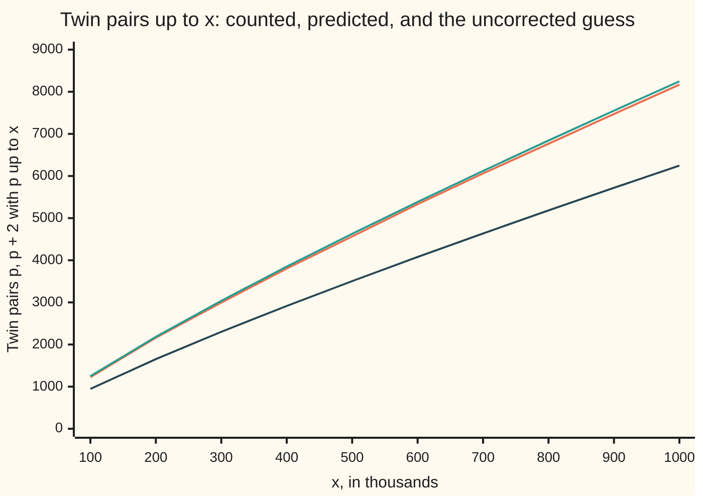

# Twin primes: infinitely many primes two apart, and the bounded gap of 246 that is proved

[Syllabus](../../../SYLLABUS.md) → [Frontier](../README.md) → [Primes and Numbers](../README.md#s03) → Twin primes

---

## General Overview

1,000,000,007 and 1,000,000,009 are both prime, and they are two apart. Two primes two apart are a **twin pair**. This one is the first twin pair above a billion.

Primes thin out as numbers grow. Below a million there are 78,498 primes and 8,169 twin pairs. Near a billion the primes are 20.77 apart on average, yet the million numbers from 1,000,000,000 to 1,000,999,999 still hold 3,037 twin pairs.

The **twin prime conjecture** says twin pairs never run out. Nobody has proved it or disproved it. In 1923 G. H. Hardy and J. E. Littlewood went further and predicted *how many* there are. Their rule says that near a billion, about one number in 325 starts a twin pair. That predicts 3,074 pairs in our window of a million numbers. The count is 3,037: 1.2% short.

The proved statement is weaker. In 2013 Yitang Zhang proved that some fixed gap, below 70,000,000, occurs between neighbouring primes infinitely often. In 2014 the Polymath project brought the bound down to 246. Nobody can yet bring it to 2.

This card states the conjecture, derives the Hardy–Littlewood prediction, and records what is proved, claimed and open.

**Twin pairs keep turning up at the rate Hardy and Littlewood predicted, 1.32 times what independent coin flips give, but the only proved statement is weaker: some gap of at most 246 occurs between primes infinitely often.**

**What kind of fact this is:** three claims with three statuses. The twin prime conjecture is a conjecture, open as of 2026-11-23. The Hardy–Littlewood count is a conjecture too, open as of 2026-11-23. Separately, the counts at a million and near a billion fall within 1.2% of it. The gap of at most 246 is a theorem, proved and refereed in 2014. Every count on this card is evidence, checked for numbers up to 1,000,000 and for one window near a billion, which proves nothing beyond.

### The picture: counted twin pairs against two predictions



The orange line is the real count of twin pairs. The green line, almost on top of it, is the Hardy–Littlewood prediction. The dark line is the guess that treats "n is prime" and "n + 2 is prime" as independent coin flips. It falls 24% short at a million, and the gap grows in step with the count.

---

## The formula

Notation, in words:

- $`\pi_2(x)`$, read "pi two of x", counts the twin pairs p, p + 2 with p at most x. Below a million, $`\pi_2(10^6) = 8169`$. This card introduces it.
- $`C_2`$, the **twin prime constant**, is a product of one correction factor for each odd prime. Step 2 of Why it works derives it. This card introduces it.
- The twiddle $`\sim`$ means "asymptotic to": the ratio of the two sides tends to 1 as x grows. It says nothing exact about any one x.

The **Hardy–Littlewood prediction** for twin primes:

```math
\pi_2(x) \sim 2C_2 \int_2^x \frac{dt}{(\log t)^2}, \qquad C_2 = \prod_{p \ge 3} \Big(1 - \frac{1}{(p-1)^2}\Big) \approx 0.660162
```

**Read it aloud:** the number of twin pairs up to x is asymptotic to two times C two times the integral from 2 to x of one over log t squared, where C two is the product, over every odd prime p, of one minus one over p minus one squared.

The integral is written $`\mathrm{Li}_2(x)`$ below. Elsewhere the same name means the dilogarithm, a different function. At x = 1,000,000 it is 6,247, and $`2C_2 = 1.320324`$, so the prediction is 8,248. The count is 8,169.

The proved result is about gaps between neighbouring primes. Write $`p_n`$ for the n-th prime, so $`p_1 = 2`$ and $`p_2 = 3`$:

```math
\liminf_{n \to \infty}\, (p_{n+1} - p_n) \le 246
```

**Read it aloud:** the gap from a prime to the next prime drops to 246 or less infinitely often.

The twin prime conjecture is the same line with 2 in place of 246. Every gap except the one from 2 to 3 is even, so "at most 2" and "exactly 2" say the same thing.

| Symbol | Plain meaning | In our example | Push it up and the answer… |
| --- | --- | --- | --- |
| $`x`$ | how far the count runs | 1,000,000 | more pairs, at a thinning rate |
| $`p`$ | a prime; in $`C_2`$ it runs over the odd primes 3, 5, 7, … | 1,000,000,007 | each larger p corrects less |
| $`\pi_2(x)`$ | twin pairs p, p + 2 with p at most x | 8,169 at $`10^6`$ | — |
| $`t`$ | the variable inside the integral: a number between 2 and x | near $`10^9`$ in the window | the chance $`1/(\log t)^2`$ falls |
| $`\log`$ | natural logarithm; $`1/\log t`$ is the rough chance that a number near t is prime | $`\log 10^9 = 20.7233`$ | primes rarer |
| $`\mathrm{Li}_2(x)`$ | the integral of $`1/(\log t)^2`$ from 2 to x: the uncorrected coin-flip count | 6,247 at $`10^6`$ | grows a little slower than x |
| $`C_2`$ | the twin prime constant: product of the odd-prime corrections | 0.660162 | — |
| $`2C_2`$ | the whole correction: 2 from the prime 2, times $`C_2`$ | 1.320324 | the prediction scales with it |
| $`\sim`$ | asymptotic: the ratio tends to 1 | 8,169 / 8,248 = 0.9904 | ratio nearer 1 |
| $`p_n`$ | the n-th prime; here n counts primes, elsewhere n is a whole number tested for primality | $`p_2 = 3`$ | — |
| $`p_{n+1} - p_n`$ | the gap to the next prime | 2, from 1,000,000,007 to 1,000,000,009 | average grows like $`\log p_n`$ |
| $`\liminf`$ | the smallest value a sequence comes back to infinitely often | at most 246, proved | — |

### When it holds

- **The pattern must dodge every small prime.** For n, n + 2 it does: at each prime p, some remainder of n keeps p off both numbers (5 and 7 dodge 3). For n, n + 2, n + 4 it fails: one of the three is always a multiple of 3. The correction at 3 is 0, so the rule predicts no triples beyond 3, 5, 7. The uncorrected coin model predicts 505 below a million; there is 1.
- **The twiddle is a statement about the limit.** At 1,000 the count is 0.7643 of the prediction, at a million 0.9904. No finite table confirms or refutes a $`\sim`$.
- **Use the integral, not its first term.** The integral and $`x/(\log x)^2`$ are asymptotic to each other, but at a million $`2C_2 \cdot x/(\log x)^2`$ gives 6,917, far below 8,169.
- **It rests on a model, not a proof.** Its key step, treating divisibility by all primes as independent, has never been justified. The bounded-gap theorem does not imply it.

---

## Why it works

This section explains why the prediction has this shape, and why proofs stop at 246. It proves the correction factors exactly; the passage from them to a count is the unproved step.

### Step 0: a weighted coin, corrected prime by prime

Near a number t, about one number in $`\log t`$ is prime (the prime number theorem, from [How primes thin out](../../02-Number%20theory/07-For%20the%20Curious/03-how-primes-thin-out.md)). Treat "n is prime" as a coin that lands heads with chance $`1/\log n`$.

Two coins for n and n + 2 are not independent. If n is odd, n + 2 is odd for certain. The fix is to measure, for each prime p, how much more or less often n and n + 2 both avoid p than two independent numbers would, and multiply the chance by that ratio.

### Step 1: the uncorrected coin undercounts

Treat the two coins as independent. The chance that n and n + 2 are both prime is $`1/(\log n)^2`$. Add those chances from 2 to x and the sum is close to the integral $`\mathrm{Li}_2(x)`$.

At a million that gives 6,247. The count is 8,169. The coins miss 24% of the pairs, and the chart shows the miss growing in step with the count.

### Step 2: the correction at each prime

Fix a prime p and look at n's remainder when divided by p. Each of the p remainders is equally common.

- Two independent numbers both avoid p with chance $`(1 - 1/p)^2`$.
- For n and n + 2 together, n must avoid remainder 0 (so p does not divide n) and remainder p − 2 (so p does not divide n + 2).

For p = 2 those are the same remainder, so 1 of 2 remainders works: chance 1/2 against 1/4, a factor of 2. For an odd prime they are different, so p − 2 of p remainders work. The ratio simplifies:

```math
\frac{1 - 2/p}{(1 - 1/p)^2} = \frac{p(p-2)}{(p-1)^2} = 1 - \frac{1}{(p-1)^2}
```

**Read it aloud:** the share of n where neither n nor n + 2 is a multiple of p, divided by the independent share, equals one minus one over p minus one squared.

The code counts the remainders and compares with the formula:

| Prime p | Both avoid p (counted) | Independent share | Ratio |
| --- | --- | --- | --- |
| 2 | 1/2 = 0.500000 | 0.250000 | 2.000000 |
| 3 | 1/3 = 0.333333 | 0.444444 | 0.750000 |
| 5 | 3/5 = 0.600000 | 0.640000 | 0.937500 |
| 7 | 5/7 = 0.714286 | 0.734694 | 0.972222 |
| 11 | 9/11 = 0.818182 | 0.826446 | 0.990000 |

The prime 2 doubles the chance. Every odd prime lowers it a little, by less as p grows.

<details>
<summary>Why the factors multiply, and why the product converges</summary>

**They multiply.** By the Chinese remainder theorem (a remainder mod 3 and a remainder mod 5 together fix one remainder mod 15, and every combination occurs), conditions at different primes are independent across n. So the share of n where n and n + 2 both avoid 3 and 5 is the share for 3 times the share for 5. The independent shares multiply the same way, and so do the ratios.

**The product converges.** Take logarithms: the product becomes a sum of $`\log(1 - 1/(p-1)^2)`$ over odd primes. Each removed amount $`1/(p-1)^2`$ is at most 1/4, and for any amount from 0 to 1/2 the logarithm of 1 minus it lies between minus twice the amount and 0. So the sum of logarithms is bounded by twice the sum of the amounts:

$`\displaystyle \sum_{p \ge 3} \frac{1}{(p-1)^2} \le \frac{1}{2^2} + \frac{1}{3^2} + \dots < \frac{1}{1 \cdot 2} + \frac{1}{2 \cdot 3} + \dots = 1,`$

where the last sum telescopes, since each term is a difference of two unit fractions. The total is finite. A convergent sum of logarithms means the product tends to a positive limit.

The code stops at primes below 1,000,000 and gets $`C_2 = 0.660162`$. The primes left out change it by less than one part in $`10^{6}`$, which matches the published $`2C_2 \approx 1.3203236316`$ (Granville, in Sources) to six decimals.

</details>

### Step 3: add the corrected chances

Multiply all the factors: $`2C_2 = 1.320324`$. The corrected chance that n and n + 2 are both prime is $`2C_2/(\log n)^2`$. Adding it over every n up to x gives the prediction, by two roads:

| x | Counted | Integral, by Simpson's rule | Sum over every n | Counted ÷ predicted |
| --- | --- | --- | --- | --- |
| 1,000 | 35 | 45.8 | 44.7 | 0.7643 |
| 10,000 | 205 | 214.2 | 213.1 | 0.9570 |
| 100,000 | 1,224 | 1,248.7 | 1,247.6 | 0.9802 |
| 1,000,000 | 8,169 | 8,248.0 | 8,247.0 | 0.9904 |

The two roads agree to about one pair. The counted share climbs towards 1 as x grows, which is what $`\sim`$ claims and all a table can show.

The same reasoning predicts other gaps. For p, p + 6, the prime 3 divides p + 6 exactly when it divides p. So only one remainder on division by 3 is ruled out instead of two: 2 of the 3 remainders pass instead of 1, which doubles the factor at 3. The rule predicts 16,496 such pairs below a million; the count is 16,386. For p, p + 4 the prediction equals the twin one, 8,248; the count is 8,144.

### Step 4: why the model is not a proof

The model treats divisibility by every prime up to the square root of x as independent. For a few small primes that is exact (Step 2). For all of them at once it is an assumption: the errors from each prime pile up faster than anyone can control. Hardy and Littlewood reached the same constant by a different road, the circle method, which also stops short of a proof.

Sieve methods (counting by removing multiples of small primes) do give upper bounds of the predicted shape. Lower bounds hit the **parity problem**: a sieve cannot tell a prime from a product of two primes. In 1973 Jingrun Chen reached exactly that wall. He proved there are infinitely many primes p with p + 2 either prime or a product of two primes. Below a million there are 29,949 such p, of which 8,169 are twins.

### Step 5: what is proved: a bounded gap

The weights behind the bounded-gap theorem are on [Bounded gaps](../../21-Algebraic%20and%20analytic%20number%20theory/04-Sieves%20and%20Prime%20Gaps/05-bounded-gaps-zhang-maynard.md). In one line: they weigh each n by how free a fixed pattern, such as n, n + 2, n + 6, is of small factors, and show that infinitely many n have two primes among the offsets. They cannot choose *which* two. Here is the status of each bound.

| Gap bound | Year | By | Kind | Status as of 2026-11-23 |
| --- | --- | --- | --- | --- |
| 70,000,000 | 2013 | Zhang | theorem | proved, refereed |
| 600 | 2013 | Maynard | theorem | proved, refereed |
| 246 | 2014 | Polymath | theorem | proved, refereed; the record found in refereed sources |
| 12 | 2013 | Maynard | theorem, conditional | proved, but rests on the Elliott–Halberstam conjecture (primes spread evenly over remainder classes for large moduli), which is open |
| 6 | 2014 | Polymath | theorem, conditional | proved on a stronger form of that conjecture, also open; 6 is the limit of sieve methods, by the parity problem |
| 2 | 1849 at latest | the twin prime conjecture | conjecture | open |

1849 is the first clear mention of twin primes in print, by Alphonse de Polignac, as the survey by Granville in Sources records.

Below a million, gaps of at most 246 are the rule: 8,169 gaps of exactly 2, 29,862 of at most 6, 50,515 of at most 12, and all 78,497 of at most 246. The widest gap below a million is only 114, after 492,113. None of that proves anything about larger numbers.

---

## Worked numbers, by hand

Predict the twin pairs p, p + 2 with p from 1,000,000,000 to 1,000,999,999. Across a window this short, $`\log t`$ barely changes, so one value serves for all of it.

| Step | Arithmetic | Value |
| --- | --- | --- |
| Log of a billion | $`\log 1000000000`$ | 20.7233 |
| Square it | $`20.7233^2`$ | 429.45 |
| Uncorrected chance for one n | $`1 / 429.45`$ | 0.0023285 |
| Correct for the prime 2 | $`\times 2`$ | 0.0046571 |
| Correct for the odd primes | $`\times C_2 = 0.660162`$ | 0.0030744, one n in 325.3 |
| Across a million numbers | $`\times 1000000`$ | 3,074 |
| The same, integral by Simpson's rule | code | 3,074 |
| Counted by a segmented sieve | code | 3,037 |
| Counted ÷ predicted | $`3037 / 3074`$ | **0.9879** |

The count lands 1.2% below the prediction. That is strong evidence for the model, and it is not a proof of anything.

### What breaks if you drop a piece

| Mistake | Comes out at | What went wrong |
| --- | --- | --- |
| Treat n and n + 2 as independent coins | 6,247 below a million, against 8,169 counted | misses the factor 2 from evenness and the odd-prime corrections |
| Keep the factor 2, drop $`C_2`$ | 12,494, against 8,169 | every odd prime lowers the chance; together they take a third off |
| Use $`2C_2 \cdot x/(\log x)^2`$ for the integral | 6,917, against 8,169 | same limit, but the integral is far better at any real x |
| Apply the coin model to n, n + 2, n + 4 | 505 triples, against 1 (3, 5, 7) | one of the three is always a multiple of 3: the factor at 3 is 0 |

The code prints all four.

---

## Code, from first principles, and it actually runs

The code takes three roads. First, a sieve of Eratosthenes counts twin pairs below a million, and a segmented sieve (the same sieve run on a window far from 0) counts them near a billion. The segmented sieve is tested against the plain one on 0 to 1,000,000, and trial division confirms the example pair. Second, the Hardy–Littlewood prediction is computed as an integral by Simpson's rule and as a direct sum over every n. Third, the twin constant is computed as a product over primes and its factors are checked against counted remainders and against the published value.

### Python

```python
# Twin primes and bounded gaps -- the check behind the card.  Standard library only.
# Road 1: a sieve of Eratosthenes counts twin pairs below a million; a segmented sieve counts
# them near a billion and is tested against the plain sieve; trial division checks the example.
# Road 2: the Hardy-Littlewood prediction, as an integral by Simpson's rule and as a direct sum.
# Road 3: the twin constant, as a product over primes and from counted remainders.
from math import log, exp
L = 1_000_010
s = bytearray([1]) * (L + 1); s[0] = s[1] = 0
for i in range(2, int(L ** 0.5) + 1):
    if s[i]: s[i * i::i] = bytearray(len(s[i * i::i]))
ps = [p for p in range(2, 1_000_000) if s[p]]
cum, c = [0] * (L + 1), 0                     # cum[x] = twin pairs p, p + 2 with p <= x
for x in range(L + 1):
    if x + 2 <= L and s[x] and s[x + 2]: c += 1
    cum[x] = c
gap, at = max((q - p, p) for p, q in zip(ps, ps[1:]))
print(f"primes below 1,000,000: {len(ps)}; twin pairs p, p+2 with p <= 1,000,000: {cum[10**6]}")
print(f"widest gap below 1,000,000: {gap}, after {at}")
def segment(a, w):                             # primality flags for a, a+1, ..., a+w+1
    seg = bytearray([1]) * (w + 2)
    for p in range(2, int((a + w + 2) ** 0.5) + 1):
        if s[p]:
            st = max(p * p, (a + p - 1) // p * p)
            seg[st - a::p] = bytearray(len(seg[st - a::p]))
    for k in range(max(0, 2 - a)): seg[k] = 0
    return seg
low = segment(0, 1_000_000)
assert sum(1 for i in range(1_000_001) if low[i] and low[i + 2]) == cum[10**6]
print(f"segmented sieve on 0..1,000,000 agrees with the plain sieve: {cum[10**6]} twin pairs")
def by_division(n):
    d = 2
    while d * d <= n and n % d: d += 1
    return d * d > n
A, W = 10**9, 10**6
seg = segment(A, W)
first = next(A + i for i in range(W) if seg[i] and seg[i + 2])
tw = sum(1 for i in range(W) if seg[i] and seg[i + 2]); pr = sum(seg[:W])
print(f"first twin pair from 1,000,000,000 up: {first}, {first + 2}")
print(f"trial division: {first} prime {by_division(first)}, {first + 2} prime {by_division(first + 2)}")
print(f"window 1,000,000,000 to 1,000,999,999: {pr} primes, {tw} twin pairs, mean spacing {W / pr:.2f}")
C2 = 1.0
for p in ps[1:]: C2 *= 1 - 1 / (p - 1) ** 2
print(f"C2 = product over odd primes below 1,000,000 of 1 - 1/(p-1)^2 = {C2:.6f}; 2 C2 = {2 * C2:.6f}")
print("local factor: p, both-coprime share counted, independent share, ratio, formula")
for p in (2, 3, 5, 7, 11):
    both = sum(1 for r in range(p) if r % p and (r + 2) % p)
    cnt, ind = both / p, (1 - 1 / p) ** 2
    form = 2.0 if p == 2 else 1 - 1 / (p - 1) ** 2
    print(f"  p = {p}: {both}/{p} = {cnt:.6f}, {ind:.6f}, {cnt / ind:.6f}, {form:.6f}")
    assert abs(cnt / ind - form) < 1e-12
def li2(a, b, n=20000):                       # integral of dt / (log t)^2, Simpson in u = log t
    u0, h = log(a), (log(b) - log(a)) / n
    f = lambda u: exp(u) / (u * u)
    return h / 3 * (f(u0) + f(u0 + n * h) + sum((4 if k % 2 else 2) * f(u0 + k * h) for k in range(1, n)))
direct, tot, nxt = {}, 0.0, 10**3
for n in range(3, 10**6 + 1):
    tot += 2 * C2 / log(n) ** 2
    if n == nxt: direct[n] = tot; nxt *= 10
print("x, twin pairs counted, 2 C2 Li2(x), direct sum, counted / predicted")
for x in (10**3, 10**4, 10**5, 10**6):
    hl = 2 * C2 * li2(2, x)
    print(f"  {x}: {cum[x]}, {hl:.1f}, {direct[x]:.1f}, {cum[x] / hl:.4f}")
    assert abs(hl - direct[x]) < 1.2 and abs(cum[x] / hl - 1) < 0.25
xs = list(range(100_000, 1_000_001, 100_000))
print("chart x (thousands):", [x // 1000 for x in xs])
print("chart counted:", [cum[x] for x in xs])
print("chart Hardy-Littlewood:", [round(2 * C2 * li2(2, x)) for x in xs])
print("chart no correction:", [round(li2(2, x)) for x in xs])
lA = log(A)
print(f"by hand near 10^9: log = {lA:.4f}, log^2 = {lA * lA:.2f}, 1/log^2 = {1 / lA ** 2:.7f}")
print(f"by hand: x 2 = {2 / lA ** 2:.7f}, x C2 = {2 * C2 / lA ** 2:.7f} = 1 in {lA ** 2 / (2 * C2):.1f}")
hand, simp = 2 * C2 * W / lA ** 2, 2 * C2 * li2(A, A + W)
print(f"window prediction: by hand {hand:.0f}, by Simpson {simp:.0f}; counted {tw}; counted / predicted {tw / simp:.4f}")
assert abs(hand - simp) < 1 and abs(tw / simp - 1) < 0.05
naive, two, crude = li2(2, 10**6), 2 * li2(2, 10**6), 2 * C2 * 10**6 / log(10**6) ** 2
trip_naive = sum(1 / log(n) ** 3 for n in range(3, 10**6 + 1))
trip = sum(1 for p in ps if s[p + 2] and s[p + 4])
print(f"mistakes below 10^6: no correction {naive:.0f}; factor 2 only {two:.0f}; x/(log x)^2 {crude:.0f}")
print(f"triples n, n+2, n+4 all prime below 10^6: coin model {trip_naive:.0f}, counted {trip}")
cousins, sexy = (sum(1 for p in ps if s[p + h]) for h in (4, 6))
print(f"pairs p, p+4 below 10^6: {cousins}; p, p+6: {sexy}; prediction for gap 6 is twice the twin one: {2 * 2 * C2 * li2(2, 10**6):.0f}")
gaps = [q - p for p, q in zip(ps, ps[1:])]
ladder = [sum(1 for g in gaps if g == 2)] + [sum(1 for g in gaps if g <= b) for b in (6, 12, 246)]
print("consecutive gaps below 10^6 equal to 2, at most 6, 12, 246:", ladder, "of", len(gaps))
assert ladder[0] == cum[10**6] and ladder[3] == len(gaps)
def chen(p):                                   # p + 2 prime, or a product of exactly two primes
    m = p + 2
    if s[m]: return True
    d = 2
    while m % d: d += 1
    return s[m // d] == 1
ch = sum(1 for p in ps if chen(p))
print(f"primes p below 10^6 with p+2 prime or a product of two primes: {ch} (twins among them {cum[10**6]})")
print("quoted, not computed: gap 70,000,000 (2013), 600 (2013), 246 (2014); 12 on EH, 6 on GEH")
assert len(ps) == 78498 and cum[10**6] == 8169 and (gap, at) == (114, 492113)
assert first == 1_000_000_007 and by_division(first) and by_division(first + 2) and tw == 3037
assert abs(2 * C2 - 1.3203236316) < 1e-6 and trip == 1 and trip_naive > 100
assert cum[1000] == sum(1 for p in range(2, 1001) if by_division(p) and by_division(p + 2))
assert ch == 29949 and (cousins, sexy) == (8144, 16386)   # pin the counts printed above
print("ALL CHECKS PASS")
```

**Ran 2026-11-23 on macOS, Python 3.14.10, standard library only. All checks passed. Output, pasted from the run:**

```
primes below 1,000,000: 78498; twin pairs p, p+2 with p <= 1,000,000: 8169
widest gap below 1,000,000: 114, after 492113
segmented sieve on 0..1,000,000 agrees with the plain sieve: 8169 twin pairs
first twin pair from 1,000,000,000 up: 1000000007, 1000000009
trial division: 1000000007 prime True, 1000000009 prime True
window 1,000,000,000 to 1,000,999,999: 48155 primes, 3037 twin pairs, mean spacing 20.77
C2 = product over odd primes below 1,000,000 of 1 - 1/(p-1)^2 = 0.660162; 2 C2 = 1.320324
local factor: p, both-coprime share counted, independent share, ratio, formula
  p = 2: 1/2 = 0.500000, 0.250000, 2.000000, 2.000000
  p = 3: 1/3 = 0.333333, 0.444444, 0.750000, 0.750000
  p = 5: 3/5 = 0.600000, 0.640000, 0.937500, 0.937500
  p = 7: 5/7 = 0.714286, 0.734694, 0.972222, 0.972222
  p = 11: 9/11 = 0.818182, 0.826446, 0.990000, 0.990000
x, twin pairs counted, 2 C2 Li2(x), direct sum, counted / predicted
  1000: 35, 45.8, 44.7, 0.7643
  10000: 205, 214.2, 213.1, 0.9570
  100000: 1224, 1248.7, 1247.6, 0.9802
  1000000: 8169, 8248.0, 8247.0, 0.9904
chart x (thousands): [100, 200, 300, 400, 500, 600, 700, 800, 900, 1000]
chart counted: [1224, 2160, 2994, 3804, 4565, 5331, 6061, 6766, 7472, 8169]
chart Hardy-Littlewood: [1249, 2182, 3038, 3849, 4628, 5384, 6121, 6843, 7551, 8248]
chart no correction: [946, 1653, 2301, 2915, 3505, 4078, 4636, 5183, 5719, 6247]
by hand near 10^9: log = 20.7233, log^2 = 429.45, 1/log^2 = 0.0023285
by hand: x 2 = 0.0046571, x C2 = 0.0030744 = 1 in 325.3
window prediction: by hand 3074, by Simpson 3074; counted 3037; counted / predicted 0.9879
mistakes below 10^6: no correction 6247; factor 2 only 12494; x/(log x)^2 6917
triples n, n+2, n+4 all prime below 10^6: coin model 505, counted 1
pairs p, p+4 below 10^6: 8144; p, p+6: 16386; prediction for gap 6 is twice the twin one: 16496
consecutive gaps below 10^6 equal to 2, at most 6, 12, 246: [8169, 29862, 50515, 78497] of 78497
primes p below 10^6 with p+2 prime or a product of two primes: 29949 (twins among them 8169)
quoted, not computed: gap 70,000,000 (2013), 600 (2013), 246 (2014); 12 on EH, 6 on GEH
ALL CHECKS PASS
```

### Rust

```rust
// Twin primes and bounded gaps -- the same check as twin_primes_and_bounded_gaps_check.py, in Rust.
// No crates.  Road 1: a sieve counts twin pairs below a million; a segmented sieve counts them near
// a billion and is tested against the plain sieve; trial division checks the example.  Road 2: the
// Hardy-Littlewood prediction as an integral by Simpson's rule and as a direct sum.  Road 3: the
// twin constant as a product over primes and from counted remainders.
fn segment(s: &[bool], a: usize, w: usize) -> Vec<bool> { // primality flags for a, a+1, ..., a+w+1
    let mut seg = vec![true; w + 2];
    let mut p = 2;
    while p * p <= a + w + 1 {
        if s[p] { let mut m = (p * p).max((a + p - 1) / p * p); while m <= a + w + 1 { seg[m - a] = false; m += p; } }
        p += 1;
    }
    for k in 0..2usize.saturating_sub(a) { seg[k] = false; }
    seg
}
fn by_division(n: usize) -> bool { let mut d = 2; while d * d <= n && n % d != 0 { d += 1; } d * d > n }
fn li2(a: f64, b: f64, n: usize) -> f64 { // integral of dt / (log t)^2, Simpson in u = log t
    let (u0, h) = (a.ln(), (b.ln() - a.ln()) / n as f64);
    let f = |u: f64| u.exp() / (u * u);
    let mut acc = f(u0) + f(u0 + n as f64 * h);
    for k in 1..n { acc += if k % 2 == 1 { 4.0 } else { 2.0 } * f(u0 + k as f64 * h); }
    h / 3.0 * acc
}
fn tf(b: bool) -> &'static str { if b { "True" } else { "False" } }
fn main() {
    const L: usize = 1_000_010;
    let mut s = vec![true; L + 1]; s[0] = false; s[1] = false;
    let mut i = 2;
    while i * i <= L { if s[i] { let mut m = i * i; while m <= L { s[m] = false; m += i; } } i += 1; }
    let ps: Vec<usize> = (2..1_000_000).filter(|&p| s[p]).collect();
    let mut cum = vec![0usize; L + 1]; let mut c = 0; // cum[x] = twin pairs p, p + 2 with p <= x
    for x in 0..=L { if x + 2 <= L && s[x] && s[x + 2] { c += 1; } cum[x] = c; }
    let (gap, at) = ps.windows(2).map(|w| (w[1] - w[0], w[0])).fold((0, 0), |b, x| if x.0 > b.0 { x } else { b });
    let m6 = 1_000_000usize;
    println!("primes below 1,000,000: {}; twin pairs p, p+2 with p <= 1,000,000: {}", ps.len(), cum[m6]);
    println!("widest gap below 1,000,000: {}, after {}", gap, at);
    let low = segment(&s, 0, m6);
    assert!((0..=m6).filter(|&i| low[i] && low[i + 2]).count() == cum[m6]);
    println!("segmented sieve on 0..1,000,000 agrees with the plain sieve: {} twin pairs", cum[m6]);
    let (a, w) = (1_000_000_000usize, 1_000_000usize);
    let seg = segment(&s, a, w);
    let first = a + (0..w).find(|&i| seg[i] && seg[i + 2]).unwrap();
    let tw = (0..w).filter(|&i| seg[i] && seg[i + 2]).count();
    let pr = (0..w).filter(|&i| seg[i]).count();
    println!("first twin pair from 1,000,000,000 up: {}, {}", first, first + 2);
    println!("trial division: {} prime {}, {} prime {}", first, tf(by_division(first)), first + 2, tf(by_division(first + 2)));
    println!("window 1,000,000,000 to 1,000,999,999: {} primes, {} twin pairs, mean spacing {:.2}", pr, tw, w as f64 / pr as f64);
    let mut c2 = 1.0f64;
    for &p in &ps[1..] { c2 *= 1.0 - 1.0 / ((p - 1) as f64).powi(2); }
    println!("C2 = product over odd primes below 1,000,000 of 1 - 1/(p-1)^2 = {:.6}; 2 C2 = {:.6}", c2, 2.0 * c2);
    println!("local factor: p, both-coprime share counted, independent share, ratio, formula");
    for p in [2usize, 3, 5, 7, 11] {
        let both = (0..p).filter(|&r| r % p != 0 && (r + 2) % p != 0).count();
        let (cnt, ind) = (both as f64 / p as f64, (1.0 - 1.0 / p as f64).powi(2));
        let form = if p == 2 { 2.0 } else { 1.0 - 1.0 / ((p - 1) as f64).powi(2) };
        println!("  p = {}: {}/{} = {:.6}, {:.6}, {:.6}, {:.6}", p, both, p, cnt, ind, cnt / ind, form);
        assert!((cnt / ind - form).abs() < 1e-12);
    }
    let (mut direct, mut tot, mut nxt) = (vec![], 0.0f64, 1000usize);
    for n in 3..=m6 { tot += 2.0 * c2 / (n as f64).ln().powi(2); if n == nxt { direct.push(tot); nxt *= 10; } }
    println!("x, twin pairs counted, 2 C2 Li2(x), direct sum, counted / predicted");
    for (j, x) in [1000usize, 10_000, 100_000, 1_000_000].iter().enumerate() {
        let hl = 2.0 * c2 * li2(2.0, *x as f64, 20000);
        println!("  {}: {}, {:.1}, {:.1}, {:.4}", x, cum[*x], hl, direct[j], cum[*x] as f64 / hl);
        assert!((hl - direct[j]).abs() < 1.2 && (cum[*x] as f64 / hl - 1.0).abs() < 0.25);
    }
    let xs: Vec<usize> = (1..=10).map(|k| k * 100_000).collect();
    println!("chart x (thousands): {:?}", xs.iter().map(|x| x / 1000).collect::<Vec<_>>());
    println!("chart counted: {:?}", xs.iter().map(|&x| cum[x]).collect::<Vec<_>>());
    println!("chart Hardy-Littlewood: {:?}", xs.iter().map(|&x| (2.0 * c2 * li2(2.0, x as f64, 20000)).round() as i64).collect::<Vec<_>>());
    println!("chart no correction: {:?}", xs.iter().map(|&x| li2(2.0, x as f64, 20000).round() as i64).collect::<Vec<_>>());
    let la = (a as f64).ln();
    println!("by hand near 10^9: log = {:.4}, log^2 = {:.2}, 1/log^2 = {:.7}", la, la * la, 1.0 / la.powi(2));
    println!("by hand: x 2 = {:.7}, x C2 = {:.7} = 1 in {:.1}", 2.0 / la.powi(2), 2.0 * c2 / la.powi(2), la.powi(2) / (2.0 * c2));
    let (hand, simp) = (2.0 * c2 * w as f64 / la.powi(2), 2.0 * c2 * li2(a as f64, (a + w) as f64, 20000));
    println!("window prediction: by hand {:.0}, by Simpson {:.0}; counted {}; counted / predicted {:.4}", hand, simp, tw, tw as f64 / simp);
    assert!((hand - simp).abs() < 1.0 && (tw as f64 / simp - 1.0).abs() < 0.05);
    let (naive, crude) = (li2(2.0, 1e6, 20000), 2.0 * c2 * 1e6 / 1e6f64.ln().powi(2));
    let trip_naive: f64 = (3..=m6).map(|n| 1.0 / (n as f64).ln().powi(3)).sum();
    let trip = ps.iter().filter(|&&p| s[p + 2] && s[p + 4]).count();
    println!("mistakes below 10^6: no correction {:.0}; factor 2 only {:.0}; x/(log x)^2 {:.0}", naive, 2.0 * naive, crude);
    println!("triples n, n+2, n+4 all prime below 10^6: coin model {:.0}, counted {}", trip_naive, trip);
    let (cousins, sexy) = (ps.iter().filter(|&&p| s[p + 4]).count(), ps.iter().filter(|&&p| s[p + 6]).count());
    println!("pairs p, p+4 below 10^6: {}; p, p+6: {}; prediction for gap 6 is twice the twin one: {:.0}", cousins, sexy, 2.0 * naive * 2.0 * c2);
    let gaps: Vec<usize> = ps.windows(2).map(|w| w[1] - w[0]).collect();
    let mut ladder = vec![gaps.iter().filter(|&&g| g == 2).count()];
    for b in [6usize, 12, 246] { ladder.push(gaps.iter().filter(|&&g| g <= b).count()); }
    println!("consecutive gaps below 10^6 equal to 2, at most 6, 12, 246: {:?} of {}", ladder, gaps.len());
    assert!(ladder[0] == cum[m6] && ladder[3] == gaps.len());
    let chen = |p: usize| { let m = p + 2; if s[m] { return true; } let mut d = 2; while m % d != 0 { d += 1; } s[m / d] };
    let ch = ps.iter().filter(|&&p| chen(p)).count();
    println!("primes p below 10^6 with p+2 prime or a product of two primes: {} (twins among them {})", ch, cum[m6]);
    println!("quoted, not computed: gap 70,000,000 (2013), 600 (2013), 246 (2014); 12 on EH, 6 on GEH");
    assert!(ps.len() == 78498 && cum[m6] == 8169 && (gap, at) == (114, 492113));
    assert!(first == 1_000_000_007 && by_division(first) && by_division(first + 2) && tw == 3037);
    assert!((2.0 * c2 - 1.3203236316).abs() < 1e-6 && trip == 1 && trip_naive > 100.0);
    assert!(cum[1000] == (2..1001).filter(|&p| by_division(p) && by_division(p + 2)).count());
    assert!(ch == 29949 && (cousins, sexy) == (8144, 16386)); // pin the counts printed above
    println!("ALL CHECKS PASS");
}
```

**Ran 2026-11-23 on macOS, rustc 1.98.1, no crates. All checks passed. Output, pasted from the run:**

```
primes below 1,000,000: 78498; twin pairs p, p+2 with p <= 1,000,000: 8169
widest gap below 1,000,000: 114, after 492113
segmented sieve on 0..1,000,000 agrees with the plain sieve: 8169 twin pairs
first twin pair from 1,000,000,000 up: 1000000007, 1000000009
trial division: 1000000007 prime True, 1000000009 prime True
window 1,000,000,000 to 1,000,999,999: 48155 primes, 3037 twin pairs, mean spacing 20.77
C2 = product over odd primes below 1,000,000 of 1 - 1/(p-1)^2 = 0.660162; 2 C2 = 1.320324
local factor: p, both-coprime share counted, independent share, ratio, formula
  p = 2: 1/2 = 0.500000, 0.250000, 2.000000, 2.000000
  p = 3: 1/3 = 0.333333, 0.444444, 0.750000, 0.750000
  p = 5: 3/5 = 0.600000, 0.640000, 0.937500, 0.937500
  p = 7: 5/7 = 0.714286, 0.734694, 0.972222, 0.972222
  p = 11: 9/11 = 0.818182, 0.826446, 0.990000, 0.990000
x, twin pairs counted, 2 C2 Li2(x), direct sum, counted / predicted
  1000: 35, 45.8, 44.7, 0.7643
  10000: 205, 214.2, 213.1, 0.9570
  100000: 1224, 1248.7, 1247.6, 0.9802
  1000000: 8169, 8248.0, 8247.0, 0.9904
chart x (thousands): [100, 200, 300, 400, 500, 600, 700, 800, 900, 1000]
chart counted: [1224, 2160, 2994, 3804, 4565, 5331, 6061, 6766, 7472, 8169]
chart Hardy-Littlewood: [1249, 2182, 3038, 3849, 4628, 5384, 6121, 6843, 7551, 8248]
chart no correction: [946, 1653, 2301, 2915, 3505, 4078, 4636, 5183, 5719, 6247]
by hand near 10^9: log = 20.7233, log^2 = 429.45, 1/log^2 = 0.0023285
by hand: x 2 = 0.0046571, x C2 = 0.0030744 = 1 in 325.3
window prediction: by hand 3074, by Simpson 3074; counted 3037; counted / predicted 0.9879
mistakes below 10^6: no correction 6247; factor 2 only 12494; x/(log x)^2 6917
triples n, n+2, n+4 all prime below 10^6: coin model 505, counted 1
pairs p, p+4 below 10^6: 8144; p, p+6: 16386; prediction for gap 6 is twice the twin one: 16496
consecutive gaps below 10^6 equal to 2, at most 6, 12, 246: [8169, 29862, 50515, 78497] of 78497
primes p below 10^6 with p+2 prime or a product of two primes: 29949 (twins among them 8169)
quoted, not computed: gap 70,000,000 (2013), 600 (2013), 246 (2014); 12 on EH, 6 on GEH
ALL CHECKS PASS
```

The two outputs match line for line.

### Lean

Lean proves three facts for every case and checks the card's small numbers exactly.

- Take an odd prime p. Then exactly p − 2 of the p remainders keep p off both n and n + 2.
- Take the same p. Then that share, divided by the independent share $`(1 - 1/p)^2`$, is exactly $`1 - 1/(p-1)^2`$.
- The only n with n, n + 2 and n + 4 all prime is n = 3, giving the triple 3, 5, 7.
- Take the odd primes below any bound. Then their amounts $`1/(p-1)^2`$ add up to less than 1.
- 1,000,000,007 and 1,000,000,009 are both prime, and no twin pair starts between a billion and 1,000,000,006.
- The remainders that pass are 1 of 2, 1 of 3, 3 of 5, 5 of 7 and 9 of 11.
- The ratios at 2, 3, 5, 7 and 11 are 2, 3/4, 15/16, 35/36 and 99/100.
- For pairs six apart, 2 of the 3 remainders pass at the prime 3.
- 492,113 and 492,227 are prime with no prime between them: the widest gap below a million, 114.

The counts below a million and near a billion, the value of $`C_2`$ and the predictions are left to the Python and Rust checks.

```lean
-- Twin primes: for every odd prime p the share of whole numbers n with neither n nor n + 2 a multiple of p, divided by the share for two independent numbers, is exactly 1 − 1/(p − 1)^2, the only three primes in a row two apart are 3, 5 and 7, and the sum of 1/(p − 1)^2 over the odd primes stays below 1, so the twin prime constant's product converges.
import Mathlib.Data.Nat.Prime.Basic
import Mathlib.Algebra.BigOperators.Field
import Mathlib.Tactic.NormNum.Prime
import Mathlib.Tactic.IntervalCases
import Mathlib.Tactic.FieldSimp
import Mathlib.Tactic.Linarith
import Mathlib.Algebra.BigOperators.Intervals
import Mathlib.Tactic.Positivity
import Mathlib.Tactic.Ring

open Finset

theorem filter_eq_aux (p : ℕ) (hp : p.Prime) (hp2 : p ≠ 2) :
    {r ∈ range p | ¬ p ∣ r ∧ ¬ p ∣ r + 2} = ((range p).erase 0).erase (p - 2) := by
  have h3 : 3 ≤ p := by have := hp.two_le; omega
  ext r
  simp only [mem_filter, mem_range, mem_erase]
  constructor
  · rintro ⟨hr, h1, h2⟩
    refine ⟨?_, ?_, hr⟩
    · rintro rfl
      exact h2 (by rw [show p - 2 + 2 = p by omega])
    · rintro rfl
      exact h1 (dvd_zero p)
  · rintro ⟨hne, hne0, hr⟩
    refine ⟨hr, ?_, ?_⟩
    · intro h
      exact hne0 (Nat.eq_zero_of_dvd_of_lt h hr)
    · intro h
      by_cases hle : p ≤ r + 2
      · have h' : p ∣ r + 2 - p := Nat.dvd_sub h dvd_rfl
        have := Nat.eq_zero_of_dvd_of_lt h' (by omega)
        omega
      · have := Nat.eq_zero_of_dvd_of_lt h (by omega)
        omega

theorem sum_inv_sq_succ_succ_le (n : ℕ) :
    ∑ k ∈ range n, (1 : ℚ) / ((k : ℚ) + 2) ^ 2 ≤ 1 - 1 / ((n : ℚ) + 1) := by
  induction n with
  | zero => simp
  | succ n ih =>
    rw [sum_range_succ]
    have key : (1 : ℚ) / (n + 1) - 1 / (n + 2) - 1 / (n + 2) ^ 2
        = 1 / ((n + 1) * (n + 2) ^ 2) := by
      field_simp
      ring
    have hpos : (0 : ℚ) ≤ 1 / ((n + 1) * (n + 2) ^ 2) := by positivity
    push_cast
    have : ((n : ℚ) + 1 + 1) = n + 2 := by ring
    rw [this]
    linarith

#print axioms filter_eq_aux
#print axioms sum_inv_sq_succ_succ_le

/-- Step 2, the correction at each odd prime. Fix an odd prime p and look at the p
remainders r = 0, 1, …, p − 1. Exactly p − 2 of them keep p off both r and r + 2, and the
share of such remainders, (p − 2)/p, divided by the share for two independent numbers,
(1 − 1/p)^2, equals 1 − 1/(p − 1)^2: the factor at p in the twin prime constant C_2. -/
theorem twin_correction_factor_at_odd_prime (p : ℕ) (hp : p.Prime) (hp2 : p ≠ 2) :
    #{r ∈ range p | ¬ p ∣ r ∧ ¬ p ∣ r + 2} = p - 2 ∧
    ((#{r ∈ range p | ¬ p ∣ r ∧ ¬ p ∣ r + 2} : ℚ) / p) / (1 - 1 / (p : ℚ)) ^ 2
      = 1 - 1 / ((p : ℚ) - 1) ^ 2 := by
  have h3 : 3 ≤ p := by have := hp.two_le; omega
  have hc : #{r ∈ range p | ¬ p ∣ r ∧ ¬ p ∣ r + 2} = p - 2 := by
    rw [filter_eq_aux p hp hp2, card_erase_of_mem, card_erase_of_mem, card_range]
    · omega
    · simp; omega
    · simp; omega
  refine ⟨hc, ?_⟩
  rw [hc, Nat.cast_sub (by omega), Nat.cast_ofNat]
  have hp0 : (p : ℚ) ≠ 0 := by positivity
  have hp1 : (p : ℚ) - 1 ≠ 0 := by
    have : (3 : ℚ) ≤ p := by exact_mod_cast h3
    linarith
  field_simp
  ring

/-- When it holds, the pattern n, n + 2, n + 4: one of the three is always a multiple of 3,
so the only whole number n with n, n + 2 and n + 4 all prime is n = 3 (the triple 3, 5, 7). -/
theorem prime_triple_two_apart_iff_eq_three (n : ℕ) :
    (n.Prime ∧ (n + 2).Prime ∧ (n + 4).Prime) ↔ n = 3 := by
  constructor
  · rintro ⟨h0, h2, h4⟩
    have hm : n % 3 = 0 ∨ n % 3 = 1 ∨ n % 3 = 2 := by omega
    rcases hm with hm | hm | hm
    · have hd : 3 ∣ n := by omega
      rcases h0.eq_one_or_self_of_dvd 3 hd with h | h <;> omega
    · have hd : 3 ∣ n + 2 := by omega
      rcases h2.eq_one_or_self_of_dvd 3 hd with h | h
      · omega
      · have : n = 1 := by omega
        subst this; norm_num at h0
    · have hd : 3 ∣ n + 4 := by omega
      rcases h4.eq_one_or_self_of_dvd 3 hd with h | h <;> omega
  · rintro rfl
    norm_num

/-- Why the product converges: over the odd primes p below any bound N, the amounts
1/(p − 1)^2 removed by the factors of C_2 add up to less than 1, since they are at most
1/2^2 + 1/3^2 + … < 1/(1·2) + 1/(2·3) + … = 1. -/
theorem sum_inv_sq_pred_odd_primes_lt_one (N : ℕ) :
    ∑ p ∈ (range N).filter (fun p => p.Prime ∧ p ≠ 2), (1 : ℚ) / ((p : ℚ) - 1) ^ 2 < 1 := by
  have hsub : (range N).filter (fun p => p.Prime ∧ p ≠ 2) ⊆ Ico 3 N := by
    intro p hp
    simp only [mem_filter, mem_range] at hp
    have := hp.2.1.two_le
    simp only [mem_Ico]
    omega
  calc ∑ p ∈ (range N).filter (fun p => p.Prime ∧ p ≠ 2), (1 : ℚ) / ((p : ℚ) - 1) ^ 2
      ≤ ∑ p ∈ Ico 3 N, (1 : ℚ) / ((p : ℚ) - 1) ^ 2 :=
        sum_le_sum_of_subset_of_nonneg hsub (fun _ _ _ => by positivity)
    _ = ∑ k ∈ range (N - 3), (1 : ℚ) / ((k : ℚ) + 2) ^ 2 := by
        rw [sum_Ico_eq_sum_range]
        refine sum_congr rfl (fun k _ => ?_)
        push_cast
        ring_nf
    _ ≤ 1 - 1 / (((N - 3 : ℕ) : ℚ) + 1) := sum_inv_sq_succ_succ_le _
    _ < 1 := by
        have : (0 : ℚ) < 1 / (((N - 3 : ℕ) : ℚ) + 1) := by positivity
        linarith

-- The card's whole-number examples.

-- The example twin pair: 1,000,000,007 and 1,000,000,009 are both prime, two apart, and the
-- first twin pair from 1,000,000,000 up (1,000,000,001 is not prime).
set_option maxRecDepth 100000 in
example : Nat.Prime 1000000007 ∧ Nat.Prime 1000000009 ∧ 1000000009 - 1000000007 = 2 := by
  norm_num
example : ¬ Nat.Prime 1000000001 := by norm_num
set_option maxRecDepth 100000 in
example : ∀ n : ℕ, 1000000000 ≤ n → n < 1000000007 → ¬ (n.Prime ∧ (n + 2).Prime) := by
  intro n h1 h2
  interval_cases n <;> norm_num
-- Step 2's table: remainders mod p that keep p off both r and r + 2.
-- p = 2: 1 of 2; p = 3: 1 of 3; p = 5: 3 of 5; p = 7: 5 of 7; p = 11: 9 of 11.
example : #{r ∈ range 2 | ¬ 2 ∣ r ∧ ¬ 2 ∣ r + 2} = 1 := by decide
example : #{r ∈ range 3 | ¬ 3 ∣ r ∧ ¬ 3 ∣ r + 2} = 1 := by decide
example : #{r ∈ range 5 | ¬ 5 ∣ r ∧ ¬ 5 ∣ r + 2} = 3 := by decide
example : #{r ∈ range 7 | ¬ 7 ∣ r ∧ ¬ 7 ∣ r + 2} = 5 := by decide
example : #{r ∈ range 11 | ¬ 11 ∣ r ∧ ¬ 11 ∣ r + 2} = 9 := by decide
-- The ratios: 2 at p = 2, then 3/4, 15/16, 35/36, 99/100.
example : ((1 : ℚ) / 2) / (1 - 1 / 2) ^ 2 = 2 := by norm_num
example : ((1 : ℚ) / 3) / (1 - 1 / 3) ^ 2 = 3 / 4 ∧ 1 - 1 / ((3 : ℚ) - 1) ^ 2 = 3 / 4 := by norm_num
example : ((3 : ℚ) / 5) / (1 - 1 / 5) ^ 2 = 15 / 16 ∧ 1 - 1 / ((5 : ℚ) - 1) ^ 2 = 15 / 16 := by
  norm_num
example : ((5 : ℚ) / 7) / (1 - 1 / 7) ^ 2 = 35 / 36 ∧ 1 - 1 / ((7 : ℚ) - 1) ^ 2 = 35 / 36 := by
  norm_num
example : ((9 : ℚ) / 11) / (1 - 1 / 11) ^ 2 = 99 / 100 ∧ 1 - 1 / ((11 : ℚ) - 1) ^ 2 = 99 / 100 := by
  norm_num
-- Gap 6: the prime 3 divides p + 6 exactly when it divides p, so 2 of the 3 remainders pass,
-- twice the 1 of 3 for twins.
example : #{r ∈ range 3 | ¬ 3 ∣ r ∧ ¬ 3 ∣ r + 6} = 2 := by decide
-- The triple 3, 5, 7.
example : Nat.Prime 3 ∧ Nat.Prime 5 ∧ Nat.Prime 7 := by norm_num
-- The gap from 2 to 3 is 1, the only odd gap; the first twin pairs are 3, 5 and 5, 7.
example : 3 - 2 = 1 ∧ Nat.Prime 2 ∧ Nat.Prime 3 := by norm_num
-- The widest gap below a million: 114, from 492,113 to the next prime 492,227.
example : Nat.Prime 492113 ∧ Nat.Prime 492227 ∧ 492227 - 492113 = 114 := by norm_num
example : ∀ m : ℕ, 492113 < m → m < 492227 → ¬ m.Prime := by
  intro m h1 h2
  interval_cases m <;> norm_num

#print axioms twin_correction_factor_at_odd_prime
#print axioms prime_triple_two_apart_iff_eq_three
#print axioms sum_inv_sq_pred_odd_primes_lt_one
```

**Checked 2026-11-23 on macOS, Lean 4.36.0-rc2, Mathlib v4.36.0-rc2. Every proof is complete and uses only Lean's standard axioms. Output, pasted from the run:**

```
'filter_eq_aux' depends on axioms: [propext, Classical.choice, Quot.sound]
'sum_inv_sq_succ_succ_le' depends on axioms: [propext, Classical.choice, Quot.sound]
'twin_correction_factor_at_odd_prime' depends on axioms: [propext, Classical.choice, Quot.sound]
'prime_triple_two_apart_iff_eq_three' depends on axioms: [propext, Classical.choice, Quot.sound]
'sum_inv_sq_pred_odd_primes_lt_one' depends on axioms: [propext, Classical.choice, Quot.sound]
```

> [!TIP]
> **Try changing**
> - Guess first: does the rule still work at two billion? Set `A, W = 2 * 10**9, 10**6`. The first twin pair is 2,000,000,087 and 2,000,000,089. The window holds 2,915 pairs against 2,879 predicted, a ratio of 1.0127. The example's assert then fires, because it is pinned to 1,000,000,007.
> - Guess first: are pairs six apart rarer or commoner than twins? Read the line `pairs p, p+4 …`: 16,386 pairs six apart against 8,169 twins, because p and p + 6 share their remainder on division by 3.
> - Guess first: what if the correction at 3 is left out? Change `for p in ps[1:]` to `for p in ps[2:]`. $`C_2`$ prints 0.880216, a third too big, and the assert on the first row of the prediction table fires.

---

## The usual mistake

> [!warning]
> **"The gap of 246 means the twin prime conjecture is nearly proved."** It is not. The theorem says some gap of at most 246 occurs infinitely often, without saying which. Getting from 246 to 2 needs more than better weights: sieve methods stop at 6 even on the strongest conjectures, because of the parity problem.
>
> Smaller traps:
> - **Treating the prediction as a theorem.** The Hardy–Littlewood count matches 8,169 to within 1% at a million. It is still a conjecture, open as of 2026-11-23.
> - **Dropping the correction.** Independent coins predict 6,247 twin pairs below a million, 24% short.
> - **Reading checked counts as proof.** Every gap below a million is at most 114. That says nothing about all primes, and a single counterexample to the twin conjecture could not be found by search anyway: it would be a last twin pair, and no search can show that none follows.
> - **Calling 12 or 6 proved outright.** Both rest on the Elliott–Halberstam conjecture or its stronger form, which are open.

---

## Where you meet it in real life

- **Cryptography.** Key exchange often needs a *safe prime*: a prime q with (q − 1)/2 also prime. Finding one is a search for a prime pattern, and the same corrected-coin reasoning predicts how long the search takes.
- **Programming.** 1,000,000,007 is a common choice of large prime for hashing and for keeping sums small, because it is prime and fits in 32 bits.
- **Prime pattern searches.** Searches for primes in patterns, such as pairs, triples and longer tuples, use Hardy–Littlewood constants to estimate how many to expect, and the patterns that fail a small prime, such as n, n + 2, n + 4, are ruled out before any search.
- **Open collaboration.** The bound 246 came from Polymath, a project run in public online threads, with its paper signed by the collaboration.

> **Say it back**
> Twin primes are primes two apart, such as 1,000,000,007 and 1,000,000,009. The conjecture that they never run out is open as of 2026-11-23. Hardy and Littlewood predict the count by treating primality as a coin with chance one over log n, corrected at each prime: a factor 2 for evenness and $`1 - 1/(p-1)^2`$ for each odd prime p. That predicts 8,248 pairs below a million, against 8,169 counted, and 3,074 near a billion, against 3,037. What is proved is that some gap of at most 246 occurs infinitely often.

---

## What this builds on

- [Bounded gaps](../../21-Algebraic%20and%20analytic%20number%20theory/04-Sieves%20and%20Prime%20Gaps/05-bounded-gaps-zhang-maynard.md): the weights of Goldston, Pintz, Yıldırım and Maynard, and the exact statement of the 246 theorem, which this card records in one line.
- [Goldbach, twin primes and friends](../../02-Number%20theory/07-For%20the%20Curious/04-goldbach-and-open-problems.md): states the twin prime conjecture with 101 and 103, and explains why no finite search can refute it.

## Where this goes next

- [Goldbach](02-goldbach-conjecture.md): the next card. Its count of ways to write an even number as two primes is predicted by the same corrected-coin reasoning.
- [Landau's four problems](03-landau-problems.md): twin primes stated beside three other open questions about primes.
- [Erdos problems](07-erdos-problems-selected.md): a database of hundreds of open problems with prizes, and the ones a computer search can touch.

Other cards on this shelf: [The abc conjecture](04-abc-conjecture.md), [Beal's conjecture](05-beal-conjecture.md) and [Fermat's last theorem, proved in 1995 and reported formalised in 2026](06-fermats-last-theorem-formalised.md).

The question this card leaves open: can any method get around the parity problem and bring the proved gap from 246 down to 2?

---

## Sources

Verified 2026-11-23: every link below resolves to the publisher's page.

- Hardy, G. H., and J. E. Littlewood. "Some problems of 'Partitio numerorum'; III: On the expression of a number as a sum of primes." *Acta Mathematica* 44 (1923): 1–70. [doi:10.1007/BF02403921](https://doi.org/10.1007/BF02403921). The twin prime prediction with the constant $`C_2`$, by the circle method.
- Chen, Jing-run. "On the representation of a larger even integer as the sum of a prime and the product of at most two primes." *Scientia Sinica* 16 (1973): 157–176; reprinted in *The Goldbach Conjecture*, World Scientific, 2002, 275–294. [doi:10.1142/9789812776600_0021](https://doi.org/10.1142/9789812776600_0021). Infinitely many p with p + 2 prime or a product of two primes.
- Zhang, Yitang. "Bounded gaps between primes." *Annals of Mathematics* 179 (2014): 1121–1174. [doi:10.4007/annals.2014.179.3.7](https://doi.org/10.4007/annals.2014.179.3.7). The first bounded gap, 70,000,000.
- Polymath, D. H. J. "Variants of the Selberg sieve, and bounded intervals containing many primes." *Research in the Mathematical Sciences* 1 (2014): article 12. [doi:10.1186/s40687-014-0012-7](https://doi.org/10.1186/s40687-014-0012-7). The bound 246; its abstract also records Maynard's 600 and 12; the conditional 6 and the parity limit.
- Granville, Andrew. "Primes in intervals of bounded length." *Bulletin of the American Mathematical Society* 52 (2015): 171–222. [doi:10.1090/S0273-0979-2015-01480-1](https://doi.org/10.1090/S0273-0979-2015-01480-1). The corrected-coin heuristic and $`2C_2 \approx 1.3203236316`$.
