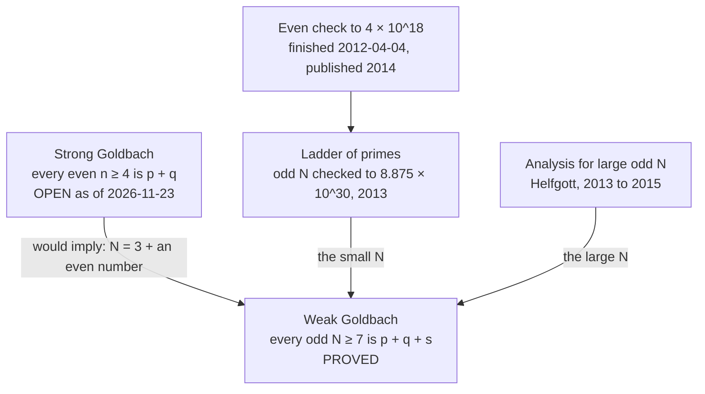

# Goldbach: every even number above 2 is a sum of two primes

[Syllabus](../../../SYLLABUS.md) → [Frontier](../README.md) → [Primes and Numbers](../README.md#s03) → Goldbach

---

## General Overview

One million is the sum of two primes: 17 + 999,983. It can be split that way in exactly **5,402** ways, counting each pair once with the smaller prime first. A prime is a whole number above 1 that only 1 and itself divide.

In 1742 Christian Goldbach and Leonhard Euler wrote to each other about such sums. In Euler's form, the claim is that every even number from 4 up is a sum of two primes. Nobody has proved it or found an even number that fails.

Computers have checked it for every even number up to 4 × 10^18, a 4 followed by eighteen zeros. That run finished on 2012-04-04 and was published in 2014. Checked is all it is. The number one bigger than the last one checked has no guarantee.

Two other cards already teach the mathematics:

- [Goldbach, twin primes and friends](../../02-Number%20theory/07-For%20the%20Curious/04-goldbach-and-open-problems.md) writes 100 as two primes six ways and says why examples never prove a for-all claim.
- [Goldbach](../../21-Algebraic%20and%20analytic%20number%20theory/04-Sieves%20and%20Prime%20Gaps/07-goldbach-and-chens-theorem.md) states the two-prime and three-prime forms, Helfgott's and Chen's theorems, and the Hardy–Littlewood pair count.

This card spends its space on the status record and on the verification: how a check to 4 × 10^18 works, what it costs, what it proves and where it stops.

**Goldbach's two-prime claim is checked for every even number up to 4 × 10^18 and is still open; the three-prime claim is proved, and the check to 4 × 10^18 is one of the inputs to that proof.**

**What kind of fact this is:** a conjecture, open as of 2026-11-23: no accepted proof or disproof. The card also records two theorems with their dated status, and counts that its own code checks. A count to a bound is evidence, never proof.

### The status record

A claim's **kind** says what sort of statement it is: theorem, conjecture, model or approximation. Its **status** says where it stands on a date: open, claimed, proved or refuted. The two are separate fields, as on [Kinds of claim](../01-How%20Research%20Works/02-theorem-conjecture-model-approximation.md).

| Claim | Kind | Status on 2026-11-23 | Source |
| --- | --- | --- | --- |
| **Strong (binary) Goldbach**: every even n ≥ 4 is p + q | conjecture | open; checked for every even n up to 4 × 10^18 (run finished 2012-04-04; double-check reached 4 × 10^17 by 2013-05-26) | Oliveira e Silva, Herzog and Pardi, 2014 |
| **Weak (ternary) Goldbach**: every odd N ≥ 7 is p + q + s | theorem | proved: Helfgott, preprints 2012–2013, full text 2015; that manuscript was accepted for publication after refereeing in 2015; a rewritten book version was still in progress at the author's last update, 2024-07-07 | Helfgott, 2015, and the author's book page |
| **Chen's theorem**: every large enough even n is a prime plus a number with at most two prime factors | theorem | proved: published 1973 | Chen's paper, cited on [Goldbach](../../21-Algebraic%20and%20analytic%20number%20theory/04-Sieves%20and%20Prime%20Gaps/07-goldbach-and-chens-theorem.md) |
| The odd numbers from 7 to 8.875 × 10^30 are each a sum of three primes | theorem, by computation | proved: refereed computation, published 2013 | Helfgott and Platt, 2013 |

The weak form is called weak because the strong form implies it. The strong form is not known to follow from anything proved.

### The picture: what feeds what



The even check proves nothing about the strong claim beyond 4 × 10^18. It does real work elsewhere: it is a rung in the proof of the weak claim.

---

## The formula

This card introduces the **Goldbach count** r(n): the number of ways to write an even n as p + q with p and q prime and p ≤ q. The number-theory card writes the same count R(n). Here p, q and s stand for primes; the letter r is kept for the count.

```math
r(n) = \#\{(p, q) : p \le q,\ p + q = n,\ p \text{ and } q \text{ both prime}\}
```

**Read it aloud:** r of n counts the pairs of primes, smaller first, that add up to n.

The conjecture is one line about that count:

```math
r(n) \ge 1 \quad \text{for every even } n \ge 4
```

**Read it aloud:** every even number from 4 up has at least one pair.

A verification does not need r(n). One pair is enough, so it looks for the smallest one:

```math
p_{\min}(n) = \text{the smallest prime } p \text{ such that } n - p \text{ is prime}
```

**Read it aloud:** p-min of n is the first prime p, counting up, that leaves a prime when taken away from n.

What the 2014 run established, written as a statement with a boundary:

```math
\text{for every even } n \text{ with } 4 \le n \le 4 \times 10^{18}:\quad p_{\min}(n) \text{ exists, and } p_{\min}(n) \le 9781
```

**Read it aloud:** every even number up to four times ten to the eighteen has a pair whose smaller prime is at most 9,781.

For one million: r(1,000,000) = 5,402 and $`p_{\min}(1{,}000{,}000) = 17`$, from 17 + 999,983.

| Symbol | Plain meaning | In our example | Push it up and the answer… |
| --- | --- | --- | --- |
| $`n`$ | an even number, the target of a two-prime sum | 1,000,000 | more pairs, on average |
| $`N`$ | an odd number, the target of a three-prime sum | 9,999,999,999 | more triples |
| $`p, q, s`$ | primes in a sum | 17 + 999,983 | — |
| $`r(n)`$ | the Goldbach count: pairs p ≤ q of primes with p + q = n | 5,402 | grows roughly like n/(log n)² |
| $`\#\{\ldots\}`$ | the number of members of a set | 5,402 pairs | — |
| $`p_{\min}(n)`$ | the smallest prime p with n − p prime | 17 for one million | creeps up slowly, with records |
| $`B`$ | the bound a check reaches: every even n up to it is checked | 2,000,000 here; 4 × 10^18 published | covers more, says nothing past it |
| $`C_2`$ | the twin-prime constant, a product over the odd primes p of 1 − 1/(p − 1)², taught on [Twin primes](01-twin-primes-and-bounded-gaps.md) | 0.660162 | — |
| $`\log`$ | the natural logarithm | log 4 × 10^18 = 42.83 | — |

### When it holds

- **n must be even.** An odd sum of two primes needs the prime 2. So 999,999 has no pair: 999,999 − 2 = 999,997 = 757 × 1,321.
- **n must be at least 4.** The smallest two primes, 2 + 2, already make 4.
- **A check holds only up to its bound.** Up to a million the largest $`p_{\min}`$ is 523. The pattern "523 is always enough" breaks at 1,077,422, which needs 601. Patterns in checked ranges stop.
- **A check is only as good as its prime test.** Base 2 alone calls 2,047 prime, but 2,047 = 23 × 89. The test used must be proved exact in the range, or each answer must carry a certificate: a short proof anyone can recheck, such as a factor.
- **The weak form needs N odd and at least 7.** Three primes add to at least 2 + 2 + 2 = 6, so 5 has no triple; 7 = 2 + 2 + 3 is the first odd case. An even N would need the prime 2 plus a pair for N − 2, which is the strong form.

---

## Why it works

This is a status card. It proves nothing new about Goldbach. The steps explain how a verification works, why it is cheap per number, what it gives the proof of the weak form, and why no amount of it reaches the strong form.

### Step 0: one small pair is enough

Goldbach asks for one pair, not all of them. So a verifier takes each even n and tries p = 3, 5, 7, 11 and so on, stopping at the first p that leaves n − p prime. That first p is $`p_{\min}(n)`$.

It is almost always tiny. In the check on this card, every even n up to 2,000,000 needed on average 6.589 tries. For a share of 0.1489 of them, p = 3 already works.

### Step 1: why the first pair comes so fast

Near n, roughly one number in log n is prime, by the prime number theorem. The numbers n − p are all odd, which doubles the chance to about 2 in log n. So the expected number of tries is about log n / 2.

At n = 2,000,000 that is 7.25 tries, close to the measured mean of 6.589. At n = 4 × 10^18 it is only 21.42. That is why a check to 4 × 10^18 is possible at all: each number needs a handful of prime tests, not a full count.

The hard cases are the **records**: n whose $`p_{\min}`$ beats every smaller n. Up to two million there are 22 of them, the last at 1,077,422 with 601. The published run found the largest record below 4 × 10^18: n = 3,325,581,707,333,960,528, with $`p_{\min}`$ = 9,781.

### Step 2: how the 4 × 10^18 run was organised

The published run, by Oliveira e Silva, Herzog and Pardi, worked like this:

1. Split the range into blocks of 10^12 consecutive numbers.
2. In each block, mark the primes with a **segmented sieve**: the sieve of Eratosthenes run on one block at a time, so memory stays small ([The sieve of Eratosthenes](../../02-Number%20theory/01-Divisibility%20and%20Primes/06-sieve-of-eratosthenes.md)).
3. For each even n in the block, try small primes p until n − p is marked prime. Record $`p_{\min}(n)`$ and any new record.
4. Hand blocks to volunteers' computers, and run a second, independent pass over part of the range.

The project page gives the speed: about 48 minutes per block of 10^12 near 10^18, on one core. At that rate the whole range costs about 365 core-years (one processor core running for 365 years), and reaching 4 × 10^19 would cost about 3,650. Each factor of 10 in the bound costs roughly a factor of 10 in work. These are estimates from the quoted speed, not measured totals.

The second pass is part of the record. It reached 4 × 10^17 by 2013-05-26, so the last factor of 10 was run once only.

### Step 3: a spot check of the frontier, by two roads

A reader cannot rerun 365 core-years. A reader can check the records. The code takes the published record n's and finds $`p_{\min}`$ with the Miller–Rabin test, which either proves a number composite or passes it as prime ([The Miller-Rabin test](../../02-Number%20theory/06-Codes%20and%20Secrets/05-miller-rabin.md)).

| n | $`p_{\min}`$ found | primes tried | composites shown by a factor |
| ---: | ---: | ---: | ---: |
| 389,965,026,819,938 (record of the 2001 check) | 5,569 | 734 | 733 of 733 |
| 3,325,581,707,333,960,528 (record of the 2014 check) | 9,781 | 1,205 | 1,204 of 1,204 |
| 10^18 | 11 | 4 | 3 of 3 |
| 4 × 10^18, the bound itself | 113 | 29 | 28 of 28 |

Two roads stand behind each row:

- **The failures.** Every rejected p leaves a composite n − p. The code finds an explicit factor of each one, by trial division and then Pollard's rho method, a search for a factor by iterating x → x² + c. A factor is a proof that does not depend on Miller–Rabin.
- **The success.** The last p leaves n − p prime. Here the code relies on Miller–Rabin with the twelve bases 2 to 37. Sorenson and Webster proved that no composite below about 3.18 × 10^23 passes all twelve, so below that size the test is exact.

Both published records come out as published: 5,569 and 9,781.

### Step 4: the even check feeds the proof of the weak form

Helfgott's proof of the weak form has two halves:

- **Large odd N:** the circle method, a way of counting sums of primes with waves, made fully explicit ([Goldbach](../../21-Algebraic%20and%20analytic%20number%20theory/04-Sieves%20and%20Prime%20Gaps/07-goldbach-and-chens-theorem.md) outlines it).
- **Small odd N:** a computer check. Helfgott and Platt checked every odd N up to 8.875 × 10^30.

The small half is built on the even check, through a **ladder**: a list of primes in which each step from one prime to the next is shorter than the even bound B. Take an odd N and the highest rung q with q ≤ N − 4. Then N − q is even, at least 4 and at most B, so it is p + s by the even check. So N = q + p + s.

The code builds a small ladder the same way. With its own even check to B = 2,000,000, it climbs 5,002 prime rungs from 3 to 10,001,881,889, the widest step 1,999,996. That covers every odd N from 7 to 10,003,881,889. For example:

- N = 9,999,999,999 = 9,999,881,909 + 29 + 118,061.

Helfgott and Platt's paper says the same move on the 4 × 10^18 even check gave them a factor of 10^7 over the previous ladder, which stood on a check to 4 × 10^11.

### Step 5: why no check reaches the strong form

The strong form covers infinitely many even numbers. Any check covers finitely many. A check to B proves the statement for n ≤ B and nothing past it.

The expected number of pairs is huge. A rough Hardy–Littlewood size, $`C_2 \cdot n / (\log n)^2`$, gives about 1.44 × 10^15 pairs for n near 4 × 10^18. A failure there would mean a count of zero where about 10^15 is expected. That is why almost everyone believes the conjecture. It is a heuristic, not a proof: the Hardy–Littlewood count is itself unproved.

### The verification bounds, on a log scale

Each bar is log10 of the largest number checked: one `#` per factor of 10.

```
  this check, even      ######                          6.30
  Sinisalo 1993         ############                    11.60
  Richstein 2001        ###############                 14.60
  double-checked to     ##################              17.60
  Oliveira e Silva 2014 ###################             18.60
  this ladder, odd      ##########                      10.00
  Helfgott-Platt, odd   ############################### 30.95
```

The first five bars are checks of the strong form. The last two are three-prime checks built on top of even checks by a ladder. Sinisalo's 1993 bound is as listed on the 2014 project's page.

---

## Worked numbers, by hand

The example: one million, its pairs, and the place where a checked pattern stops.

| Step | Arithmetic | Value |
| --- | --- | --- |
| try p = 3 | 1,000,000 − 3 = 999,997 = 757 × 1,321 | composite |
| try p = 5 and 7 | 999,995 = 5 × 199,999; 999,993 = 3 × 333,331 | composite |
| try p = 11 and 13 | 999,989 = 19 × 52,631; 999,987 = 3 × 333,329 | composite |
| try p = 17 | 1,000,000 − 17 = 999,983 | prime |
| smallest pair | the first p that works | 17 + 999,983 |
| all pairs, smaller first | count by sieve, recount by Miller–Rabin | **5,402** |
| as ordered pairs | 2 × 5,402 | 10,804 |
| largest $`p_{\min}`$ up to a million | the record at 503,222 | 523 |
| first n needing more | the next record | 1,077,422, with 601 |

One million has 5,402 pairs, and the first one turns up on the sixth try; the record table shows the hard numbers are rare and their first prime still small.

### What breaks if you drop a piece

| Mistake | Comes out at | What went wrong |
| --- | --- | --- |
| Reading "523 is enough up to a million" as a rule | fails at 1,077,422, which needs 601 | A pattern in a checked range says nothing past the range |
| Counting 17 + 999,983 and 999,983 + 17 as two | 10,804, not 5,402 | Each pair counts once, smaller prime first |
| Dropping "even": try 999,999 | 0 pairs | An odd sum needs the prime 2, and 999,997 = 757 × 1,321 |
| Testing primes with base 2 alone | calls 2,047 prime | 2,047 = 23 × 89; the test must be proved exact in its range |

The code prints every row.

---

## Code, from first principles, and it actually runs

The code checks Goldbach for every even number up to 2,000,000 and records $`p_{\min}`$ and its records. It counts the pairs of one million by two roads: a sieve, and a Miller–Rabin test written out that shares no step with it. It rechecks every record, and every sieve entry up to 2,000,000, by Miller–Rabin. It then rechecks the published frontier records, proving each rejected candidate composite by an explicit factor. Finally it builds a prime ladder to 10^10 and prints the bound bars.

### Python

```python
# Goldbach's conjecture, the verification and its limits -- the check behind
# the card.  Standard library only: math supplies log10 and log.  Roads: a
# sieve against a Miller-Rabin test written out; each composite confirmed by an
# explicit factor (trial division, then Pollard's rho); published records
# rechecked; a ladder of primes turning a two-prime check into a three-prime one.
import math
B = 2_000_000                                      # the even check here runs to B
flag = bytearray([1]) * (B + 1)
flag[0] = flag[1] = 0
for i in range(2, 1415):
    if flag[i]: flag[i * i::i] = bytearray(len(range(i * i, B + 1, i)))
P = [m for m in range(3, B + 1) if flag[m]]        # the odd primes up to B
BASES = (2, 3, 5, 7, 11, 13, 17, 19, 23, 29, 31, 37)
def mr(m, bases=BASES):                            # Miller-Rabin; 12 bases are exact below 3.18e23
    if m < 2: return False
    for a in bases:
        if m % a == 0: return m == a
    d, s = m - 1, 0
    while d % 2 == 0: d, s = d // 2, s + 1
    for a in bases:
        x = pow(a, d, m)
        if x == 1 or x == m - 1: continue
        for _ in range(s - 1):
            x = x * x % m
            if x == m - 1: break
        else: return False
    return True
def gcd(a, b):
    while b: a, b = b, a % b
    return a
def factor_of(m):                                  # an explicit factor 1 < f < m, or 0
    for d in range(3, 100_000, 2):
        if m % d == 0: return d
    for c in range(1, 20):                         # Pollard's rho with x -> x*x + c
        x, y, g = 2, 2, 1
        while g == 1:
            x = (x * x + c) % m
            y = (y * y + c) % m
            y = (y * y + c) % m
            g = gcd(abs(x - y), m)
        if g != m: return g
    return 0
def p_min(n, prime):                               # smallest odd prime p with n - p prime, and tries
    for k, p in enumerate(P):
        if prime(n - p): return p, k + 1
def by_sieve(m): return flag[m] == 1
n = 10 ** 6                                        # the worked example: one million
pairs = [p for p in P if p <= n // 2 and flag[n - p]]
pairs_mr = [p for p in range(3, n // 2 + 1, 2) if mr(p) and mr(n - p)]
print(f"r(1000000) = {len(pairs)} by the sieve, {len(pairs_mr)} by Miller-Rabin; ordered pairs {2 * len(pairs)}")
print(f"smallest pair {pairs[0]} + {n - pairs[0]}; largest p {pairs[-1]} + {n - pairs[-1]}")
first, k0 = p_min(n, by_sieve)
print(f"p_min(1000000) = {first}, found on try {k0}; the failures: " +
      ", ".join(f"{n - q} = {factor_of(n - q)} x {(n - q) // factor_of(n - q)}" for q in P[:k0 - 1]))
records, tries, threes = [(4, 2)], 0, 0
for m in range(6, B + 1, 2):
    p, k = p_min(m, by_sieve)
    tries, threes = tries + k, threes + (p == 3)
    if p > records[-1][1]: records.append((m, p))
evens = (B - 4) // 2
print(f"every even n from 4 to {B} has a pair: yes; {evens + 1} numbers checked")
print(f"mean primes tried per n: {tries / evens:.3f}; share settled by p = 3: {threes / evens:.4f}")
print("records of the smallest prime p_min(n), as n:p")
for i in range(0, len(records), 7):
    print("  " + "  ".join(f"{m}:{p}" for m, p in records[i:i + 7]))
print(f"{len(records)} records; rough tries log(n)/2: {math.log(B) / 2:.2f} at n = {B}, "
      f"{math.log(4e18) / 2:.2f} at n = 4e18, where log n = {math.log(4e18):.2f}")
recheck = [(m, p_min(m, mr)[0]) for m, p in records[1:]]
print(f"records rechecked by Miller-Rabin: {'agree' if recheck == records[1:] else 'differ'}")
below = [r for r in records if r[0] <= n]
print(f"to a million the largest p_min is {below[-1][1]} at {below[-1][0]}; the rule p_min <= {below[-1][1]} "
      f"first fails at {records[len(below)][0]} ({records[len(below)][1]})")
odd = 999_999
print(f"odd {odd}: pairs {sum(1 for p in [2] + P if p < odd and mr(odd - p))}; {odd} - 2 = {odd - 2} = "
      f"{factor_of(odd - 2)} x {(odd - 2) // factor_of(odd - 2)}")
print("published frontier cases, rechecked: n | p_min | primes tried | composites with a factor shown")
front = {}
for m in (389_965_026_819_938, 3_325_581_707_333_960_528, 10 ** 18, 4 * 10 ** 18):
    p, k = p_min(m, mr)
    shown = [q for q in P[:k - 1] if 1 < (f := factor_of(m - q)) < m - q and (m - q) % f == 0]
    front[m] = (p, k, len(shown))
    print(f"  {m} | {p} | {k} | {len(shown)} of {k - 1}")
C2 = 1.0
for p in P: C2 *= 1 - 1 / (p - 1) ** 2
L = math.log(4e18)
print(f"twin-prime constant C2, primes to {B}: {C2:.6f}; crude pair count near 4e18: "
      f"C2 x n/(log n)^2 = {C2 * 4e18 / L ** 2 / 1e15:.2f}e15")
years = 4e18 / 1e12 * 48 / 60 / 24 / 365.25
print(f"cost at 48 minutes per 1e12 block on one core: {years:.0f} core-years to 4e18, {10 * years:.0f} to 4e19")
rungs, q = [3], 3                                  # the ladder: prime steps no longer than B - 4
while q < 10 ** 10:
    q = q + B - 4                                  # odd, since q and B - 4 are
    while not mr(q): q -= 2
    rungs.append(q)
gap = max(b - a for a, b in zip(rungs, rungs[1:]))
top = rungs[-1] + B
print(f"ladder: {len(rungs)} prime rungs from 3 to {rungs[-1]}, widest step {gap}")
print(f"so every odd N from 7 to {top} is a sum of three primes, given the even check to {B}")
N = 9_999_999_999
r = max(x for x in rungs if x <= N - 4)
p, _ = p_min(N - r, by_sieve)
print(f"  N = {N} = {r} + {p} + {N - r - p}")
print("verification bounds, log10 of the largest number checked")
bars = [("this check, even", B), ("Sinisalo 1993", 4e11), ("Richstein 2001", 4e14),
        ("double-checked to", 4e17), ("Oliveira e Silva 2014", 4e18),
        ("this ladder, odd", top), ("Helfgott-Platt, odd", 8.875e30)]
for name, v in bars:
    print(f"  {name:<22}{'#' * round(math.log10(v)):<32}{math.log10(v):.2f}")
two = mr(2047, (2,))
print(f"base 2 alone calls 2047 {'prime' if two else 'composite'}; 2047 = 23 x 89; twelve bases say "
      f"{'prime' if mr(2047) else 'composite'}")
assert len(pairs) == len(pairs_mr) == 5402 and pairs[0] == first == 17 and pairs_mr == pairs
assert recheck == records[1:] and below[-1] == (503222, 523) and records[len(below)] == (1077422, 601)
assert front[389_965_026_819_938][0] == 5569 and front[3_325_581_707_333_960_528][0] == 9781
assert all(v[2] == v[1] - 1 for v in front.values()) and odd - 2 == 757 * 1321
assert gap <= B - 4 and all(r % d for d in range(2, 100_001)) and flag[N - r - p] and flag[p]
assert two and not mr(2047) and 23 * 89 == 2047
assert len(records) == 22 and tries == 6_589_204 and [v[1] for v in front.values()][:2] == [734, 1205]
assert all(flag[m] == mr(m) for m in range(2, B + 1))     # the whole sieve, rechecked by Miller-Rabin
print("ALL CHECKS PASS")
```

**Ran 2026-11-23 on macOS, Python 3.14.10, standard library only. All checks passed. Output, pasted from the run:**

```
r(1000000) = 5402 by the sieve, 5402 by Miller-Rabin; ordered pairs 10804
smallest pair 17 + 999983; largest p 499943 + 500057
p_min(1000000) = 17, found on try 6; the failures: 999997 = 757 x 1321, 999995 = 5 x 199999, 999993 = 3 x 333331, 999989 = 19 x 52631, 999987 = 3 x 333329
every even n from 4 to 2000000 has a pair: yes; 999999 numbers checked
mean primes tried per n: 6.589; share settled by p = 3: 0.1489
records of the smallest prime p_min(n), as n:p
  4:2  6:3  12:5  30:7  98:19  220:23  308:31
  556:47  992:73  2642:103  5372:139  7426:173  43532:211  54244:233
  63274:293  113672:313  128168:331  194428:359  194470:383  413572:389  503222:523
  1077422:601
22 records; rough tries log(n)/2: 7.25 at n = 2000000, 21.42 at n = 4e18, where log n = 42.83
records rechecked by Miller-Rabin: agree
to a million the largest p_min is 523 at 503222; the rule p_min <= 523 first fails at 1077422 (601)
odd 999999: pairs 0; 999999 - 2 = 999997 = 757 x 1321
published frontier cases, rechecked: n | p_min | primes tried | composites with a factor shown
  389965026819938 | 5569 | 734 | 733 of 733
  3325581707333960528 | 9781 | 1205 | 1204 of 1204
  1000000000000000000 | 11 | 4 | 3 of 3
  4000000000000000000 | 113 | 29 | 28 of 28
twin-prime constant C2, primes to 2000000: 0.660162; crude pair count near 4e18: C2 x n/(log n)^2 = 1.44e15
cost at 48 minutes per 1e12 block on one core: 365 core-years to 4e18, 3650 to 4e19
ladder: 5002 prime rungs from 3 to 10001881889, widest step 1999996
so every odd N from 7 to 10003881889 is a sum of three primes, given the even check to 2000000
  N = 9999999999 = 9999881909 + 29 + 118061
verification bounds, log10 of the largest number checked
  this check, even      ######                          6.30
  Sinisalo 1993         ############                    11.60
  Richstein 2001        ###############                 14.60
  double-checked to     ##################              17.60
  Oliveira e Silva 2014 ###################             18.60
  this ladder, odd      ##########                      10.00
  Helfgott-Platt, odd   ############################### 30.95
base 2 alone calls 2047 prime; 2047 = 23 x 89; twelve bases say composite
ALL CHECKS PASS
```

### Rust

Same numbers, same labels, built with `rustc --edition 2021 -O`.

```rust
// Goldbach's conjecture, the verification and its limits -- the same check as
// the Python, in Rust.  No crates.  Roads: a sieve against a Miller-Rabin test
// written out; each composite confirmed by an explicit factor (trial division,
// then Pollard's rho); published records rechecked; a ladder of primes turning
// a two-prime check into a three-prime one.  Products go through u128.
const B: u64 = 2_000_000;                          // the even check here runs to B
const BASES: [u64; 12] = [2, 3, 5, 7, 11, 13, 17, 19, 23, 29, 31, 37];
fn mulmod(a: u64, b: u64, m: u64) -> u64 { ((a as u128 * b as u128) % m as u128) as u64 }
fn powmod(mut a: u64, mut e: u64, m: u64) -> u64 {
    let mut r = 1u64;
    a %= m;
    while e > 0 { if e & 1 == 1 { r = mulmod(r, a, m) } a = mulmod(a, a, m); e >>= 1 }
    r
}
fn mr_with(m: u64, bases: &[u64]) -> bool {        // Miller-Rabin; 12 bases are exact below 3.18e23
    if m < 2 { return false }
    for &a in bases { if m % a == 0 { return m == a } }
    let (mut d, mut s) = (m - 1, 0);
    while d % 2 == 0 { d /= 2; s += 1 }
    'outer: for &a in bases {
        let mut x = powmod(a, d, m);
        if x == 1 || x == m - 1 { continue }
        for _ in 0..s - 1 { x = mulmod(x, x, m); if x == m - 1 { continue 'outer } }
        return false;
    }
    true
}
fn mr(m: u64) -> bool { mr_with(m, &BASES) }
fn gcd(mut a: u64, mut b: u64) -> u64 { while b != 0 { (a, b) = (b, a % b) } a }
fn factor_of(m: u64) -> u64 {                      // an explicit factor 1 < f < m, or 0
    let mut d = 3;
    while d < 100_000 { if m % d == 0 { return d } d += 2 }
    for c in 1..20u64 {                            // Pollard's rho with x -> x*x + c
        let (mut x, mut y, mut g) = (2u64, 2u64, 1u64);
        while g == 1 {
            x = ((x as u128 * x as u128 + c as u128) % m as u128) as u64;
            y = ((y as u128 * y as u128 + c as u128) % m as u128) as u64;
            y = ((y as u128 * y as u128 + c as u128) % m as u128) as u64;
            g = gcd(x.abs_diff(y), m);
        }
        if g != m { return g }
    }
    0
}
fn p_min(n: u64, p: &[u64], prime: &dyn Fn(u64) -> bool) -> (u64, usize) {
    for (k, &q) in p.iter().enumerate() { if prime(n - q) { return (q, k + 1) } }
    (0, 0)
}
fn main() {
    let mut flag = vec![true; B as usize + 1];
    flag[0] = false; flag[1] = false;
    for i in 2..1415usize { if flag[i] { let mut k = i * i; while k <= B as usize { flag[k] = false; k += i } } }
    let p: Vec<u64> = (3..=B).filter(|&m| flag[m as usize]).collect();   // odd primes up to B
    let sieve = |m: u64| flag[m as usize];
    let n: u64 = 1_000_000;                        // the worked example: one million
    let pairs: Vec<u64> = p.iter().copied().filter(|&q| q <= n / 2 && flag[(n - q) as usize]).collect();
    let pairs_mr: Vec<u64> = (3..=n / 2).step_by(2).filter(|&q| mr(q) && mr(n - q)).collect();
    println!("r(1000000) = {} by the sieve, {} by Miller-Rabin; ordered pairs {}", pairs.len(), pairs_mr.len(), 2 * pairs.len());
    let last = pairs[pairs.len() - 1];
    println!("smallest pair {} + {}; largest p {} + {}", pairs[0], n - pairs[0], last, n - last);
    let (first, k0) = p_min(n, &p, &sieve);
    let fails: Vec<String> = p[..k0 - 1].iter().map(|&q| format!("{} = {} x {}", n - q, factor_of(n - q), (n - q) / factor_of(n - q))).collect();
    println!("p_min(1000000) = {}, found on try {}; the failures: {}", first, k0, fails.join(", "));
    let (mut records, mut tries, mut threes) = (vec![(4u64, 2u64)], 0usize, 0usize);
    let mut m = 6;
    while m <= B {
        let (q, k) = p_min(m, &p, &sieve);
        assert!(k > 0); tries += k;
        if q == 3 { threes += 1 }
        if q > records[records.len() - 1].1 { records.push((m, q)) }
        m += 2;
    }
    let evens = (B - 4) / 2;
    println!("every even n from 4 to {} has a pair: yes; {} numbers checked", B, evens + 1);
    println!("mean primes tried per n: {:.3}; share settled by p = 3: {:.4}", tries as f64 / evens as f64, threes as f64 / evens as f64);
    println!("records of the smallest prime p_min(n), as n:p");
    for chunk in records.chunks(7) {
        let parts: Vec<String> = chunk.iter().map(|(a, b)| format!("{}:{}", a, b)).collect();
        println!("  {}", parts.join("  "));
    }
    println!("{} records; rough tries log(n)/2: {:.2} at n = {}, {:.2} at n = 4e18, where log n = {:.2}",
             records.len(), (B as f64).ln() / 2.0, B, (4e18f64).ln() / 2.0, (4e18f64).ln());
    let recheck: Vec<(u64, u64)> = records[1..].iter().map(|&(a, _)| (a, p_min(a, &p, &mr).0)).collect();
    println!("records rechecked by Miller-Rabin: {}", if recheck == records[1..] { "agree" } else { "differ" });
    let below: Vec<(u64, u64)> = records.iter().copied().filter(|r| r.0 <= n).collect();
    let (bl, nx) = (below[below.len() - 1], records[below.len()]);
    println!("to a million the largest p_min is {} at {}; the rule p_min <= {} first fails at {} ({})", bl.1, bl.0, bl.1, nx.0, nx.1);
    let odd: u64 = 999_999;
    let odd_pairs = std::iter::once(2u64).chain(p.iter().copied()).filter(|&q| q < odd && mr(odd - q)).count();
    let f = factor_of(odd - 2);
    println!("odd {}: pairs {}; {} - 2 = {} = {} x {}", odd, odd_pairs, odd, odd - 2, f, (odd - 2) / f);
    println!("published frontier cases, rechecked: n | p_min | primes tried | composites with a factor shown");
    let mut front = Vec::new();
    for &m in &[389_965_026_819_938u64, 3_325_581_707_333_960_528, 1_000_000_000_000_000_000, 4_000_000_000_000_000_000] {
        let (q, k) = p_min(m, &p, &mr);
        let shown = p[..k - 1].iter().filter(|&&r| { let f = factor_of(m - r); f > 1 && f < m - r && (m - r) % f == 0 }).count();
        front.push((q, k, shown));
        println!("  {} | {} | {} | {} of {}", m, q, k, shown, k - 1);
    }
    let mut c2 = 1.0f64;
    for &q in &p { c2 *= 1.0 - 1.0 / (((q - 1) * (q - 1)) as f64) }
    let l = (4e18f64).ln();
    println!("twin-prime constant C2, primes to {}: {:.6}; crude pair count near 4e18: C2 x n/(log n)^2 = {:.2}e15", B, c2, c2 * 4e18 / (l * l) / 1e15);
    let years = 4e18 / 1e12 * 48.0 / 60.0 / 24.0 / 365.25;
    println!("cost at 48 minutes per 1e12 block on one core: {:.0} core-years to 4e18, {:.0} to 4e19", years, 10.0 * years);
    let (mut rungs, mut q) = (vec![3u64], 3u64);   // the ladder: prime steps no longer than B - 4
    while q < 10_000_000_000 {
        q = q + B - 4;                             // odd, since q and B - 4 are
        while !mr(q) { q -= 2 }
        rungs.push(q);
    }
    let gap = rungs.windows(2).map(|w| w[1] - w[0]).max().unwrap();
    let top = rungs[rungs.len() - 1] + B;
    println!("ladder: {} prime rungs from 3 to {}, widest step {}", rungs.len(), rungs[rungs.len() - 1], gap);
    println!("so every odd N from 7 to {} is a sum of three primes, given the even check to {}", top, B);
    let big_n: u64 = 9_999_999_999;
    let r = rungs.iter().copied().filter(|&x| x <= big_n - 4).max().unwrap();
    let (s, _) = p_min(big_n - r, &p, &sieve);
    println!("  N = {} = {} + {} + {}", big_n, r, s, big_n - r - s);
    println!("verification bounds, log10 of the largest number checked");
    let bars: [(&str, f64); 7] = [("this check, even", B as f64), ("Sinisalo 1993", 4e11), ("Richstein 2001", 4e14),
        ("double-checked to", 4e17), ("Oliveira e Silva 2014", 4e18),
        ("this ladder, odd", top as f64), ("Helfgott-Platt, odd", 8.875e30)];
    for (name, v) in bars.iter() {
        let lg = v.log10();
        println!("  {:<22}{:<32}{:.2}", name, "#".repeat(lg.round() as usize), lg);
    }
    let two = mr_with(2047, &[2]);
    println!("base 2 alone calls 2047 {}; 2047 = 23 x 89; twelve bases say {}",
             if two { "prime" } else { "composite" }, if mr(2047) { "prime" } else { "composite" });
    assert!(pairs.len() == 5402 && pairs_mr.len() == 5402 && pairs[0] == 17 && first == 17 && pairs_mr == pairs);
    assert!(recheck == records[1..] && bl == (503222, 523) && nx == (1077422, 601));
    assert!(front[0].0 == 5569 && front[1].0 == 9781);
    assert!(front.iter().all(|v| v.2 == v.1 - 1) && odd - 2 == 757 * 1321);
    assert!(gap <= B - 4 && (2..=100_000u64).all(|d| r % d != 0) && flag[(big_n - r - s) as usize] && flag[s as usize]);
    assert!(two && !mr(2047) && 23 * 89 == 2047);
    assert!(records.len() == 22 && tries == 6_589_204 && front[0].1 == 734 && front[1].1 == 1205);
    assert!((2..=B).all(|m| flag[m as usize] == mr(m))); // the whole sieve, rechecked by Miller-Rabin
    println!("ALL CHECKS PASS");
}
```

**Ran 2026-11-23 on macOS, rustc 1.98.1, no crates. All checks passed. Output, pasted from the run:**

```
r(1000000) = 5402 by the sieve, 5402 by Miller-Rabin; ordered pairs 10804
smallest pair 17 + 999983; largest p 499943 + 500057
p_min(1000000) = 17, found on try 6; the failures: 999997 = 757 x 1321, 999995 = 5 x 199999, 999993 = 3 x 333331, 999989 = 19 x 52631, 999987 = 3 x 333329
every even n from 4 to 2000000 has a pair: yes; 999999 numbers checked
mean primes tried per n: 6.589; share settled by p = 3: 0.1489
records of the smallest prime p_min(n), as n:p
  4:2  6:3  12:5  30:7  98:19  220:23  308:31
  556:47  992:73  2642:103  5372:139  7426:173  43532:211  54244:233
  63274:293  113672:313  128168:331  194428:359  194470:383  413572:389  503222:523
  1077422:601
22 records; rough tries log(n)/2: 7.25 at n = 2000000, 21.42 at n = 4e18, where log n = 42.83
records rechecked by Miller-Rabin: agree
to a million the largest p_min is 523 at 503222; the rule p_min <= 523 first fails at 1077422 (601)
odd 999999: pairs 0; 999999 - 2 = 999997 = 757 x 1321
published frontier cases, rechecked: n | p_min | primes tried | composites with a factor shown
  389965026819938 | 5569 | 734 | 733 of 733
  3325581707333960528 | 9781 | 1205 | 1204 of 1204
  1000000000000000000 | 11 | 4 | 3 of 3
  4000000000000000000 | 113 | 29 | 28 of 28
twin-prime constant C2, primes to 2000000: 0.660162; crude pair count near 4e18: C2 x n/(log n)^2 = 1.44e15
cost at 48 minutes per 1e12 block on one core: 365 core-years to 4e18, 3650 to 4e19
ladder: 5002 prime rungs from 3 to 10001881889, widest step 1999996
so every odd N from 7 to 10003881889 is a sum of three primes, given the even check to 2000000
  N = 9999999999 = 9999881909 + 29 + 118061
verification bounds, log10 of the largest number checked
  this check, even      ######                          6.30
  Sinisalo 1993         ############                    11.60
  Richstein 2001        ###############                 14.60
  double-checked to     ##################              17.60
  Oliveira e Silva 2014 ###################             18.60
  this ladder, odd      ##########                      10.00
  Helfgott-Platt, odd   ############################### 30.95
base 2 alone calls 2047 prime; 2047 = 23 x 89; twelve bases say composite
ALL CHECKS PASS
```

The two outputs match line for line.

### Lean

Lean proves three facts for every case and checks the card's whole numbers; it states the strong form but leaves it unproved.

- Suppose the even check reaches an even B, and prime rungs rise from 3 with each step shorter than B. Then every odd N from 7 to the top rung plus B is a sum of three primes.
- Take any whole number n. Then r(n) is at least 1 exactly when n is p + q for some primes p and q.
- Take an odd n. Then n is a sum of two primes exactly when n − 2 is prime.
- One million is 17 + 999,983, and one million minus p is composite for p = 3, 5, 7, 11 and 13.
- Counted as ordered pairs, the 5,402 pairs of one million become 10,804.
- 999,999 has no pair, since 999,999 − 2 = 999,997 = 757 × 1,321.
- The records leave a prime: 503,222 − 523 and 1,077,422 − 601 are prime, and so are 523 and 601.
- Base 2 alone calls 2,047 prime, since 2^1023 leaves remainder 1 on division by 2,047. Yet 2,047 = 23 × 89.
- The bounds of "When it holds" add up: 2 + 2 = 4, 2 + 2 + 2 = 6, and 7 = 2 + 2 + 3.
- 9,999,999,999 = 9,999,881,909 + 29 + 118,061, and all three are prime.
- The top rung 10,001,881,889 is prime, and adding B = 2,000,000 gives 10,003,881,889.

The count 5,402, the even check to 2,000,000, the ladder's 5,002 rungs and the frontier records are left to the Python and Rust checks.

```lean
-- Goldbach: the conjecture is stated exactly and left open; the file proves that an even check to B and a ladder of primes with steps shorter than B make every odd number from 7 to the top rung plus B a sum of three primes, that r(n) ≥ 1 says exactly that n is a sum of two primes, that an odd number is a sum of two primes exactly when it is 2 more than a prime, and the card's whole-number examples.
import Mathlib.Data.Nat.Prime.Basic
import Mathlib.Data.Finset.Prod
import Mathlib.Order.Interval.Finset.Nat
import Mathlib.Tactic.NormNum.Prime

/-- Goldbach's conjecture, strong (binary) form (open as of 2026-11-23; the card does not
prove it): every even number n from 4 up is p + q with p and q prime. -/
def GoldbachConjecture : Prop :=
  ∀ n : ℕ, Even n → 4 ≤ n → ∃ p q : ℕ, p.Prime ∧ q.Prime ∧ p + q = n

/-- The Goldbach count r(n): the number of pairs (p, q) of primes with p ≤ q and p + q = n. -/
def goldbachCount (n : ℕ) : ℕ :=
  ((Finset.range (n + 1) ×ˢ Finset.range (n + 1)).filter
    (fun x : ℕ × ℕ => x.1 ≤ x.2 ∧ x.1 + x.2 = n ∧ x.1.Prime ∧ x.2.Prime)).card

/-- Every rung of a strictly rising ladder starting at 3 is at least 3. -/
theorem goldbach_rung_ge_three (k : ℕ) (rung : ℕ → ℕ) (hstart : rung 0 = 3)
    (hinc : ∀ i < k, rung i < rung (i + 1)) : ∀ i ≤ k, 3 ≤ rung i := by
  intro i
  induction i with
  | zero => intro _; omega
  | succ j ih =>
    intro hj
    have h1 := ih (by omega)
    have h2 := hinc j (by omega)
    omega

#print axioms goldbach_rung_ge_three

/-- The ladder: suppose every even n with 4 ≤ n ≤ B is a sum of two primes (the even check
to an even bound B), and the rungs 3 = q₀ < q₁ < ... < q_k are primes with each step from one
rung to the next shorter than B. Then every odd N from 7 up to the top rung plus B is a sum of
three primes: take the highest rung q ≤ N − 4, and N − q is even, at least 4 and at most B. -/
theorem even_check_and_prime_ladder_give_three_primes (B k : ℕ) (rung : ℕ → ℕ)
    (hB : Even B)
    (hcheck : ∀ n : ℕ, Even n → 4 ≤ n → n ≤ B → ∃ p q : ℕ, p.Prime ∧ q.Prime ∧ p + q = n)
    (hstart : rung 0 = 3)
    (hprime : ∀ i ≤ k, (rung i).Prime)
    (hstep : ∀ i < k, rung i < rung (i + 1) ∧ rung (i + 1) - rung i < B) :
    ∀ N : ℕ, Odd N → 7 ≤ N → N ≤ rung k + B →
      ∃ p q s : ℕ, p.Prime ∧ q.Prime ∧ s.Prime ∧ p + q + s = N := by
  intro N hN h7 hNk
  have hge := goldbach_rung_ge_three k rung hstart (fun i hi => (hstep i hi).1)
  have hodd : ∀ i ≤ k, Odd (rung i) := by
    intro i hi
    exact (hprime i hi).odd_of_ne_two (by have := hge i hi; omega)
  set P : ℕ → Prop := fun i => rung i + 4 ≤ N with hPdef
  set i := Nat.findGreatest P k with hidef
  have hP0 : P 0 := by simp only [hPdef]; omega
  have hPi : P i := Nat.findGreatest_spec (P := P) (Nat.zero_le k) hP0
  have hik : i ≤ k := Nat.findGreatest_le k
  simp only [hPdef] at hPi
  obtain ⟨a, ha⟩ := hN
  obtain ⟨b, hb⟩ := hodd i hik
  obtain ⟨d, hd⟩ := hB
  have hle : N - rung i ≤ B := by
    rcases Nat.lt_or_ge i k with hlt | hge'
    · have hnot : ¬ P (i + 1) := Nat.findGreatest_is_greatest (Nat.lt_succ_self i) hlt
      simp only [hPdef] at hnot
      obtain ⟨c, hc⟩ := hodd (i + 1) hlt
      have hs := (hstep i hlt).2
      omega
    · have : i = k := le_antisymm hik hge'
      rw [this]; omega
  obtain ⟨p, q, hp, hq, hpq⟩ := hcheck (N - rung i) ⟨a - b, by omega⟩ (by omega) hle
  exact ⟨p, q, rung i, hp, hq, hprime i hik, by omega⟩

/-- One pair is enough: r(n) ≥ 1 exactly when n is p + q for some primes p and q. -/
theorem one_le_goldbachCount_iff (n : ℕ) :
    1 ≤ goldbachCount n ↔ ∃ p q : ℕ, p.Prime ∧ q.Prime ∧ p + q = n := by
  constructor
  · intro h
    have hpos : 0 < goldbachCount n := by omega
    unfold goldbachCount at hpos
    obtain ⟨x, hx⟩ := Finset.card_pos.mp hpos
    rw [Finset.mem_filter] at hx
    exact ⟨x.1, x.2, hx.2.2.2.1, hx.2.2.2.2, hx.2.2.1⟩
  · rintro ⟨p, q, hp, hq, hpq⟩
    unfold goldbachCount
    apply Finset.card_pos.mpr
    refine ⟨(min p q, max p q), ?_⟩
    rw [Finset.mem_filter, Finset.mem_product, Finset.mem_range, Finset.mem_range]
    refine ⟨⟨by omega, by omega⟩, by omega, by omega, ?_, ?_⟩
    · rcases le_total p q with h | h
      · rw [min_eq_left h]; exact hp
      · rw [min_eq_right h]; exact hq
    · rcases le_total p q with h | h
      · rw [max_eq_right h]; exact hq
      · rw [max_eq_left h]; exact hp

/-- Why n must be even: an odd n is a sum of two primes exactly when n − 2 is prime,
since one of the two primes must be 2. So 999,999 has no pair, as 999,997 is composite. -/
theorem odd_sum_of_two_primes_iff (n : ℕ) (hn : Odd n) :
    (∃ p q : ℕ, p.Prime ∧ q.Prime ∧ p + q = n) ↔ (n - 2).Prime := by
  constructor
  · rintro ⟨p, q, hp, hq, hpq⟩
    rcases hp.eq_two_or_odd' with h2 | hpo
    · subst h2
      have : n - 2 = q := by omega
      rw [this]; exact hq
    · rcases hq.eq_two_or_odd' with h2 | hqo
      · subst h2
        have : n - 2 = p := by omega
        rw [this]; exact hp
      · exfalso
        obtain ⟨a, ha⟩ := hpo
        obtain ⟨b, hb⟩ := hqo
        obtain ⟨c, hc⟩ := hn
        omega
  · intro h
    have h2 := h.two_le
    exact ⟨2, n - 2, Nat.prime_two, h, by omega⟩

/-! The card's whole-number examples. -/

-- One million: the smallest pair is 17 + 999,983.
example : (17 : ℕ).Prime ∧ (999983 : ℕ).Prime ∧ 17 + 999983 = 1000000 := by norm_num
-- The failures before p = 17: 1,000,000 − p is composite for p = 3, 5, 7, 11, 13.
example : 999997 = 757 * 1321 ∧ 999995 = 5 * 199999 ∧ 999993 = 3 * 333331 ∧
    999989 = 19 * 52631 ∧ 999987 = 3 * 333329 := by norm_num
example : ¬ (999997 : ℕ).Prime ∧ ¬ (999995 : ℕ).Prime ∧ ¬ (999993 : ℕ).Prime ∧
    ¬ (999989 : ℕ).Prime ∧ ¬ (999987 : ℕ).Prime := by norm_num
-- Counted as ordered pairs, the 5,402 pairs of one million become 10,804.
example : 2 * 5402 = 10804 := by norm_num
-- 999,999 has no pair: 999,999 − 2 = 999,997 = 757 × 1,321.
example : 999999 - 2 = 999997 ∧ 999997 = 757 * 1321 := by norm_num
-- The records at 503,222 (with 523) and 1,077,422 (with 601) leave a prime.
example : (523 : ℕ).Prime ∧ (503222 - 523 : ℕ).Prime := by norm_num
example : (601 : ℕ).Prime ∧ (1077422 - 601 : ℕ).Prime := by norm_num
-- Base 2 alone calls 2,047 prime: 2^1023 leaves remainder 1 mod 2,047, yet 2,047 = 23 × 89.
set_option exponentiation.threshold 1024 in
example : 2 ^ 1023 % 2047 = 1 ∧ 2047 = 23 * 89 ∧ ¬ (2047 : ℕ).Prime := by norm_num
-- The bounds of "When it holds": 2 + 2 = 4, 2 + 2 + 2 = 6, and 7 = 2 + 2 + 3.
example : 2 + 2 = 4 ∧ 2 + 2 + 2 = 6 ∧ 2 + 2 + 3 = 7 ∧ (3 : ℕ).Prime := by norm_num
-- The ladder's worked case: 9,999,999,999 = 9,999,881,909 + 29 + 118,061, all three prime.
set_option maxRecDepth 100000 in
example : (9999881909 : ℕ).Prime ∧ (29 : ℕ).Prime ∧ (118061 : ℕ).Prime ∧
    9999881909 + 29 + 118061 = 9999999999 := by norm_num
-- The ladder's top rung 10,001,881,889 plus B = 2,000,000 gives the end of its range.
set_option maxRecDepth 100000 in
example : (10001881889 : ℕ).Prime ∧ 10001881889 + 2000000 = 10003881889 := by norm_num

#print axioms even_check_and_prime_ladder_give_three_primes
#print axioms one_le_goldbachCount_iff
#print axioms odd_sum_of_two_primes_iff
```

**Checked 2026-11-23 on macOS, Lean 4.36.0-rc2, Mathlib v4.36.0-rc2. Every proof is complete and uses only Lean's standard axioms. Output, pasted from the run:**

```
'goldbach_rung_ge_three' depends on axioms: [propext, Quot.sound]
'even_check_and_prime_ladder_give_three_primes' depends on axioms: [propext, Classical.choice, Quot.sound]
'one_le_goldbachCount_iff' depends on axioms: [propext, Classical.choice, Quot.sound]
'odd_sum_of_two_primes_iff' depends on axioms: [propext, Classical.choice, Quot.sound]
```

> [!TIP]
> **Try changing**
> Guess first, then run it. The asserts are pinned to the card's numbers, so expect some changes to stop the program.
> - **Weaken the prime test.** Set `BASES = (2,)`. Guess first: does the pair count of a million change? It does not; every count to 4 × 10^18 comes out the same. Only the 2,047 line flips to "twelve bases say prime", and the sixth assert stops it.
> - **Stretch the ladder.** Change `q + B - 4` to `q + B + 4`. Guess first: the widest step becomes 2,000,004, wider than the even check can bridge, and the fifth assert stops it.
> - **Move the frontier.** Change `10 ** 18` to `10 ** 18 + 2` in the frontier list. Guess first: $`p_{\min}`$ becomes 13, found on the 5th try, and every assert still passes.

---

## The usual mistake

> [!warning]
> **Reading "checked to 4 × 10^18" as "true".** A check to a bound proves the statement up to that bound and nothing past it. Up to a million, 523 always suffices as the smaller prime; at 1,077,422 it does not. Patterns stop, and so could Goldbach.
>
> - **Calling the weak form the whole problem.** Helfgott proved three primes for odd numbers. Two primes for even numbers is still open.
> - **Calling Chen's theorem Goldbach.** Chen allows the second number two prime factors. It is not a pair of primes.
> - **Counting each pair twice.** One million has 5,402 pairs, not 10,804.
> - **Trusting a weak prime test.** Base 2 alone calls 2,047 prime; a verification must use a test proved exact in its range.

---

## Where you meet it in real life

- **Primality testing in cryptography.** The Miller–Rabin test that rechecks the records here is the one that finds primes for RSA keys ([RSA in outline](../../02-Number%20theory/06-Codes%20and%20Secrets/03-rsa-in-outline.md)).
- **Volunteer computing.** The 4 × 10^18 run used spare time on donated computers, split into blocks that are easy to hand out and to check twice.
- **Proofs that lean on computation.** The proof of the weak form needs a computer check for the small cases, and that check stands on the even check. Auditing such a proof means auditing its code and its bounds, as [Machines in proofs](../01-How%20Research%20Works/06-computer-assistance-and-formal-verification.md) describes.

> **Say it back**
> Goldbach's strong conjecture says every even number from 4 up is a sum of two primes; it is open as of 2026-11-23. Computers have checked every even number up to 4 × 10^18, by finding the smallest working prime, which is never more than 9,781 in that range. A check proves nothing past its bound, and patterns in checked ranges do stop. The weak form, three primes for every odd number from 7 up, is proved, and its proof uses the even check through a ladder of primes. Chen's theorem gets within one prime factor of the strong form.

---

## What this builds on

- [Goldbach, twin primes and friends](../../02-Number%20theory/07-For%20the%20Curious/04-goldbach-and-open-problems.md): the claim stated plainly, with 100 as two primes six ways, and why examples never prove a for-all claim.
- [Goldbach](../../21-Algebraic%20and%20analytic%20number%20theory/04-Sieves%20and%20Prime%20Gaps/07-goldbach-and-chens-theorem.md): the mathematics this card only records: the circle method, Helfgott's and Chen's theorems, and the Hardy–Littlewood count.
- [The Miller-Rabin test](../../02-Number%20theory/06-Codes%20and%20Secrets/05-miller-rabin.md): the prime test the code writes out.
- [The sieve of Eratosthenes](../../02-Number%20theory/01-Divisibility%20and%20Primes/06-sieve-of-eratosthenes.md): the sieve that a segmented sieve runs one block at a time.

## Where this goes next

- [Landau's four problems](03-landau-problems.md): the next card puts Goldbach beside three other open questions about primes, with the same status fields.
- [Twin primes](01-twin-primes-and-bounded-gaps.md): the sibling problem about pairs of primes two apart, where the constant $`C_2`$ comes from.
- [Erdos problems](07-erdos-problems-selected.md): more problems where a computer search can touch small cases and still settle nothing in general.

Left open: is there an even number, beyond every bound anyone will check, that is not a sum of two primes?

---

## Sources

Verified 2026-11-23: every link below resolves to the publisher's page.

- Oliveira e Silva, Tomás, Siegfried Herzog, and Silvio Pardi. "Empirical verification of the even Goldbach conjecture and computation of prime gaps up to 4·10^18." *Mathematics of Computation* 83, no. 288 (2014): 2033–2060. [doi:10.1090/S0025-5718-2013-02787-1](https://doi.org/10.1090/S0025-5718-2013-02787-1). The check to 4 × 10^18 and its method. The [project page](https://sweet.ua.pt/tos/goldbach.html) gives the completion date, the record 9,781, the double-check bound, the block speed and the earlier bounds.
- Richstein, Jörg. "Verifying the Goldbach conjecture up to 4·10^14." *Mathematics of Computation* 70, no. 236 (2001): 1745–1749. [doi:10.1090/S0025-5718-00-01290-4](https://doi.org/10.1090/S0025-5718-00-01290-4). The previous bound, and its record 5,569 at 389,965,026,819,938.
- Helfgott, Harald A. "The ternary Goldbach problem." Preprint, 2015. [arXiv:1501.05438](https://arxiv.org/abs/1501.05438). The full proof of the weak form; the status of its book version is on the [author's page](http://webusers.imj-prg.fr/~harald.helfgott//anglais/book.html).
- Helfgott, H. A., and David J. Platt. "Numerical verification of the ternary Goldbach conjecture up to 8.875·10^30." *Experimental Mathematics* 22, no. 4 (2013): 406–409. [doi:10.1080/10586458.2013.831742](https://doi.org/10.1080/10586458.2013.831742). The prime ladder built on the even check.
- Sorenson, Jonathan, and Jonathan Webster. "Strong pseudoprimes to twelve prime bases." *Mathematics of Computation* 86, no. 304 (2017): 985–1003. [doi:10.1090/mcom/3134](https://doi.org/10.1090/mcom/3134). Why Miller–Rabin with the bases 2 to 37 is exact far beyond 4 × 10^18.
