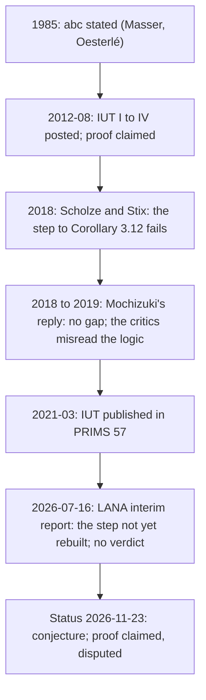

# The abc conjecture: when a plus b equals c, the radical of abc is rarely much smaller than c

[Syllabus](../../../SYLLABUS.md) → [Frontier](../README.md) → [Primes and Numbers](../README.md#s03) → The abc conjecture

---

## General Overview

Take the sum 2 + 6,436,341 = 6,436,343. Factor each number into primes: 2, then $`3^{10} \times 109`$, then $`23^5`$. Only four different primes appear: 2, 3, 23 and 109. Their product is 15,042, and the answer c is 427.8914 times that.

The product of the distinct primes is the **radical**, written rad. For most sums the radical is far above c: for 2 + 3 = 5 it is 30. The abc conjecture says a sum can beat its radical only by a small power. This triple beats it by the power 1.6299, the highest quality of any known triple: it heads the table of known examples kept on the abc conjecture home page.

The conjecture dates from 1985 (Masser and Oesterlé). In August 2012 Shinichi Mochizuki posted four papers, inter-universal Teichmüller theory (IUT), that claim a proof. In 2018 Peter Scholze and Jakob Stix wrote that the key step fails. The papers were published in 2021. In July 2026 a team led by Fumiharu Kato, trying to put the argument into a proof checker, reported that it could not yet rebuild that step. The team is only partly independent: it includes Yuichiro Hoshi, Mochizuki's colleague at his Kyoto institute.

The number-theory wing's card [The abc conjecture](../../21-Algebraic%20and%20analytic%20number%20theory/07-Diophantine%20and%20Modular/09-abc-conjecture-and-szpiro.md) states abc, works 1 + 8 = 9 and proves what abc would imply. This card measures triples by their quality, reads the ε and the constant as numbers, and records where the claimed proof stands.

**For coprime a + b = c, the quality log c / log rad(abc) exceeds 1 + ε for only finitely many triples, for every ε > 0; a proof was claimed in 2012 and is still disputed.**

**What kind of fact this is:** a conjecture. Status as of 2026-11-23: claimed and disputed. A proof is claimed in refereed papers (published 2021-03), but a written objection (2018) is, in the critics' view, unresolved, and no independent check has rebuilt the disputed step. On this card two things are proved: that the quality form and the constant form of abc say the same thing, and that a Fermat solution with exponent n has quality above n/3. Every search count is evidence only.

### The picture: the route of the claimed proof



Each box is a dated primary source, listed under Sources or named in those sources. No box upgrades a claim beyond its source.

---

## The formula

Notation first, in words. The **radical** $`\mathrm{rad}(n)`$ is the product of the distinct primes dividing n, each taken once ([The abc conjecture](../../21-Algebraic%20and%20analytic%20number%20theory/07-Diophantine%20and%20Modular/09-abc-conjecture-and-szpiro.md)). This card introduces the **quality** $`q`$ of a triple: the power to which the radical must be raised to reach c. Here log is the natural logarithm.

```math
q(a, b, c) = \frac{\log c}{\log \mathrm{rad}(abc)}
```

**Read it aloud:** the quality is the log of c divided by the log of the radical of a times b times c.

For the record triple, $`q = 15.6775 / 9.6186 = 1.6299`$. A triple with $`q > 1`$ is a **hit**: c beats its radical.

The conjecture, in quality form:

```math
\text{for every } \varepsilon > 0:\ \ \#\{(a, b, c) : a + b = c,\ \gcd(a, b) = 1,\ q(a, b, c) > 1 + \varepsilon\} < \infty
```

**Read it aloud:** for every positive ε, only finitely many coprime triples with a plus b equal to c have quality above one plus ε.

The same statement, in constant form:

```math
c < K_\varepsilon \, \mathrm{rad}(abc)^{1 + \varepsilon}
```

**Read it aloud:** for each ε there is a constant $`K_\varepsilon`$ such that c is always below that constant times the radical to the power one plus ε.

| Symbol | Plain meaning | In our example | Push it up and the answer… |
| --- | --- | --- | --- |
| $`a, b, c`$ | positive whole numbers with a + b = c and no common factor | 2, 6,436,341, 6,436,343 | larger c makes high quality rarer |
| $`\mathrm{rad}(n)`$ | product of the distinct primes dividing n | rad(abc) = 15,042 | a higher power of the same prime leaves it unchanged |
| $`q`$ | quality: log c over log rad(abc) | 1.6299 | above 1 means a hit |
| $`\varepsilon`$ | a positive margin above exponent 1 | 0.6, where K must be at least 1.3334 | fewer triples break the bound |
| $`K_\varepsilon`$ | the constant abc promises for that ε; no value is known | at least 427.8914 at ε = 0 | — |
| $`\#\{\ldots\}`$ | how many triples are in the set | 2 with c below 100,000 and q > 1.5 | — |
| $`R, \delta, M`$ | shorthand in the proof fold: rad(abc), a second margin, the largest ratio among the exceptions | R = 15,042 | — |
| $`K_0`$ | the unstated constant in the best proved bound | not given | — |
| $`x, y, z, n`$ | a supposed Fermat solution $`x^n + y^n = z^n`$ | none exists for n ≥ 3 | larger n needs higher quality |

### When it holds

- **No common factor.** Without it, 512 + 512 = 1024 has radical 2 and quality 10.0000, and doubling gives any quality wanted.
- **The radical, not the product.** With the product abc in the denominator the record's ratio is 0.4892, and the ratio is never above 1, so the statement says nothing.
- **The ε is needed.** At ε = 0 the family 1 + 8 = 9, 1 + 80 = 81, … has c/rad of 1.5000, 2.7000, 5.3341, 10.6667, 21.3333, roughly doubling, so no fixed constant works.
- **The constant is needed.** With ε = 0.2 and no constant, 1 + 8 = 9 already fails: $`6^{1.2} = 8.5858 < 9`$.
- **Finitely many is not none.** abc allows exceptions above 1 + ε; it gives no list and no size for $`K_\varepsilon`$.

---

## Why it works

abc is unproved, so this section proves what can be proved: what the quality means, why the two forms agree, and what abc would decide. Then it outlines the claimed proof and the objection, with sources. It checks neither.

### Step 0: the quality is an exponent

A number has a small radical only if it is built from high powers of few primes, like $`3^{10}`$ and $`23^5`$. Addition does not respect that structure, so a sum of two such numbers is rarely another. That is why hits are rare.

Logarithms turn "c beats the radical by a power" into a single number. If $`c = \mathrm{rad}(abc)^q`$, then $`q = \log c / \log \mathrm{rad}(abc)`$. The record has $`6{,}436{,}343 = 15{,}042^{1.6299}`$, to four decimals.

The check confirms this without logarithms. In exact whole numbers, $`15{,}042^{16299} < 6{,}436{,}343^{10000} < 15{,}042^{16300}`$, so the quality lies between 1.6299 and 1.6300.

### Step 1: the quality form and the constant form say the same thing

Each form follows from the other.

- **Constant form gives quality form.** Fix ε. A triple with quality above 1 + 2ε has $`c > \mathrm{rad}^{1 + 2\varepsilon}`$. With $`c < K_\varepsilon \mathrm{rad}^{1+\varepsilon}`$ this forces $`\mathrm{rad}^{\varepsilon} < K_\varepsilon`$. So the radical is bounded, then c is bounded, and only finitely many such triples exist.
- **Quality form gives constant form.** Fix ε. Only finitely many triples have quality above 1 + ε. Every other triple has $`c \le \mathrm{rad}^{1 + \varepsilon}`$. Take $`K_\varepsilon`$ larger than 1 and larger than c / rad^(1+ε) for each exception.

<details>
<summary>Detailed proof: the two forms are equivalent</summary>

Write R for rad(abc).

Suppose the constant form holds for every ε. Take any δ > 0 and set ε = δ/2. A triple with $`q > 1 + \delta`$ satisfies $`c > R^{1 + \delta}`$. Combined with $`c < K_\varepsilon R^{1+\varepsilon}`$:

$`\displaystyle R^{1+\delta} < K_\varepsilon R^{1 + \delta/2}, \quad\text{so}\quad R^{\delta/2} < K_\varepsilon.`$

So R is below $`K_\varepsilon^{2/\delta}`$, and c is below $`K_\varepsilon R^{1+\varepsilon}`$. Both are bounded, so only finitely many triples have quality above 1 + δ.

Suppose the quality form holds. Fix ε and list the finitely many triples with $`q > 1 + \varepsilon`$. Every other triple has $`c \le R^{1+\varepsilon}`$. Let M be the largest value of $`c / R^{1+\varepsilon}`$ over the list, or 1 if the list is empty. Then $`K_\varepsilon = M + 1`$ works for every triple.

</details>

### Step 2: the trade between ε and the constant

The proof in Step 1 shows the price. A smaller ε forces a larger constant. The check measures the smallest constant that the hits allow:

| ε | $`K_\varepsilon`$ must be at least | Set by |
| --- | ---: | --- |
| 0.0 | 427.8914 | the record |
| 0.2 | 62.4989 | the record |
| 0.4 | 9.1288 | the record |
| 0.6 | 1.3334 | the record |
| 0.7 | 0.5096 | the record |

These are lower limits from the hits below 100,000 plus the record. A larger search can only push them up. At ε = 0 they grow without bound, because of the family in "When it holds".

### Step 3: what abc would decide

The number-theory card proves the main consequences. In one line each:

- **Fermat for large exponents.** abc with ε < 1/3 leaves finitely many solutions of $`x^n + y^n = z^n`$ with n ≥ 4, all exponents together ([The abc conjecture](../../21-Algebraic%20and%20analytic%20number%20theory/07-Diophantine%20and%20Modular/09-abc-conjecture-and-szpiro.md)).
- **Szpiro's conjecture.** abc implies Szpiro's inequality between an elliptic curve's minimal discriminant and its conductor, and Szpiro implies abc with exponent 3/2 + ε, through the Frey curve (same card: the first direction stated with sources, the second proved).
- **Beal.** abc allows only finitely many coprime counterexamples, not none ([Beal's conjecture](05-beal-conjecture.md)).

The quality gives a sharper reading of the Fermat case. Put $`a = x^n`$, $`b = y^n`$, $`c = z^n`$. The radical ignores powers, so $`\mathrm{rad}(abc) \le xyz < z^3`$. Then

```math
q = \frac{\log z^n}{\log \mathrm{rad}(abc)} > \frac{n \log z}{3 \log z} = \frac{n}{3}
```

**Read it aloud:** a Fermat solution with exponent n would have quality above n over 3.

| Exponent n | Quality would exceed | Above the record 1.6299? |
| --- | ---: | --- |
| 4 | 1.3333 | no |
| 5 | 1.6667 | yes |
| 6 | 2.0000 | yes |

So a Fermat solution with n ≥ 5 would be a new record triple. Fermat's last theorem is proved anyway, without abc ([Fermat's last theorem, proved in 1995 and reported formalised in 2026](06-fermats-last-theorem-formalised.md)).

### Step 4: what is proved

The best proved bound is far weaker. Stewart and Yu (2001) proved, for coprime a + b = c:

```math
\log c < K_0 \, \mathrm{rad}(abc)^{1/3} (\log \mathrm{rad}(abc))^3
```

**Read it aloud:** the log of c is below a fixed constant times the cube root of the radical times the cube of its log.

abc asks for log c below about (1 + ε) log rad. On the record triple:

| Quantity | Value |
| --- | ---: |
| actual log c | 15.6775 |
| abc with ε = 0.7: (1 + ε) log rad, before log K | 16.3516 |
| proved shape $`\mathrm{rad}^{1/3} (\log \mathrm{rad})^3`$, before $`K_0`$ | 21967.0127 |

The proved bound allows c up to an exponential in the radical. abc wants a power. That gap is the whole problem.

### Step 5: the claimed proof, in outline

This is an outline of a research proof and of the objection to it. Nothing here was checked on this card.

- **Statement.** IUT claims an inequality of Vojta type (a bound on the height of a point on a curve, in terms of its conductor) for elliptic curves over number fields. Applied to Frey curves, it gives abc.
- **Key steps.** IUT builds many copies of the arithmetic of a number field, called Hodge theaters, and links them by the Θ-link. Theorem 3.11 of IUT III describes how certain quantities on one side can be computed from the other, up to stated indeterminacies (allowed error). Corollary 3.12 turns this into the needed inequality on log-volumes.
- **The objection.** Scholze and Stix (2018) argue that the copies must be identified with each other. Once they are, they say, the inequality of Corollary 3.12 does not follow. They write that small changes will not rescue the strategy.
- **The reply.** Mochizuki answered in a report in 2018 and later ones: in his view the identification is not permitted, and the critics misread the logical structure.
- **Other readings.** Others have offered reformulations of the argument, and those have drawn criticism of their own (LANA report, section 0). None is an accepted repair.
- **A partly independent attempt.** The LANA project (announced 2026-03-31; core members Commelin, Kedlaya, Hoshi, Topaz and Kato, the leader) aims at a formal proof in Lean. Its report says the aim was to be "somewhat independent from Mochizuki": Hoshi is his colleague at RIMS (the Research Institute for Mathematical Sciences, Kyoto) and took part in the 2018 discussions with Scholze and Stix. Its interim report (updated 2026-07-16) isolates one compatibility problem at the final stage. It "has not yet reconstructed a proof" of it and gives no verdict.

The status record, in the four audit fields:

| Field | Entry |
| --- | --- |
| Statement | abc as above: for every ε, finitely many triples of quality above 1 + ε |
| Artifact | IUT I to IV, Publications of RIMS 57 (2021), pages 3 to 723 |
| Independent check | none complete; LANA's formal check, only partly independent (Hoshi of RIMS is a core member), is under way and has reached no verdict |
| Status | claimed, disputed, as of 2026-11-23 |

---

## Worked numbers, by hand

| Step | Arithmetic | Value |
| --- | --- | --- |
| the triple | 2 + 3¹⁰ × 109 = 2 + 6,436,341 | 6,436,343 = 23⁵ |
| coprime? | 2 and 6,436,341 share no prime | yes |
| radical | 2 × 3 × 109 × 23 | 15,042 |
| c over rad | 6,436,343 / 15,042 | 427.8914 |
| logs | log c, log rad | 15.6775, 9.6186 |
| quality | 15.6775 / 9.6186 | **1.6299** |
| exact bracket | 15,042^16299 < c^10000 < 15,042^16300 | between 1.6299 and 1.6300 |

So c equals its radical to the power 1.6299. If abc holds with ε = 0.6, this one triple forces the constant to at least 1.3334.

The hits below 100,000, by quality:

```
  quality > 1.0  ############################################################  418
  quality > 1.1  ######################                                        152
  quality > 1.2  ########                                                       51
  quality > 1.3  ##                                                             13
  quality > 1.4  #                                                               6
  quality > 1.5  #                                                               2
  quality > 1.6                                                                  0
```

One # stands for 7 hits, rounded up. The top two are 1 + 4,374 = 4,375 (quality 1.5679) and 343 + 59,049 = 59,392 (quality 1.5471). The record lies far beyond 100,000. The check confirms its arithmetic, not its rank. The abc conjecture home page (updated 2026-03-04) ranks the record first among known triples, and these two fifth and sixth.

### What breaks if you drop a piece

| Mistake | Comes out at | What went wrong |
| --- | --- | --- |
| Drop the constant: c < rad^1.2 | 1 + 8 = 9 fails, since 6^1.2 = 8.5858 | Small triples need room; $`K_\varepsilon`$ supplies it |
| Drop the ε: c < K rad | c/rad = 1.5000, 2.7000, 5.3341, 10.6667, 21.3333 for 1 + 8 = 9, 1 + 80 = 81, … | The family $`3^{2^k}`$ beats every fixed K |
| Use the product, not the radical | log c / log(abc) = 0.4892 | The product always exceeds c, so the ratio is never above 1 |
| Allow a common factor | 512 + 512 = 1024: quality 10.0000 | Scaling by a prime power raises quality freely |

---

## Code, from first principles, and it actually runs

The code computes the record's quality two ways: by logarithms, and by exact whole-number powers that bracket it between 1.6299 and 1.6300 (Rust uses a small written-out big-number type). It finds every hit with c below 100,000 by a pruned search, which tries only those a whose radical is at most c / rad(c), and checks the list against brute force below 2,000. Radicals come from a sieve, checked against trial division up to 3,000. It then measures the smallest constant for each ε, the Fermat thresholds and every "what breaks" number. That is three independent cross-checks, and every count is evidence, not proof.

### Python

```python
# The abc conjecture, status card: the quality of a triple, the record 2 + 3^10*109 = 23^5,
# and what the epsilon and the constant mean.  Standard library only.  abc is open, so every
# count is evidence.  Roads: radical by sieve against trial division; hits by a pruned search
# against brute force; the record's quality by logarithms against exact integer powers.
from math import gcd, log

def rad_trial(n):                            # product of the distinct primes dividing n
    r, p = 1, 2
    while p * p <= n:
        if n % p == 0:
            r *= p
            while n % p == 0: n //= p
        p += 1
    return r * n if n > 1 else r

def rad_sieve(N):
    rad = [1] * (N + 1)
    for p in range(2, N + 1):
        if rad[p] == 1:                      # untouched so far: p is prime
            for m in range(p, N + 1, p): rad[m] *= p
    return rad

def q(a, b, c): return log(c) / log(rad_trial(a * b * c))

# ---- the record triple ----
a, b, c = 2, 3 ** 10 * 109, 23 ** 5
r = rad_trial(a * b * c)
print(f"record: 2 + 3^10*109 = 23^5:  {a} + {b:,} = {c:,}")
print(f"rad = 2*3*109*23 = {r:,}   log c = {log(c):.4f}   log rad = {log(r):.4f}   quality = {q(a, b, c):.4f}")
assert a + b == c and gcd(a, b) == 1 and r == 2 * 3 * 109 * 23   # trial division against the factorisation
assert r ** 16299 < c ** 10000 < r ** 16300  # exact: quality lies between 1.6299 and 1.6300
assert 1.6299 < q(a, b, c) < 1.6300           # the logarithm road lands inside the exact bracket
print("exact powers: rad^16299 < c^10000 < rad^16300, so 1.6299 < quality < 1.6300")
print(f"c / rad = {c / r:.4f}")
print(f"small example: 1 + 8 = 9  rad = {rad_trial(72)}  quality = {q(1, 8, 9):.4f}")

# ---- every hit with c below 100,000, by a pruned search ----
N = 100_000
rad = rad_sieve(N)
assert all(rad[m] == rad_trial(m) for m in range(1, 3001))
order = sorted(range(1, N + 1), key=lambda x: rad[x])
hits = []
for cc in range(3, N):
    bound = cc // rad[cc]                    # rad(a) * rad(b) must stay below c / rad(c)
    for aa in order:
        if rad[aa] > bound: break
        bb = cc - aa
        if aa < bb and gcd(aa, bb) == 1 and rad[aa] * rad[bb] * rad[cc] < cc:
            hits.append((aa, bb, cc))
brute = [(x, y - x, y) for y in range(3, 2000) for x in range(1, (y + 1) // 2)
         if gcd(x, y) == 1 and rad_trial(x * (y - x) * y) < y]
assert sorted(brute) == sorted(h for h in hits if h[2] < 2000)   # two roads, same list
print(f"\nhits (rad(abc) < c) with c below 2,000: pruned {sum(1 for h in hits if h[2] < 2000)}, brute force {len(brute)}")
quals = sorted(((log(z) / log(rad[x] * rad[y] * rad[z]), x, y, z) for x, y, z in hits), reverse=True)
print("quality ladder, c below 100,000 (the record lies beyond); one # per 7 hits, rounded up:")
for t in (1.0, 1.1, 1.2, 1.3, 1.4, 1.5, 1.6):
    n = sum(1 for v in quals if v[0] > t)
    print(f"  quality > {t:.1f}  {'#' * ((n + 6) // 7):<60}  {n:>3}")
print("top three, c below 100,000:")
for v, x, y, z in quals[:3]:
    print(f"  {x:,} + {y:,} = {z:,}   rad = {rad[x] * rad[y] * rad[z]:,}   quality = {v:.4f}")
assert quals[0][1:] == (1, 4374, 4375) and len(quals) == 418

# ---- what the constant K must be, for each epsilon, on what is known ----
print("\nsmallest K with c < K rad^(1+eps) on the hits below 100,000 plus the record")
pool = [(x, y, z, rad[x] * rad[y] * rad[z]) for x, y, z in hits] + [(a, b, c, r)]
for eps in (0.0, 0.2, 0.4, 0.6, 0.7):
    k, x, y, z = max((z / rr ** (1 + eps), x, y, z) for x, y, z, rr in pool)
    print(f"  eps = {eps:.1f}:  K at least {k:10.4f}   set by {x:,} + {y:,} = {z:,}")
    if eps == 0.7: assert k < 1                # no triple here reaches quality 1.7
    else: assert k > 1

# ---- what abc would buy: a Fermat solution x^n + y^n = z^n has quality above n/3 ----
print("\nFermat: rad(x^n y^n z^n) <= xyz < z^3, so quality > log z^n / log z^3 = n/3")
for n in (4, 5, 6):
    print(f"  n = {n}: quality above {n / 3:.4f}   beats the record: {n / 3 > q(a, b, c)}")

# ---- proved against conjectured, on the record (logarithms of c) ----
lr = log(r)
print("\nsize of log c on the record:")
print(f"  actual log c                         {log(c):12.4f}")
print(f"  abc, eps = 0.7: (1 + eps) log rad    {1.7 * lr:12.4f}   plus log K")
print(f"  proved shape rad^(1/3) (log rad)^3   {r ** (1 / 3) * lr ** 3:12.4f}   times an unstated K")

# ---- what breaks ----
print("\nwhat breaks")
print(f"no constant, eps = 0.2: 6^1.2 = {6 ** 1.2:.4f} < 9, so c < rad^1.2 fails at 1 + 8 = 9")
assert 6 ** 6 < 9 ** 5                         # exact: 6^1.2 < 9
fam = [(3 ** 2 ** k, rad_trial(3 ** 2 ** k - 1) * 3) for k in range(1, 6)]
print("eps = 0, family 1 + (3^(2^k) - 1) = 3^(2^k):  c/rad =", ", ".join(f"{z / w:.4f}" for z, w in fam))
assert all(z1 * w2 < z2 * w1 for (z1, w1), (z2, w2) in zip(fam, fam[1:]))  # exact: c/rad grows
print(f"product, not radical: log c / log(abc) = {log(c) / log(a * b * c):.4f}")
print(f"common factor: 512 + 512 = 1024  quality = {log(1024) / log(rad_trial(512 * 512 * 1024)):.4f}")
assert rad_trial(512 * 512 * 1024) == 2

print("\ntry changing")
print(f"hits with c below 10,000: {sum(1 for h in hits if h[2] < 10_000)}")
print(f"eps = 0.65: K at least {c / r ** 1.65:.4f}")
print(f"3 + 125 = 128: quality = {q(3, 125, 128):.4f}")
print(f"Fermat n = 7: quality above {7 / 3:.4f}")
print("ALL CHECKS PASS")
```

**Ran 2026-11-23 on macOS, Python 3.14.10, standard library only. All checks passed. Output, pasted from the run:**

```
record: 2 + 3^10*109 = 23^5:  2 + 6,436,341 = 6,436,343
rad = 2*3*109*23 = 15,042   log c = 15.6775   log rad = 9.6186   quality = 1.6299
exact powers: rad^16299 < c^10000 < rad^16300, so 1.6299 < quality < 1.6300
c / rad = 427.8914
small example: 1 + 8 = 9  rad = 6  quality = 1.2263

hits (rad(abc) < c) with c below 2,000: pruned 40, brute force 40
quality ladder, c below 100,000 (the record lies beyond); one # per 7 hits, rounded up:
  quality > 1.0  ############################################################  418
  quality > 1.1  ######################                                        152
  quality > 1.2  ########                                                       51
  quality > 1.3  ##                                                             13
  quality > 1.4  #                                                               6
  quality > 1.5  #                                                               2
  quality > 1.6                                                                  0
top three, c below 100,000:
  1 + 4,374 = 4,375   rad = 210   quality = 1.5679
  343 + 59,049 = 59,392   rad = 1,218   quality = 1.5471
  37 + 32,768 = 32,805   rad = 1,110   quality = 1.4829

smallest K with c < K rad^(1+eps) on the hits below 100,000 plus the record
  eps = 0.0:  K at least   427.8914   set by 2 + 6,436,341 = 6,436,343
  eps = 0.2:  K at least    62.4989   set by 2 + 6,436,341 = 6,436,343
  eps = 0.4:  K at least     9.1288   set by 2 + 6,436,341 = 6,436,343
  eps = 0.6:  K at least     1.3334   set by 2 + 6,436,341 = 6,436,343
  eps = 0.7:  K at least     0.5096   set by 2 + 6,436,341 = 6,436,343

Fermat: rad(x^n y^n z^n) <= xyz < z^3, so quality > log z^n / log z^3 = n/3
  n = 4: quality above 1.3333   beats the record: False
  n = 5: quality above 1.6667   beats the record: True
  n = 6: quality above 2.0000   beats the record: True

size of log c on the record:
  actual log c                              15.6775
  abc, eps = 0.7: (1 + eps) log rad         16.3516   plus log K
  proved shape rad^(1/3) (log rad)^3     21967.0127   times an unstated K

what breaks
no constant, eps = 0.2: 6^1.2 = 8.5858 < 9, so c < rad^1.2 fails at 1 + 8 = 9
eps = 0, family 1 + (3^(2^k) - 1) = 3^(2^k):  c/rad = 1.5000, 2.7000, 5.3341, 10.6667, 21.3333
product, not radical: log c / log(abc) = 0.4892
common factor: 512 + 512 = 1024  quality = 10.0000

try changing
hits with c below 10,000: 120
eps = 0.65: K at least 0.8243
3 + 125 = 128: quality = 1.4266
Fermat n = 7: quality above 2.3333
ALL CHECKS PASS
```

### Rust

Same numbers, same labels, built with `rustc --edition 2021 -O`.

```rust
// The abc conjecture, status card: the quality of a triple, the record 2 + 3^10*109 = 23^5,
// and what the epsilon and the constant mean.  Rust std only, no crates.  abc is open, so every
// count is evidence.  Roads: radical by sieve against trial division; hits by a pruned search
// against brute force; the record's quality by logarithms against exact integer powers.
fn gcd(a: u64, b: u64) -> u64 { if b == 0 { a } else { gcd(b, a % b) } }
fn rad_trial(mut n: u128) -> u128 { // product of the distinct primes dividing n
    let (mut r, mut p) = (1u128, 2u128);
    while p * p <= n {
        if n % p == 0 { r *= p; while n % p == 0 { n /= p; } }
        p += 1;
    }
    if n > 1 { r * n } else { r }
}
fn rad_sieve(n: usize) -> Vec<u64> {
    let mut rad = vec![1u64; n + 1];
    for p in 2..=n {
        if rad[p] == 1 { let mut m = p; while m <= n { rad[m] *= p as u64; m += p; } } // p is prime
    }
    rad
}
fn q(a: u128, b: u128, c: u128) -> f64 { (c as f64).ln() / (rad_trial(a * b * c) as f64).ln() }
fn commas(n: u64) -> String {
    let (s, mut out) = (n.to_string(), String::new());
    for (i, ch) in s.chars().enumerate() {
        if i > 0 && (s.len() - i) % 3 == 0 { out.push(','); }
        out.push(ch);
    }
    out
}
// a small bignum: little-endian base 2^32 limbs, enough for base^e and a comparison
fn big_pow(base: u64, e: u32) -> Vec<u32> {
    let mut x = vec![1u32];
    for _ in 0..e {
        let mut carry = 0u64;
        for limb in x.iter_mut() { let t = *limb as u64 * base + carry; *limb = t as u32; carry = t >> 32; }
        while carry > 0 { x.push(carry as u32); carry >>= 32; }
    }
    x
}
fn big_lt(a: &[u32], b: &[u32]) -> bool {
    if a.len() != b.len() { return a.len() < b.len(); }
    for i in (0..a.len()).rev() { if a[i] != b[i] { return a[i] < b[i]; } }
    false
}
fn tf(b: bool) -> &'static str { if b { "True" } else { "False" } }
fn main() {
    // ---- the record triple ----
    let (a, b, c) = (2u128, 3u128.pow(10) * 109, 23u128.pow(5));
    let r = rad_trial(a * b * c);
    println!("record: 2 + 3^10*109 = 23^5:  {} + {} = {}", a, commas(b as u64), commas(c as u64));
    println!("rad = 2*3*109*23 = {}   log c = {:.4}   log rad = {:.4}   quality = {:.4}",
             commas(r as u64), (c as f64).ln(), (r as f64).ln(), q(a, b, c));
    assert!(a + b == c && gcd(a as u64, b as u64) == 1 && r == 2 * 3 * 109 * 23); // trial division against the factorisation
    let cp = big_pow(c as u64, 10000);
    assert!(big_lt(&big_pow(r as u64, 16299), &cp) && big_lt(&cp, &big_pow(r as u64, 16300))); // exact bracket
    assert!(1.6299 < q(a, b, c) && q(a, b, c) < 1.6300); // the logarithm road lands inside the exact bracket
    println!("exact powers: rad^16299 < c^10000 < rad^16300, so 1.6299 < quality < 1.6300");
    println!("c / rad = {:.4}", c as f64 / r as f64);
    println!("small example: 1 + 8 = 9  rad = {}  quality = {:.4}", rad_trial(72), q(1, 8, 9));

    // ---- every hit with c below 100,000, by a pruned search ----
    let n = 100_000usize;
    let rad = rad_sieve(n);
    assert!((1..3001).all(|m| rad[m] as u128 == rad_trial(m as u128)));
    let mut order: Vec<usize> = (1..=n).collect();
    order.sort_by_key(|&x| rad[x]);
    let mut hits: Vec<(u64, u64, u64)> = Vec::new();
    for cc in 3..n {
        let bound = cc as u64 / rad[cc]; // rad(a) * rad(b) must stay below c / rad(c)
        for &aa in &order {
            if rad[aa] > bound { break; }
            if aa >= cc { continue; }
            let bb = cc - aa;
            if aa < bb && gcd(aa as u64, bb as u64) == 1 && rad[aa] * rad[bb] * rad[cc] < cc as u64 {
                hits.push((aa as u64, bb as u64, cc as u64));
            }
        }
    }
    let mut brute = Vec::new();
    for y in 3u64..2000 { for x in 1..(y + 1) / 2 {
        if gcd(x, y) == 1 && rad_trial((x * (y - x) * y) as u128) < y as u128 { brute.push((x, y - x, y)); }
    } }
    let mut small: Vec<_> = hits.iter().cloned().filter(|h| h.2 < 2000).collect();
    small.sort(); brute.sort();
    assert!(small == brute); // two roads, same list
    println!("\nhits (rad(abc) < c) with c below 2,000: pruned {}, brute force {}", small.len(), brute.len());
    let rr = |x: u64| rad[x as usize];
    let mut quals: Vec<(f64, u64, u64, u64)> = hits.iter()
        .map(|&(x, y, z)| ((z as f64).ln() / ((rr(x) * rr(y) * rr(z)) as f64).ln(), x, y, z)).collect();
    quals.sort_by(|p, s| s.partial_cmp(p).unwrap());
    println!("quality ladder, c below 100,000 (the record lies beyond); one # per 7 hits, rounded up:");
    for t in [1.0, 1.1, 1.2, 1.3, 1.4, 1.5, 1.6] {
        let k = quals.iter().filter(|v| v.0 > t).count();
        println!("  quality > {:.1}  {:<60}  {:>3}", t, "#".repeat((k + 6) / 7), k);
    }
    println!("top three, c below 100,000:");
    for &(v, x, y, z) in &quals[..3] {
        println!("  {} + {} = {}   rad = {}   quality = {:.4}", commas(x), commas(y), commas(z), commas(rr(x) * rr(y) * rr(z)), v);
    }
    assert!((quals[0].1, quals[0].2, quals[0].3) == (1, 4374, 4375) && quals.len() == 418);

    // ---- what the constant K must be, for each epsilon, on what is known ----
    println!("\nsmallest K with c < K rad^(1+eps) on the hits below 100,000 plus the record");
    let mut pool: Vec<(u64, u64, u64, u64)> = hits.iter().map(|&(x, y, z)| (x, y, z, rr(x) * rr(y) * rr(z))).collect();
    pool.push((a as u64, b as u64, c as u64, r as u64));
    for eps in [0.0f64, 0.2, 0.4, 0.6, 0.7] {
        let mut best = (f64::MIN, 0, 0, 0);
        for &(x, y, z, w) in &pool {
            let k = z as f64 / (w as f64).powf(1.0 + eps);
            if k > best.0 { best = (k, x, y, z); }
        }
        println!("  eps = {:.1}:  K at least {:10.4}   set by {} + {} = {}", eps, best.0, commas(best.1), commas(best.2), commas(best.3));
        if eps == 0.7 { assert!(best.0 < 1.0); } else { assert!(best.0 > 1.0); } // no triple here reaches 1.7
    }

    // ---- what abc would buy: a Fermat solution x^n + y^n = z^n has quality above n/3 ----
    println!("\nFermat: rad(x^n y^n z^n) <= xyz < z^3, so quality > log z^n / log z^3 = n/3");
    for k in [4.0f64, 5.0, 6.0] {
        println!("  n = {}: quality above {:.4}   beats the record: {}", k, k / 3.0, tf(k / 3.0 > q(a, b, c)));
    }

    // ---- proved against conjectured, on the record (logarithms of c) ----
    let lr = (r as f64).ln();
    println!("\nsize of log c on the record:");
    println!("  actual log c                         {:12.4}", (c as f64).ln());
    println!("  abc, eps = 0.7: (1 + eps) log rad    {:12.4}   plus log K", 1.7 * lr);
    println!("  proved shape rad^(1/3) (log rad)^3   {:12.4}   times an unstated K", (r as f64).powf(1.0 / 3.0) * lr.powi(3));

    // ---- what breaks ----
    println!("\nwhat breaks");
    println!("no constant, eps = 0.2: 6^1.2 = {:.4} < 9, so c < rad^1.2 fails at 1 + 8 = 9", 6f64.powf(1.2));
    assert!(6u64.pow(6) < 9u64.pow(5)); // exact: 6^1.2 < 9
    let fam: Vec<(u128, u128)> = (1..6u32).map(|k| (3u128.pow(1 << k), rad_trial(3u128.pow(1 << k) - 1) * 3)).collect();
    let s: Vec<String> = fam.iter().map(|&(z, w)| format!("{:.4}", z as f64 / w as f64)).collect();
    println!("eps = 0, family 1 + (3^(2^k) - 1) = 3^(2^k):  c/rad = {}", s.join(", "));
    assert!(fam.windows(2).all(|p| p[0].0 * p[1].1 < p[1].0 * p[0].1)); // exact: c/rad grows
    println!("product, not radical: log c / log(abc) = {:.4}", (c as f64).ln() / ((a * b * c) as f64).ln());
    println!("common factor: 512 + 512 = 1024  quality = {:.4}", 1024f64.ln() / (rad_trial(512 * 512 * 1024) as f64).ln());
    assert!(rad_trial(512 * 512 * 1024) == 2);

    println!("\ntry changing");
    println!("hits with c below 10,000: {}", hits.iter().filter(|h| h.2 < 10_000).count());
    println!("eps = 0.65: K at least {:.4}", c as f64 / (r as f64).powf(1.65));
    println!("3 + 125 = 128: quality = {:.4}", q(3, 125, 128));
    println!("Fermat n = 7: quality above {:.4}", 7.0 / 3.0);
    println!("ALL CHECKS PASS");
}
```

**Ran 2026-11-23 on macOS, rustc 1.98.1, no crates. All checks passed. Output, pasted from the run:**

```
record: 2 + 3^10*109 = 23^5:  2 + 6,436,341 = 6,436,343
rad = 2*3*109*23 = 15,042   log c = 15.6775   log rad = 9.6186   quality = 1.6299
exact powers: rad^16299 < c^10000 < rad^16300, so 1.6299 < quality < 1.6300
c / rad = 427.8914
small example: 1 + 8 = 9  rad = 6  quality = 1.2263

hits (rad(abc) < c) with c below 2,000: pruned 40, brute force 40
quality ladder, c below 100,000 (the record lies beyond); one # per 7 hits, rounded up:
  quality > 1.0  ############################################################  418
  quality > 1.1  ######################                                        152
  quality > 1.2  ########                                                       51
  quality > 1.3  ##                                                             13
  quality > 1.4  #                                                               6
  quality > 1.5  #                                                               2
  quality > 1.6                                                                  0
top three, c below 100,000:
  1 + 4,374 = 4,375   rad = 210   quality = 1.5679
  343 + 59,049 = 59,392   rad = 1,218   quality = 1.5471
  37 + 32,768 = 32,805   rad = 1,110   quality = 1.4829

smallest K with c < K rad^(1+eps) on the hits below 100,000 plus the record
  eps = 0.0:  K at least   427.8914   set by 2 + 6,436,341 = 6,436,343
  eps = 0.2:  K at least    62.4989   set by 2 + 6,436,341 = 6,436,343
  eps = 0.4:  K at least     9.1288   set by 2 + 6,436,341 = 6,436,343
  eps = 0.6:  K at least     1.3334   set by 2 + 6,436,341 = 6,436,343
  eps = 0.7:  K at least     0.5096   set by 2 + 6,436,341 = 6,436,343

Fermat: rad(x^n y^n z^n) <= xyz < z^3, so quality > log z^n / log z^3 = n/3
  n = 4: quality above 1.3333   beats the record: False
  n = 5: quality above 1.6667   beats the record: True
  n = 6: quality above 2.0000   beats the record: True

size of log c on the record:
  actual log c                              15.6775
  abc, eps = 0.7: (1 + eps) log rad         16.3516   plus log K
  proved shape rad^(1/3) (log rad)^3     21967.0127   times an unstated K

what breaks
no constant, eps = 0.2: 6^1.2 = 8.5858 < 9, so c < rad^1.2 fails at 1 + 8 = 9
eps = 0, family 1 + (3^(2^k) - 1) = 3^(2^k):  c/rad = 1.5000, 2.7000, 5.3341, 10.6667, 21.3333
product, not radical: log c / log(abc) = 0.4892
common factor: 512 + 512 = 1024  quality = 10.0000

try changing
hits with c below 10,000: 120
eps = 0.65: K at least 0.8243
3 + 125 = 128: quality = 1.4266
Fermat n = 7: quality above 2.3333
ALL CHECKS PASS
```

### Lean

Lean proves that abc's two forms agree and that a Fermat solution has quality above n/3. It also checks the whole-number examples exactly.

- The quality form and the constant form of abc say the same thing. Neither form is proved; only their equivalence is.
- Take x and y positive, n at least 1, and $`x^n + y^n = z^n`$. Then the triple $`x^n, y^n, z^n`$ has quality above n/3.
- The record 2 + 6,436,341 = 6,436,343 has no common factor, and its radical is 2 × 3 × 109 × 23 = 15,042.
- Take the record's c and radical as exact whole numbers. Then $`15{,}042^{16299} < 6{,}436{,}343^{10000} < 15{,}042^{16300}`$, so its quality lies between 1.6299 and 1.6300.
- For the record, c over rad lies between 427 and 428.
- Take 1 + 8 = 9, whose radical is 6. Then $`6^6 < 9^5`$, so c < rad^1.2 fails without a constant.
- 1 + 4,374 = 4,375 has radical 210, and 343 + 59,049 = 59,392 has radical 1,218. Both radicals are below c.
- Take the top hit 1 + 4,374 = 4,375. Then $`210^{15678} < 4{,}375^{10000} < 210^{15679}`$, so its quality lies between 1.5678 and 1.5679.
- In the family, 1 + 80 = 81 has radical 30, and 1 + 6,560 = 6,561 has radical 1,230.
- 512 + 512 = 1024 shares the factor 512, and its radical is 2.
- The Fermat threshold 4/3 lies below 1.6299, and 5/3 lies above 1.6300.

The search for hits below 100,000, the logarithms and the smallest constant for each ε are left to the Python and Rust checks.

```lean
-- The abc conjecture: the quality form and the constant form of abc say the same thing, a Fermat solution with exponent n has quality above n/3, and the card's whole-number examples are exact.
import Mathlib.RingTheory.Radical.NatInt
import Mathlib.Analysis.SpecialFunctions.Pow.Real
import Mathlib.Analysis.SpecialFunctions.Log.Basic
import Mathlib.Data.Set.Finite.Basic
import Mathlib.Tactic.Simproc.Factors
import Mathlib.Tactic.NormNum.GCD

open UniqueFactorizationMonoid

/-- The quality of a triple: log c divided by log rad(abc), where rad(n) is the product of
the distinct primes dividing n and log is the natural logarithm. -/
noncomputable def quality (a b c : ℕ) : ℝ :=
  Real.log c / Real.log ((radical (a * b * c) : ℕ) : ℝ)

/-- The abc conjecture in quality form (open; the card does not prove it): for every ε > 0,
only finitely many triples a + b = c of positive whole numbers with no common factor have
quality above 1 + ε. -/
def ABCQualityForm : Prop :=
  ∀ ε : ℝ, 0 < ε →
    {t : ℕ × ℕ × ℕ | 0 < t.1 ∧ 0 < t.2.1 ∧ t.1 + t.2.1 = t.2.2 ∧ Nat.Coprime t.1 t.2.1 ∧
      1 + ε < quality t.1 t.2.1 t.2.2}.Finite

/-- The abc conjecture in constant form (open; the card does not prove it): for every ε > 0
there is a constant K such that c < K · rad(abc)^(1 + ε) for every triple a + b = c of
positive whole numbers with no common factor. -/
def ABCConstantForm : Prop :=
  ∀ ε : ℝ, 0 < ε → ∃ K : ℝ, ∀ a b c : ℕ, 0 < a → 0 < b → a + b = c → Nat.Coprime a b →
    (c : ℝ) < K * ((radical (a * b * c) : ℕ) : ℝ) ^ (1 + ε)

/-- For a triple a + b = c of positive whole numbers, the radical of abc is at least 2. -/
lemma abc_two_le_radical (a b c : ℕ) (ha : 0 < a) (hb : 0 < b) (hab : a + b = c) :
    (2 : ℝ) ≤ ((radical (a * b * c) : ℕ) : ℝ) := by
  have h : 2 ≤ radical (a * b * c) := by
    rw [Nat.two_le_radical_iff]
    calc 2 ≤ c := by omega
      _ = 1 * 1 * c := by ring
      _ ≤ a * b * c := by gcongr <;> omega
  exact_mod_cast h

/-- Quality above 1 + ε means c is above rad(abc)^(1 + ε). -/
lemma abc_rpow_lt_of_quality (a b c : ℕ) (ha : 0 < a) (hb : 0 < b) (hab : a + b = c)
    (ε : ℝ) (hq : 1 + ε < quality a b c) :
    ((radical (a * b * c) : ℕ) : ℝ) ^ (1 + ε) < (c : ℝ) := by
  have hr2 := abc_two_le_radical a b c ha hb hab
  have hr0 : (0 : ℝ) < ((radical (a * b * c) : ℕ) : ℝ) := by linarith
  have hlogr : 0 < Real.log ((radical (a * b * c) : ℕ) : ℝ) := Real.log_pos (by linarith)
  have hc0 : (0 : ℝ) < (c : ℝ) := by exact_mod_cast (show 0 < c by omega)
  unfold quality at hq
  rw [lt_div_iff₀ hlogr, ← Real.log_rpow hr0] at hq
  exact (Real.log_lt_log_iff (by positivity) hc0).1 hq

/-- Quality at most 1 + ε means c is at most rad(abc)^(1 + ε). -/
lemma abc_le_rpow_of_quality (a b c : ℕ) (ha : 0 < a) (hb : 0 < b) (hab : a + b = c)
    (ε : ℝ) (hq : quality a b c ≤ 1 + ε) :
    (c : ℝ) ≤ ((radical (a * b * c) : ℕ) : ℝ) ^ (1 + ε) := by
  have hr2 := abc_two_le_radical a b c ha hb hab
  have hr0 : (0 : ℝ) < ((radical (a * b * c) : ℕ) : ℝ) := by linarith
  have hlogr : 0 < Real.log ((radical (a * b * c) : ℕ) : ℝ) := Real.log_pos (by linarith)
  have hc0 : (0 : ℝ) < (c : ℝ) := by exact_mod_cast (show 0 < c by omega)
  unfold quality at hq
  rw [div_le_iff₀ hlogr, ← Real.log_rpow hr0] at hq
  exact (Real.log_le_log_iff hc0 (by positivity)).1 hq

/-- If c < K · rad^(1 + ε/2) and c > rad^(1 + ε), then c < K · (K^(2/ε))^(1 + ε/2). -/
lemma abc_bound_of_constant (ε K r c : ℝ) (hε : 0 < ε) (hr : 1 ≤ r)
    (hcK : c < K * r ^ (1 + ε / 2)) (hq : r ^ (1 + ε) < c) :
    c < K * (K ^ (2 / ε)) ^ (1 + ε / 2) := by
  have hr0 : 0 < r := by linarith
  have hA : 0 < r ^ (1 + ε / 2) := Real.rpow_pos_of_pos hr0 _
  have hB : 0 < r ^ (ε / 2) := Real.rpow_pos_of_pos hr0 _
  have hsplit : r ^ (1 + ε) = r ^ (1 + ε / 2) * r ^ (ε / 2) := by
    rw [← Real.rpow_add hr0]; ring_nf
  have h1 : r ^ (1 + ε / 2) * r ^ (ε / 2) < K * r ^ (1 + ε / 2) := by
    rw [← hsplit]; linarith
  have hrK : r ^ (ε / 2) < K := by
    have : r ^ (1 + ε / 2) * r ^ (ε / 2) < r ^ (1 + ε / 2) * K := by linarith
    exact lt_of_mul_lt_mul_left this hA.le
  have hK0 : 0 < K := lt_trans hB hrK
  have hrB : r < K ^ (2 / ε) := by
    have h := Real.rpow_lt_rpow hB.le hrK (show 0 < 2 / ε by positivity)
    rwa [← Real.rpow_mul hr0.le, show ε / 2 * (2 / ε) = 1 by field_simp, Real.rpow_one] at h
  have hle : r ^ (1 + ε / 2) ≤ (K ^ (2 / ε)) ^ (1 + ε / 2) :=
    Real.rpow_le_rpow hr0.le hrB.le (by positivity)
  calc c < K * r ^ (1 + ε / 2) := hcK
    _ ≤ K * (K ^ (2 / ε)) ^ (1 + ε / 2) := by gcongr

/-- The two forms of abc say the same thing: "for every ε > 0, only finitely many coprime
triples a + b = c have quality log c / log rad(abc) above 1 + ε" holds exactly when "for
every ε > 0 there is a constant K with c < K · rad(abc)^(1 + ε) for every coprime triple"
holds. Neither form is proved; only their equivalence is. -/
theorem abc_quality_form_iff_constant_form : ABCQualityForm ↔ ABCConstantForm := by
  constructor
  · intro hQ ε hε
    have hS := hQ ε hε
    refine ⟨2 + ∑ t ∈ hS.toFinset, (t.2.2 : ℝ), ?_⟩
    intro a b c ha hb hab hcop
    have hr2 := abc_two_le_radical a b c ha hb hab
    have hR1 : (1 : ℝ) ≤ ((radical (a * b * c) : ℕ) : ℝ) ^ (1 + ε) :=
      Real.one_le_rpow (by linarith) (by linarith)
    have hsum0 : (0 : ℝ) ≤ ∑ t ∈ hS.toFinset, (t.2.2 : ℝ) :=
      Finset.sum_nonneg (fun t _ => Nat.cast_nonneg _)
    by_cases hq : 1 + ε < quality a b c
    · have hmem : (a, b, c) ∈ hS.toFinset := by
        rw [Set.Finite.mem_toFinset]
        exact ⟨ha, hb, hab, hcop, hq⟩
      have hcle : (c : ℝ) ≤ ∑ t ∈ hS.toFinset, (t.2.2 : ℝ) :=
        Finset.single_le_sum (f := fun t : ℕ × ℕ × ℕ => (t.2.2 : ℝ))
          (fun t _ => Nat.cast_nonneg _) hmem
      nlinarith
    · have hcle := abc_le_rpow_of_quality a b c ha hb hab ε (not_lt.1 hq)
      nlinarith
  · intro hC ε hε
    obtain ⟨K, hK⟩ := hC (ε / 2) (by positivity)
    set N : ℕ := ⌈K * (K ^ (2 / ε)) ^ (1 + ε / 2)⌉₊ with hN
    apply (Finset.range N ×ˢ Finset.range N ×ˢ Finset.range N).finite_toSet.subset
    rintro ⟨a, b, c⟩ ⟨ha, hb, hab, hcop, hq⟩
    simp only at ha hb hab hcop hq
    have hr2 := abc_two_le_radical a b c ha hb hab
    have hc : (c : ℝ) < K * (K ^ (2 / ε)) ^ (1 + ε / 2) :=
      abc_bound_of_constant ε K _ c hε (by linarith) (hK a b c ha hb hab hcop)
        (abc_rpow_lt_of_quality a b c ha hb hab ε hq)
    have hcN : c < N := Nat.lt_ceil.2 hc
    simp only [Finset.coe_product, Set.mem_prod, Finset.mem_coe, Finset.mem_range]
    omega

/-- What abc would decide for Fermat: if x^n + y^n = z^n with x, y positive and n ≥ 1, then
the triple (x^n, y^n, z^n) has quality above n/3, because rad(x^n y^n z^n) ≤ xyz < z^3. -/
theorem fermat_solution_quality_gt (x y z n : ℕ) (hx : 0 < x) (hy : 0 < y) (hn : 1 ≤ n)
    (h : x ^ n + y ^ n = z ^ n) : (n : ℝ) / 3 < quality (x ^ n) (y ^ n) (z ^ n) := by
  have hn0 : n ≠ 0 := by omega
  have hxn : 0 < x ^ n := pow_pos hx n
  have hyn : 0 < y ^ n := pow_pos hy n
  have hxz : x < z := by
    have : x ^ n < z ^ n := by omega
    exact (Nat.pow_lt_pow_iff_left hn0).1 this
  have hyz : y < z := by
    have : y ^ n < z ^ n := by omega
    exact (Nat.pow_lt_pow_iff_left hn0).1 this
  have hrad : radical (x ^ n * y ^ n * z ^ n) = radical (x * y * z) := by
    rw [← mul_pow, ← mul_pow, radical_pow _ hn0]
  have hz' : 0 < z := by omega
  have hxyz0 : x * y * z ≠ 0 := by positivity
  have hle : radical (x * y * z) ≤ x * y * z := Nat.radical_le_self_iff.2 hxyz0
  have hlt : x * y * z < z ^ 3 := by
    have h1 : x * y < z * z := Nat.mul_lt_mul'' hxz hyz
    have : x * y * z < z * z * z := Nat.mul_lt_mul_of_pos_right h1 (by omega)
    simpa [pow_succ, pow_zero, one_mul] using this
  have h2 : 2 ≤ radical (x * y * z) := by
    rw [Nat.two_le_radical_iff]
    have : 2 ≤ z := by omega
    calc 2 ≤ z := this
      _ = 1 * 1 * z := by ring
      _ ≤ x * y * z := by gcongr <;> omega
  unfold quality
  rw [hrad]
  set r := radical (x * y * z) with hr
  have hr1 : (1 : ℝ) < (r : ℝ) := by exact_mod_cast h2
  have hlogr : 0 < Real.log (r : ℝ) := Real.log_pos hr1
  have hz0 : (0 : ℝ) < (z : ℝ) := by exact_mod_cast (show 0 < z by omega)
  have hrz : (r : ℝ) < (z : ℝ) ^ 3 := by exact_mod_cast lt_of_le_of_lt hle hlt
  have hlog : Real.log (r : ℝ) < 3 * Real.log (z : ℝ) := by
    rw [show (3:ℝ) * Real.log (z:ℝ) = Real.log ((z:ℝ)^3) by rw [Real.log_pow]; norm_num]
    exact Real.log_lt_log (by positivity) hrz
  rw [lt_div_iff₀ hlogr]
  push_cast
  rw [Real.log_pow]
  have hnpos : (0 : ℝ) < n := by exact_mod_cast (show 0 < n by omega)
  nlinarith

-- The record triple 2 + 3^10 · 109 = 23^5: no common factor, rad(abc) = 2 · 3 · 109 · 23 = 15,042.
example : 3 ^ 10 * 109 = 6436341 ∧ 23 ^ 5 = 6436343 ∧ 2 + 3 ^ 10 * 109 = 23 ^ 5 ∧
    Nat.gcd 2 6436341 = 1 ∧ 2 * 3 * 109 * 23 = 15042 ∧
    radical (2 * (3 ^ 10 * 109) * 23 ^ 5 : ℕ) = 15042 := by
  rw [Nat.radical_eq_prod_primeFactors]; norm_num [Nat.primeFactors]
-- The exact bracket: 15,042^16299 < 6,436,343^10000 < 15,042^16300, so 1.6299 < quality < 1.6300.
example : 15042 ^ 16299 < 6436343 ^ 10000 ∧ 6436343 ^ 10000 < 15042 ^ 16300 := by
  decide +kernel
-- c over rad is between 427 and 428 (the card's 427.8914).
example : 427 * 15042 < 6436343 ∧ 6436343 < 428 * 15042 := by norm_num
-- 1 + 8 = 9: rad(1 · 8 · 9) = 6.
example : 1 + 8 = 9 ∧ radical (1 * 8 * 9 : ℕ) = 6 := by
  rw [Nat.radical_eq_prod_primeFactors]; norm_num [Nat.primeFactors]
-- The constant is needed: with ε = 0.2 and no constant, 1 + 8 = 9 fails, since 6^1.2 < 9
-- (in whole numbers, 6^6 = 46,656 < 9^5 = 59,049).
example : 6 ^ 6 < 9 ^ 5 := by norm_num
-- The top two hits below 100,000: 1 + 4,374 = 4,375 with radical 210, and
-- 343 + 59,049 = 59,392 with radical 1,218; both radicals are below c.
example : 1 + 4374 = 4375 ∧ radical (1 * 4374 * 4375 : ℕ) = 210 ∧ 210 < 4375 := by
  rw [Nat.radical_eq_prod_primeFactors]; norm_num [Nat.primeFactors]
example : 343 + 59049 = 59392 ∧ Nat.gcd 343 59049 = 1 ∧
    radical (343 * 59049 * 59392 : ℕ) = 1218 ∧ 1218 < 59392 := by
  rw [Nat.radical_eq_prod_primeFactors]; norm_num [Nat.primeFactors]
-- The top hit's quality in exact powers: 210^15678 < 4,375^10000 < 210^15679, so it rounds to 1.5679.
example : 210 ^ 15678 < 4375 ^ 10000 ∧ 4375 ^ 10000 < 210 ^ 15679 := by decide +kernel
-- The ε is needed: the family 1 + 8 = 9, 1 + 80 = 81, 1 + 6,560 = 6,561 has
-- c / rad = 9/6 = 1.5, 81/30 = 2.7 and 6,561/1,230 (≈ 5.3341).
example : radical (1 * 80 * 81 : ℕ) = 30 ∧ radical (1 * 6560 * 6561 : ℕ) = 1230 ∧
    (9 : ℚ) / 6 = 3 / 2 ∧ (81 : ℚ) / 30 = 27 / 10 := by
  simp only [Nat.radical_eq_prod_primeFactors]; norm_num [Nat.primeFactors]
-- A common factor breaks it: 512 + 512 = 1024 = 2^10 has radical 2, so quality 10.
example : 512 + 512 = 1024 ∧ Nat.gcd 512 512 = 512 ∧ 1024 = 2 ^ 10 ∧
    radical (512 * 512 * 1024 : ℕ) = 2 := by
  rw [Nat.radical_eq_prod_primeFactors]; norm_num [Nat.primeFactors]
-- Fermat thresholds n/3: 4/3 is below the record 1.6299, 5/3 is above 1.6300.
example : (4 : ℚ) / 3 < 16299 / 10000 ∧ (16300 : ℚ) / 10000 < 5 / 3 := by norm_num

#print axioms abc_two_le_radical
#print axioms abc_rpow_lt_of_quality
#print axioms abc_le_rpow_of_quality
#print axioms abc_bound_of_constant
#print axioms abc_quality_form_iff_constant_form
#print axioms fermat_solution_quality_gt
```

**Checked 2026-11-23 on macOS, Lean 4.36.0-rc2, Mathlib v4.36.0-rc2. Every proof is complete and uses only Lean's standard axioms. Output, pasted from the run:**

```
'abc_two_le_radical' depends on axioms: [propext, Classical.choice, Quot.sound]
'abc_rpow_lt_of_quality' depends on axioms: [propext, Classical.choice, Quot.sound]
'abc_le_rpow_of_quality' depends on axioms: [propext, Classical.choice, Quot.sound]
'abc_bound_of_constant' depends on axioms: [propext, Classical.choice, Quot.sound]
'abc_quality_form_iff_constant_form' depends on axioms: [propext, Classical.choice, Quot.sound]
'fermat_solution_quality_gt' depends on axioms: [propext, Classical.choice, Quot.sound]
```

> [!TIP]
> **Try changing**
> - Guess first: how many hits lie below 10,000? Change the filter `h[2] < 2000` to `h[2] < 10_000`. Answer: 120, against 418 below 100,000.
> - Guess first: at ε = 0.65, does the record still force K above 1? Compute `c / r ** 1.65`. Answer: no, K at least 0.8243.
> - Guess first: what quality has 3 + 125 = 128? Call `q(3, 125, 128)`. Answer: 1.4266, one of the 6 hits below 100,000 with quality above 1.4.
> - Guess first: what quality would a Fermat solution with n = 7 need? Add 7 to the exponent loop. Answer: above 2.3333, where no triple is known.

---

## The usual mistake

> [!warning]
> **Treating publication as proof, or the dispute as a disproof.** IUT is refereed and published (2021), yet the objection to Corollary 3.12 was not resolved, in the critics' view, and no independent check has rebuilt that step as of 2026-11-23. Nor has anyone shown abc false. The honest status is claimed and disputed.
>
> - **Reading the record as a bound.** No triple below 100,000 has quality above 1.6, and the record is 1.6299. Neither number is proved to be a ceiling.
> - **Dropping the constant.** c < rad^1.2 fails already at 1 + 8 = 9, since 6^1.2 = 8.5858.
> - **Dropping the ε.** At ε = 0 the record alone needs K of at least 427.8914, and the family $`3^{2^k}`$ pushes it higher without end.
> - **Confusing quality above 1 with a counterexample.** abc permits every hit, 418 below 100,000; only infinitely many above 1 + ε would refute it.

---

## Where you meet it in real life

- **Search projects.** Volunteer computing projects have listed hits far beyond 100,000, ranked by quality as the check ranks them.
- **Polynomials.** The Mason–Stothers theorem is abc for polynomials, and it is proved: for coprime polynomials a + b = c, not all constant, the largest degree is below the number of distinct roots of abc.
- **Proof checkers.** The LANA project tests whether a disputed research proof can be settled by a formal proof assistant (a program that checks every logical step).
- **Elliptic curve tables.** Published tables list each curve's minimal discriminant and conductor, the two numbers Szpiro's conjecture compares.

> **Say it back**
> The quality of a coprime triple a + b = c is log c over the log of the radical of abc. The record, 2 + 3¹⁰ × 109 = 23⁵, has quality 1.6299. abc says only finitely many triples exceed quality 1 + ε, which is the same as c < K rad^(1+ε). A proof was claimed in 2012 and published in 2021, but Scholze and Stix's 2018 objection is unresolved and a partly independent formal check has not rebuilt the disputed step. As of 2026-11-23 abc is a conjecture with a disputed claimed proof.

---

## What this builds on

- [The abc conjecture](../../21-Algebraic%20and%20analytic%20number%20theory/07-Diophantine%20and%20Modular/09-abc-conjecture-and-szpiro.md): the radical, the example 1 + 8 = 9, the family that shows the ε is needed, the proofs that abc implies Fermat for large exponents and Catalan, and the link with Szpiro's conjecture.

## Where this goes next

- [Beal's conjecture](05-beal-conjecture.md): the next card; abc leaves finitely many coprime counterexamples, and Beal asks for none.
- [Fermat's last theorem, proved in 1995 and reported formalised in 2026](06-fermats-last-theorem-formalised.md): the theorem abc would bound for n ≥ 4, proved another way, and what a formal proof adds.
- [Erdos problems](07-erdos-problems-selected.md): more open questions about integers where a computer search can test small cases.
- Sibling cards on the same shelf: [Twin primes](01-twin-primes-and-bounded-gaps.md), [Goldbach](02-goldbach-conjecture.md) and [Landau's four problems](03-landau-problems.md), each a prime question with its own dated status.
- [Schanuel's conjecture](08-schanuels-conjecture.md): one statement that would settle almost every open question about transcendental numbers.

The question this card leaves open: is there any triple at all of quality 2 or more?

---

## Sources

Verified 2026-11-23: every link below resolves to the publisher's page.

- Mochizuki, Shinichi. "Inter-universal Teichmüller Theory IV: Log-Volume Computations and Set-Theoretic Foundations." *Publications of the Research Institute for Mathematical Sciences* 57 (2021): 627–723. [doi:10.4171/PRIMS/57-1-4](https://doi.org/10.4171/PRIMS/57-1-4). The last of the four published papers that claim abc.
- Scholze, Peter, and Jakob Stix. "Why abc is still a conjecture." Manuscript, 2018. [PDF at the University of Bonn](https://www.math.uni-bonn.de/people/scholze/WhyABCisStillaConjecture.pdf). The objection to the step from Theorem 3.11 to Corollary 3.12, and the 1985 origin of abc.
- Nitaj, Abderrahmane. "The abc conjecture home page." Last updated 2026-03-04. [Université de Caen](https://nitaj.users.lmno.cnrs.fr/abc.html). The table of known triples by quality, with the record 1.62991 first, the proved bounds, and the Mason–Stothers theorem.
- LANA Project. "Project LANA Interim Report on IUT Theory." Last updated 2026-07-16. [PDF](https://ncatlab.org/nlab/files/LANAProject-Report-July2026.pdf). The formalisation attempt, its members and its history from 2023, and the one step it has not rebuilt.
- Stewart, C. L., and Kunrui Yu. "On the abc conjecture, II." *Duke Mathematical Journal* 108 (2001): 169–181. [doi:10.1215/S0012-7094-01-10815-6](https://doi.org/10.1215/S0012-7094-01-10815-6). The best proved bound, exponential in the radical.
