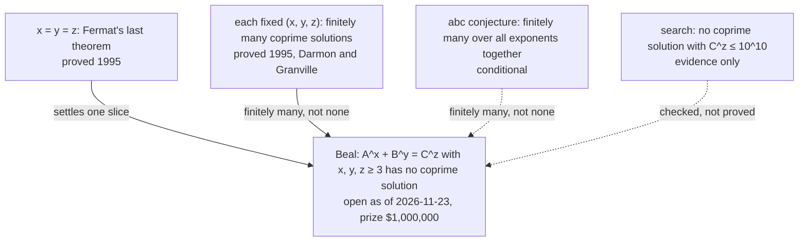

# Beal's conjecture: A to the x plus B to the y equals C to the z with exponents above 2 forces a common factor

[Syllabus](../../../SYLLABUS.md) → [Frontier](../README.md) → [Primes and Numbers](../README.md#s03) → Beal's conjecture

---

## General Overview

Add 27 and 216. The answer is 243. All three numbers are perfect powers: 27 is 3 cubed, 216 is 6 cubed, and 243 is 3 to the fifth. So a cube plus a cube makes a fifth power.

Fermat's last theorem says a cube plus a cube is never a cube. Change one exponent, and solutions appear. But look at the bases 3, 6 and 3. All three are multiples of 3. That shared prime is the whole story of this card.

In 1993 Andrew Beal, a Dallas banker with an interest in number theory, found ways to build solutions of this kind. Every way he found needed a prime shared by all three bases. He guessed that this is forced, and tested the guess by computer in August 1993. The American Mathematical Society (AMS) now holds a prize of $1,000,000 for a proof or a counterexample.

**If a power plus a power equals a power, with all three exponents 3 or more, then the three bases share a prime factor.**

**What kind of fact this is:** a conjecture, open as of 2026-11-23: there is no accepted proof or counterexample, and the AMS prize pages name no winner. Proved on this card: solutions with a shared prime come in infinite families; the case of three equal exponents is exactly Fermat's last theorem; and the exponent 2 must be excluded. The search on this card is evidence only.

### The picture: what is proved around the conjecture



Solid arrows are proved results that cover part of the question. Dotted arrows are a conditional result and a search. The search is this card's own; the card cites no published search bound.

---

## The formula

Notation first, in words. A, B and C are the **bases**, positive whole numbers. The letters x, y and z are the **exponents**, also positive whole numbers. The **greatest common divisor**, written gcd, is the largest whole number that divides all the numbers in the brackets. Two or more numbers are **coprime** when their gcd is 1, so no prime divides them all.

```math
A^x + B^y = C^z,\quad x, y, z \ge 3 \ \Longrightarrow\ \gcd(A, B, C) > 1
```

**Read it aloud:** if a power plus a power equals a power, and all three exponents are at least 3, then some prime divides all three bases.

The same statement, turned round: the equation has no solution with A, B and C coprime and all exponents at least 3. In our example, gcd(3, 6, 3) = 3, and the prime is 3.

| Symbol | Plain meaning | In our example | Push it up and the answer… |
| --- | --- | --- | --- |
| $`A, B, C`$ | the bases: positive whole numbers | 3, 6 and 3 | bigger bases make powers rarer |
| $`x, y, z`$ | the exponents, each 3 or more | 3, 3 and 5 | bigger exponents leave fewer solutions |
| $`\gcd`$ | greatest common divisor: the largest number dividing all of them | gcd(3, 6, 3) = 3; gcd(27, 216, 243) = 27 | 1 would be a counterexample |
| $`p`$ | a prime that divides all three bases | 3 | — |
| $`n`$ | one exponent shared by all three terms: Fermat's case | none in the search | — |
| $`k`$ | index of the family built from 1 + 8 = 9 | 1 gives the example | the family has no end |
| $`a, b`$ | the seeds of the second family | 1 and 2 | any positive whole numbers work |
| $`m`$ | the common exponent of the second family | 3 | any m of 3 or more works |
| $`s`$ | the seeds' power sum, $`s = a^m + b^m`$ | 9 | — |
| $`N`$ | the search bound on $`C^z`$ | $`10^{10}`$ | the search finds more, still all with a shared prime |

### When it holds

- **All three exponents at least 3.** Allow one exponent of 2, and coprime solutions exist: $`2^5 + 7^2 = 3^4`$, that is 32 + 49 = 81, with gcd 1. Allow all three to be 2, and $`3^2 + 4^2 = 5^2`$ is one of infinitely many.
- **Positive whole numbers.** The conjecture is about positive bases and exponents. A base of 1 gives no counterexample: $`1 + B^y = C^z`$ would put two perfect powers 1 apart. Catalan's conjecture, proved by Mihăilescu in 2002 and published in 2004, says the only such pair is 8 and 9, and $`9 = 3^2`$ has exponent 2.
- **A shared prime, not "no solution".** The conclusion is weaker than Fermat's. Solutions with a shared prime exist in infinite families (Why it works, Step 1). A statement that no solutions exist at all is false.
- **Any exponents, together.** For one fixed set of exponents the coprime solutions are known to be finite in number. Beal claims there are none, for every set at once. That is the open part.

---

## Why it works

Beal's conjecture is unproved, so this section does three jobs. It shows why shared-prime solutions are everywhere. It shows how the conjecture contains Fermat's last theorem. It shows what is proved and what is not.

### Step 0: a shared factor lets any sum be dressed up as powers

Take any true sum, such as 1 + 8 = 9. Multiply both sides by one well-chosen number. The sum stays true. If the multiplier carries the right powers of the primes in the sum, every term becomes a high power.

Our example works this way. Multiply 1 + 8 = 9 by $`27 = 3^3`$:

```math
27 \cdot 1 + 27 \cdot 8 = 27 \cdot 9 \quad\Longleftrightarrow\quad 3^3 + 6^3 = 3^5
```

So the example is the sum 1 + 8 = 9 in disguise. The disguise costs a common factor, 27, which is exactly what the conjecture says every solution pays.

### Step 1: two infinite families with a shared prime

Multiply 1 + 8 = 9 by $`3^{3k}`$ instead, for any k of 1 or more. The first term is $`(3^k)^3`$, the second $`(2 \cdot 3^k)^3`$, and the third $`9 \cdot 3^{3k} = 3^{3k+2}`$:

```math
(3^k)^3 + (2 \cdot 3^k)^3 = 3^{3k+2}
```

For k = 1 this is our example. For k = 2 it is $`9^3 + 18^3 = 3^8 = 6{,}561`$.

A second family works for any seeds a and b and any exponent m of 3 or more. Put $`s = a^m + b^m`$. Then:

```math
(a s)^m + (b s)^m = s^m (a^m + b^m) = s^m \cdot s = s^{m+1}
```

With a = 1, b = 2 and m = 3, s is 9, and this gives $`9^3 + 18^3 = 9^4`$. Every member has the factor s in all three bases. The check confirms 64 members of this family in whole numbers.

So shared-prime solutions are cheap and endless. Beal's conjecture says they are the only kind.

### Step 2: a prime in two of the bases is in all three

Suppose a prime p divides A and B. Then p divides $`A^x + B^y`$, which is $`C^z`$. A prime that divides a product divides one of its factors, so p divides C.

The same argument works for any two of the three. So "the three bases share a prime" means the same as "some two of them share a prime". Coprime here means gcd(A, B) = 1. The check counts coprime solutions both ways and gets the same answer.

### Step 3: equal exponents give exactly Fermat's last theorem

Set all three exponents equal to one number n of 3 or more. A solution is $`A^n + B^n = C^n`$.

If the bases share a prime p, divide every term by $`p^n`$. Each base is a multiple of p, so $`A^n / p^n = (A/p)^n`$ is still an nth power, and likewise for B and C. This gives a smaller solution. Repeat until no prime is shared. The result is a coprime solution of Fermat's equation.

[Fermat's last theorem](../../21-Algebraic%20and%20analytic%20number%20theory/07-Diophantine%20and%20Modular/04-fermats-last-theorem-history-and-descent.md) says there is none, so there was no solution at all. That theorem was proved in 1995. So Beal's conjecture with equal exponents is true, and it says the same as Fermat.

With unequal exponents the division fails. Divide our example by $`3^3`$:

```math
\frac{3^3}{3^3} + \frac{6^3}{3^3} = \frac{3^5}{3^3} \quad\Longrightarrow\quad 1 + 2^3 = 3^2
```

The last exponent falls from 5 to 2, below Beal's limit. The common factor cannot be removed, because it sits under three different exponents. That is why Beal is a separate question from Fermat.

### Step 4: why the exponents must be above 2

The size of $`1/x + 1/y + 1/z`$ sorts the equations into three kinds. Darmon and Granville worked this out in 1995.

| Value of $`1/x + 1/y + 1/z`$ | Examples | Coprime solutions |
| --- | --- | --- |
| above 1 | for example (2, 2, z) or (2, 3, 4) | can be infinitely many, as with $`3^2 + 4^2 = 5^2`$ |
| exactly 1 | (3, 3, 3), (2, 4, 4), (2, 3, 6) | none for (3, 3, 3): Fermat's cubes, settled by Euler |
| below 1 | everything else | finitely many for each fixed (x, y, z): proved 1995 |

With all three exponents 3 or more, the sum is at most 1. It equals 1 only at (3, 3, 3). Next comes (3, 3, 4), at 11/12. So every Beal case other than Fermat's cubes is in the bottom row. For each one, only finitely many coprime solutions can exist.

Beal asks for more: that each of those finite lists is empty. Many exponent sets have been settled, using the modularity methods of Fermat's proof (the link between elliptic curves and modular forms that Wiles used). A 2015 survey by Bennett, Chen, Dahmen and Yazdani lists them. The general case remains open.

With an exponent 2 allowed, the bottom row is not empty. Ten coprime solutions were known by 1997:

| Solution | Value of the sum |
| --- | ---: |
| $`1^7 + 2^3 = 3^2`$ | 9 |
| $`2^5 + 7^2 = 3^4`$ | 81 |
| $`7^3 + 13^2 = 2^9`$ | 512 |
| $`2^7 + 17^3 = 71^2`$ | 5,041 |
| $`3^5 + 11^4 = 122^2`$ | 14,884 |
| $`17^7 + 76271^3 = 21063928^2`$ | 443,689,062,789,184 |
| $`1414^3 + 2213459^2 = 65^7`$ | 4,902,227,890,625 |
| $`9262^3 + 15312283^2 = 113^7`$ | 235,260,548,044,817 |
| $`43^8 + 96222^3 = 30042907^2`$ | 902,576,261,010,649 |
| $`33^8 + 1549034^2 = 15613^3`$ | 3,805,914,951,397 |

The 1997 list writes the first as $`1 + 2^3 = 3^2`$. Since 1 is $`1^x`$ for every x, it belongs in the bottom row once x is 7 or more, where $`1/x + 1/3 + 1/2`$ drops below 1; the table writes it with 7. All ten have exponent sums below 1, and every one has a 2 among its exponents. The **Fermat–Catalan conjecture** says this list is finite. Beal says no entry can have all three exponents of 3 or more.

### Step 5: what abc would add

[The abc conjecture](../../21-Algebraic%20and%20analytic%20number%20theory/07-Diophantine%20and%20Modular/09-abc-conjecture-and-szpiro.md) would give finitely many coprime solutions over all exponents together, not just one set at a time. It would also rule out every coprime solution once the smallest exponent passes some fixed size. It cannot give "none", which is what Beal claims. The shelf's [The abc conjecture](04-abc-conjecture.md) card gives its current status.

### Step 6: what would settle it, and the prize terms

A counterexample would be six numbers A, B, C, x, y, z with the sum exact and gcd(A, B) = 1. Anyone can check that with whole-number arithmetic. A proof would be a research paper. The prize rules treat the two differently.

The prize began in the December 1997 *Notices of the AMS*. It offered $5,000, rising by $5,000 a year up to $50,000. Today the prize is $1,000,000, held under an agreement between Beal and the AMS effective 2013-05-22. The AMS rules, in the copy archived on 2024-09-18, set these terms:

| Term | What the rules say |
| --- | --- |
| What wins | a proof of the conjecture, or a counterexample |
| Who judges | the Beal Prize Committee, appointed by the AMS president |
| How to submit | not directly: unpublished manuscripts are not considered |
| Publication | in a refereed mathematics publication that is respected and keeps the highest editorial standards |
| Waiting period | at least two years after publication, with wide acceptance by the mathematics community; a counterexample may be accepted sooner |
| Checking | at least two outside experts verify the work; a counterexample is verified independently |
| Approval | the AMS Executive Committee and Board of Trustees approve any award |
| Sharing | the prize may be divided among contributors whose published work the solution relies on |
| The money meanwhile | held by the AMS; its income funds the annual Erdős Memorial Lecture and activities for early-career mathematicians |

---

## Worked numbers, by hand

| Step | Arithmetic | Value |
| --- | --- | --- |
| the cubes | $`3^3 = 3 \times 3 \times 3`$ and $`6^3 = 6 \times 6 \times 6`$ | 27 and 216 |
| their sum | 27 + 216 | 243 |
| is it a power? | $`3^5 = 3 \times 3 \times 3 \times 3 \times 3`$ | 243, yes |
| common factor of the terms | gcd(27, 216, 243) | 27 |
| common prime of the bases | gcd(3, 6, 3) | 3 |
| where it came from | divide every term by 27 | 1 + 8 = 9 |
| the hidden exponent | $`9 = 3^2`$ | 2, below Beal's 3 |
| verdict | a solution, with a shared prime | **consistent with Beal: the bases share 3** |

So $`3^3 + 6^3 = 3^5`$ is a genuine solution, and it obeys the conjecture. It is the sum 1 + 8 = 9 multiplied by a common factor of 27.

The search goes further. It lists every sum $`A^x + B^y = C^z`$ with all exponents 3 or more and $`C^z`$ at most $`10^{10}`$:

| Bound on $`C^z`$ | Perfect powers up to it, 1 included | Solutions | Coprime solutions |
| --- | ---: | ---: | ---: |
| $`10^6`$ | 152 | 25 | 0 |
| $`10^7`$ | 306 | 36 | 0 |
| $`10^8`$ | 616 | 48 | 0 |
| $`10^9`$ | 1,260 | 68 | 0 |
| $`10^{10}`$ | 2,598 | 101 | 0 |

The 25 below $`10^6`$ match the count on the number-theory wing's [The abc conjecture](../../21-Algebraic%20and%20analytic%20number%20theory/07-Diophantine%20and%20Modular/09-abc-conjecture-and-szpiro.md). Of the 101, 34 are doublings such as 8 + 8 = 16, where the two terms are equal. None has a single exponent shared by all three terms, as Fermat requires. Checked for $`C^z \le 10^{10}`$; this proves nothing beyond.

```
Solutions with a shared prime, by bound on C^z (one # per 2)
10^6   ############                                         25
10^7   ##################                                   36
10^8   ########################                             48
10^9   ##################################                   68
10^10  ##################################################  101
coprime solutions at every bound                             0
```

### What breaks if you drop a piece

| Mistake | Comes out at | What went wrong |
| --- | --- | --- |
| Allow an exponent of 2 | $`2^5 + 7^2 = 3^4 = 81`$, gcd 1 | Fermat–Catalan solutions are coprime; Beal needs all three exponents at least 3 |
| Divide out the common factor, as for Fermat | 1 + 8 = 9, with exponent 2 | Unequal exponents: dividing by $`3^3`$ drops the 5 to 2 |
| Read the conclusion as "no solutions" | 101 shared-prime solutions with $`C^z \le 10^{10}`$ | Shared-prime solutions come in infinite families |
| Treat the search as proof | 5 of the 10 coprime exponent-2 solutions lie above $`10^{10}`$ | Solutions can start far beyond any search |

---

## Code, from first principles, and it actually runs

The code builds the example and checks both families of shared-prime solutions in exact whole numbers. It lists every perfect power with exponent 3 or more up to $`10^{10}`$ and searches all sums of two of them. It takes two independent roads to the solution list: a lookup in the set of powers, and an integer-root test on each difference with no table. It counts coprime solutions two ways, by the gcd of all three and of the first two, as Step 2 allows, and runs both counters on the ten known coprime sums, where each must find all ten. It counts the doublings a second way, and tests the shared-exponent column on three cubes. It checks the ten exponent-2 solutions and the exponent sums as exact fractions, each below 1. Every count is evidence, not proof.

### Python

```python
# Beal's conjecture: A^x + B^y = C^z with x, y, z >= 3 forces a common prime.  Standard library only.
# Beal is open, so the search is evidence.  Roads: the search by set lookup against integer-root tests;
# the common factor by gcd of all three against gcd of two; the families by identity against direct powers.
from math import gcd
from fractions import Fraction as F

def iroot(n, k):                            # largest r with r^k <= n, float guess corrected in integers
    r = int(round(n ** (1 / k)))
    while r > 0 and r ** k > n: r -= 1
    while (r + 1) ** k <= n: r += 1
    return r

def high_power(n):                          # n = r^k for some k >= 3?  (1 = 1^3 counts)
    return n == 1 or any(iroot(n, k) ** k == n for k in range(3, n.bit_length() + 1))

def common_exp(vals):                       # an n >= 3 with every value an n-th power, else 0
    for n in range(3, max(vals).bit_length() + 1):
        if all(iroot(v, n) ** n == v for v in vals): return n
    return 0

def cop_all(T): return sum(1 for t in T if gcd(gcd(t[0], t[1]), t[2]) == 1)   # coprime: gcd of all three
def cop_two(T): return sum(1 for t in T if gcd(t[0], t[1]) == 1)              # coprime: gcd of the first two
def below1(x, y, z): return F(1, x) + F(1, y) + F(1, z) < 1                    # Darmon-Granville's bottom row

print("example: 3^3 + 6^3 = 3^5")
a, b, c = 3 ** 3, 6 ** 3, 3 ** 5
print(f"{a} + {b} = {c}   gcd = {gcd(gcd(a, b), c)}   gcd(A, B, C) = {gcd(gcd(3, 6), 3)}")
print(f"divide by 3^3: {a // 27} + {b // 27} = {c // 27} = 3^2, so z falls to 2")
print("float cube root of 216, truncated:", int(216 ** (1 / 3)), "  integer root:", iroot(216, 3))

print("\nfamily 1: 1 + 2^3 = 3^2 times 3^(3k) gives (3^k)^3 + (2*3^k)^3 = 3^(3k+2)")
for k in range(1, 5):
    A, B, C = 3 ** k, 2 * 3 ** k, 3
    assert 3 ** (3 * k) * (1 + 8) == A ** 3 + B ** 3 == C ** (3 * k + 2)
    print(f"  k={k}: {A}^3 + {B}^3 = 3^{3 * k + 2} = {C ** (3 * k + 2):,}")
print("family 2: (a s)^m + (b s)^m = s^(m+1), s = a^m + b^m")
n_id = 0
for x in range(1, 5):
    for y in range(1, 5):
        for m in range(3, 7):
            s = x ** m + y ** m
            lhs = (x * s) ** m + (y * s) ** m
            assert lhs == s ** (m + 1) and high_power(lhs)
            n_id += 1
print(f"  a=1 b=2 m=3: 9^3 + 18^3 = 9^4 = {9 ** 4:,}   identities checked: {n_id}")

N = 10 ** 10
P = {1}
for e in range(3, N.bit_length() + 1):      # every A^x <= N with x >= 3
    r = 2
    while r ** e <= N: P.add(r ** e); r += 1
L = sorted(P)
road1 = [(p, r - p, r) for r in L for p in L if 2 * p <= r and r - p in P]
road2 = []
for r in L:                                 # second road: no lookup table, an integer-root test
    for p in L:
        if 2 * p > r: break
        if high_power(r - p): road2.append((p, r - p, r))
assert road1 == road2
print(f"\nsearch: A^x + B^y = C^z, x, y, z >= 3, A^x <= B^y, C^z <= 10^10")
print("bound    powers  solutions  coprime  one exponent for all three")
for j in range(6, 11):
    S = [t for t in road1 if t[2] <= 10 ** j]
    cop1, cop2 = cop_all(S), cop_two(S)
    assert cop1 == cop2                     # a prime in two of p, q, r divides the third
    feq = sum(1 for t in S if common_exp(t))
    print(f"10^{j:<5} {sum(1 for v in L if v <= 10 ** j):>6}  {len(S):>9}  {cop1:>7}  {feq:>5}")
assert sum(1 for t in road1 if t[2] <= 10 ** 6) == 25   # the abc card's count below 1,000,000
print("set lookup and integer-root test agree; checked for C^z <= 10^10")
print("one-exponent test on 8, 27, 64 (all cubes):", common_exp((8, 27, 64)))
assert common_exp((8, 27, 64)) == 3                     # the last column's test can find a shared exponent
print("first eight:", ", ".join(f"{p}+{q}={r}" for p, q, r in road1[:8]))
dbl = sum(1 for t in road1 if t[0] == t[1])
print(f"A^x = B^y (a doubling, like 8 + 8 = 16): {dbl} of {len(road1)}")
assert dbl == sum(1 for p in P if 2 * p in P)           # second road: powers whose double is a power
assert (27, 216, 243) in road1

print("\nexponent 2 allowed: the ten coprime solutions listed in 1997")
FC = [((1, 7), (2, 3), (3, 2)), ((2, 5), (7, 2), (3, 4)), ((7, 3), (13, 2), (2, 9)),
      ((2, 7), (17, 3), (71, 2)), ((3, 5), (11, 4), (122, 2)), ((17, 7), (76271, 3), (21063928, 2)),
      ((1414, 3), (2213459, 2), (65, 7)), ((9262, 3), (15312283, 2), (113, 7)),
      ((43, 8), (96222, 3), (30042907, 2)), ((33, 8), (1549034, 2), (15613, 3))]
inside = 0
for (A, x), (B, y), (C, z) in FC:
    assert A ** x + B ** y == C ** z and gcd(A, B) == gcd(B, C) == gcd(A, C) == 1
    assert 2 in (x, y, z) and below1(x, y, z)
    inside += C ** z <= N
    print(f"  {A}^{x} + {B}^{y} = {C}^{z} = {C ** z:,}")
fcv = [(A ** x, B ** y, C ** z) for (A, x), (B, y), (C, z) in FC]
least_x = next(x for x in range(2, 99) if below1(x, 3, 2))   # 1 = 1^x for every x
print(f"1/x + 1/y + 1/z below 1 for all ten; for 1^x + 2^3 = 3^2, from x = {least_x}")
print(f"coprime counters on these ten: gcd of all three {cop_all(fcv)}, gcd of two {cop_two(fcv)}")
assert cop_all(fcv) == cop_two(fcv) == len(FC)
print(f"inside the search bound 10^10: {inside} of 10")
assert inside == 5
print("Pythagoras, all exponents 2: 3^2 + 4^2 = 5^2 =", 3 ** 2 + 4 ** 2, " gcd", gcd(3, 4))
sums = sorted({F(1, x) + F(1, y) + F(1, z) for x in range(3, 30) for y in range(x, 30) for z in range(y, 30)})
print("1/x + 1/y + 1/z, all >= 3: largest", sums[-1], "at (3, 3, 3), next", sums[-2], "at (3, 3, 4)")
assert sums[-1] == 1 and sums[-2] == F(11, 12)

print("\nwhat breaks")
print("  allow an exponent 2: 2^5 + 7^2 = 3^4 =", 2 ** 5 + 7 ** 2, " gcd", gcd(32, 49))
print("  divide out the common 3^3: 1 + 8 = 9, exponent 2")
print(f"  read 'no solutions': {len(road1)} solutions with a common prime, C^z <= 10^10")
print(f"  trust the search: {10 - inside} of 10 exponent-2 solutions lie above 10^10")
print("ALL CHECKS PASS")
```

**Ran 2026-11-23 on macOS, Python 3.14.10, standard library only. All checks passed. Output, pasted from the run:**

```
example: 3^3 + 6^3 = 3^5
27 + 216 = 243   gcd = 27   gcd(A, B, C) = 3
divide by 3^3: 1 + 8 = 9 = 3^2, so z falls to 2
float cube root of 216, truncated: 5   integer root: 6

family 1: 1 + 2^3 = 3^2 times 3^(3k) gives (3^k)^3 + (2*3^k)^3 = 3^(3k+2)
  k=1: 3^3 + 6^3 = 3^5 = 243
  k=2: 9^3 + 18^3 = 3^8 = 6,561
  k=3: 27^3 + 54^3 = 3^11 = 177,147
  k=4: 81^3 + 162^3 = 3^14 = 4,782,969
family 2: (a s)^m + (b s)^m = s^(m+1), s = a^m + b^m
  a=1 b=2 m=3: 9^3 + 18^3 = 9^4 = 6,561   identities checked: 64

search: A^x + B^y = C^z, x, y, z >= 3, A^x <= B^y, C^z <= 10^10
bound    powers  solutions  coprime  one exponent for all three
10^6        152         25        0      0
10^7        306         36        0      0
10^8        616         48        0      0
10^9       1260         68        0      0
10^10      2598        101        0      0
set lookup and integer-root test agree; checked for C^z <= 10^10
one-exponent test on 8, 27, 64 (all cubes): 3
first eight: 8+8=16, 16+16=32, 32+32=64, 64+64=128, 27+216=243, 128+128=256, 256+256=512, 512+512=1024
A^x = B^y (a doubling, like 8 + 8 = 16): 34 of 101

exponent 2 allowed: the ten coprime solutions listed in 1997
  1^7 + 2^3 = 3^2 = 9
  2^5 + 7^2 = 3^4 = 81
  7^3 + 13^2 = 2^9 = 512
  2^7 + 17^3 = 71^2 = 5,041
  3^5 + 11^4 = 122^2 = 14,884
  17^7 + 76271^3 = 21063928^2 = 443,689,062,789,184
  1414^3 + 2213459^2 = 65^7 = 4,902,227,890,625
  9262^3 + 15312283^2 = 113^7 = 235,260,548,044,817
  43^8 + 96222^3 = 30042907^2 = 902,576,261,010,649
  33^8 + 1549034^2 = 15613^3 = 3,805,914,951,397
1/x + 1/y + 1/z below 1 for all ten; for 1^x + 2^3 = 3^2, from x = 7
coprime counters on these ten: gcd of all three 10, gcd of two 10
inside the search bound 10^10: 5 of 10
Pythagoras, all exponents 2: 3^2 + 4^2 = 5^2 = 25  gcd 1
1/x + 1/y + 1/z, all >= 3: largest 1 at (3, 3, 3), next 11/12 at (3, 3, 4)

what breaks
  allow an exponent 2: 2^5 + 7^2 = 3^4 = 81  gcd 1
  divide out the common 3^3: 1 + 8 = 9, exponent 2
  read 'no solutions': 101 solutions with a common prime, C^z <= 10^10
  trust the search: 5 of 10 exponent-2 solutions lie above 10^10
ALL CHECKS PASS
```

### Rust

```rust
// Beal's conjecture: A^x + B^y = C^z with x, y, z >= 3 forces a common prime.  std only, no crates.
// Beal is open, so the search is evidence.  Roads: the search by set lookup against integer-root tests;
// the common factor by gcd of all three against gcd of two; the families by identity against direct powers.
use std::collections::HashSet;

fn gcd(a: u128, b: u128) -> u128 { if b == 0 { a } else { gcd(b, a % b) } }

fn pw(b: u128, e: u32) -> Option<u128> { b.checked_pow(e) }

fn iroot(n: u128, k: u32) -> u128 {          // largest r with r^k <= n, float guess corrected in integers
    let mut r = (n as f64).powf(1.0 / k as f64).round() as u128;
    while r > 0 && pw(r, k).map_or(true, |v| v > n) { r -= 1; }
    while pw(r + 1, k).map_or(false, |v| v <= n) { r += 1; }
    r
}

fn bits(n: u128) -> u32 { 128 - n.leading_zeros() }

fn high_power(n: u128) -> bool {             // n = r^k for some k >= 3?  (1 = 1^3 counts)
    n == 1 || (3..=bits(n)).any(|k| iroot(n, k).pow(k) == n)
}

fn common_exp(v: &[u128]) -> u32 {           // an n >= 3 with every value an n-th power, else 0
    let top = v.iter().map(|&x| bits(x)).max().unwrap();
    for n in 3..=top {
        if v.iter().all(|&x| iroot(x, n).pow(n) == x) { return n; }
    }
    0
}

type T3 = (u128, u128, u128);
fn cop_all(t: &[T3]) -> usize { t.iter().filter(|t| gcd(gcd(t.0, t.1), t.2) == 1).count() }  // coprime: gcd of all three
fn cop_two(t: &[T3]) -> usize { t.iter().filter(|t| gcd(t.0, t.1) == 1).count() }             // coprime: gcd of the first two
fn below1(x: u32, y: u32, z: u32) -> bool {    // 1/x + 1/y + 1/z < 1, in whole numbers: the bottom row
    let (x, y, z) = (x as u128, y as u128, z as u128);
    y * z + x * z + x * y < x * y * z
}

fn commas(n: u128) -> String {
    let s = n.to_string();
    let mut out = String::new();
    for (i, ch) in s.chars().enumerate() {
        if i > 0 && (s.len() - i) % 3 == 0 { out.push(','); }
        out.push(ch);
    }
    out
}

fn main() {
    println!("example: 3^3 + 6^3 = 3^5");
    let (a, b, c) = (3u128.pow(3), 6u128.pow(3), 3u128.pow(5));
    println!("{} + {} = {}   gcd = {}   gcd(A, B, C) = {}", a, b, c, gcd(gcd(a, b), c), gcd(gcd(3, 6), 3));
    println!("divide by 3^3: {} + {} = {} = 3^2, so z falls to 2", a / 27, b / 27, c / 27);
    println!("float cube root of 216, truncated: {}   integer root: {}", 216f64.powf(1.0 / 3.0) as u64, iroot(216, 3));

    println!("\nfamily 1: 1 + 2^3 = 3^2 times 3^(3k) gives (3^k)^3 + (2*3^k)^3 = 3^(3k+2)");
    for k in 1..5u32 {
        let (x, y) = (3u128.pow(k), 2 * 3u128.pow(k));
        let r = 3u128.pow(3 * k + 2);
        assert!(3u128.pow(3 * k) * 9 == x.pow(3) + y.pow(3) && x.pow(3) + y.pow(3) == r);
        println!("  k={}: {}^3 + {}^3 = 3^{} = {}", k, x, y, 3 * k + 2, commas(r));
    }
    println!("family 2: (a s)^m + (b s)^m = s^(m+1), s = a^m + b^m");
    let mut n_id = 0;
    for x in 1..5u128 {
        for y in 1..5u128 {
            for m in 3..7u32 {
                let s = x.pow(m) + y.pow(m);
                let lhs = (x * s).pow(m) + (y * s).pow(m);
                assert!(lhs == s.pow(m + 1) && high_power(lhs));
                n_id += 1;
            }
        }
    }
    println!("  a=1 b=2 m=3: 9^3 + 18^3 = 9^4 = {}   identities checked: {}", commas(9u128.pow(4)), n_id);

    let big_n: u128 = 10u128.pow(10);
    let mut set: HashSet<u128> = HashSet::new();
    set.insert(1);
    for e in 3..=bits(big_n) {                // every A^x <= N with x >= 3
        let mut r = 2u128;
        while r.pow(e) <= big_n { set.insert(r.pow(e)); r += 1; }
    }
    let mut l: Vec<u128> = set.iter().cloned().collect();
    l.sort();
    let mut road1 = Vec::new();
    let mut road2 = Vec::new();
    for &r in &l {
        for &p in &l {
            if 2 * p > r { break; }
            if set.contains(&(r - p)) { road1.push((p, r - p, r)); }
            if high_power(r - p) { road2.push((p, r - p, r)); }   // second road: no lookup table
        }
    }
    assert!(road1 == road2);
    println!("\nsearch: A^x + B^y = C^z, x, y, z >= 3, A^x <= B^y, C^z <= 10^10");
    println!("bound    powers  solutions  coprime  one exponent for all three");
    for j in 6..11u32 {
        let lim = 10u128.pow(j);
        let s: Vec<T3> = road1.iter().filter(|t| t.2 <= lim).cloned().collect();
        let (cop1, cop2) = (cop_all(&s), cop_two(&s));
        assert!(cop1 == cop2);                 // a prime in two of p, q, r divides the third
        let feq = s.iter().filter(|t| common_exp(&[t.0, t.1, t.2]) > 0).count();
        let np = l.iter().filter(|&&v| v <= lim).count();
        println!("10^{:<5} {:>6}  {:>9}  {:>7}  {:>5}", j, np, s.len(), cop1, feq);
    }
    assert!(road1.iter().filter(|t| t.2 <= 1_000_000).count() == 25);   // the abc card's count
    println!("set lookup and integer-root test agree; checked for C^z <= 10^10");
    println!("one-exponent test on 8, 27, 64 (all cubes): {}", common_exp(&[8, 27, 64]));
    assert!(common_exp(&[8, 27, 64]) == 3);   // the last column's test can find a shared exponent
    let first: Vec<String> = road1[..8].iter().map(|t| format!("{}+{}={}", t.0, t.1, t.2)).collect();
    println!("first eight: {}", first.join(", "));
    let dbl = road1.iter().filter(|t| t.0 == t.1).count();
    println!("A^x = B^y (a doubling, like 8 + 8 = 16): {} of {}", dbl, road1.len());
    assert!(dbl == l.iter().filter(|&&p| set.contains(&(2 * p))).count());   // second road: powers whose double is a power
    assert!(road1.contains(&(27, 216, 243)));

    println!("\nexponent 2 allowed: the ten coprime solutions listed in 1997");
    let fc: [[(u128, u32); 3]; 10] = [
        [(1, 7), (2, 3), (3, 2)], [(2, 5), (7, 2), (3, 4)], [(7, 3), (13, 2), (2, 9)],
        [(2, 7), (17, 3), (71, 2)], [(3, 5), (11, 4), (122, 2)], [(17, 7), (76271, 3), (21063928, 2)],
        [(1414, 3), (2213459, 2), (65, 7)], [(9262, 3), (15312283, 2), (113, 7)],
        [(43, 8), (96222, 3), (30042907, 2)], [(33, 8), (1549034, 2), (15613, 3)]];
    let mut inside = 0;
    for t in fc.iter() {
        let ((aa, x), (bb, y), (cc, z)) = (t[0], t[1], t[2]);
        assert!(aa.pow(x) + bb.pow(y) == cc.pow(z) && gcd(aa, bb) == 1 && gcd(bb, cc) == 1 && gcd(aa, cc) == 1);
        assert!((x == 2 || y == 2 || z == 2) && below1(x, y, z));
        if cc.pow(z) <= big_n { inside += 1; }
        println!("  {}^{} + {}^{} = {}^{} = {}", aa, x, bb, y, cc, z, commas(cc.pow(z)));
    }
    let fcv: Vec<T3> = fc.iter().map(|t| (t[0].0.pow(t[0].1), t[1].0.pow(t[1].1), t[2].0.pow(t[2].1))).collect();
    let least_x = (2..99u32).find(|&x| below1(x, 3, 2)).unwrap();   // 1 = 1^x for every x
    println!("1/x + 1/y + 1/z below 1 for all ten; for 1^x + 2^3 = 3^2, from x = {}", least_x);
    println!("coprime counters on these ten: gcd of all three {}, gcd of two {}", cop_all(&fcv), cop_two(&fcv));
    assert!(cop_all(&fcv) == fc.len() && cop_two(&fcv) == fc.len());
    println!("inside the search bound 10^10: {} of 10", inside);
    assert!(inside == 5);
    println!("Pythagoras, all exponents 2: 3^2 + 4^2 = 5^2 = {}  gcd {}", 9 + 16, gcd(3, 4));
    let mut sums: Vec<(u128, u128)> = Vec::new();        // 1/x + 1/y + 1/z as a reduced fraction
    for x in 3..30u128 { for y in x..30 { for z in y..30 {
        let (nu, de) = (y * z + x * z + x * y, x * y * z);
        let g = gcd(nu, de);
        sums.push((nu / g, de / g));
    } } }
    sums.sort_by(|p, q| (q.0 * p.1).cmp(&(p.0 * q.1)));
    sums.dedup();
    let show = |f: (u128, u128)| if f.1 == 1 { f.0.to_string() } else { format!("{}/{}", f.0, f.1) };
    println!("1/x + 1/y + 1/z, all >= 3: largest {} at (3, 3, 3), next {} at (3, 3, 4)", show(sums[0]), show(sums[1]));
    assert!(sums[0] == (1, 1) && sums[1] == (11, 12));

    println!("\nwhat breaks");
    println!("  allow an exponent 2: 2^5 + 7^2 = 3^4 = {}  gcd {}", 32 + 49, gcd(32, 49));
    println!("  divide out the common 3^3: 1 + 8 = 9, exponent 2");
    println!("  read 'no solutions': {} solutions with a common prime, C^z <= 10^10", road1.len());
    println!("  trust the search: {} of 10 exponent-2 solutions lie above 10^10", 10 - inside);
    println!("ALL CHECKS PASS");
}
```

**Ran 2026-11-23 on macOS, rustc 1.98.1, no crates. All checks passed. Output, pasted from the run:**

```
example: 3^3 + 6^3 = 3^5
27 + 216 = 243   gcd = 27   gcd(A, B, C) = 3
divide by 3^3: 1 + 8 = 9 = 3^2, so z falls to 2
float cube root of 216, truncated: 5   integer root: 6

family 1: 1 + 2^3 = 3^2 times 3^(3k) gives (3^k)^3 + (2*3^k)^3 = 3^(3k+2)
  k=1: 3^3 + 6^3 = 3^5 = 243
  k=2: 9^3 + 18^3 = 3^8 = 6,561
  k=3: 27^3 + 54^3 = 3^11 = 177,147
  k=4: 81^3 + 162^3 = 3^14 = 4,782,969
family 2: (a s)^m + (b s)^m = s^(m+1), s = a^m + b^m
  a=1 b=2 m=3: 9^3 + 18^3 = 9^4 = 6,561   identities checked: 64

search: A^x + B^y = C^z, x, y, z >= 3, A^x <= B^y, C^z <= 10^10
bound    powers  solutions  coprime  one exponent for all three
10^6        152         25        0      0
10^7        306         36        0      0
10^8        616         48        0      0
10^9       1260         68        0      0
10^10      2598        101        0      0
set lookup and integer-root test agree; checked for C^z <= 10^10
one-exponent test on 8, 27, 64 (all cubes): 3
first eight: 8+8=16, 16+16=32, 32+32=64, 64+64=128, 27+216=243, 128+128=256, 256+256=512, 512+512=1024
A^x = B^y (a doubling, like 8 + 8 = 16): 34 of 101

exponent 2 allowed: the ten coprime solutions listed in 1997
  1^7 + 2^3 = 3^2 = 9
  2^5 + 7^2 = 3^4 = 81
  7^3 + 13^2 = 2^9 = 512
  2^7 + 17^3 = 71^2 = 5,041
  3^5 + 11^4 = 122^2 = 14,884
  17^7 + 76271^3 = 21063928^2 = 443,689,062,789,184
  1414^3 + 2213459^2 = 65^7 = 4,902,227,890,625
  9262^3 + 15312283^2 = 113^7 = 235,260,548,044,817
  43^8 + 96222^3 = 30042907^2 = 902,576,261,010,649
  33^8 + 1549034^2 = 15613^3 = 3,805,914,951,397
1/x + 1/y + 1/z below 1 for all ten; for 1^x + 2^3 = 3^2, from x = 7
coprime counters on these ten: gcd of all three 10, gcd of two 10
inside the search bound 10^10: 5 of 10
Pythagoras, all exponents 2: 3^2 + 4^2 = 5^2 = 25  gcd 1
1/x + 1/y + 1/z, all >= 3: largest 1 at (3, 3, 3), next 11/12 at (3, 3, 4)

what breaks
  allow an exponent 2: 2^5 + 7^2 = 3^4 = 81  gcd 1
  divide out the common 3^3: 1 + 8 = 9, exponent 2
  read 'no solutions': 101 solutions with a common prime, C^z <= 10^10
  trust the search: 5 of 10 exponent-2 solutions lie above 10^10
ALL CHECKS PASS
```

### Lean

Lean proves the general facts of Steps 1 to 3 for all whole numbers, and checks the card's worked numbers.

- Lean writes out Beal's conjecture as a statement, but proves neither it nor Fermat's last theorem.
- Suppose all three exponents equal one n of 3 or more. Then Beal's conjecture says exactly what Fermat's last theorem says.
- Take positive seeds a and b, any exponent m, and $`s = a^m + b^m`$. Then $`(a s)^m + (b s)^m = s^{m+1}`$, and the three bases share a factor above 1.
- Suppose $`A^x + B^y = C^z`$ with x and y positive. Then A and B are coprime exactly when A, B and C are coprime.
- The example holds: $`3^3 + 6^3 = 3^5`$, with gcd(3, 6, 3) = 3 and gcd(27, 216, 243) = 27.
- Dividing the example by $`3^3`$ leaves $`1 + 2^3 = 3^2`$.
- Family 1 holds for k = 1 to 4. Family 2 with a = 1, b = 2 and m = 3 gives $`9^3 + 18^3 = 9^4`$.
- With an exponent 2 allowed, $`2^5 + 7^2 = 3^4`$ and $`3^2 + 4^2 = 5^2`$ both have gcd 1.
- The ten solutions of the 1997 list are true, with the sums in Step 4's table. In each, A and B are coprime.
- At exponents (3, 3, 3), $`1/x + 1/y + 1/z`$ is 1. At (3, 3, 4) it is 11/12.

The search up to $`10^{10}`$ and the 64 family identities are left to the Python and Rust checks.

```lean
-- Beal's conjecture: this file states the conjecture, proves that its equal-exponent case says exactly the same as Fermat's last theorem, proves the shared-factor family and the two-bases-share-a-prime rule, and checks the card's whole-number examples.
import Mathlib.NumberTheory.FLT.Basic
import Mathlib.Data.Nat.Prime.Basic
import Mathlib.Tactic.NormNum.GCD

/-- Beal's conjecture (open as of 2026-11-23; nothing here proves it): if A^x + B^y = C^z
with A, B, C positive whole numbers and all three exponents x, y, z at least 3, then the
three bases share a prime factor, that is gcd(A, B, C) > 1. -/
def BealConjecture : Prop :=
  ∀ A B C x y z : ℕ, 0 < A → 0 < B → 0 < C → 3 ≤ x → 3 ≤ y → 3 ≤ z →
    A ^ x + B ^ y = C ^ z → 1 < Nat.gcd (Nat.gcd A B) C

/-- Equal exponents give exactly Fermat's last theorem: Beal's conjecture with all three
exponents equal to one n of 3 or more (if A^n + B^n = C^n with A, B, C positive, then
gcd(A, B, C) > 1) holds if and only if Fermat's last theorem holds. -/
theorem beal_equal_exponents_iff_fermat :
    (∀ A B C n : ℕ, 0 < A → 0 < B → 0 < C → 3 ≤ n →
      A ^ n + B ^ n = C ^ n → 1 < Nat.gcd (Nat.gcd A B) C) ↔ FermatLastTheorem := by
  constructor
  · intro H n hn a b c ha hb hc habc
    have ha' : 0 < a := Nat.pos_of_ne_zero ha
    have hb' : 0 < b := Nat.pos_of_ne_zero hb
    have hc' : 0 < c := Nat.pos_of_ne_zero hc
    set d := Nat.gcd (Nat.gcd a b) c with hd
    have hdpos : 0 < d := Nat.gcd_pos_of_pos_right _ hc'
    have hda : d ∣ a := (Nat.gcd_dvd_left _ _).trans (Nat.gcd_dvd_left _ _)
    have hdb : d ∣ b := (Nat.gcd_dvd_left _ _).trans (Nat.gcd_dvd_right _ _)
    have hdc : d ∣ c := Nat.gcd_dvd_right _ _
    obtain ⟨a', ha2⟩ := hda
    obtain ⟨b', hb2⟩ := hdb
    obtain ⟨c', hc2⟩ := hdc
    have hdn : 0 < d ^ n := pow_pos hdpos n
    have key : a' ^ n + b' ^ n = c' ^ n := by
      have : d ^ n * (a' ^ n + b' ^ n) = d ^ n * c' ^ n := by
        rw [mul_add, ← mul_pow, ← mul_pow, ← mul_pow, ← ha2, ← hb2, ← hc2]; exact habc
      exact Nat.eq_of_mul_eq_mul_left hdn this
    have hg : Nat.gcd (Nat.gcd a' b') c' = 1 := by
      have h1 : d * Nat.gcd (Nat.gcd a' b') c' = d * 1 := by
        rw [mul_one, ← Nat.gcd_mul_left, ← Nat.gcd_mul_left, ← ha2, ← hb2, ← hc2]
      exact Nat.eq_of_mul_eq_mul_left hdpos h1
    have hpos : ∀ u, 0 < d * u → 0 < u := fun u hu => Nat.pos_of_mul_pos_left hu
    have := H a' b' c' n (hpos _ (ha2 ▸ ha')) (hpos _ (hb2 ▸ hb')) (hpos _ (hc2 ▸ hc')) hn key
    omega
  · intro hF A B C n hA hB hC hn h
    exact absurd h (hF n hn A B C hA.ne' hB.ne' hC.ne')

/-- Shared-factor solutions are endless: for any positive seeds a, b and any exponent m,
with s = a^m + b^m, the identity (a s)^m + (b s)^m = s^(m+1) holds, and the three bases
a s, b s and s have a common factor greater than 1. -/
theorem shared_factor_family (a b m : ℕ) (ha : 0 < a) (hb : 0 < b) :
    (a * (a ^ m + b ^ m)) ^ m + (b * (a ^ m + b ^ m)) ^ m = (a ^ m + b ^ m) ^ (m + 1) ∧
      1 < Nat.gcd (Nat.gcd (a * (a ^ m + b ^ m)) (b * (a ^ m + b ^ m))) (a ^ m + b ^ m) := by
  have hs : 1 < a ^ m + b ^ m := by
    have := Nat.one_le_pow m a ha
    have := Nat.one_le_pow m b hb
    omega
  refine ⟨by rw [mul_pow, mul_pow, pow_succ]; ring, ?_⟩
  rw [Nat.gcd_eq_right (Nat.dvd_gcd (Dvd.intro_left _ rfl) (Dvd.intro_left _ rfl))]
  exact hs

/-- A prime in two bases is in all three: if A^x + B^y = C^z with x and y positive, then
A and B are coprime exactly when A, B and C have no common factor, gcd(A, B, C) = 1. -/
theorem coprime_two_iff_coprime_three (A B C x y z : ℕ) (hx : 0 < x) (hy : 0 < y)
    (h : A ^ x + B ^ y = C ^ z) :
    Nat.Coprime A B ↔ Nat.gcd (Nat.gcd A B) C = 1 := by
  constructor
  · intro hAB
    rw [Nat.Coprime] at hAB
    rw [hAB, Nat.gcd_one_left]
  · intro hg
    have hdA : Nat.gcd A B ∣ A ^ x := (Nat.gcd_dvd_left A B).trans (dvd_pow_self A hx.ne')
    have hdB : Nat.gcd A B ∣ B ^ y := (Nat.gcd_dvd_right A B).trans (dvd_pow_self B hy.ne')
    have hdC : Nat.gcd A B ∣ C ^ z := h ▸ Nat.dvd_add hdA hdB
    have hcop : Nat.Coprime (Nat.gcd A B) (C ^ z) := Nat.Coprime.pow_right z hg
    exact Nat.Coprime.eq_one_of_dvd hcop hdC

-- The card's example: 3^3 + 6^3 = 3^5, that is 27 + 216 = 243, with gcd(3, 6, 3) = 3
-- and gcd(27, 216, 243) = 27.
example : 3 ^ 3 + 6 ^ 3 = 3 ^ 5 ∧ 27 + 216 = 243 ∧
    Nat.gcd (Nat.gcd 3 6) 3 = 3 ∧ Nat.gcd (Nat.gcd 27 216) 243 = 27 := by norm_num
-- Dividing by 3^3 leaves 1 + 2^3 = 3^2: the last exponent falls from 5 to 2.
example : 3 ^ 3 / 3 ^ 3 + 6 ^ 3 / 3 ^ 3 = 3 ^ 5 / 3 ^ 3 ∧ 1 + 2 ^ 3 = 3 ^ 2 := by norm_num
-- Family 1, k = 1 to 4: (3^k)^3 + (2 * 3^k)^3 = 3^(3k+2); k = 2 is 9^3 + 18^3 = 3^8 = 6,561.
example : (3 ^ 1) ^ 3 + (2 * 3 ^ 1) ^ 3 = 3 ^ 5 ∧ (3 ^ 2) ^ 3 + (2 * 3 ^ 2) ^ 3 = 3 ^ 8 ∧
    (3 ^ 3) ^ 3 + (2 * 3 ^ 3) ^ 3 = 3 ^ 11 ∧ (3 ^ 4) ^ 3 + (2 * 3 ^ 4) ^ 3 = 3 ^ 14 ∧
    9 ^ 3 + 18 ^ 3 = 6561 ∧ 3 ^ 8 = 6561 := by norm_num
-- Family 2 with a = 1, b = 2, m = 3: s = 9 and 9^3 + 18^3 = 9^4.
example : 1 ^ 3 + 2 ^ 3 = 9 ∧ 9 ^ 3 + 18 ^ 3 = 9 ^ 4 := by norm_num
-- Exponent 2 must be excluded: 2^5 + 7^2 = 3^4 = 81 with gcd 1, and 3^2 + 4^2 = 5^2.
example : 2 ^ 5 + 7 ^ 2 = 3 ^ 4 ∧ 3 ^ 4 = 81 ∧ Nat.gcd (Nat.gcd 2 7) 3 = 1 ∧
    3 ^ 2 + 4 ^ 2 = 5 ^ 2 ∧ Nat.gcd (Nat.gcd 3 4) 5 = 1 := by norm_num
-- The ten coprime solutions with an exponent 2 listed in 1997, each with gcd(A, B) = 1.
example : 1 ^ 7 + 2 ^ 3 = 3 ^ 2 ∧ 2 ^ 5 + 7 ^ 2 = 3 ^ 4 ∧ 7 ^ 3 + 13 ^ 2 = 2 ^ 9 ∧
    2 ^ 7 + 17 ^ 3 = 71 ^ 2 ∧ 3 ^ 5 + 11 ^ 4 = 122 ^ 2 ∧
    17 ^ 7 + 76271 ^ 3 = 21063928 ^ 2 ∧ 1414 ^ 3 + 2213459 ^ 2 = 65 ^ 7 ∧
    9262 ^ 3 + 15312283 ^ 2 = 113 ^ 7 ∧ 43 ^ 8 + 96222 ^ 3 = 30042907 ^ 2 ∧
    33 ^ 8 + 1549034 ^ 2 = 15613 ^ 3 := by norm_num
example : Nat.Coprime 1 2 ∧ Nat.Coprime 2 7 ∧ Nat.Coprime 7 13 ∧ Nat.Coprime 2 17 ∧
    Nat.Coprime 3 11 ∧ Nat.Coprime 17 76271 ∧ Nat.Coprime 1414 2213459 ∧
    Nat.Coprime 9262 15312283 ∧ Nat.Coprime 43 96222 ∧ Nat.Coprime 33 1549034 := by
  norm_num [Nat.coprime_iff_gcd_eq_one]
-- Their sums, as in the card's table.
example : 3 ^ 2 = 9 ∧ 3 ^ 4 = 81 ∧ 2 ^ 9 = 512 ∧ 71 ^ 2 = 5041 ∧ 122 ^ 2 = 14884 ∧
    21063928 ^ 2 = 443689062789184 ∧ 65 ^ 7 = 4902227890625 ∧
    113 ^ 7 = 235260548044817 ∧ 30042907 ^ 2 = 902576261010649 ∧
    15613 ^ 3 = 3805914951397 := by norm_num
-- The exponent sums: 1/3 + 1/3 + 1/3 = 1 and 1/3 + 1/3 + 1/4 = 11/12, in whole numbers.
example : 3 * 3 + 3 * 3 + 3 * 3 = 3 * 3 * 3 ∧ 3 * 4 + 3 * 4 + 3 * 3 = 11 * 3 := by norm_num

#print axioms beal_equal_exponents_iff_fermat
#print axioms shared_factor_family
#print axioms coprime_two_iff_coprime_three
```

**Checked 2026-11-23 on macOS, Lean 4.36.0-rc2, Mathlib v4.36.0-rc2. Every proof is complete and uses only Lean's standard axioms. Output, pasted from the run:**

```
'beal_equal_exponents_iff_fermat' depends on axioms: [propext, Quot.sound]
'shared_factor_family' depends on axioms: [propext, Quot.sound]
'coprime_two_iff_coprime_three' depends on axioms: [propext, Quot.sound]
```

> [!TIP]
> **Try changing**
> Guess first, then run it.
> - **A bigger search.** Set `N = 10 ** 11` in the Python and change `range(6, 11)` to `range(6, 12)`. Guess how many coprime solutions appear. Still 0. The solutions rise from 101 to 142, of which 39 are doublings, and the run takes about two minutes.
> - **Equal seeds.** In family 2, take a = b = 1. Guess what comes out. Then s = 2, and the family is $`2^m + 2^m = 2^{m+1}`$: the doublings, starting with 8 + 8 = 16.
> - **The float trap.** Replace `iroot(216, 3)` with `int(216 ** (1 / 3))`. Guess the answer. It is 5, not 6, and the search would miss $`6^3`$.

---

## The usual mistake

> [!warning]
> **Thinking Beal says the equation has no solutions.** It says every solution has a prime shared by all three bases. Shared-prime solutions are plentiful: $`3^3 + 6^3 = 3^5`$ is one, and the search finds 101 with $`C^z`$ at most $`10^{10}`$. A claimed counterexample must have gcd(A, B) = 1.
>
> - **Dividing out the common factor.** That works for Fermat, where all exponents match. Here it turns $`3^3 + 6^3 = 3^5`$ into 1 + 8 = 9, with exponent 2.
> - **Letting one exponent be 2.** Then $`2^5 + 7^2 = 3^4`$ is coprime, and so are nine other known solutions.
> - **Trusting a float root.** In floating point, the cube root of 216 comes out just below 6, and cutting off the decimals gives 5. A search that does this misses $`6^3`$ and our example.
> - **Reading "finitely many" as "none".** For each fixed set of exponents, finitely many coprime solutions is proved. Beal asks for zero, which is open.

---

## Where you meet it in real life

- **Funding young mathematicians.** The AMS holds the $1,000,000 and spends only its investment income, on the annual Erdős Memorial Lecture and on early-career activities. The open problem pays out every year it stays open.
- **Judging a big claim.** The prize rules require publication, two years of community scrutiny and two outside experts. A counterexample can be accepted sooner, because exact arithmetic settles it.
- **Exact arithmetic in software.** Search code for perfect powers must correct floating-point roots in whole numbers, as `iroot` does here. The cube root of 216 truncates to 5 otherwise.
- **Amateur mathematics.** Beal tested his guess by computer in August 1993 and wrote to about 50 journals and number theorists in 1994. The 1997 announcement notes that similar problems appear in a 1914 paper by Viggo Brun.

> **Say it back**
> Beal's conjecture says that if $`A^x + B^y = C^z`$ with all three exponents at least 3, then A, B and C share a prime. Solutions with a shared prime are easy to make: $`3^3 + 6^3 = 3^5`$ is 1 + 8 = 9 multiplied by 27. With equal exponents the conjecture is exactly Fermat's last theorem, proved in 1995, but unequal exponents stop the common factor being divided out. Allowing an exponent of 2 gives coprime solutions, and for each fixed set of exponents above 2 only finitely many coprime solutions can exist. The AMS holds $1,000,000 for a published proof or counterexample, and the problem is open as of 2026-11-23.

---

## What this builds on

- [Fermat's last theorem](../../21-Algebraic%20and%20analytic%20number%20theory/07-Diophantine%20and%20Modular/04-fermats-last-theorem-history-and-descent.md): the equal-exponent case, and the descent that removes a shared factor when exponents match.
- [The abc conjecture](../../21-Algebraic%20and%20analytic%20number%20theory/07-Diophantine%20and%20Modular/09-abc-conjecture-and-szpiro.md): places Beal beside Fermat and Catalan, and shows abc would leave finitely many coprime solutions, not none.

## Where this goes next

- [The abc conjecture](04-abc-conjecture.md): this shelf's card on where abc stands now, the result that would bound Beal's exceptions.
- [Fermat's last theorem, proved in 1995 and reported formalised in 2026](06-fermats-last-theorem-formalised.md): the equal-exponent case of this card, and the status of its machine-checked proof.
- [Erdos problems](07-erdos-problems-selected.md): another set of open questions with prizes attached.
- [Schanuel's conjecture](08-schanuels-conjecture.md): one statement that would settle almost every open question about transcendental numbers.

Is there a single coprime solution with all three exponents at least 3? None is known, and none is ruled out.

---

## Sources

Verified 2026-11-23: every link below resolves to the publisher's page.

- American Mathematical Society. [Beal Prize](https://www.ams.org/profession/prizes-awards/ams-supported/beal-prize), [Beal Prize Rules and Procedures](https://www.ams.org/profession/prizes-awards/ams-supported/beal-prize-rules) and [Beal Conjecture](https://www.ams.org/profession/prizes-awards/ams-supported/beal-conjecture), read 2026-11-23 in the Internet Archive copies of 2019-04-05, 2024-09-18 and 2025-01-26, because the live pages refuse automated readers. The statement, the $1,000,000 prize and its terms, the use of the fund, and the 1993 to 1994 history.
- Mauldin, R. Daniel. "A Generalization of Fermat's Last Theorem: The Beal Conjecture and Prize Problem." *Notices of the AMS* 44, no. 11 (1997): 1436–1437. [ams.org/notices/199711/beal.pdf](https://www.ams.org/notices/199711/beal.pdf), read 2026-11-23 in the Internet Archive copy of 2006-02-05, because the live PDF refuses automated readers. The announcement, the original $5,000 prize, and the ten known exponent-2 solutions.
- Darmon, Henri, and Andrew Granville. "On the Equations $`z^m = F(x, y)`$ and $`Ax^p + By^q = Cz^r`$." *Bulletin of the London Mathematical Society* 27 (1995). [doi:10.1112/blms/27.6.513](https://doi.org/10.1112/blms/27.6.513). Finitely many coprime solutions for each fixed set of exponents with sum below 1.
- Bennett, Michael A., Imin Chen, Sander R. Dahmen, and Soroosh Yazdani. "Generalized Fermat Equations: A Miscellany." *International Journal of Number Theory* 11 (2015). [doi:10.1142/S179304211530001X](https://doi.org/10.1142/S179304211530001X). A survey of the exponent sets settled so far, and the methods.
- Mihăilescu, Preda. "Primary Cyclotomic Units and a Proof of Catalan's Conjecture." *Journal für die reine und angewandte Mathematik* 572 (2004). [doi:10.1515/crll.2004.048](https://doi.org/10.1515/crll.2004.048). Only 8 and 9 are consecutive perfect powers, which disposes of a base of 1.
