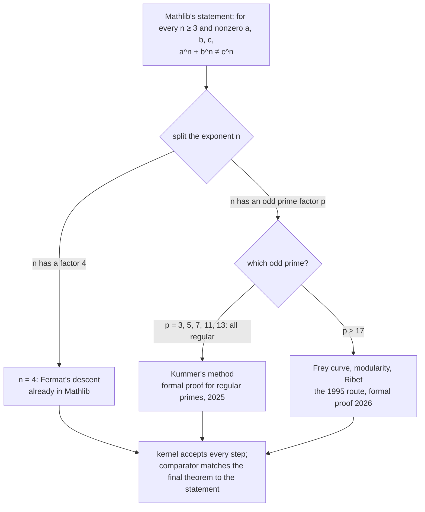

# Fermat's last theorem, proved in 1995 and reported formalised in 2026: what a formalisation adds

[Syllabus](../../../SYLLABUS.md) → [Frontier](../README.md) → [Primes and Numbers](../README.md#s03) → Fermat's last theorem, proved in 1995 and reported formalised in 2026

---

## General Overview

Squares can add up to a square: $`3^2 + 4^2 = 5^2`$. With $`c`$ up to 1,000 there are 881 such triples $`a^2 + b^2 = c^2`$. Cubes never do, and neither does any higher power. In about 1637 Pierre de Fermat wrote this claim in a book margin. Andrew Wiles proved it in 1995, 358 years later, with a key step from Richard Taylor and Wiles.

That proof fills two long journal papers and rests on decades of earlier work. For 31 years, "it is proved" meant "the experts have checked it". On 2026-09-04 an AI lab announced a **formal proof**: the whole argument written in Lean, a proof assistant, so that a small checking program (the **kernel**) accepts every step back to the axioms. AI agents built it in 11 days. It runs to over 13.4 million lines.

The same day, Kevin Buzzard, who leads a five-year funded project to formalise the theorem by hand, reported that he had built the code and run a statement checker on it: "it checks out". This card reads that report. It asks what exactly was checked, what is still trusted, and what the formal proof adds to a theorem nobody doubted.

**A formal proof of Fermat's last theorem adds no new mathematics; it replaces "the experts agree" with "a small program checked every step from the axioms to one exact statement", and it moves the remaining trust onto that statement, the kernel and the tools.**

**What kind of fact this is:** two claims, each with a kind and a dated status.

| Claim | Kind | Status |
| --- | --- | --- |
| Fermat's last theorem | theorem | proved: Wiles, and Taylor and Wiles, refereed, 1995 |
| The 2026 formal proof is complete | theorem (a formal proof) | proved: announced 2026-09-04; built and statement-checked by one independent mathematician the same day. Not built for this card: the checks below test small cases and the arithmetic only |

### The picture: which piece of the formal proof covers which exponent



Each arrow down is a reduction proved inside the formal proof. The bottom box is what the machine checks. The top box is what a person must still read.

---

## The formula

The theorem, as the formal proof states it:

```math
\forall n \ge 3,\ \forall a, b, c \in \mathbb{N}: \quad a \ne 0,\ b \ne 0,\ c \ne 0 \ \Longrightarrow\ a^n + b^n \ne c^n
```

**Read it aloud:** for every exponent n of at least 3, and every three whole numbers a, b and c that are not zero, a to the n plus b to the n is not c to the n.

Here $`\mathbb{N}`$ is the whole numbers 0, 1, 2 and so on, so "not zero" means "positive". The symbols $`\forall`$ ("for every") and $`\Longrightarrow`$ ("then") are as on [Proof assistants](../../24-Computability%20and%20complexity/02-Computability%20and%20Logic/08-proof-assistants-and-formal-verification.md).

The same statement in Lean, quoted from Mathlib, Lean's shared mathematics library (file `Mathlib/NumberTheory/FLT/Basic.lean`, Mathlib v4.36.0-rc2, the copy pinned in this library, read 2026-11-23). This excerpt is quoted, not compiled for this card:

```lean4
def FermatLastTheoremWith (R : Type*) [Semiring R] (n : ℕ) : Prop :=
  ∀ a b c : R, a ≠ 0 → b ≠ 0 → c ≠ 0 → a ^ n + b ^ n ≠ c ^ n

def FermatLastTheoremFor (n : ℕ) : Prop := FermatLastTheoremWith ℕ n

def FermatLastTheorem : Prop := ∀ n ≥ 3, FermatLastTheoremFor n
```

The formal proof splits the statement into pieces. Write $`\mathrm{FLT}(n)`$ for "no solution with exponent $`n`$" (Mathlib's `FermatLastTheoremFor n`). Then:

```math
\mathrm{FLT}(4)\ \text{ and }\ \mathrm{FLT}(p) \text{ for every odd prime } p \ \Longrightarrow\ \mathrm{FLT}(n) \text{ for every } n \ge 3
```

**Read it aloud:** if exponent 4 has no solution and no odd prime exponent has one, then no exponent of 3 or more has one.

| Symbol | Plain meaning | In our example | Push it up and the answer… |
| --- | --- | --- | --- |
| $`n`$ | the exponent | 3 to 6 searched; 3 to 1,000 split | larger $`n`$: still covered, by its factor 4 or an odd prime |
| $`a, b, c`$ | the three whole numbers in $`a^n + b^n = c^n`$ | $`c \le 1{,}000`$ in the search | a search can go further, and still proves nothing past its bound |
| $`\mathbb{N}`$ | the whole numbers 0, 1, 2, … | Lean's `ℕ` | — |
| $`p`$ | an odd prime factor of $`n`$ | 24 odd primes below 100 | from 17 up the 1995 route covers it |
| $`\mathrm{FLT}(n)`$ | "no solution with exponent $`n`$" | `FermatLastTheoremFor n` | — |
| $`d, m`$ | a split of the exponent, $`n = dm`$ | $`m = 4`$ or an odd prime | — |
| $`B_k`$; $`k`$, $`j`$, $`r`$ | the $`k`$-th Bernoulli number, a fraction defined below; indices; $`\binom{r+1}{j}`$ is a binomial coefficient | 37 divides the top of $`B_{32}`$ | — |
| $`\equiv \pmod{p^2}`$ | equal after dividing by $`p^2`$ and keeping the remainder | power sums for $`p = 37`$ | — |
| regular prime | an odd prime $`p`$ dividing the top of none of $`B_2, B_4, \dots, B_{p-3}`$ | 3, 5, 7, 11, 13 | irregular below 100: 37, 59, 67 |
| kernel | the small program that accepts or rejects each step | Lean's kernel, and a second one, nanoda | — |
| comparator | a tool that checks the final theorem states exactly a given challenge statement, using only allowed axioms | Mathlib's `FermatLastTheorem` | — |

The **Bernoulli numbers** are the fractions $`B_0 = 1`$, $`B_1 = -1/2`$, $`B_2 = 1/6`$, $`B_4 = -1/30`$ and so on, fixed one at a time by $`\sum_{j=0}^{r} \binom{r+1}{j} B_j = 0`$ for $`r = 1, 2, 3, \dots`$. Ernst Kummer showed that $`\mathrm{FLT}(p)`$ holds for every regular prime $`p`$.

### When it holds

- **The statement says what Fermat meant.** Drop $`a \ne 0`$ and the statement is false: $`0^3 + 1^3 = 1^3`$. A formal "proof" of a wrong statement would mean a broken kernel, and a proof of a weaker one would prove less than claimed.
- **The kernel is sound and its code is right.** Sound means it accepts only steps that follow by its rules. The repository's README reports a second, independently written kernel, nanoda, that rechecked 1,052,234 declarations with no errors. The artifact's authors ran it with four patches of their own, one for progress output and three for speed; the README says none adds, removes or weakens a typing rule.
- **Only the standard axioms are used.** Lean's three are `propext`, `Classical.choice` and `Quot.sound`. If the proof added an axiom of its own, it could simply assume the theorem. Comparator rejects any extra axiom.
- **The definitions mean what they say.** The README says the statement is built from Lean's own `ℕ`, `+` and `≠`, plus Mathlib's `^` on `ℕ`, which Mathlib defines as Lean's built-in power; comparator checks that each definition is stock Mathlib's. These are old, small and widely read definitions, but they are trusted, not checked against anything outside.
- **Every exponent is covered.** The route through modular forms reaches only primes from 17 up. The primes 3 to 13 need the separate regular-prime proof. Without it the formal proof has a hole.

---

## Why it works

### Step 0: trust moves from a long argument to a short statement

A paper proof asks the reader to trust every step. A formal proof asks the reader to trust three short things: the statement, the kernel, and the axioms. [Proof assistants](../../24-Computability%20and%20complexity/02-Computability%20and%20Logic/08-proof-assistants-and-formal-verification.md) explains why a kernel's "accepted" means "follows from the axioms". This card applies that to one very large proof.

The checking is mechanical. The 13.4 million lines matter only to the machine. What a person must read is the statement quoted above, a few lines of Lean.

### Step 1: the mathematics is the 1995 route

[Modularity](../../21-Algebraic%20and%20analytic%20number%20theory/07-Diophantine%20and%20Modular/08-modularity-and-the-proof-of-fermat.md) follows it in full: a solution builds the Frey curve; Wiles and Taylor–Wiles make that curve modular; Ribet moves its modular form down to level 2; level 2 has no forms.

Buzzard reports that the formal proof follows the 1995 survey by Darmon, Diamond and Taylor of that argument. It is not the modern, more general proof that his own project formalises.

### Step 2: cut the exponent down to 4 or an odd prime

Suppose $`n = dm`$. A solution with exponent $`n`$ gives one with exponent $`m`$:

```math
a^{dm} + b^{dm} = c^{dm} \ \Longrightarrow\ (a^d)^m + (b^d)^m = (c^d)^m
```

So $`\mathrm{FLT}(m)`$ gives $`\mathrm{FLT}(dm)`$. Every $`n \ge 3`$ either has an odd prime factor or is a power of 2 that is at least 4, so a multiple of 4. The code checks this for every $`n`$ from 3 to 1,000, two ways. Only 8 of them, the powers of 2 from 4 to 512, rely on the 4 alone. Fermat's own descent proof for exponent 4 is already in Mathlib.

### Step 3: which formal proof covers which prime

One step of the 1995 route is a fact about the Frey curve: it has no rational point of order $`p`$ (a point with fraction coordinates that returns to the start after $`p`$ additions on the curve). This one step is formalised only for $`p \ge 17`$: Buzzard reports that the repository proves it from enough of Mazur's work on the Eisenstein ideal (a tool from the theory of modular forms), but only for those primes. So the route covers the primes from 17 up.

The primes 3, 5, 7, 11 and 13 are all regular. A separate formal proof by Best, Birkbeck, Brasca, Rodriguez Boidi, van de Velde and Yang, published 2025-07-15, proves $`\mathrm{FLT}(p)`$ for every odd regular prime by Kummer's method. Buzzard's report counts on it for the small primes.

The two pieces overlap. Among the 24 odd primes below 100, 16 from 17 up are regular too, so both proofs cover them. The irregular primes 37, 59 and 67 are covered only by the 2026 proof. The code finds them two ways: Bernoulli numbers mod $`p`$, and power sums mod $`p^2`$.

<details>
<summary>Why power sums detect irregular primes</summary>

For an even $`k`$ from 2 to $`p - 3`$, the sum of the $`k`$-th powers of $`1, 2, \dots, p - 1`$ satisfies

$`\displaystyle \sum_{a=1}^{p-1} a^k \equiv p\,B_k \pmod{p^2}`$

This follows from Faulhaber's formula for power sums, whose coefficients are Bernoulli numbers. So $`p`$ divides the top of $`B_k`$ exactly when the power sum is divisible by $`p^2`$. That gives a second road that never builds a Bernoulli number. Both roads give the same three irregular primes below 100: 37 at $`k = 32`$, 59 at $`k = 44`$, and 67 at $`k = 58`$.

</details>

### Step 4: what was checked, and by whom

The audit list, from [Machines in proofs](../01-How%20Research%20Works/06-computer-assistance-and-formal-verification.md), asks four questions of any machine-checked claim: what is the statement, where is the artifact, who checked it independently, and what is its status.

| Audit item | For the 2026 formal proof |
| --- | --- |
| Statement | Mathlib's `FermatLastTheorem`, quoted above; comparator confirms the final theorem states exactly this |
| Artifact | a public Lean repository, linked from Buzzard's post: over 13.4 million lines; its README reports 29,511 theorems, Lean 4.33.1 and Mathlib v4.33.0 |
| Independent check | Buzzard built it and ran comparator, on a machine with 96 cores, 2026-09-04; the README adds the second kernel, nanoda |
| Status | proved, 2026-09-04: one independent rebuild and comparator run; not built for this card |

The build took nearly 20 times as long as building Mathlib itself, Buzzard reports. That is why this card checks the coverage and the arithmetic, not the 13.4 million lines.

### Step 5: what the formal proof does not add

- **No new truth.** The theorem was proved in 1995. Buzzard writes that, mathematically, the work "tells us essentially nothing".
- **No new route.** It follows the 1995 literature step by step.
- **No readable account.** Lemma names were made by machine. The README warns that where a name and a statement disagree, the statement is what was proved.

What it does show, in Buzzard's reading, is what machine formalisation can now do: thousands of pages of literature checked end to end in 11 days.

---

## Worked numbers, by hand

| Step | Arithmetic | Value |
| --- | --- | --- |
| squares that work, $`c \le 1{,}000`$ | count of $`a \le b`$ with $`a^2 + b^2 = c^2`$ | 881 |
| cubes to sixth powers, $`c \le 1{,}000`$ | the same search for $`n = 3`$ to 6 | 0, checked to 1,000 only |
| exponents 3 to 1,000 | those with no odd prime factor: powers of 2 | 8, all multiples of 4 |
| the rest | $`998 - 8`$ | 990, each with an odd prime factor |
| odd primes below 17 | 3, 5, 7, 11, 13 | 5, all regular |
| odd primes below 100 | 24 in all; irregular | 37, 59, 67 |
| theorems a day | $`29{,}511 \div 11`$, whole part | 2,682 |
| lines a day | $`13{,}400{,}000 \div 11`$, whole part | 1,218,181 |
| lines per theorem | $`13{,}400{,}000 \div 29{,}511`$, whole part | 454 |
| **coverage** | 4, or 3 to 13 (regular), or 17 up (1995 route) | **every exponent from 3 up** |

Every exponent lands on a proved piece, and the pieces meet in one statement that comparator checks. The size numbers say how big the artifact is, not how careful.

### What breaks if you drop a piece

| Mistake | Comes out at | What went wrong |
| --- | --- | --- |
| Drop $`a \ne 0`$ from the statement | $`0^3 + 1^3 = 1^3`$ | the statement becomes false; the check of the statement matters as much as the proof |
| Drop $`n \ge 3`$ | 881 solutions with $`c \le 1{,}000`$ at $`n = 2`$ | squares really do add up to squares |
| Treat a search as a proof | no solution to 1,000, yet $`1782^{12} + 1841^{12}`$ misses $`1922^{12}`$ by a relative $`-2.755 \times 10^{-10}`$ | a search proves nothing past its bound, and near misses exist |
| Use the 1995 route alone | 3, 5, 7, 11, 13 uncovered | the route needs $`p \ge 17`$; the regular-prime proof fills the gap |

---

## Code, from first principles, and it actually runs

The code does not build the formal proof. It checks the claims around it that a reader can check. It searches $`a^n + b^n = c^n`$ for $`c \le 1{,}000`$ two ways, a table of powers and two pointers walking towards each other, with Euclid's formula for triples as a third road at $`n = 2`$. It splits every exponent from 3 to 1,000 two ways. It finds the irregular primes below 100 two independent ways. It shows the near miss is not a solution by parity, and measures its gap. It prints the sources' figures and the arithmetic on them.

### Python

```python
# Fermat's last theorem, formalised -- the check behind the card.  Standard
# library only.  Part 1 searches a^n + b^n = c^n for c <= 1,000 by two roads
# (a table of powers, and two pointers walking towards each other), with
# Euclid's formula as a third road at n = 2.  Part 2 splits every exponent
# n <= 1,000 into "has a factor 4" or "has an odd prime factor", two ways.
# Part 3 finds the irregular primes below 100 two ways (Bernoulli numbers
# mod p, and power sums mod p^2), which tells which formal proof covers which
# prime.  Part 4 is the near miss 1782^12 + 1841^12 against 1922^12, and
# Part 5 is the arithmetic of the eleven days.
N = 1000

def by_table(n):
    powers = {c ** n: c for c in range(1, N + 1)}
    hits = 0
    for a in range(1, N):
        for b in range(a, N):
            s = a ** n + b ** n
            if s > N ** n:
                break
            hits += s in powers
    return hits

def by_pointers(n):
    hits = 0
    for c in range(2, N + 1):
        a, b, t = 1, c - 1, c ** n
        while a <= b:
            s = a ** n + b ** n
            if s == t:
                hits += 1; a += 1
            elif s < t:
                a += 1
            else:
                b -= 1
    return hits

def gcd(x, y):
    while y:
        x, y = y, x % y
    return x

def by_euclid():  # every triple is k(m^2 - j^2, 2mj, m^2 + j^2), m > j, coprime, opposite parity
    total = 0
    for m in range(2, int(N ** 0.5) + 1):
        for j in range(1, m):
            if (m - j) % 2 == 1 and gcd(m, j) == 1 and m * m + j * j <= N:
                total += N // (m * m + j * j)
    return total

print(f"Part 1: solutions of a^n + b^n = c^n, 1 <= a <= b, c <= {N}")
counts = {}
for n in range(2, 7):
    t, p = by_table(n), by_pointers(n)
    counts[n] = t
    assert t == p, n
    print(f"n = {n}: table {t}, two pointers {p}")
assert counts[2] == by_euclid()
print(f"n = 2 by Euclid's formula: {by_euclid()}")
assert all(counts[n] == 0 for n in range(3, 7))
print(f"n = 3 to 6: none, checked for c <= {N} only")
print("drop a != 0: 0^3 + 1^3 = 1^3 is a solution")

print(f"Part 2: every n from 3 to {N} has a factor 4 or an odd prime factor")
only4 = []
for n in range(3, N + 1):
    odd = n
    while odd % 2 == 0:
        odd //= 2
    by_factor = odd > 1  # road 1: strip the 2s, something odd is left
    pow2 = (n & (n - 1)) == 0  # road 2: n is a power of two
    assert by_factor != pow2 and (by_factor or n % 4 == 0), n
    if not by_factor:
        only4.append(n)
print(f"covered by 4 alone: {len(only4)} exponents: {only4}")
print(f"covered by an odd prime: {N - 2 - len(only4)}")

print("Part 3: irregular primes below 100, two roads")
def is_prime(n):
    return n > 1 and all(n % d for d in range(2, int(n ** 0.5) + 1))
def irregular_bernoulli(p):  # B_0..B_{p-3} mod p from sum_j C(m+1, j) B_j = 0
    B = [1]
    for m in range(1, p - 2):
        s, c = 0, 1
        for j in range(m):
            s += c * B[j]
            c = c * (m + 1 - j) // (j + 1)
        B.append(-s * pow(m + 1, p - 2, p) % p)
    return [k for k in range(2, p - 2, 2) if B[k] == 0]
def irregular_powersum(p):  # sum a^k == p B_k mod p^2 for even k < p - 1
    return any(sum(pow(a, k, p * p) for a in range(1, p)) % (p * p) == 0 for k in range(2, p - 2, 2))
odd_primes = [p for p in range(3, 100) if is_prime(p)]
irr = [p for p in odd_primes if irregular_bernoulli(p)]
assert irr == [p for p in odd_primes if irregular_powersum(p)]
assert irr == [37, 59, 67]
small = [p for p in odd_primes if p < 17]
assert not any(p in irr for p in small)
print(f"odd primes below 100: {len(odd_primes)}; irregular: {irr}")
print(f"below 17, all regular: {small}")
print("p divides the top of B_k at (p, k): " + ", ".join(f"({p}, {irregular_bernoulli(p)[0]})" for p in irr))
both = [p for p in odd_primes if p >= 17 and p not in irr]
print(f"17 and up, regular too (covered twice): {len(both)}; covered by the 2026 proof only: {irr}")

print("Part 4: the near miss 1782^12 + 1841^12 against 1922^12")
L, R = 1782 ** 12 + 1841 ** 12, 1922 ** 12
def fpow(x, k):
    r = 1.0
    for _ in range(k):
        r *= x
    return r
gap = fpow(1782 / 1922, 12) + fpow(1841 / 1922, 12) - 1.0
assert L != R and L % 2 == 1 and R % 2 == 0
assert abs(gap - (L - R) / R) < 1e-15
print(f"left side odd, right side even, so not equal; relative gap {gap:.3e}")

print("Part 5: the eleven days, from the sources' own figures")
days, lines, thms, decls = 11, 13_400_000, 29_511, 1_052_234
print(f"source figures: {days} days, {lines} lines, {thms} theorems, {decls} declarations")
print("rebuild: a machine with 96 cores, nearly 20 times as long as building Mathlib")
print(f"a day: {thms // days} theorems, {lines // days} lines; lines per theorem: {lines // thms}")
print(f"years: note 1637 to proof 1995 = {1995 - 1637}; proof to formal proof 2026 = {2026 - 1995}")
print("ALL CHECKS PASS")
```

**Ran 2026-11-23 on macOS, Python 3.14.10, standard library only. All checks passed. Output, pasted from the run:**

```
Part 1: solutions of a^n + b^n = c^n, 1 <= a <= b, c <= 1000
n = 2: table 881, two pointers 881
n = 3: table 0, two pointers 0
n = 4: table 0, two pointers 0
n = 5: table 0, two pointers 0
n = 6: table 0, two pointers 0
n = 2 by Euclid's formula: 881
n = 3 to 6: none, checked for c <= 1000 only
drop a != 0: 0^3 + 1^3 = 1^3 is a solution
Part 2: every n from 3 to 1000 has a factor 4 or an odd prime factor
covered by 4 alone: 8 exponents: [4, 8, 16, 32, 64, 128, 256, 512]
covered by an odd prime: 990
Part 3: irregular primes below 100, two roads
odd primes below 100: 24; irregular: [37, 59, 67]
below 17, all regular: [3, 5, 7, 11, 13]
p divides the top of B_k at (p, k): (37, 32), (59, 44), (67, 58)
17 and up, regular too (covered twice): 16; covered by the 2026 proof only: [37, 59, 67]
Part 4: the near miss 1782^12 + 1841^12 against 1922^12
left side odd, right side even, so not equal; relative gap -2.755e-10
Part 5: the eleven days, from the sources' own figures
source figures: 11 days, 13400000 lines, 29511 theorems, 1052234 declarations
rebuild: a machine with 96 cores, nearly 20 times as long as building Mathlib
a day: 2682 theorems, 1218181 lines; lines per theorem: 454
years: note 1637 to proof 1995 = 358; proof to formal proof 2026 = 31
ALL CHECKS PASS
```

### Rust

```rust
// Fermat's last theorem, formalised -- the check behind the card.  std only.
// Part 1 searches a^n + b^n = c^n for c <= 1,000 by two roads (a table of
// powers, and two pointers walking towards each other), with Euclid's formula
// as a third road at n = 2.  Part 2 splits every exponent n <= 1,000 into "has
// a factor 4" or "has an odd prime factor", two ways.  Part 3 finds the
// irregular primes below 100 two ways (Bernoulli numbers mod p, and power sums
// mod p^2).  Part 4 is the near miss 1782^12 + 1841^12 against 1922^12, and
// Part 5 is the arithmetic of the eleven days.
use std::collections::HashSet;

const N: u128 = 1000;

fn by_table(n: u32) -> u64 {
    let powers: HashSet<u128> = (1..=N).map(|c| c.pow(n)).collect();
    let mut hits = 0;
    for a in 1..N {
        for b in a..N {
            let s = a.pow(n) + b.pow(n);
            if s > N.pow(n) { break; }
            if powers.contains(&s) { hits += 1; }
        }
    }
    hits
}

fn by_pointers(n: u32) -> u64 {
    let mut hits = 0;
    for c in 2..=N {
        let (mut a, mut b, t) = (1u128, c - 1, c.pow(n));
        while a <= b {
            let s = a.pow(n) + b.pow(n);
            if s == t { hits += 1; a += 1; } else if s < t { a += 1; } else { b -= 1; }
        }
    }
    hits
}

fn gcd(mut x: u128, mut y: u128) -> u128 {
    while y != 0 { let r = x % y; x = y; y = r; }
    x
}

fn by_euclid() -> u64 {
    let mut total = 0;
    for m in (2..).take_while(|m: &u128| m * m <= N) {
        for j in 1..m {
            if (m - j) % 2 == 1 && gcd(m, j) == 1 && m * m + j * j <= N {
                total += (N / (m * m + j * j)) as u64;
            }
        }
    }
    total
}

fn powmod(mut b: u128, mut e: u128, m: u128) -> u128 {
    let mut r = 1 % m;
    b %= m;
    while e > 0 { if e & 1 == 1 { r = r * b % m; } b = b * b % m; e >>= 1; }
    r
}

fn is_prime(n: u128) -> bool { n > 1 && (2..n).take_while(|d| d * d <= n).all(|d| n % d != 0) }

fn irregular_bernoulli(p: u128) -> Vec<u128> {
    let mut bern: Vec<u128> = vec![1];
    for m in 1..(p - 2) {
        let (mut s, mut c) = (0u128, 1u128); // c = C(m+1, j) mod p, built from the exact binomial
        let mut exact: u128 = 1;
        for j in 0..m {
            s = (s + c * bern[j as usize]) % p;
            exact = exact * (m + 1 - j) / (j + 1);
            c = exact % p;
        }
        let inv = powmod(m + 1, p - 2, p);
        bern.push((p - s) % p * inv % p);
    }
    (2..(p - 2)).step_by(2).filter(|&k| bern[k as usize] == 0).collect()
}

fn irregular_powersum(p: u128) -> bool {
    (2..(p - 2)).step_by(2).any(|k| (1..p).map(|a| powmod(a, k, p * p)).sum::<u128>() % (p * p) == 0)
}

fn fpow(x: f64, k: u32) -> f64 { let mut r = 1.0; for _ in 0..k { r *= x; } r }

fn list(v: &[u128]) -> String {
    format!("[{}]", v.iter().map(|x| x.to_string()).collect::<Vec<_>>().join(", "))
}

fn main() {
    println!("Part 1: solutions of a^n + b^n = c^n, 1 <= a <= b, c <= {}", N);
    let mut counts = vec![0u64; 7];
    for n in 2..7u32 {
        let (t, p) = (by_table(n), by_pointers(n));
        counts[n as usize] = t;
        assert_eq!(t, p, "n = {}", n);
        println!("n = {}: table {}, two pointers {}", n, t, p);
    }
    assert_eq!(counts[2], by_euclid());
    println!("n = 2 by Euclid's formula: {}", by_euclid());
    assert!((3..7).all(|n| counts[n] == 0));
    println!("n = 3 to 6: none, checked for c <= {} only", N);
    println!("drop a != 0: 0^3 + 1^3 = 1^3 is a solution");

    println!("Part 2: every n from 3 to {} has a factor 4 or an odd prime factor", N);
    let mut only4: Vec<u128> = vec![];
    for n in 3..=N {
        let mut odd = n;
        while odd % 2 == 0 { odd /= 2; }
        let by_factor = odd > 1;
        let pow2 = n & (n - 1) == 0;
        assert!(by_factor != pow2 && (by_factor || n % 4 == 0), "n = {}", n);
        if !by_factor { only4.push(n); }
    }
    println!("covered by 4 alone: {} exponents: {}", only4.len(), list(&only4));
    println!("covered by an odd prime: {}", N as usize - 2 - only4.len());

    println!("Part 3: irregular primes below 100, two roads");
    let odd_primes: Vec<u128> = (3..100).filter(|&p| is_prime(p)).collect();
    let irr: Vec<u128> = odd_primes.iter().copied().filter(|&p| !irregular_bernoulli(p).is_empty()).collect();
    let irr2: Vec<u128> = odd_primes.iter().copied().filter(|&p| irregular_powersum(p)).collect();
    assert_eq!(irr, irr2);
    assert_eq!(irr, vec![37, 59, 67]);
    let small: Vec<u128> = odd_primes.iter().copied().filter(|&p| p < 17).collect();
    assert!(!small.iter().any(|p| irr.contains(p)));
    println!("odd primes below 100: {}; irregular: {}", odd_primes.len(), list(&irr));
    println!("below 17, all regular: {}", list(&small));
    let pk: Vec<String> = irr.iter().map(|&p| format!("({}, {})", p, irregular_bernoulli(p)[0])).collect();
    println!("p divides the top of B_k at (p, k): {}", pk.join(", "));
    let both = odd_primes.iter().filter(|&&p| p >= 17 && !irr.contains(&p)).count();
    println!("17 and up, regular too (covered twice): {}; covered by the 2026 proof only: {}", both, list(&irr));

    println!("Part 4: the near miss 1782^12 + 1841^12 against 1922^12");
    let (l2, r2) = ((powmod(1782, 12, 2) + powmod(1841, 12, 2)) % 2, powmod(1922, 12, 2));
    let gap = fpow(1782.0 / 1922.0, 12) + fpow(1841.0 / 1922.0, 12) - 1.0;
    assert!(l2 == 1 && r2 == 0);
    assert!(gap < -2.7e-10 && gap > -2.8e-10); // the exact gap, -2.7554...e-10, comes from Python's integers
    println!("left side odd, right side even, so not equal; relative gap {:.3e}", gap);

    println!("Part 5: the eleven days, from the sources' own figures");
    let (days, lines, thms, decls) = (11u64, 13_400_000u64, 29_511u64, 1_052_234u64);
    println!("source figures: {} days, {} lines, {} theorems, {} declarations", days, lines, thms, decls);
    println!("rebuild: a machine with 96 cores, nearly 20 times as long as building Mathlib");
    println!("a day: {} theorems, {} lines; lines per theorem: {}", thms / days, lines / days, lines / thms);
    println!("years: note 1637 to proof 1995 = {}; proof to formal proof 2026 = {}", 1995 - 1637, 2026 - 1995);
    println!("ALL CHECKS PASS");
}
```

**Ran 2026-11-23 on macOS, rustc 1.98.1, no crates. All checks passed. Output, pasted from the run:**

```
Part 1: solutions of a^n + b^n = c^n, 1 <= a <= b, c <= 1000
n = 2: table 881, two pointers 881
n = 3: table 0, two pointers 0
n = 4: table 0, two pointers 0
n = 5: table 0, two pointers 0
n = 6: table 0, two pointers 0
n = 2 by Euclid's formula: 881
n = 3 to 6: none, checked for c <= 1000 only
drop a != 0: 0^3 + 1^3 = 1^3 is a solution
Part 2: every n from 3 to 1000 has a factor 4 or an odd prime factor
covered by 4 alone: 8 exponents: [4, 8, 16, 32, 64, 128, 256, 512]
covered by an odd prime: 990
Part 3: irregular primes below 100, two roads
odd primes below 100: 24; irregular: [37, 59, 67]
below 17, all regular: [3, 5, 7, 11, 13]
p divides the top of B_k at (p, k): (37, 32), (59, 44), (67, 58)
17 and up, regular too (covered twice): 16; covered by the 2026 proof only: [37, 59, 67]
Part 4: the near miss 1782^12 + 1841^12 against 1922^12
left side odd, right side even, so not equal; relative gap -2.755e-10
Part 5: the eleven days, from the sources' own figures
source figures: 11 days, 13400000 lines, 29511 theorems, 1052234 declarations
rebuild: a machine with 96 cores, nearly 20 times as long as building Mathlib
a day: 2682 theorems, 1218181 lines; lines per theorem: 454
years: note 1637 to proof 1995 = 358; proof to formal proof 2026 = 31
ALL CHECKS PASS
```

### Lean

Lean proves that 4 and the odd primes cover every exponent, assuming those cases, and checks the small numbers.

- Suppose $`\mathrm{FLT}(4)`$ holds, and $`\mathrm{FLT}(p)`$ holds for every odd prime $`p`$. Then $`\mathrm{FLT}(n)`$ holds for every $`n \ge 3`$.
- Take a split $`n = dm`$ and suppose $`\mathrm{FLT}(m)`$. Then $`\mathrm{FLT}(dm)`$ holds too.
- Take any $`n \ge 3`$. Then $`n`$ is a multiple of 4 or has an odd prime factor.
- Squares can add up to a square: $`3^2 + 4^2 = 5^2`$.
- Drop $`a \ne 0`$. Then $`0^3 + 1^3 = 1^3`$ is a solution.
- $`1782^{12} + 1841^{12}`$ is not $`1922^{12}`$. The left side is odd and the right side even.
- For $`3987^{12} + 4365^{12}`$ against $`4472^{12}`$, both sides are even. Mod 3 the left side is 0 and the right side 1.
- Between 3 and 1,000 lie 8 powers of 2, from 4 to 512.
- Take $`p = 37`$. Then the sum of $`a^{32}`$ for $`a = 1`$ to 36 is divisible by $`37^2`$, which marks 37 as irregular.
- The whole parts in Worked numbers check: 2,682 theorems a day, 1,218,181 lines a day, 454 lines per theorem.
- The years check too: 358 from Fermat's note to the proof, 31 from the proof to the formal proof.

The searches to 1,000, the Bernoulli numbers and the near miss's relative gap are left to the Python and Rust checks.

```lean
-- Fermat's last theorem, proved in 1995 and reported formalised in 2026: this file proves that exponent 4 and the odd prime exponents together cover every exponent of at least 3.
import Mathlib.NumberTheory.FLT.Basic
import Mathlib.Data.Nat.Factors
import Mathlib.Algebra.BigOperators.Group.Finset.Basic
import Mathlib.Tactic.NormNum

/-- The card's reduction: if exponent 4 has no solution and no odd prime exponent has one,
then no exponent of 3 or more has one. In Mathlib's terms, `FermatLastTheoremFor 4` and
`FermatLastTheoremFor p` for every odd prime `p` give `FermatLastTheorem`. -/
theorem fermat_last_theorem_of_four_and_odd_primes
    (h4 : FermatLastTheoremFor 4)
    (hp : ∀ p : ℕ, p.Prime → Odd p → FermatLastTheoremFor p) :
    FermatLastTheorem := by
  intro n hn
  rcases Nat.four_dvd_or_exists_odd_prime_and_dvd_of_two_lt (by omega : 2 < n) with
    h | ⟨p, hpp, hpd, hpo⟩
  · exact FermatLastTheoremFor.mono h h4
  · exact FermatLastTheoremFor.mono hpd (hp p hpp hpo)

/-- A solution with exponent `d * m` gives one with exponent `m`, since
`a ^ (d * m) = (a ^ d) ^ m`; so no solution with exponent `m` means none with exponent `d * m`. -/
theorem fermat_last_theorem_for_mul (d m : ℕ) (hm : FermatLastTheoremFor m) :
    FermatLastTheoremFor (d * m) := by
  exact FermatLastTheoremFor.mono (Dvd.intro_left d rfl) hm

/-- Every exponent `n` of at least 3 is a multiple of 4 or has an odd prime factor. -/
theorem four_dvd_or_odd_prime_factor (n : ℕ) (hn : 3 ≤ n) :
    4 ∣ n ∨ ∃ p : ℕ, p.Prime ∧ Odd p ∧ p ∣ n := by
  rcases Nat.four_dvd_or_exists_odd_prime_and_dvd_of_two_lt (by omega : 2 < n) with h | ⟨p, hp, hd, ho⟩
  · exact Or.inl h
  · exact Or.inr ⟨p, hp, ho, hd⟩

-- Squares can add up to a square.
example : 3 ^ 2 + 4 ^ 2 = 5 ^ 2 := by norm_num

-- Drop a ≠ 0 and the statement is false: 0^3 + 1^3 = 1^3.
example : 0 ^ 3 + 1 ^ 3 = 1 ^ 3 := by norm_num

-- The near miss: 1782^12 + 1841^12 is not 1922^12.
example : 1782 ^ 12 + 1841 ^ 12 ≠ 1922 ^ 12 := by norm_num

-- Parity settles it: the left side is odd, the right side even.
example : (1782 ^ 12 + 1841 ^ 12) % 2 = 1 ∧ 1922 ^ 12 % 2 = 0 := by norm_num

-- The second near miss: parity fails, mod 3 settles it (left 0, right 1).
example : (3987 ^ 12 + 4365 ^ 12) % 2 = 0 ∧ 4472 ^ 12 % 2 = 0 := by norm_num
example : (3987 ^ 12 + 4365 ^ 12) % 3 = 0 ∧ 4472 ^ 12 % 3 = 1 := by norm_num

-- The exponents from 3 to 1,000 with no odd prime factor are the 8 powers of 2 from 4 to 512.
example : ((Finset.range 10).filter (fun k => 3 ≤ 2 ^ k ∧ 2 ^ k ≤ 1000)).card = 8 := by decide

-- 37 is irregular: the sum of a^32 for a = 1 to 36 is divisible by 37^2 (so 37 divides the top of B_32).
example : (∑ a ∈ Finset.range 37, a ^ 32) % (37 ^ 2) = 0 := by decide

-- The arithmetic of the eleven days, whole parts.
example : 29511 / 11 = 2682 := by norm_num
example : 13400000 / 11 = 1218181 := by norm_num
example : 13400000 / 29511 = 454 := by norm_num
example : 1995 - 1637 = 358 ∧ 2026 - 1995 = 31 := by norm_num

#print axioms fermat_last_theorem_of_four_and_odd_primes
#print axioms fermat_last_theorem_for_mul
#print axioms four_dvd_or_odd_prime_factor
```

**Checked 2026-11-23 on macOS, Lean 4.36.0-rc2, Mathlib v4.36.0-rc2. Every proof is complete and uses only Lean's standard axioms. Output, pasted from the run:**

```
'fermat_last_theorem_of_four_and_odd_primes' depends on axioms: [propext, Classical.choice, Quot.sound]
'fermat_last_theorem_for_mul' depends on axioms: [propext, Classical.choice, Quot.sound]
'four_dvd_or_odd_prime_factor' depends on axioms: [propext, Classical.choice, Quot.sound]
```

> [!TIP]
> **Try changing**
> - Guess first: how many triples $`a^2 + b^2 = c^2`$ have $`c \le 2{,}000`$? Set `N = 2000`. The run prints 1,981 by all three roads, and still none for $`n = 3`$ to 6. The search still proves nothing past 2,000.
> - Guess first: is 101 regular? Change `range(3, 100)` in Part 3 to `range(3, 102)`. The two roads still agree, and 101 joins the irregular list, at $`k = 68`$. The fixed list `[37, 59, 67]` then stops the program.
> - Guess first: does parity rule out $`3987^{12} + 4365^{12} = 4472^{12}`$, another near miss? Put 3987, 4365 and 4472 into Part 4. Both left terms are odd, so the left side is even, like the right, and the parity assert stops the program. Mod 3 settles it instead: the left side is 0 and the right side is 1.

---

## The usual mistake

> [!warning]
> **Thinking the formal proof proved Fermat's last theorem, or proved it "more".** The theorem was proved in 1995 and accepted. The formal proof checks the same argument by machine. It removes doubt about the steps and leaves the trust in the statement, the kernel and the axioms.
>
> - **Reading a search as evidence of proof.** No solution for $`c \le 1{,}000`$ and $`n = 3`$ to 6 is 0 cases found, not a proof.
> - **Skipping the statement.** Without $`a \ne 0`$ the statement is false: $`0^3 + 1^3 = 1^3`$. Comparator exists to check the final theorem against the agreed statement.
> - **Reading size as rigour.** 13.4 million lines and 454 lines per theorem measure the artifact, not its care.
> - **Calling it the modern proof.** It follows the 1995 route, which reaches only $`p \ge 17`$; the primes 3 to 13 come from the regular-prime proof.

---

## Where you meet it in real life

- **The list of 100 theorems.** Freek Wiedijk's list tracks which famous theorems have formal proofs. Buzzard reports that Fermat's last theorem was the last of the 100 to be done.
- **Refereeing.** Buzzard expects machine formalisation to make reviewing hard papers less painful, and to show which results "known to the experts" a proof really assumes.
- **Human formalisation goes on.** Buzzard's project, funded for five years, still adds modern number theory to Mathlib and plans a document people can explore.
- **Other machine-checked proofs.** The four-colour theorem was checked the same way; see [Machines in proofs](../01-How%20Research%20Works/06-computer-assistance-and-formal-verification.md). So was the Kepler conjecture; see [Proof assistants](../../24-Computability%20and%20complexity/02-Computability%20and%20Logic/08-proof-assistants-and-formal-verification.md).

> **Say it back**
> Fermat's last theorem says $`a^n + b^n = c^n`$ has no solution in positive whole numbers for $`n \ge 3`$. Wiles and Taylor–Wiles proved it in 1995. On 2026-09-04 a complete formal proof in Lean was announced, built in 11 days, and an independent mathematician rebuilt it and matched its final theorem to Mathlib's statement. It covers exponent 4, the regular primes 3 to 13, and every prime from 17 up by the 1995 route. It adds certainty about the steps, not new mathematics, and it leaves the trust in the statement, the kernel and the axioms.

---

## What this builds on

- [Modularity](../../21-Algebraic%20and%20analytic%20number%20theory/07-Diophantine%20and%20Modular/08-modularity-and-the-proof-of-fermat.md): the 1995 route that the formal proof follows, from the Frey curve to level 2.
- [Proof assistants](../../24-Computability%20and%20complexity/02-Computability%20and%20Logic/08-proof-assistants-and-formal-verification.md): what a kernel checks, and what stays outside the check.

## Where this goes next

- [Erdos problems](07-erdos-problems-selected.md): open problems where machine search and machine proof now take part.
- [Beal's conjecture](05-beal-conjecture.md): Fermat's equation with three different exponents, still open.
- [The abc conjecture](04-abc-conjecture.md): a bound that would give Fermat's last theorem for all large exponents at once.
- [Schanuel's conjecture](08-schanuels-conjecture.md): one statement that would settle almost every open question about transcendental numbers.
- [The Langlands program](../06-Algebra%2C%20Logic%20and%20Computation/06-langlands-program-and-geometric-langlands.md): matching Galois representations with automorphic forms, and the 2024 geometric proof.

The formal proof leaves open whether the modern proofs of the Langlands programme can be checked the same way, and what that will expose.

---

## Sources

Verified 2026-11-23: every link below resolves to the publisher's page.

- Buzzard, Kevin. Post on the Xena Project blog, 2026-09-04. [wp.me/p9bxpM-10G](https://wp.me/p9bxpM-10G). The independent rebuild and comparator run, the 13.4 million lines, the 11 days, the 1995 route and its $`p \ge 17`$ limit, and the link to the repository and its README.
- Best, Alex, Christopher Birkbeck, Riccardo Brasca, Eric Rodriguez Boidi, Ruben van de Velde, and Andrew Yang. "A complete formalization of Fermat's Last Theorem for regular primes in Lean." *Annals of Formalized Mathematics* 1 (2025). [doi:10.46298/afm.14586](https://doi.org/10.46298/afm.14586). The formal proof for regular primes that covers 3 to 13.
- Darmon, Henri, Fred Diamond, and Richard Taylor. "Fermat's Last Theorem." *Current Developments in Mathematics* 1995, 1–154. [doi:10.4310/CDM.1995.v1995.n1.a1](https://doi.org/10.4310/CDM.1995.v1995.n1.a1). The account of the 1995 proof that the formal proof follows.
- Wiles, Andrew. "Modular Elliptic Curves and Fermat's Last Theorem." *Annals of Mathematics* 141 (1995), 443–551. [doi:10.2307/2118559](https://doi.org/10.2307/2118559). The proof itself.
- The mathlib Community. "The Lean Mathematical Library." *Proceedings of the 9th ACM SIGPLAN International Conference on Certified Programs and Proofs*, 2020, 367–381. [doi:10.1145/3372885.3373824](https://doi.org/10.1145/3372885.3373824). The library whose statement of the theorem the formal proof is checked against.
