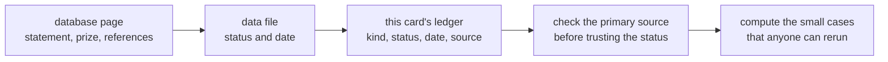

# Erdos problems: a database of hundreds, with prizes, and the ones a computer search can touch

[Syllabus](../../../SYLLABUS.md) → [Frontier](../README.md) → [Primes and Numbers](../README.md#s03) → Erdos problems

---

## General Overview

Lay out one million points as a square grid, 1,000 by 1,000. Measure the distance between every pair. There are 499,999,500,000 pairs, but only **299,230** different distances among them.

In 1946 Paul Erdős asked whether any arrangement of a million points does much better. Could the points sit so cleverly that they make only a few thousand different distances? Larry Guth and Nets Katz proved the answer is no, in a paper published in 2015. No arrangement can beat the grid by more than a slowly growing factor. The problem is nearly settled, but not settled, and the database's data file still lists it, with its $500 prize, as open.

Erdős left hundreds of questions like this one. Many carry a cash prize he offered himself. A public database, erdosproblems.com, now lists them. Its data file of 2026-11-22 holds **1,221 problems**: 570 still marked open, and 114 with a prize attached.

This card reads that database and follows three of its problems:

- **Distinct distances** (problem 89, $500): how few different distances n points can make. Nearly settled in 2015.
- **Unit distances** (problem 90, $500): how many pairs of n points can sit exactly one apart. Erdős's guess was refuted in May 2026.
- **Sunflowers** (problem 20, $1,000): how many sets you can collect before three of them overlap in a fixed pattern. Big progress in 2019, still open.

[Erdos problems](../../21-Algebraic%20and%20analytic%20number%20theory/08-Additive%20Combinatorics%20and%20Probabilistic%20Number%20Theory/07-erdos-problems-and-computer-search.md) already shows what a computer search proves and what it cannot. This card spends its space on the database, the three problems' status, and the methods that moved them.

**The Erdős problem database records each problem's statement, prize and dated status; of the three problems here, distinct distances is open but pinned within a factor of about sqrt(log n), unit distances is refuted, and sunflowers is open with a much better bound since 2019.**

**What kind of fact this is:** a status card. Three conjectures, each with a dated status: distinct distances open, unit distances refuted, sunflowers open, all as of 2026-11-23. Every count the code computes is a theorem about one finite set of points or sets, proved by running the code.

### The picture: one million points, four counts

Distinct distances for one million points, on a log10 scale. Each bar is 8 characters per power of ten.

```
easy proof (Why it works, Step 2)   #######################                       707
Guth-Katz shape, n/log n            #######################################       72,382
Erdos's guess, n/sqrt(log n)        ###########################################   269,040
the 1,000 by 1,000 grid             ############################################  299,230
```

The Guth–Katz bar is the shape of their bound with its unknown constant set to 1, for scale only. The grid sits just above n/sqrt(log n), and Erdős guessed nothing does better. Both bounds carry unnamed constants, so bars at one n do not measure what is open. The open question is the growth factor sqrt(log n) between the two shapes.

---

## The formula

Notation first, in words. Write n for the number of points in the plane. Write g(n) for the **fewest** different distances that any n points can make, and u(n) for the **most** pairs at distance exactly 1 that any n points can have, the unit-distance count from [Working on a problem](../01-How%20Research%20Works/07-how-to-work-on-an-open-problem.md). Write log for the natural logarithm. The letters c and C stand for fixed positive numbers that the proofs show exist but do not pin down.

Distinct distances, as it stands:

```math
c\,\frac{n}{\log n} \;\le\; g(n) \;\le\; C\,\frac{n}{\sqrt{\log n}}
```

**Read it aloud:** the fewest distances n points can make is at least a constant times n over log n, and at most a constant times n over the square root of log n.

The right side is Erdős's grid, from 1946. The left side is Guth and Katz, 2015. Erdős's conjecture is that the right side is the truth.

Unit distances, as it stands:

```math
n^{1.014} \;<\; u(n) \text{ for arbitrarily large } n, \qquad u(n) \;\le\; C\, n^{4/3}
```

**Read it aloud:** for some arbitrarily large n there are arrangements with more than n to the power 1.014 unit pairs, and no arrangement has more than a constant times n to the power four-thirds.

Erdős conjectured $`u(n) \le n^{1 + C/\log\log n}`$, only a little above n. The left statement, from May 2026, refutes that. Its exponent 1.014 is claimed in a preprint by Will Sawin, 2026-05-20, not yet refereed; Step 0 gives the sources behind the refutation.

A **sunflower** with r petals is a collection of r sets whose pairwise overlaps are all the same set. That shared overlap is the **core**; what each set has outside it is a **petal**, and the petals share nothing. Write f(w, r) for the smallest family size that forces a sunflower with r petals, among families of distinct sets with w members each:

```math
f(w, r) \;<\; (C\, r^3 \log w \,\log\log w)^{w}
```

**Read it aloud:** past roughly r cubed times log w times log log w, raised to the power w, sets of size w must contain an r-petal sunflower.

Erdős and Richard Rado's 1960 bound grew like w factorial times $`(r-1)^w`$. The conjecture asks for $`f(w, r) < C_r^{\,w}`$, a constant depending on r alone raised to the power w.

| Symbol | Plain meaning | In our example | Push it up and the answer… |
| --- | --- | --- | --- |
| n | points in the plane | 1,000,000 in a grid | more distances, more unit pairs |
| g(n) | fewest different distances n points can make | the grid gives 299,230 | — |
| u(n) | most pairs exactly 1 apart among n points | the grid gives 25,992,416 | — |
| k | side of the square grid, so n = k × k | 1,000 | — |
| m | a squared distance, $`a^2 + b^2`$ | 160,225 | — |
| a, b | the horizontal and vertical steps between two grid points | 0 to 999 | — |
| log | natural logarithm | log 1,000,000 ≈ 13.8155 | — |
| c, C | fixed constants the proofs leave unnamed | — | the bound loosens |
| $`r_2(m)`$, $`d_1(m)`$, $`d_3(m)`$ | whole-number vectors (a, b) with $`a^2 + b^2 = m`$; divisors of m of the forms 4j + 1 and 4j + 3 | 96 vectors for 160,225 | more ways to repeat one distance |
| w, r | members in each set; petals asked for | 2 and 3 | more sets needed to force a sunflower |
| f(w, r), $`C_r`$ | family size that forces an r-petal sunflower; the conjectured base, depending on r alone | f(2, 3) = 7 | — |
| t, D, $`t_0`$, s | distances seen from one point; distances in the whole set; the least t with $`2t^2 + t \ge n - 1`$, and $`t_0 - 1`$ | D at least $`t_0`$ = 707 | — |

### When it holds

- **Points in the plane, all different.** In three dimensions the counts change: the database tracks that version separately, as problem 1083.
- **Distance exactly 1 for u(n).** Allow "within 0.001 of 1" and the problem becomes a different one.
- **Sunflower overlaps all equal, core allowed to be empty.** Three disjoint sets are a sunflower with an empty core. Forget that and a ring of 8 edges looks sunflower-free.
- **Statements about growth, not a given n.** The constants c and C are unnamed, so none of the bounds gives a number for n = 1,000,000 on its own.

---

## Why it works

### Step 0: reading the database

Each problem has a page at erdosproblems.com/N. The page gives the statement as Erdős posed it, the prize, his original references, what is known, and when the page was last edited. A companion data file keeps each problem's status, with the date of its last change. On 2026-10-06 the website stopped showing statuses and the solved count; the data file still carries them.

The data file sorts the 1,221 problems into these states:

| State | Plain meaning | Problems |
| --- | --- | ---: |
| open | no proof or disproof known | 570 |
| proved | shown true | 339 |
| disproved | shown false | 144 |
| solved | answered, where "true or false" does not fit | 104 |
| falsifiable, verifiable, decidable | open, but a finite computation could settle it (one way, the other, or both) | 46 |
| not provable, not disprovable, independent | tied to the limits of the standard axioms of set theory | 18 |

The 46 in the fifth row are the clearest targets for a computer search. A search can also touch the others, through small cases.

The wing's ledger ([Kinds of claim](../01-How%20Research%20Works/02-theorem-conjecture-model-approximation.md)) keeps a claim's **kind** (theorem, conjecture, model) apart from its **status** (open, claimed, proved, refuted) and records a date and a primary source. Here are the three problems in that form:

| Problem | Database | Kind | Status on 2026-11-23 | Primary source |
| --- | --- | --- | --- | --- |
| Distinct distances: $`g(n) \ge c\,n/\sqrt{\log n}`$? | #89, $500, "open" since 2025-08-31 | conjecture | **open**; the bound c n/log n is proved | Guth and Katz, *Annals of Mathematics*, 2015 |
| Unit distances: $`u(n) \le n^{1 + C/\log\log n}`$? | #90, $500, "disproved (Lean)" since 2026-06-07 | conjecture | **refuted** | Sawin, preprint, 2026-05-20; Alon and eight coauthors, preprint, 2026-05-20 |
| Sunflowers: $`f(w, r) < C_r^{\,w}`$? | #20, $1,000, "open" since 2025-08-31 | conjecture | **open**; the bound above is proved | Alweiss, Lovett, Wu and Zhang, *Annals of Mathematics*, 2021 |

"Refuted" for unit distances rests on more than one paper. The first counterexample was produced with an AI system by an industry research team. Nine mathematicians outside that team then wrote out and checked a short version of the argument. Will Sawin then improved the construction to an explicit exponent, 1.014. The database records a formal proof in Lean, a proof-checking program. The preprints were not yet refereed when this card was written, and this card found no record that the $500 prize has been paid.



### Step 1: why the grid makes so few distances

Two grid points that differ by a steps across and b steps up are $`\sqrt{a^2 + b^2}`$ apart. So the grid's distinct distances are the distinct values of $`a^2 + b^2`$, with a and b from 0 to 999.

Which numbers are a sum of two squares is an old question about primes ([Gaussian integers](../../03-Algebra/10-For%20the%20Curious/03-gaussian-integers-and-sums-of-two-squares.md)). Fermat's answer: m is a sum of two squares exactly when every prime of the form 4j + 3 divides m an even number of times. So 45 = 3 × 3 × 5 is 36 + 9, but 21 = 3 × 7 is no sum of two squares.

Half the primes have the form 4j + 3. Below a million, 39,322 of the 78,498 primes do. Each one knocks out numbers, so sums of two squares thin out. In 1908 Edmund Landau proved that about $`x/\sqrt{\log x}`$ of the numbers up to x survive, times a constant.

That is where Erdős's n/sqrt(log n) comes from. The grid's squared distances run up to about 2n, and only a 1/sqrt(log n) share of the numbers there are sums of two squares. The code confirms the ratio settles: grid count over n/sqrt(log n) is 1.112 at both 10,000 and 1,000,000 points.

### Step 2: the easy lower bound, and the hard one

Some lower bound is easy. Pick any point P. Suppose it sees t different distances. Then the other n − 1 points sit on t circles around P, so one circle holds at least (n − 1)/t of them.

Pick a point Q on that circle. A circle around Q meets the circle around P in at most two points. So each distance from Q to the others on that circle repeats at most twice, and Q sees at least half that many distances. The set makes at least the larger of the two counts.

For a million points this gives at least **707** distances. The grid has 299,230. The truth is somewhere between.

<details>
<summary>Detailed proof: at least the least t with 2t² + t ≥ n − 1</summary>

Let D be the number of distinct distances. Point P sees t of them, so D ≥ t. Some circle around P holds at least (n − 1)/t points, and Q on it sees at least ((n − 1)/t − 1)/2 distinct distances, so D is at least that too.

Let $`t_0`$ be the least whole number with $`2t_0^2 + t_0 \ge n - 1`$. If $`t \ge t_0`$, then $`D \ge t_0`$. If $`t \le t_0 - 1 = s`$, then $`2s^2 + s < n - 1`$, so $`(n-1)/s - 1 > 2s`$:

$`\displaystyle D \;\ge\; \frac{1}{2}\Big(\frac{n-1}{t} - 1\Big) \;\ge\; \frac{1}{2}\Big(\frac{n-1}{s} - 1\Big) \;>\; s`$

D is a whole number above s, so $`D \ge s + 1 = t_0`$. For n = 1,000,000, $`t_0`$ = 707, since 2 × 707² + 707 = 1,000,405 and 2 × 706² + 706 = 997,578.

</details>

The hard bound, n/log n, is a research proof. In outline, from Guth and Katz's own summary:

1. **Turn distances into motions.** Two pairs of points at equal distance are matched by a rigid motion of the plane (a turn plus a shift). Following György Elekes and Micha Sharir, count such motions instead of distances.
2. **Turn motions into lines.** The motions are described by three numbers. In suitable coordinates, the motions that carry one given point to another form a line. Counting equal distances becomes counting where many lines meet.
3. **Cut space with a polynomial.** Choose a polynomial whose zero set (the points where it equals 0) splits the space into cells, each with few lines. Points inside cells are easy to count. Points on the walls lie on a low-degree surface, where algebra takes over.
4. **Use the shape of that surface.** Where only two lines meet, a nineteenth-century tool of George Salmon shows most lines lie on a ruled surface (one swept out by moving a straight line), and its geometry finishes the count.

The method, polynomial partitioning, is now standard well beyond this problem. What remains open is the last factor of sqrt(log n).

### Step 3: unit distances, and the grid's best distance

Shrink the grid until some chosen distance becomes 1. Then u(n) is at least the number of pairs at that distance. So the question is which distance the grid repeats most.

The number of whole-number vectors (a, b) with $`a^2 + b^2 = m`$ has a formula, with $`d_1(m)`$ and $`d_3(m)`$ the divisors of m of the forms 4j + 1 and 4j + 3:

```math
r_2(m) = 4\,\big(d_1(m) - d_3(m)\big)
```

**Read it aloud:** the ways to write m as a sum of two squares, signs and order counted, are four times the gap between its divisors of the two kinds.

Each prime of the form 4j + 1 in m multiplies the count. The million-point grid's most repeated squared distance is **160,225** = 5² × 13 × 17 × 29, built from the four smallest such primes. It has 96 vectors and **25,992,416** pairs at that distance, about 26 pairs per point, so on average each point has about 52 partners at that distance. Erdős's 1946 version of this argument gives $`n^{1 + c/\log\log n}`$ unit pairs.

The upper side came in 1984: Joel Spencer, Endre Szemerédi and William Trotter proved $`u(n) \le C n^{4/3}`$. László Székely found a short proof in 1997 by drawing the unit pairs as a graph and counting its crossings ([doi:10.1017/S0963548397002976](https://doi.org/10.1017/S0963548397002976)). The database page notes why that bound is hard to beat: a different way of measuring distance in the plane does reach $`n^{4/3}`$, and the same proof covers it.

The 2026 refutation changed the number system, not the geometry. The grid uses the Gaussian integers, a + bi, whose primes come from 5, 13, 17 and so on. Sawin's paper builds number fields (number systems that extend the fractions, as a + bi does) of large degree with many small primes. Used in place of the Gaussian integers, they place points that repeat one distance more than $`n^{1.014}`$ times, for arbitrarily large n.

The refutation is about growth only. At a million points, $`n^{1.014}`$ is 1,213,389, far below the grid's 25,992,416. The grid's effective exponent there is 1.2358, because log log n is still tiny. The new construction wins only for astronomically large n.

### Step 4: sunflowers

Take sets with two members each, which are the edges of a graph. Three edges form a sunflower in two ways: three edges at one shared point (core of one point), or three edges with no point in common (empty core).

A sunflower-free family of edges can therefore have no point on three edges and no three disjoint edges. That caps it at 6 edges:

- Take a largest set of pairwise disjoint edges. It has at most 2 edges, so at most 4 points.
- Every other edge touches one of those 4 points, or it could join the set.
- Each of the 4 points already sits on one edge of the set, so it can take only one more. That allows at most 4 more edges: 2 + 4 = 6.

Two separate triangles reach 6. The same count shows a sunflower-free family touches at most 4 + 4 = 8 points, so a search on 8 points misses nothing. The code checks every family on 6 points, and every family on 8 points by a second method: **6** is the most. So f(2, 3) = 7.

<details>
<summary>Detailed proof: the Erdős–Rado bound, w! (r − 1)^w</summary>

Induct on w. For w = 1, more than r − 1 distinct single-member sets are r disjoint sets: a sunflower with empty core.

For larger w, take a family with more than $`w!(r-1)^w`$ sets and pick a largest collection of pairwise disjoint members. If it has r sets, it is a sunflower. If not, its union U has at most (r − 1)w points, and every set in the family meets U, or it could join the collection.

So some point x of U lies in more than $`w!(r-1)^w / ((r-1)w) = (w-1)!(r-1)^{w-1}`$ sets. Delete x from them. The induction gives r of the shrunken sets forming a sunflower; put x back into the core.

For w = 2 and r = 3 this allows up to 2! × 2² = 8 edges. The truth, 6, is lower.

</details>

The 2019 idea, by Ryan Alweiss, Shachar Lovett, Kewen Wu and Jiapeng Zhang, attacks the step that wastes the most. Call a family **spread** when no small set sits inside too many of its members. They showed that a spread family must contain r disjoint members, by choosing a random part of the points and tracking what each set keeps inside it. A family that is not spread has a heavily shared small set, which goes into the core, and the argument repeats inside. The factor w! fell to about $`(\log w)^w`$. The database page records later refinements that remove the log log w factor; the conjecture's constant base is still open.

### Step 5: where a computer search touches these problems

- **Exact small values.** The On-Line Encyclopedia of Integer Sequences lists g(n) up to n = 13 and u(n) up to n = 21 ([A186704](https://oeis.org/A186704), [A186705](https://oeis.org/A186705)). It credits the exact u values up to 21 to recent work by Alexeev, Mixon and Parshall. The code checks two of them by building the record holders: the hexagon with its centre gives g(7) = 3 and u(7) = 12.
- **Small cases that break a pattern.** The 3 by 3 grid makes 5 distances and 12 unit pairs, while the records for 9 points are 4 and 18. A grid is not best for small n.
- **Formal statements.** The data file counts 1,021 problems whose statements are written out in Lean, so a claimed proof can be checked against the exact statement.

A search settles none of the three conjectures. Each is about every n.

---

## Worked numbers, by hand

| Step | Arithmetic | Value |
| --- | --- | --- |
| database states | 570 + 339 + 144 + 104 + 46 + 18 | 1,221 problems |
| grid distances, a million points | distinct values of $`a^2 + b^2`$, 0 ≤ a, b ≤ 999 | **299,230** |
| the same, up to 999² | grid count against Fermat's test on the factors | 215,924 both ways |
| easy lower bound | least t with 2t² + t ≥ 999,999 | 707 |
| Guth–Katz shape | 1,000,000 ÷ log 1,000,000 | 72,382 |
| Erdős's guess | 1,000,000 ÷ sqrt(log 1,000,000) | 269,040 |
| grid against the guess | 299,230 ÷ 269,040 | 1.112 |
| most repeated squared distance | 5² × 13 × 17 × 29 | 160,225 |
| its vectors | 4 × (divisors of form 4j + 1 − divisors of form 4j + 3) | 96 |
| unit pairs after rescaling | pairs at that distance | **25,992,416** |
| sunflower-free edges | two triangles | **6**, so f(2, 3) = 7 |

A million grid points make 299,230 distances, 4.134 times the Guth–Katz shape and 1.112 times Erdős's guess; the remaining gap is the open problem.

### What breaks if you drop a piece

| Mistake | Comes out at | What went wrong |
| --- | --- | --- |
| Counting ordered pairs in the 3 by 3 grid | 24 unit pairs, not 12 | each pair counted from both ends |
| Reading n/log n as the count | 72,382 against the grid's 299,230 | a lower bound, with an unnamed constant |
| Taking the grid as best for 9 points | 5 distances and 12 unit pairs | records are 4 and 18: the pattern stops at small n |
| Forbidding only stars in the sunflower search | 8 edges on 8 points, a ring | three disjoint edges are a sunflower too |

The code prints all four.

---

## Code, from first principles, and it actually runs

Nothing is imported except `math.log`. The script prints the database tallies, quoted from the data file, and their sum. It then takes two roads to each key count. The grid's 299,230 distances are listed directly and again as the distances in a second histogram of pair counts, built over every step in the full plane, where each pair is seen twice. The two histograms agree at every distance, and both pick out 160,225 and its 25,992,416 pairs; the first also sums to the 499,999,500,000 pairs among a million points. The 215,924 distances up to 999 are also counted by Fermat's test on prime factors, from a sieve of every prime below a million. The divisor formula for $`r_2(m)`$ is checked against a direct count of vectors for every m up to 2,000 and for 160,225. On the small point sets, pair counts by formula match a brute-force comparison of every pair. The largest sunflower-free family is found by trying every family on 6 points and by backtracking on 8 points.

### Python

```python
# Erdos problems, three selected -- the check behind the card.  Nothing is
# imported but math.log.  It reads the database's quoted tallies, then works
# the small and million-point cases of distinct distances, unit distances
# and sunflowers, each by two roads.
from math import log

def c(x): return f"{x:,}"

# 1. The database, quoted from its data file as of 2026-11-22.
states = [("open", 570), ("proved", 339), ("disproved", 144), ("solved", 104),
          ("falsifiable", 29), ("verifiable", 9), ("decidable", 8),
          ("not disprovable", 9), ("not provable", 5), ("independent", 4)]
total, prized, prized_open = 1221, 114, 48
print("database: " + ", ".join(f"{s} {n}" for s, n in states))
finite = sum(n for s, n in states if s in ("falsifiable", "verifiable", "decidable"))
print(f"states sum to {c(sum(n for _, n in states))} of {c(total)}; a finite computation could settle {finite}")
axioms = sum(n for s, n in states if s in ("not disprovable", "not provable", "independent"))
print(f"tied to the axioms: {axioms}; with a prize: {prized}, of them open {prized_open}; statements in Lean: 1,021")
print("chosen: #89 $500 open, #90 $500 disproved (Lean), #20 $1000 open")

# 2. Distinct distances.  In a k-by-k grid every squared distance is a*a + b*b.
spf = list(range(1_000_001))                 # smallest prime factor, sieved
for p in range(2, 1001):
    if spf[p] == p:
        for q in range(p * p, 1_000_001, p):
            if spf[q] == q: spf[q] = p
primes = [p for p in range(2, 1_000_000) if spf[p] == p]

def two_squares(m):                          # road 2: Fermat's test on the factors
    while m > 1:
        p, e = spf[m], 0
        while m % p == 0: m //= p; e += 1
        if p % 4 == 3 and e % 2: return False
    return True

print(f"primes below 1,000,000: {c(len(primes))}; of them 3 mod 4: {c(sum(p % 4 == 3 for p in primes))}; "
      f"Fermat's test: 45 {'yes' if two_squares(45) else 'no'}, 21 {'yes' if two_squares(21) else 'no'}")

def easy_bound(n):                           # least t with 2t^2 + t >= n - 1
    t = 0
    while 2 * t * t + t < n - 1: t += 1
    return t

for k in (3, 10, 100, 1000):
    n = k * k
    D = {a * a + b * b for a in range(k) for b in range(a, k)} - {0}
    low = sum(1 for m in D if m <= (k - 1) ** 2)
    sieve = sum(1 for m in range(1, (k - 1) ** 2 + 1) if two_squares(m))
    assert low == sieve                      # two roads to the distances below k - 1
    print(f"grid {k}x{k}, n = {c(n)}: distinct distances {c(len(D))}; up to {k - 1}: grid {c(low)}, "
          f"sieve {c(sieve)}")
    if k >= 10:
        ln = log(n)
        print(f"  log n {ln:.4f}; sqrt(log n) {ln ** 0.5:.3f}; easy bound {easy_bound(n)}; n/log n {c(round(n / ln))}; n/sqrt(log n) "
              f"{c(round(n / ln ** 0.5))}")
        print(f"  grid over n/log n {len(D) * ln / n:.3f}; grid over n/sqrt(log n) {len(D) * ln ** 0.5 / n:.3f}")
    if k == 1000: D6 = len(D)
t = easy_bound(10 ** 6)
print(f"easy bound check: 2 x {t}^2 + {t} = {c(2 * t * t + t)}; 2 x {t - 1}^2 + {t - 1} = "
      f"{c(2 * (t - 1) ** 2 + t - 1)}; pairs among 1,000,000 points {c(10 ** 6 * (10 ** 6 - 1) // 2)}")

# 3. Unit distances: the most repeated distance, rescaled to 1.
def pair_counts(k):                          # pairs of grid points at each squared distance
    h = {}
    for dx in range(k):
        for dy in range(-k + 1, k):
            if dx > 0 or dy > 0:
                m = dx * dx + dy * dy
                h[m] = h.get(m, 0) + (k - dx) * (k - abs(dy))
    return h

def brute(pts, norm):                        # road 2: every pair, compared directly
    d = [norm(p, q) for i, p in enumerate(pts) for q in pts[i + 1:]]
    return len(set(d)), max(d.count(m) for m in set(d)), d.count(min(d))

sq = lambda p, q: (p[0] - q[0]) ** 2 + (p[1] - q[1]) ** 2
tri = lambda p, q: (p[0] - q[0]) ** 2 + (p[0] - q[0]) * (p[1] - q[1]) + (p[1] - q[1]) ** 2
g3 = brute([(x, y) for x in range(3) for y in range(3)], sq)
hexa = brute([(0, 0), (1, 0), (0, 1), (-1, 1), (-1, 0), (0, -1), (1, -1)], tri)
h3 = pair_counts(3)
print(f"3x3 grid: distinct {g3[0]}, unit pairs {g3[2]} (formula {h3[1]}); best known for 9 points: 4 and 18")
print(f"hexagon and centre, 7 points: distinct {hexa[0]}, unit pairs {hexa[2]}; best known for 7: 3 and 12")
h = pair_counts(1000)
best = max(h, key=lambda m: (h[m], -m))
f = [p for p in primes[:20] if best % p == 0]
def r2(m): return 4 * sum((d % 4 == 1) - (d % 4 == 3) for d in range(1, m + 1, 2) if m % d == 0)
small = all(r2(m) == sum(1 for x in range(-45, 46) for y in range(-45, 46) if x * x + y * y == m)
            for m in range(1, 2001))
h2, vec = {}, 0                              # road 2: every step in the full plane, so each pair twice
for x in range(-999, 1000):
    for y in range(-999, 1000):
        m = x * x + y * y
        if m: h2[m] = h2.get(m, 0) + (1000 - abs(x)) * (1000 - abs(y)); vec += m == best
best2 = max(h2, key=lambda m: (h2[m], -m))
print(f"grid 1000x1000: most repeated squared distance {c(best)}, prime factors {f}, {c(h[best])} pairs")
print(f"  lattice vectors of that length: divisor formula {r2(best)}, direct count {vec}")
print(f"  second histogram, full plane of steps: {c(len(h2))} distances, most repeated {c(best2)}, {c(h2[best2] // 2)} pairs")
print(f"  divisor formula against direct count, every m up to 2,000: {'agree' if small else 'differ'}")
print(f"  pairs per point {h[best] / 1e6:.2f}; partners per point {2 * h[best] / 1e6:.2f}; "
      f"exponent log(pairs)/log(n) {log(h[best]) / log(1e6):.4f}")
print(f"  n^(4/3) = {c(round(1e6 ** (4 / 3)))}; "
      f"n^1.014 = {c(round(1e6 ** 1.014))}")

# 4. Sunflowers of 2-sets (edges): three edges, all pairs meeting in one core.
def flower(a, b, d): return a & b == a & d == b & d
def free(fam, e): return all(not flower(a, b, e) for i, a in enumerate(fam) for b in fam[i + 1:])

def brute_force(v):                          # road 1: every family of edges on v points
    E = [frozenset((i, j)) for i in range(v) for j in range(i + 1, v)]
    best, ways = 0, 0
    for mask in range(1 << len(E)):
        fam = [E[i] for i in range(len(E)) if mask >> i & 1]
        if len(fam) >= best and all(free(fam[:i], fam[i]) for i in range(len(fam))):
            best, ways = (len(fam), 1) if len(fam) > best else (best, ways + 1)
    return best, ways

def grow(E, fam, start, ok):                 # road 2: backtrack, pruning at once
    out = len(fam)
    for i in range(start, len(E)):
        if ok(fam, E[i]): out = max(out, grow(E, fam + [E[i]], i + 1, ok))
    return out

E8 = [frozenset((i, j)) for i in range(8) for j in range(i + 1, 8)]
b6 = brute_force(6)
b8 = grow(E8, [], 0, free)
stars = grow(E8, [], 0, lambda fam, e: all(not (a & b & e and flower(a, b, e))
                                           for i, a in enumerate(fam) for b in fam[i + 1:]))
print(f"edges, no 3-petal sunflower: 6 points max {b6[0]} ({b6[1]} families), 8 points max {b8}")
print(f"Erdos-Rado allows up to 2! x 2^2 = {2 * 2 ** 2}; forbidding only stars, 8 points hold {stars}")
print(f"mistakes: ordered pairs {2 * g3[2]}; n/log n read as the truth, {c(D6)} against "
      f"{c(round(1e6 / log(1e6)))}; the 3x3 grid as best, 5 and 12 against 4 and 18")
assert len(primes) == 78498
assert g3 == (5, 12, 12) and h3[1] == 12 and hexa == (3, 12, 12)
assert r2(best) == vec and small and best <= 999 ** 2
assert sum(h3.values()) == 9 * 8 // 2 and sum(h.values()) == 10 ** 6 * (10 ** 6 - 1) // 2
assert h2 == {m: 2 * v for m, v in h.items()}            # the two histograms agree at every distance
assert len(h2) == D6 and best2 == best                   # two roads to 299,230 and to 160,225
assert b6 == (6, 10) and b8 == 6 and stars == 8
print("ALL CHECKS PASS")
```

**Ran 2026-11-23 on macOS, Python 3.14.10, standard library only. All checks passed. Output, pasted from the run:**

```
database: open 570, proved 339, disproved 144, solved 104, falsifiable 29, verifiable 9, decidable 8, not disprovable 9, not provable 5, independent 4
states sum to 1,221 of 1,221; a finite computation could settle 46
tied to the axioms: 18; with a prize: 114, of them open 48; statements in Lean: 1,021
chosen: #89 $500 open, #90 $500 disproved (Lean), #20 $1000 open
primes below 1,000,000: 78,498; of them 3 mod 4: 39,322; Fermat's test: 45 yes, 21 no
grid 3x3, n = 9: distinct distances 5; up to 2: grid 3, sieve 3
grid 10x10, n = 100: distinct distances 50; up to 9: grid 36, sieve 36
  log n 4.6052; sqrt(log n) 2.146; easy bound 7; n/log n 22; n/sqrt(log n) 47
  grid over n/log n 2.303; grid over n/sqrt(log n) 1.073
grid 100x100, n = 10,000: distinct distances 3,663; up to 99: grid 2,697, sieve 2,697
  log n 9.2103; sqrt(log n) 3.035; easy bound 71; n/log n 1,086; n/sqrt(log n) 3,295
  grid over n/log n 3.374; grid over n/sqrt(log n) 1.112
grid 1000x1000, n = 1,000,000: distinct distances 299,230; up to 999: grid 215,924, sieve 215,924
  log n 13.8155; sqrt(log n) 3.717; easy bound 707; n/log n 72,382; n/sqrt(log n) 269,040
  grid over n/log n 4.134; grid over n/sqrt(log n) 1.112
easy bound check: 2 x 707^2 + 707 = 1,000,405; 2 x 706^2 + 706 = 997,578; pairs among 1,000,000 points 499,999,500,000
3x3 grid: distinct 5, unit pairs 12 (formula 12); best known for 9 points: 4 and 18
hexagon and centre, 7 points: distinct 3, unit pairs 12; best known for 7: 3 and 12
grid 1000x1000: most repeated squared distance 160,225, prime factors [5, 13, 17, 29], 25,992,416 pairs
  lattice vectors of that length: divisor formula 96, direct count 96
  second histogram, full plane of steps: 299,230 distances, most repeated 160,225, 25,992,416 pairs
  divisor formula against direct count, every m up to 2,000: agree
  pairs per point 25.99; partners per point 51.98; exponent log(pairs)/log(n) 1.2358
  n^(4/3) = 100,000,000; n^1.014 = 1,213,389
edges, no 3-petal sunflower: 6 points max 6 (10 families), 8 points max 6
Erdos-Rado allows up to 2! x 2^2 = 8; forbidding only stars, 8 points hold 8
mistakes: ordered pairs 24; n/log n read as the truth, 299,230 against 72,382; the 3x3 grid as best, 5 and 12 against 4 and 18
ALL CHECKS PASS
```

### Rust

Same numbers, same labels, built with `rustc --edition 2021 -O`.

```rust
// Erdos problems, three selected -- the same check as the Python, in Rust.  No
// crates.  The database's quoted tallies, then distinct distances, unit
// distances and sunflowers, small and million-point cases, each by two roads.
use std::collections::{HashMap, HashSet};

fn c(x: u64) -> String {                       // thousands commas
    let s = x.to_string();
    let mut out = String::new();
    for (i, ch) in s.chars().enumerate() { if i > 0 && (s.len() - i) % 3 == 0 { out.push(','); } out.push(ch); }
    out
}

fn two_squares(spf: &[usize], mut m: usize) -> bool {   // road 2: Fermat's test
    while m > 1 {
        let (p, mut e) = (spf[m], 0);
        while m % p == 0 { m /= p; e += 1; }
        if p % 4 == 3 && e % 2 == 1 { return false; }
    }
    true
}

fn easy_bound(n: i64) -> i64 {                 // least t with 2t^2 + t >= n - 1
    let mut t = 0;
    while 2 * t * t + t < n - 1 { t += 1; }
    t
}

fn pair_counts(k: i64) -> HashMap<i64, u64> {  // pairs of grid points at each squared distance
    let mut h = HashMap::new();
    for dx in 0..k {
        for dy in -k + 1..k {
            if dx > 0 || dy > 0 {
                *h.entry(dx * dx + dy * dy).or_insert(0) += ((k - dx) * (k - dy.abs())) as u64;
            }
        }
    }
    h
}

fn argmax(h: &HashMap<i64, u64>) -> i64 { *h.keys().max_by_key(|&&m| (h[&m], -m)).unwrap() }   // smallest m on a tie

fn brute(pts: &[(i64, i64)], norm: fn((i64, i64), (i64, i64)) -> i64) -> (usize, usize, usize) {
    let mut d = vec![];                        // road 2: every pair, compared directly
    for i in 0..pts.len() { for j in i + 1..pts.len() { d.push(norm(pts[i], pts[j])); } }
    let set: HashSet<i64> = d.iter().cloned().collect();
    let cnt = |m: i64| d.iter().filter(|&&x| x == m).count();
    (set.len(), set.iter().map(|&m| cnt(m)).max().unwrap(), cnt(*d.iter().min().unwrap()))
}

fn flower(a: u32, b: u32, d: u32) -> bool { a & b == a & d && a & d == b & d }
fn free(fam: &[u32], e: u32) -> bool {
    (0..fam.len()).all(|i| (i + 1..fam.len()).all(|j| !flower(fam[i], fam[j], e)))
}
fn stars_ok(fam: &[u32], e: u32) -> bool {
    (0..fam.len()).all(|i| (i + 1..fam.len()).all(|j| !(fam[i] & fam[j] & e != 0 && flower(fam[i], fam[j], e))))
}
fn edges(v: u32) -> Vec<u32> { (0..v).flat_map(|i| (i + 1..v).map(move |j| (1 << i) | (1 << j))).collect() }
fn brute_force(v: u32) -> (usize, usize) {    // road 1: every family of edges on v points
    let e = edges(v);
    let (mut best, mut ways) = (0, 0);
    for mask in 0u32..(1 << e.len()) {
        let fam: Vec<u32> = (0..e.len()).filter(|&i| mask >> i & 1 == 1).map(|i| e[i]).collect();
        if fam.len() >= best && (0..fam.len()).all(|i| free(&fam[..i], fam[i])) {
            if fam.len() > best { best = fam.len(); ways = 1; } else { ways += 1; }
        }
    }
    (best, ways)
}
fn grow(e: &[u32], fam: &mut Vec<u32>, start: usize, ok: fn(&[u32], u32) -> bool) -> usize {
    let mut out = fam.len();                   // road 2: backtrack, pruning at once
    for i in start..e.len() {
        if ok(fam, e[i]) { fam.push(e[i]); out = out.max(grow(e, fam, i + 1, ok)); fam.pop(); }
    }
    out
}

fn main() {
    let states = [("open", 570u64), ("proved", 339), ("disproved", 144), ("solved", 104),
        ("falsifiable", 29), ("verifiable", 9), ("decidable", 8),
        ("not disprovable", 9), ("not provable", 5), ("independent", 4)];
    let (total, prized, prized_open) = (1221u64, 114, 48);   // quoted, as of 2026-11-22
    let parts: Vec<String> = states.iter().map(|(s, n)| format!("{} {}", s, n)).collect();
    println!("database: {}", parts.join(", "));
    let finite: u64 = states.iter().filter(|(s, _)| ["falsifiable", "verifiable", "decidable"].contains(s)).map(|x| x.1).sum();
    let sum: u64 = states.iter().map(|x| x.1).sum();
    println!("states sum to {} of {}; a finite computation could settle {}", c(sum), c(total), finite);
    let axioms: u64 = states.iter().filter(|(s, _)| ["not disprovable", "not provable", "independent"].contains(s)).map(|x| x.1).sum();
    println!("tied to the axioms: {}; with a prize: {}, of them open {}; statements in Lean: 1,021", axioms, prized, prized_open);
    println!("chosen: #89 $500 open, #90 $500 disproved (Lean), #20 $1000 open");

    // 2. Distinct distances.  In a k-by-k grid every squared distance is a*a + b*b.
    let mut spf: Vec<usize> = (0..=1_000_000).collect();
    for p in 2..=1000 {
        if spf[p] == p { let mut q = p * p; while q <= 1_000_000 { if spf[q] == q { spf[q] = p; } q += p; } }
    }
    let primes: Vec<usize> = (2..1_000_000).filter(|&p| spf[p] == p).collect();
    let yn = |b: bool| if b { "yes" } else { "no" };
    println!("primes below 1,000,000: {}; of them 3 mod 4: {}; Fermat's test: 45 {}, 21 {}", c(primes.len() as u64),
             c(primes.iter().filter(|&&p| p % 4 == 3).count() as u64), yn(two_squares(&spf, 45)), yn(two_squares(&spf, 21)));
    let mut d6 = 0;
    for k in [3i64, 10, 100, 1000] {
        let n = k * k;
        let mut dset = HashSet::new();
        for a in 0..k { for b in a..k { if a + b > 0 { dset.insert(a * a + b * b); } } }
        let low = dset.iter().filter(|&&m| m <= (k - 1) * (k - 1)).count();
        let sieve = (1..=((k - 1) * (k - 1)) as usize).filter(|&m| two_squares(&spf, m)).count();
        assert!(low == sieve);                 // two roads to the distances below k - 1
        println!("grid {}x{}, n = {}: distinct distances {}; up to {}: grid {}, sieve {}", k, k, c(n as u64),
                 c(dset.len() as u64), k - 1, c(low as u64), c(sieve as u64));
        if k >= 10 {
            let (nf, ln) = (n as f64, (n as f64).ln());
            println!("  log n {:.4}; sqrt(log n) {:.3}; easy bound {}; n/log n {}; n/sqrt(log n) {}", ln, ln.sqrt(), easy_bound(n),
                     c((nf / ln).round() as u64), c((nf / ln.sqrt()).round() as u64));
            println!("  grid over n/log n {:.3}; grid over n/sqrt(log n) {:.3}",
                     dset.len() as f64 * ln / nf, dset.len() as f64 * ln.sqrt() / nf);
        }
        if k == 1000 { d6 = dset.len() as u64; }
    }
    let t = easy_bound(1_000_000);
    println!("easy bound check: 2 x {}^2 + {} = {}; 2 x {}^2 + {} = {}; pairs among 1,000,000 points {}", t, t, c((2 * t * t + t) as u64),
             t - 1, t - 1, c((2 * (t - 1) * (t - 1) + t - 1) as u64), c(1_000_000u64 * 999_999 / 2));

    // 3. Unit distances: the most repeated distance, rescaled to 1.
    let sq: fn((i64, i64), (i64, i64)) -> i64 = |p, q| (p.0 - q.0).pow(2) + (p.1 - q.1).pow(2);
    let tri: fn((i64, i64), (i64, i64)) -> i64 =
        |p, q| (p.0 - q.0).pow(2) + (p.0 - q.0) * (p.1 - q.1) + (p.1 - q.1).pow(2);
    let grid3: Vec<(i64, i64)> = (0..3).flat_map(|x| (0..3).map(move |y| (x, y))).collect();
    let g3 = brute(&grid3, sq);
    let hexa = brute(&[(0, 0), (1, 0), (0, 1), (-1, 1), (-1, 0), (0, -1), (1, -1)], tri);
    let h3 = pair_counts(3);
    println!("3x3 grid: distinct {}, unit pairs {} (formula {}); best known for 9 points: 4 and 18", g3.0, g3.2, h3[&1]);
    println!("hexagon and centre, 7 points: distinct {}, unit pairs {}; best known for 7: 3 and 12", hexa.0, hexa.2);
    let h = pair_counts(1000);
    let best = argmax(&h);
    let f: Vec<usize> = primes[..20].iter().cloned().filter(|&p| best % p as i64 == 0).collect();
    let r2 = |m: i64| 4 * (1..=m).step_by(2).filter(|d| m % d == 0)
        .map(|d| if d % 4 == 1 { 1 } else if d % 4 == 3 { -1 } else { 0 }).sum::<i64>();
    let small = (1..=2000i64).all(|m| r2(m) == (-45i64..46)
        .map(|x| (-45i64..46).filter(|y| x * x + y * y == m).count() as i64).sum::<i64>());
    let (mut h2, mut vec_n) = (HashMap::new(), 0);   // road 2: every step in the full plane, so each pair twice
    for x in -999i64..1000 { for y in -999i64..1000 { let m = x * x + y * y; if m > 0 {
        *h2.entry(m).or_insert(0u64) += ((1000 - x.abs()) * (1000 - y.abs())) as u64;
        if m == best { vec_n += 1; } } } }
    let best2 = argmax(&h2);
    println!("grid 1000x1000: most repeated squared distance {}, prime factors {:?}, {} pairs", c(best as u64), f, c(h[&best]));
    println!("  lattice vectors of that length: divisor formula {}, direct count {}", r2(best), vec_n);
    println!("  second histogram, full plane of steps: {} distances, most repeated {}, {} pairs", c(h2.len() as u64),
             c(best2 as u64), c(h2[&best2] / 2));
    println!("  divisor formula against direct count, every m up to 2,000: {}", if small { "agree" } else { "differ" });
    println!("  pairs per point {:.2}; partners per point {:.2}; exponent log(pairs)/log(n) {:.4}", h[&best] as f64 / 1e6,
             2.0 * h[&best] as f64 / 1e6, (h[&best] as f64).ln() / 1e6f64.ln());
    println!("  n^(4/3) = {}; n^1.014 = {}", c(1e6f64.powf(4.0 / 3.0).round() as u64), c(1e6f64.powf(1.014).round() as u64));

    // 4. Sunflowers of 2-sets (edges): three edges, all pairs meeting in one core.
    let (e8, b6) = (edges(8), brute_force(6));
    let b8 = grow(&e8, &mut vec![], 0, free);
    let stars = grow(&e8, &mut vec![], 0, stars_ok);
    println!("edges, no 3-petal sunflower: 6 points max {} ({} families), 8 points max {}", b6.0, b6.1, b8);
    println!("Erdos-Rado allows up to 2! x 2^2 = {}; forbidding only stars, 8 points hold {}", 2 * 2i32.pow(2), stars);
    println!("mistakes: ordered pairs {}; n/log n read as the truth, {} against {}; the 3x3 grid as best, 5 and 12 against 4 and 18",
             2 * g3.2, c(d6), c((1e6 / 1e6f64.ln()).round() as u64));
    assert!(primes.len() == 78498);
    assert!(g3 == (5, 12, 12) && h3[&1] == 12 && hexa == (3, 12, 12));
    assert!(r2(best) == vec_n && small && best <= 999 * 999);
    assert!(h3.values().sum::<u64>() == 9 * 8 / 2 && h.values().sum::<u64>() == 1_000_000 * 999_999 / 2);
    assert!(h2.len() == h.len() && h.iter().all(|(m, v)| h2.get(m) == Some(&(2 * v))));   // the two histograms agree
    assert!(h2.len() as u64 == d6 && best2 == best);                                       // two roads to 299,230 and 160,225
    assert!(b6 == (6, 10) && b8 == 6 && stars == 8);
    println!("ALL CHECKS PASS");
}
```

**Ran 2026-11-23 on macOS, rustc 1.98.1, no crates. All checks passed. Output, pasted from the run:**

```
database: open 570, proved 339, disproved 144, solved 104, falsifiable 29, verifiable 9, decidable 8, not disprovable 9, not provable 5, independent 4
states sum to 1,221 of 1,221; a finite computation could settle 46
tied to the axioms: 18; with a prize: 114, of them open 48; statements in Lean: 1,021
chosen: #89 $500 open, #90 $500 disproved (Lean), #20 $1000 open
primes below 1,000,000: 78,498; of them 3 mod 4: 39,322; Fermat's test: 45 yes, 21 no
grid 3x3, n = 9: distinct distances 5; up to 2: grid 3, sieve 3
grid 10x10, n = 100: distinct distances 50; up to 9: grid 36, sieve 36
  log n 4.6052; sqrt(log n) 2.146; easy bound 7; n/log n 22; n/sqrt(log n) 47
  grid over n/log n 2.303; grid over n/sqrt(log n) 1.073
grid 100x100, n = 10,000: distinct distances 3,663; up to 99: grid 2,697, sieve 2,697
  log n 9.2103; sqrt(log n) 3.035; easy bound 71; n/log n 1,086; n/sqrt(log n) 3,295
  grid over n/log n 3.374; grid over n/sqrt(log n) 1.112
grid 1000x1000, n = 1,000,000: distinct distances 299,230; up to 999: grid 215,924, sieve 215,924
  log n 13.8155; sqrt(log n) 3.717; easy bound 707; n/log n 72,382; n/sqrt(log n) 269,040
  grid over n/log n 4.134; grid over n/sqrt(log n) 1.112
easy bound check: 2 x 707^2 + 707 = 1,000,405; 2 x 706^2 + 706 = 997,578; pairs among 1,000,000 points 499,999,500,000
3x3 grid: distinct 5, unit pairs 12 (formula 12); best known for 9 points: 4 and 18
hexagon and centre, 7 points: distinct 3, unit pairs 12; best known for 7: 3 and 12
grid 1000x1000: most repeated squared distance 160,225, prime factors [5, 13, 17, 29], 25,992,416 pairs
  lattice vectors of that length: divisor formula 96, direct count 96
  second histogram, full plane of steps: 299,230 distances, most repeated 160,225, 25,992,416 pairs
  divisor formula against direct count, every m up to 2,000: agree
  pairs per point 25.99; partners per point 51.98; exponent log(pairs)/log(n) 1.2358
  n^(4/3) = 100,000,000; n^1.014 = 1,213,389
edges, no 3-petal sunflower: 6 points max 6 (10 families), 8 points max 6
Erdos-Rado allows up to 2! x 2^2 = 8; forbidding only stars, 8 points hold 8
mistakes: ordered pairs 24; n/log n read as the truth, 299,230 against 72,382; the 3x3 grid as best, 5 and 12 against 4 and 18
ALL CHECKS PASS
```

The two outputs match line for line.

### Lean

Lean proves the easy distance bound, the Erdős–Rado bound and the cap of 6 sunflower-free edges, and checks the small counts.

- Take n different points in the plane, and a whole number s with $`2s^2 + s < n - 1`$. Then the points make more than s different distances.
- Take more than $`w!\,(r-1)^w`$ distinct sets, each with w members. Then r of them form a sunflower.
- Take distinct 2-member sets with no three forming a sunflower. Then there are at most 6 of them.
- Two separate triangles have 6 edges, and no three of them form a sunflower. So f(2, 3) = 7.
- A ring of 8 edges has no point on three edges. Yet three of its edges are disjoint, so they form a sunflower.
- The 3 by 3 grid makes 5 distinct distances and 12 unit pairs, or 24 counted from both ends.
- The hexagon with its centre makes 3 distinct distances and 12 unit pairs.
- The 10 by 10 grid makes 50 distinct distances.
- The database's states add up to 1,221 problems.
- For a million points the easy bound is 707, since 2 × 707² + 707 = 1,000,405 and 2 × 706² + 706 = 997,578.
- A million points make 499,999,500,000 pairs.
- 45 = 36 + 9 is a sum of two squares, and 21 is not.
- 160,225 = 5² × 13 × 17 × 29.
- At a million points, $`n^{4/3}`$ is 100,000,000.
- For edges and 3 petals, Erdős–Rado allows up to 2! × 2² = 8 sets.

The million-point grid counts, the divisor formula and the full family searches are left to the Python and Rust checks.

```lean
-- Erdos problems: the easy lower bound on distinct distances, the Erdős–Rado sunflower bound, the fact that six 2-sets are the most with no 3-petal sunflower, and the card's whole-number counts are exact.
import Mathlib.Analysis.InnerProductSpace.PiL2
import Mathlib.Data.Nat.Factorial.Basic
import Mathlib.Data.Finset.Powerset
import Mathlib.Data.Int.Interval
import Mathlib.Tactic.NormNum.Prime
import Mathlib.Geometry.Euclidean.Basic

/-- A sunflower: a family of sets whose pairwise overlaps are all the same set (the core).
The core may be empty, so pairwise disjoint sets form a sunflower. -/
def IsSunflower {α : Type*} [DecidableEq α] (G : Finset (Finset α)) : Prop :=
  ∀ A ∈ G, ∀ B ∈ G, ∀ C ∈ G, ∀ D ∈ G, A ≠ B → C ≠ D → A ∩ B = C ∩ D

instance {α : Type*} [DecidableEq α] (G : Finset (Finset α)) : Decidable (IsSunflower G) := by
  unfold IsSunflower; infer_instance

/-- Two circles with different centres in the plane share at most two points. -/
theorem card_le_two_of_dist_eq {p q : EuclideanSpace ℝ (Fin 2)} (hpq : p ≠ q)
    (T : Finset (EuclideanSpace ℝ (Fin 2))) (a b : ℝ)
    (hT : ∀ x ∈ T, dist x p = a ∧ dist x q = b) : T.card ≤ 2 := by
  by_contra h
  push Not at h
  obtain ⟨x, hx, y, hy, z, hz, hxy, hxz, hyz⟩ := Finset.two_lt_card.mp h
  have := EuclideanGeometry.eq_of_dist_eq_of_dist_eq_of_finrank_eq_two finrank_euclideanSpace_fin
    hpq hxy (hT x hx).1 (hT y hy).1 (hT z hz).1 (hT x hx).2 (hT y hy).2 (hT z hz).2
  rcases this with h | h
  · exact hxz h.symm
  · exact hyz h.symm

/-- A family whose distinct pairs all overlap in the same set is a sunflower. -/
theorem isSunflower_of_inter_eq {α : Type*} [DecidableEq α] (G : Finset (Finset α))
    (K : Finset α) (h : ∀ A ∈ G, ∀ B ∈ G, A ≠ B → A ∩ B = K) : IsSunflower G := by
  intro A hA B hB C hC D hD hAB hCD
  rw [h A hA B hB hAB, h C hC D hD hCD]

/-- Two different 2-sets that share a point overlap in exactly that point. -/
theorem pair_inter_eq_singleton {α : Type*} [DecidableEq α] {X Y : Finset α} {v : α}
    (hX : X.card = 2) (hY : Y.card = 2) (hXY : X ≠ Y) (hvX : v ∈ X) (hvY : v ∈ Y) :
    X ∩ Y = {v} := by
  have hv : v ∈ X ∩ Y := Finset.mem_inter.mpr ⟨hvX, hvY⟩
  have hle : (X ∩ Y).card ≤ 1 := by
    by_contra h
    push Not at h
    have h1 : X ∩ Y = X :=
      Finset.eq_of_subset_of_card_le Finset.inter_subset_left (by omega)
    have h2 : X ∩ Y = Y :=
      Finset.eq_of_subset_of_card_le Finset.inter_subset_right (by omega)
    exact hXY (h1.symm.trans h2)
  exact Finset.eq_singleton_iff_unique_mem.mpr
    ⟨hv, fun w hw => Finset.card_le_one.mp hle w hw v hv⟩

/-- With no 3-petal sunflower, at most two of the 2-sets contain any one point. -/
theorem star_card_le_two {α : Type*} [DecidableEq α] (F : Finset (Finset α))
    (h2 : ∀ A ∈ F, A.card = 2) (hfree : ∀ G ∈ F.powersetCard 3, ¬ IsSunflower G) (v : α) :
    (F.filter (fun A => v ∈ A)).card ≤ 2 := by
  by_contra h
  push Not at h
  obtain ⟨A, hA, B, hB, C, hC, hAB, hAC, hBC⟩ := Finset.two_lt_card.mp h
  have hsub : ({A, B, C} : Finset (Finset α)) ⊆ F.filter (fun A => v ∈ A) := by
    intro X hX
    simp only [Finset.mem_insert, Finset.mem_singleton] at hX
    rcases hX with rfl | rfl | rfl <;> assumption
  apply hfree {A, B, C}
  · rw [Finset.mem_powersetCard]
    refine ⟨hsub.trans (Finset.filter_subset _ _), ?_⟩
    rw [Finset.card_insert_of_notMem (by simp [hAB, hAC]), Finset.card_pair hBC]
  · apply isSunflower_of_inter_eq _ {v}
    intro X hX Y hY hXY
    have hX' := Finset.mem_filter.mp (hsub hX)
    have hY' := Finset.mem_filter.mp (hsub hY)
    exact pair_inter_eq_singleton (h2 X hX'.1) (h2 Y hY'.1) hXY hX'.2 hY'.2

/-- With no 3-petal sunflower, at most three of the 2-sets meet a given one (itself included). -/
theorem card_le_three_add {α : Type*} [DecidableEq α] (F : Finset (Finset α))
    (h2 : ∀ A ∈ F, A.card = 2) (hfree : ∀ G ∈ F.powersetCard 3, ¬ IsSunflower G)
    (e : Finset α) (he : e ∈ F) :
    F.card ≤ 3 + (F.filter (fun f => f ∩ e = ∅)).card := by
  obtain ⟨a, b, hab, rfl⟩ := Finset.card_eq_two.mp (h2 e he)
  have hsub : F ⊆ (F.filter (fun f => a ∈ f) ∪ F.filter (fun f => b ∈ f)) ∪
      F.filter (fun f => f ∩ {a, b} = ∅) := by
    intro f hf
    by_cases ha : a ∈ f
    · simp [hf, ha]
    by_cases hb : b ∈ f
    · simp [hf, hb]
    · simp only [Finset.mem_union, Finset.mem_filter]
      right
      refine ⟨hf, ?_⟩
      ext x
      simp only [Finset.mem_inter, Finset.mem_insert, Finset.mem_singleton,
        Finset.notMem_empty, iff_false, not_and]
      rintro hx (rfl | rfl) <;> contradiction
  have hX := star_card_le_two F h2 hfree a
  have hY := star_card_le_two F h2 hfree b
  have hint : 1 ≤ (F.filter (fun f => a ∈ f) ∩ F.filter (fun f => b ∈ f)).card :=
    Finset.card_pos.mpr ⟨{a, b}, by simp [he]⟩
  have h3 := Finset.card_union_add_card_inter (F.filter (fun f => a ∈ f))
    (F.filter (fun f => b ∈ f))
  have h4 := Finset.card_le_card hsub
  have h5 := Finset.card_union_le (F.filter (fun f => a ∈ f) ∪ F.filter (fun f => b ∈ f))
    (F.filter fun f => f ∩ {a, b} = ∅)
  omega

/-- The easy lower bound for distinct distances: n different points in the plane make at
least t₀ different distances, where t₀ is the least whole number with 2t₀² + t₀ ≥ n − 1.
Said another way: whenever 2s² + s < n − 1, the points make more than s distances. -/
theorem distinct_distances_ge_easy_bound (S : Finset (EuclideanSpace ℝ (Fin 2))) (s : ℕ)
    (hs : 2 * s ^ 2 + s < S.card - 1) :
    s < (S.offDiag.image fun p => dist p.1 p.2).card := by
  set D := S.offDiag.image fun p => dist p.1 p.2 with hD
  by_contra hcon
  push Not at hcon
  obtain ⟨p, hp, q, hq, hpq⟩ := Finset.one_lt_card.mp (by omega : 1 < S.card)
  set T := (S.erase p).erase q with hTdef
  have key : T.card ≤ 2 * (D ×ˢ D).card := by
    calc T.card ≤ 2 * (T.image fun x => (dist x p, dist x q)).card := by
          apply Finset.card_le_mul_card_image
          intro ab _
          apply card_le_two_of_dist_eq hpq _ ab.1 ab.2
          intro x hx
          rw [Finset.mem_filter] at hx
          rw [← hx.2]
          exact ⟨rfl, rfl⟩
      _ ≤ 2 * (D ×ˢ D).card := by
          apply Nat.mul_le_mul_left
          apply Finset.card_le_card
          intro ab hab
          obtain ⟨x, hx, rfl⟩ := Finset.mem_image.mp hab
          simp only [hTdef, Finset.mem_erase] at hx
          simp only [Finset.mem_product, hD, Finset.mem_image, Finset.mem_offDiag]
          exact ⟨⟨(x, p), ⟨hx.2.2, hp, hx.2.1⟩, rfl⟩, ⟨(x, q), ⟨hx.2.2, hq, hx.1⟩, rfl⟩⟩
  rw [Finset.card_product] at key
  have hT : T.card = S.card - 1 - 1 := by
    rw [hTdef, Finset.card_erase_of_mem (Finset.mem_erase.mpr ⟨hpq.symm, hq⟩),
      Finset.card_erase_of_mem hp]
  have hD1 : 1 ≤ D.card :=
    Finset.card_pos.mpr ⟨dist p q, Finset.mem_image.mpr ⟨(p, q), by simp [hp, hq, hpq], rfl⟩⟩
  have hsq : D.card * D.card ≤ s * s := Nat.mul_le_mul hcon hcon
  have hs' : 2 * (s * s) + s < S.card - 1 := by rw [← pow_two]; exact hs
  generalize D.card * D.card = t2 at key hsq
  generalize s * s = s2 at hs' hsq
  omega

/-- The Erdős–Rado sunflower bound: a family of more than w! (r − 1)^w distinct sets, each
with w members, contains r sets forming a sunflower. -/
theorem erdos_rado_sunflower {α : Type*} [DecidableEq α] (w r : ℕ) (F : Finset (Finset α))
    (hw : ∀ A ∈ F, A.card = w) (hF : w.factorial * (r - 1) ^ w < F.card) :
    ∃ G ∈ F.powersetCard r, IsSunflower G := by
  induction w generalizing F with
  | zero =>
    exfalso
    have : F.card ≤ 1 := by
      apply Finset.card_le_one.mpr
      intro a ha b hb
      rw [Finset.card_eq_zero.mp (hw a ha), Finset.card_eq_zero.mp (hw b hb)]
    simp at hF
    omega
  | succ w ih =>
    let P := F.powerset.filter (fun M => ∀ A ∈ M, ∀ B ∈ M, A ≠ B → A ∩ B = ∅)
    have hPne : P.Nonempty := ⟨∅, by simp [P]⟩
    obtain ⟨M, hMP, hMmax⟩ := P.exists_max_image Finset.card hPne
    have hMP' := Finset.mem_filter.mp hMP
    have hMF : M ⊆ F := Finset.mem_powerset.mp hMP'.1
    have hMdisj := hMP'.2
    by_cases hr : r ≤ M.card
    · obtain ⟨G, hGM, hGcard⟩ := Finset.exists_subset_card_eq hr
      refine ⟨G, Finset.mem_powersetCard.mpr ⟨hGM.trans hMF, hGcard⟩, ?_⟩
      apply isSunflower_of_inter_eq G ∅
      intro A hA B hB hAB
      exact hMdisj A (hGM hA) B (hGM hB) hAB
    · push Not at hr
      set U := M.biUnion id with hUdef
      have hU : U.card ≤ (r - 1) * (w + 1) := by
        calc U.card ≤ ∑ A ∈ M, (id A).card := Finset.card_biUnion_le
          _ = ∑ A ∈ M, (w + 1) := Finset.sum_congr rfl (fun A hA => hw A (hMF hA))
          _ = M.card * (w + 1) := by simp
          _ ≤ (r - 1) * (w + 1) := Nat.mul_le_mul_right _ (by omega)
      have hmeet : ∀ A ∈ F, ∃ x ∈ U, x ∈ A := by
        intro A hA
        by_contra hno
        push Not at hno
        by_cases hAM : A ∈ M
        · have hne : A.Nonempty := by
            rw [← Finset.card_pos, hw A hA]
            omega
          obtain ⟨x, hx⟩ := hne
          exact hno x (Finset.mem_biUnion.mpr ⟨A, hAM, hx⟩) hx
        · have hdA : ∀ D ∈ M, A ∩ D = ∅ := by
            intro D hD
            rw [Finset.eq_empty_iff_forall_notMem]
            intro x hx
            rw [Finset.mem_inter] at hx
            exact hno x (Finset.mem_biUnion.mpr ⟨D, hD, hx.2⟩) hx.1
          have hins : insert A M ∈ P := by
            refine Finset.mem_filter.mpr ⟨Finset.mem_powerset.mpr (Finset.insert_subset hA hMF), ?_⟩
            intro B hB C hC hBC
            rw [Finset.mem_insert] at hB hC
            rcases hB with rfl | hB <;> rcases hC with rfl | hC
            · exact absurd rfl hBC
            · exact hdA C hC
            · rw [Finset.inter_comm]; exact hdA B hB
            · exact hMdisj B hB C hC hBC
          have := hMmax _ hins
          rw [Finset.card_insert_of_notMem hAM] at this
          omega
      have hex : ∃ x ∈ U, w.factorial * (r - 1) ^ w < (F.filter (fun A => x ∈ A)).card := by
        by_contra hno
        push Not at hno
        have h1 : F.card ≤ ∑ x ∈ U, (F.filter (fun A => x ∈ A)).card := by
          calc F.card ≤ (U.biUnion fun x => F.filter (fun A => x ∈ A)).card := by
                apply Finset.card_le_card
                intro A hA
                obtain ⟨x, hxU, hxA⟩ := hmeet A hA
                exact Finset.mem_biUnion.mpr ⟨x, hxU, Finset.mem_filter.mpr ⟨hA, hxA⟩⟩
            _ ≤ _ := Finset.card_biUnion_le
        have h2 : ∑ x ∈ U, (F.filter (fun A => x ∈ A)).card ≤
            U.card * (w.factorial * (r - 1) ^ w) := by
          have := Finset.sum_le_card_nsmul U _ _ hno
          simpa using this
        have h3 : U.card * (w.factorial * (r - 1) ^ w) ≤ (w + 1).factorial * (r - 1) ^ (w + 1) := by
          rw [Nat.factorial_succ, pow_succ]
          calc U.card * (w.factorial * (r - 1) ^ w)
              ≤ ((r - 1) * (w + 1)) * (w.factorial * (r - 1) ^ w) := Nat.mul_le_mul_right _ hU
            _ = (w + 1) * w.factorial * ((r - 1) ^ w * (r - 1)) := by ring
        omega
      obtain ⟨x, -, hx⟩ := hex
      set Fx := F.filter (fun A => x ∈ A) with hFx
      set F' := Fx.image (fun A : Finset α => A.erase x) with hF'
      have hinj : Set.InjOn (fun A : Finset α => A.erase x) Fx := by
        intro A hA B hB hAB
        have hA' := (Finset.mem_filter.mp (Finset.mem_coe.mp hA)).2
        have hB' := (Finset.mem_filter.mp (Finset.mem_coe.mp hB)).2
        have := congrArg (insert x) hAB
        simp only at this
        rwa [Finset.insert_erase hA', Finset.insert_erase hB'] at this
      have hF'card : F'.card = Fx.card := Finset.card_image_of_injOn hinj
      have hw' : ∀ B ∈ F', B.card = w := by
        intro B hB
        obtain ⟨A, hA, rfl⟩ := Finset.mem_image.mp hB
        rw [Finset.mem_filter] at hA
        rw [Finset.card_erase_of_mem hA.2, hw A hA.1]
        rfl
      obtain ⟨G', hG'mem, hG'sun⟩ := ih F' hw' (by rw [hF'card]; exact hx)
      rw [Finset.mem_powersetCard] at hG'mem
      obtain ⟨hG'F', hG'card⟩ := hG'mem
      have hxnot : ∀ B ∈ G', x ∉ B := by
        intro B hB
        obtain ⟨A, -, rfl⟩ := Finset.mem_image.mp (hG'F' hB)
        exact Finset.notMem_erase x A
      refine ⟨G'.image (insert x), ?_, ?_⟩
      · rw [Finset.mem_powersetCard]
        constructor
        · intro A hA
          obtain ⟨B, hB, rfl⟩ := Finset.mem_image.mp hA
          obtain ⟨A', hA', hA'B⟩ := Finset.mem_image.mp (hG'F' hB)
          rw [Finset.mem_filter] at hA'
          rw [← hA'B, Finset.insert_erase hA'.2]
          exact hA'.1
        · rw [Finset.card_image_of_injOn, hG'card]
          intro B hB C hC hBC
          have := congrArg (fun S : Finset α => S.erase x) hBC
          rwa [Finset.erase_insert (hxnot B hB), Finset.erase_insert (hxnot C hC)] at this
      · intro A hA B hB C hC D hD hAB hCD
        obtain ⟨A', hA', rfl⟩ := Finset.mem_image.mp hA
        obtain ⟨B', hB', rfl⟩ := Finset.mem_image.mp hB
        obtain ⟨C', hC', rfl⟩ := Finset.mem_image.mp hC
        obtain ⟨D', hD', rfl⟩ := Finset.mem_image.mp hD
        have hA'B' : A' ≠ B' := fun h => hAB (h ▸ rfl)
        have hC'D' : C' ≠ D' := fun h => hCD (h ▸ rfl)
        rw [← Finset.insert_inter_distrib, ← Finset.insert_inter_distrib,
          hG'sun A' hA' B' hB' C' hC' D' hD' hA'B' hC'D']

/-- Sunflowers of edges: a family of distinct 2-member sets with no three forming a sunflower
has at most 6 members, so f(2, 3) = 7 (two separate triangles reach 6). -/
theorem sunflower_free_edges_le_six {α : Type*} [DecidableEq α] (F : Finset (Finset α))
    (h2 : ∀ A ∈ F, A.card = 2) (hfree : ∀ G ∈ F.powersetCard 3, ¬ IsSunflower G) :
    F.card ≤ 6 := by
  by_contra h
  push Not at h
  obtain ⟨e, he⟩ : F.Nonempty := Finset.card_pos.mp (by omega)
  have hne : ∀ A ∈ F, A.Nonempty := fun A hA => by
    rw [← Finset.card_pos, h2 A hA]; omega
  have hc1 := card_le_three_add F h2 hfree e he
  set F1 := F.filter (fun f => f ∩ e = ∅) with hF1
  have hF1sub : F1 ⊆ F := Finset.filter_subset _ _
  obtain ⟨f, hf⟩ : F1.Nonempty := Finset.card_pos.mp (by omega)
  have h2' : ∀ A ∈ F1, A.card = 2 := fun A hA => h2 A (hF1sub hA)
  have hfree' : ∀ G ∈ F1.powersetCard 3, ¬ IsSunflower G :=
    fun G hG => hfree G (Finset.powersetCard_mono hF1sub hG)
  have hc2 := card_le_three_add F1 h2' hfree' f hf
  obtain ⟨g, hg⟩ : (F1.filter (fun g => g ∩ f = ∅)).Nonempty := Finset.card_pos.mp (by omega)
  rw [Finset.mem_filter] at hg
  have hfF := Finset.mem_filter.mp hf
  have hgF := Finset.mem_filter.mp hg.1
  have hfe : f ∩ e = ∅ := hfF.2
  have hge : g ∩ e = ∅ := hgF.2
  have hgf : g ∩ f = ∅ := hg.2
  have hneq : ∀ X ∈ F, ∀ Y ∈ F, X ∩ Y = ∅ → X ≠ Y := by
    intro X hX Y _ hXY hEq
    subst hEq
    rw [Finset.inter_self] at hXY
    exact (hne X hX).ne_empty hXY
  have h_fe := hneq f hfF.1 e he hfe
  have h_ge := hneq g hgF.1 e he hge
  have h_gf := hneq g hgF.1 f hfF.1 hgf
  apply hfree {e, f, g}
  · rw [Finset.mem_powersetCard]
    refine ⟨?_, ?_⟩
    · intro X hX
      simp only [Finset.mem_insert, Finset.mem_singleton] at hX
      rcases hX with rfl | rfl | rfl
      · exact he
      · exact hfF.1
      · exact hgF.1
    · rw [Finset.card_insert_of_notMem (by simp [h_fe.symm, h_ge.symm]), Finset.card_pair h_gf.symm]
  · apply isSunflower_of_inter_eq _ ∅
    intro X hX Y hY hXY
    simp only [Finset.mem_insert, Finset.mem_singleton] at hX hY
    rcases hX with rfl | rfl | rfl <;> rcases hY with rfl | rfl | rfl <;>
      first
      | exact absurd rfl hXY
      | assumption
      | rwa [Finset.inter_comm]

/-- Squared distance between two whole-number grid points. -/
def sqDist (p q : ℤ × ℤ) : ℤ := (p.1 - q.1) ^ 2 + (p.2 - q.2) ^ 2

/-- Squared distance in the triangular lattice, coordinates along two unit vectors 60° apart. -/
def triDist (p q : ℤ × ℤ) : ℤ :=
  (p.1 - q.1) ^ 2 + (p.1 - q.1) * (p.2 - q.2) + (p.2 - q.2) ^ 2

/-- The 3 by 3 grid. -/
def grid3 : Finset (ℤ × ℤ) := Finset.Icc 0 2 ×ˢ Finset.Icc 0 2

/-- The hexagon and its centre, in triangular-lattice coordinates. -/
def hexagon : Finset (ℤ × ℤ) := {(0, 0), (1, 0), (0, 1), (-1, 1), (-1, 0), (0, -1), (1, -1)}

-- The database's states add up: 570 + 339 + 144 + 104 + 46 + 18 = 1,221, with 46 = 29 + 9 + 8
-- open but finitely checkable and 18 = 9 + 5 + 4 tied to the axioms.
example : 570 + 339 + 144 + 104 + (29 + 9 + 8) + (9 + 5 + 4) = 1221 := by norm_num
-- The 3 by 3 grid: 5 distinct distances, 24 ordered unit pairs, so 12 unit pairs.
example : (grid3.offDiag.image fun p => sqDist p.1 p.2).card = 5 := by decide +kernel
example : (grid3.offDiag.filter fun p => sqDist p.1 p.2 = 1).card = 24 := by decide
-- The hexagon and its centre: 3 distinct distances and 12 unit pairs (24 ordered).
example : (hexagon.offDiag.image fun p => triDist p.1 p.2).card = 3 := by decide
example : (hexagon.offDiag.filter fun p => triDist p.1 p.2 = 1).card = 24 := by decide
-- The 10 by 10 grid makes 50 distinct squared distances a² + b², 0 ≤ a ≤ b ≤ 9, not both 0.
example : (((Finset.range 10 ×ˢ Finset.range 10).filter fun p => p.1 ≤ p.2 ∧ 0 < p.2).image
    fun p => p.1 ^ 2 + p.2 ^ 2).card = 50 := by decide
-- The easy bound for a million points is 707: 2·707² + 707 ≥ 999,999 > 2·706² + 706.
example : 2 * 707 ^ 2 + 707 = 1000405 ∧ 2 * 706 ^ 2 + 706 = 997578 ∧
    2 * 706 ^ 2 + 706 < 1000000 - 1 ∧ 1000000 - 1 ≤ 2 * 707 ^ 2 + 707 := by norm_num
-- Pairs among a million points.
example : 1000000 * (1000000 - 1) / 2 = 499999500000 := by norm_num
-- Fermat's test: 45 = 36 + 9 is a sum of two squares; 21 = 3 · 7 is not.
example : 45 = 6 ^ 2 + 3 ^ 2 ∧ ∀ a ∈ Finset.range 5, ∀ b ∈ Finset.range 5, a ^ 2 + b ^ 2 ≠ 21 := by
  decide
-- The grid's most repeated squared distance: 160,225 = 5² · 13 · 17 · 29.
example : (160225 : ℕ) = 5 ^ 2 * 13 * 17 * 29 := by norm_num
-- n^(4/3) at a million points is 100,000,000: (10^8)^3 = (10^6)^4.
example : ((10 : ℕ) ^ 8) ^ 3 = (10 ^ 6) ^ 4 := by norm_num
-- Erdős–Rado for edges and 3 petals allows up to 2! · 2² = 8.
example : Nat.factorial 2 * (3 - 1) ^ 2 = 8 := by decide
/-- Two separate triangles on 6 points. -/
def twoTriangles : Finset (Finset (Fin 6)) := {{0, 1}, {1, 2}, {0, 2}, {3, 4}, {4, 5}, {3, 5}}

/-- A ring of 8 edges on 8 points. -/
def ring8 : Finset (Finset (Fin 8)) :=
  {{0, 1}, {1, 2}, {2, 3}, {3, 4}, {4, 5}, {5, 6}, {6, 7}, {7, 0}}

-- Two separate triangles: 6 edges, no three of them a sunflower.
example : twoTriangles.card = 6 := by decide +kernel
example : ∀ A ∈ twoTriangles, ∀ B ∈ twoTriangles, ∀ C ∈ twoTriangles,
    A ≠ B → A ≠ C → B ≠ C → ¬ IsSunflower {A, B, C} := by decide +kernel
-- A ring of 8 edges has no three at one point, but three of its edges are disjoint,
-- and three disjoint edges are a sunflower.
example : ring8.card = 8 ∧ ∀ v : Fin 8, (ring8.filter fun e => v ∈ e).card ≤ 2 := by
  decide +kernel
example : ({{0, 1}, {2, 3}, {4, 5}} : Finset (Finset (Fin 8))) ⊆ ring8 ∧
    IsSunflower ({{0, 1}, {2, 3}, {4, 5}} : Finset (Finset (Fin 8))) := by decide +kernel

#print axioms distinct_distances_ge_easy_bound
#print axioms erdos_rado_sunflower
#print axioms sunflower_free_edges_le_six
#print axioms card_le_two_of_dist_eq
#print axioms isSunflower_of_inter_eq
#print axioms pair_inter_eq_singleton
#print axioms star_card_le_two
#print axioms card_le_three_add
```

**Checked 2026-11-23 on macOS, Lean 4.36.0-rc2, Mathlib v4.36.0-rc2. Every proof is complete and uses only Lean's standard axioms. Output, pasted from the run:**

```
'distinct_distances_ge_easy_bound' depends on axioms: [propext, Classical.choice, Quot.sound]
'erdos_rado_sunflower' depends on axioms: [propext, Classical.choice, Quot.sound]
'sunflower_free_edges_le_six' depends on axioms: [propext, Classical.choice, Quot.sound]
'card_le_two_of_dist_eq' depends on axioms: [propext, Classical.choice, Quot.sound]
'isSunflower_of_inter_eq' depends on axioms: [propext, Classical.choice, Quot.sound]
'pair_inter_eq_singleton' depends on axioms: [propext, Classical.choice, Quot.sound]
'star_card_le_two' depends on axioms: [propext, Classical.choice, Quot.sound]
'card_le_three_add' depends on axioms: [propext, Classical.choice, Quot.sound]
```

> [!TIP]
> **Try changing**
> - **Guess first:** does the grid's ratio to n/sqrt(log n) hold at a size in between? Change `(3, 10, 100, 1000)` to `(3, 10, 100, 300, 1000)`. At 90,000 points the grid makes 29,584 distances, ratio 1.110. Every assert still passes.
> - **Guess first:** do 7 points allow a bigger sunflower-free family than 6? Change `brute_force(6)` to `brute_force(7)`. The most is still 6, but there are now 70 such families, 7 ways to leave one point out times 10; the last assert stops the run, since it is pinned to 10.
> - **Guess first:** what happens if 3 slips through Fermat's test? Add `and p > 3` to the test in `two_squares`. The sieve then counts 3 as a sum of two squares, and the grid-against-sieve assert stops the run at the 3 by 3 grid.

---

## The usual mistake

> [!warning]
> **Reading "nearly settled" as settled.** Guth and Katz proved at least c n/log n distances, with c unnamed. Erdős's conjecture is c n/sqrt(log n). For a million points the two shapes differ by a factor of sqrt(log n) ≈ 3.717, and that factor grows without limit. Problem 89 is open.
>
> - **Reading a refutation as beating the grid.** The 2026 construction gives more than $`n^{1.014}`$ unit pairs for some huge n. At a million points that is 1,213,389, while the grid already has 25,992,416.
> - **Reading the website for status.** Since 2026-10-06 the site shows no statuses. The data file holds them, with dates, and the primary paper decides.
> - **Counting ordered pairs.** The 3 by 3 grid then shows 24 unit pairs, not 12.
> - **Forgetting the empty core.** Three disjoint sets are a sunflower. Forbid only stars and a ring of 8 edges passes, though it holds three disjoint edges.

---

## Where you meet it in real life

- **Measuring research progress.** The database is now a public benchmark: its dated statuses show which problems moved, by which method, and whether by people or with machine help.
- **Incidence bounds in algorithms.** The Szemerédi–Trotter count of point–line meetings, behind the $`n^{4/3}`$ bound, is used to bound the running time of geometric search algorithms.
- **Circuit complexity.** Alexander Razborov's 1985 proof that monotone circuits (built from AND and OR gates only) cannot find cliques quickly uses the sunflower lemma. Better sunflower bounds feed straight into such proofs.
- **Lattices and crystals.** The distances in a square lattice are exactly the sums of two squares, and $`r_2(m)`$ counts the neighbours on each shell.

> **Say it back**
> The Erdős problem database lists 1,221 problems, with statements, prizes and dated statuses in a data file. Distinct distances is open: a million grid points make 299,230 distances, Erdős guessed about n/sqrt(log n) is best, and Guth and Katz proved at least c n/log n. Unit distances is refuted: Erdős guessed barely more than n pairs, and in 2026 number fields with many small primes gave more than $`n^{1.014}`$ for huge n. Sunflowers is open: for edges, 6 is the most without a 3-petal sunflower, and the general bound fell from w factorial to about $`(\log w)^w`$ in 2019.

---

## What this builds on

- [Erdos problems](../../21-Algebraic%20and%20analytic%20number%20theory/08-Additive%20Combinatorics%20and%20Probabilistic%20Number%20Theory/07-erdos-problems-and-computer-search.md): what a computer search proves and what it cannot, on Collatz and the discrepancy problem.
- [Erdos-Szekeres](../../04-Combinatorics%20and%20graphs/14-Ramsey%20and%20Extremal%2C%20in%20Outline/04-erdos-szekeres.md): Erdős's 1935 point-set question, a cousin of these; how many points force a convex polygon is still open, as problem 107.
- [Gaussian integers](../../03-Algebra/10-For%20the%20Curious/03-gaussian-integers-and-sums-of-two-squares.md): which numbers are sums of two squares, the arithmetic behind both grid counts.

## Where this goes next

- [The unit-distance problem](../04-Geometry%20and%20Combinatorics/01-unit-distance-problem.md): u(n) in full, with the 2026 construction.
- [Sunflowers and union-closed families](../04-Geometry%20and%20Combinatorics/05-sunflower-and-union-closed-conjectures.md): petals, core and the spread-family method.
- [Machines that prove](../07-Physics%2C%20Finance%20and%20Machines/02-ai-and-mathematics-2026.md): how to audit a machine-assisted result like the unit-distance counterexample.
- [The status register](../07-Physics%2C%20Finance%20and%20Machines/05-the-status-register.md): the wing's ledger, where these three status lines are kept.

Other cards on this shelf: [Twin primes](01-twin-primes-and-bounded-gaps.md), [Goldbach](02-goldbach-conjecture.md), [Landau's four problems](03-landau-problems.md), [The abc conjecture](04-abc-conjecture.md), [Beal's conjecture](05-beal-conjecture.md) and [Fermat's last theorem, proved in 1995 and reported formalised in 2026](06-fermats-last-theorem-formalised.md).

The question this card leaves open: is the last factor of sqrt(log n) in the distinct distances problem real, or can n points beat the grid?

---

## Sources

Verified 2026-11-23: every link below resolves to the publisher's page.

- Bloom, Thomas F. *Erdős Problems*, [erdosproblems.com](https://www.erdosproblems.com/), pages [89](https://www.erdosproblems.com/89), [90](https://www.erdosproblems.com/90) and [20](https://www.erdosproblems.com/20), accessed 2026-11-23, with its [data file](https://github.com/teorth/erdosproblems) of 2026-11-22. The statements, prizes, statuses and tallies.
- Guth, Larry, and Nets Hawk Katz. "On the Erdős distinct distances problem in the plane." *Annals of Mathematics* 181 (2015): 155–190. [doi:10.4007/annals.2015.181.1.2](https://doi.org/10.4007/annals.2015.181.1.2). The bound c n/log n and its method.
- Alweiss, Ryan, Shachar Lovett, Kewen Wu, and Jiapeng Zhang. "Improved bounds for the sunflower lemma." *Annals of Mathematics* 194 (2021): 795–815. [doi:10.4007/annals.2021.194.3.5](https://doi.org/10.4007/annals.2021.194.3.5). The fall from w factorial to about $`(\log w)^w`$.
- Sawin, Will. "An explicit lower bound for the unit distance problem." Preprint, 2026-05-20. [arXiv:2605.20579](https://arxiv.org/abs/2605.20579). More than $`n^{1.014}`$ unit pairs, by number fields.
- Alon, Noga, Thomas F. Bloom, W. T. Gowers, Daniel Litt, Will Sawin, Arul Shankar, Jacob Tsimerman, Victor Wang, and Melanie Matchett Wood. "Remarks on the disproof of the unit distance conjecture." Preprint, 2026-05-20. [arXiv:2605.20695](https://arxiv.org/abs/2605.20695). The checked short version of the counterexample.
