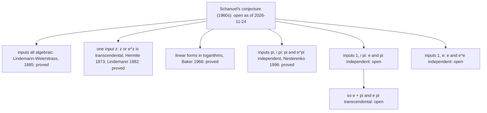

# Schanuel's conjecture: one statement that would settle almost every open question about transcendental numbers

[Syllabus](../../../SYLLABUS.md) → [Frontier](../README.md) → [Primes and Numbers](../README.md#s03) → Schanuel's conjecture

---

## General Overview

Add e ≈ 2.718281828459 and π ≈ 3.141592653590. The sum is about 5.859874482. Is that sum a root of some polynomial with whole-number coefficients, the way 1 + √2 is a root of $`x^2 - 2x - 1`$? As of 2026-11-24, nobody knows. Nobody has even proved that e + π is irrational.

That is strange, because e and π on their own are settled. Charles Hermite proved e **transcendental** (a root of no nonzero whole-number polynomial) in 1873. Ferdinand Lindemann did the same for π in 1882. What is missing is a fact about the pair: that no polynomial equation ties e and π together.

**Schanuel's conjecture**, posed by Stephen Schanuel in the 1960s, would supply that fact and far more. It is one sentence about the exponential function. Feed it the two numbers 1 and iπ, where i is the square root of −1, and it says e and π are **algebraically independent**: no nonzero whole-number polynomial in two variables vanishes at the pair. Then e + π and eπ are transcendental at once, by a few lines of algebra that this card proves.

Almost every known transcendence theorem about $`e^z`$ and logarithms is a special case. The Lindemann-Weierstrass theorem (1885) is the case where every input is algebraic. In 1996 Yuri Nesterenko proved one more case: π and $`e^{\pi}`$ are algebraically independent.

**If n complex numbers have no whole-number linear relation, then among those n numbers and their n exponentials at least n are algebraically independent; for the inputs 1 and iπ this would make e and π independent, so e + π and eπ would be transcendental.**

**What kind of fact this is:** a conjecture, open as of 2026-11-24: no accepted proof or disproof. Proved on this card: that the conjecture implies e and π are algebraically independent, and that this implies e + π and eπ are transcendental. The cases called proved below are theorems stated with their sources. Every search the code runs is evidence only.

### The picture: what the one statement would give, and what is already proved



Each "proved" box is a published theorem that the conjecture would also give. Each "open" box waits on the conjecture or on a new idea.

---

## The formula

Notation first, in words.

- Numbers $`z_1, \dots, z_n`$ are **linearly independent over the rationals** when no whole numbers $`a_1, \dots, a_n`$, not all 0, give $`a_1 z_1 + \dots + a_n z_n = 0`$. So 1 and √2 are independent; 1 and 2 are not, since 2 × 1 − 2 = 0.
- Numbers are **algebraically independent** when no nonzero polynomial with whole-number coefficients, in that many variables, vanishes at them. The pair e and $`e^2`$ is not: $`x^2 - y`$ vanishes at it.
- $`\mathbb{Q}`$ is the rationals. $`\mathbb{Q}(w_1, \dots, w_m)`$ is the **field generated** by the $`w`$s: every number you can reach from them and the rationals by adding, subtracting, multiplying and dividing.
- The **transcendence degree** of that field, written $`\mathrm{trdeg}`$, is the largest number of its members that are algebraically independent. If every $`w`$ is algebraic, it is 0. It can never exceed m, the number of generators.

**Schanuel's conjecture.** If $`z_1, \dots, z_n`$ are complex numbers, linearly independent over the rationals, then

```math
\mathrm{trdeg}\ \mathbb{Q}\left(z_1, \dots, z_n,\ e^{z_1}, \dots, e^{z_n}\right) \ \ge\ n
```

**Read it aloud:** take n complex numbers with no whole-number linear relation; the field made from them and their exponentials holds at least n algebraically independent numbers.

There are 2n generators and the conjecture asks for only n of them to be free. On the card's example, n = 2:

```math
z_1 = 1,\ z_2 = i\pi \quad\Rightarrow\quad \mathrm{trdeg}\ \mathbb{Q}(1,\ i\pi,\ e,\ -1) \ \ge\ 2
```

**Read it aloud:** with inputs 1 and i pi, the field made from 1, i pi, e and minus 1 holds at least two independent numbers.

Two of the four generators, 1 and −1, are algebraic. So the two that are left, e and iπ, must be the independent pair.

| Symbol | Plain meaning | In our example | Push it up and the answer… |
| --- | --- | --- | --- |
| $`z_1, \dots, z_n`$ | the inputs: complex numbers with no whole-number linear relation | 1 and iπ | more inputs, a stronger claim |
| $`n`$ | how many inputs; also the promised transcendence degree | 2 | more numbers promised free, still only half of 2n |
| $`e^{z}`$ | the exponential of an input | e ≈ 2.718281828 and $`e^{i\pi}`$ = −1 | — |
| $`i`$ | the square root of −1 | — | — |
| $`\mathbb{Q}`$, $`\mathbb{Q}(\ldots)`$ | the rationals; the field generated by the listed numbers | $`\mathbb{Q}(1, i\pi, e, -1)`$ | — |
| $`\mathrm{trdeg}`$ | transcendence degree: the most algebraically independent members | at least 2, if Schanuel holds | at most the number of generators |
| $`a, b`$ | whole numbers in a supposed linear relation $`a z_1 + b z_2 = 0`$ | none for 1 and iπ; −50 and 25 for 1 and 2 | a wider range finds smaller near-misses for 1 and √2, never 0 |
| $`g`$, $`d`$ | a whole-number polynomial in one variable, and its degree | the search's best $`-x^3 + 7x^2 - 6x - 4`$, d = 3 | a higher degree or range gets closer to 0 at e + π, and still proves nothing |
| $`P`$, $`X`$, $`Y`$ | a whole-number polynomial in two variables X and Y | $`P(X, Y) = g(X + Y)`$, 10 nonzero terms | more terms, and the $`X^d`$ coefficient is still g's leading one |
| $`R`$ | P times its mirror image, with i replaced by −i, in Step 4 | $`P(X, -iY)P(X, iY)`$ | — |
| $`t`$ | a spare variable: in the quadratic with roots e and π, and in Ax's power series | $`t^2 - (e + \pi)t + e\pi`$ | — |
| $`c_{jk}`$, $`b_m`$, $`j, k, m`$ | in the fold: the coefficients of P and of g, and their counting indices | $`b_3 = -1`$ | — |

### When it holds

- **Linear independence over the rationals.** Inputs 1 and 2 are dependent, and the field $`\mathbb{Q}(1, 2, e, e^2)`$ has transcendence degree only 1, because $`e^2 = e \cdot e`$. The code finds the relation −50 + 25 × 2 = 0.
- **At least n, not 2n.** For inputs 1 and iπ, the generators 1 and −1 are algebraic, so 2 is the most anyone could ask for. The conjecture's n is the best bound that holds in every case.
- **Complex inputs are allowed.** The example needs iπ. Restricting to real inputs would lose the step from $`e^{i\pi} = -1`$ to π.
- **Lower bound only.** The conjecture never says which n numbers are independent. In the example the choice is forced, because only two generators are not known to be algebraic.

---

## Why it works

The conjecture is unproved. This section proves what follows from it, shows which special cases are theorems, and says where each proof lives.

### Step 0: the exponential should create no relations it is not forced to

The exponential turns sums into products: $`e^{z_1 + z_2} = e^{z_1} e^{z_2}`$. That rule is the source of every known relation between the z's and the $`e^z`$'s. If inputs are linearly dependent, as 1 and 2 are, the rule hands you $`e^2 = e \cdot e`$.

Schanuel's guess is that nothing else ties them together. With no linear relation among the inputs, there should be no polynomial relations beyond what the count allows. Of 2n numbers, at least half stay free.

### Step 1: one input is a theorem

Take n = 1 and any nonzero z. The conjecture says z and $`e^z`$ are not both algebraic. That is the Hermite-Lindemann theorem: if z is algebraic and not 0, then $`e^z`$ is transcendental ([Transcendence of e and pi](../../21-Algebraic%20and%20analytic%20number%20theory/07-Diophantine%20and%20Modular/13-transcendence-of-e-and-pi.md) proves the cases z = 1 and z = iπ and states the general theorem with its source).

- z = 1 gives e transcendental (Hermite, 1873).
- z = iπ gives: iπ or −1 is transcendental. Since −1 is algebraic, iπ is transcendental, so π is (Lindemann, 1882).

### Step 2: all inputs algebraic is a theorem

Suppose every $`z_j`$ is algebraic. Then the z's add nothing to the transcendence degree, and the conjecture says the n exponentials $`e^{z_1}, \dots, e^{z_n}`$ are algebraically independent. That is exactly the Lindemann-Weierstrass theorem (1885), in its independence form ([Transcendence of e and pi](../../21-Algebraic%20and%20analytic%20number%20theory/07-Diophantine%20and%20Modular/13-transcendence-of-e-and-pi.md) states it in another form, with its source).

That form says: e raised to distinct algebraic powers, weighted by algebraic numbers not all 0, never adds up to 0. One step joins the two forms. Expand a polynomial relation among $`e^{z_1}, \dots, e^{z_n}`$. Each of its terms is a whole number times e raised to a whole-number combination of the z's, as in $`e^{z_1} e^{z_2} = e^{z_1 + z_2}`$. Those powers are algebraic, and they are distinct because the z's have no whole-number linear relation. So that form forbids the sum from being 0.

For example, inputs 1 and √2 are independent, because √2 is irrational (the code's smallest $`\lvert a + b\sqrt{2}\rvert`$ with a, b up to 50 is 0.012193309, at −41 + 29√2). So e and $`e^{\sqrt{2}}`$ ≈ 4.113250379 are algebraically independent. That is proved.

### Step 3: inputs 1 and iπ give e and iπ independent

The inputs are independent. If whole numbers a and b gave a + biπ = 0, the real part gives a = 0 and the imaginary part b = 0. The code's smallest $`\lvert a + bi\pi\rvert`$ is 1.

The exponentials are $`e^1 = e`$ and $`e^{i\pi} = -1`$. The code sums the exponential series at iπ and gets real part −1.000000000000, with imaginary part below $`10^{-12}`$.

So Schanuel says $`\mathbb{Q}(1, i\pi, e, -1) = \mathbb{Q}(i\pi, e)`$ has transcendence degree 2. A field made from two generators has degree 2 only if the two are independent. **So, if Schanuel holds, e and iπ are algebraically independent.**

### Step 4: from iπ to π

Suppose a nonzero whole-number polynomial P had $`P(e, \pi) = 0`$. Build a new polynomial by pairing $`P(X, iY)`$ with its mirror image, the same expression with i replaced by −i:

```math
R(X, Y) = P(X, -iY)\, P(X, iY)
```

**Read it aloud:** R is P with Y replaced by minus i Y, times P with Y replaced by i Y.

Three facts finish the step.

1. **R has whole-number coefficients.** Swapping i for −i swaps the two factors and leaves the product unchanged. So the i's cancel.
2. **R is not zero.** Each factor is a nonzero polynomial, and a product of nonzero polynomials is nonzero.
3. **R vanishes at (e, iπ).** The first factor becomes $`P(e, -i \cdot i\pi) = P(e, \pi) = 0`$.

That contradicts Step 3. **So Schanuel implies e and π are algebraically independent.**

### Step 5: from independence to e + π and eπ

Suppose e + π were algebraic. Then some nonzero whole-number polynomial g of degree d has $`g(e + \pi) = 0`$. Put

```math
P(X, Y) = g(X + Y)
```

**Read it aloud:** P of X and Y is g evaluated at X plus Y.

P is nonzero: expanding $`(X + Y)^d`$, the only $`X^d`$ term comes from g's top term, so the coefficient of $`X^d`$ is g's leading coefficient. And $`P(e, \pi) = g(e + \pi) = 0`$. That is a polynomial relation between e and π, which Step 4 forbids. So e + π is transcendental.

The same proof with $`P(X, Y) = g(XY)`$ handles eπ: the coefficient of $`X^d Y^d`$ is g's leading coefficient.

The code runs this step on a real g: the search's best cubic at e + π, $`g = -x^3 + 7x^2 - 6x - 4`$. It expands $`g(X + Y)`$ exactly, finds 10 nonzero terms with $`X^3`$ coefficient −1, and evaluates both sides. Both give −0.009469843.

<details>
<summary>Detailed proof: the Step 4 and Step 5 polynomials are nonzero</summary>

Write $`P = \sum c_{jk} X^j Y^k`$ with whole numbers $`c_{jk}`$, not all 0.

For Step 4: $`P(X, iY) = \sum c_{jk} i^k X^j Y^k`$ has a nonzero coefficient wherever P does, since $`i^k \ne 0`$. Polynomials over the complex numbers have no zero divisors: two nonzero polynomials never multiply to 0. To see it, order the monomials, the single terms $`X^j Y^k`$, lexicographically: the higher power of X wins, and a tie goes to the higher power of Y. This order respects multiplication, so the product of the two highest terms is a nonzero highest term of the product. Swapping i and −i maps $`P(X, iY)`$ to $`P(X, -iY)`$ and back, so it fixes R, so every coefficient of R is real and has no i part. The coefficients are sums of products of whole numbers and powers of i, so they are whole numbers.

For Step 5: write $`g(x) = \sum_{m=0}^{d} b_m x^m`$ with $`b_d \ne 0`$.

$`\displaystyle g(X + Y) = \sum_{m=0}^{d} b_m \sum_{j=0}^{m} \binom{m}{j} X^j Y^{m-j}`$

The monomial $`X^d`$ needs j = m = d, so its coefficient is $`b_d \binom{d}{d} = b_d \ne 0`$. For $`g(XY) = \sum b_m X^m Y^m`$ the coefficient of $`X^d Y^d`$ is $`b_d`$.

</details>

### Step 6: what is proved, and what would follow

| Inputs z | Schanuel would give | Status as of 2026-11-24 | Source |
| --- | --- | --- | --- |
| 1 | e transcendental | proved, 1873 | Hermite |
| iπ | π transcendental | proved, 1882 | Lindemann |
| any algebraic, independent | their exponentials independent | proved, 1885 | Lindemann-Weierstrass |
| π, iπ | π and $`e^{\pi}`$ ≈ 23.140692633 independent | proved, 1996 | Nesterenko |
| 1, iπ | e and π independent; e + π, eπ transcendental | open | — |
| 1, e | e and $`e^e`$ ≈ 15.154262241 independent | open | — |
| log 2, log 3 | log 2 and log 3 independent | open | — |

Two more proved results sit inside the conjecture.

- **Gelfond-Schneider (1934 and 1935) and Baker (1966).** Baker proved that logarithms of algebraic numbers with no whole-number linear relation have no linear relation with algebraic coefficients either ([Gelfond-Schneider](../../21-Algebraic%20and%20analytic%20number%20theory/07-Diophantine%20and%20Modular/14-gelfond-schneider-theorem.md) is the two-logarithm case). Schanuel asks for polynomial relations, not only linear ones.
- **The power-series version (Ax, 1971).** Replace the numbers by power series in a variable t with no constant term: sums of infinitely many powers of t, like polynomials that never stop. James Ax proved the analogue of the conjecture for them. The number version stays open.

**What the conjecture does not touch.** It speaks only about its inputs and their exponentials. Liouville's constant and Mahler's 1929 number are transcendental by other methods ([Chasing an algebraic number with fractions](../../21-Algebraic%20and%20analytic%20number%20theory/07-Diophantine%20and%20Modular/10-diophantine-approximation-liouville-to-roth.md)), and Schanuel does not give them. Nor does it settle every open question. No known argument derives from it that ζ(3), the sum of the reciprocals of the cubes, is transcendental, which is open as of 2026-11-24 ([Apery's theorem](../../21-Algebraic%20and%20analytic%20number%20theory/07-Diophantine%20and%20Modular/15-irrationality-of-zeta-three.md) gives its status and sources).

Nesterenko's case comes from inputs π and iπ. They are independent, because a real number plus a nonzero imaginary one is never 0. The generators are π, iπ, $`e^{\pi}`$ and −1, and the field they make holds at most two independent numbers, π and $`e^{\pi}`$. He proved those two are independent, by methods built on modular functions (functions with a large group of symmetries), not by Schanuel.

One weaker fact about e + π is proved. At least one of e + π and eπ is transcendental. Both e and π are roots of $`t^2 - (e + \pi)t + e\pi`$. That is an identity, true for any two numbers; the code checks it, with both residuals below $`10^{-12}`$. If both coefficients were algebraic, e would be too.

The status record, in the four audit fields:

| Field | Entry |
| --- | --- |
| Statement | Schanuel's conjecture, as above |
| Artifact | none: no claimed proof or disproof found as of 2026-11-24 |
| Independent check | not applicable |
| Status | open, as of 2026-11-24; suggested register row: Schanuel's conjecture, conjecture, open, checked 2026-11-24, source: the strongest proved case, π and $`e^{\pi}`$ independent, Nesterenko (1996) |

---

## Worked numbers, by hand

| Step | Arithmetic | Value |
| --- | --- | --- |
| inputs | $`z_1 = 1`$, $`z_2 = i\pi`$ | n = 2 |
| linear relation? | a + biπ = 0 forces a = b = 0; smallest size with a, b up to 50 | 1.000000000 |
| exponentials | $`e^1`$, and $`e^{i\pi}`$ by the series | 2.718281828, −1.000000000000 |
| generators | 1, iπ, e, −1; algebraic: 1 and −1 | 2 left: e and iπ |
| Schanuel's claim | transcendence degree at least n | e and iπ independent |
| pair the conjugates | $`P(X, -iY)P(X, iY)`$ | e and π independent |
| the sum | e + π | 5.859874482 |
| the product | eπ | 8.539734223 |
| conclusion | g(X + Y) and g(XY) are nonzero | **both transcendental, if Schanuel holds** |

**If Schanuel's conjecture holds, 5.859874482… and 8.539734223… solve no whole-number polynomial; as of 2026-11-24 neither is even known to be irrational.**

The searches show what evidence looks like, and why it is not proof:

| Target | Search | Smallest value found |
| --- | --- | --- |
| 1 + √2 (algebraic, calibration) | g of degree ≤ 3, coefficients ≤ 10 | below $`10^{-12}`$, at $`-5x^3 + 10x^2 + 5x = -5x(x^2 - 2x - 1)`$ |
| e + π | same | 0.009469843 |
| eπ | same | 0.053372436 |
| e and π together | P of degree ≤ 2, coefficients ≤ 4 | 0.000178238 |

The search finds the relation for 1 + √2 at once, and none for e + π. A bigger search would find smaller values. No finite search can show that none is ever 0.

### What breaks if you drop a piece

| Mistake | Comes out at | What went wrong |
| --- | --- | --- |
| Inputs with a linear relation: 1 and 2 | relation −50 + 25 × 2 = 0; $`e^2 - e \cdot e`$ below $`10^{-12}`$ | $`x^2 - y`$ vanishes at e, $`e^2`$; only 1 of 2 forced |
| Expecting 2n independent numbers | inputs 1, iπ: at most 4 − 2 = 2 independent, never 2n = 4 | 1 and −1 are algebraic; the conjecture asks only for n |
| "Each transcendental" read as "independent" | e and 1/e: $`4xy - 4`$ below $`10^{-12}`$ | both are transcendental, yet xy − 1 = 0 ties them |
| A search read as a proof | e + π: smallest 0.009469843 | the same search finds 1 + √2's relation; absence is evidence only |

---

## Code, from first principles, and it actually runs

The code computes e by its series and π by Machin's formula and checks both against the library. It sums the exponential series at iπ to get −1. It tests the inputs for linear relations by searching all whole a and b up to 50. It searches small polynomials for a relation at e + π, eπ and (e, π), and calibrates each search on numbers that have one: 1 + √2, (e, $`e^2`$) and (e, 1/e). Finally it expands $`g(X + Y)`$ exactly and checks it against $`g(e + \pi)`$. That is three independent cross-checks. Every search is evidence; no code can test the conjecture. There is no Lean section: the conjecture has no proof to check, and Step 5's algebra lemma, which Mathlib can state, has not been formalised for this card.

### Python

```python
# Schanuel's conjecture, status card: what it says for z = 1 and z = i*pi, the algebra step
# from "e and pi algebraically independent" to "e + pi transcendental", and small searches.
# Standard library only.  Schanuel is open, so every search here is evidence, not proof.
# Roads: constants by written-out series against the library; relation searches calibrated
# on numbers that do satisfy a relation; g(e + pi) against the expanded P(e, pi) = g(X + Y).
import math
from itertools import product
from math import comb

def exp_series(x):                          # e^x = sum x^k / k!, only +, * and /
    s, t = 0.0, 1.0
    for k in range(1, 80): s, t = s + t, t * x / k
    return s
def atan_inv(n):                            # arctan(1/n) = sum (-1)^k / ((2k+1) n^(2k+1))
    s, p, k = 0.0, 1.0 / n, 0
    while p > 1e-30: s, p, k = s + (-1) ** k * p / (2 * k + 1), p / (n * n), k + 1
    return s
def cexp_series(a, b):                      # e^(a + bi) by the series, complex product written out
    sr, si, tr, ti = 0.0, 0.0, 1.0, 0.0
    for k in range(1, 80):
        sr, si = sr + tr, si + ti
        tr, ti = (tr * a - ti * b) / k, (tr * b + ti * a) / k
    return sr, si

# ---- the constants, two roads each ----
e, pi = exp_series(1.0), 16 * atan_inv(5) - 4 * atan_inv(239)
assert abs(e - math.e) < 1e-15 and abs(pi - math.pi) < 1e-15        # series against library
print(f"e  = {e:.12f}   (series; library {math.e:.12f})")
print(f"pi = {pi:.12f}   (Machin; library {math.pi:.12f})")
er, ei = cexp_series(0.0, pi)
assert abs(er + 1) < 1e-12 and abs(ei) < 1e-12                       # e^(i pi) = -1
print(f"e^(i pi) by the series: real part {er:.12f}, |imaginary part| below 1e-12")
epi = exp_series(pi)
assert abs(epi - math.exp(pi)) < 1e-12 * epi
print(f"e^pi = {epi:.9f}   e^sqrt2 = {exp_series(math.sqrt(2)):.9f}   e^e = {exp_series(e):.9f}")
s, p = e + pi, e * pi
print(f"e + pi = {s:.9f}   e * pi = {p:.9f}")
assert abs(e * e - s * e + p) < 1e-12 and abs(pi * pi - s * pi + p) < 1e-12
print("e and pi are the roots of t^2 - (e + pi) t + e pi: both residuals below 1e-12")

# ---- linear independence over Q: smallest |a z1 + b z2|, a, b whole, |a|, |b| <= 50 ----
def lin_min(z1, z2):
    best = None
    for a, b in product(range(-50, 51), repeat=2):
        if (a, b) != (0, 0):
            w = a * z1 + b * z2
            v = math.sqrt(w.real * w.real + w.imag * w.imag)
            if best is None or v < best[0]: best = (v, a, b)
    return best
print("\nsmallest |a z1 + b z2| with whole a, b of size at most 50, not both 0")
for name, z1, z2 in [("1, sqrt2", 1.0, math.sqrt(2)), ("1, e", 1.0, e), ("1, i pi", 1.0, complex(0, pi)),
                     ("pi, i pi", complex(pi), complex(0, pi)), ("1, 2", 1.0, 2.0)]:
    v, a, b = lin_min(z1, z2)
    print(f"  {name:9s}  {v:.9f}  at a = {a}, b = {b}")
    if name == "1, 2": assert v == 0 and a == -2 * b                       # dependent: relation found
    else: assert v > 1e-3                                                   # independent: none

# ---- one-variable search: whole-number g of degree <= 3, coefficients of size <= 10 ----
def best_g(x):
    best = None
    for c in product(range(-10, 11), repeat=4):          # c = (a3, a2, a1, a0)
        if any(c):
            v = abs(((c[0] * x + c[1]) * x + c[2]) * x + c[3])
            if best is None or v < best[0]: best = (v, c)
    return best
def gtext(c): return " ".join(f"{t:+d}{m}" for t, m in zip(c, ["x^3", "x^2", "x", ""]) if t)
print("\nsmallest |g(x)|, g whole-number, degree <= 3, coefficients of size <= 10")
cal = best_g(1 + math.sqrt(2))
assert cal[0] < 1e-12                                                  # calibration: a root is found
print(f"  x = 1 + sqrt2 (algebraic):  below 1e-12, g = {gtext(cal[1])}")
gs, gp = best_g(s), best_g(p)
assert gs[0] > 1e-4 and gp[0] > 1e-4
print(f"  x = e + pi:  {gs[0]:.9f}  g = {gtext(gs[1])}")
print(f"  x = e pi:    {gp[0]:.9f}  g = {gtext(gp[1])}")

# ---- the algebra step: P(X, Y) = g(X + Y) is a nonzero polynomial ----
def expand_sum(c):                                     # g(X + Y) as {(i, j): coefficient of X^i Y^j}
    P, d = {}, len(c) - 1
    for k, a in enumerate(c):                          # a is the coefficient of x^(d - k)
        n = d - k
        for i in range(n + 1): P[(i, n - i)] = P.get((i, n - i), 0) + a * comb(n, i)
    return {m: v for m, v in P.items() if v}
c = gs[1]
lead = next(k for k, a in enumerate(c) if a)
P = expand_sum(c)
deg = len(c) - 1 - lead
assert P[(deg, 0)] == c[lead]                          # coefficient of X^d equals g's leading coefficient
val_P = sum(v * e ** i * pi ** j for (i, j), v in sorted(P.items()))
gval = ((c[0] * s + c[1]) * s + c[2]) * s + c[3]
assert abs(val_P - gval) < 1e-9                        # two roads to the same number
print(f"\ng(X + Y) for that g: {len(P)} nonzero terms, X^{deg} coefficient {P[(deg, 0)]}")
print(f"  g(e + pi) = {gval:.9f}   P(e, pi) from the expansion = {val_P:.9f}")

# ---- two-variable search: P(x, y) of total degree <= 2, coefficients of size <= 4 ----
def best_P(x, y):
    m, best = (1.0, x, y, x * x, x * y, y * y), None
    for c in product(range(-4, 5), repeat=6):
        if any(c):
            v = abs(c[0] * m[0] + c[1] * m[1] + c[2] * m[2] + c[3] * m[3] + c[4] * m[4] + c[5] * m[5])
            if best is None or v < best[0]: best = (v, c)
    return best
def ptext(c): return " ".join(f"{t:+d}{m}" for t, m in zip(c, ["", "x", "y", "x^2", "xy", "y^2"]) if t)
print("\nsmallest |P(x, y)|, total degree <= 2, coefficients of size <= 4")
for name, x, y in [("e, e^2", e, e * e), ("e, 1/e", e, 1 / e), ("e, pi", e, pi)]:
    v, cc = best_P(x, y)
    if name == "e, pi":
        assert v > 1e-4; print(f"  {name:7s} {v:.9f}  P = {ptext(cc)}")
    else:
        assert v < 1e-12; print(f"  {name:7s} below 1e-12  P = {ptext(cc)}")

# ---- what breaks, and the generator count ----
print("\nwhat breaks")
assert abs(exp_series(2.0) - e * e) < 1e-12
print("z = 1, 2 (dependent): e^2 - e*e below 1e-12, so x^2 - y vanishes at e, e^2: only 1 of 2 forced")
print("z = 1, i pi: generators 1, i pi, e, -1; algebraic: 1 and -1; so at most 4 - 2 = 2, never 2n = 4")
print("e and 1/e: each transcendental, yet xy - 1 = 0: 'each transcendental' is not 'independent'")

print("\ntry changing")
print(f"e^pi - pi = {epi - pi:.9f}")
print(f"z = 1, sqrt3:  smallest |a + b sqrt3| = {lin_min(1.0, math.sqrt(3))[0]:.9f}")
print(f"x = e - pi = {e - pi:.9f}:  smallest |g| = {best_g(e - pi)[0]:.9f}")
print("ALL CHECKS PASS")
```

**Ran 2026-11-24 on macOS, Python 3.14.10, standard library only. All checks passed. Output, pasted from the run:**

```
e  = 2.718281828459   (series; library 2.718281828459)
pi = 3.141592653590   (Machin; library 3.141592653590)
e^(i pi) by the series: real part -1.000000000000, |imaginary part| below 1e-12
e^pi = 23.140692633   e^sqrt2 = 4.113250379   e^e = 15.154262241
e + pi = 5.859874482   e * pi = 8.539734223
e and pi are the roots of t^2 - (e + pi) t + e pi: both residuals below 1e-12

smallest |a z1 + b z2| with whole a, b of size at most 50, not both 0
  1, sqrt2   0.012193309  at a = -41, b = 29
  1, e       0.027972799  at a = -19, b = 7
  1, i pi    1.000000000  at a = -1, b = 0
  pi, i pi   3.141592654  at a = -1, b = 0
  1, 2       0.000000000  at a = -50, b = 25

smallest |g(x)|, g whole-number, degree <= 3, coefficients of size <= 10
  x = 1 + sqrt2 (algebraic):  below 1e-12, g = -5x^3 +10x^2 +5x
  x = e + pi:  0.009469843  g = -1x^3 +7x^2 -6x -4
  x = e pi:    0.053372436  g = -1x^3 +9x^2 -3x -8

g(X + Y) for that g: 10 nonzero terms, X^3 coefficient -1
  g(e + pi) = -0.009469843   P(e, pi) from the expansion = -0.009469843

smallest |P(x, y)|, total degree <= 2, coefficients of size <= 4
  e, e^2  below 1e-12  P = -4y +4x^2
  e, 1/e  below 1e-12  P = -4 +4xy
  e, pi   0.000178238  P = -3 -3x -2y +2x^2 -2xy +2y^2

what breaks
z = 1, 2 (dependent): e^2 - e*e below 1e-12, so x^2 - y vanishes at e, e^2: only 1 of 2 forced
z = 1, i pi: generators 1, i pi, e, -1; algebraic: 1 and -1; so at most 4 - 2 = 2, never 2n = 4
e and 1/e: each transcendental, yet xy - 1 = 0: 'each transcendental' is not 'independent'

try changing
e^pi - pi = 19.999099979
z = 1, sqrt3:  smallest |a + b sqrt3| = 0.019237886
x = e - pi = -0.423310825:  smallest |g| = 0.000083298
ALL CHECKS PASS
```

### Rust

Same numbers, same labels, built with `rustc --edition 2021 -O`.

```rust
// Schanuel's conjecture, status card: what it says for z = 1 and z = i*pi, the algebra step
// from "e and pi algebraically independent" to "e + pi transcendental", and small searches.
// Rust std only, no crates.  Schanuel is open, so every search here is evidence, not proof.
// Roads: constants by written-out series against the library; relation searches calibrated
// on numbers that do satisfy a relation; g(e + pi) against the expanded P(e, pi) = g(X + Y).
use std::collections::BTreeMap;

fn exp_series(x: f64) -> f64 { // e^x = sum x^k / k!, only +, * and /
    let (mut s, mut t) = (0.0f64, 1.0f64);
    for k in 1..80 { s += t; t = t * x / k as f64; }
    s
}
fn atan_inv(n: f64) -> f64 { // arctan(1/n) = sum (-1)^k / ((2k+1) n^(2k+1))
    let (mut s, mut p, mut k) = (0.0f64, 1.0 / n, 0i32);
    while p > 1e-30 { s += (if k % 2 == 0 { 1.0 } else { -1.0 }) * p / (2 * k + 1) as f64; p = p / (n * n); k += 1; }
    s
}
fn cexp_series(a: f64, b: f64) -> (f64, f64) { // e^(a + bi) by the series, complex product written out
    let (mut sr, mut si, mut tr, mut ti) = (0.0f64, 0.0f64, 1.0f64, 0.0f64);
    for k in 1..80 {
        sr += tr; si += ti;
        let (nr, ni) = ((tr * a - ti * b) / k as f64, (tr * b + ti * a) / k as f64);
        tr = nr; ti = ni;
    }
    (sr, si)
}
// smallest |a z1 + b z2| with whole a, b of size at most 50, not both 0; z = (real, imaginary)
fn lin_min(z1: (f64, f64), z2: (f64, f64)) -> (f64, i64, i64) {
    let mut best: Option<(f64, i64, i64)> = None;
    for a in -50i64..=50 { for b in -50i64..=50 {
        if a == 0 && b == 0 { continue; }
        let (wr, wi) = (a as f64 * z1.0 + b as f64 * z2.0, a as f64 * z1.1 + b as f64 * z2.1);
        let v = (wr * wr + wi * wi).sqrt();
        if best.map_or(true, |q| v < q.0) { best = Some((v, a, b)); }
    } }
    best.unwrap()
}
fn horner(c: &[i64; 4], x: f64) -> f64 { ((c[0] as f64 * x + c[1] as f64) * x + c[2] as f64) * x + c[3] as f64 }
fn best_g(x: f64) -> (f64, [i64; 4]) { // whole-number g of degree <= 3, coefficients of size <= 10
    let mut best: Option<(f64, [i64; 4])> = None;
    for a3 in -10..=10 { for a2 in -10..=10 { for a1 in -10..=10 { for a0 in -10..=10 {
        let c = [a3, a2, a1, a0];
        if c == [0, 0, 0, 0] { continue; }
        let v = horner(&c, x).abs();
        if best.map_or(true, |q| v < q.0) { best = Some((v, c)); }
    } } } }
    best.unwrap()
}
fn text(c: &[i64], names: &[&str]) -> String {
    c.iter().zip(names).filter(|(t, _)| **t != 0).map(|(t, m)| format!("{:+}{}", t, m)).collect::<Vec<_>>().join(" ")
}
fn binom(n: i64, k: i64) -> i64 { (0..k).fold(1, |acc, i| acc * (n - i) / (i + 1)) }
fn best_p(x: f64, y: f64) -> (f64, [i64; 6]) { // P(x, y) of total degree <= 2, coefficients of size <= 4
    let m = [1.0, x, y, x * x, x * y, y * y];
    let mut best: Option<(f64, [i64; 6])> = None;
    let mut c = [-4i64; 6];
    loop {
        if c != [0; 6] {
            let v = (c[0] as f64 * m[0] + c[1] as f64 * m[1] + c[2] as f64 * m[2] + c[3] as f64 * m[3]
                + c[4] as f64 * m[4] + c[5] as f64 * m[5]).abs();
            if best.map_or(true, |q| v < q.0) { best = Some((v, c)); }
        }
        let mut i = 5; // next tuple, last place fastest
        loop { if c[i] < 4 { c[i] += 1; break; } c[i] = -4; if i == 0 { return best.unwrap(); } i -= 1; }
    }
}
fn main() {
    // ---- the constants, two roads each ----
    let (e, pi) = (exp_series(1.0), 16.0 * atan_inv(5.0) - 4.0 * atan_inv(239.0));
    assert!((e - std::f64::consts::E).abs() < 1e-15 && (pi - std::f64::consts::PI).abs() < 1e-15);
    println!("e  = {:.12}   (series; library {:.12})", e, std::f64::consts::E);
    println!("pi = {:.12}   (Machin; library {:.12})", pi, std::f64::consts::PI);
    let (er, ei) = cexp_series(0.0, pi);
    assert!((er + 1.0).abs() < 1e-12 && ei.abs() < 1e-12); // e^(i pi) = -1
    println!("e^(i pi) by the series: real part {:.12}, |imaginary part| below 1e-12", er);
    let epi = exp_series(pi);
    assert!((epi - pi.exp()).abs() < 1e-12 * epi);
    println!("e^pi = {:.9}   e^sqrt2 = {:.9}   e^e = {:.9}", epi, exp_series(2f64.sqrt()), exp_series(e));
    let (s, p) = (e + pi, e * pi);
    println!("e + pi = {:.9}   e * pi = {:.9}", s, p);
    assert!((e * e - s * e + p).abs() < 1e-12 && (pi * pi - s * pi + p).abs() < 1e-12);
    println!("e and pi are the roots of t^2 - (e + pi) t + e pi: both residuals below 1e-12");

    // ---- linear independence over Q ----
    println!("\nsmallest |a z1 + b z2| with whole a, b of size at most 50, not both 0");
    let cases = [("1, sqrt2", (1.0, 0.0), (2f64.sqrt(), 0.0)), ("1, e", (1.0, 0.0), (e, 0.0)),
                 ("1, i pi", (1.0, 0.0), (0.0, pi)), ("pi, i pi", (pi, 0.0), (0.0, pi)), ("1, 2", (1.0, 0.0), (2.0, 0.0))];
    for (name, z1, z2) in cases {
        let (v, a, b) = lin_min(z1, z2);
        println!("  {:9}  {:.9}  at a = {}, b = {}", name, v, a, b);
        if name == "1, 2" { assert!(v == 0.0 && a == -2 * b); } else { assert!(v > 1e-3); }
    }

    // ---- one-variable search ----
    let gn = ["x^3", "x^2", "x", ""];
    println!("\nsmallest |g(x)|, g whole-number, degree <= 3, coefficients of size <= 10");
    let cal = best_g(1.0 + 2f64.sqrt());
    assert!(cal.0 < 1e-12); // calibration: a root is found
    println!("  x = 1 + sqrt2 (algebraic):  below 1e-12, g = {}", text(&cal.1, &gn));
    let (gs, gp) = (best_g(s), best_g(p));
    assert!(gs.0 > 1e-4 && gp.0 > 1e-4);
    println!("  x = e + pi:  {:.9}  g = {}", gs.0, text(&gs.1, &gn));
    println!("  x = e pi:    {:.9}  g = {}", gp.0, text(&gp.1, &gn));

    // ---- the algebra step: P(X, Y) = g(X + Y) is a nonzero polynomial ----
    let c = gs.1;
    let mut pm: BTreeMap<(i64, i64), i64> = BTreeMap::new(); // (i, j) -> coefficient of X^i Y^j
    for (k, &a) in c.iter().enumerate() {
        let n = 3 - k as i64;
        for i in 0..=n { *pm.entry((i, n - i)).or_insert(0) += a * binom(n, i); }
    }
    pm.retain(|_, v| *v != 0);
    let lead = c.iter().position(|&a| a != 0).unwrap();
    let deg = 3 - lead as i64;
    assert!(pm[&(deg, 0)] == c[lead]); // coefficient of X^d equals g's leading coefficient
    let val_p: f64 = pm.iter().map(|(&(i, j), &v)| v as f64 * e.powi(i as i32) * pi.powi(j as i32)).sum();
    let gval = horner(&c, s);
    assert!((val_p - gval).abs() < 1e-9); // two roads to the same number
    println!("\ng(X + Y) for that g: {} nonzero terms, X^{} coefficient {}", pm.len(), deg, pm[&(deg, 0)]);
    println!("  g(e + pi) = {:.9}   P(e, pi) from the expansion = {:.9}", gval, val_p);

    // ---- two-variable search ----
    let pn = ["", "x", "y", "x^2", "xy", "y^2"];
    println!("\nsmallest |P(x, y)|, total degree <= 2, coefficients of size <= 4");
    for (name, x, y) in [("e, e^2", e, e * e), ("e, 1/e", e, 1.0 / e), ("e, pi", e, pi)] {
        let (v, cc) = best_p(x, y);
        if name == "e, pi" { assert!(v > 1e-4); println!("  {:7} {:.9}  P = {}", name, v, text(&cc, &pn)); }
        else { assert!(v < 1e-12); println!("  {:7} below 1e-12  P = {}", name, text(&cc, &pn)); }
    }

    // ---- what breaks, and the generator count ----
    println!("\nwhat breaks");
    assert!((exp_series(2.0) - e * e).abs() < 1e-12);
    println!("z = 1, 2 (dependent): e^2 - e*e below 1e-12, so x^2 - y vanishes at e, e^2: only 1 of 2 forced");
    println!("z = 1, i pi: generators 1, i pi, e, -1; algebraic: 1 and -1; so at most 4 - 2 = 2, never 2n = 4");
    println!("e and 1/e: each transcendental, yet xy - 1 = 0: 'each transcendental' is not 'independent'");

    println!("\ntry changing");
    println!("e^pi - pi = {:.9}", epi - pi);
    println!("z = 1, sqrt3:  smallest |a + b sqrt3| = {:.9}", lin_min((1.0, 0.0), (3f64.sqrt(), 0.0)).0);
    println!("x = e - pi = {:.9}:  smallest |g| = {:.9}", e - pi, best_g(e - pi).0);
    println!("ALL CHECKS PASS");
}
```

**Ran 2026-11-24 on macOS, rustc 1.98.1, no crates. All checks passed. Output, pasted from the run:**

```
e  = 2.718281828459   (series; library 2.718281828459)
pi = 3.141592653590   (Machin; library 3.141592653590)
e^(i pi) by the series: real part -1.000000000000, |imaginary part| below 1e-12
e^pi = 23.140692633   e^sqrt2 = 4.113250379   e^e = 15.154262241
e + pi = 5.859874482   e * pi = 8.539734223
e and pi are the roots of t^2 - (e + pi) t + e pi: both residuals below 1e-12

smallest |a z1 + b z2| with whole a, b of size at most 50, not both 0
  1, sqrt2   0.012193309  at a = -41, b = 29
  1, e       0.027972799  at a = -19, b = 7
  1, i pi    1.000000000  at a = -1, b = 0
  pi, i pi   3.141592654  at a = -1, b = 0
  1, 2       0.000000000  at a = -50, b = 25

smallest |g(x)|, g whole-number, degree <= 3, coefficients of size <= 10
  x = 1 + sqrt2 (algebraic):  below 1e-12, g = -5x^3 +10x^2 +5x
  x = e + pi:  0.009469843  g = -1x^3 +7x^2 -6x -4
  x = e pi:    0.053372436  g = -1x^3 +9x^2 -3x -8

g(X + Y) for that g: 10 nonzero terms, X^3 coefficient -1
  g(e + pi) = -0.009469843   P(e, pi) from the expansion = -0.009469843

smallest |P(x, y)|, total degree <= 2, coefficients of size <= 4
  e, e^2  below 1e-12  P = -4y +4x^2
  e, 1/e  below 1e-12  P = -4 +4xy
  e, pi   0.000178238  P = -3 -3x -2y +2x^2 -2xy +2y^2

what breaks
z = 1, 2 (dependent): e^2 - e*e below 1e-12, so x^2 - y vanishes at e, e^2: only 1 of 2 forced
z = 1, i pi: generators 1, i pi, e, -1; algebraic: 1 and -1; so at most 4 - 2 = 2, never 2n = 4
e and 1/e: each transcendental, yet xy - 1 = 0: 'each transcendental' is not 'independent'

try changing
e^pi - pi = 19.999099979
z = 1, sqrt3:  smallest |a + b sqrt3| = 0.019237886
x = e - pi = -0.423310825:  smallest |g| = 0.000083298
ALL CHECKS PASS
```

### Lean

Lean proves what would follow from Schanuel's conjecture, and the card's small identities; it does not prove the conjecture itself.

- Suppose Schanuel's conjecture holds. Then e and π are algebraically independent, and e + π and eπ are transcendental.
- Take any two real numbers that are algebraically independent. Then their sum and their product are both transcendental.
- Take any transcendental x and any real y. Then at least one of x + y and xy is transcendental.
- With x = e this gives the proved weaker fact. Hermite's 1873 theorem that e is transcendental is cited, not checked in Lean.
- Inputs 1 and 2 are dependent, since −50 + 25 × 2 = 0. So $`x^2 - y`$ vanishes at e and $`e^2`$.
- The exponential of iπ is exactly −1: $`e^{i\pi} = -1`$.
- The generator count for inputs 1 and iπ: 4 − 2 = 2, while 2n = 4.
- e and 1/e satisfy xy − 1 = 0.
- The calibration cubic factors: $`-5x^3 + 10x^2 + 5x = -5x(x^2 - 2x - 1)`$. And 1 + √2 is a root of $`x^2 - 2x - 1`$.
- Take the search's cubic $`g = -x^3 + 7x^2 - 6x - 4`$. Then $`g(X + Y)`$ expands to 10 nonzero terms, with $`X^3`$ coefficient −1.
- Take any two real numbers x and y. Then both are roots of $`t^2 - (x + y)t + xy`$.

The Python and Rust checks keep the decimal values and the searches, which are evidence only.

```lean
-- Schanuel's conjecture: if Schanuel's conjecture holds, then e and π are algebraically independent and e + π and eπ are transcendental.
import Mathlib.RingTheory.AlgebraicIndependent.Basic
import Mathlib.RingTheory.Algebraic.Defs
import Mathlib.FieldTheory.IntermediateField.Adjoin.Basic
import Mathlib.Analysis.SpecialFunctions.Trigonometric.Basic
import Mathlib.Analysis.SpecialFunctions.Exp
import Mathlib.Analysis.Real.Sqrt
import Mathlib.RingTheory.AlgebraicIndependent.TranscendenceBasis
import Mathlib.RingTheory.AlgebraicIndependent.Transcendental
import Mathlib.Analysis.Complex.IsIntegral
import Mathlib.Tactic.ComputeDegree
import Mathlib.LinearAlgebra.LinearIndependent.Lemmas

/-- Schanuel's conjecture (open as of 2026-11-24; the card does not prove it): if the complex
numbers z₁, …, zₙ are linearly independent over the rationals, then the field generated over
the rationals by z₁, …, zₙ and e^z₁, …, e^zₙ has transcendence degree at least n. -/
def SchanuelConjecture : Prop :=
  ∀ (n : ℕ) (z : Fin n → ℂ), LinearIndependent ℚ z →
    (n : Cardinal) ≤ Algebra.trdeg ℚ
      (IntermediateField.adjoin ℚ (Set.range z ∪ Set.range (fun j => Complex.exp (z j))))

/-- Helper: a pair a, b is algebraically independent over the rationals exactly when a is
transcendental and b is transcendental over the rational algebra generated by a. -/
lemma schanuel_aux_pair_iff {A : Type*} [CommRing A] [Algebra ℚ A] (a b : A) :
    AlgebraicIndependent ℚ ![a, b] ↔
      Transcendental ℚ a ∧ Transcendental (Algebra.adjoin ℚ {a}) b := by
  have hs : Subsingleton {j : Fin 2 // j ≠ 1} :=
    have h0 : ∀ k : Fin 2, k ≠ 1 → k = 0 := by decide
    ⟨fun ⟨i, hi⟩ ⟨j, hj⟩ => Subtype.ext ((h0 i hi).trans (h0 j hj).symm)⟩
  have him : (![a, b] '' ({1}ᶜ : Set (Fin 2))) = {a} := by
    ext c; simp [Fin.exists_fin_two, eq_comm]
  rw [AlgebraicIndependent.iff_transcendental_adjoin_image 1,
    algebraicIndependent_singleton_iff ⟨0, by decide⟩, him]
  simp

/-- Helper (the content of Step 5): if x and y are algebraically independent, then x + y and xy
are transcendental, since y = (x + y) − x and y = xy / x would otherwise be algebraic over ℚ[x]. -/
lemma schanuel_aux_add_mul (x y : ℝ) (h : AlgebraicIndependent ℚ ![x, y]) :
    Transcendental ℚ (x + y) ∧ Transcendental ℚ (x * y) := by
  rw [schanuel_aux_pair_iff] at h
  obtain ⟨hx, hy⟩ := h
  have hinj : Function.Injective (algebraMap ℚ (Algebra.adjoin ℚ ({x} : Set ℝ))) :=
    (algebraMap ℚ _).injective
  have hxR : IsAlgebraic (Algebra.adjoin ℚ ({x} : Set ℝ)) x := by
    simpa using isAlgebraic_algebraMap (R := Algebra.adjoin ℚ ({x} : Set ℝ)) (A := ℝ)
      ⟨x, Algebra.self_mem_adjoin_singleton ℚ x⟩
  constructor
  · intro hs
    apply hy
    have := (hs.extendScalars hinj).sub hxR
    simpa using this
  · intro hp
    apply hy
    exact IsAlgebraic.of_mul (mem_nonZeroDivisors_of_ne_zero hx.ne_zero) hxR
      (hp.extendScalars hinj)

/-- Helper: Schanuel's conjecture with z = (1, iπ) makes e and π algebraically independent. -/
lemma schanuel_aux_e_pi (h : SchanuelConjecture) :
    AlgebraicIndependent ℚ ![Real.exp 1, Real.pi] := by
  set z : Fin 2 → ℂ := ![1, (Real.pi : ℂ) * Complex.I] with hz_def
  have hz : LinearIndependent ℚ z := by
    rw [hz_def, LinearIndependent.pair_iff]
    intro s t hst
    have hre := congrArg Complex.re hst
    have him := congrArg Complex.im hst
    simp [Rat.smul_def] at hre him
    exact ⟨hre, him⟩
  have htr := h 2 z hz
  set S : Set ℂ := Set.range z ∪ Set.range (fun j => Complex.exp (z j)) with hS
  have he : ((Real.exp 1 : ℝ) : ℂ) ∈ IntermediateField.adjoin ℚ S :=
    IntermediateField.subset_adjoin ℚ S (Or.inr ⟨0, by simp [z, Complex.ofReal_exp]⟩)
  have hb : ((Real.pi : ℂ) * Complex.I) ∈ IntermediateField.adjoin ℚ S :=
    IntermediateField.subset_adjoin ℚ S (Or.inl ⟨1, by simp [z]⟩)
  let a : IntermediateField.adjoin ℚ S := ⟨_, he⟩
  let b : IntermediateField.adjoin ℚ S := ⟨_, hb⟩
  have ha2 : a ∈ Algebra.adjoin ℚ (Set.range ![a, b]) := Algebra.subset_adjoin ⟨0, rfl⟩
  have hb2 : b ∈ Algebra.adjoin ℚ (Set.range ![a, b]) := Algebra.subset_adjoin ⟨1, rfl⟩
  have halg : Algebra.IsAlgebraic (Algebra.adjoin ℚ (Set.range ![a, b]))
      (IntermediateField.adjoin ℚ S) := by
    constructor
    rintro ⟨k, hk⟩
    induction hk using IntermediateField.adjoin_induction with
    | mem x hx =>
      rcases hx with ⟨j, rfl⟩ | ⟨j, rfl⟩ <;> fin_cases j
      · convert isAlgebraic_algebraMap (R := Algebra.adjoin ℚ (Set.range ![a, b]))
          (A := IntermediateField.adjoin ℚ S) 1 using 1
        ext; simp [z]
      · convert isAlgebraic_algebraMap (R := Algebra.adjoin ℚ (Set.range ![a, b]))
          (A := IntermediateField.adjoin ℚ S) ⟨b, hb2⟩ using 1
        ext; simp [z, b]
      · convert isAlgebraic_algebraMap (R := Algebra.adjoin ℚ (Set.range ![a, b]))
          (A := IntermediateField.adjoin ℚ S) ⟨a, ha2⟩ using 1
        ext; simp [z, a, Complex.ofReal_exp]
      · convert isAlgebraic_algebraMap (R := Algebra.adjoin ℚ (Set.range ![a, b]))
          (A := IntermediateField.adjoin ℚ S) (-1) using 1
        ext; simp [z, Complex.exp_pi_mul_I]
    | algebraMap q =>
      convert isAlgebraic_algebraMap (R := Algebra.adjoin ℚ (Set.range ![a, b]))
          (A := IntermediateField.adjoin ℚ S) (algebraMap ℚ _ q) using 1
      ext; rfl
    | add x y hx hy ihx ihy => exact ihx.add ihy
    | inv x hx ih => exact ih.inv
    | mul x y hx hy ihx ihy => exact ihx.mul ihy
  have hbasis := Algebra.IsAlgebraic.isTranscendenceBasis_of_le_trdeg_of_finite ℚ ![a, b]
    (by rw [Cardinal.mk_fin]; exact htr)
  have hK := hbasis.1.map' (f := (IntermediateField.adjoin ℚ S).val) Subtype.val_injective
  have hcomp : ((IntermediateField.adjoin ℚ S).val ∘ ![a, b]) =
      ![((Real.exp 1 : ℝ) : ℂ), (Real.pi : ℂ) * Complex.I] := by
    ext i; fin_cases i <;> rfl
  rw [hcomp, schanuel_aux_pair_iff] at hK
  obtain ⟨T1, T2⟩ := hK
  have T3 : Transcendental (Algebra.adjoin ℚ {((Real.exp 1 : ℝ) : ℂ)}) (Real.pi : ℂ) := by
    intro hπ
    exact T2 (hπ.mul (Complex.isIntegral_I _).isAlgebraic)
  have hC := (schanuel_aux_pair_iff _ _).mpr ⟨T1, T3⟩
  apply AlgebraicIndependent.of_comp (Complex.ofRealAm.restrictScalars ℚ)
  convert hC using 1
  ext i; fin_cases i <;> rfl

#print axioms schanuel_aux_pair_iff
#print axioms schanuel_aux_add_mul
#print axioms schanuel_aux_e_pi

/-- If Schanuel's conjecture holds, then e and π are algebraically independent (no nonzero
polynomial with rational, equivalently whole-number, coefficients in two variables vanishes at
the pair), and so e + π and eπ are both transcendental. -/
theorem schanuel_implies_e_pi_independent_and_sum_product_transcendental
    (h : SchanuelConjecture) :
    AlgebraicIndependent ℚ ![Real.exp 1, Real.pi] ∧
      Transcendental ℚ (Real.exp 1 + Real.pi) ∧ Transcendental ℚ (Real.exp 1 * Real.pi) := by
  have hind := schanuel_aux_e_pi h
  exact ⟨hind, schanuel_aux_add_mul _ _ hind⟩

/-- Step 5: if two real numbers x and y are algebraically independent over the rationals, then
their sum x + y and their product xy are both transcendental. -/
theorem add_and_mul_transcendental_of_algebraicIndependent (x y : ℝ)
    (h : AlgebraicIndependent ℚ ![x, y]) :
    Transcendental ℚ (x + y) ∧ Transcendental ℚ (x * y) := by
  exact schanuel_aux_add_mul x y h

/-- The proved weaker fact, in general: if x is transcendental, then for any real y at least one
of x + y and xy is transcendental, because x is a root of t² − (x + y)t + xy. With x = e
(transcendental by Hermite, 1873) this says at least one of e + π and eπ is transcendental. -/
theorem add_or_mul_transcendental_of_transcendental (x y : ℝ) (hx : Transcendental ℚ x) :
    Transcendental ℚ (x + y) ∨ Transcendental ℚ (x * y) := by
  by_contra hcon
  rw [not_or] at hcon
  obtain ⟨hs, hp⟩ := hcon
  simp only [Transcendental, not_not] at hs hp
  have : Algebra.IsAlgebraic ℚ (Algebra.adjoin ℚ ({x + y, x * y} : Set ℝ)) :=
    (Subalgebra.isAlgebraic_iff _).mp
      (Algebra.isAlgebraic_adjoin_iff.mpr (by rintro z (rfl | rfl) <;> assumption))
  apply hx
  have hint : IsIntegral (Algebra.adjoin ℚ ({x + y, x * y} : Set ℝ)) x := by
    refine ⟨Polynomial.X ^ 2 - Polynomial.C ⟨x + y, Algebra.subset_adjoin (by simp)⟩ * Polynomial.X +
      Polynomial.C ⟨x * y, Algebra.subset_adjoin (by simp)⟩, ?_, ?_⟩
    · monicity!
    · simp; ring
  exact hint.isAlgebraic.restrictScalars ℚ

-- Inputs 1 and 2 are linearly dependent: −50 · 1 + 25 · 2 = 0.
example : (-50 : ℤ) * 1 + 25 * 2 = 0 := by norm_num
-- So e and e² satisfy x² − y = 0.
example : Real.exp 1 ^ 2 - Real.exp 2 = 0 := by
  rw [← Real.exp_nat_mul]; norm_num
-- The second exponential in the example: e^(iπ) = −1.
example : Complex.exp (Real.pi * Complex.I) = -1 := Complex.exp_pi_mul_I
-- Generators 1, iπ, e, −1; two are algebraic, so at most 4 − 2 = 2 are independent, never 2n = 4.
example : 4 - 2 = 2 ∧ 2 * 2 = 4 := by norm_num
-- e and 1/e are each transcendental, yet xy − 1 vanishes at them.
example : Real.exp 1 * (1 / Real.exp 1) - 1 = 0 := by
  field_simp; ring
-- The calibration: −5x³ + 10x² + 5x = −5x(x² − 2x − 1), and 1 + √2 is a root of x² − 2x − 1.
example (x : ℤ) : -5 * x ^ 3 + 10 * x ^ 2 + 5 * x = -5 * x * (x ^ 2 - 2 * x - 1) := by ring
example : (1 + Real.sqrt 2) ^ 2 - 2 * (1 + Real.sqrt 2) - 1 = 0 := by
  nlinarith [Real.sq_sqrt (show (0 : ℝ) ≤ 2 by norm_num)]
-- The search's cubic g = −x³ + 7x² − 6x − 4: g(X + Y) has 10 nonzero terms and X³ coefficient −1.
example (X Y : ℤ) : -(X + Y) ^ 3 + 7 * (X + Y) ^ 2 - 6 * (X + Y) - 4 =
    -X ^ 3 - 3 * X ^ 2 * Y - 3 * X * Y ^ 2 - Y ^ 3 + 7 * X ^ 2 + 14 * X * Y + 7 * Y ^ 2
      - 6 * X - 6 * Y - 4 := by ring
-- Any x and y are the roots of t² − (x + y)t + xy; with x = e and y = π this is the card's identity.
example (x y : ℝ) : x ^ 2 - (x + y) * x + x * y = 0 ∧ y ^ 2 - (x + y) * y + x * y = 0 := by
  constructor <;> ring

#print axioms schanuel_implies_e_pi_independent_and_sum_product_transcendental
#print axioms add_and_mul_transcendental_of_algebraicIndependent
#print axioms add_or_mul_transcendental_of_transcendental
```

**Checked 2026-11-24 on macOS, Lean 4.36.0-rc2, Mathlib v4.36.0-rc2. Every proof is complete and uses only Lean's standard axioms. Output, pasted from the run:**

```
'schanuel_aux_pair_iff' depends on axioms: [propext, Classical.choice, Quot.sound]
'schanuel_aux_add_mul' depends on axioms: [propext, Classical.choice, Quot.sound]
'schanuel_aux_e_pi' depends on axioms: [propext, Classical.choice, Quot.sound]
'schanuel_implies_e_pi_independent_and_sum_product_transcendental' depends on axioms: [propext, Classical.choice, Quot.sound]
'add_and_mul_transcendental_of_algebraicIndependent' depends on axioms: [propext, Classical.choice, Quot.sound]
'add_or_mul_transcendental_of_transcendental' depends on axioms: [propext, Classical.choice, Quot.sound]
```

> [!TIP]
> **Try changing**
> - Guess first: is $`e^{\pi} - \pi`$ a whole number? Print `epi - pi`. Answer: 19.999099979, close to 20 but not 20. It is in fact transcendental: Nesterenko's independence of π and $`e^{\pi}`$ gives that by Step 5's argument with $`g(X - Y)`$.
> - Guess first: do 1 and √3 have a small linear relation? Call `lin_min(1.0, math.sqrt(3))`. Answer: no; the smallest size is 0.019237886.
> - Guess first: does the cubic search come closer at e − π than at e + π? Call `best_g(e - pi)`. Answer: yes, 0.000083298 against 0.009469843; e − π ≈ −0.423310825 is closer to 0, so small polynomials reach near 0 more easily. It proves nothing either way.

---

## The usual mistake

> [!warning]
> **Saying e + π is known to be transcendental.** It is not, as of 2026-11-24. Its transcendence follows from Schanuel's conjecture, which is open. Even its irrationality is unproved. What is proved is weaker: at least one of e + π and eπ is transcendental.
>
> - **Confusing Nesterenko's pair with e and π.** Nesterenko (1996) proved π and $`e^{\pi}`$ ≈ 23.140692633 independent. That is a different pair: inputs π and iπ, not 1 and iπ.
> - **Reading "each transcendental" as "independent".** e and 1/e are both transcendental, yet the code finds $`4xy - 4`$ below $`10^{-12}`$ at them.
> - **Dropping linear independence.** Inputs 1 and 2 give only transcendence degree 1, because $`e^2 = e \cdot e`$.
> - **Taking a search as proof.** The smallest cubic value at e + π is 0.009469843 in the card's search range (degree ≤ 3, coefficients ≤ 10), and smaller in a larger range; no finite range decides.

---

## Where you meet it in real life

- **Deciding questions about the real numbers with exp.** Tarski asked in 1951 whether the real numbers with the exponential function have a decision procedure: a program that answers every question in that language. The answer is yes if Schanuel's conjecture holds, a theorem of Angus Macintyre and Alex Wilkie (1996) ([Decidable theories](../../24-Computability%20and%20complexity/02-Computability%20and%20Logic/14-decidable-theories-presburger-and-tarski.md)).
- **Exact computer algebra.** A program that simplifies formulas must decide whether an expression built from exp, log and whole numbers is exactly 0. Without a theorem like Schanuel's, numerical digits can only suggest an answer, as the card's searches show.
- **Solving equations in whole numbers.** The proved part, Baker's theorem on logarithms, turns many equations, such as $`x^3 - 2y^3 = 1`$, into a finite search ([Chasing an algebraic number with fractions](../../21-Algebraic%20and%20analytic%20number%20theory/07-Diophantine%20and%20Modular/10-diophantine-approximation-liouville-to-roth.md)).

> **Say it back**
> Schanuel's conjecture says that n complex numbers with no whole-number linear relation, together with their exponentials, include at least n algebraically independent numbers. With inputs 1 and iπ the exponentials are e and −1, so e and iπ would be independent, and pairing a polynomial with its mirror image, with i replaced by −i, makes e and π independent. Then g(X + Y) and g(XY) are nonzero polynomials, so e + π and eπ would be transcendental. Proved cases include Hermite and Lindemann, Lindemann-Weierstrass, Baker's theorem and Nesterenko's π and $`e^{\pi}`$. As of 2026-11-24 the conjecture is open, and e + π is not even known to be irrational.

---

## What this builds on

- [The abc conjecture](04-abc-conjecture.md): an earlier status card on this shelf; one open statement that would settle many questions at once, with its consequences proved and its status dated.
- [Chasing an algebraic number with fractions](../../21-Algebraic%20and%20analytic%20number%20theory/07-Diophantine%20and%20Modular/10-diophantine-approximation-liouville-to-roth.md): what algebraic and transcendental numbers are, and the first transcendental number, Liouville's.
- [Minimal polynomials](../../21-Algebraic%20and%20analytic%20number%20theory/05-Fields%20and%20Galois%20Theory/02-minimal-polynomials-and-conjugates.md): fields generated by numbers, algebraic numbers and conjugates, which Step 4's mirror-image trick uses.
- [Transcendence of e and pi](../../21-Algebraic%20and%20analytic%20number%20theory/07-Diophantine%20and%20Modular/13-transcendence-of-e-and-pi.md): the proofs for e and π, and the Lindemann-Weierstrass theorem stated with its source, which this card cites and does not redo.
- [Gelfond-Schneider](../../21-Algebraic%20and%20analytic%20number%20theory/07-Diophantine%20and%20Modular/14-gelfond-schneider-theorem.md): $`e^{\pi}`$ and $`2^{\sqrt{2}}`$ transcendental, the two-logarithm case of what Schanuel would give.
- Companion status cards on this shelf, each with its own dated status: [Twin primes](01-twin-primes-and-bounded-gaps.md), [Goldbach](02-goldbach-conjecture.md), [Landau's four problems](03-landau-problems.md), [Beal's conjecture](05-beal-conjecture.md), [Fermat's last theorem, proved in 1995 and reported formalised in 2026](06-fermats-last-theorem-formalised.md) and [Erdos problems](07-erdos-problems-selected.md).

## Where this goes next

- [The status register](../07-Physics%2C%20Finance%20and%20Machines/05-the-status-register.md): the wing's table of every problem's status; Step 6 suggests the row for Schanuel's conjecture, open as of 2026-11-24.

The question this card leaves open: can anyone prove that e and π are algebraically independent, or even that e + π is irrational, without proving all of Schanuel's conjecture?

---

## Sources

Verified 2026-11-24: every link below resolves to the publisher's page.

- Ax, James. "On Schanuel's Conjectures." *Annals of Mathematics* 93 (1971): 252–268. [doi:10.2307/1970774](https://doi.org/10.2307/1970774). The conjecture named and its power-series analogue proved.
- Nesterenko, Yu. V. "Modular functions and transcendence questions." *Sbornik: Mathematics* 187 (1996): 1319–1348. [doi:10.1070/SM1996v187n09ABEH000158](https://doi.org/10.1070/SM1996v187n09ABEH000158). The proof that π and $`e^{\pi}`$ are algebraically independent.
- Baker, Alan. *Transcendental Number Theory*. Cambridge University Press, 1975. [doi:10.1017/CBO9780511565977](https://doi.org/10.1017/CBO9780511565977). Lindemann-Weierstrass, Gelfond-Schneider and linear forms in logarithms, the proved cases of Step 6.
- Wilkie, A. J. "Schanuel's Conjecture and the Decidability of the Real Exponential Field." In *Algebraic Model Theory*, Kluwer, 1997: 223–230. [doi:10.1007/978-94-015-8923-9_11](https://doi.org/10.1007/978-94-015-8923-9_11). The decision procedure for the real numbers with exp, assuming Schanuel's conjecture, from Macintyre and Wilkie's paper "On the decidability of the real exponential field" (*Kreiseliana*, 1996, 441–467).
- Baker, Alan. "Linear forms in the logarithms of algebraic numbers." *Mathematika* 13 (1966): 204–216. [doi:10.1112/S0025579300003971](https://doi.org/10.1112/S0025579300003971). The linear case of the conjecture for logarithms, proved.
