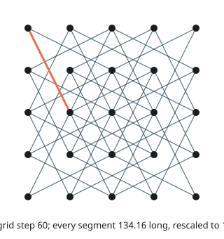

# The unit-distance problem: how many pairs of n points can be exactly one apart

[Syllabus](../../../SYLLABUS.md) → [Frontier](../README.md) → [Geometry and Combinatorics](../README.md#s04) → The unit-distance problem

---

## General Overview

Put 9 points on a 3 by 3 grid, one metre apart. Count the pairs of points that are exactly one metre apart: 6 side by side and 6 one above the other, 12 in all.

Can 9 points do better? Yes: the best 9 points have 18 such pairs. Can a million? In 1946 Paul Erdős asked the general question. Place $`n`$ points anywhere in the plane. How many of the pairs can be exactly distance 1 apart? The best possible count is $`u(n)`$, the **unit-distance count**, introduced in [Working on a problem](../01-How%20Research%20Works/07-how-to-work-on-an-open-problem.md), which builds the 9-point set with 18. The pairs at distance 1, drawn as lines between the points, make the **unit-distance graph** of the set.

Distance 1 is not special. Any set can be shrunk or stretched until its most common distance becomes 1. So $`u(n)`$ asks how often one single distance can repeat among $`n`$ points.

A 5 by 5 board shows the trick. Steps of 1 give 40 pairs. Knight's moves, one square one way and two the other, give 48 pairs, all of length $`\sqrt{5}`$ grid steps. Shrink the board by $`\sqrt{5}`$ and those 48 pairs are exactly one apart. So $`u(25) \ge 48`$. That is this board's count, not the best known: [Working on a problem](../01-How%20Research%20Works/07-how-to-work-on-an-open-problem.md) reports 21 points with 57 unit pairs, and adding points never lowers the best count.

Erdős pushed this to huge grids, where some lengths repeat far more often. He proved that $`u(n)`$ grows a little faster than $`n`$, and he guessed that it grows only a little faster: slower than $`n^{1.01}`$, or $`n`$ to any power above 1, once $`n`$ is large enough. For 80 years nobody could prove or break that guess.

On 2026-05-20 an AI lab announced a construction that breaks it. The same day, mathematicians posted a checked write-up and a sharper version: point sets with more than $`n^{1.014}`$ unit distances, for $`n`$ as large as wanted. The grid is already **superlinear**: more than any constant times $`n`$, but only by a factor smaller than every power of $`n`$. The new sets beat $`n`$ by a fixed power above 1, which is **power-law growth**. This card separates the two kinds, and shows why the difference only shows up at sizes nobody will ever draw.

**The square grid gives $`n`$ points about $`n^{1 + c/\log\log n}`$ unit distances, an exponent that sinks back toward 1, and in May 2026 a number-field construction beat every such bound with a fixed exponent above 1, refuting Erdős's conjecture while the true exponent stays open between just above 1 and 4/3.**

**What kind of fact this is:** several separate claims, each with its own status. The grid bound and the 4/3 ceiling are theorems. Erdős's guess was a conjecture, now refuted. The exponent 1.014 is a claim in one preprint. The true growth rate is open. The table below dates each one.

| Statement | Kind | Status | Date | Source |
| --- | --- | --- | --- | --- |
| $`u(n) \ge n^{1 + c/\log\log n}`$, from grids | theorem | proved | 1946 | Erdős |
| $`u(n) \le C\,n^{4/3}`$ | theorem | proved | 1984 | Spencer, Szemerédi and Trotter, as cited by Sawin; short proof by Székely, 1997 |
| $`u(n) \le n^{1+o(1)}`$ (Erdős's conjecture) | conjecture | refuted | 2026-05-20 | announced by an AI lab; checked write-up by nine mathematicians, preprint |
| $`u(n) > n^{1.014}`$ for $`n`$ as large as wanted | theorem | claimed: preprint, not yet refereed as of 2026-11-23 | 2026-05-20 | Sawin, preprint |
| the true growth rate of $`u(n)`$ | question | open as of 2026-11-23 | — | — |

The kinds and status words follow [Kinds of claim](../01-How%20Research%20Works/02-theorem-conjecture-model-approximation.md). No refereed improvement to either exponent, the 1.014 below or the 4/3 above, was found as of 2026-11-23.

### The picture: 25 points, 48 equal lengths

<p align="center"></p>

Drawn to scale, one grid step = 60 units. Every one of the 48 segments is $`60\sqrt{5} = 134.16`$ units long. The highlighted one runs from (40, 40) to (100, 160). Divide every length by 134.16 and all 48 pairs are exactly one apart.

---

## The formula

```math
n^{1 + c/\log\log n} \;\le\; u(n) \;\le\; C\, n^{4/3}
```

**Read it aloud:** the most unit distances among $`n`$ points in the plane is at least $`n`$ to the power one plus $`c`$ over log log $`n`$, and at most a fixed multiple of $`n`$ to the four-thirds.

Here $`\log`$ is the natural logarithm, and $`\log\log n`$ is the logarithm taken twice. It grows extremely slowly, which is why the grid's extra exponent fades so gently. Erdős's conjecture said the left side is the truth, up to the size of $`c`$. A weaker form says that for every $`\varepsilon > 0`$, $`u(n) \le n^{1+\varepsilon}`$ once $`n`$ is large. The 2026 result breaks both:

```math
u(n) \;>\; n^{1+\varepsilon} \quad \text{for infinitely many } n, \text{ with a fixed } \varepsilon > 0
```

**Read it aloud:** there is one fixed power above 1 that the unit-distance count beats again and again, however large $`n`$ gets.

The checked write-up gives $`\varepsilon \approx 6.24 \times 10^{-38}`$. The sharper preprint gives $`\varepsilon = 0.014`$.

| Symbol | Plain meaning | In our example | Push it up and the answer… |
| --- | --- | --- | --- |
| $`n`$ | how many points | 25 on the 5 by 5 board | more pairs, and a larger share of them can be equal |
| $`u(n)`$ | the most pairs at distance exactly 1 that $`n`$ points in the plane can have | at least 48 for $`n = 25`$ | — |
| $`k`$ | the side of a square grid, so $`n = k^2`$ | 5 | more room for long steps |
| $`m`$ | the squared length of the repeated step, in grid units | 5, a knight's move | more ways to write it, if its prime factors leave remainder 1 on division by 4 |
| $`(a, b)`$ | one grid step: $`a`$ across, $`b`$ up, with $`a^2 + b^2 = m`$ | (1, 2) | — |
| $`r_2(m)`$ | how many whole-number steps $`(a, b)`$ have $`a^2 + b^2 = m`$, signs and order counted | 8 for $`m = 5`$ | more unit distances |
| $`t`$, $`x`$ | how many primes leaving remainder 1 on division by 4 are multiplied into $`m`$; in the Step 3 outline, the size below which all such primes are used | 1 (just 5); the checks sieve to $`x`$ = one million | doubles $`r_2(m)`$ each time |
| $`s`$ | half the grid side in Erdős's grid: the whole number just above $`\sqrt{m}`$ | 3 for $`m = 5`$ | — |
| $`d_1(m)`$, $`d_3(m)`$ | how many divisors of $`m`$ leave remainder 1, and remainder 3, on division by 4 | 2 and 0 for $`m = 5`$ | $`d_1`$ up: more steps |
| $`c`$ | the grid's constant: close to $`\log 2 = 0.6931`$ for this construction | — | a faster-growing lower bound |
| $`C`$ | a fixed multiplier in the upper bound, the same for every $`n`$ | — | — |
| $`\varepsilon`$ | the fixed amount by which the exponent beats 1 | 0.014 claimed; $`6.24 \times 10^{-38}`$ checked | a stronger counterexample |

### When it holds

- **The points lie in the plane.** In four dimensions, two circles in perpendicular planes put every point of one at the same distance from every point of the other. Twenty-four such points have 168 equal-distance pairs, where no 24 points in the plane can have more than 87.
- **Distance means exactly 1, measured straight.** Allow "about 1" and two tight clusters a metre apart give roughly $`n^2/4`$ pairs. The whole problem lives in the word "exactly".
- **The points are distinct and finitely many.** Stacking points on top of each other or using infinitely many makes the count meaningless.
- **Exponents describe large $`n`$.** Any single small case has a misleading "exponent": the 3 by 3 grid gives $`\log 12 / \log 9 = 1.1309`$, which says nothing about growth.

---

## Why it works

### Step 0: one distance, repeated as often as possible

Scaling a set changes every distance by the same factor. So the question is never about the number 1. It is: among $`n`$ points, how many pairs can share one distance? On a grid every squared distance is a whole number $`m`$, so the question becomes how many grid steps have squared length $`m`$.

### Step 1: count the pairs on a grid

A step $`(a, b)`$ fits inside a $`k`$ by $`k`$ grid in $`(k - |a|)(k - |b|)`$ positions. The steps $`(a, b)`$ and $`(-a, -b)`$ give the same pairs, so the pair count is half the sum:

```math
\text{pairs at squared distance } m \;=\; \tfrac{1}{2} \sum_{a^2 + b^2 = m} (k - |a|)\,(k - |b|)
```

**Read it aloud:** for every step of squared length $`m`$, count where it fits, add, and halve.

On the 5 by 5 board, the 8 knight steps each fit $`(5 - 1)(5 - 2) = 12`$ times: 96 ordered, 48 pairs. The checks count every pair one by one and get 48 too.

### Step 2: some lengths can be drawn in many ways

The number of steps is $`r_2(m)`$, the count of ways to write $`m`$ as a sum of two squares. [Two squares](../../21-Algebraic%20and%20analytic%20number%20theory/07-Diophantine%20and%20Modular/02-sums-of-squares-and-gaussian-integers.md) proves $`r_2(m) = 4\,(d_1(m) - d_3(m))`$, where $`d_1`$ and $`d_3`$ count the divisors of $`m`$ leaving remainder 1 and 3 on division by 4.

If $`m`$ is a product of $`t`$ different primes that each leave remainder 1, all $`2^t`$ of its divisors leave remainder 1. So $`r_2(m) = 4 \times 2^t`$. Each new prime doubles the number of steps: 8 for 5, 16 for 65, 32 for 1105.

### Step 3: build the grid around the best length

Take the first $`t`$ such primes, 5, 13, 17, 29, 37, 41 and so on, and multiply them to get $`m`$. Let $`s`$ be the whole number just above $`\sqrt{m}`$ and use a grid of side $`k = 2s`$. Every step has $`|a|, |b| < s`$, so each fits at least $`s \times s`$ times:

```math
u(n) \;\ge\; \tfrac{1}{2} \times 4 \times 2^t \times s^2 \;=\; 2^{t-1}\, n
```

**Read it aloud:** the grid gives at least two to the power $`t - 1`$ unit distances per point.

For $`t = 6`$, $`m = 48{,}612{,}265`$ and the grid has side 13,946. The exact count is 11,031,062,096 pairs, above the guaranteed 6,223,709,312.

How does $`2^t`$ compare with $`n`$? The primes multiplied into $`m`$ grow, so $`m`$ grows a little faster than exponentially in $`t`$. The prime count turns this into an exponent that shrinks.

<details>
<summary>Outline: why the extra exponent is about log 2 over log log n</summary>

This is an estimate, not a proof. Erdős's 1946 paper has the proof.

Take all primes up to some size $`x`$ that leave remainder 1 on division by 4. The prime number theorem for such primes says there are about $`x / (2 \log x)`$ of them, and their logarithms add up to about $`x / 2`$.

So $`\log n \approx \log m \approx x/2`$, and $`t \approx x / (2 \log x) \approx \log n / \log\log n`$. The guaranteed ratio is then

$`\displaystyle \frac{u(n)}{n} \;\ge\; 2^{t-1} \;\approx\; 2^{\log n / \log\log n} \;=\; n^{\log 2 / \log\log n}.`$

The extra exponent, $`\log 2 / \log\log n`$, tends to 0 as $`n`$ grows, but so slowly that the checks' sieve to one million still finds 0.0545, with the estimate at 0.0528.

</details>

### Step 4: the ceiling, from two circles

The points at distance 1 from a given point lie on the circle of radius 1 around it. Two different circles meet in at most two points. So no two points of the set share more than two unit-distance neighbours.

That one fact caps the count. Count, for every point, the pairs among its neighbours. The total is at most two for each pair of points in the whole set. Averaging gives $`u(n) \le C\,n^{3/2}`$, Erdős's first ceiling.

[Working on a problem](../01-How%20Research%20Works/07-how-to-work-on-an-open-problem.md) proves this counting bound in full: $`u(n) \le n(1 + \sqrt{8n - 7})/4`$, which allows at most 87 unit pairs for $`n = 24`$. On the 10 by 10 grid at $`m = 5`$, the checks find at most 2 shared neighbours for every pair of points, and the neighbour pairs summed over all points number 1,564, well under $`n(n-1) = 9{,}900`$.

The best ceiling, $`C\,n^{4/3}`$, came in 1984 from Spencer, Szemerédi and Trotter. Székely's 1997 proof draws the unit circles through the points as a graph on paper. A graph with many edges must have many crossings, but two circles cross at most twice, and balancing the two counts gives $`n^{4/3}`$. This card states that bound without proof; Székely's paper proves it in about a page.

### Step 5: the 2026 construction, in outline

This step outlines a research proof. Its statements come from the two 2026 preprints, and the checks do not verify them.

The grid is the **Gaussian integers**, the numbers $`a + bi`$ with $`a`$ and $`b`$ whole. A step of length $`\sqrt{m}`$, divided by $`\sqrt{m}`$, has absolute value 1. Erdős's construction is a search for many such numbers of absolute value 1 with a shared denominator. In only two dimensions there are too few of them: $`2^t`$ is smaller than every fixed power of $`n`$.

The new construction keeps the plan and changes the number system:

1. **A bigger number field.** A **number field** is the set of numbers built from the fractions and one root of a polynomial; the Gaussian numbers are one, built from $`i`$. Its **degree** is how many fractions it takes to write one of its numbers: 2 for the Gaussian numbers. The construction uses fields of huge degree made by adding $`i`$ to a **totally real** field, one that lands on the real line however it is placed inside the complex numbers. These are **CM fields** (CM for complex multiplication): in them a number's mirror image, its complex conjugate, is the same number of the field whichever way the field is placed.
2. **Fields that stay tight.** A field's **root discriminant** measures how widely its whole numbers are spread, per dimension. Most families of fields spread out as the degree grows. The tight ones come from an infinite **class field tower**: a chain of fields, each a standard enlargement of the last (its class field), that never stops. Such towers exist by a 1964 criterion of Golod and Shafarevich, and their fields grow in degree while the root discriminant stays bounded.
3. **Many numbers of absolute value 1.** A prime that splits, as $`5 = (2+i)(2-i)`$ does for the Gaussian integers, gives quotients $`\alpha / \bar\alpha`$: a whole number $`\alpha`$ of the field divided by its mirror image $`\bar\alpha`$. Because the field is CM, each has absolute value 1 in every **complex embedding**, that is, every way of placing the field inside the complex numbers. Splitting into many pieces gives many such quotients. The write-up states this for ideals, which stand in for whole numbers when factoring is not unique, and divides the count by the class number, which measures how far factoring in the field is from unique.
4. **Back to the plane.** The field's whole numbers form a lattice in a space of many complex dimensions. The construction cuts out a window of that lattice and keeps one complex coordinate. Moving a point by one of the quotients keeps it at distance exactly 1 in that coordinate. Every coordinate of the step has size 1, so a point at least 1 inside the window's edge stays in the window.

Both the number of points and the number of unit distances then grow exponentially in the degree. Their logarithms keep a fixed ratio above 1, and that ratio is $`1 + \varepsilon`$. The original announcement gave no explicit value of $`\varepsilon`$. The checked write-up's simplified argument gives $`\varepsilon \approx 6.24 \times 10^{-38}`$; the sharper preprint tunes the tower and the primes to reach 0.014.

---

## Worked numbers, by hand

The 5 by 5 board, with the knight's move as the repeated length.

| Step | Arithmetic | Value |
| --- | --- | --- |
| points | 5 × 5 | 25 |
| pairs at distance 1, side by side and stacked | 2 × 5 × 4 | 40 |
| knight steps of squared length 5 | $`(\pm1, \pm2)`$ and $`(\pm2, \pm1)`$ | 8 = $`r_2(5)`$ |
| positions for each step | (5 − 1) × (5 − 2) | 12 |
| ordered pairs | 8 × 12 | 96 |
| unordered pairs | 96 ÷ 2 | 48 |
| unit distances after shrinking by $`\sqrt{5}`$ | the same pairs | **48** |

So 25 points can have at least 48 unit distances from this board alone: $`u(25) \ge 48`$, 1.92 per point, against 40 pairs for plain neighbours. On larger grids the best length changes: $`m = 5`$ gives 288 pairs on the 10 by 10 grid, and $`m = 65`$, with 16 steps, gives 4,944 on the 30 by 30 grid, 5.49 per point.

### What breaks if you drop a piece

| Mistake | Comes out at | What went wrong |
| --- | --- | --- |
| Use distance 1 only on the 10 by 10 grid | 180 pairs, not 288 | The best length on a big grid is a longer one with many ways to draw it |
| Count ordered pairs on the 5 by 5 board | 96, not 48 | Each pair was counted once from each end |
| Read the 3 by 3 grid as a growth exponent | $`\log 12 / \log 9 = 1.1309`$ | One small case has no exponent; exponents describe large $`n`$ |
| Drop "in the plane": two circles in four dimensions | 168 pairs for 24 points, plane cap 87 | Two circles there share 14 neighbours, not at most 2 |

---

## Code, from first principles, and it actually runs

The code counts grid pairs one by one and again by Step 1's formula, and finds $`r_2(m)`$ on the circle and again by divisors. It builds Erdős's grids for $`t = 1`$ to 6 and checks the exact counts against Step 3's bound. It tests the two-circles rule on the plane grid and shows the four-dimensional set breaking it. A sieve of the primes below one million then follows the grid's extra exponent far beyond any drawable size. That gives four independent roads: brute force against formula, circle against divisors, exact count against bound, and sieve against the prime-count estimate.

### Python

```python
# The unit-distance problem -- the check behind the card.  Standard library
# only.  Grid counts are made pair by pair and again by the two-squares formula;
# r2(m) is counted on the circle and again by divisors; a 4-D set shows what the
# plane forbids; a sieve follows the grid's extra exponent as n grows.
import math

def grid(k):
    return [(x, y) for x in range(k) for y in range(k)]

def histogram(pts):                      # road one: every unordered pair, by squared distance
    h = {}
    for i in range(len(pts)):
        for j in range(i + 1, len(pts)):
            d = sum((p - q) ** 2 for p, q in zip(pts[i], pts[j]))
            h[d] = h.get(d, 0) + 1
    return h

def reps(m):                             # road one: whole (a, b) on the circle a^2 + b^2 = m
    out = []
    for a in range(-math.isqrt(m), math.isqrt(m) + 1):
        b = math.isqrt(m - a * a)
        if b * b == m - a * a:
            out += [(a, b), (a, -b)] if b else [(a, 0)]
    return out

def r2_divisors(m):                      # road two: 4 x (divisors 1 mod 4 - divisors 3 mod 4)
    d1 = sum(1 for d in range(1, m + 1) if m % d == 0 and d % 4 == 1)
    d3 = sum(1 for d in range(1, m + 1) if m % d == 0 and d % 4 == 3)
    return 4 * (d1 - d3)

def by_formula(k, m):                    # road two for grids: each step (a, b) fits (k-|a|)(k-|b|) times
    return sum((k - abs(a)) * (k - abs(b)) for a, b in reps(m) if abs(a) < k and abs(b) < k) // 2

def most_shared(pts, m):                 # most points at squared distance m from two given points
    nb = [{j for j, q in enumerate(pts) if sum((x - y) ** 2 for x, y in zip(p, q)) == m} for p in pts]
    return max(len(nb[i] & nb[j]) for i in range(len(pts)) for j in range(i + 1, len(pts)))

def sci(v):                              # mantissa and exponent, written out alike in Rust
    ex = math.floor(math.log10(v))
    return f"{v / 10 ** ex:.3f}e{ex}"

def plane_cap(n):                        # largest u with n * C(d, 2) <= n(n - 1), d = 2u/n
    u = 0
    while (2 * (u + 1) / n) * (2 * (u + 1) / n - 1) <= 2 * (n - 1):
        u += 1
    return u

g3 = histogram(grid(3))
print(f"3x3 grid: n = 9, pairs at distance 1: {g3[1]} by brute force ({g3[1] // 2} across, {g3[1] // 2} up), {2 * 3 * 2} by 2k(k-1)")
g5 = histogram(grid(5))
print(f"5x5 grid, pairs by squared distance: 1 -> {g5[1]}, 2 -> {g5[2]}, 5 -> {g5[5]}, 25 -> {g5[25]}")
d1, d3 = (sum(1 for d in range(1, 6) if 5 % d == 0 and d % 4 == r) for r in (1, 3))
print(f"5x5 knight steps: {len(reps(5))} steps x (5-1)(5-2) = {len(reps(5)) * 12} ordered, {by_formula(5, 5)} pairs;"
      f" divisors of 5: d1 = {d1}, d3 = {d3}")
print("best squared distance m in a k x k grid (brute force, then formula):")
best = {}
for k in (5, 10, 20, 30):
    h = histogram(grid(k))
    m = min(d for d in h if h[d] == max(h.values()))
    best[k] = (m, h[m])
    print(f"  k={k:2d} n={k * k:3d} best m={m:2d} pairs {h[m]:5d} formula {by_formula(k, m):5d}"
          f" distance-1 pairs {h[1]:5d} pairs/n {h[m] / (k * k):.2f}")
    assert by_formula(k, m) == h[m] and h[1] == 2 * k * (k - 1)    # two roads per grid
r2s = [(m, len(reps(m)), r2_divisors(m)) for m in (5, 15, 25, 45, 65, 325, 1105)]
print("r2(m) on the circle and by divisors:", "; ".join(f"{m}: {a} {b}" for m, a, b in r2s))
assert all(a == b for _, a, b in r2s)                             # two roads to r2
m10 = best[10][0]
deg = [sum(1 for q in grid(10) if (p[0] - q[0]) ** 2 + (p[1] - q[1]) ** 2 == m10) for p in grid(10)]
sc2 = sum(d * (d - 1) // 2 for d in deg)
print(f"plane rule, 10x10 grid at m={m10}: most shared neighbours {most_shared(grid(10), m10)};"
      f" sum C(d,2) = {sc2} <= n(n-1) = {100 * 99}")
circ = [(a, b) for a, b in reps(25)]
four = [(a, b, 0, 0) for a, b in circ] + [(0, 0, a, b) for a, b in circ]
h4 = histogram(four)
print(f"4-D, two circles of radius 5: n = {len(four)}, pairs at squared distance 50: {h4[50]};"
      f" most shared neighbours {most_shared(four, 50)}")
print(f"plane cap for n = 24 when no two points share 3 neighbours: {plane_cap(24)}")
assert most_shared(grid(10), m10) <= 2 and sc2 <= 100 * 99 and h4[50] > plane_cap(24)
print(f"mistake, 10x10 grid with distance 1 only: {2 * 10 * 9} not {best[10][1]}")
print(f"mistake, ordered pairs in the 5x5 grid: {2 * g5[5]} not {g5[5]}")
print(f"mistake, 3x3 grid read as an exponent: log 12 / log 9 = {math.log(12) / math.log(9):.4f}")
primes1 = [p for p in range(5, 200) if p % 4 == 1 and all(p % q for q in range(2, math.isqrt(p) + 1))]
print(f"Erdos grid: m = first t primes 1 mod 4 ({', '.join(map(str, primes1[:6]))}) multiplied, side k = 2s, s = isqrt(m) + 1:")
m = 1
for t in range(1, 7):
    m *= primes1[t - 1]
    k = 2 * (math.isqrt(m) + 1)
    u = by_formula(k, m)
    print(f"  t={t} m={m} r2={len(reps(m))} s={k // 2} k={k} pairs {u} >= 2^(t-1) n = {2 ** (t - 1) * k * k};"
          f" log u / log n - 1 = {math.log(u) / math.log(k * k) - 1:.4f}")
    assert len(reps(m)) == 4 * 2 ** t and u >= 2 ** (t - 1) * k * k   # circle count, then the bound
limit = 10 ** 6
sieve = bytearray([1]) * (limit + 1)
sieve[0] = sieve[1] = 0
for p in range(2, math.isqrt(limit) + 1):
    if sieve[p]:
        sieve[p * p::p] = bytearray(len(range(p * p, limit + 1, p)))
print("the grid bound further out (extra exponent = (t-1) log 2 / log n, log n = log 4 + log m):")
t, logm, mark = 0, 0.0, 100
for p in range(5, limit + 1, 4):
    if sieve[p]:
        t += 1
        logm += math.log(p)
    if p + 4 > mark:
        logn = math.log(4) + logm
        e, est = (t - 1) * math.log(2) / logn, math.log(2) / math.log(logn)
        print(f"  primes below {mark:>7}: t = {t:5d}, log10 n = {logn / math.log(10):9.1f},"
              f" extra exponent {e:.4f}, estimate log 2 / log log n {est:.4f}")
        assert e > 0.014 and abs(e / est - 1) < 0.1             # above n^1.014; sieve near the estimate
        mark *= 10
print(f"estimate: c near log 2 = {math.log(2):.4f}; the grid's extra exponent falls to 0.014"
      f" near log10 n = {sci(math.exp(math.log(2) / 0.014) / math.log(10))}")
print("quoted: Erdos 1946 grid and 3/2 ceiling; Golod-Shafarevich 1964; 4/3 ceiling 1984, Szekely 1997;"
      " disproof announced 2026-05-20; explicit eps 6.24e-38; Sawin exponent 1.014; u(9) = 18, u(21) = 57")
print(f"log10 n where n^eps reaches 2: eps 6.24e-38 -> {sci(math.log10(2) / 6.24e-38)},"
      f" eps 0.014 -> {math.log10(2) / 0.014:.2f}")
segs = [((x, y), (x + a, y + b)) for x, y in grid(5) for a, b in reps(5)
        if (a, b) > (0, 0) and 0 <= x + a < 5 and 0 <= y + b < 5]
(x0, y0), (x1, y1) = segs[0]
print(f"figure, 5x5 grid, step 60, origin (40, 40); {len(segs)} segments of squared length 5;"
      f" first ({40 + 60 * x0}, {40 + 60 * y0})-({40 + 60 * x1}, {40 + 60 * y1}); unit {60 * math.sqrt(5):.2f}")
print("ALL CHECKS PASS")
```

**Ran 2026-11-23 on macOS, Python 3.14.10, standard library only. All checks passed. Output, pasted from the run:**

```
3x3 grid: n = 9, pairs at distance 1: 12 by brute force (6 across, 6 up), 12 by 2k(k-1)
5x5 grid, pairs by squared distance: 1 -> 40, 2 -> 32, 5 -> 48, 25 -> 8
5x5 knight steps: 8 steps x (5-1)(5-2) = 96 ordered, 48 pairs; divisors of 5: d1 = 2, d3 = 0
best squared distance m in a k x k grid (brute force, then formula):
  k= 5 n= 25 best m= 5 pairs    48 formula    48 distance-1 pairs    40 pairs/n 1.92
  k=10 n=100 best m= 5 pairs   288 formula   288 distance-1 pairs   180 pairs/n 2.88
  k=20 n=400 best m=65 pairs  1744 formula  1744 distance-1 pairs   760 pairs/n 4.36
  k=30 n=900 best m=65 pairs  4944 formula  4944 distance-1 pairs  1740 pairs/n 5.49
r2(m) on the circle and by divisors: 5: 8 8; 15: 0 0; 25: 12 12; 45: 8 8; 65: 16 16; 325: 24 24; 1105: 32 32
plane rule, 10x10 grid at m=5: most shared neighbours 2; sum C(d,2) = 1564 <= n(n-1) = 9900
4-D, two circles of radius 5: n = 24, pairs at squared distance 50: 168; most shared neighbours 14
plane cap for n = 24 when no two points share 3 neighbours: 87
mistake, 10x10 grid with distance 1 only: 180 not 288
mistake, ordered pairs in the 5x5 grid: 96 not 48
mistake, 3x3 grid read as an exponent: log 12 / log 9 = 1.1309
Erdos grid: m = first t primes 1 mod 4 (5, 13, 17, 29, 37, 41) multiplied, side k = 2s, s = isqrt(m) + 1:
  t=1 m=5 r2=8 s=3 k=6 pairs 80 >= 2^(t-1) n = 36; log u / log n - 1 = 0.2228
  t=2 m=65 r2=16 s=9 k=18 pairs 1296 >= 2^(t-1) n = 648; log u / log n - 1 = 0.2398
  t=3 m=1105 r2=32 s=34 k=68 pairs 33664 >= 2^(t-1) n = 18496; log u / log n - 1 = 0.2352
  t=4 m=32045 r2=64 s=180 k=360 pairs 1854416 >= 2^(t-1) n = 1036800; log u / log n - 1 = 0.2260
  t=5 m=1185665 r2=128 s=1089 k=2178 pairs 134278416 >= 2^(t-1) n = 75898944; log u / log n - 1 = 0.2175
  t=6 m=48612265 r2=256 s=6973 k=13946 pairs 11031062096 >= 2^(t-1) n = 6223709312; log u / log n - 1 = 0.2116
the grid bound further out (extra exponent = (t-1) log 2 / log n, log n = log 4 + log m):
  primes below     100: t =    11, log10 n =      17.6, extra exponent 0.1711, estimate log 2 / log log n 0.1872
  primes below    1000: t =    80, log10 n =     200.4, extra exponent 0.1187, estimate log 2 / log log n 0.1130
  primes below   10000: t =   609, log10 n =    2136.4, extra exponent 0.0857, estimate log 2 / log log n 0.0815
  primes below  100000: t =  4783, log10 n =   21602.3, extra exponent 0.0666, estimate log 2 / log log n 0.0641
  primes below 1000000: t = 39175, log10 n =  216424.1, extra exponent 0.0545, estimate log 2 / log log n 0.0528
estimate: c near log 2 = 0.6931; the grid's extra exponent falls to 0.014 near log10 n = 1.380e21
quoted: Erdos 1946 grid and 3/2 ceiling; Golod-Shafarevich 1964; 4/3 ceiling 1984, Szekely 1997; disproof announced 2026-05-20; explicit eps 6.24e-38; Sawin exponent 1.014; u(9) = 18, u(21) = 57
log10 n where n^eps reaches 2: eps 6.24e-38 -> 4.824e36, eps 0.014 -> 21.50
figure, 5x5 grid, step 60, origin (40, 40); 48 segments of squared length 5; first (40, 40)-(100, 160); unit 134.16
ALL CHECKS PASS
```

### Rust

Same numbers, same labels, built with `rustc --edition 2021 -O`.

```rust
// The unit-distance problem -- the same check as the Python, in Rust.  No
// crates.  Grid counts are made pair by pair and again by the two-squares formula;
// r2(m) is counted on the circle and again by divisors; a 4-D set shows what the
// plane forbids; a sieve follows the grid's extra exponent as n grows.
use std::collections::{BTreeMap, BTreeSet};

fn grid(k: i64) -> Vec<Vec<i64>> {
    let mut out = Vec::new();
    for x in 0..k { for y in 0..k { out.push(vec![x, y]) } }
    out
}

fn sq(p: &[i64], q: &[i64]) -> i64 { p.iter().zip(q).map(|(a, b)| (a - b) * (a - b)).sum() }

fn histogram(pts: &[Vec<i64>]) -> BTreeMap<i64, i64> {   // road one: every unordered pair
    let mut h = BTreeMap::new();
    for i in 0..pts.len() {
        for j in i + 1..pts.len() { *h.entry(sq(&pts[i], &pts[j])).or_insert(0) += 1 }
    }
    h
}

fn isqrt(m: i64) -> i64 {
    let mut s = (m as f64).sqrt() as i64;
    while s * s > m { s -= 1 }
    while (s + 1) * (s + 1) <= m { s += 1 }
    s
}

fn reps(m: i64) -> Vec<(i64, i64)> {                   // road one: whole (a, b) on the circle
    let mut out = Vec::new();
    for a in -isqrt(m)..=isqrt(m) {
        let b = isqrt(m - a * a);
        if b * b == m - a * a {
            if b != 0 { out.push((a, b)); out.push((a, -b)) } else { out.push((a, 0)) }
        }
    }
    out
}

fn r2_divisors(m: i64) -> i64 {                        // road two: 4 x (d1 - d3)
    let d1 = (1..=m).filter(|d| m % d == 0 && d % 4 == 1).count() as i64;
    let d3 = (1..=m).filter(|d| m % d == 0 && d % 4 == 3).count() as i64;
    4 * (d1 - d3)
}

fn by_formula(k: i64, m: i64) -> i64 {                 // road two for grids
    reps(m).iter().filter(|(a, b)| a.abs() < k && b.abs() < k)
        .map(|(a, b)| (k - a.abs()) * (k - b.abs())).sum::<i64>() / 2
}

fn most_shared(pts: &[Vec<i64>], m: i64) -> usize {
    let nb: Vec<BTreeSet<usize>> = pts.iter()
        .map(|p| (0..pts.len()).filter(|&j| sq(p, &pts[j]) == m).collect()).collect();
    let mut best = 0;
    for i in 0..pts.len() {
        for j in i + 1..pts.len() { best = best.max(nb[i].intersection(&nb[j]).count()) }
    }
    best
}

fn plane_cap(n: i64) -> i64 {
    let mut u = 0;
    let nf = n as f64;
    while (2.0 * (u + 1) as f64 / nf) * (2.0 * (u + 1) as f64 / nf - 1.0) <= 2.0 * (nf - 1.0) { u += 1 }
    u
}

fn sci(v: f64) -> String {
    let ex = v.log10().floor() as i32;
    format!("{:.3}e{}", v / 10f64.powi(ex), ex)
}

fn main() {
    let g3 = histogram(&grid(3));
    println!("3x3 grid: n = 9, pairs at distance 1: {} by brute force ({} across, {} up), {} by 2k(k-1)", g3[&1], g3[&1] / 2, g3[&1] / 2, 2 * 3 * 2);
    let g5 = histogram(&grid(5));
    println!("5x5 grid, pairs by squared distance: 1 -> {}, 2 -> {}, 5 -> {}, 25 -> {}", g5[&1], g5[&2], g5[&5], g5[&25]);
    let dc = |r: i64| (1..6).filter(|d| 5 % d == 0 && d % 4 == r).count();
    println!("5x5 knight steps: {} steps x (5-1)(5-2) = {} ordered, {} pairs; divisors of 5: d1 = {}, d3 = {}",
             reps(5).len(), reps(5).len() * 12, by_formula(5, 5), dc(1), dc(3));
    println!("best squared distance m in a k x k grid (brute force, then formula):");
    let mut best = BTreeMap::new();
    for k in [5i64, 10, 20, 30] {
        let h = histogram(&grid(k));
        let top = *h.values().max().unwrap();
        let m = *h.iter().find(|(_, &c)| c == top).unwrap().0;
        best.insert(k, (m, h[&m]));
        println!("  k={:2} n={:3} best m={:2} pairs {:5} formula {:5} distance-1 pairs {:5} pairs/n {:.2}",
                 k, k * k, m, h[&m], by_formula(k, m), h[&1], h[&m] as f64 / (k * k) as f64);
        assert!(by_formula(k, m) == h[&m] && h[&1] == 2 * k * (k - 1));
    }
    let r2s: Vec<(i64, i64, i64)> = [5, 15, 25, 45, 65, 325, 1105].iter().map(|&m| (m, reps(m).len() as i64, r2_divisors(m))).collect();
    let txt: Vec<String> = r2s.iter().map(|(m, a, b)| format!("{}: {} {}", m, a, b)).collect();
    println!("r2(m) on the circle and by divisors: {}", txt.join("; "));
    assert!(r2s.iter().all(|(_, a, b)| a == b));
    let m10 = best[&10].0;
    let g10 = grid(10);
    let sc2: i64 = g10.iter().map(|p| g10.iter().filter(|q| sq(p, q) == m10).count() as i64)
        .map(|d| d * (d - 1) / 2).sum();
    let ms10 = most_shared(&g10, m10);
    println!("plane rule, 10x10 grid at m={}: most shared neighbours {}; sum C(d,2) = {} <= n(n-1) = {}", m10, ms10, sc2, 100 * 99);
    let circ = reps(25);
    let mut four: Vec<Vec<i64>> = circ.iter().map(|&(a, b)| vec![a, b, 0, 0]).collect();
    four.extend(circ.iter().map(|&(a, b)| vec![0, 0, a, b]));
    let h4 = histogram(&four);
    println!("4-D, two circles of radius 5: n = {}, pairs at squared distance 50: {}; most shared neighbours {}",
             four.len(), h4[&50], most_shared(&four, 50));
    println!("plane cap for n = 24 when no two points share 3 neighbours: {}", plane_cap(24));
    assert!(ms10 <= 2 && sc2 <= 100 * 99 && h4[&50] > plane_cap(24));
    println!("mistake, 10x10 grid with distance 1 only: {} not {}", 2 * 10 * 9, best[&10].1);
    println!("mistake, ordered pairs in the 5x5 grid: {} not {}", 2 * g5[&5], g5[&5]);
    println!("mistake, 3x3 grid read as an exponent: log 12 / log 9 = {:.4}", 12f64.ln() / 9f64.ln());
    let primes1: Vec<i64> = (5..200).filter(|&p| p % 4 == 1 && (2..=isqrt(p)).all(|q| p % q != 0)).collect();
    let p6: Vec<String> = primes1[..6].iter().map(|p| p.to_string()).collect();
    println!("Erdos grid: m = first t primes 1 mod 4 ({}) multiplied, side k = 2s, s = isqrt(m) + 1:", p6.join(", "));
    let mut m = 1i64;
    for t in 1..7u32 {
        m *= primes1[t as usize - 1];
        let k = 2 * (isqrt(m) + 1);
        let u = by_formula(k, m);
        let r2 = reps(m).len() as i64;
        println!("  t={} m={} r2={} s={} k={} pairs {} >= 2^(t-1) n = {}; log u / log n - 1 = {:.4}",
                 t, m, r2, k / 2, k, u, 2i64.pow(t - 1) * k * k, (u as f64).ln() / ((k * k) as f64).ln() - 1.0);
        assert!(r2 == 4 * 2i64.pow(t) && u >= 2i64.pow(t - 1) * k * k);
    }
    let limit = 1_000_000usize;
    let mut sieve = vec![true; limit + 1];
    sieve[0] = false;
    sieve[1] = false;
    for p in 2..=1000 {
        if sieve[p] { let mut q = p * p; while q <= limit { sieve[q] = false; q += p } }
    }
    println!("the grid bound further out (extra exponent = (t-1) log 2 / log n, log n = log 4 + log m):");
    let (mut t, mut logm, mut mark) = (0i64, 0.0f64, 100usize);
    let mut p = 5usize;
    while p <= limit {
        if sieve[p] { t += 1; logm += (p as f64).ln() }
        if p + 4 > mark {
            let logn = 4f64.ln() + logm;
            let (e, est) = ((t - 1) as f64 * 2f64.ln() / logn, 2f64.ln() / logn.ln());
            println!("  primes below {:>7}: t = {:5}, log10 n = {:9.1}, extra exponent {:.4}, estimate log 2 / log log n {:.4}",
                     mark, t, logn / 10f64.ln(), e, est);
            assert!(e > 0.014 && (e / est - 1.0).abs() < 0.1);
            mark *= 10;
        }
        p += 4;
    }
    println!("estimate: c near log 2 = {:.4}; the grid's extra exponent falls to 0.014 near log10 n = {}", 2f64.ln(), sci((2f64.ln() / 0.014).exp() / 10f64.ln()));
    println!("quoted: Erdos 1946 grid and 3/2 ceiling; Golod-Shafarevich 1964; 4/3 ceiling 1984, Szekely 1997; disproof announced 2026-05-20; explicit eps 6.24e-38; Sawin exponent 1.014; u(9) = 18, u(21) = 57");
    println!("log10 n where n^eps reaches 2: eps 6.24e-38 -> {}, eps 0.014 -> {:.2}", sci(2f64.log10() / 6.24e-38), 2f64.log10() / 0.014);
    let mut segs = Vec::new();
    for pt in grid(5) {
        for (a, b) in reps(5) {
            let (x, y) = (pt[0], pt[1]);
            if (a > 0 || (a == 0 && b > 0)) && 0 <= x + a && x + a < 5 && 0 <= y + b && y + b < 5 { segs.push((x, y, x + a, y + b)) }
        }
    }
    let (x0, y0, x1, y1) = segs[0];
    println!("figure, 5x5 grid, step 60, origin (40, 40); {} segments of squared length 5; first ({}, {})-({}, {}); unit {:.2}",
             segs.len(), 40 + 60 * x0, 40 + 60 * y0, 40 + 60 * x1, 40 + 60 * y1, 60.0 * 5f64.sqrt());
    println!("ALL CHECKS PASS");
}
```

**Ran 2026-11-23 on macOS, rustc 1.98.1, no crates. All checks passed. Output, pasted from the run:**

```
3x3 grid: n = 9, pairs at distance 1: 12 by brute force (6 across, 6 up), 12 by 2k(k-1)
5x5 grid, pairs by squared distance: 1 -> 40, 2 -> 32, 5 -> 48, 25 -> 8
5x5 knight steps: 8 steps x (5-1)(5-2) = 96 ordered, 48 pairs; divisors of 5: d1 = 2, d3 = 0
best squared distance m in a k x k grid (brute force, then formula):
  k= 5 n= 25 best m= 5 pairs    48 formula    48 distance-1 pairs    40 pairs/n 1.92
  k=10 n=100 best m= 5 pairs   288 formula   288 distance-1 pairs   180 pairs/n 2.88
  k=20 n=400 best m=65 pairs  1744 formula  1744 distance-1 pairs   760 pairs/n 4.36
  k=30 n=900 best m=65 pairs  4944 formula  4944 distance-1 pairs  1740 pairs/n 5.49
r2(m) on the circle and by divisors: 5: 8 8; 15: 0 0; 25: 12 12; 45: 8 8; 65: 16 16; 325: 24 24; 1105: 32 32
plane rule, 10x10 grid at m=5: most shared neighbours 2; sum C(d,2) = 1564 <= n(n-1) = 9900
4-D, two circles of radius 5: n = 24, pairs at squared distance 50: 168; most shared neighbours 14
plane cap for n = 24 when no two points share 3 neighbours: 87
mistake, 10x10 grid with distance 1 only: 180 not 288
mistake, ordered pairs in the 5x5 grid: 96 not 48
mistake, 3x3 grid read as an exponent: log 12 / log 9 = 1.1309
Erdos grid: m = first t primes 1 mod 4 (5, 13, 17, 29, 37, 41) multiplied, side k = 2s, s = isqrt(m) + 1:
  t=1 m=5 r2=8 s=3 k=6 pairs 80 >= 2^(t-1) n = 36; log u / log n - 1 = 0.2228
  t=2 m=65 r2=16 s=9 k=18 pairs 1296 >= 2^(t-1) n = 648; log u / log n - 1 = 0.2398
  t=3 m=1105 r2=32 s=34 k=68 pairs 33664 >= 2^(t-1) n = 18496; log u / log n - 1 = 0.2352
  t=4 m=32045 r2=64 s=180 k=360 pairs 1854416 >= 2^(t-1) n = 1036800; log u / log n - 1 = 0.2260
  t=5 m=1185665 r2=128 s=1089 k=2178 pairs 134278416 >= 2^(t-1) n = 75898944; log u / log n - 1 = 0.2175
  t=6 m=48612265 r2=256 s=6973 k=13946 pairs 11031062096 >= 2^(t-1) n = 6223709312; log u / log n - 1 = 0.2116
the grid bound further out (extra exponent = (t-1) log 2 / log n, log n = log 4 + log m):
  primes below     100: t =    11, log10 n =      17.6, extra exponent 0.1711, estimate log 2 / log log n 0.1872
  primes below    1000: t =    80, log10 n =     200.4, extra exponent 0.1187, estimate log 2 / log log n 0.1130
  primes below   10000: t =   609, log10 n =    2136.4, extra exponent 0.0857, estimate log 2 / log log n 0.0815
  primes below  100000: t =  4783, log10 n =   21602.3, extra exponent 0.0666, estimate log 2 / log log n 0.0641
  primes below 1000000: t = 39175, log10 n =  216424.1, extra exponent 0.0545, estimate log 2 / log log n 0.0528
estimate: c near log 2 = 0.6931; the grid's extra exponent falls to 0.014 near log10 n = 1.380e21
quoted: Erdos 1946 grid and 3/2 ceiling; Golod-Shafarevich 1964; 4/3 ceiling 1984, Szekely 1997; disproof announced 2026-05-20; explicit eps 6.24e-38; Sawin exponent 1.014; u(9) = 18, u(21) = 57
log10 n where n^eps reaches 2: eps 6.24e-38 -> 4.824e36, eps 0.014 -> 21.50
figure, 5x5 grid, step 60, origin (40, 40); 48 segments of squared length 5; first (40, 40)-(100, 160); unit 134.16
ALL CHECKS PASS
```

The two outputs match line for line.

### Lean

Lean proves Steps 2 and 3 for any primes leaving remainder 1 on division by 4, and Step 4's two-circles rule.

- Take $`t`$ different primes, each leaving remainder 1 on division by 4, and let $`m`$ be their product. Then $`r_2(m) = 4 \times 2^t`$.
- Take such an $`m`$, $`s`$ the whole number just above $`\sqrt{m}`$, and $`n = (2s)^2`$. Then some $`n`$ distinct points in the plane have at least $`2^{t-1}\,n`$ unit distances.
- Take two different points of the plane. Then at most two points lie at distance exactly 1 from both.
- The 3 by 3 grid's 12 pairs and the 5 by 5 board's 40 and 48 pairs also check.
- So do the checks' values of $`r_2(m)`$, and the 80 pairs of Erdős's grid for $`t = 1`$.

The larger grids, the 87-pair cap, the four-dimensional set and the sieve are left to the Python and Rust checks.

```lean
-- The unit-distance problem: Erdős's square grid puts n points in the plane with at least 2^(t-1) n pairs exactly one apart when its squared step is a product of t different primes leaving remainder 1 on division by 4, that step can be drawn in exactly 4 × 2^t ways, and two points in the plane never share more than two unit-distance neighbours.
import Mathlib.Analysis.InnerProductSpace.PiL2
import Mathlib.Data.Int.Interval
import Mathlib.Data.Nat.Prime.Basic
import Mathlib.Data.Nat.Sqrt
import Mathlib.Data.Set.Card
import Mathlib.Algebra.BigOperators.Group.Finset.Basic
import Mathlib.NumberTheory.SumTwoSquares
import Mathlib.NumberTheory.Zsqrtd.GaussianInt
import Mathlib.Geometry.Euclidean.Basic

/-! A set of points in the plane is a finite set of distinct points of
`EuclideanSpace ℝ (Fin 2)`, and distance is the straight-line distance `dist`. -/

/-- The unit distances of a finite plane set: the pairs of its points exactly 1 apart.
Each pair is counted once from each end in `offDiag`, so the count is halved. -/
noncomputable def unitPairs (S : Finset (EuclideanSpace ℝ (Fin 2))) : ℕ :=
  (S.offDiag.filter (fun pq => dist pq.1 pq.2 = 1)).card / 2

/-- r₂(m): the whole-number steps (a, b) with a² + b² = m, signs and order counted.
Every such step has |a|, |b| ≤ √m, so the search box loses none. -/
def r2 (m : ℕ) : ℕ :=
  ((Finset.Icc (-(Nat.sqrt m : ℤ)) (Nat.sqrt m) ×ˢ Finset.Icc (-(Nat.sqrt m : ℤ)) (Nat.sqrt m)).filter
    (fun ab => ab.1 ^ 2 + ab.2 ^ 2 = (m : ℤ))).card

/-- The k by k grid of whole-number points (x, y), 0 ≤ x, y < k. -/
def gridPts (k : ℕ) : Finset (ℤ × ℤ) :=
  (Finset.range k ×ˢ Finset.range k).image (fun p => ((p.1 : ℤ), (p.2 : ℤ)))

/-- Pairs of grid points at squared distance m, each pair counted once. -/
def gridPairs (k m : ℕ) : ℕ :=
  ((gridPts k).offDiag.filter
    (fun pq => (pq.1.1 - pq.2.1) ^ 2 + (pq.1.2 - pq.2.2) ^ 2 = (m : ℤ))).card / 2

lemma r2_box_mem (m : ℕ) (ab : ℤ × ℤ) :
    ab ∈ (Finset.Icc (-(Nat.sqrt m : ℤ)) (Nat.sqrt m) ×ˢ Finset.Icc (-(Nat.sqrt m : ℤ)) (Nat.sqrt m)).filter
      (fun ab => ab.1 ^ 2 + ab.2 ^ 2 = (m : ℤ)) ↔ ab.1 ^ 2 + ab.2 ^ 2 = (m : ℤ) := by
  obtain ⟨a, b⟩ := ab
  simp only [Finset.mem_filter, Finset.mem_product, Finset.mem_Icc]
  constructor
  · exact fun h => h.2
  · intro h
    refine ⟨⟨?_, ?_⟩, h⟩
    · have ha : a.natAbs ^ 2 ≤ m := by
        have : ((a.natAbs ^ 2 : ℕ) : ℤ) ≤ m := by
          push_cast; rw [sq_abs]; nlinarith [sq_nonneg b]
        exact_mod_cast this
      have := Nat.le_sqrt'.mpr ha
      omega
    · have hb : b.natAbs ^ 2 ≤ m := by
        have : ((b.natAbs ^ 2 : ℕ) : ℤ) ≤ m := by
          push_cast; rw [sq_abs]; nlinarith [sq_nonneg a]
        exact_mod_cast this
      have := Nat.le_sqrt'.mpr hb
      omega

lemma r2_eq_card_gauss (m : ℕ) :
    r2 m = (((Finset.Icc (-(Nat.sqrt m : ℤ)) (Nat.sqrt m) ×ˢ Finset.Icc (-(Nat.sqrt m : ℤ)) (Nat.sqrt m)).filter
      (fun ab => ab.1 ^ 2 + ab.2 ^ 2 = (m : ℤ))).image (fun ab => (⟨ab.1, ab.2⟩ : GaussianInt))).card := by
  rw [Finset.card_image_of_injective]
  · rfl
  · intro x y h
    simp only [Zsqrtd.mk.injEq] at h
    exact Prod.ext h.1 h.2

lemma gauss_mem_iff (m : ℕ) (z : GaussianInt) :
    z ∈ ((Finset.Icc (-(Nat.sqrt m : ℤ)) (Nat.sqrt m) ×ˢ Finset.Icc (-(Nat.sqrt m : ℤ)) (Nat.sqrt m)).filter
      (fun ab => ab.1 ^ 2 + ab.2 ^ 2 = (m : ℤ))).image (fun ab => (⟨ab.1, ab.2⟩ : GaussianInt)) ↔
      z.norm = m := by
  rw [Finset.mem_image]
  constructor
  · rintro ⟨ab, hab, rfl⟩
    rw [r2_box_mem] at hab
    rw [Zsqrtd.norm_def, ← hab]; ring
  · intro h
    refine ⟨(z.re, z.im), ?_, rfl⟩
    rw [r2_box_mem, ← h, Zsqrtd.norm_def]; ring

lemma gauss_prime_of_norm_prime (z : GaussianInt) (p : ℕ) (hp : p.Prime) (hz : z.norm = p) :
    Prime z := by
  have hirr : Irreducible z := by
    refine ⟨fun hu => ?_, fun x y hxy => ?_⟩
    · have := (Zsqrtd.norm_eq_one_iff' (by norm_num) z).mpr hu
      rw [hz] at this
      exact hp.one_lt.ne' (by exact_mod_cast this)
    · have h1 : (x.norm.natAbs) * (y.norm.natAbs) = p := by
        rw [← Int.natAbs_mul, ← Zsqrtd.norm_mul, ← hxy, hz]; rfl
      rw [← h1] at hp
      rcases Nat.prime_mul_iff.mp hp with ⟨_, h⟩ | ⟨_, h⟩
      · exact Or.inr (Zsqrtd.norm_eq_one_iff.mp h)
      · exact Or.inl (Zsqrtd.norm_eq_one_iff.mp h)
  exact hirr.prime

lemma gauss_norm_dvd {x y : GaussianInt} (h : x ∣ y) : x.norm ∣ y.norm := by
  obtain ⟨c, rfl⟩ := h
  exact ⟨c.norm, Zsqrtd.norm_mul x c⟩

lemma gauss_card_split (m p : ℕ) (hp : p.Prime) (hp4 : p % 4 = 1) (hpm : ¬ p ∣ m)
    (A B : Finset GaussianInt) (hA : ∀ z, z ∈ A ↔ z.norm = ((p * m : ℕ) : ℤ))
    (hB : ∀ z, z ∈ B ↔ z.norm = (m : ℤ)) : A.card = 2 * B.card := by
  have := Fact.mk hp
  obtain ⟨a, b, hab⟩ := Nat.Prime.sq_add_sq (p := p) (by omega)
  set π : GaussianInt := ⟨a, b⟩ with hπdef
  set π' : GaussianInt := star π with hπ'def
  have hnπ : π.norm = p := by
    rw [Zsqrtd.norm_def, ← hab]; push_cast; ring
  have hnπ' : π'.norm = p := by rw [hπ'def, Zsqrtd.norm_conj, hnπ]
  have hpπ : Prime π := gauss_prime_of_norm_prime π p hp hnπ
  have hpπ' : Prime π' := gauss_prime_of_norm_prime π' p hp hnπ'
  have hp0 : (p : ℤ) ≠ 0 := by exact_mod_cast hp.ne_zero
  have hpZ : Prime (p : ℤ) := Nat.prime_iff_prime_int.mp hp
  -- star π does not divide π
  have hndvd : ¬ π' ∣ π := by
    intro h
    have h1 : π' ∣ (⟨2 * a, 0⟩ : GaussianInt) := by
      have : (⟨2 * a, 0⟩ : GaussianInt) = π + π' := by
        rw [hπ'def, hπdef, Zsqrtd.star_mk]; ext <;> simp; ring
      rw [this]; exact dvd_add h dvd_rfl
    have h2 : π' ∣ (⟨0, 2 * b⟩ : GaussianInt) := by
      have : (⟨0, 2 * b⟩ : GaussianInt) = π - π' := by
        rw [hπ'def, hπdef, Zsqrtd.star_mk]; ext <;> simp; ring
      rw [this]; exact dvd_sub h dvd_rfl
    have n1 := gauss_norm_dvd h1
    have n2 := gauss_norm_dvd h2
    rw [hnπ', Zsqrtd.norm_def] at n1 n2
    simp only at n1 n2
    have hp2 : ¬ (p : ℤ) ∣ 2 := by
      intro h2
      have : p ∣ 2 := by exact_mod_cast h2
      have := Nat.le_of_dvd (by norm_num) this
      have := hp.two_le
      omega
    have ha : (p : ℤ) ∣ a := by
      have : (p : ℤ) ∣ 2 * (2 * ((a : ℤ) * a)) := by
        have e : (2 * (a : ℤ) * (2 * a) - -1 * 0 * 0) = 2 * (2 * ((a : ℤ) * a)) := by ring
        rw [← e]; exact n1
      rcases hpZ.dvd_or_dvd this with h | h
      · exact absurd h hp2
      rcases hpZ.dvd_or_dvd h with h | h
      · exact absurd h hp2
      rcases hpZ.dvd_or_dvd h with h | h <;> exact h
    have hb : (p : ℤ) ∣ b := by
      have : (p : ℤ) ∣ 2 * (2 * ((b : ℤ) * b)) := by
        have e : ((0:ℤ) * 0 - -1 * (2 * b) * (2 * b)) = 2 * (2 * ((b : ℤ) * b)) := by ring
        rw [← e]; exact n2
      rcases hpZ.dvd_or_dvd this with h | h
      · exact absurd h hp2
      rcases hpZ.dvd_or_dvd h with h | h
      · exact absurd h hp2
      rcases hpZ.dvd_or_dvd h with h | h <;> exact h
    have : (p : ℤ) * p ∣ p * 1 := by
      have e : ((p : ℤ) * 1) = (a : ℤ) * a + b * b := by rw [← hab]; push_cast; ring
      rw [e]; exact dvd_add (mul_dvd_mul ha ha) (mul_dvd_mul hb hb)
    have h1 := (mul_dvd_mul_iff_left hp0).mp this
    have : p ∣ 1 := by exact_mod_cast h1
    exact hp.one_lt.ne' (Nat.dvd_one.mp this)
  have hnotdvd : ∀ w : GaussianInt, w.norm = m → ¬ π' ∣ w := by
    intro w hw h
    have := gauss_norm_dvd h
    rw [hnπ', hw] at this
    exact hpm (by exact_mod_cast this)
  have hsplit : A = (B).image (π * ·) ∪ (B).image (π' * ·) := by
    ext z
    rw [Finset.mem_union, Finset.mem_image, Finset.mem_image, hA]
    constructor
    · intro hz
      have hdvd : π ∣ z * star z := by
        rw [← Zsqrtd.norm_eq_mul_conj, hz]
        refine ⟨π' * (m : GaussianInt), ?_⟩
        rw [← mul_assoc, hπ'def, ← Zsqrtd.norm_eq_mul_conj, hnπ]; push_cast; ring
      rcases hpπ.dvd_or_dvd hdvd with ⟨w, hw⟩ | ⟨w, hw⟩
      · left
        refine ⟨w, ?_, hw.symm⟩
        rw [hB]
        rw [hw, Zsqrtd.norm_mul, hnπ] at hz
        push_cast at hz
        exact mul_left_cancel₀ hp0 hz
      · right
        have hz' : z = π' * star w := by
          rw [← star_star z, hw, star_mul, mul_comm]
        refine ⟨star w, ?_, hz'.symm⟩
        rw [hB]
        rw [hz', Zsqrtd.norm_mul, hnπ'] at hz
        push_cast at hz
        exact mul_left_cancel₀ hp0 hz
    · rintro (⟨w, hw, rfl⟩ | ⟨w, hw, rfl⟩) <;> rw [hB] at hw <;>
        rw [Zsqrtd.norm_mul, hw] <;> [rw [hnπ]; rw [hnπ']] <;> push_cast <;> ring
  have hπ0 : π ≠ 0 := hpπ.ne_zero
  have hπ'0 : π' ≠ 0 := hpπ'.ne_zero
  have hdisj : Disjoint ((B).image (π * ·)) ((B).image (π' * ·)) := by
    rw [Finset.disjoint_left]
    rintro z hz1 hz2
    rw [Finset.mem_image] at hz1 hz2
    obtain ⟨w, hw, rfl⟩ := hz1
    obtain ⟨w', hw', he⟩ := hz2
    rw [hB] at hw hw'
    have : π' ∣ π * w := ⟨w', he.symm⟩
    rcases hpπ'.dvd_or_dvd this with h | h
    · exact hndvd h
    · exact hnotdvd w hw h
  rw [hsplit, Finset.card_union_of_disjoint hdisj,
    Finset.card_image_of_injective _ (mul_right_injective₀ hπ0),
    Finset.card_image_of_injective _ (mul_right_injective₀ hπ'0)]
  ring

lemma r2_mul_prime (m p : ℕ) (hp : p.Prime) (hp4 : p % 4 = 1) (hpm : ¬ p ∣ m) :
    r2 (p * m) = 2 * r2 m := by
  rw [r2_eq_card_gauss, r2_eq_card_gauss]
  exact gauss_card_split m p hp hp4 hpm _ _ (gauss_mem_iff _) (gauss_mem_iff _)

lemma r2_prod_primes_helper (P : Finset ℕ)
    (hprime : ∀ p ∈ P, p.Prime) (hmod : ∀ p ∈ P, p % 4 = 1) :
    r2 (∏ p ∈ P, p) = 4 * 2 ^ P.card := by
  induction P using Finset.induction_on with
  | empty => simp only [Finset.prod_empty, Finset.card_empty]; decide
  | insert p P hpP ih =>
    have hp := hprime p (Finset.mem_insert_self p P)
    rw [Finset.prod_insert hpP, Finset.card_insert_of_notMem hpP,
      r2_mul_prime _ _ hp (hmod p (Finset.mem_insert_self p P)),
      ih (fun q hq => hprime q (Finset.mem_insert_of_mem hq))
        (fun q hq => hmod q (Finset.mem_insert_of_mem hq))]
    · ring
    · intro hdvd
      obtain ⟨q, hq, hpq⟩ := (Prime.dvd_finsetProd_iff hp.prime _).mp hdvd
      have hqp := hprime q (Finset.mem_insert_of_mem hq)
      have : p = q := (Nat.prime_dvd_prime_iff_eq hp hqp).mp hpq
      exact hpP (this ▸ hq)

lemma gridPts_mem (k : ℕ) (x y : ℤ) :
    (x, y) ∈ gridPts k ↔ 0 ≤ x ∧ x < k ∧ 0 ≤ y ∧ y < k := by
  simp only [gridPts, Finset.mem_image, Finset.mem_product, Finset.mem_range, Prod.mk.injEq,
    Prod.exists]
  constructor
  · rintro ⟨a, b, ⟨ha, hb⟩, rfl, rfl⟩
    omega
  · rintro ⟨h1, h2, h3, h4⟩
    exact ⟨x.toNat, y.toNat, ⟨by omega, by omega⟩, by omega, by omega⟩

lemma gridPts_card (k : ℕ) : (gridPts k).card = k ^ 2 := by
  rw [gridPts, Finset.card_image_of_injective, Finset.card_product, Finset.card_range, sq]
  intro p q h
  simp only [Prod.mk.injEq, Nat.cast_inj] at h
  exact Prod.ext h.1 h.2

lemma grid_ordered_ge (m : ℕ) (hm : 0 < m) :
    r2 m * ((Nat.sqrt m + 1) * (Nat.sqrt m + 1)) ≤
      ((gridPts (2 * (Nat.sqrt m + 1))).offDiag.filter
        (fun pq => (pq.1.1 - pq.2.1) ^ 2 + (pq.1.2 - pq.2.2) ^ 2 = (m : ℤ))).card := by
  unfold r2
  rw [show (Nat.sqrt m + 1) * (Nat.sqrt m + 1) =
      (Finset.range (Nat.sqrt m + 1) ×ˢ Finset.range (Nat.sqrt m + 1)).card by simp,
    ← Finset.card_product]
  refine Finset.card_le_card_of_injOn
    (fun x : (ℤ × ℤ) × (ℕ × ℕ) =>
      (((x.2.1 : ℤ) + max x.1.1 0, (x.2.2 : ℤ) + max x.1.2 0),
       ((x.2.1 : ℤ) + max (-x.1.1) 0, (x.2.2 : ℤ) + max (-x.1.2) 0))) ?_ ?_
  · rintro ⟨⟨a, b⟩, ⟨i, j⟩⟩ hx
    simp only [Finset.coe_product, Finset.coe_filter, Set.mem_prod, Set.mem_ofPred_eq,
      Finset.mem_product, Finset.mem_Icc, Finset.coe_range, Set.mem_Iio] at hx
    obtain ⟨⟨⟨⟨ha1, ha2⟩, hb1, hb2⟩, hab⟩, hi, hj⟩ := hx
    simp only [Finset.coe_filter, Finset.mem_offDiag, Set.mem_ofPred_eq, gridPts_mem]
    have e1 : (i : ℤ) + max a 0 - ((i : ℤ) + max (-a) 0) = a := by omega
    have e2 : (j : ℤ) + max b 0 - ((j : ℤ) + max (-b) 0) = b := by omega
    rw [e1, e2]
    refine ⟨⟨⟨by omega, by push_cast; omega, by omega, by push_cast; omega⟩,
      ⟨by omega, by push_cast; omega, by omega, by push_cast; omega⟩, ?_⟩, hab⟩
    intro h
    simp only [Prod.mk.injEq] at h
    have ha : a = 0 := by omega
    have hb : b = 0 := by omega
    subst ha hb
    simp at hab
    omega
  · rintro ⟨⟨a, b⟩, ⟨i, j⟩⟩ _ ⟨⟨a', b'⟩, ⟨i', j'⟩⟩ _ h
    simp only [Prod.mk.injEq] at h
    obtain ⟨⟨h1, h2⟩, h3, h4⟩ := h
    have ha : a = a' := by omega
    have hb : b = b' := by omega
    subst ha hb
    have hi : i = i' := by omega
    have hj : j = j' := by omega
    subst hi hj
    rfl

/-- Two grid points shrunk by √m are exactly 1 apart when their squared step is m. -/
lemma dist_scaled (m : ℕ) (hm : 0 < m) (p q : ℤ × ℤ) :
    dist (!₂[(p.1 : ℝ) / √m, (p.2 : ℝ) / √m]) (!₂[(q.1 : ℝ) / √m, (q.2 : ℝ) / √m]) = 1 ↔
      (p.1 - q.1) ^ 2 + (p.2 - q.2) ^ 2 = (m : ℤ) := by
  have hm' : (0 : ℝ) < m := by exact_mod_cast hm
  have hs : (√(m : ℝ)) ^ 2 = m := Real.sq_sqrt hm'.le
  have hs0 : √(m : ℝ) ≠ 0 := (Real.sqrt_pos.mpr hm').ne'
  rw [EuclideanSpace.dist_eq, Real.sqrt_eq_one, Fin.sum_univ_two]
  simp only [Matrix.cons_val_zero, Matrix.cons_val_one, Real.dist_eq, sq_abs]
  have e : ((p.1 : ℝ) / √m - q.1 / √m) ^ 2 + ((p.2 : ℝ) / √m - q.2 / √m) ^ 2 =
      ((((p.1 - q.1) ^ 2 + (p.2 - q.2) ^ 2 : ℤ) : ℝ)) / m := by
    rw [div_sub_div_same, div_sub_div_same, div_pow, div_pow, hs, ← add_div]; push_cast; ring
  rw [e, div_eq_one_iff_eq hm'.ne']
  exact_mod_cast Iff.rfl

lemma scaled_injective (m : ℕ) (hm : 0 < m) :
    Function.Injective (fun p : ℤ × ℤ => (!₂[(p.1 : ℝ) / √m, (p.2 : ℝ) / √m] :
      EuclideanSpace ℝ (Fin 2))) := by
  have hm' : (0 : ℝ) < m := by exact_mod_cast hm
  have hs0 : √(m : ℝ) ≠ 0 := (Real.sqrt_pos.mpr hm').ne'
  intro p q h
  have h0 := congrArg (fun v : EuclideanSpace ℝ (Fin 2) => v 0) h
  have h1 := congrArg (fun v : EuclideanSpace ℝ (Fin 2) => v 1) h
  simp only [Matrix.cons_val_zero, Matrix.cons_val_one] at h0 h1
  rw [div_left_inj' hs0] at h0 h1
  exact Prod.ext (by exact_mod_cast h0) (by exact_mod_cast h1)

lemma unitPairs_scaled (k m : ℕ) (hm : 0 < m) :
    unitPairs ((gridPts k).image (fun p : ℤ × ℤ => (!₂[(p.1 : ℝ) / √m, (p.2 : ℝ) / √m] :
      EuclideanSpace ℝ (Fin 2)))) = gridPairs k m := by
  unfold unitPairs gridPairs
  congr 1
  set F := (fun p : ℤ × ℤ => (!₂[(p.1 : ℝ) / √m, (p.2 : ℝ) / √m] :
      EuclideanSpace ℝ (Fin 2))) with hF
  have hinj : Function.Injective F := scaled_injective m hm
  symm
  refine Finset.card_bij (fun pq _ => (F pq.1, F pq.2)) ?_ ?_ ?_
  · rintro ⟨p, q⟩ h
    simp only [Finset.mem_filter, Finset.mem_offDiag] at h ⊢
    refine ⟨⟨Finset.mem_image_of_mem F h.1.1, Finset.mem_image_of_mem F h.1.2.1,
      fun e => h.1.2.2 (hinj e)⟩, ?_⟩
    exact (dist_scaled m hm p q).mpr h.2
  · rintro ⟨p, q⟩ _ ⟨p', q'⟩ _ h
    simp only [Prod.mk.injEq] at h
    rw [hinj h.1, hinj h.2]
  · rintro ⟨x, y⟩ h
    simp only [Finset.mem_filter, Finset.mem_offDiag, Finset.mem_image] at h
    obtain ⟨⟨⟨p, hp, rfl⟩, ⟨q, hq, rfl⟩, hne⟩, hd⟩ := h
    refine ⟨(p, q), ?_, rfl⟩
    simp only [Finset.mem_filter, Finset.mem_offDiag]
    exact ⟨⟨hp, hq, fun e => hne (by rw [e])⟩, (dist_scaled m hm p q).mp hd⟩

/-- Erdős's grid (Step 3). Let m be the product of t different primes, each leaving
remainder 1 on division by 4, let s be the whole number just above √m, and take the
square grid of side k = 2s, so n = k² points. Shrunk so that its step of length √m
becomes 1, it is a set of n distinct points in the plane with at least 2^(t-1) n pairs
exactly one apart: u(n) ≥ 2^(t-1) n. -/
theorem erdos_grid_unit_distance_lower_bound (P : Finset ℕ)
    (hprime : ∀ p ∈ P, p.Prime) (hmod : ∀ p ∈ P, p % 4 = 1) :
    ∃ S : Finset (EuclideanSpace ℝ (Fin 2)),
      S.card = (2 * (Nat.sqrt (∏ p ∈ P, p) + 1)) ^ 2 ∧
      2 ^ (P.card - 1) * S.card ≤ unitPairs S := by
  have hm0 : 0 < ∏ p ∈ P, p := Finset.prod_pos (fun p hp => (hprime p hp).pos)
  refine ⟨(gridPts (2 * (Nat.sqrt (∏ p ∈ P, p) + 1))).image
    (fun p : ℤ × ℤ => (!₂[(p.1 : ℝ) / √(∏ p ∈ P, p : ℕ), (p.2 : ℝ) / √(∏ p ∈ P, p : ℕ)] :
      EuclideanSpace ℝ (Fin 2))), ?_, ?_⟩
  · rw [Finset.card_image_of_injective _ (scaled_injective _ hm0), gridPts_card]
  · rw [Finset.card_image_of_injective _ (scaled_injective _ hm0), gridPts_card,
      unitPairs_scaled _ _ hm0]
    rcases Nat.eq_zero_or_pos P.card with h0 | hpos
    · rw [Finset.card_eq_zero] at h0
      subst h0
      simp only [Finset.prod_empty, Finset.card_empty]
      decide +kernel
    · have hge := grid_ordered_ge _ hm0
      rw [r2_prod_primes_helper P hprime hmod] at hge
      unfold gridPairs
      rw [Nat.le_div_iff_mul_le (by norm_num)]
      obtain ⟨t, ht⟩ : ∃ t, P.card = t + 1 := ⟨P.card - 1, by omega⟩
      rw [ht] at hge
      rw [ht, Nat.add_sub_cancel]
      calc 2 ^ t * (2 * (Nat.sqrt (∏ p ∈ P, p) + 1)) ^ 2 * 2
          = 4 * 2 ^ (t + 1) * ((Nat.sqrt (∏ p ∈ P, p) + 1) * (Nat.sqrt (∏ p ∈ P, p) + 1)) := by
            ring
        _ ≤ _ := hge

/-- Each new prime doubles the steps (Step 2). If m is the product of t different primes,
each leaving remainder 1 on division by 4, then m is a sum of two whole squares in exactly
4 × 2^t ways, signs and order counted. -/
theorem r2_prod_primes_one_mod_four (P : Finset ℕ)
    (hprime : ∀ p ∈ P, p.Prime) (hmod : ∀ p ∈ P, p % 4 = 1) :
    r2 (∏ p ∈ P, p) = 4 * 2 ^ P.card := by
  exact r2_prod_primes_helper P hprime hmod

/-- The two-circles rule (Step 4). Two different points of the plane have at most two
points at distance exactly 1 from both, because two different unit circles meet in at
most two points. -/
theorem at_most_two_shared_unit_neighbours (p q : EuclideanSpace ℝ (Fin 2)) (hpq : p ≠ q) :
    {x : EuclideanSpace ℝ (Fin 2) | dist x p = 1 ∧ dist x q = 1}.encard ≤ 2 := by
  set A := {x : EuclideanSpace ℝ (Fin 2) | dist x p = 1 ∧ dist x q = 1}
  by_cases h : ∃ a ∈ A, ∃ b ∈ A, a ≠ b
  · obtain ⟨a, ha, b, hb, hab⟩ := h
    have hsub : A ⊆ {a, b} := by
      intro x hx
      have := EuclideanGeometry.eq_of_dist_eq_of_dist_eq_of_finrank_eq_two
        (by simp) hpq hab ha.1 hb.1 hx.1 ha.2 hb.2 hx.2
      simpa using this
    calc A.encard ≤ ({a, b} : Set _).encard := Set.encard_le_encard hsub
      _ ≤ 2 := by
        rw [Set.encard_pair hab]
  · push Not at h
    have : A.encard ≤ 1 := Set.encard_le_one_iff.mpr (fun a b ha hb => h a ha b hb)
    exact this.trans (by norm_num)

-- The 3 by 3 grid: 12 pairs at distance 1 (6 across, 6 up).
example : gridPairs 3 1 = 12 := by decide
-- The 5 by 5 board: 40 pairs at distance 1, 32 at squared distance 2,
-- 48 knight's moves at squared distance 5, 8 at squared distance 25.
example : gridPairs 5 1 = 40 := by decide
example : gridPairs 5 2 = 32 := by decide
example : gridPairs 5 5 = 48 := by decide
example : gridPairs 5 25 = 8 := by decide
-- The knight's move by hand: 8 steps, each fitting (5 - 1)(5 - 2) = 12 times, 96 ordered, 48 pairs.
example : r2 5 = 8 ∧ (5 - 1) * (5 - 2) = 12 ∧ 8 * 12 = 96 ∧ 96 / 2 = 48 := by decide +kernel
-- r₂(m) for the card's list: 5, 15, 25, 45, 65, 325, 1105.
example : r2 5 = 8 := by decide +kernel
example : r2 15 = 0 := by decide +kernel
example : r2 25 = 12 := by decide +kernel
example : r2 45 = 8 := by decide +kernel
example : r2 65 = 16 := by decide +kernel
example : r2 325 = 24 := by decide +kernel
example : r2 1105 = 32 := by decide +kernel
-- Erdős's grid for t = 1: m = 5, s = 3, side 6, n = 36, and 80 pairs ≥ 2^0 × 36.
example : Nat.sqrt 5 + 1 = 3 ∧ gridPairs 6 5 = 80 ∧ 2 ^ 0 * 36 ≤ 80 := by decide +kernel
-- The first six primes leaving remainder 1 multiply to the card's m values.
example : 5 * 13 = 65 ∧ 65 * 17 = 1105 ∧ 1105 * 29 = 32045 ∧ 32045 * 37 = 1185665 ∧
    1185665 * 41 = 48612265 := by norm_num
-- t = 6: s = 6973, side 13,946, and the guarantee 2^5 × 13946² = 6,223,709,312.
example : Nat.sqrt 48612265 + 1 = 6973 ∧ 2 ^ 5 * 13946 ^ 2 = 6223709312 := by decide +kernel

#print axioms erdos_grid_unit_distance_lower_bound
#print axioms r2_prod_primes_one_mod_four
#print axioms at_most_two_shared_unit_neighbours
#print axioms r2_box_mem
#print axioms r2_eq_card_gauss
#print axioms gauss_mem_iff
#print axioms gauss_prime_of_norm_prime
#print axioms gauss_norm_dvd
#print axioms gauss_card_split
#print axioms r2_mul_prime
#print axioms r2_prod_primes_helper
#print axioms gridPts_mem
#print axioms gridPts_card
#print axioms grid_ordered_ge
#print axioms dist_scaled
#print axioms scaled_injective
#print axioms unitPairs_scaled
```

**Checked 2026-11-23 on macOS, Lean 4.36.0-rc2, Mathlib v4.36.0-rc2. Every proof is complete and uses only Lean's standard axioms. Output, pasted from the run:**

```
'erdos_grid_unit_distance_lower_bound' depends on axioms: [propext, Classical.choice, Quot.sound]
'r2_prod_primes_one_mod_four' depends on axioms: [propext, Classical.choice, Quot.sound]
'at_most_two_shared_unit_neighbours' depends on axioms: [propext, Classical.choice, Quot.sound]
'r2_box_mem' depends on axioms: [propext, Classical.choice, Quot.sound]
'r2_eq_card_gauss' depends on axioms: [propext, Classical.choice, Quot.sound]
'gauss_mem_iff' depends on axioms: [propext, Classical.choice, Quot.sound]
'gauss_prime_of_norm_prime' depends on axioms: [propext, Classical.choice, Quot.sound]
'gauss_norm_dvd' depends on axioms: [propext, Quot.sound]
'gauss_card_split' depends on axioms: [propext, Classical.choice, Quot.sound]
'r2_mul_prime' depends on axioms: [propext, Classical.choice, Quot.sound]
'r2_prod_primes_helper' depends on axioms: [propext, Classical.choice, Quot.sound]
'gridPts_mem' depends on axioms: [propext, Classical.choice, Quot.sound]
'gridPts_card' depends on axioms: [propext, Classical.choice, Quot.sound]
'grid_ordered_ge' depends on axioms: [propext, Classical.choice, Quot.sound]
'dist_scaled' depends on axioms: [propext, Classical.choice, Quot.sound]
'scaled_injective' depends on axioms: [propext, Classical.choice, Quot.sound]
'unitPairs_scaled' depends on axioms: [propext, Classical.choice, Quot.sound]
```

> [!TIP]
> **Try changing**
> - **A bigger board.** Guess first: which length wins on a 40 by 40 grid? Add `40` to `(5, 10, 20, 30)`. The answer: $`m = 65`$ again, 9,744 pairs, 6.09 per point.
> - **A wider pair of circles.** Guess first: does the four-dimensional set still beat the plane? Change `reps(25)` to `reps(65)`, every `50` to `130`, and `plane_cap(24)` to `plane_cap(32)`. The answer: 32 points, 288 pairs, against a plane cap of 134.
> - **Sieve further.** Guess first: does the grid's extra exponent reach 0.014 below ten million? Set `limit = 10 ** 7`. The answer: no. With 332,180 primes it is 0.0461, for an $`n`$ with about 2.17 million digits.
> - **Ask the grid for more.** Guess first: what happens if the assert demands an extra exponent above 0.06? Change `0.014` to `0.06` in that assert. The run stops at the one-million row, where the extra exponent is 0.0545.

---

## The usual mistake

> [!warning]
> **Reading power-law growth as "many more unit distances in practice".** The 2026 bound promises $`n^{1.014}`$: twice $`n`$ only when $`n`$ has about 21.5 digits. The grid gives more at every size the checks reach. At an $`n`$ with about 216,424 digits it still guarantees an extra exponent of 0.0545. By the prime-count estimate it falls to 0.014 only near $`n`$ with $`1.38 \times 10^{21}`$ digits. The new result wins only in the limit, and the limit is what the conjecture was about.
>
> - **Calling the refutation a measurement of the exponent.** It proves a lower bound. The true exponent could be anywhere from $`1 + \varepsilon`$ to 4/3.
> - **Upgrading 1.014 to proved.** The disproof is checked by mathematicians independent of the announcement, but the 1.014 figure sits in one preprint, not refereed as of 2026-11-23.
> - **Trusting the first explicit exponent to show up.** With $`\varepsilon \approx 6.24 \times 10^{-38}`$, the count doubles past $`n`$ only when $`n`$ has about $`4.824 \times 10^{36}`$ digits.
> - **Forgetting the plane.** In four dimensions 24 points reach 168 pairs, far above the plane cap of 87; the problem is a question about the plane.

---

## Where you meet it in real life

- **Discrete geometry research.** The problem sits beside its sibling, the distinct-distances problem. Its unit-distance graph is the graph whose colouring question is in [Colouring the plane](03-hadwiger-nelson-chromatic-number-of-the-plane.md).
- **Incidence counting.** The crossing argument behind the 4/3 ceiling also counts how often lines meet points: the Szemerédi–Trotter theorem, a standard tool across discrete geometry.
- **Number theory meeting geometry.** The 2026 construction made class field towers, a tool from pure number theory, produce a picture in the plane. [Kakeya](02-kakeya-and-restriction.md) and [Sphere packing, solved in dimensions 8 and 24](06-sphere-packing-and-viazovska.md) are other places on this shelf where algebra decides a drawable question.
- **Machines in research.** The disproof was produced by an AI system and checked by mathematicians in a write-up posted the same day. How to audit such a claim is the subject of [Machines that prove](../07-Physics%2C%20Finance%20and%20Machines/02-ai-and-mathematics-2026.md).

> **Say it back**
> The unit-distance problem asks how many of the pairs among $`n`$ points in the plane can share one distance. A grid built on a number with many representations as a sum of two squares gives about $`n^{1 + c/\log\log n}`$ such pairs, and two circles meeting at most twice cap the count at a multiple of $`n^{4/3}`$. Erdős guessed the grid was close to best. In May 2026 a construction built from number fields of huge degree beat every bound of that shape with a fixed exponent, at least $`1 + 6.24 \times 10^{-38}`$ by a checked write-up and 1.014 by one preprint. The true exponent is open, and the new bound overtakes the grid only at sizes far beyond anything drawable.

---

## What this builds on

- [Distance and midpoint](../../05-Geometry%20and%20trig/04-Coordinates%20and%20Curves/01-distance-and-midpoint.md): the distance between grid points is the square root of a sum of two squares.
- [Two squares](../../21-Algebraic%20and%20analytic%20number%20theory/07-Diophantine%20and%20Modular/02-sums-of-squares-and-gaussian-integers.md): the count $`r_2(m)`$ and the Gaussian integers that the 2026 construction generalises.
- [Working on a problem](../01-How%20Research%20Works/07-how-to-work-on-an-open-problem.md): the count $`u(n)`$, the counting proof of the 3/2 ceiling, the small cases up to $`n = 21`$, and the status ledger this card's table follows.
- [Erdos-Szekeres](../../04-Combinatorics%20and%20graphs/14-Ramsey%20and%20Extremal%2C%20in%20Outline/04-erdos-szekeres.md): another Erdős question about points, settled by counting labels instead of searching.

## Where this goes next

- [Colouring the plane](03-hadwiger-nelson-chromatic-number-of-the-plane.md): the same unit-distance graph, asked how many colours it needs.
- [Kakeya](02-kakeya-and-restriction.md): another drawable question whose answer needs heavy machinery.
- [Sphere packing, solved in dimensions 8 and 24](06-sphere-packing-and-viazovska.md): lattices in many dimensions, settled exactly in two of them.
- [Cycle double cover](04-cycle-double-cover-conjecture.md) and [Sunflowers and union-closed families](05-sunflower-and-union-closed-conjectures.md): combinatorial conjectures with recent progress, at different statuses.
- [Machines that prove](../07-Physics%2C%20Finance%20and%20Machines/02-ai-and-mathematics-2026.md): the audit list applied to the 2026 disproof and three other machine claims.
- The status register (planned, shelf 07): where this problem's dated status lines are kept.

The open question: is the true exponent of $`u(n)`$ closer to 1 or to 4/3, and does it even exist as a single limit?

---

## Sources

Verified 2026-11-23: every link below resolves to the publisher's page.

- Erdős, P. "On sets of distances of n points." *The American Mathematical Monthly* 53 (1946). [doi:10.1080/00029890.1946.11991674](https://doi.org/10.1080/00029890.1946.11991674). The question, the grid lower bound and the first ceiling.
- Székely, L. A. "Crossing numbers and hard Erdős problems in discrete geometry." *Combinatorics, Probability and Computing* 6 (1997). [doi:10.1017/S0963548397002976](https://doi.org/10.1017/S0963548397002976). The short crossing-number proof of the 4/3 ceiling.
- Brass, P., W. Moser and J. Pach. *Research Problems in Discrete Geometry*. Springer, 2005. [Publisher page](https://doi.org/10.1007/0-387-29929-7). The problem and its relatives as they stood before 2026.
- Alon, N., T. F. Bloom, W. T. Gowers, D. Litt, W. Sawin, A. Shankar, J. Tsimerman, V. Wang and M. M. Wood. "Remarks on the disproof of the unit distance conjecture." arXiv preprint, 2026-05-20. [doi:10.48550/arXiv.2605.20695](https://doi.org/10.48550/arXiv.2605.20695). The human-checked, simplified version of the counterexample, with $`\varepsilon \approx 6.24 \times 10^{-38}`$; the original announcement gave no explicit value.
- Sawin, W. "An explicit lower bound for the unit distance problem." arXiv preprint, 2026-05-20. [doi:10.48550/arXiv.2605.20579](https://doi.org/10.48550/arXiv.2605.20579). The exponent 1.014, by tuning the class field tower; also cites the 1984 Spencer–Szemerédi–Trotter ceiling and the 1964 Golod–Shafarevich criterion.
