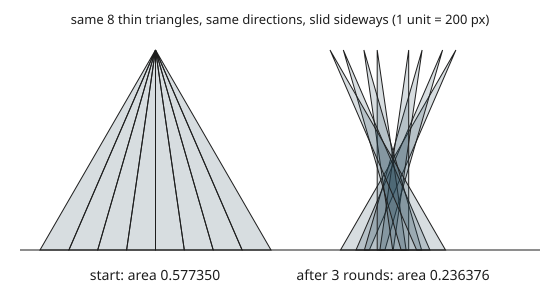

# Kakeya: a set containing a unit segment in every direction, and how small it can be

[Syllabus](../../../SYLLABUS.md) → [Frontier](../README.md) → [Geometry and Combinatorics](../README.md#s04) → Kakeya

---

## General Overview

In 1917 Sōichi Kakeya asked: what is the smallest area in which a needle of length 1 can be turned round, so that it ends up pointing the other way?

Spinning it about its middle sweeps a disc of area 0.785398 ($`\pi/4`$). An equilateral triangle of height 1 does better, at 0.577350. A three-cusped curve, the deltoid, does better still, at 0.392699. [Restriction and Kakeya in outline](../../20-Harmonic%20analysis/06-Maximal%20Functions%20and%20Beyond/06-restriction-and-kakeya-in-outline.md) computes these three.

Abram Besicovitch answered in 1919 and 1928: there is no smallest area. Cut the triangle into thin slices and slide them sideways until they pile up. Sliding never turns a slice, so every needle direction survives.

Here, 8 slices slid in 3 rounds cover 0.236376 instead of 0.577350. After 8 rounds, three such piles plus some thin connecting moves turn the needle round in 0.392304, already less than the deltoid. More rounds go lower, towards zero.

A set that only *holds* a unit needle in every direction, without turning it, can have area exactly zero. Such a set is a **Kakeya set**. Area cannot tell these sets apart, so the modern question uses dimension. The **Kakeya conjecture** says a Kakeya set in $`d`$-dimensional space always has the full dimension $`d`$, even when its volume is zero.

**Sliding thin triangles keeps every direction while the area falls towards zero, so a needle set is measured by its dimension, and the conjecture says that dimension is always full.**

**What kind of fact this is:** two claims with separate status. Besicovitch's construction is a theorem, outlined here and built to 8 rounds by the code. The Kakeya conjecture is a conjecture, proved in dimensions 2 and 3 and open above; its three-dimensional proof is outlined with its source, not checked here.

**Status, 2026-11-23:**

- **Plane ($`d = 2`$): proved.** Roy Davies, 1971, refereed.
- **Space ($`d = 3`$): proved.** Hong Wang and Joshua Zahl posted a 127-page preprint on 2025-02-24. A streamlined proof by Larry Guth, Wang and Zahl appeared in the refereed journal *Mathematika* on 2026-11-06. The preprint itself was still arXiv version 1, with no journal reference, on 2026-11-23.
- **Four or more dimensions: open.** No accepted proof or disproof.

### The picture: one triangle, eight slices, slid

<p align="center"></p>

Drawn to scale, 1 unit = 200 pixels, from the code's `figure,` line. Left: the starting triangle, area 0.577350, in 8 thin triangles. Right: the same 8 after 3 rounds of sliding, area 0.236376. This shape is called a **Perron tree**, after Oskar Perron's 1928 simplification of Besicovitch's construction.

---

## The formula

Notation first, in words.

- $`d`$ is the dimension of the space: 2 for a table top, 3 for a room.
- A **direction** is a unit vector $`e`$, an arrow of length 1. A unit needle in direction $`e`$ starting at the point $`x`$ is the set of points $`x + te`$ with $`0 \le t \le 1`$.
- $`\lvert A\rvert`$ is the area of a set $`A`$ in the plane, or its volume in space: its [Lebesgue measure](../../10-Measure%20and%20integration/02-Length%20Done%20Properly/03-lebesgue-measure.md).
- $`\dim_H`$ and $`\dim_M`$ are the Hausdorff and Minkowski dimensions, defined in Step 4 of Why it works: 1 for a segment, 2 for a filled square.

The definition and the conjecture:

```math
K \subset \mathbb{R}^d \text{ is a Kakeya set} \iff \forall e \ \exists x : \{x + te : 0 \le t \le 1\} \subset K; \qquad \text{conjecture: } \dim_H K = \dim_M K = d
```

**Read it aloud:** "K is a Kakeya set when, for every direction, some unit needle in that direction lies inside K; the conjecture says every such set has full dimension d, by both rulers." A Kakeya set is also taken to be compact: closed and bounded.

Besicovitch's construction, in the Perron-tree form this card computes. Start from a triangle $`T`$. Cut it into $`2^k`$ thin triangles with a common apex, then slide them in $`k`$ rounds with a ratio $`\alpha`$. The result $`P_k`$ obeys

```math
\lvert P_k\rvert \le \Bigl(\alpha^{2k} + 2(1-\alpha)^2\,\frac{1-\alpha^{2k}}{1-\alpha^2}\Bigr)\lvert T\rvert, \qquad \tfrac12 < \alpha < 1
```

**Read it aloud:** "The tree's area is at most the shrunken main triangle, alpha to the power 2k of the start, plus the sprouts that each round leaves behind."

Step 2 shows that with $`\alpha = 1 - \log(k+1)/(2k)`$ the bound shrinks to zero as $`k`$ grows (log is the natural logarithm). At $`k`$ = 8 the tree keeps 0.2265 of $`\lvert T\rvert`$, under the bound's 0.2277.

| Symbol | Plain meaning | In our example | Push it up and the answer… |
| --- | --- | --- | --- |
| $`d`$ | dimension of the space | 2 for the needle; 3 for the 2025 result | the conjecture asks for more |
| $`e,\ x,\ t`$ | a direction (unit vector); a needle's start point; position along the needle, 0 to 1 | the 2001 directions the code tests | — |
| $`K`$ | a Kakeya set: compact, a unit needle in every direction | three Perron trees | — |
| $`\lvert A\rvert`$ | area (in space, volume) of a set $`A`$ | $`\lvert T\rvert`$ = 0.577350 | — |
| $`T,\ T_1,\ T_2`$ | the starting equilateral triangle, height 1, base $`2/\sqrt 3`$; its left and right halves | holds every direction within 30° of vertical | — |
| $`k,\ 2^k,\ j`$ | sliding rounds; thin triangles; the number of one round | 8 rounds, 256 triangles | area falls |
| $`\alpha`$ | shrink ratio of the main triangle per round, between 1/2 and 1 | 0.862673 at $`k`$ = 8 | fewer sprouts, but less shrinking |
| $`P_k,\ M,\ M_1,\ M_2`$ | the Perron tree after $`k`$ rounds; a merged triangle and the two main triangles it is made of | $`\lvert P_8\rvert`$ = 0.130743 | — |
| $`p,\ \beta`$ | in the fold's coordinates: the apex's sideways position; where $`M_1`$'s base ends | $`\beta`$ = 1/2 for equal bases | unequal halves leave bigger sprouts |
| $`\theta`$ | turning angle of one Pál join, radians | at most $`6.1477 \times 10^{-7}`$ to beat the deltoid | each join costs area $`\theta`$ |
| $`E,\ s,\ U_i,\ \varepsilon,\ \mathcal H^s,\ N(\varepsilon)`$ | a set; a trial dimension; the pieces of a cover; the largest piece size; the $`s`$-dimensional Hausdorff measure; boxes of side $`\varepsilon`$ the set touches | Cantor set: pieces $`3^{-k}`$, sums 1.0000 at $`s`$ = 0.630930 | above the true dimension the sums vanish |
| $`\dim_H,\ \dim_M`$ | Hausdorff and Minkowski dimension | 0.630930 for the Cantor set; 2 for any Kakeya set in the plane | — |

### When it holds

- **The ratio $`\alpha`$ is above 1/2.** The merge formula needs it. Below 1/2 the slid half passes the other half's corner, and the formula overstates the area: at $`\alpha`$ = 0.4 one merge leaves 0.8400 of the triangle, not the formula's 0.8800.
- **The ratio rises towards 1 as the rounds grow.** Fixed at $`\alpha`$ = 2/3, eight rounds stall at 0.3775 of the triangle, against 0.2265 with the rising rule.
- **Pieces move only by sliding.** After 8 rounds the code finds a needle in 2001 of 2001 tested directions. Turning a piece would lose some.
- **Turning needs connecting moves.** Each Pál join (Step 3) costs area $`\theta`$, small but not zero.
- **Area is not dimension.** A Kakeya set in the plane can have area 0, yet Davies proved it always has dimension 2.

---

## Why it works

### Step 0: slide, never turn

A thin triangle with apex at the top and base on the table holds a needle in every direction between its two sides. Move the triangle sideways and it still holds those directions. Directions belong to the triangle's shape, not to its position.

So cut the big triangle into thin ones and slide them until they overlap. The directions stay, and the area shrinks by the overlap. The art is to make overlaps large and leftover tips small.

### Step 1: one merge, worked exactly

Cut $`T`$ into its left and right halves, $`T_1`$ and $`T_2`$. Slide $`T_2`$ left by $`(1-\alpha)`$ times the full base.

- The far left side of $`T_1`$ and the far right side of the slid $`T_2`$ now meet at height $`\alpha`$. Below that point they enclose a copy of $`T`$ shrunk by $`\alpha`$: the **main triangle**, area $`\alpha^2\lvert T\rvert`$.
- What sticks out above and beside the main triangle are two **sprouts**: thin tips of $`T_1`$ and $`T_2`$. Each has area $`(1-\alpha)^2\lvert T\rvert`$.

So one merge leaves exactly $`(\alpha^2 + 2(1-\alpha)^2)\lvert T\rvert`$. The best ratio is $`\alpha`$ = 2/3, which leaves 2/3 of the triangle: 0.384900. The code's sweep finds the same three values the formula gives at $`\alpha`$ = 1, 2/3 and 1/2.

### Step 2: many rounds, and the bound

Repeat the merge with neighbours in pairs. Round 1 merges thin triangles 1 and 2, 3 and 4, and so on. Round 2 merges the merged pairs, using their main triangles as the halves. After $`k`$ rounds one main triangle remains, shrunk by $`\alpha`$ in every round: area $`\alpha^{2k}\lvert T\rvert`$.

The sprouts pile up. Round $`j`$ leaves sprouts of total area $`2(1-\alpha)^2\alpha^{2(j-1)}\lvert T\rvert`$. Adding these over the rounds gives the bound in the formula. The real area is a little less, because some sprouts overlap.

<details>
<summary>Detailed proof: why each merge leaves sprouts of area (1 − α)² times the merged triangle</summary>

Take two groups whose main triangles $`M_1`$ and $`M_2`$ have equal bases and the same height. Slide the second group so the bases touch; then $`M_1 \cup M_2`$ is one triangle $`M`$ with a common apex.

Now slide the second group left by $`(1-\alpha)`$ times the base of $`M`$. The outer sides of $`M_1`$ and the slid $`M_2`$ meet at height $`\alpha`$ times the height of $`M`$. The triangle below that point is $`M`$ shrunk by $`\alpha`$, fixed at $`M`$'s left corner, so it has area $`\alpha^2\lvert M\rvert`$.

Use coordinates in which $`M`$ has corners $`(0, 0)`$, $`(1, 0)`$ and $`(p, 1)`$, and $`M_1`$ has base from 0 to $`\beta`$; this change of coordinates keeps ratios of areas. The part of $`M_1`$ outside the new main triangle is a triangle with area

$`\displaystyle \frac{(1-\alpha)^2}{2}\cdot\frac{\beta}{1-\beta}`$

and the part of $`M_2`$ outside it has the same form with $`\beta`$ and $`1 - \beta`$ swapped. Equal bases mean $`\beta = 1/2`$, so each part is $`(1-\alpha)^2/2 = (1-\alpha)^2\lvert M\rvert`$, since $`\lvert M\rvert = 1/2`$ here. The condition $`\alpha > 1/2`$ makes the slid side cross $`M_1`$ where this formula assumes.

Old sprouts move with their group, so after round $`j`$ the union lies inside the new main triangles plus all sprouts so far. In round $`j`$ the merged triangles $`M`$ have total area $`\alpha^{2(j-1)}\lvert T\rvert`$, so that round adds at most $`2(1-\alpha)^2\alpha^{2(j-1)}\lvert T\rvert`$. Summing the geometric series over $`j = 1, \dots, k`$ gives

$`\displaystyle \lvert P_k\rvert \le \alpha^{2k}\lvert T\rvert + 2(1-\alpha)^2\,\frac{1-\alpha^{2k}}{1-\alpha^2}\,\lvert T\rvert`$

This is the standard Perron-tree argument. The first source has Besicovitch's original route.

</details>

The code builds the tree for $`k`$ = 1 to 8 and measures its area two ways. Both roads agree to six decimals, and every area sits under the bound:

```
share of the triangle left, rule alpha = 1 - log(k+1)/(2k)
k=1  #################################   0.6672
k=2  #########################           0.5014
k=3  ####################                0.4094
k=4  #################                   0.3490
k=5  ###############                     0.3058
k=6  ##############                      0.2731
k=7  ############                        0.2473
k=8  ###########                         0.2265
```

With this rule the first term of the bound is close to $`1/(k+1)`$ and the second is below $`2(1-\alpha)/(1+\alpha)`$, about $`\log(k+1)/(2k)`$. So the fall is slow, roughly like $`\log k / k`$, but it gets below any area named in advance.

### Step 3: from piles to a needle turned round

One tree holds every direction within 30° of vertical. Three trees, turned by 0°, 60° and 120°, hold all 180°. Their total area is at most three times one tree: 0.392228 at $`k`$ = 8.

To turn the needle, pivot it at a thin triangle's apex and sweep it across. At the edge, the next thin triangle has a parallel side elsewhere. A **Pál join**, after Julius Pál, moves the needle there:

1. Turn the needle by a tiny angle $`\theta`$ about one end. This sweeps a sector of area $`\theta/2`$.
2. Slide it along its new line until that line meets the target line. A slide along a line sweeps no area.
3. Turn back by $`\theta`$, another $`\theta/2`$.

Total cost: $`\theta`$, however far apart the lines are. The slide is long, about $`1/\theta`$ times the gap. Three trees with 256 triangles each need 767 joins. With $`\theta = 10^{-7}`$ the whole half-turn fits in 0.392304, below the deltoid's 0.392699.

To reach zero area, Besicovitch let the trees get finer without end and passed to a limit. The limit set is compact, holds a unit needle in every direction, and has area 0. It has no joins, so it holds the needle without turning it.

### Step 4: Hausdorff and Minkowski dimension, the finer ruler

[Fractals](../../05-Geometry%20and%20trig/07-Points%2C%20Convexity%20and%20Fractals/05-self-similarity-and-fractal-dimension.md) gives the similarity dimension of self-similar shapes. Kakeya sets are not self-similar, so they need the general rulers.

**Minkowski dimension (box counting).** Lay a grid of boxes of side $`\varepsilon`$ and count the boxes the set touches, $`N(\varepsilon)`$. If $`N(\varepsilon)`$ grows like $`\varepsilon^{-s}`$ as $`\varepsilon`$ shrinks, then $`\dim_M = s`$.

**Hausdorff dimension (Felix Hausdorff, 1918).** Cover the set with pieces $`U_i`$ of any shape, each of diameter at most $`\varepsilon`$. Weigh each piece by its diameter to a trial power $`s`$, add up, and take the cheapest cover:

```math
\mathcal H^s(E) = \lim_{\varepsilon \to 0}\, \inf\Bigl\{\sum_i (\mathrm{diam}\, U_i)^s : E \subset \bigcup_i U_i,\ \mathrm{diam}\, U_i \le \varepsilon\Bigr\}, \qquad \dim_H E = \inf\{s : \mathcal H^s(E) = 0\}
```

**Read it aloud:** "The s-dimensional measure is the cheapest total of diameters to the power s, over covers by ever smaller pieces; the dimension is where that measure drops from infinite to zero."

The middle-thirds Cantor set shows the jump. Remove the middle third of [0, 1], then the middle third of each piece left, and so on. Stage $`k`$ is $`2^k`$ pieces of length $`3^{-k}`$, so the sum is $`(2 \cdot 3^{-s})^k`$:

| Trial $`s`$ | $`k`$ = 10 | $`k`$ = 20 | $`k`$ = 40 | Trend |
| ---: | ---: | ---: | ---: | --- |
| 0.5000 | 4.2140 | 17.758 | 315.34 | grows without end |
| 0.630930 | 1.0000 | 1.0000 | 1.0000 | stays at 1 |
| 0.7000 | 0.46822 | 0.21923 | 0.048062 | falls to 0 |

So $`\dim_H`$ = log 2 / log 3 = 0.630930. Pieces of mixed sizes make Hausdorff finer than box counting: the rational numbers in [0, 1] have Hausdorff dimension 0 but Minkowski dimension 1, since they touch every box. Hausdorff dimension is never the larger, so $`\dim_H K = d`$ is the stronger result.

### Step 5: the conjecture, dimension by dimension

**The plane.** Davies proved in 1971 that every Kakeya set in the plane has Hausdorff dimension 2. The outline card proves the box-counting version.

**The link to restriction, in one line.** Proved on [Restriction and Kakeya in outline](../../20-Harmonic%20analysis/06-Maximal%20Functions%20and%20Beyond/06-restriction-and-kakeya-in-outline.md): a restriction bound forces Kakeya sets to be large (Bourgain, 1991). Kakeya sets of tiny area also break the ideal circular filter (Fefferman, 1971). Kakeya bounds have not been shown to give restriction bounds in three or more dimensions.

**Space.** The route, as the 2025 preprint's history section records it:

| Year | Result |
| --- | --- |
| 1995 | Wolff's "hairbrush" argument: tubes meeting one tube must spread out, so Hausdorff dimension is at least 5/2 |
| 2000 | Katz, Łaba and Tao: upper Minkowski dimension at least 5/2 plus a small fixed amount |
| 2022 | Wang and Zahl: **sticky** Kakeya sets have dimension 3 (refereed, *Journal of the American Mathematical Society*, online 2025-11-05) |
| 2024 | Wang and Zahl: every Kakeya set in space has Assouad dimension 3 (one with less would have to be sticky, which the 2022 result rules out) |
| 2025-02-24 | Wang and Zahl: every Kakeya set in space has Minkowski and Hausdorff dimension 3 |

Tubes are **sticky** when, at every coarser scale, they bundle into fatter tubes that still point in well-spread directions. The Assouad dimension is a third ruler, never below the Minkowski one, so the 2024 result was not yet enough.

**The 2025 proof, outlined, not checked.**

1. **Statement.** Thicken each needle into a thin tube. Take many tubes in a ball of radius 1, with no flat box holding too many of them; tubes in well-separated directions qualify. Keep at least a fixed share of each tube. Then the kept parts cover nearly the tubes' total volume. The loss is at most a fixed power of the share, times a factor that grows slower than any power of one over the width. A Kakeya set of dimension below 3 would break this.
2. **The sticky case.** The 2022 paper had already handled tubes that bundle neatly at every scale.
3. **The general case.** The paper shows that a set of tubes making the volume bound nearly tight must have structure at two scales, built from **grains** (small flat slabs where many tubes meet). An induction on scales then pushes the problem down to the sticky case.
4. **Artifact and check.** A 127-page preprint, then a streamlined refereed proof by Guth, Wang and Zahl in *Mathematika*, 2026.

### Step 6: what the 2025 result does not claim

- It does not prove the **Kakeya maximal function conjecture** in space, a stronger averaged form; the preprint says so.
- It does not claim the **restriction conjecture** in space. The proved implication runs from restriction to Kakeya, not back.
- It says nothing about four or more dimensions, which stay open as of 2026-11-23.

---

## Worked numbers, by hand

The starting triangle, one merge, then the eight-round trees and the joins.

| Step | Arithmetic | Value |
| --- | --- | --- |
| starting triangle $`T`$ | base $`2/\sqrt3`$ × height 1 ÷ 2 | 0.577350 |
| one merge at $`\alpha`$ = 2/3 | $`(4/9 + 2 \times 1/9) \times 0.577350`$ | 0.384900 |
| rule at $`k`$ = 8 | $`1 - \log 9 / 16`$ | 0.862673 |
| tree after 8 rounds | sweep over 256 slid triangles | 0.130743 |
| as a share of $`T`$ | 0.130743 ÷ 0.577350 | 0.2265 (bound 0.2277) |
| three trees | 3 × 0.130743 | 0.392228 |
| 767 Pál joins at $`\theta = 10^{-7}`$ | 767 × 0.0000001 | 0.0000767 |
| whole half-turn | 0.392228 + 0.0000767 | **0.392304** |
| deltoid, for comparison | $`\pi/8`$ | 0.392699 |

So eight rounds of sliding already turn the needle round in less area than the deltoid. The three trees leave 0.000472 of room under it, and the joins use 0.0000767 of that.

### What breaks if you drop a piece

| Mistake | Comes out at | What went wrong |
| --- | --- | --- |
| Never slide ($`\alpha`$ = 1) | 0.577350 | the slices still fill the whole triangle |
| Slide too far ($`\alpha`$ = 1/2, one merge) | 0.433013, a share of 0.7500 | the sprouts eat much of what the overlap saves; 2/3 gives 0.6667 |
| Keep $`\alpha`$ fixed at 2/3 for 8 rounds | share 0.3775, against 0.2265 | the sprout term stalls near 2(1 − α)/(1 + α) = 0.4000 |
| Join with a coarse angle, $`\theta`$ above $`6.1477 \times 10^{-7}`$ | more than 0.392699 | 767 joins eat the 0.000472 of room under the deltoid |
| Test a trial dimension below the true one ($`s`$ = 0.5, Cantor set) | 315.34 at $`k`$ = 40, still growing | below the dimension the cover sums blow up |

---

## Code, from first principles, and it actually runs

Both programs build the Perron tree by sliding $`2^k`$ thin triangles, with no geometry library, and measure each built tree's area two ways. Road 1 is exact: between heights where two sides cross, the union's width is a straight line in the height, so a midpoint gives the exact slice. Road 2 is a midpoint rule on 20,000 slices. Both roads measure the same construction, so they check the measuring, not the sliding.

The sliding itself is checked against the one-merge formula, every tree against the bound, and 2001 test directions for a needle. The Pál sector is checked as a fan of 100,000 thin triangles.

### Python

```python
# Kakeya: the check behind the card. Standard library only.
# A Perron tree: cut a triangle of height 1 into 2^k thin triangles and slide them
# sideways so they pile up. Sliding never turns a triangle, so every needle
# direction survives while the area shrinks. Every area is computed here.
import math

B = 1 / math.sqrt(3)  # half-base of the equilateral triangle of height 1
T = B                 # its area: base 2B times height 1, halved

def tree(k, al):
    # thin triangles [left base x, right base x, apex x]; base at y = 0, apex at y = 1
    n = 2 ** k
    tris = [[-B + 2 * B * i / n, -B + 2 * B * (i + 1) / n, 0.0] for i in range(n)]
    groups = [([i], (tris[i][0], tris[i][1], 0.0, 1.0)) for i in range(n)]
    while len(groups) > 1:  # each round merges neighbouring groups in pairs
        new = []
        for (i1, (a1, b1, p1x, p1y)), (i2, (a2, b2, p2x, p2y)) in zip(groups[0::2], groups[1::2]):
            s = b1 - a2  # close the gap: the two main triangles become one triangle M
            b2, p2x = b2 + s, p2x + s
            assert abs(p1x - p2x) < 1e-12 and abs(p1y - p2y) < 1e-12  # common apex
            t = (1 - al) * (b2 - a1)  # then slide the right group left by (1 - alpha) of M's base
            for i in i2:
                for j in range(3):
                    tris[i][j] += s - t
            new.append((i1 + i2, (a1, b2 - t, a1 + al * (p1x - a1), al * p1y)))
        groups = new
    return tris

def width(tris, y):  # length of the union of the triangles' cross-sections at height y
    iv = sorted((l + (a - l) * y, r + (a - r) * y) for l, r, a in tris)
    tot, (cl, cr) = 0.0, iv[0]
    for l, r in iv[1:]:
        if l > cr:
            tot, cl, cr = tot + cr - cl, l, r
        else:
            cr = max(cr, r)
    return tot + cr - cl

def area_exact(tris):  # road 1: between edge crossings the width is linear, so midpoints are exact
    lines = [e for l, r, a in tris for e in ((l, a - l), (r, a - r))]
    ys = {0.0, 1.0}
    for i, (c1, m1) in enumerate(lines):
        for c2, m2 in lines[i + 1:]:
            if m1 != m2 and 0 < (c2 - c1) / (m1 - m2) < 1:
                ys.add((c2 - c1) / (m1 - m2))
    ys = sorted(ys)
    return sum((y2 - y1) * width(tris, (y1 + y2) / 2) for y1, y2 in zip(ys, ys[1:]))

def area_sampled(tris, m=20000):  # road 2: plain midpoint rule on m slices
    return sum(width(tris, (j + 0.5) / m) for j in range(m)) / m

def bound(k, al):  # main triangle alpha^(2k), plus 2(1 - alpha)^2 of each merged triangle
    return al ** (2 * k) + 2 * (1 - al) ** 2 * (1 - al ** (2 * k)) / (1 - al * al)

pts = [(-B, 0.0), (B, 0.0), (0.0, 1.0)]
shoe = abs(sum(x1 * y2 - x2 * y1 for (x1, y1), (x2, y2) in zip(pts, pts[1:] + pts[:1]))) / 2
assert abs(shoe - 1 / math.sqrt(3)) < 1e-15
print(f"starting triangle, height 1: area {shoe:.6f} (1/sqrt 3 = {1 / math.sqrt(3):.6f}); disc pi/4 = {math.pi / 4:.6f}")
print("one merge (k=1): exact area = (alpha^2 + 2(1-alpha)^2) T")
for al in (1.0, 2 / 3, 0.5):
    a, f = area_exact(tree(1, al)), (al * al + 2 * (1 - al) ** 2) * T
    assert abs(a - f) < 1e-12
    print(f"  alpha={al:.4f}: sweep {a:.6f}, formula {f:.6f}, share of T {a / T:.4f}")
a4, f4 = area_exact(tree(1, 0.4)) / T, 0.4 * 0.4 + 2 * 0.6 * 0.6  # alpha below 1/2: the formula fails
print(f"  alpha=0.4000: sweep share {a4:.4f}, formula share {f4:.4f}: below 1/2 the formula overstates")
assert f4 - a4 > 0.01
print("k  alpha     area(exact)  area(sampled) share  bound   3 trees")
bars = []
for k in range(1, 9):
    al = 1 - math.log(k + 1) / (2 * k)
    tr = tree(k, al)
    a, b = area_exact(tr), area_sampled(tr)
    assert abs(a - b) < 1e-6 and a <= bound(k, al) * T + 1e-12
    assert a > 0.95 * bound(k, al) * T  # the sprouts barely overlap
    bars.append(a / T)
    print(f"{k}  {al:.6f}  {a:.6f}     {b:.6f}       {a / T:.4f}  {bound(k, al):.4f}  {3 * a:.6f}")
    if k == 8:
        a8 = a
        # every direction in the 60-degree wedge: a needle from some apex to the base
        hit = 0
        for j in range(2001):
            u = -B + 2 * B * j / 2000  # base point x - apex x, for a needle from the apex
            hit += any(l - 1e-12 <= a0 + u <= r + 1e-12 for l, r, a0 in tr)
        assert hit == 2001
        print(f"k=8: directions with a needle from apex to base: {hit} of 2001; "
              f"x from {min(t[0] for t in tr):.4f} to {max(t[1] for t in tr):.4f}")
print("bars:", ", ".join(f"{v:.4f}" for v in bars))
fixed = area_exact(tree(8, 2 / 3)) / T
print(f"fixed alpha=2/3 at k=8: share {fixed:.4f}, bound floor 2(1-a)/(1+a) = {2 * (1 / 3) / (5 / 3):.4f}")
assert fixed > bars[-1]

# Pal join: move a needle to a parallel line h away by turning theta, sliding, turning back
for th in (0.01, 0.001):
    m = 100000  # fan of thin triangles: the sector swept by one turn, by shoelace
    fan = sum(0.5 * math.sin(th / m) for _ in range(m))
    assert abs(fan - th / 2) < 1e-9
    print(f"Pal join theta={th}: two sectors {2 * fan:.6f} (formula theta {th}), slide 1/sin = {1 / math.sin(th):.4f}")
joins = 3 * 2 ** 8 - 1
print(f"whole half-turn, k=8, theta=1e-7: at most {3 * a8:.6f} + {joins} x 1e-7 = {3 * a8 + joins * 1e-7:.6f}"
      f" (deltoid pi/8 = {math.pi / 8:.6f})")
assert 3 * a8 + joins * 1e-7 < math.pi / 8
room = math.pi / 8 - 3 * a8
print(f"room under the deltoid: {room:.6f}, so each of {joins} joins may use theta up to {room / joins:.4e}")

# Hausdorff sums for the middle-thirds Cantor set: 2^k pieces of length 3^-k
s0 = math.log(2) / math.log(3)
print(f"Cantor set: critical s = log 2 / log 3 = {s0:.6f}")
for s in (0.5, s0, 0.7):
    sums = [2 ** k * 3.0 ** (-k * s) for k in (10, 20, 40)]
    print(f"  s={s:.4f}: k=10 {sums[0]:.4e}, k=20 {sums[1]:.4e}, k=40 {sums[2]:.4e}")
    if s == s0:
        assert abs(sums[2] - 1) < 1e-9
    else:
        assert (sums[2] > sums[0]) == (s < s0)

tr = tree(3, 1 - math.log(4) / 6)
print("figure, k=3 tree, base x and apex x:", "; ".join(f"{l:.4f} {r:.4f} {a:.4f}" for l, r, a in tr))
print("ALL CHECKS PASS")
```

**Ran 2026-11-23 on macOS, Python 3.14.10, standard library only. All checks passed. Output, pasted from the run:**

```
starting triangle, height 1: area 0.577350 (1/sqrt 3 = 0.577350); disc pi/4 = 0.785398
one merge (k=1): exact area = (alpha^2 + 2(1-alpha)^2) T
  alpha=1.0000: sweep 0.577350, formula 0.577350, share of T 1.0000
  alpha=0.6667: sweep 0.384900, formula 0.384900, share of T 0.6667
  alpha=0.5000: sweep 0.433013, formula 0.433013, share of T 0.7500
  alpha=0.4000: sweep share 0.8400, formula share 0.8800: below 1/2 the formula overstates
k  alpha     area(exact)  area(sampled) share  bound   3 trees
1  0.653426  0.385204     0.385204       0.6672  0.6672  1.155611
2  0.725347  0.289463     0.289463       0.5014  0.5071  0.868390
3  0.768951  0.236376     0.236376       0.4094  0.4139  0.709127
4  0.798820  0.201522     0.201522       0.3490  0.3524  0.604565
5  0.820824  0.176560     0.176560       0.3058  0.3083  0.529680
6  0.837841  0.157665     0.157665       0.2731  0.2750  0.472995
7  0.851468  0.142793     0.142793       0.2473  0.2488  0.428380
8  0.862673  0.130743     0.130743       0.2265  0.2277  0.392228
k=8: directions with a needle from apex to base: 2001 of 2001; x from -0.5774 to -0.2232
bars: 0.6672, 0.5014, 0.4094, 0.3490, 0.3058, 0.2731, 0.2473, 0.2265
fixed alpha=2/3 at k=8: share 0.3775, bound floor 2(1-a)/(1+a) = 0.4000
Pal join theta=0.01: two sectors 0.010000 (formula theta 0.01), slide 1/sin = 100.0017
Pal join theta=0.001: two sectors 0.001000 (formula theta 0.001), slide 1/sin = 1000.0002
whole half-turn, k=8, theta=1e-7: at most 0.392228 + 767 x 1e-7 = 0.392304 (deltoid pi/8 = 0.392699)
room under the deltoid: 0.000472, so each of 767 joins may use theta up to 6.1477e-07
Cantor set: critical s = log 2 / log 3 = 0.630930
  s=0.5000: k=10 4.2140e+00, k=20 1.7758e+01, k=40 3.1534e+02
  s=0.6309: k=10 1.0000e+00, k=20 1.0000e+00, k=40 1.0000e+00
  s=0.7000: k=10 4.6822e-01, k=20 2.1923e-01, k=40 4.8062e-02
figure, k=3 tree, base x and apex x: -0.5774 -0.4330 0.0000; -0.4997 -0.3554 -0.0667; -0.4579 -0.3136 -0.1693; -0.3803 -0.2360 -0.2360; -0.3937 -0.2494 -0.3937; -0.3161 -0.1717 -0.4604; -0.2743 -0.1300 -0.5630; -0.1967 -0.0523 -0.6297
ALL CHECKS PASS
```

### Rust

```rust
// Kakeya: the check behind the card. Rust std only, no crates.
// A Perron tree: cut a triangle of height 1 into 2^k thin triangles and slide them
// sideways so they pile up. Sliding never turns a triangle, so every needle
// direction survives while the area shrinks. Every area is computed here.

// half-base of the equilateral triangle of height 1, and also its area
fn half_base() -> f64 { 1.0 / 3f64.sqrt() }

// thin triangles [left base x, right base x, apex x]; base at y = 0, apex at y = 1
fn tree(k: u32, al: f64) -> Vec<[f64; 3]> {
    let b = half_base();
    let n = 1usize << k;
    let mut tris: Vec<[f64; 3]> = (0..n)
        .map(|i| [-b + 2.0 * b * i as f64 / n as f64, -b + 2.0 * b * (i + 1) as f64 / n as f64, 0.0])
        .collect();
    // a group: its triangle numbers, and its main triangle (left base, right base, apex x, apex y)
    let mut groups: Vec<(Vec<usize>, [f64; 4])> =
        (0..n).map(|i| (vec![i], [tris[i][0], tris[i][1], 0.0, 1.0])).collect();
    while groups.len() > 1 {
        let mut new = Vec::new();
        for pair in groups.chunks(2) {
            let (i1, m1) = (&pair[0].0, pair[0].1);
            let (i2, m2) = (&pair[1].0, pair[1].1);
            let s = m1[1] - m2[0]; // close the gap: the two main triangles become one triangle M
            let (b2, p2x) = (m2[1] + s, m2[2] + s);
            assert!((m1[2] - p2x).abs() < 1e-12 && (m1[3] - m2[3]).abs() < 1e-12); // common apex
            let t = (1.0 - al) * (b2 - m1[0]); // slide the right group left by (1 - alpha) of M's base
            for &i in i2 { for j in 0..3 { tris[i][j] += s - t; } }
            let mut ids = i1.clone();
            ids.extend(i2.iter().cloned());
            new.push((ids, [m1[0], b2 - t, m1[0] + al * (m1[2] - m1[0]), al * m1[3]]));
        }
        groups = new;
    }
    tris
}

// length of the union of the triangles' cross-sections at height y
fn width(tris: &[[f64; 3]], y: f64) -> f64 {
    let mut iv: Vec<(f64, f64)> =
        tris.iter().map(|t| (t[0] + (t[2] - t[0]) * y, t[1] + (t[2] - t[1]) * y)).collect();
    iv.sort_by(|p, q| p.partial_cmp(q).unwrap());
    let (mut tot, mut cl, mut cr) = (0.0, iv[0].0, iv[0].1);
    for &(l, r) in &iv[1..] {
        if l > cr { tot += cr - cl; cl = l; cr = r; } else { cr = cr.max(r); }
    }
    tot + cr - cl
}

// road 1: between edge crossings the width is linear, so midpoints are exact
fn area_exact(tris: &[[f64; 3]]) -> f64 {
    let lines: Vec<(f64, f64)> =
        tris.iter().flat_map(|t| [(t[0], t[2] - t[0]), (t[1], t[2] - t[1])]).collect();
    let mut ys = vec![0.0, 1.0];
    for i in 0..lines.len() {
        let (c1, m1) = lines[i];
        for &(c2, m2) in &lines[i + 1..] {
            let y = (c2 - c1) / (m1 - m2);
            if m1 != m2 && 0.0 < y && y < 1.0 { ys.push(y); }
        }
    }
    ys.sort_by(|p, q| p.partial_cmp(q).unwrap());
    ys.dedup();
    ys.windows(2).map(|w| (w[1] - w[0]) * width(tris, (w[0] + w[1]) / 2.0)).sum()
}

// road 2: plain midpoint rule on m slices
fn area_sampled(tris: &[[f64; 3]], m: usize) -> f64 {
    (0..m).map(|j| width(tris, (j as f64 + 0.5) / m as f64)).sum::<f64>() / m as f64
}

// main triangle alpha^(2k), plus 2(1 - alpha)^2 of each merged triangle
fn bound(k: u32, al: f64) -> f64 {
    let a2k = al.powi(2 * k as i32);
    a2k + 2.0 * (1.0 - al).powi(2) * (1.0 - a2k) / (1.0 - al * al)
}

fn sci(x: f64) -> String { // Python's {:.4e}: mantissa, then e+NN or e-NN
    let mut e = x.abs().log10().floor() as i32;
    if format!("{:.4}", x / 10f64.powi(e)) == "10.0000" { e += 1; }
    format!("{:.4}e{}{:02}", x / 10f64.powi(e), if e < 0 { "-" } else { "+" }, e.abs())
}

fn main() {
    let b = half_base();
    let t_area = b;
    let pts = [(-b, 0.0), (b, 0.0), (0.0, 1.0)];
    let sh: f64 = (0..3).map(|i| pts[i].0 * pts[(i + 1) % 3].1 - pts[(i + 1) % 3].0 * pts[i].1).sum();
    let shoe = sh.abs() / 2.0;
    assert!((shoe - 1.0 / 3f64.sqrt()).abs() < 1e-15);
    println!("starting triangle, height 1: area {:.6} (1/sqrt 3 = {:.6}); disc pi/4 = {:.6}",
             shoe, 1.0 / 3f64.sqrt(), std::f64::consts::PI / 4.0);
    println!("one merge (k=1): exact area = (alpha^2 + 2(1-alpha)^2) T");
    for al in [1.0, 2.0 / 3.0, 0.5] {
        let a = area_exact(&tree(1, al));
        let f = (al * al + 2.0 * (1.0 - al) * (1.0 - al)) * t_area;
        assert!((a - f).abs() < 1e-12);
        println!("  alpha={:.4}: sweep {:.6}, formula {:.6}, share of T {:.4}", al, a, f, a / t_area);
    }
    let (a4, f4) = (area_exact(&tree(1, 0.4)) / t_area, 0.4 * 0.4 + 2.0 * 0.6 * 0.6); // alpha below 1/2: the formula fails
    println!("  alpha=0.4000: sweep share {:.4}, formula share {:.4}: below 1/2 the formula overstates", a4, f4);
    assert!(f4 - a4 > 0.01);
    println!("k  alpha     area(exact)  area(sampled) share  bound   3 trees");
    let mut bars = Vec::new();
    let mut a8 = 0.0;
    for k in 1..=8u32 {
        let al = 1.0 - ((k + 1) as f64).ln() / (2.0 * k as f64);
        let tr = tree(k, al);
        let (a, s) = (area_exact(&tr), area_sampled(&tr, 20000));
        assert!((a - s).abs() < 1e-6 && a <= bound(k, al) * t_area + 1e-12);
        assert!(a > 0.95 * bound(k, al) * t_area); // the sprouts barely overlap
        bars.push(a / t_area);
        println!("{}  {:.6}  {:.6}     {:.6}       {:.4}  {:.4}  {:.6}",
                 k, al, a, s, a / t_area, bound(k, al), 3.0 * a);
        if k == 8 {
            a8 = a;
            // every direction in the 60-degree wedge: a needle from some apex to the base
            let mut hit = 0;
            for j in 0..=2000 {
                let u = -b + 2.0 * b * j as f64 / 2000.0; // base point x - apex x
                hit += tr.iter().any(|t| t[0] - 1e-12 <= t[2] + u && t[2] + u <= t[1] + 1e-12) as u32;
            }
            assert_eq!(hit, 2001);
            let lo = tr.iter().map(|t| t[0]).fold(f64::INFINITY, f64::min);
            let hi = tr.iter().map(|t| t[1]).fold(f64::NEG_INFINITY, f64::max);
            println!("k=8: directions with a needle from apex to base: {} of 2001; x from {:.4} to {:.4}",
                     hit, lo, hi);
        }
    }
    let bs: Vec<String> = bars.iter().map(|v| format!("{:.4}", v)).collect();
    println!("bars: {}", bs.join(", "));
    let fixed = area_exact(&tree(8, 2.0 / 3.0)) / t_area;
    println!("fixed alpha=2/3 at k=8: share {:.4}, bound floor 2(1-a)/(1+a) = {:.4}",
             fixed, 2.0 * (1.0 / 3.0) / (5.0 / 3.0));
    assert!(fixed > bars[7]);

    // Pal join: move a needle to a parallel line h away by turning theta, sliding, turning back
    for th in [0.01f64, 0.001] {
        let m = 100000;
        let fan: f64 = (0..m).map(|_| 0.5 * (th / m as f64).sin()).sum();
        assert!((fan - th / 2.0).abs() < 1e-9);
        println!("Pal join theta={}: two sectors {:.6} (formula theta {}), slide 1/sin = {:.4}",
                 th, 2.0 * fan, th, 1.0 / th.sin());
    }
    let joins = 3 * (1 << 8) - 1;
    let total = 3.0 * a8 + joins as f64 * 1e-7;
    println!("whole half-turn, k=8, theta=1e-7: at most {:.6} + {} x 1e-7 = {:.6} (deltoid pi/8 = {:.6})",
             3.0 * a8, joins, total, std::f64::consts::PI / 8.0);
    assert!(total < std::f64::consts::PI / 8.0);
    let room = std::f64::consts::PI / 8.0 - 3.0 * a8;
    println!("room under the deltoid: {:.6}, so each of {} joins may use theta up to {}", room, joins, sci(room / joins as f64));

    // Hausdorff sums for the middle-thirds Cantor set: 2^k pieces of length 3^-k
    let s0 = 2f64.ln() / 3f64.ln();
    println!("Cantor set: critical s = log 2 / log 3 = {:.6}", s0);
    for s in [0.5, s0, 0.7] {
        let sums: Vec<f64> = [10, 20, 40].iter().map(|&k| 2f64.powi(k) * 3f64.powf(-(k as f64) * s)).collect();
        println!("  s={:.4}: k=10 {}, k=20 {}, k=40 {}", s, sci(sums[0]), sci(sums[1]), sci(sums[2]));
        if s == s0 { assert!((sums[2] - 1.0).abs() < 1e-9); } else { assert_eq!(sums[2] > sums[0], s < s0); }
    }

    let tr = tree(3, 1.0 - 4f64.ln() / 6.0);
    let parts: Vec<String> = tr.iter().map(|t| format!("{:.4} {:.4} {:.4}", t[0], t[1], t[2])).collect();
    println!("figure, k=3 tree, base x and apex x: {}", parts.join("; "));
    println!("ALL CHECKS PASS");
}
```

**Ran 2026-11-23 on macOS, rustc 1.98.1, no crates. All checks passed. Output, pasted from the run:**

```
starting triangle, height 1: area 0.577350 (1/sqrt 3 = 0.577350); disc pi/4 = 0.785398
one merge (k=1): exact area = (alpha^2 + 2(1-alpha)^2) T
  alpha=1.0000: sweep 0.577350, formula 0.577350, share of T 1.0000
  alpha=0.6667: sweep 0.384900, formula 0.384900, share of T 0.6667
  alpha=0.5000: sweep 0.433013, formula 0.433013, share of T 0.7500
  alpha=0.4000: sweep share 0.8400, formula share 0.8800: below 1/2 the formula overstates
k  alpha     area(exact)  area(sampled) share  bound   3 trees
1  0.653426  0.385204     0.385204       0.6672  0.6672  1.155611
2  0.725347  0.289463     0.289463       0.5014  0.5071  0.868390
3  0.768951  0.236376     0.236376       0.4094  0.4139  0.709127
4  0.798820  0.201522     0.201522       0.3490  0.3524  0.604565
5  0.820824  0.176560     0.176560       0.3058  0.3083  0.529680
6  0.837841  0.157665     0.157665       0.2731  0.2750  0.472995
7  0.851468  0.142793     0.142793       0.2473  0.2488  0.428380
8  0.862673  0.130743     0.130743       0.2265  0.2277  0.392228
k=8: directions with a needle from apex to base: 2001 of 2001; x from -0.5774 to -0.2232
bars: 0.6672, 0.5014, 0.4094, 0.3490, 0.3058, 0.2731, 0.2473, 0.2265
fixed alpha=2/3 at k=8: share 0.3775, bound floor 2(1-a)/(1+a) = 0.4000
Pal join theta=0.01: two sectors 0.010000 (formula theta 0.01), slide 1/sin = 100.0017
Pal join theta=0.001: two sectors 0.001000 (formula theta 0.001), slide 1/sin = 1000.0002
whole half-turn, k=8, theta=1e-7: at most 0.392228 + 767 x 1e-7 = 0.392304 (deltoid pi/8 = 0.392699)
room under the deltoid: 0.000472, so each of 767 joins may use theta up to 6.1477e-07
Cantor set: critical s = log 2 / log 3 = 0.630930
  s=0.5000: k=10 4.2140e+00, k=20 1.7758e+01, k=40 3.1534e+02
  s=0.6309: k=10 1.0000e+00, k=20 1.0000e+00, k=40 1.0000e+00
  s=0.7000: k=10 4.6822e-01, k=20 2.1923e-01, k=40 4.8062e-02
figure, k=3 tree, base x and apex x: -0.5774 -0.4330 0.0000; -0.4997 -0.3554 -0.0667; -0.4579 -0.3136 -0.1693; -0.3803 -0.2360 -0.2360; -0.3937 -0.2494 -0.3937; -0.3161 -0.1717 -0.4604; -0.2743 -0.1300 -0.5630; -0.1967 -0.0523 -0.6297
ALL CHECKS PASS
```

### Lean

Lean proves where the Perron-tree bound goes as the rounds grow, and where the Cantor set's cover sums jump, in every case.

- Take the rising rule $`\alpha = 1 - \log(k+1)/(2k)`$, with $`k \ge 1`$ rounds. Then $`\alpha`$ lies between 1/2 and 1, and the bound tends to 0 as $`k`$ grows.
- Take a fixed ratio $`\alpha`$ between 1/2 and 1. Then the bound never drops below $`2(1-\alpha)/(1+\alpha)`$, which is positive, and it tends to that value.
- Take the Cantor set's stage-$`k`$ sum $`(2 \cdot 3^{-s})^k`$. Then it is 1 at every stage when $`s`$ = log 2 / log 3.
- Below log 2 / log 3 the sums grow without end. Above it they fall to 0.
- One merge leaves 1, 2/3 and 3/4 of the triangle at $`\alpha`$ = 1, 2/3 and 1/2. The formula gives 0.8800 at $`\alpha`$ = 0.4.
- At one round the bound equals the one-merge formula. At $`\alpha`$ = 2/3, the value $`2(1-\alpha)/(1+\alpha)`$ is 0.4000.
- Eight rounds make 256 thin triangles, and three trees need 767 Pál joins.

Lean does not build the trees, so the measured areas, the needle directions and the Pál joins are left to the Python and Rust checks.

```lean
-- Kakeya: the Perron-tree area bound with the card's rising ratio α = 1 − log(k+1)/(2k) falls to zero, a fixed ratio stalls at 2(1 − α)/(1 + α), and the Cantor set's cover sums jump from infinite to zero at s = log 2 / log 3.
import Mathlib.Analysis.SpecialFunctions.Pow.Real
import Mathlib.Analysis.SpecialFunctions.Log.Basic
import Mathlib.Analysis.SpecificLimits.Basic

open Filter Topology

namespace KakeyaRestriction

/-- The card's Perron-tree bound, as a share of the starting triangle's area `|T|`: after `k`
rounds of sliding with ratio `α`, the tree's area is at most
`α^(2k) + 2(1 − α)² (1 − α^(2k)) / (1 − α²)` times `|T|`. The first term is the last main
triangle; the second adds up the sprouts each round leaves behind. -/
noncomputable def perronBound (k : ℕ) (α : ℝ) : ℝ :=
  α ^ (2 * k) + 2 * (1 - α) ^ 2 * (1 - α ^ (2 * k)) / (1 - α ^ 2)

/-- The card's rising rule for the ratio at `k` rounds: `α = 1 − log(k+1)/(2k)`. -/
noncomputable def risingRatio (k : ℕ) : ℝ :=
  1 - Real.log (k + 1) / (2 * k)

/-- One merge (`k = 1`) leaves `α² + 2(1 − α)²` of the triangle: the main triangle plus two sprouts. -/
def oneMerge (α : ℝ) : ℝ :=
  α ^ 2 + 2 * (1 - α) ^ 2

/-- The middle-thirds Cantor set's cover sum at stage `k` and trial dimension `s`: `2^k` pieces,
each of length `3^(−k)`, each weighed by its length to the power `s`. -/
noncomputable def cantorSum (k : ℕ) (s : ℝ) : ℝ :=
  (2 : ℝ) ^ k * ((3 : ℝ) ^ (-(k : ℝ))) ^ s

/-- Rewriting the bound around the floor `2(1 − α)/(1 + α)`. -/
theorem perronBound_eq (k : ℕ) (α : ℝ) (h0 : 0 < α) (h1 : α < 1) :
    perronBound k α = 2 * (1 - α) / (1 + α) + (α ^ 2) ^ k * (1 - 2 * (1 - α) / (1 + α)) := by
  unfold perronBound
  have ha : (1 : ℝ) - α ^ 2 ≠ 0 := by nlinarith
  have hb : (1 : ℝ) + α ≠ 0 := by linarith
  rw [pow_mul]
  field_simp
  ring

/-- The cantor sum as a power of a single exponential. -/
theorem cantorSum_eq (k : ℕ) (s : ℝ) :
    cantorSum k s = Real.exp (Real.log 2 - s * Real.log 3) ^ k := by
  unfold cantorSum
  rw [← Real.rpow_mul (by norm_num), ← Real.rpow_natCast,
    Real.rpow_def_of_pos (by norm_num), Real.rpow_def_of_pos (by norm_num), ← Real.exp_add,
    ← Real.exp_nat_mul]
  congr 1
  ring

#print axioms perronBound_eq
#print axioms cantorSum_eq

/-- Sliding thin triangles makes the area fall towards zero: with the rising rule
`α = 1 − log(k+1)/(2k)`, the ratio stays strictly between 1/2 and 1 for every `k ≥ 1` (so the
merge formula applies), and the Perron-tree bound `α^(2k) + 2(1 − α)²(1 − α^(2k))/(1 − α²)`
tends to 0 as the number of rounds `k` grows. -/
theorem perron_bound_tendsto_zero :
    (∀ k : ℕ, 1 ≤ k → 1 / 2 < risingRatio k ∧ risingRatio k < 1) ∧
      Tendsto (fun k : ℕ => perronBound k (risingRatio k)) atTop (𝓝 0) := by
  have hratio : ∀ k : ℕ, 1 ≤ k → 1 / 2 < risingRatio k ∧ risingRatio k < 1 := by
    intro k hk
    have hk' : (1 : ℝ) ≤ k := by exact_mod_cast hk
    have hlogpos : 0 < Real.log ((k : ℝ) + 1) := Real.log_pos (by linarith)
    have hloglt : Real.log ((k : ℝ) + 1) < k := by
      have := Real.log_lt_sub_one_of_pos (x := (k : ℝ) + 1) (by linarith) (by linarith)
      linarith
    unfold risingRatio
    constructor
    · rw [div_lt_iff₀ (by norm_num)] at *
      have : Real.log ((k : ℝ) + 1) / (2 * k) < 1 / 2 := by
        rw [div_lt_iff₀ (by positivity)]; linarith
      linarith
    · have : 0 < Real.log ((k : ℝ) + 1) / (2 * k) := by positivity
      linarith
  refine ⟨hratio, ?_⟩
  -- ε k = log(k+1)/(2k) tends to 0
  have hε : Tendsto (fun k : ℕ => Real.log ((k : ℝ) + 1) / (2 * k)) atTop (𝓝 0) := by
    have h := (Real.tendsto_pow_log_div_mul_add_atTop 2 (-2) 1 (by norm_num)).comp
      (tendsto_atTop_add_const_right atTop (1 : ℝ) tendsto_natCast_atTop_atTop)
    refine h.congr' ?_
    filter_upwards with k
    simp only [Function.comp, pow_one]
    congr 1
    ring
  have hinv : Tendsto (fun k : ℕ => ((k : ℝ) + 1)⁻¹) atTop (𝓝 0) :=
    tendsto_inv_atTop_zero.comp (tendsto_atTop_add_const_right atTop (1 : ℝ)
      tendsto_natCast_atTop_atTop)
  have hup : Tendsto (fun k : ℕ => ((k : ℝ) + 1)⁻¹ + 2 * (Real.log ((k : ℝ) + 1) / (2 * k)))
      atTop (𝓝 0) := by
    simpa using hinv.add (hε.const_mul 2)
  refine tendsto_of_tendsto_of_tendsto_of_le_of_le' tendsto_const_nhds hup ?_ ?_
  · filter_upwards [eventually_ge_atTop 1] with k hk
    obtain ⟨h1, h2⟩ := hratio k hk
    rw [perronBound_eq k _ (by linarith) h2]
    have hp : 0 ≤ (risingRatio k ^ 2) ^ k := by positivity
    have hF : 0 ≤ 1 - 2 * (1 - risingRatio k) / (1 + risingRatio k) := by
      rw [sub_nonneg, div_le_one (by linarith)]; linarith
    have hF0 : 0 ≤ 2 * (1 - risingRatio k) / (1 + risingRatio k) := by
      apply div_nonneg <;> linarith
    have := mul_nonneg hp hF
    linarith
  · filter_upwards [eventually_ge_atTop 1] with k hk
    obtain ⟨h1, h2⟩ := hratio k hk
    have hk' : (1 : ℝ) ≤ k := by exact_mod_cast hk
    set ε := Real.log ((k : ℝ) + 1) / (2 * k) with hεdef
    have hα : risingRatio k = 1 - ε := rfl
    rw [perronBound_eq k _ (by linarith) h2]
    -- the power term is at most 1/(k+1)
    have hpow : (risingRatio k ^ 2) ^ k ≤ ((k : ℝ) + 1)⁻¹ := by
      have hle : risingRatio k ≤ Real.exp (-ε) := by
        have := Real.add_one_le_exp (-ε); rw [hα]; linarith
      have h0 : 0 ≤ risingRatio k := by linarith
      calc (risingRatio k ^ 2) ^ k ≤ (Real.exp (-ε) ^ 2) ^ k := by gcongr
        _ = Real.exp (((2 * k : ℕ) : ℝ) * (-ε)) := by rw [Real.exp_nat_mul, pow_mul]
        _ = Real.exp (-Real.log ((k : ℝ) + 1)) := by
          congr 1
          rw [hεdef]; push_cast
          field_simp
        _ = ((k : ℝ) + 1)⁻¹ := by
          rw [Real.exp_neg, Real.exp_log (by positivity)]
    have hF1 : 1 - 2 * (1 - risingRatio k) / (1 + risingRatio k) ≤ 1 := by
      have : 0 ≤ 2 * (1 - risingRatio k) / (1 + risingRatio k) := by
        apply div_nonneg <;> linarith
      linarith
    have hF0 : 0 ≤ 1 - 2 * (1 - risingRatio k) / (1 + risingRatio k) := by
      rw [sub_nonneg, div_le_one (by linarith)]; linarith
    have hfloor : 2 * (1 - risingRatio k) / (1 + risingRatio k) ≤ 2 * ε := by
      rw [div_le_iff₀ (by linarith), hα]
      have : 0 ≤ ε := by rw [hα] at h2; linarith
      nlinarith
    have hp : 0 ≤ (risingRatio k ^ 2) ^ k := by positivity
    have : (risingRatio k ^ 2) ^ k * (1 - 2 * (1 - risingRatio k) / (1 + risingRatio k)) ≤
        ((k : ℝ) + 1)⁻¹ := by
      calc _ ≤ (risingRatio k ^ 2) ^ k * 1 := by gcongr
        _ ≤ _ := by rw [mul_one]; exact hpow
    linarith

/-- A fixed ratio stalls: for a fixed `α` with `1/2 < α < 1`, the Perron-tree bound never drops
below the floor `2(1 − α)/(1 + α)`, which is positive, and it tends to that floor as `k` grows
(at `α = 2/3` the floor is 0.4). -/
theorem fixed_ratio_stalls (α : ℝ) (h1 : 1 / 2 < α) (h2 : α < 1) :
    0 < 2 * (1 - α) / (1 + α) ∧
      (∀ k : ℕ, 2 * (1 - α) / (1 + α) ≤ perronBound k α) ∧
      Tendsto (fun k : ℕ => perronBound k α) atTop (𝓝 (2 * (1 - α) / (1 + α))) := by
  have hF0 : 0 < 2 * (1 - α) / (1 + α) := by apply div_pos <;> linarith
  have hF1 : 0 ≤ 1 - 2 * (1 - α) / (1 + α) := by
    rw [sub_nonneg, div_le_one (by linarith)]; linarith
  refine ⟨hF0, ?_, ?_⟩
  · intro k
    rw [perronBound_eq k α (by linarith) h2]
    have : 0 ≤ (α ^ 2) ^ k * (1 - 2 * (1 - α) / (1 + α)) := by positivity
    linarith
  · have hq : Tendsto (fun k : ℕ => (α ^ 2) ^ k) atTop (𝓝 0) :=
      tendsto_pow_atTop_nhds_zero_of_lt_one (by positivity) (by nlinarith)
    have := (hq.mul_const (1 - 2 * (1 - α) / (1 + α))).const_add (2 * (1 - α) / (1 + α))
    simp only [zero_mul, add_zero] at this
    refine this.congr' ?_
    filter_upwards with k
    rw [perronBound_eq k α (by linarith) h2]

/-- The Cantor set's Hausdorff sums jump at `s = log 2 / log 3`: there every stage's cover sum
`2^k (3^(−k))^s` equals 1; below it the sums grow without end; above it they fall to 0. -/
theorem cantor_sums_jump_at_log2_div_log3 :
    (∀ k : ℕ, cantorSum k (Real.log 2 / Real.log 3) = 1) ∧
      (∀ s : ℝ, s < Real.log 2 / Real.log 3 →
        Tendsto (fun k : ℕ => cantorSum k s) atTop atTop) ∧
      (∀ s : ℝ, Real.log 2 / Real.log 3 < s →
        Tendsto (fun k : ℕ => cantorSum k s) atTop (𝓝 0)) := by
  have hl2 : 0 < Real.log 2 := Real.log_pos (by norm_num)
  have hl3 : 0 < Real.log 3 := Real.log_pos (by norm_num)
  refine ⟨?_, ?_, ?_⟩
  · intro k
    rw [cantorSum_eq]
    have : Real.log 2 - Real.log 2 / Real.log 3 * Real.log 3 = 0 := by
      field_simp; ring
    rw [this, Real.exp_zero, one_pow]
  · intro s hs
    have hc : 0 < Real.log 2 - s * Real.log 3 := by
      rw [lt_div_iff₀ hl3] at hs; linarith
    simp_rw [cantorSum_eq]
    exact tendsto_pow_atTop_atTop_of_one_lt (Real.one_lt_exp_iff.mpr hc)
  · intro s hs
    have hc : Real.log 2 - s * Real.log 3 < 0 := by
      rw [div_lt_iff₀ hl3] at hs; linarith
    simp_rw [cantorSum_eq]
    exact tendsto_pow_atTop_nhds_zero_of_lt_one (Real.exp_pos _).le (Real.exp_lt_one_iff.mpr hc)

/-! The card's exact worked numbers. -/

-- One merge: no slide (α = 1) keeps the whole triangle; α = 2/3 leaves 2/3; α = 1/2 leaves 3/4.
example : oneMerge 1 = 1 ∧ oneMerge (2 / 3) = 2 / 3 ∧ oneMerge (1 / 2) = 3 / 4 := by
  norm_num [oneMerge]

-- At α = 0.4 = 2/5 the formula gives 0.88 = 22/25 (the code's sweep finds less).
example : oneMerge (2 / 5) = 22 / 25 := by
  norm_num [oneMerge]

-- The one-merge formula agrees with the bound at k = 1.
example (α : ℝ) (h : α ^ 2 ≠ 1) : perronBound 1 α = oneMerge α := by
  unfold perronBound oneMerge
  have h' : (1 : ℝ) - α ^ 2 ≠ 0 := sub_ne_zero.mpr (Ne.symm h)
  field_simp

-- The fixed ratio 2/3 stalls at the floor 2(1 − 2/3)/(1 + 2/3) = 2/5 = 0.4000.
example : 2 * (1 - (2 / 3 : ℝ)) / (1 + 2 / 3) = 2 / 5 := by
  norm_num

-- Eight rounds: 2^8 = 256 thin triangles; three trees need 3 × 256 − 1 = 767 Pál joins.
example : 2 ^ 8 = 256 ∧ 3 * 2 ^ 8 - 1 = 767 := by
  decide

#print axioms perron_bound_tendsto_zero
#print axioms fixed_ratio_stalls
#print axioms cantor_sums_jump_at_log2_div_log3

end KakeyaRestriction
```

**Checked 2026-11-23 on macOS, Lean 4.36.0-rc2, Mathlib v4.36.0-rc2. Every proof is complete and uses only Lean's standard axioms. Output, pasted from the run:**

```
'KakeyaRestriction.perronBound_eq' depends on axioms: [propext, Classical.choice, Quot.sound]
'KakeyaRestriction.cantorSum_eq' depends on axioms: [propext, Classical.choice, Quot.sound]
'KakeyaRestriction.perron_bound_tendsto_zero' depends on axioms: [propext, Classical.choice, Quot.sound]
'KakeyaRestriction.fixed_ratio_stalls' depends on axioms: [propext, Classical.choice, Quot.sound]
'KakeyaRestriction.cantor_sums_jump_at_log2_div_log3' depends on axioms: [propext, Classical.choice, Quot.sound]
```

> [!TIP]
> **Try changing**
> - **Guess first:** does one fixed ratio work? Set `al = 2 / 3` in the main loop. The share at $`k`$ = 8 rises from 0.2265 to 0.3775.
> - **Guess first:** does the one-merge formula hold for every ratio? Add 0.4 to its list. The assert fails: below 1/2 the slid half passes the other half's corner.
> - **Guess first:** can the joins be coarse? Change `1e-7` to `1e-6` in the half-turn line. The total passes the deltoid's 0.392699 and the assert fails.
> - **Guess first:** what if a triangle is lost? Test directions over `tr[1:]`. Fewer than 2001 are found: no other triangle holds the lost directions.

---

## The usual mistake

> [!warning]
> **Reading the three-dimensional Kakeya proof as a proof of the restriction conjecture.** The proved implication runs from restriction to Kakeya. Nobody has shown that a needle bound gives the restriction bound in three dimensions. The 2025 preprint claims Kakeya sets only, and leaves even the Kakeya maximal function conjecture in space open.
>
> Smaller traps:
> - **"Turned round in zero area."** The moving needle uses a small positive area: 0.392304 at 8 rounds. Only the limit set has area 0, and it does not turn the needle.
> - **Treating area as size.** A Kakeya set in the plane can have area 0 and dimension 2.
> - **One fixed slide ratio.** At $`\alpha`$ = 2/3 throughout, 8 rounds stall at a share of 0.3775.
> - **Mixing up the two dimensions.** The rationals in [0, 1] have Minkowski dimension 1 but Hausdorff dimension 0.

---

## Where you meet it in real life

- **Signal filtering.** Kakeya sets of tiny area make the ideal circular low-pass filter unbounded when signal size is measured by any power average other than the mean square; see [Restriction and Kakeya in outline](../../20-Harmonic%20analysis/06-Maximal%20Functions%20and%20Beyond/06-restriction-and-kakeya-in-outline.md).
- **Beams of waves.** A focused beam of light or sound is a long thin tube, so tube-overlap bounds limit how waves pile up.
- **Randomness in computing.** The finite-field Kakeya problem, solved in 2008, helps merge weak sources of randomness, as the outline card notes.
- **Fractal measurement.** Hausdorff and Minkowski dimension are the standard rulers for coastlines and Cantor sets.

> **Say it back**
> Kakeya asked in 1917 for the smallest area in which a unit needle can be turned round. Besicovitch showed there is none: slide thin triangles sideways, never turning them, and the area falls towards zero while the directions stay. A set holding a needle in every direction can have area 0, so the modern question asks for its dimension, and the Kakeya conjecture says it is always full. That is proved in the plane (1971) and in space (preprint 2025, refereed proof 2026), and open in four or more dimensions. The proof in space does not settle the restriction conjecture.

---

## What this builds on

- [Restriction and Kakeya in outline](../../20-Harmonic%20analysis/06-Maximal%20Functions%20and%20Beyond/06-restriction-and-kakeya-in-outline.md): the needle question's first answers, the tube-overlap proof in the plane, and the two proved links between Kakeya sets and Fourier transforms.
- [Fractals](../../05-Geometry%20and%20trig/07-Points%2C%20Convexity%20and%20Fractals/05-self-similarity-and-fractal-dimension.md): similarity dimension and box counting, which Step 4 extends to the Hausdorff dimension.
- [Lebesgue measure](../../10-Measure%20and%20integration/02-Length%20Done%20Properly/03-lebesgue-measure.md): area and volume for sets as rough as Kakeya sets, and what "area 0" means.

## Where this goes next

- [The unit-distance problem](01-unit-distance-problem.md): the shelf's house example, another plane problem drawn with segments of length 1, whose exact growth rate is still open.
- [Sphere packing, solved in dimensions 8 and 24](06-sphere-packing-and-viazovska.md): another problem whose answer depends sharply on the dimension, settled in some dimensions and open in the rest.

Related cards on this shelf: [Colouring the plane](03-hadwiger-nelson-chromatic-number-of-the-plane.md), [Cycle double cover](04-cycle-double-cover-conjecture.md) and [Sunflowers and union-closed families](05-sunflower-and-union-closed-conjectures.md).

Left open: does every Kakeya set in four dimensions have dimension 4? And does the restriction conjecture hold in space: does every bounded amplitude on the sphere give a field whose size, raised to any power above 3, has a finite total?

---

## Sources

Verified 2026-11-23: every link below resolves to the publisher's page.

- Besicovitch, A. S. "On Kakeya's problem and a similar one." *Mathematische Zeitschrift* 27 (1928): 312–320. [doi:10.1007/BF01171101](https://doi.org/10.1007/BF01171101). The needle turned round in arbitrarily small area (Steps 1 to 3).
- Hausdorff, F. "Dimension und äußeres Maß." *Mathematische Annalen* 79 (1918): 157–179. [doi:10.1007/BF01457179](https://doi.org/10.1007/BF01457179). The definition of Hausdorff dimension (Step 4).
- Davies, R. O. "Some remarks on the Kakeya problem." *Mathematical Proceedings of the Cambridge Philosophical Society* 69 (1971): 417–421. [doi:10.1017/S0305004100046867](https://doi.org/10.1017/S0305004100046867). Kakeya sets in the plane have dimension 2 (Step 5).
- Wang, H., and J. Zahl. "Volume estimates for unions of convex sets, and the Kakeya set conjecture in three dimensions." Preprint, 2025-02-24. [doi:10.48550/arXiv.2502.17655](https://doi.org/10.48550/arXiv.2502.17655). The three-dimensional proof, its history section and its stated limits (Steps 5 and 6). The 2022 sticky result it builds on was refereed as "Sticky Kakeya sets and the sticky Kakeya conjecture", *Journal of the American Mathematical Society* 39, no. 2, online 2025-11-05, [doi:10.1090/jams/1067](https://doi.org/10.1090/jams/1067).
- Guth, L., H. Wang, and J. Zahl. "A streamlined proof of the Kakeya set conjecture in $`\mathbb{R}^3`$." *Mathematika* 73, no. 1 (2027), online 2026-11-06. [doi:10.1112/mtk.70138](https://doi.org/10.1112/mtk.70138). The refereed proof behind the "proved" status; title, authors and date confirmed on Crossref, since the publisher's page blocks automated checks.
