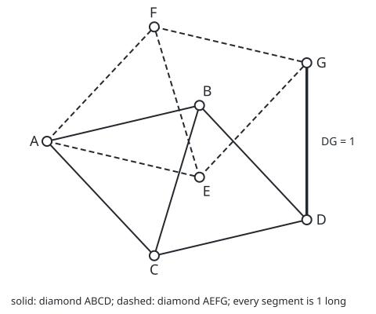
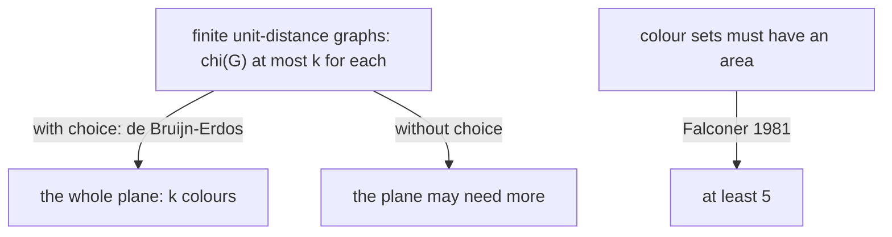

# Colouring the plane: how many colours so that no two points at distance one share a colour

[Syllabus](../../../SYLLABUS.md) → [Frontier](../README.md) → [Geometry and Combinatorics](../README.md#s04) → Colouring the plane

---

## General Overview

Paint every point of a flat, endless sheet. One rule: two points exactly 1 unit apart must get different colours. How few colours can do it? Edward Nelson asked this in 1950. It is called the Hadwiger–Nelson problem, and it is still open.

Seven points settle a first piece. Leo and William Moser drew them in 1961, and the drawing is called the **Moser spindle**. It has 11 pairs at distance exactly 1. Try all 2,187 ways to paint its seven points with three colours, and every one gives some pair at distance 1 the same colour. So three colours never work on the plane.

Hexagons settle the other end. Tile the sheet with hexagons of side 0.4 and paint them in a seven-colour pattern. Two points 1 apart always land in differently coloured hexagons. So seven colours always work.

Between those ends, only one more step is known. In 2018 Aubrey de Grey found a drawing of 1,581 points that four colours cannot paint, checked by computer. Five, six or seven: nobody knows which.

**A finite drawing that some number of colours cannot paint pushes the answer up, a repeating colour pattern pushes it down, and today these meet only at "at least 5, at most 7".**

**What kind of fact this is:** an open problem with two proved bounds. The bounds 4 and 7 are proved on this card in Why it works. The bound 5 is a theorem proved by computer search, quoted with its sources.

**Status, 2026-11-23:** at least 5, proved (de Grey 2018, refereed in *Geombinatorics*, and re-checked independently by Heule the same year with graphs of 553 points). At most 7, proved (the hexagon colouring, from 1950). The exact value: open.

### The picture: the Moser spindle, to scale

<p align="center"></p>

Each diamond is two equilateral triangles with side 1. The second diamond is the first one turned about A until its tip G sits exactly 1 from D. Every drawn segment has length 1, and no other pair of the seven points does.

---

## The formula

Notation first, in words. The plane is $`\mathbb{R}^2`$: every point $`p = (x, y)`$ with real coordinates. The distance between points $`p`$ and $`q`$ is $`\lvert p - q\rvert`$, the ordinary ruler distance. A colouring $`c`$ gives each point a colour $`c(p)`$, out of $`k`$ colours on offer.

```math
\chi(\mathbb{R}^2) = \min\{\,k : \text{some colouring } c \text{ with } k \text{ colours has } c(p) \ne c(q) \text{ whenever } \lvert p - q\rvert = 1\,\}
```

**Read it aloud:** the chromatic number of the plane is the fewest colours that keep every two points at distance 1 apart in colour.

This is the [Colouring](../../04-Combinatorics%20and%20graphs/12-Planarity%20and%20Colouring/03-vertex-colouring-and-chromatic-number.md) card's chromatic number, $`\chi(G)`$, for one huge graph. Its dots are all the points of the plane, and its lines join every two points at distance 1. That graph is the **unit-distance graph** of the plane ([The unit-distance problem](01-unit-distance-problem.md)). A **finite unit-distance graph** is any finite set of points with the pairs at distance 1 as its lines, such as the Moser spindle.

What is known today:

```math
5 \le \chi(\mathbb{R}^2) \le 7
```

**Read it aloud:** the plane needs at least five colours and never more than seven.

| Symbol | Plain meaning | In our example | Push it up and the answer… |
| --- | --- | --- | --- |
| $`\mathbb{R}^2`$ | the plane: all points with two real coordinates | the endless sheet | — |
| $`p`$, $`q`$; $`\lvert p - q\rvert`$ | two points of the plane; the ruler distance between them | D and G; DG = 1 | only distance 1 is forbidden |
| $`c`$, $`c(p)`$ | a colouring; the colour it gives the point $`p`$ | the hexagon pattern | — |
| $`k`$ | colours on offer | 3 fail on the spindle; 7 work | more colours, easier |
| $`G`$ | a finite unit-distance graph: points, with lines at distance 1 | the spindle: 7 points, 11 lines | bigger graphs can force more |
| $`\chi(G)`$ | fewest colours that paint $`G`$ | 4 for the spindle | a floor for the plane |
| $`\chi(\mathbb{R}^2)`$ | fewest colours that paint the whole plane | 5, 6 or 7 | — |
| $`s`$ | side of each hexagon in the tiling | 0.4 | widest hexagon grows |
| $`2s`$ | widest distance inside one hexagon | 0.8 | above 1 breaks the colouring |
| $`\sqrt{7}\,s`$ | nearest distance between two same-coloured hexagons | 1.0583 | below 1 breaks the colouring |
| $`(a, b)`$ | whole-number label of a hexagon; its colour is $`(a + 3b) \bmod 7`$ | $`(1, 2)`$: nearest other hexagon of colour 0 | — |
| $`\varphi`$ | angle the second diamond is turned about A | chosen so that DG = 1 | DG grows |

### When it holds

- **Exactly one forbidden distance.** The rule bans distance 1 only. Every other distance is allowed. Ban a whole range of distances and the question changes.
- **The flat plane.** On a line, two colours work: paint each half-open stretch of length 1 alternately. In space the bounds are different and also open.
- **Every point gets a colour.** Painting only finitely many points is the finite question, $`\chi(G)`$. The bridge from finite drawings to the whole plane needs the axiom of choice (Step 4).
- **No rule on the shape of the colour regions.** If each colour's set must have a well-defined area, a floor of 5 was proved in 1981, decades before the general one (Step 4). The bounds 5 to 7 hold with or without that rule.

---

## Why it works

### Step 0: a floor is a drawing, a ceiling is a pattern

To show $`k`$ colours are too few, one finite drawing is enough. If a finite set of points cannot be painted, neither can the plane that contains it. To show $`k`$ colours are enough, one colouring of the whole plane is needed. Floors are searches over finite graphs. Ceilings are constructions.

### Step 1: a diamond forces its tips to match

Take the diamond ABCD: two triangles ABC and BCD with all sides 1. With three colours:

1. A, B and C are pairwise 1 apart, so they take all three colours.
2. D is 1 from B and 1 from C, so D avoids both their colours.
3. Only A's colour is left, so D has A's colour.

The same holds for the second diamond: G has A's colour.

### Step 2: the spindle needs four colours

D and G both carry A's colour. But D and G are exactly 1 apart, so they must differ. No 3-colouring exists. So $`\chi(\mathbb{R}^2) \ge 4`$.

Four colours do paint the spindle: there are 384 ways. So the spindle alone cannot push the floor past 4. It has no four points all joined: its largest all-joined set has 3 points. The floor of 4 comes from the diamonds' forcing, not from a clique, the [Colouring](../../04-Combinatorics%20and%20graphs/12-Planarity%20and%20Colouring/03-vertex-colouring-and-chromatic-number.md) card's name for a set of dots joined in every pair.

<details>
<summary>Detailed check: why D and G can sit exactly 1 apart</summary>

Each diamond's tip is twice a triangle's height from A, so its distance from A is $`\sqrt{3}`$. Turning the second diamond about A by an angle $`\varphi`$ moves its tip along a circle of radius $`\sqrt{3}`$. The gap between the two tips is a chord of that circle.

$`\displaystyle \lvert DG\rvert = 2\sqrt{3}\,\sin(\varphi/2) = 1 \quad\text{so}\quad \sin(\varphi/2) = \frac{1}{2\sqrt{3}}`$

Place the spindle symmetric about the horizontal axis. Then D and G sit at $`(\sqrt{11}/2,\ \mp 1/2)`$, exactly 1 apart. Every coordinate is a whole combination of 1, $`\sqrt{3}`$, $`\sqrt{11}`$ and $`\sqrt{33}`$, divided by 12. The code squares every one of the 21 distances in that exact form. Exactly 11 come out as 1.

</details>

### Step 3: seven colours always work

Tile the plane with regular hexagons of side $`s`$. Neighbouring centres are $`\sqrt{3}\,s`$ apart. Label each hexagon by whole numbers $`(a, b)`$: its centre is $`a`$ steps along one row direction and $`b`$ steps along a direction turned by 60°. Give it colour $`(a + 3b) \bmod 7`$, the remainder after dividing by 7.

- **The six neighbours all differ from the centre.** Their colours differ from it by 1, 6, 3, 4, 5 and 2: every nonzero remainder once. So each hexagon and its six neighbours use all seven colours.
- **Two points in one hexagon are at most $`2s`$ apart.** That is the hexagon's widest span, corner to opposite corner.
- **Two same-coloured hexagons are at least $`\sqrt{7}\,s`$ apart.** The nearest copy of colour 0 sits at $`(a, b) = (1, 2)`$, with centres $`\sqrt{21}\,s`$ apart: 1.8330 at side 0.4. The closest corners are then $`\sqrt{7}\,s`$ apart.

So a pair at distance 1 is never same-coloured when

```math
2s < 1 < \sqrt{7}\,s, \quad\text{that is}\quad 0.3780 < s < 0.5
```

**Read it aloud:** each hexagon must be narrower than 1, and same-coloured hexagons must be more than 1 apart.

With $`s = 0.4`$: widest span 0.8, nearest same colour 1.0583. Points on a shared edge go to either neighbour; both distances stay as stated. So $`\chi(\mathbb{R}^2) \le 7`$. This colouring is credited to John Isbell, 1950.

### Step 4: from four to five, and where the axioms come in

**The finite bridge.** The de Bruijn–Erdős theorem (1951) says: if every finite piece of a graph can be painted with $`k`$ colours, so can the whole graph. Its proof uses the axiom of choice: one pick from each of infinitely many boxes, even with no rule naming the pick ([The axiom of choice](../../01-Foundations/09-Sizes%20of%20Infinity/05-axiom-of-choice.md)). With choice, the plane's answer is a finite question:

```math
\chi(\mathbb{R}^2) = \max\{\,\chi(G) : G \text{ a finite unit-distance graph in the plane}\,\}
```

**Read it aloud:** under the usual axioms, the plane needs exactly as many colours as its hardest finite drawing.

**The floor of 5.** De Grey built a 1,581-point graph with no 4-colouring from many copies of small unit-distance pieces, spindles among them. A 4-colouring check of that size is far beyond listing. De Grey checked it with his own program; others confirmed it with SAT solvers: programs that decide whether a long list of yes-or-no conditions can all hold at once. Heule shrank the graph to 553 points in 2018, and the online Polymath16 project, started that year, shrank it further: Parts reported 509 points in 2020. These searches are quoted here, not rerun.

**Where the answer may depend on the axioms.** The standard axioms of set theory are ZFC: ZF, the basic rules for sets, plus the axiom of choice. Two results show that the axioms can matter for questions like this one.

- Falconer (1981): if every colour's set is **measurable**, meaning it has a well-defined area in Lebesgue's sense, at least 5 colours are needed. That floor came decades before de Grey's, but only for measurable colourings.
- Shelah and Soifer (2003): a distance graph on the real line needs 2 colours under ZFC, but uncountably many under ZF with a weak form of choice (dependent choice: picks made one after another, countably many times) and the rule that every set of reals is measurable. That second system was shown consistent by Solovay in 1970, as Shelah and Soifer cite, given one extra assumption about very large infinite sets.

Shelah and Soifer also noted a split for the plane itself. If every finite unit-distance graph could be 4-coloured, the plane would need 4 colours under ZFC but at least 5 under the second system. De Grey's graph removed that particular split: both systems now say at least 5. Whether the final answer, 5, 6 or 7, could still differ between systems is open.



---

## Worked numbers, by hand

| Step | Arithmetic | Value |
| --- | --- | --- |
| spindle points and unit pairs | two diamonds of 5 lines, plus DG | 7 points, 11 lines |
| colourings to try with 3 colours | $`3^7`$ | 2,187 |
| diamond ABCD | D avoids B and C, so takes A's colour | D = A |
| diamond AEFG | G avoids E and F, so takes A's colour | G = A |
| line DG | D and G must differ | **no 3-colouring: at least 4** |
| hexagon side | chosen | 0.4 |
| widest inside one hexagon | 2 × 0.4 | 0.8, below 1 |
| nearest same-coloured hexagons | $`\sqrt{7}`$ × 0.4 | 1.0583, above 1 |
| allowed sides | from 1/$`\sqrt{7}`$ to 1/2 | 0.3780 to 0.5 |
| result | both conditions hold | **7 colours work: at most 7** |

The spindle shows three colours fail anywhere on the plane; the hexagons show seven always succeed; a computer-checked graph lifts the floor to 5, and the true number is one of 5, 6 or 7.

### What breaks if you drop a piece

| Mistake | Comes out at | What went wrong |
| --- | --- | --- |
| Drop the line DG from the spindle | 12 ways to 3-colour it | Without DG nothing clashes with the forced D = G |
| Hexagons of side 0.55 | 289 same-coloured pairs in 100,000 random unit pairs | Widest span 1.1: one hexagon holds two points 1 apart |
| Hexagons of side 0.35 | 400 same-coloured pairs in 100,000 | Same-coloured hexagons only 0.9260 apart |
| Floor from the largest all-joined set | 3 | The spindle has no 4 points all joined, yet needs 4 |

The code prints all four.

---

## Code, from first principles, and it actually runs

The code takes three roads. Road 1 tries every colouring of the spindle: 2,187 with three colours, 16,384 with four. Road 2 counts the same colourings by deletion–contraction, which never lists one: the count for a graph equals the count with one line deleted, minus the count with that line's two ends merged. Road 3 builds the hexagon colouring, measures its two distances polygon by polygon against the formulas $`2s`$ and $`\sqrt{7}\,s`$, then tests 100,000 random pairs at distance 1 from SplitMix64, a small random-number generator written out in the code, with seed 2026. The spindle's coordinates are held exactly, as whole combinations of 1, $`\sqrt{3}`$, $`\sqrt{11}`$ and $`\sqrt{33}`$, so "distance exactly 1" is tested with no rounding.

### Python

```python
# Colouring the plane -- the check behind the card.  Standard library only.
# Road 1: every colouring of the Moser spindle tried (3^7 = 2,187 of them).
# Road 2: the same counts by deletion-contraction, which never lists one.
# Road 3: the 7-colouring by hexagons: its two distances by formula and by
# measuring the polygons, then tested on random unit pairs (SplitMix64).
from math import sqrt, floor
from itertools import product

# A number a + b*sqrt3 + c*sqrt11 + d*sqrt33 is held as four integers (a, b, c, d).
def mul(x, y):
    (a, b, c, d), (e, f, g, h) = x, y
    return (a*e + 3*b*f + 11*c*g + 33*d*h, a*f + b*e + 11*c*h + 11*d*g,
            a*g + c*e + 3*b*h + 3*d*f, a*h + d*e + b*g + c*f)

def val(x): return (x[0] + x[1]*sqrt(3) + x[2]*sqrt(11) + x[3]*sqrt(33)) / 12
# The spindle, every coordinate multiplied by 12 so all are whole combinations.
NAMES = "ABCDEFG"
PTS = [((0, 0, 0, 0), (0, 0, 0, 0)), ((0, 1, 3, 0), (-3, 0, 0, 1)),
       ((0, -1, 3, 0), (-3, 0, 0, -1)), ((0, 0, 6, 0), (-6, 0, 0, 0)),
       ((0, 1, 3, 0), (3, 0, 0, -1)), ((0, -1, 3, 0), (3, 0, 0, 1)),
       ((0, 0, 6, 0), (6, 0, 0, 0))]

def dist2(p, q):
    dx, dy = (tuple(s - t for s, t in zip(p[k], q[k])) for k in (0, 1))
    return tuple(s + t for s, t in zip(mul(dx, dx), mul(dy, dy)))

pairs = [(i, j) for i in range(7) for j in range(i + 1, 7)]
edges = [(i, j) for i, j in pairs if dist2(PTS[i], PTS[j]) == (144, 0, 0, 0)]

def brute(n, es, k):                                   # road 1: list them all
    count = 0
    for code in range(k ** n):
        col = [code // k ** i % k for i in range(n)]
        count += all(col[u] != col[v] for u, v in es)
    return count

def dc(n, es, k):                                      # road 2: P(G) = P(G-e) - P(G/e)
    if not es: return k ** n
    (u, v), rest = es[0], es[1:]
    merged = sorted({(min(a, b), max(a, b)) for a, b in
                     ((u if a == v else a, u if b == v else b) for a, b in rest) if a != b})
    return dc(n, rest, k) - dc(n - 1, merged, k)

def clique(es):                                        # largest all-joined set
    best = 0
    for m in range(1 << 7):
        vs = [i for i in range(7) if m >> i & 1]
        if all((a, b) in es for a in vs for b in vs if a < b):
            best = max(best, len(vs))
    return best

R3 = sqrt(3)
CORNERS = [(R3 / 2, 0.5), (0.0, 1.0), (-R3 / 2, 0.5), (-R3 / 2, -0.5), (0.0, -1.0), (R3 / 2, -0.5)]

def centre(a, b, s):
    return (R3 * s * (a + b / 2), 1.5 * s * b)

def hexagon(a, b, s):
    cx, cy = centre(a, b, s)
    return [(cx + s * x, cy + s * y) for x, y in CORNERS]

def seg(p, a, b):                                      # point to segment distance
    vx, vy, wx, wy = b[0] - a[0], b[1] - a[1], p[0] - a[0], p[1] - a[1]
    t = max(0.0, min(1.0, (vx * wx + vy * wy) / (vx * vx + vy * vy)))
    return sqrt((wx - t * vx) ** 2 + (wy - t * vy) ** 2)

def gap(s):                                            # measured, polygon to polygon
    h0, best = hexagon(0, 0, s), 9.0
    for a, b in product(range(-5, 6), repeat=2):
        if (a + 3 * b) % 7 == 0 and (a, b) != (0, 0):
            h = hexagon(a, b, s)
            for P, Q in ((h0, h), (h, h0)):
                for p in P:
                    for i in range(6):
                        best = min(best, seg(p, Q[i], Q[(i + 1) % 6]))
    return best

def colour(x, y, s):                                   # colour of the nearest centre
    b0 = floor(y / (1.5 * s))
    a0 = floor(x / (R3 * s) - b0 / 2)
    best, col = 9e9, -1
    for a, b in product(range(a0 - 1, a0 + 3), range(b0 - 1, b0 + 3)):
        cx, cy = centre(a, b, s)
        d = (x - cx) ** 2 + (y - cy) ** 2
        if d < best:
            best, col = d, (a + 3 * b) % 7
    return col

M64 = (1 << 64) - 1
def unit_pairs(s, n, seed):                            # same-coloured pairs at distance 1
    st, bad = seed, 0
    def nxt():
        nonlocal st
        st = (st + 0x9E3779B97F4A7C15) & M64
        z = ((st ^ (st >> 30)) * 0xBF58476D1CE4E5B9) & M64
        z = ((z ^ (z >> 27)) * 0x94D049BB133111EB) & M64
        return (z ^ (z >> 31)) >> 11
    for _ in range(n):
        x, y = 20 * nxt() / 2**53, 20 * nxt() / 2**53
        while True:
            dx, dy = 2 * nxt() / 2**53 - 1, 2 * nxt() / 2**53 - 1
            r = sqrt(dx * dx + dy * dy)
            if 0 < r <= 1:
                break
        bad += colour(x, y, s) == colour(x + dx / r, y + dy / r, s)
    return bad

cut = [e for e in edges if e != (3, 6)]                # the spindle without edge DG
print("Moser spindle: 7 points, unit pairs found by exact arithmetic:", len(edges), "of", len(pairs))
print("edges:", " ".join(NAMES[i] + NAMES[j] for i, j in edges))
print("figure, " + ", ".join(f"{NAMES[i]} ({val(p[0]):.4f}, {val(p[1]):.4f})" for i, p in enumerate(PTS)))
print("largest all-joined set:", clique(edges), "points")
b3, d3, b4, d4 = brute(7, edges, 3), dc(7, edges, 3), brute(7, edges, 4), dc(7, edges, 4)
print(f"proper 3-colourings: {b3} of {3**7} by listing, {d3} by deletion-contraction")
print(f"proper 4-colourings: {b4} of {4**7} by listing, {d4} by deletion-contraction")
c3, c4 = brute(7, cut, 3), brute(7, cut, 4)
hand = [k * (k - 1) ** 2 * (k - 2) ** 4 for k in (3, 4)]   # two diamonds sharing A
print(f"without edge DG: {c3} 3-colourings, {c4} 4-colourings; k(k-1)^2(k-2)^4 at 3 and 4: "
      f"{hand[0]}, {hand[1]}")
same = sum(1 for code in range(3**7) for col in [[code // 3**i % 3 for i in range(7)]]
           if all(col[u] != col[v] for u, v in cut) and col[0] == col[3] == col[6])
print(f"of those 3-colourings, A, D and G share one colour in {same}")
for s in (0.4, 0.55, 0.35):
    print(f"hexagons of side {s}: widest inside one {2 * s:.4f}; nearest same colour "
          f"{gap(s):.4f} measured, {sqrt(7) * s:.4f} by sqrt(7) x side")
nb = [(a + 3 * b) % 7 for a, b in ((1, 0), (-1, 0), (0, 1), (0, -1), (1, -1), (-1, 1))]
d12 = sqrt(sum(t * t for t in centre(1, 2, 0.4)))         # nearest same-colour centre
print(f"colours of the 6 neighbours of colour 0: {nb}; nearest colour-0 centre (1, 2), {d12:.4f} away at side 0.4")
print(f"side must lie between 1/sqrt(7) = {1 / sqrt(7):.4f} and 1/2 = 0.5000")
tests = [(s, unit_pairs(s, 100000, 2026)) for s in (0.4, 0.55, 0.35)]
for s, bad in tests:
    print(f"side {s}: 100000 random unit pairs, same-coloured pairs {bad}")
print("quoted, not checked here: de Grey 2018 graph 1581 points; Heule 2018 graph 553 points; Parts 2020 graph 509 points")
assert len(edges) == 11 and clique(edges) == 3
assert b3 == d3 == 0 and b4 == d4 > 0                  # two roads agree
assert [c3, c4] == [dc(7, cut, 3), dc(7, cut, 4)] == hand and same == c3
assert abs(gap(0.4) - sqrt(7) * 0.4) < 1e-12 and gap(0.35) < 1 < gap(0.4)
assert sorted(nb) == list(range(1, 7)) and abs(d12 - sqrt(21) * 0.4) < 1e-12
assert tests[0][1] == 0 and tests[1][1] > 0 and tests[2][1] > 0
print("ALL CHECKS PASS")
```

**Ran 2026-11-23 on macOS, Python 3.14.10, standard library only. All checks passed. Output, pasted from the run:**

```
Moser spindle: 7 points, unit pairs found by exact arithmetic: 11 of 21
edges: AB AC AE AF BC BD CD DG EF EG FG
figure, A (0.0000, 0.0000), B (0.9735, 0.2287), C (0.6848, -0.7287), D (1.6583, -0.5000), E (0.9735, -0.2287), F (0.6848, 0.7287), G (1.6583, 0.5000)
largest all-joined set: 3 points
proper 3-colourings: 0 of 2187 by listing, 0 by deletion-contraction
proper 4-colourings: 384 of 16384 by listing, 384 by deletion-contraction
without edge DG: 12 3-colourings, 576 4-colourings; k(k-1)^2(k-2)^4 at 3 and 4: 12, 576
of those 3-colourings, A, D and G share one colour in 12
hexagons of side 0.4: widest inside one 0.8000; nearest same colour 1.0583 measured, 1.0583 by sqrt(7) x side
hexagons of side 0.55: widest inside one 1.1000; nearest same colour 1.4552 measured, 1.4552 by sqrt(7) x side
hexagons of side 0.35: widest inside one 0.7000; nearest same colour 0.9260 measured, 0.9260 by sqrt(7) x side
colours of the 6 neighbours of colour 0: [1, 6, 3, 4, 5, 2]; nearest colour-0 centre (1, 2), 1.8330 away at side 0.4
side must lie between 1/sqrt(7) = 0.3780 and 1/2 = 0.5000
side 0.4: 100000 random unit pairs, same-coloured pairs 0
side 0.55: 100000 random unit pairs, same-coloured pairs 289
side 0.35: 100000 random unit pairs, same-coloured pairs 400
quoted, not checked here: de Grey 2018 graph 1581 points; Heule 2018 graph 553 points; Parts 2020 graph 509 points
ALL CHECKS PASS
```

### Rust

Same numbers, same labels, built with `rustc --edition 2021 -O`.

```rust
// Colouring the plane -- the same check as the Python, in Rust.  No crates.
// Road 1: every colouring of the Moser spindle tried (3^7 = 2,187 of them).
// Road 2: the same counts by deletion-contraction, which never lists one.
// Road 3: the 7-colouring by hexagons: its two distances by formula and by
// measuring the polygons, then tested on random unit pairs (SplitMix64).
use std::collections::BTreeSet;

type Q4 = [i64; 4]; // a + b*sqrt3 + c*sqrt11 + d*sqrt33, held as four integers

fn mul(x: Q4, y: Q4) -> Q4 {
    let ([a, b, c, d], [e, f, g, h]) = (x, y);
    [a * e + 3 * b * f + 11 * c * g + 33 * d * h, a * f + b * e + 11 * c * h + 11 * d * g,
     a * g + c * e + 3 * b * h + 3 * d * f, a * h + d * e + b * g + c * f]
}

fn val(x: Q4) -> f64 {
    (x[0] as f64 + x[1] as f64 * 3f64.sqrt() + x[2] as f64 * 11f64.sqrt() + x[3] as f64 * 33f64.sqrt()) / 12.0
}

// The spindle, every coordinate multiplied by 12 so all are whole combinations.
const PTS: [(Q4, Q4); 7] = [([0, 0, 0, 0], [0, 0, 0, 0]), ([0, 1, 3, 0], [-3, 0, 0, 1]),
    ([0, -1, 3, 0], [-3, 0, 0, -1]), ([0, 0, 6, 0], [-6, 0, 0, 0]),
    ([0, 1, 3, 0], [3, 0, 0, -1]), ([0, -1, 3, 0], [3, 0, 0, 1]),
    ([0, 0, 6, 0], [6, 0, 0, 0])];
const NAMES: [&str; 7] = ["A", "B", "C", "D", "E", "F", "G"];

fn dist2(p: (Q4, Q4), q: (Q4, Q4)) -> Q4 {
    let (dx, dy): (Q4, Q4) = ([0, 1, 2, 3].map(|k| p.0[k] - q.0[k]), [0, 1, 2, 3].map(|k| p.1[k] - q.1[k]));
    let (u, v) = (mul(dx, dx), mul(dy, dy));
    [0, 1, 2, 3].map(|k| u[k] + v[k])
}

fn brute(n: u32, es: &[(usize, usize)], k: usize) -> usize {   // road 1: list them all
    (0..k.pow(n)).filter(|&code| {
        let col: Vec<usize> = (0..n).map(|i| code / k.pow(i) % k).collect();
        es.iter().all(|&(u, v)| col[u] != col[v])
    }).count()
}

fn dc(n: u32, es: &[(usize, usize)], k: i64) -> i64 {         // road 2: P(G) = P(G-e) - P(G/e)
    if es.is_empty() { return k.pow(n) }
    let ((u, v), rest) = (es[0], &es[1..]);
    let merged: Vec<(usize, usize)> = rest.iter()
        .map(|&(a, b)| (if a == v { u } else { a }, if b == v { u } else { b }))
        .filter(|&(a, b)| a != b).map(|(a, b)| (a.min(b), a.max(b)))
        .collect::<BTreeSet<_>>().into_iter().collect();
    dc(n, rest, k) - dc(n - 1, &merged, k)
}

fn clique(es: &[(usize, usize)]) -> usize {                     // largest all-joined set
    let mut best = 0;
    for m in 0..(1usize << 7) {
        let vs: Vec<usize> = (0..7).filter(|i| m >> i & 1 == 1).collect();
        let ok = vs.iter().all(|&a| vs.iter().all(|&b| a >= b || es.contains(&(a, b))));
        if ok { best = best.max(vs.len()) }
    }
    best
}

fn centre(a: i64, b: i64, s: f64) -> (f64, f64) {
    (3f64.sqrt() * s * (a as f64 + b as f64 / 2.0), 1.5 * s * b as f64)
}

fn hexagon(a: i64, b: i64, s: f64) -> Vec<(f64, f64)> {
    let h = 3f64.sqrt() / 2.0;
    let corners = [(h, 0.5), (0.0, 1.0), (-h, 0.5), (-h, -0.5), (0.0, -1.0), (h, -0.5)];
    let (cx, cy) = centre(a, b, s);
    corners.iter().map(|&(x, y)| (cx + s * x, cy + s * y)).collect()
}

fn seg(p: (f64, f64), a: (f64, f64), b: (f64, f64)) -> f64 {    // point to segment distance
    let (vx, vy, wx, wy) = (b.0 - a.0, b.1 - a.1, p.0 - a.0, p.1 - a.1);
    let t = 0f64.max(1f64.min((vx * wx + vy * wy) / (vx * vx + vy * vy)));
    ((wx - t * vx) * (wx - t * vx) + (wy - t * vy) * (wy - t * vy)).sqrt()
}

fn gap(s: f64) -> f64 {                                         // measured, polygon to polygon
    let (h0, mut best) = (hexagon(0, 0, s), 9.0f64);
    for a in -5..6i64 {
        for b in -5..6i64 {
            if (a + 3 * b).rem_euclid(7) == 0 && (a, b) != (0, 0) {
                let h = hexagon(a, b, s);
                for (p_, q_) in [(&h0, &h), (&h, &h0)] {
                    for &p in p_.iter() {
                        for i in 0..6 { best = best.min(seg(p, q_[i], q_[(i + 1) % 6])) }
                    }
                }
            }
        }
    }
    best
}

fn colour(x: f64, y: f64, s: f64) -> i64 {                      // colour of the nearest centre
    let b0 = (y / (1.5 * s)).floor() as i64;
    let a0 = (x / (3f64.sqrt() * s) - b0 as f64 / 2.0).floor() as i64;
    let (mut best, mut col) = (9e9f64, -1i64);
    for a in a0 - 1..a0 + 3 {
        for b in b0 - 1..b0 + 3 {
            let (cx, cy) = centre(a, b, s); let d = (x - cx) * (x - cx) + (y - cy) * (y - cy);
            if d < best { best = d; col = (a + 3 * b).rem_euclid(7) }
        }
    }
    col
}

fn unit_pairs(s: f64, n: usize, seed: u64) -> usize {          // same-coloured pairs at distance 1
    let (mut st, mut bad) = (seed, 0);
    let mut nxt = || {
        st = st.wrapping_add(0x9E3779B97F4A7C15);
        let mut z = (st ^ (st >> 30)).wrapping_mul(0xBF58476D1CE4E5B9);
        z = (z ^ (z >> 27)).wrapping_mul(0x94D049BB133111EB);
        ((z ^ (z >> 31)) >> 11) as f64
    };
    let t53 = 9007199254740992.0;
    for _ in 0..n {
        let (x, y) = (20.0 * nxt() / t53, 20.0 * nxt() / t53);
        let (dx, dy, r) = loop {
            let (dx, dy) = (2.0 * nxt() / t53 - 1.0, 2.0 * nxt() / t53 - 1.0);
            let r = (dx * dx + dy * dy).sqrt();
            if 0.0 < r && r <= 1.0 { break (dx, dy, r) }
        };
        if colour(x, y, s) == colour(x + dx / r, y + dy / r, s) { bad += 1 }
    }
    bad
}

fn main() {
    let pairs: Vec<(usize, usize)> = (0..7).flat_map(|i| (i + 1..7).map(move |j| (i, j))).collect();
    let edges: Vec<(usize, usize)> =
        pairs.iter().copied().filter(|&(i, j)| dist2(PTS[i], PTS[j]) == [144, 0, 0, 0]).collect();
    let cut: Vec<(usize, usize)> = edges.iter().copied().filter(|&e| e != (3, 6)).collect();
    let names = |es: &[(usize, usize)]| es.iter().map(|&(i, j)| format!("{}{}", NAMES[i], NAMES[j])).collect::<Vec<_>>().join(" ");
    println!("Moser spindle: 7 points, unit pairs found by exact arithmetic: {} of {}", edges.len(), pairs.len());
    println!("edges: {}", names(&edges));
    let fig: Vec<String> = PTS.iter().enumerate().map(|(i, p)| format!("{} ({:.4}, {:.4})", NAMES[i], val(p.0), val(p.1))).collect();
    println!("figure, {}", fig.join(", "));
    println!("largest all-joined set: {} points", clique(&edges));
    let (b3, d3, b4, d4) = (brute(7, &edges, 3), dc(7, &edges, 3), brute(7, &edges, 4), dc(7, &edges, 4));
    println!("proper 3-colourings: {} of {} by listing, {} by deletion-contraction", b3, 3i64.pow(7), d3);
    println!("proper 4-colourings: {} of {} by listing, {} by deletion-contraction", b4, 4i64.pow(7), d4);
    let (c3, c4) = (brute(7, &cut, 3), brute(7, &cut, 4));
    let hand: Vec<i64> = [3i64, 4].iter().map(|&k| k * (k - 1).pow(2) * (k - 2).pow(4)).collect();
    println!("without edge DG: {} 3-colourings, {} 4-colourings; k(k-1)^2(k-2)^4 at 3 and 4: {}, {}",
             c3, c4, hand[0], hand[1]);
    let same = (0..3usize.pow(7)).filter(|&code| {
        let col: Vec<usize> = (0..7).map(|i| code / 3usize.pow(i) % 3).collect();
        cut.iter().all(|&(u, v)| col[u] != col[v]) && col[0] == col[3] && col[3] == col[6]
    }).count();
    println!("of those 3-colourings, A, D and G share one colour in {}", same);
    for s in [0.4, 0.55, 0.35] {
        println!("hexagons of side {}: widest inside one {:.4}; nearest same colour {:.4} measured, {:.4} by sqrt(7) x side",
                 s, 2.0 * s, gap(s), 7f64.sqrt() * s);
    }
    let nb: Vec<i64> = [(1, 0), (-1, 0), (0, 1), (0, -1), (1, -1), (-1, 1)].iter().map(|&(a, b): &(i64, i64)| (a + 3 * b).rem_euclid(7)).collect();
    let d12 = { let (cx, cy) = centre(1, 2, 0.4); (cx * cx + cy * cy).sqrt() };  // nearest same-colour centre
    println!("colours of the 6 neighbours of colour 0: {:?}; nearest colour-0 centre (1, 2), {:.4} away at side 0.4", nb, d12);
    println!("side must lie between 1/sqrt(7) = {:.4} and 1/2 = 0.5000", 1.0 / 7f64.sqrt());
    let tests: Vec<(f64, usize)> = [0.4, 0.55, 0.35].iter().map(|&s| (s, unit_pairs(s, 100000, 2026))).collect();
    for &(s, bad) in &tests { println!("side {}: 100000 random unit pairs, same-coloured pairs {}", s, bad) }
    println!("quoted, not checked here: de Grey 2018 graph 1581 points; Heule 2018 graph 553 points; Parts 2020 graph 509 points");
    assert!(edges.len() == 11 && clique(&edges) == 3);
    assert!(b3 == 0 && d3 == 0 && b4 as i64 == d4 && d4 > 0);                // two roads agree
    assert!(vec![c3 as i64, c4 as i64] == vec![dc(7, &cut, 3), dc(7, &cut, 4)] && vec![c3 as i64, c4 as i64] == hand && same == c3);
    assert!((gap(0.4) - 7f64.sqrt() * 0.4).abs() < 1e-12 && gap(0.35) < 1.0 && 1.0 < gap(0.4));
    let mut sorted = nb.clone(); sorted.sort();
    assert!(sorted == (1..7).collect::<Vec<i64>>() && (d12 - 21f64.sqrt() * 0.4).abs() < 1e-12);
    assert!(tests[0].1 == 0 && tests[1].1 > 0 && tests[2].1 > 0);
    println!("ALL CHECKS PASS");
}
```

**Ran 2026-11-23 on macOS, rustc 1.98.1, no crates. All checks passed. Output, pasted from the run:**

```
Moser spindle: 7 points, unit pairs found by exact arithmetic: 11 of 21
edges: AB AC AE AF BC BD CD DG EF EG FG
figure, A (0.0000, 0.0000), B (0.9735, 0.2287), C (0.6848, -0.7287), D (1.6583, -0.5000), E (0.9735, -0.2287), F (0.6848, 0.7287), G (1.6583, 0.5000)
largest all-joined set: 3 points
proper 3-colourings: 0 of 2187 by listing, 0 by deletion-contraction
proper 4-colourings: 384 of 16384 by listing, 384 by deletion-contraction
without edge DG: 12 3-colourings, 576 4-colourings; k(k-1)^2(k-2)^4 at 3 and 4: 12, 576
of those 3-colourings, A, D and G share one colour in 12
hexagons of side 0.4: widest inside one 0.8000; nearest same colour 1.0583 measured, 1.0583 by sqrt(7) x side
hexagons of side 0.55: widest inside one 1.1000; nearest same colour 1.4552 measured, 1.4552 by sqrt(7) x side
hexagons of side 0.35: widest inside one 0.7000; nearest same colour 0.9260 measured, 0.9260 by sqrt(7) x side
colours of the 6 neighbours of colour 0: [1, 6, 3, 4, 5, 2]; nearest colour-0 centre (1, 2), 1.8330 away at side 0.4
side must lie between 1/sqrt(7) = 0.3780 and 1/2 = 0.5000
side 0.4: 100000 random unit pairs, same-coloured pairs 0
side 0.55: 100000 random unit pairs, same-coloured pairs 289
side 0.35: 100000 random unit pairs, same-coloured pairs 400
quoted, not checked here: de Grey 2018 graph 1581 points; Heule 2018 graph 553 points; Parts 2020 graph 509 points
ALL CHECKS PASS
```

The two outputs match line for line.

### Lean

Lean proves the bounds 4 and 7 for the whole plane, the spindle's facts, and the card's hand counts.

- Colour every point of the plane, with only distance 1 forbidden. Then three colours never suffice and seven always do: $`4 \le \chi(\mathbb{R}^2) \le 7`$.
- The Moser spindle needs exactly 4 colours: three fail and four work.
- The spindle can be drawn with seven different points. Exactly its 11 lines join points 1 apart, and no other pair is.
- The spindle has 11 lines, and three colours give $`3^7`$ = 2,187 colourings to try.
- Four colours paint the spindle in 384 ways.
- Take the spindle without the line DG. Then three colours paint it in 12 ways, as $`k(k-1)^2(k-2)^4`$ gives at $`k = 3`$.
- No four spindle points are all joined, so its largest all-joined set has at most 3 points.
- Colour hexagon $`(a, b)`$ by $`(a + 3b) \bmod 7`$. Then its six neighbours differ from it by 1, 6, 3, 4, 5 and 2.
- The hexagon $`(1, 2)`$ also has colour 0. Its centre gap $`\sqrt{21}\,s`$ comes from $`3(1^2 + 1 \cdot 2 + 2^2) = 21`$.
- Take side $`s = 0.4`$. Then $`2s < 1 < \sqrt{7}\,s`$.
- Take side 0.55. Then the widest span, 1.1, passes 1.
- Take side 0.35. Then the nearest same colour, $`\sqrt{7}\,s`$, falls below 1.

The exact spindle coordinates in the code, the measured hexagon distances and the random unit-pair tests are left to the Python and Rust checks.

```lean
-- Colouring the plane: the plane's unit-distance graph needs at least 4 and at most 7 colours, the Moser spindle needs exactly 4 and sits in the plane with exactly its 11 lines at distance 1, and the card's hand counts hold.
import Mathlib.Analysis.InnerProductSpace.PiL2
import Mathlib.Analysis.SpecialFunctions.Pow.Real
import Mathlib.Combinatorics.SimpleGraph.Coloring.Vertex
import Mathlib.Combinatorics.SimpleGraph.Clique
import Mathlib.Combinatorics.SimpleGraph.Finite
import Mathlib.Tactic.NormNum

open SimpleGraph

/-- The unit-distance graph of the plane: its dots are all the points of ℝ², and two points
are joined exactly when the ruler distance between them is 1. Every other distance is allowed. -/
def unitDistancePlane : SimpleGraph (EuclideanSpace ℝ (Fin 2)) where
  Adj p q := dist p q = 1
  symm := ⟨fun p q h => by rw [dist_comm]; exact h⟩
  loopless := ⟨fun p h => by simp at h⟩

lemma hn_dist_sq (p q : EuclideanSpace ℝ (Fin 2)) :
    dist p q ^ 2 = (p 0 - q 0) ^ 2 + (p 1 - q 1) ^ 2 := by
  rw [EuclideanSpace.dist_sq_eq, Fin.sum_univ_two, Real.dist_eq, Real.dist_eq, sq_abs, sq_abs]
#print axioms hn_dist_sq

lemma hn_dist_eq_one_iff (p q : EuclideanSpace ℝ (Fin 2)) :
    dist p q = 1 ↔ (p 0 - q 0) ^ 2 + (p 1 - q 1) ^ 2 = 1 := by
  rw [← hn_dist_sq]
  constructor
  · intro h; rw [h]; norm_num
  · intro h; nlinarith [dist_nonneg (x := p) (y := q)]
#print axioms hn_dist_eq_one_iff

noncomputable def hnPt : Fin 7 → EuclideanSpace ℝ (Fin 2) :=
  ![!₂[0, 0],
    !₂[-1/4 + √3 * √11 / 12, √11 / 4 + √3 / 12],
    !₂[-1/4 - √3 * √11 / 12, √11 / 4 - √3 / 12],
    !₂[-1/2, √11 / 2],
    !₂[1/4 - √3 * √11 / 12, √11 / 4 + √3 / 12],
    !₂[1/4 + √3 * √11 / 12, √11 / 4 - √3 / 12],
    !₂[1/2, √11 / 2]]

def hnEdges : List (Fin 7 × Fin 7) :=
  [(0, 1), (0, 2), (1, 2), (1, 3), (2, 3),
   (0, 4), (0, 5), (4, 5), (4, 6), (5, 6),
   (3, 6)]

lemma hnPt_dist (u v : Fin 7) :
    dist (hnPt u) (hnPt v) = 1 ↔ ((u, v) ∈ hnEdges ∨ (v, u) ∈ hnEdges) := by
  have ha : (√3) ^ 2 = 3 := Real.sq_sqrt (by norm_num)
  have hb : (√11) ^ 2 = 11 := Real.sq_sqrt (by norm_num)
  have ha0 : 0 ≤ √3 := Real.sqrt_nonneg _
  have hb0 : 0 ≤ √11 := Real.sqrt_nonneg _
  have hc : (√3 * √11) ^ 2 = 33 := by rw [mul_pow, ha, hb]; norm_num
  have hc0 : 0 ≤ √3 * √11 := mul_nonneg ha0 hb0
  have hc1 : 5.7 < √3 * √11 := by nlinarith
  have hc2 : √3 * √11 < 5.8 := by nlinarith
  rw [hn_dist_eq_one_iff]
  fin_cases u <;> fin_cases v <;>
    simp only [hnPt, Fin.zero_eta, Fin.mk_one, Fin.reduceFinMk, Fin.isValue, Matrix.cons_val, PiLp.toLp_apply,
      Matrix.cons_val_zero, Matrix.cons_val_one] <;>
    constructor <;> intro h <;>
    first
    | decide
    | exact absurd h (by decide)
    | linarith
#print axioms hnPt_dist

/-- Distinct spindle points have distinct neighbourhoods. -/
lemma hnEdges_nbhd_inj (u v : Fin 7)
    (h : ∀ w, ((u, w) ∈ hnEdges ∨ (w, u) ∈ hnEdges) ↔ ((v, w) ∈ hnEdges ∨ (w, v) ∈ hnEdges)) :
    u = v := by
  have key : ∀ u v : Fin 7, (∀ w : Fin 7,
      decide ((u, w) ∈ hnEdges ∨ (w, u) ∈ hnEdges) = decide ((v, w) ∈ hnEdges ∨ (w, v) ∈ hnEdges)) →
      u = v := by decide
  exact key u v (fun w => decide_eq_decide.2 (h w))
#print axioms hnEdges_nbhd_inj

lemma hnPt_injective : Function.Injective hnPt := by
  intro u v h
  apply hnEdges_nbhd_inj
  intro w
  rw [← hnPt_dist, ← hnPt_dist, h]
#print axioms hnPt_injective

/-- The plane has no proper 3-colouring: the seven spindle points already force a fourth colour. -/
lemma hn_plane_not_three (c : EuclideanSpace ℝ (Fin 2) → Fin 3)
    (hc : ∀ p q, dist p q = 1 → c p ≠ c q) : False := by
  have e : ∀ u v, ((u, v) ∈ hnEdges ∨ (v, u) ∈ hnEdges) → (c (hnPt u)).val ≠ (c (hnPt v)).val :=
    fun u v h => Fin.val_ne_of_ne (hc _ _ ((hnPt_dist u v).2 h))
  have h01 := e 0 1 (by decide)
  have h02 := e 0 2 (by decide)
  have h12 := e 1 2 (by decide)
  have h13 := e 1 3 (by decide)
  have h23 := e 2 3 (by decide)
  have h04 := e 0 4 (by decide)
  have h05 := e 0 5 (by decide)
  have h45 := e 4 5 (by decide)
  have h46 := e 4 6 (by decide)
  have h56 := e 5 6 (by decide)
  have h36 := e 3 6 (by decide)
  have b0 := (c (hnPt 0)).isLt
  have b1 := (c (hnPt 1)).isLt
  have b2 := (c (hnPt 2)).isLt
  have b3 := (c (hnPt 3)).isLt
  have b4 := (c (hnPt 4)).isLt
  have b5 := (c (hnPt 5)).isLt
  have b6 := (c (hnPt 6)).isLt
  omega
#print axioms hn_plane_not_three

lemma hn_Q_cover (u v : ℝ) (hu0 : 0 ≤ u) (hu1 : u < 1) (hv0 : 0 ≤ v) (hv1 : v < 1) :
    ∃ α β : ℤ, (u - α) ^ 2 + (u - α) * (v - β) + (v - β) ^ 2 ≤ 1 / 3 := by
  rcases le_total (u + v) 1 with h | h
  · rcases le_total (2 * u + v) 1 with h2 | h2
    · rcases le_total (u + 2 * v) 1 with h3 | h3
      · exact ⟨0, 0, by push_cast; nlinarith⟩
      · exact ⟨0, 1, by push_cast; nlinarith⟩
    · rcases le_total v u with h4 | h4
      · exact ⟨1, 0, by push_cast; nlinarith⟩
      · exact ⟨0, 1, by push_cast; nlinarith⟩
  · rcases le_total (u + 2 * v) 2 with h2 | h2
    · rcases le_total v u with h4 | h4
      · exact ⟨1, 0, by push_cast; nlinarith⟩
      · rcases le_total (2 * u + v) 2 with h3 | h3
        · exact ⟨0, 1, by push_cast; nlinarith⟩
        · exact ⟨1, 0, by push_cast; nlinarith⟩
    · rcases le_total (2 * u + v) 2 with h3 | h3
      · exact ⟨0, 1, by push_cast; nlinarith⟩
      · exact ⟨1, 1, by push_cast; nlinarith⟩
#print axioms hn_Q_cover

lemma hn_Q_cover_all (x y : ℝ) :
    ∃ a b : ℤ, (x - a) ^ 2 + (x - a) * (y - b) + (y - b) ^ 2 ≤ 1 / 3 := by
  obtain ⟨α, β, h⟩ := hn_Q_cover (x - ⌊x⌋) (y - ⌊y⌋) (by linarith [Int.floor_le x])
    (by linarith [Int.lt_floor_add_one x]) (by linarith [Int.floor_le y])
    (by linarith [Int.lt_floor_add_one y])
  refine ⟨⌊x⌋ + α, ⌊y⌋ + β, ?_⟩
  push_cast
  convert h using 2 <;> ring
#print axioms hn_Q_cover_all

/-- Lattice point `(a, b)` of the hexagonal lattice whose hexagons have side 2/5. -/
noncomputable def hnLat (a b : ℤ) : EuclideanSpace ℝ (Fin 2) :=
  !₂[((a : ℝ) + b / 2) * (2 * √3 / 5), (b : ℝ) * (3 / 5)]

lemma hnLat_apply_zero (a b : ℤ) : hnLat a b 0 = ((a : ℝ) + b / 2) * (2 * √3 / 5) := rfl
#print axioms hnLat_apply_zero

lemma hnLat_apply_one (a b : ℤ) : hnLat a b 1 = (b : ℝ) * (3 / 5) := rfl
#print axioms hnLat_apply_one

lemma hnLat_near (p : EuclideanSpace ℝ (Fin 2)) : ∃ a b : ℤ, dist p (hnLat a b) ≤ 2 / 5 := by
  have ht : (√3) ^ 2 = 3 := Real.sq_sqrt (by norm_num)
  have ht0 : 0 < √3 := by positivity
  set y : ℝ := p 1 * (5 / 3) with hy
  set x : ℝ := p 0 / (2 * √3 / 5) - y / 2 with hx
  have hp0 : p 0 = (x + y / 2) * (2 * √3 / 5) := by rw [hx]; field_simp; ring
  have hp1 : p 1 = y * (3 / 5) := by rw [hy]; ring
  obtain ⟨a, b, h⟩ := hn_Q_cover_all x y
  refine ⟨a, b, ?_⟩
  have hd := hn_dist_sq p (hnLat a b)
  rw [hnLat_apply_zero, hnLat_apply_one, hp0, hp1] at hd
  have : dist p (hnLat a b) ^ 2 ≤ (2 / 5) ^ 2 := by
    rw [hd]; nlinarith
  nlinarith [dist_nonneg (x := p) (y := hnLat a b)]
#print axioms hnLat_near

lemma hnLat_dist_sq (a b c d : ℤ) :
    dist (hnLat a b) (hnLat c d) ^ 2 =
      12 / 25 * (((a - c : ℤ) : ℝ) ^ 2 + ((a - c : ℤ) : ℝ) * ((b - d : ℤ) : ℝ) + ((b - d : ℤ) : ℝ) ^ 2) := by
  have ht : (√3) ^ 2 = 3 := Real.sq_sqrt (by norm_num)
  rw [hn_dist_sq]
  rw [hnLat_apply_zero, hnLat_apply_one, hnLat_apply_zero, hnLat_apply_one]
  push_cast
  linear_combination (4 / 25 * ((a:ℝ) - c + (b - d) / 2) ^ 2) * ht
#print axioms hnLat_dist_sq

lemma hn_Q_ge_seven (m n : ℤ) (h7 : 7 ∣ m + 3 * n) (hne : m ≠ 0 ∨ n ≠ 0) :
    7 ≤ m ^ 2 + m * n + n ^ 2 := by
  obtain ⟨k, hk⟩ := h7
  have hm : m = 7 * k - 3 * n := by omega
  have hQ : m ^ 2 + m * n + n ^ 2 = 7 * (7 * k ^ 2 - 5 * k * n + n ^ 2) := by subst hm; ring
  have hpos : 0 < m ^ 2 + m * n + n ^ 2 := by
    rcases hne with h | h
    · have : 0 < m ^ 2 := by positivity
      nlinarith [sq_nonneg (m + 2 * n), sq_nonneg n]
    · have : 0 < n ^ 2 := by positivity
      nlinarith [sq_nonneg (2 * m + n)]
  rw [hQ] at hpos ⊢
  omega
#print axioms hn_Q_ge_seven

/-- The lattice point chosen near `p`: its two coordinates. -/
noncomputable def hnA (p : EuclideanSpace ℝ (Fin 2)) : ℤ := Classical.choose (hnLat_near p)

noncomputable def hnB (p : EuclideanSpace ℝ (Fin 2)) : ℤ :=
  Classical.choose (Classical.choose_spec (hnLat_near p))

lemma hnAB_near (p : EuclideanSpace ℝ (Fin 2)) : dist p (hnLat (hnA p) (hnB p)) ≤ 2 / 5 :=
  Classical.choose_spec (Classical.choose_spec (hnLat_near p))
#print axioms hnAB_near

/-- The colour of a point: the hexagon-lattice point chosen near it, coloured `(a + 3b) mod 7`. -/
noncomputable def hnColour (p : EuclideanSpace ℝ (Fin 2)) : Fin 7 :=
  ⟨((hnA p + 3 * hnB p) % 7).toNat, by omega⟩

lemma hnColour_valid (p q : EuclideanSpace ℝ (Fin 2)) (hpq : dist p q = 1) :
    hnColour p ≠ hnColour q := by
  intro hc
  have h7 : 7 ∣ (hnA p - hnA q) + 3 * (hnB p - hnB q) := by
    have := congrArg Fin.val hc
    simp only [hnColour] at this
    omega
  have hp := hnAB_near p
  have hq := hnAB_near q
  by_cases he : hnA p - hnA q = 0 ∧ hnB p - hnB q = 0
  · have ha : hnA p = hnA q := by omega
    have hb : hnB p = hnB q := by omega
    rw [ha, hb] at hp
    have := dist_triangle_right p q (hnLat (hnA q) (hnB q))
    linarith
  · have hQ := hn_Q_ge_seven _ _ h7 (by tauto)
    have hQr : (7 : ℝ) ≤ (((hnA p - hnA q : ℤ) : ℝ) ^ 2 + ((hnA p - hnA q : ℤ) : ℝ) *
        ((hnB p - hnB q : ℤ) : ℝ) + ((hnB p - hnB q : ℤ) : ℝ) ^ 2) := by exact_mod_cast hQ
    have hL := hnLat_dist_sq (hnA p) (hnB p) (hnA q) (hnB q)
    have htri : dist (hnLat (hnA p) (hnB p)) (hnLat (hnA q) (hnB q)) ≤ 9 / 5 := by
      have h1 := dist_triangle (hnLat (hnA p) (hnB p)) p (hnLat (hnA q) (hnB q))
      have h2 := dist_triangle p q (hnLat (hnA q) (hnB q))
      rw [dist_comm] at hp
      linarith
    nlinarith [dist_nonneg (x := hnLat (hnA p) (hnB p)) (y := hnLat (hnA q) (hnB q))]
#print axioms hnColour_valid

lemma hn_plane_colorable_seven :
    ∃ c : EuclideanSpace ℝ (Fin 2) → Fin 7, ∀ p q, dist p q = 1 → c p ≠ c q :=
  ⟨hnColour, hnColour_valid⟩
#print axioms hn_plane_colorable_seven


/-- The two bounds proved on the card. Colour every point of the flat plane, with one
forbidden distance, 1, and no rule on the shape of the colour regions: three colours never
suffice (the Moser spindle) and seven always do (Isbell's hexagons), so 4 ≤ χ(ℝ²) ≤ 7. -/
theorem four_le_chromaticNumber_plane_le_seven :
    4 ≤ unitDistancePlane.chromaticNumber ∧ unitDistancePlane.chromaticNumber ≤ 7 := by
  constructor
  · rw [show (4 : ℕ∞) = ((4 : ℕ) : ℕ∞) from rfl, le_chromaticNumber_iff_colorable]
    intro m hm
    by_contra hlt
    have hm3 : m ≤ 3 := by
      by_contra h3
      exact hlt (by exact_mod_cast (show 4 ≤ m by omega))
    obtain ⟨C⟩ := hm.mono hm3
    exact hn_plane_not_three C (fun p q h => C.valid h)
  · have hcol : unitDistancePlane.Colorable 7 :=
      ⟨Coloring.mk hnColour (fun h => hnColour_valid _ _ h)⟩
    exact_mod_cast hcol.chromaticNumber_le

/-! The Moser spindle, points A to G as `0` to `6`: diamond ABCD (triangles ABC and BCD),
diamond AEFG (triangles AEF and EFG), and the line DG. -/

/-- The spindle's 11 lines. -/
def spindleEdges : List (Fin 7 × Fin 7) :=
  [(0, 1), (0, 2), (1, 2), (1, 3), (2, 3),   -- AB AC BC BD CD
   (0, 4), (0, 5), (4, 5), (4, 6), (5, 6),   -- AE AF EF EG FG
   (3, 6)]                                    -- DG

/-- The Moser spindle as a graph: 7 dots, 11 lines. -/
def moserSpindle : SimpleGraph (Fin 7) where
  Adj u v := (u, v) ∈ spindleEdges ∨ (v, u) ∈ spindleEdges
  symm := ⟨fun _ _ h => h.symm⟩
  loopless := ⟨by decide⟩

instance : DecidableRel moserSpindle.Adj := fun u v =>
  inferInstanceAs (Decidable ((u, v) ∈ spindleEdges ∨ (v, u) ∈ spindleEdges))

/-- The spindle needs four colours: no 3-colouring exists (each diamond forces its tip to take
A's colour, and the tips D and G are joined), and four colours do paint it. -/
theorem moserSpindle_chromaticNumber_eq_four : moserSpindle.chromaticNumber = 4 := by
  rw [show (4 : ℕ∞) = ((3 : ℕ) : ℕ∞) + 1 by norm_num, chromaticNumber_eq_iff_colorable_not_colorable]
  constructor
  · have key : ∀ v w, moserSpindle.Adj v w → (![0, 1, 2, 0, 1, 2, 3] : Fin 7 → Fin 4) v ≠
        (![0, 1, 2, 0, 1, 2, 3] : Fin 7 → Fin 4) w := by decide
    exact ⟨Coloring.mk _ (fun h => key _ _ h)⟩
  · rintro ⟨C⟩
    have e : ∀ u v, moserSpindle.Adj u v → (C u).val ≠ (C v).val :=
      fun u v h => Fin.val_ne_of_ne (C.valid h)
    have h01 := e 0 1 (by decide)
    have h02 := e 0 2 (by decide)
    have h12 := e 1 2 (by decide)
    have h13 := e 1 3 (by decide)
    have h23 := e 2 3 (by decide)
    have h04 := e 0 4 (by decide)
    have h05 := e 0 5 (by decide)
    have h45 := e 4 5 (by decide)
    have h46 := e 4 6 (by decide)
    have h56 := e 5 6 (by decide)
    have h36 := e 3 6 (by decide)
    have b0 := (C 0).isLt
    have b1 := (C 1).isLt
    have b2 := (C 2).isLt
    have b3 := (C 3).isLt
    have b4 := (C 4).isLt
    have b5 := (C 5).isLt
    have b6 := (C 6).isLt
    omega

/-- The spindle can be drawn in the plane: seven different points whose pairs at distance
exactly 1 are exactly the spindle's 11 lines, and no other pair. -/
theorem moserSpindle_unit_distance_drawing :
    ∃ f : Fin 7 → EuclideanSpace ℝ (Fin 2), Function.Injective f ∧
      ∀ u v, moserSpindle.Adj u v ↔ dist (f u) (f v) = 1 := by
  exact ⟨hnPt, hnPt_injective, fun u v => (hnPt_dist u v).symm⟩

-- 7 points, 11 lines, and 3^7 = 2,187 colourings to try with three colours.
example : moserSpindle.edgeFinset.card = 11 ∧ 3 ^ 7 = 2187 := by
  decide +kernel
-- Four colours paint the spindle in 384 ways.
example : (Finset.univ.filter (fun c : Fin 7 → Fin 4 =>
    ∀ u v, moserSpindle.Adj u v → c u ≠ c v)).card = 384 := by
  decide +kernel
-- Drop the line DG: 12 ways with three colours, matching k(k-1)^2(k-2)^4 at k = 3; 576 at k = 4.
example : (Finset.univ.filter (fun c : Fin 7 → Fin 3 =>
    ∀ u v, moserSpindle.Adj u v → (u, v) ≠ (3, 6) → (u, v) ≠ (6, 3) → c u ≠ c v)).card = 12 ∧
    3 * (3 - 1) ^ 2 * (3 - 2) ^ 4 = 12 ∧ 4 * (4 - 1) ^ 2 * (4 - 2) ^ 4 = 576 := by
  decide +kernel
-- The floor from the largest all-joined set is only 3: no four spindle points are all joined.
example : moserSpindle.CliqueFree 4 := by
  rw [cliqueFree_iff_isEmpty_copy_top_fin]
  refine ⟨fun f => ?_⟩
  have key : ∀ a b c d : Fin 7, moserSpindle.Adj a b → moserSpindle.Adj a c →
      moserSpindle.Adj a d → moserSpindle.Adj b c → moserSpindle.Adj b d →
      moserSpindle.Adj c d → False := by decide
  exact key (f 0) (f 1) (f 2) (f 3) (f.toHom.map_adj (by decide)) (f.toHom.map_adj (by decide))
    (f.toHom.map_adj (by decide)) (f.toHom.map_adj (by decide)) (f.toHom.map_adj (by decide))
    (f.toHom.map_adj (by decide))
-- Hexagon colour (a + 3b) mod 7: the six neighbours differ from the centre by 1, 6, 3, 4, 5, 2.
example : [((1 : ℤ), (0 : ℤ)), (-1, 0), (0, 1), (0, -1), (1, -1), (-1, 1)].map
    (fun ab => (ab.1 + 3 * ab.2) % 7) = [1, 6, 3, 4, 5, 2] := by
  decide
-- The nearest other hexagon of colour 0 is (1, 2); its centre is sqrt(3 × 7) s = sqrt 21 s away.
example : ((1 : ℤ) + 3 * 2) % 7 = 0 ∧ 3 * (1 ^ 2 + 1 * 2 + 2 ^ 2) = 21 := by
  decide
-- Side s = 2/5: widest span 2s below 1, nearest same colour sqrt 7 × s above 1.
example : (2 : ℝ) * (2 / 5) < 1 ∧ 1 < Real.sqrt 7 * (2 / 5) := by
  have h := Real.sq_sqrt (show (0 : ℝ) ≤ 7 by norm_num)
  have h0 := Real.sqrt_nonneg 7
  constructor <;> nlinarith
-- What breaks: side 11/20 spans more than 1; side 7/20 puts same colours under 1 apart.
example : 1 < (2 : ℝ) * (11 / 20) ∧ Real.sqrt 7 * (7 / 20) < 1 := by
  have h := Real.sq_sqrt (show (0 : ℝ) ≤ 7 by norm_num)
  have h0 := Real.sqrt_nonneg 7
  constructor <;> nlinarith

#print axioms four_le_chromaticNumber_plane_le_seven
#print axioms moserSpindle_chromaticNumber_eq_four
#print axioms moserSpindle_unit_distance_drawing
```

**Checked 2026-11-23 on macOS, Lean 4.36.0-rc2, Mathlib v4.36.0-rc2. Every proof is complete and uses only Lean's standard axioms. Output, pasted from the run:**

```
'hn_dist_sq' depends on axioms: [propext, Classical.choice, Quot.sound]
'hn_dist_eq_one_iff' depends on axioms: [propext, Classical.choice, Quot.sound]
'hnPt_dist' depends on axioms: [propext, Classical.choice, Quot.sound]
'hnEdges_nbhd_inj' depends on axioms: [propext, Classical.choice, Quot.sound]
'hnPt_injective' depends on axioms: [propext, Classical.choice, Quot.sound]
'hn_plane_not_three' depends on axioms: [propext, Classical.choice, Quot.sound]
'hn_Q_cover' depends on axioms: [propext, Classical.choice, Quot.sound]
'hn_Q_cover_all' depends on axioms: [propext, Classical.choice, Quot.sound]
'hnLat_apply_zero' depends on axioms: [propext, Classical.choice, Quot.sound]
'hnLat_apply_one' depends on axioms: [propext, Classical.choice, Quot.sound]
'hnLat_near' depends on axioms: [propext, Classical.choice, Quot.sound]
'hnLat_dist_sq' depends on axioms: [propext, Classical.choice, Quot.sound]
'hn_Q_ge_seven' depends on axioms: [propext, Classical.choice, Quot.sound]
'hnAB_near' depends on axioms: [propext, Classical.choice, Quot.sound]
'hnColour_valid' depends on axioms: [propext, Classical.choice, Quot.sound]
'hn_plane_colorable_seven' depends on axioms: [propext, Classical.choice, Quot.sound]
'four_le_chromaticNumber_plane_le_seven' depends on axioms: [propext, Classical.choice, Quot.sound]
'moserSpindle_chromaticNumber_eq_four' depends on axioms: [propext, Classical.choice, Quot.sound]
'moserSpindle_unit_distance_drawing' depends on axioms: [propext, Classical.choice, Quot.sound]
```

> [!TIP]
> **Try changing**
> - Guess first: how many 3-colourings does the spindle have once the line DG is gone? Use `cut` in place of `edges` in the 3-colour count. Answer: 12, and in all 12 the points A, D and G share a colour.
> - Guess first: with four colours, does the spindle still resist? Answer: no, 384 of the 16,384 colourings work, so the spindle proves 4 and nothing more.
> - Guess first: what happens at side 0.35? Answer: the nearest same-coloured hexagons are 0.9260 apart, and 400 of 100,000 random unit pairs land in one colour.
> - Guess first: does the pattern $`(a + 2b) \bmod 7`$ work as well? Change it in `colour`. Answer: no. Its nearest same-coloured hexagons sit closer, the side-0.4 test finds same-coloured unit pairs, and an assert fails.

---

## The usual mistake

> [!warning]
> **Reading a bound as the answer.** "At least 5" is proved; "is 5" is not. The spindle proves at least 4 and the hexagons at most 7. De Grey's graph moved only the floor. No proof decides the value as of 2026-11-23.
>
> Four smaller traps:
> - **Counting cliques for the floor.** The spindle's largest all-joined set has 3 points, which suggests 3. The diamonds force 4.
> - **Hexagons too big.** At side 0.55 the widest span is 1.1, so one hexagon holds a pair at distance 1: 289 clashes in 100,000 random pairs.
> - **Hexagons too small.** At side 0.35 same-coloured hexagons sit 0.9260 apart: 400 clashes in 100,000. The side must lie between 0.3780 and 0.5.
> - **Trusting the random test as proof.** Zero clashes in 100,000 pairs at side 0.4 is evidence. The proof is the two distances, 0.8 and 1.0583.

---

## Where you meet it in real life

- **Radio channels.** Transmitters closer than some distance interfere, so they must use different channels. Colouring the plane is a stripped-down version, with one forbidden distance.
- **SAT solvers in proofs.** The floor of 5 is a showcase for computer-checked proofs: Heule's 553-point graphs can be rechecked by machine quickly, and independently of the search that found them.
- **Open collaboration.** After de Grey's preprint, the online Polymath16 project shrank his graph in public, with many contributors checking each other.
- **Foundations.** It is a rare geometry question where the axiom of choice visibly matters: with it, the plane reduces to finite drawings; without it, Shelah and Soifer show such answers can change.

> **Say it back**
> Paint the plane so that points 1 apart differ: how few colours? A finite drawing that some number of colours cannot paint raises the floor, and the Moser spindle's two diamonds force their tips to match, so three colours fail. A seven-colour tiling by hexagons narrower than 1, with same colours more than 1 apart, shows seven are enough. A 1,581-point graph checked by computer raised the floor to 5 in 2018. The answer is 5, 6 or 7, and it might depend on the axiom of choice.

---

## What this builds on

- [Colouring](../../04-Combinatorics%20and%20graphs/12-Planarity%20and%20Colouring/03-vertex-colouring-and-chromatic-number.md): proper colouring, the chromatic number $`\chi(G)`$, and the clique floor that the spindle beats.
- [The axiom of choice](../../01-Foundations/09-Sizes%20of%20Infinity/05-axiom-of-choice.md): the axiom itself and why it is debated; here it is the bridge from finite drawings to the whole plane.

## Where this goes next

- [The unit-distance problem](01-unit-distance-problem.md): the same graph, asked a different question: how many pairs at distance 1 can $`n`$ points have.
- [Cycle double cover](04-cycle-double-cover-conjecture.md): another graph problem stated in one line and open for decades.
- [Sphere packing, solved in dimensions 8 and 24](06-sphere-packing-and-viazovska.md): a geometry problem that was settled, for contrast with one that is not.
- [Hadwiger's conjecture](12-hadwigers-conjecture.md): a graph with no K_t minor can be coloured with t - 1 colours.

The question this card leaves open: is the plane's number 5, 6 or 7, and is it the same under every reasonable choice of axioms?

---

## Sources

Verified 2026-11-23: every link below resolves to the publisher's page, except the Geombinatorics papers, which have no DOI and link to arXiv.

- de Grey, Aubrey D. N. J. "The chromatic number of the plane is at least 5." *Geombinatorics* 28 (2018). Preprint [arXiv:1804.02385](https://arxiv.org/abs/1804.02385). The 1,581-point graph and the floor of 5.
- Heule, Marijn J. H. "Computing small unit-distance graphs with chromatic number 5." *Geombinatorics* 28 (2018). Preprint [arXiv:1805.12181](https://arxiv.org/abs/1805.12181). The 553-point graphs and an independent computer check. The Polymath16 search that followed reached 509 points: Parts, J., "Graph minimization, focusing on the example of 5-chromatic unit-distance graphs in the plane", *Geombinatorics* 29, no. 4 (2020), [arXiv:2010.12665](https://arxiv.org/abs/2010.12665).
- Shelah, Saharon, and Alexander Soifer. "Axiom of choice and chromatic number of the plane." *Journal of Combinatorial Theory, Series A* 103, no. 2 (2003): 387–391. [doi:10.1016/S0097-3165(03)00102-X](https://doi.org/10.1016/S0097-3165(03)00102-X). Where the axioms can change the answer.
- Falconer, K. J. "The realization of distances in measurable subsets covering Rn." *Journal of Combinatorial Theory, Series A* 31, no. 2 (1981): 184–189. [doi:10.1016/0097-3165(81)90014-5](https://doi.org/10.1016/0097-3165(81)90014-5). At least 5 colours when every colour's set is measurable.
- Soifer, Alexander. *The Mathematical Coloring Book*. Springer, 2009. [doi:10.1007/978-0-387-74642-5](https://doi.org/10.1007/978-0-387-74642-5). The problem's history, the Moser spindle, Isbell's hexagons and the de Bruijn–Erdős theorem.
