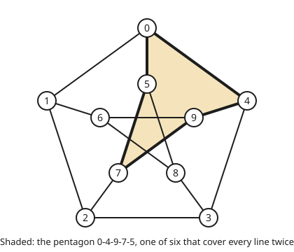

# Cycle double cover: every bridgeless graph has cycles covering each edge exactly twice

[Syllabus](../../../SYLLABUS.md) → [Frontier](../README.md) → [Geometry and Combinatorics](../README.md#s04) → Cycle double cover

---

## General Overview

Draw a cube flat: a large square, a small square inside it, and four spokes joining their corners. That is 8 dots and 12 lines. The drawing cuts the page into 6 faces, the outside included. Walk round the border of each face and you get 6 closed loops. Every line borders exactly two faces, so every line lies on exactly two of the loops.

A closed loop that repeats no dot is a **cycle**. A list of cycles that uses every line exactly twice is a **cycle double cover**. For any flat drawing, the face borders are the natural candidate.

Now take the **Petersen graph**: 10 dots and 15 lines, an outer pentagon, an inner five-pointed star, and five spokes between them. Julius Petersen published it in 1898. It cannot be drawn flat, so it has no faces to borrow. Yet six of its pentagons still cover every line exactly twice. The checks find exactly two such sets of six pentagons.

The conjecture says this always works, with one exception. A **bridge** is a line whose removal splits the graph into two pieces. A bridge lies on no cycle, so nothing can cover it. George Szekeres asked the question for graphs with three lines at every dot in 1973. Paul Seymour asked it for every graph without a bridge in 1979.

**A cycle double cover uses every line exactly twice; face borders give one for every flat graph with no bridge, and whether every bridgeless graph has one is a 1970s conjecture whose July 2026 proof is claimed: accepted in two expert expositions, not yet refereed.**

**What kind of fact this is:** a conjecture, posed in 1973 and 1979. Status as of 2026-11-23: claimed. A proof was announced in July 2026, and two graph theorists who are not its authors have posted arXiv expositions that accept it; one states the result as a theorem and writes out the whole proof. Both expositions are unrefereed preprints, not a published check, and no refereed publication was found, so this card keeps the status at claimed. The planar case is a theorem, proved on this card in Why it works.

### The picture: the Petersen graph and one covering pentagon

<p align="center"></p>

Schematic: the lengths and angles mean nothing. Dots 0 to 4 form the outer pentagon. Each inner dot sits inside an outer one: 5 inside 0, 6 inside 1, and so on. The inner dots join in a star, 5-7-9-6-8-5. The shaded pentagon 0-4-9-7-5 is one of the six cycles in the cover.

---

## The formula

Notation first, in words. A graph $`G`$ has dots, its vertex set $`V`$, and lines, its edge set $`E`$. Bars count: $`\lvert E\rvert`$ is the number of lines, and $`\lvert C\rvert`$ is the number of lines on a cycle $`C`$. The conjecture names cycles $`C_1`$ to $`C_k`$; repeats are allowed.

```math
\text{every finite bridgeless } G \text{ has cycles } C_1, \dots, C_k \text{ with } \#\{\, i : e \in C_i \,\} = 2 \text{ for every edge } e
```

**Read it aloud:** in any finite graph with no bridge, some list of cycles passes along every line exactly twice.

Counting the line slots gives one identity that every cover must meet:

```math
\lvert C_1\rvert + \lvert C_2\rvert + \dots + \lvert C_k\rvert = 2\,\lvert E\rvert
```

**Read it aloud:** the cycle lengths add up to twice the number of lines. For the Petersen graph, six pentagons give 6 × 5 = 30 = 2 × 15.

| Symbol | Plain meaning | In our example | Push it up and the answer… |
| --- | --- | --- | --- |
| $`G`$ | the graph: dots and the lines between them | the Petersen graph | — |
| $`V`$, $`\lvert V\rvert`$ | the dots, and how many | dots 0 to 9; 10 | more cycles to search |
| $`E`$, $`\lvert E\rvert`$ | the lines, and how many | 15 | more slots: $`2\lvert E\rvert`$ = 30 |
| $`e`$ | one line | the spoke 0-5 | — |
| $`C_i`$ | the $`i`$-th cycle in the list: a closed loop with no dot repeated | pentagon 0-4-9-7-5 | — |
| $`k`$ | how many cycles the list holds | 6 pentagons; 5 at the fewest | — |
| $`\lvert C_i\rvert`$ | lines on one cycle | 5 | fewer cycles needed |
| $`\#\{i : e \in C_i\}`$ | how many cycles of the list pass along $`e`$ | 2 for every line | — |
| $`F`$ | faces of a drawing, the outside included | 6 for the flat cube | — |
| $`A`$, $`B`$ | two even subgraphs: sets of lines meeting every dot an even number of times (Step 5) | the Petersen graph is not the union of two | — |

### When it holds

- **No bridge.** A bridge lies on no cycle, so its count stays 0. Two triangles joined by one line (a dumbbell) have 2 cycles, and neither passes along the joining line.
- **Finitely many dots and lines.** The face count and the cycle search both need a finite graph.
- **Repeats are allowed in the list.** A graph that is one single cycle has only one cycle, so its cover is that cycle twice.
- **A cycle repeats no dot.** A closed walk through a dot twice is not a cycle. The outer face of a bowtie (two triangles sharing one dot) is such a walk. Some authors allow any **even subgraph** (a set of lines meeting every dot an even number of times) instead. Nothing changes: an even subgraph splits into cycles that share no line, the splitting behind [Euler circuits](../../04-Combinatorics%20and%20graphs/11-Tours%20-%20Euler%20and%20Hamilton/01-euler-circuits.md).

---

## Why it works

What follows proves two special cases, explains why the general case is hard, and outlines the 2026 claim. It does not prove the conjecture.

### Step 0: each line needs two sides

A line in a flat drawing has a face on each side. If the two faces differ and each face border is a cycle, the borders are a cover. Most graphs have no flat drawing, so the two sides must come from somewhere else. That is the whole difficulty.

### Step 1: why a bridge rules a graph out

A line is a bridge exactly when it lies on no cycle. A cycle through the line would be a detour round it, so removing it would split nothing. This is stated on [How many cuts break a network](../../04-Combinatorics%20and%20graphs/13-Matchings%20and%20Flows/07-connectivity-and-mengers-theorem.md).

So a graph with a bridge has no cover at all. The dumbbell's search confirms it: no list of up to 6 cycles covers it.

### Step 2: planar graphs, by faces

Take a bridgeless graph drawn flat. On the cube, the 6 traced faces are all 4-cycles, and each of the 12 lines borders exactly 2 of them. Euler's count gives the face total as $`F = \lvert E\rvert - \lvert V\rvert + 2`$ = 12 − 8 + 2 = 6 ([Planar graphs](../../04-Combinatorics%20and%20graphs/12-Planarity%20and%20Colouring/01-planar-graphs-and-eulers-formula.md)). The trace and the count agree.

Two things must hold in general. Each face border must be a cycle, and each line must border two different faces.

- **Two different faces.** With no bridge, every line lies on a cycle. A flat cycle is a closed curve, so the faces on its two sides differ: Step 0 of the planar card.
- **Borders are cycles.** This can fail. The bowtie's outer face is the walk 0-2-1-0-3-4, through dot 0 twice. The fix is to cut the graph at such dots into **blocks**: the largest pieces that no single dot can split. Each block, drawn alone, has faces bordered by cycles, and every line lies in exactly one block.

<details>
<summary>Detailed proof: in a flat drawing of a bridgeless graph, the face borders of its blocks cover every line twice</summary>

Cut the graph at every dot whose removal splits it. The pieces are the blocks. Every cycle lies inside one block, and every line lies in exactly one block.

A block that is a single line would be a bridge, so every block has a cycle. Such a block can be built from one cycle by adding **ears**: paths whose two ends are already in the block and whose inner dots are new. This is Whitney's ear theorem for graphs with no cut dot.

Start with one cycle, drawn flat. It has two faces, and both borders are that cycle. Add the ears one at a time, as they sit in the drawing. An ear's inside avoids the rest of the drawing, so it runs through one face. Its two ends lie on that face's border cycle and split it into two arcs. The ear plus each arc is a cycle, and these two cycles border the two new faces. Every other face keeps its border. So after the last ear, every face border of the block is a cycle.

Each line lies on a cycle, so its two sides are different faces. Every line therefore lies on exactly two face borders of its block. Gather the face borders of all blocks: each line is covered exactly twice. For the bowtie, each triangle is a block, and its two faces give that triangle twice.

</details>

### Step 3: three colours give a cover

A graph with three lines at every dot is **cubic**. Colour its lines with three colours so that the three lines at each dot all differ ([Edge colouring](../../04-Combinatorics%20and%20graphs/12-Planarity%20and%20Colouring/06-edge-colouring-and-round-robin.md)).

Keep any two colours and drop the third. Each dot then meets exactly 2 kept lines, so the kept lines form cycles that share no dot. There are three ways to drop a colour. Each line has one colour, so it is kept in exactly two of the three choices.

- **The cube.** It has 24 proper colourings. The first one found gives 2 cycles in each colour pair: 6 cycles, a cover.
- **K(3,3)**, three dots each joined to three others. It has 12 colourings, and each colour pair is one hexagon. K(3,3) cannot be drawn flat, so this road reaches beyond Step 2.

### Step 4: the Petersen graph escapes both roads

The Petersen graph is not planar. A flat drawing whose faces each have at least 5 sides has at most $`5(\lvert V\rvert - 2)/3`$ lines, which is 13.33 for 10 dots. This is the face count of [Why some graphs cannot be drawn flat](../../04-Combinatorics%20and%20graphs/12-Planarity%20and%20Colouring/02-edge-bound-and-kuratowski.md) with 5 sides per face in place of 3 or 4: $`2\lvert E\rvert \ge 5F`$ and Euler's count give a sharper limit than the two on that card. Its shortest cycle has 5 lines, and it has 15 lines. So Step 2 does not apply.

It has no proper 3-colouring of its lines either. The backtracking search finds 0. So Step 3 does not apply.

A cover exists all the same. The search lists all 57 cycles: 12 of length 5, 10 of length 6, 15 of length 8 and 20 of length 9. Two sets of six pentagons cover every line exactly twice; the worked numbers show one.

The six pentagons are the faces of a drawing of the Petersen graph on the **projective plane**: the one-sided surface made by gluing opposite points of a disc's rim ([Orientability](../../17-Topology/03-Surfaces%20and%20Manifolds/03-orientability-mobius-strip-and-klein-bottle.md)). The count $`\lvert V\rvert - \lvert E\rvert + F`$ = 10 − 15 + 6 = 1 is that surface's number ([Euler characteristic](../../17-Topology/03-Surfaces%20and%20Manifolds/04-euler-characteristic-and-triangulations.md)). So Step 0 still works: the second side of each line is found on another surface.

The **strong embedding conjecture** asks for this in general. It says every graph with no cut dot has a drawing on some surface whose face borders are all cycles. That would imply the cycle double cover conjecture, and it is also open.

### Step 5: what is proved, and where a counterexample would have to hide

A graph with no 3-colouring of its lines, cubic and bridgeless, is called a **snark**. The Petersen graph is the smallest. Step 3 handles every cubic graph that is not a snark. Standard reductions show that a smallest counterexample would be a snark.

| Statement | Kind | Status | Date | Source |
| --- | --- | --- | --- | --- |
| Planar bridgeless graphs have a cover | theorem | proved | classical | Step 2 |
| Cubic graphs with a 3-colouring of lines have a cover | theorem | proved | classical | Step 3 |
| Graphs needing 4 line cuts to split have a cover | theorem | proved | 1979 | Jaeger |
| Every bridgeless graph has 7 even subgraphs using each line exactly 4 times | theorem | proved | 1983 | Bermond, Jackson, Jaeger |
| A smallest counterexample has no cycle shorter than 12 | theorem | proved | 2000 | Huck |
| The full conjecture | conjecture | claimed | 2026-07 | expositions below |

Jaeger's result uses the trick of Step 3. A graph that needs 4 line cuts to split is the union of two even subgraphs $`A`$ and $`B`$. Take $`A`$, $`B`$, and the lines in exactly one of them. All three are even subgraphs, and each line lies in exactly two of them.

The 1983 result shows that "exactly four times" is proved for every bridgeless graph. "Exactly twice" is the open part.

### Step 6: the July 2026 claim, in outline

In July 2026 a proof was announced by the developer of a machine-learning system, which it credited with producing the argument. The primary source is the developer's own note, "A proof of the cycle double cover conjecture", dated July 2026 and listed as reference 22 of Oum's exposition. Two mathematicians posted expositions on arXiv: Jim Geelen on 2026-07-16 ([arXiv:2607.15399](https://arxiv.org/abs/2607.15399)) and Sang-il Oum on 2026-07-17, revised on 2026-08-01 (Sources). A separate claim by Shiva Kintali appeared on 2026-07-13 ([arXiv:2607.14140](https://arxiv.org/abs/2607.14140)).

The route, as Oum's exposition presents it. This is an outline, not a check.

1. **Reduce.** A smallest counterexample is cubic and needs at least 3 line cuts to split.
2. **Label.** Such a graph has a labelling of its lines by nonzero 3-bit strings whose three labels at each dot combine to zero under bitwise exclusive-or (a nowhere-zero flow with values in three bits, due to Jaeger and, independently, Kilpatrick).
3. **Lift.** A "flow lifting" lemma turns the labels into a cover, once suitable extra labels at the dots exist.
4. **Solve.** A linear-algebra argument over the two-element field shows that those extra labels always exist.

Secondary reports mention a formal proof in Lean, a proof-checking program. No primary source for it was found as of 2026-11-23, so it carries no status here. Both expositions come from mathematicians independent of the announcement, and both accept the proof. Oum's states the result as a theorem and writes the proof out with small changes; Geelen's title calls it the Cycle Double Cover Theorem, and his notes clarify the proof and add nothing new. But both are unrefereed arXiv preprints, not a published check. Until a refereed publication or a formal proof rerun by others appears, this card keeps the status at **claimed**.

---

## Worked numbers, by hand

The six pentagons below are the first of the two covering sets the checks find. The dots are numbered as in the picture.

| Step | Arithmetic | Value |
| --- | --- | --- |
| line slots to fill | 2 × 15 lines | 30 |
| six pentagons | 0-1-2-3-4, 0-4-9-7-5, 2-3-8-5-7, 0-1-6-8-5, 3-4-9-6-8, 1-2-7-9-6 | 6 × 5 = 30 |
| spoke 0-5 | in 0-4-9-7-5 and 0-1-6-8-5 only | 2 |
| star line 5-7 | in 0-4-9-7-5 and 2-3-8-5-7 only | 2 |
| outer line 0-1 | in 0-1-2-3-4 and 0-1-6-8-5 only | 2 |
| the pentagons as faces | 10 − 15 + 6 | 1, the projective plane |
| fewest cycles possible | longest cycle 9, so at least 30 ÷ 9, rounded up | 4 |
| fewest cycles found | lengths 5 + 5 + 5 + 6 + 9 | **5 cycles, 30 slots** |

The Petersen graph has a cover although no flat drawing and no colour pairing produces one; the search shows that 4 cycles are too few and 5 are enough.

The checks also give the smallest cover for four more graphs.

| Graph | Dots | Lines | Cycles | Bridges | Smallest cover |
| --- | ---: | ---: | ---: | ---: | ---: |
| K(4), every pair of 4 dots joined | 4 | 6 | 7 | 0 | 3 |
| K(3,3) | 6 | 9 | 15 | 0 | 3 |
| cube | 8 | 12 | 28 | 0 | 4 |
| K(5) | 5 | 10 | 37 | 0 | 4 |
| Petersen | 10 | 15 | 57 | 0 | 5 |

These are checked instances, not evidence for the conjecture in general.

### What breaks if you drop a piece

| Mistake | Comes out at | What went wrong |
| --- | --- | --- |
| Keeping a bridge | dumbbell: 0 of 2 cycles pass along line 0-3; no cover with up to 6 cycles | a bridge lies on no cycle |
| Using face borders without cutting into blocks | bowtie outer face 0-2-1-0-3-4, 6 lines, dot 0 twice | that face border is not a cycle |
| Using colour pairs on the Petersen graph | 0 proper 3-colourings, so no pairs | the Petersen graph is a snark |
| Using faces on the Petersen graph | at most 13.33 lines in a flat drawing, but it has 15 | the Petersen graph is not planar |

The code prints all four.

---

## Code, from first principles, and it actually runs

Nothing is imported except `math`, used for angles in the drawings and for one counting formula. The code lists every cycle of each small graph by a depth-first search. Then an exact search, which knows no theory, looks for the smallest cover. Three independent roads reach covers. Faces are traced from the cube's drawing and checked against Euler's count. Colour pairs come from a backtracking 3-colouring. Blind search reaches the Petersen covers and the smallest-cover table. Two cross-checks guard the search itself: a cutting test and a cycle count find the bridge two ways, and the 37 cycles of K(5) are matched against a counting formula.

### Python

```python
# Cycle double cover -- the check behind the card.  Standard library only;
# math gives atan2, cos and sin for the drawings, perm for one count.  Every cycle of each small
# graph is listed by search, and double covers are found by an exact search
# that knows no theory.  Roads: faces of a flat drawing, colour pairs, search.
import math

ring = lambda n, s=0: [(s + i, s + (i + 1) % n) for i in range(n)]

CUBE = ring(4) + ring(4, 4) + [(i, i + 4) for i in range(4)]      # the 8-pad board
CUBE_XY = [(0, 0), (4, 0), (4, 4), (0, 4), (1, 1), (3, 1), (3, 3), (1, 3)]
PET = ring(5) + [(i, i + 5) for i in range(5)] + [(5 + i, 5 + (i + 2) % 5) for i in range(5)]
K4, K5 = ([(a, b) for a in range(n) for b in range(a + 1, n)] for n in (4, 5))
K33 = [(a, b) for a in range(3) for b in range(3, 6)]
DUMBBELL = ring(3) + ring(3, 3) + [(0, 3)]                       # two triangles and a bridge
BOWTIE = ring(3) + [(0, 3), (3, 4), (4, 0)]                       # two triangles, one shared dot
BOWTIE_XY = [(0, 0), (-2, 1), (-2, -1), (2, 1), (2, -1)]
size = lambda c: bin(c).count("1")                                # edges in a cycle mask

def nbrs(n, E):
    adj = [[] for _ in range(n)]
    for k, (a, b) in enumerate(E):
        adj[a].append((b, k)); adj[b].append((a, k))
    return adj

def cycles(n, E):                       # every cycle once, as a bitmask of its edges
    adj, found = nbrs(n, E), set()
    def walk(s, v, seen, mask):
        for w, k in adj[v]:
            if w == s and size(mask) >= 2 and not mask >> k & 1:
                found.add(mask | 1 << k)
            elif w > s and w not in seen:
                walk(s, w, seen | {w}, mask | 1 << k)
    for s in range(n):
        walk(s, s, {s}, 0)
    return sorted(found, key=lambda c: (size(c), c))

def double_cover(m, cyc, k):            # k cycles, repeats allowed, each edge exactly twice
    need = [2] * m
    def go(left):
        e = next((i for i in range(m) if need[i]), None)
        if left == 0 or e is None:
            return [] if left == 0 and e is None else None
        for c in cyc:                   # some cycle of the cover holds edge e
            if c >> e & 1 and all(need[i] for i in range(m) if c >> i & 1):
                for i in range(m):
                    need[i] -= c >> i & 1
                rest = go(left - 1)
                for i in range(m):
                    need[i] += c >> i & 1
                if rest is not None:
                    return [c] + rest
        return None
    return go(k)

def colourings(n, E):                   # proper 3-edge-colourings, counted by backtracking
    col, first = [-1] * len(E), []
    def go(i):
        if i == len(E):
            first[:] = first or col[:]
            return 1
        busy, out = {col[j] for j in range(i) if set(E[j]) & set(E[i])}, 0
        for c in range(3):
            if c not in busy:
                col[i] = c; out += go(i + 1); col[i] = -1
        return out
    return go(0), first

def pieces(n, E):
    adj, seen, count = nbrs(n, E), set(), 0
    for s in range(n):
        if s not in seen:
            count += 1; stack = [s]; seen.add(s)
            while stack:
                for w, _ in adj[stack.pop()]:
                    if w not in seen:
                        seen.add(w); stack.append(w)
    return count

def faces(n, E, xy):                    # trace a flat drawing's faces, dart by dart
    adj = nbrs(n, E)
    turn = [[w for w, _ in sorted(adj[v], key=lambda t: math.atan2(xy[t[0]][1] - xy[v][1],
             xy[t[0]][0] - xy[v][0]))] for v in range(n)]
    used, out = set(), []
    for v0 in range(n):
        for w0 in turn[v0]:
            walk, v, w = [], v0, w0
            while (v, w) not in used:
                used.add((v, w)); walk.append(v)
                v, w = w, turn[w][(turn[w].index(v) - 1) % len(turn[w])]
            out += [walk] if walk else []
    return out

cf = faces(8, CUBE, CUBE_XY)
through = [sum(1 for f in cf for x, y in zip(f, f[1:] + f[:1]) if {x, y} == set(e)) for e in CUBE]
print(f"cube board: V 8, E 12, faces traced {len(cf)}, face lengths {[len(f) for f in cf]}")
print(f"faces by Euler's count E - V + 2 = {12 - 8 + 2}; every face a cycle: {all(len(set(f)) == len(f) for f in cf)}")
print(f"faces through each edge: {through}")
bf = faces(5, BOWTIE, BOWTIE_XY)
print(f"bowtie faces {[len(f) for f in bf]}; outer walk {max(bf, key=len)} passes dot 0 twice")
for name, n, E in [("cube", 8, CUBE), ("K3,3", 6, K33), ("Petersen", 10, PET)]:
    count, col = colourings(n, E)
    pairs = [[e for k, e in enumerate(E) if col[k] != c] for c in range(3)] if count else []
    even = all(sorted(a for e in p for a in e) == sorted(list(range(n)) * 2) for p in pairs)
    print(f"{name}: 3-edge-colourings {count}; cycles in the three colour pairs "
          f"{[pieces(n, p) for p in pairs] or 'none'}")
    assert even and (count == 0) == (name == "Petersen")             # Petersen alone has none
pc = cycles(10, PET)
print(f"Petersen cycles: {len(pc)}, by length {[(L, sum(1 for c in pc if size(c) == L)) for L in (5, 6, 8, 9)]}")
pent = [c for c in pc if size(c) == 5]
six = [[pent[i] for i in range(12) if s >> i & 1] for s in range(1 << 12) if size(s) == 6]
six = [p for p in six if all(sum(c >> e & 1 for c in p) == 2 for e in range(15))]
print(f"pentagons: {len(pent)}; sets of 6 covering every edge twice: {len(six)}; as faces, V - E + F = {10 - 15 + 6}")
for c in six[0]:
    print("  pentagon " + " ".join(f"{min(a, b)}{max(a, b)}" for k, (a, b) in enumerate(PET) if c >> k & 1))
print(f"Petersen flat? girth 5 allows at most 5(V - 2)/3 = {5 * 8 / 3:.2f} edges, it has 15")
print("graph, V, E, cycles, bridges, smallest double cover (cycles)")
best = {}
for name, n, E in [("K4", 4, K4), ("K3,3", 6, K33), ("cube", 8, CUBE), ("K5", 5, K5), ("Petersen", 10, PET)]:
    cyc = cycles(n, E)
    k = -(-2 * len(E) // max(size(c) for c in cyc))               # 2|E| over the longest cycle
    while double_cover(len(E), cyc, k) is None:
        k += 1
    best[name] = double_cover(len(E), cyc, k)
    br = sum(1 for e in E if pieces(n, [f for f in E if f != e]) > 1)
    assert all(sum(c >> e & 1 for c in best[name]) == 2 for e in range(len(E)))   # a real cover
    print(f"  {name}, {n}, {len(E)}, {len(cyc)}, {br}, {k}")
lens = sorted(size(c) for c in best["Petersen"])
print(f"Petersen, 5 cycles: lengths {lens}, adding to {sum(lens)} = 2 x 15; longest cycle 9, so at least {-(-30 // 9)}")
dc = cycles(6, DUMBBELL)
br = [e for e in DUMBBELL if pieces(6, [f for f in DUMBBELL if f != e]) > 1]
print(f"dumbbell: bridges {br}; cycles through edge 03: {sum(c >> 6 & 1 for c in dc)} of {len(dc)}; "
      f"double cover with up to 6 cycles: {any(double_cover(len(DUMBBELL), dc, k) for k in range(1, 7))}")
xy = [(round(210 + r * math.cos(math.radians(90 + 72 * i))), round(190 - r * math.sin(math.radians(90 + 72 * i))))
      for r in (150, 70) for i in range(5)]
print("figure," + ";".join(f"{x} {y}" for x, y in xy))
assert len(cf) == 12 - 8 + 2 and all(t == 2 for t in through)        # faces: two roads agree
assert len(six) == 2 and len(best["Petersen"]) == 5 and len(best["K4"]) == 3
assert br == [(0, 3)] and len(dc) == 2 and not any(c >> 6 & 1 for c in dc)   # bridge on no cycle
assert len(cycles(5, K5)) == sum(math.perm(5, L) // (2 * L) for L in range(3, 6))   # by formula
print("ALL CHECKS PASS")
```

**Ran 2026-11-23 on macOS, Python 3.14.10, standard library only. All checks passed. Output, pasted from the run:**

```
cube board: V 8, E 12, faces traced 6, face lengths [4, 4, 4, 4, 4, 4]
faces by Euler's count E - V + 2 = 6; every face a cycle: True
faces through each edge: [2, 2, 2, 2, 2, 2, 2, 2, 2, 2, 2, 2]
bowtie faces [6, 3, 3]; outer walk [0, 2, 1, 0, 3, 4] passes dot 0 twice
cube: 3-edge-colourings 24; cycles in the three colour pairs [2, 2, 2]
K3,3: 3-edge-colourings 12; cycles in the three colour pairs [1, 1, 1]
Petersen: 3-edge-colourings 0; cycles in the three colour pairs none
Petersen cycles: 57, by length [(5, 12), (6, 10), (8, 15), (9, 20)]
pentagons: 12; sets of 6 covering every edge twice: 2; as faces, V - E + F = 1
  pentagon 01 12 23 34 04
  pentagon 04 05 49 57 79
  pentagon 23 27 38 57 58
  pentagon 01 05 16 68 58
  pentagon 34 38 49 68 69
  pentagon 12 16 27 79 69
Petersen flat? girth 5 allows at most 5(V - 2)/3 = 13.33 edges, it has 15
graph, V, E, cycles, bridges, smallest double cover (cycles)
  K4, 4, 6, 7, 0, 3
  K3,3, 6, 9, 15, 0, 3
  cube, 8, 12, 28, 0, 4
  K5, 5, 10, 37, 0, 4
  Petersen, 10, 15, 57, 0, 5
Petersen, 5 cycles: lengths [5, 5, 5, 6, 9], adding to 30 = 2 x 15; longest cycle 9, so at least 4
dumbbell: bridges [(0, 3)]; cycles through edge 03: 0 of 2; double cover with up to 6 cycles: False
figure,210 40;67 144;122 311;298 311;353 144;210 120;143 168;169 247;251 247;277 168
ALL CHECKS PASS
```

### Rust

Same numbers, same labels, built with `rustc --edition 2021 -O`.

```rust
// Cycle double cover -- the same check as the Python, in Rust.  No crates.
// Every cycle of each small graph is listed by search, and double covers are
// found by an exact search that knows no theory.  Roads: faces of a flat
// drawing, colour pairs, and blind search.
type G = Vec<(usize, usize)>;

fn ring(n: usize, s: usize) -> G { (0..n).map(|i| (s + i, s + (i + 1) % n)).collect() }
fn size(c: u32) -> usize { c.count_ones() as usize }
fn py(b: bool) -> &'static str { if b { "True" } else { "False" } }

fn nbrs(n: usize, e: &G) -> Vec<Vec<(usize, usize)>> {
    let mut adj = vec![Vec::new(); n];
    for (k, &(a, b)) in e.iter().enumerate() { adj[a].push((b, k)); adj[b].push((a, k)); }
    adj
}
fn walk(adj: &Vec<Vec<(usize, usize)>>, s: usize, v: usize, seen: &mut Vec<bool>, mask: u32, found: &mut Vec<u32>) {
    for &(w, k) in &adj[v] {
        if w == s && size(mask) >= 2 && mask >> k & 1 == 0 {
            if !found.contains(&(mask | 1 << k)) { found.push(mask | 1 << k) }
        } else if w > s && !seen[w] {
            seen[w] = true;
            walk(adj, s, w, seen, mask | 1 << k, found);
            seen[w] = false;
        }
    }
}

fn cycles(n: usize, e: &G) -> Vec<u32> {      // every cycle once, as a bitmask of its edges
    let (adj, mut found) = (nbrs(n, e), Vec::new());
    for s in 0..n {
        let mut seen = vec![false; n];
        seen[s] = true;
        walk(&adj, s, s, &mut seen, 0, &mut found);
    }
    found.sort_by_key(|&c| (size(c), c));
    found
}
fn go(m: usize, cyc: &[u32], need: &mut Vec<u32>, left: usize) -> Option<Vec<u32>> {
    let e = (0..m).find(|&i| need[i] > 0);
    if left == 0 || e.is_none() { return if left == 0 && e.is_none() { Some(vec![]) } else { None } }
    let e = e.unwrap();
    for &c in cyc {                             // some cycle of the cover holds edge e
        if c >> e & 1 == 1 && (0..m).all(|i| c >> i & 1 == 0 || need[i] > 0) {
            for i in 0..m { need[i] -= c >> i & 1 }
            let rest = go(m, cyc, need, left - 1);
            for i in 0..m { need[i] += c >> i & 1 }
            if let Some(mut r) = rest { r.insert(0, c); return Some(r) }
        }
    }
    None
}
fn double_cover(m: usize, cyc: &[u32], k: usize) -> Option<Vec<u32>> { go(m, cyc, &mut vec![2; m], k) }
fn colour(e: &G, i: usize, col: &mut Vec<i32>, first: &mut Vec<i32>) -> usize {
    if i == e.len() { if first.is_empty() { *first = col.clone() } return 1 }
    let mut out = 0;
    for c in 0..3 {
        let busy = (0..i).any(|j| col[j] == c && (e[j].0 == e[i].0 || e[j].0 == e[i].1 || e[j].1 == e[i].0 || e[j].1 == e[i].1));
        if !busy { col[i] = c; out += colour(e, i + 1, col, first); col[i] = -1 }
    }
    out
}
fn pieces(n: usize, e: &G) -> usize {
    let (adj, mut seen, mut count) = (nbrs(n, e), vec![false; n], 0);
    for s in 0..n {
        if seen[s] { continue } else { count += 1; seen[s] = true }
        let mut stack = vec![s];
        while let Some(v) = stack.pop() {
            for &(w, _) in &adj[v] { if !seen[w] { seen[w] = true; stack.push(w) } }
        }
    }
    count
}
fn faces(n: usize, e: &G, xy: &[(f64, f64)]) -> Vec<Vec<usize>> {   // trace faces, dart by dart
    let adj = nbrs(n, e);
    let turn: Vec<Vec<usize>> = (0..n).map(|v| {
        let mut t: Vec<usize> = adj[v].iter().map(|x| x.0).collect();
        let ang = |w: usize| (xy[w].1 - xy[v].1).atan2(xy[w].0 - xy[v].0);
        t.sort_by(|&a, &b| ang(a).partial_cmp(&ang(b)).unwrap());
        t
    }).collect();
    let (mut used, mut out) = (Vec::new(), Vec::new());
    for v0 in 0..n {
        for &w0 in &turn[v0] {
            let (mut walk, mut v, mut w) = (Vec::new(), v0, w0);
            while !used.contains(&(v, w)) {
                used.push((v, w)); walk.push(v);
                let p = turn[w].iter().position(|&x| x == v).unwrap();
                (v, w) = (w, turn[w][(p + turn[w].len() - 1) % turn[w].len()]);
            }
            if !walk.is_empty() { out.push(walk) }
        }
    }
    out
}
fn without(e: &G, k: usize) -> G { e.iter().enumerate().filter(|&(j, _)| j != k).map(|(_, &x)| x).collect() }

fn main() {
    let cube: G = [ring(4, 0), ring(4, 4), (0..4).map(|i| (i, i + 4)).collect()].concat();
    let cube_xy = [(0., 0.), (4., 0.), (4., 4.), (0., 4.), (1., 1.), (3., 1.), (3., 3.), (1., 3.)];
    let pet: G = [ring(5, 0), (0..5).map(|i| (i, i + 5)).collect(), (0..5).map(|i| (5 + i, 5 + (i + 2) % 5)).collect()].concat();
    let kn = |n: usize| -> G { (0..n).flat_map(|a| (a + 1..n).map(move |b| (a, b))).collect() };
    let k33: G = (0..3).flat_map(|a| (3..6).map(move |b| (a, b))).collect();
    let dumbbell: G = [ring(3, 0), ring(3, 3), vec![(0, 3)]].concat();
    let bowtie: G = [ring(3, 0), vec![(0, 3), (3, 4), (4, 0)]].concat();
    let bowtie_xy = [(0., 0.), (-2., 1.), (-2., -1.), (2., 1.), (2., -1.)];
    let cf = faces(8, &cube, &cube_xy);
    let through: Vec<usize> = cube.iter().map(|&(a, b)| cf.iter().map(|f| (0..f.len())
        .filter(|&i| { let (x, y) = (f[i], f[(i + 1) % f.len()]); (x, y) == (a, b) || (x, y) == (b, a) }).count()).sum()).collect();
    let all_cycles = cf.iter().all(|f| { let mut g = f.clone(); g.sort(); g.dedup(); g.len() == f.len() });
    println!("cube board: V 8, E 12, faces traced {}, face lengths {:?}", cf.len(), cf.iter().map(|f| f.len()).collect::<Vec<_>>());
    println!("faces by Euler's count E - V + 2 = {}; every face a cycle: {}", 12 - 8 + 2, py(all_cycles));
    println!("faces through each edge: {:?}", through);
    let bf = faces(5, &bowtie, &bowtie_xy);
    let outer = bf.iter().fold(&bf[0], |m, f| if f.len() > m.len() { f } else { m });
    println!("bowtie faces {:?}; outer walk {:?} passes dot 0 twice", bf.iter().map(|f| f.len()).collect::<Vec<_>>(), outer);
    for (name, n, e) in [("cube", 8, &cube), ("K3,3", 6, &k33), ("Petersen", 10, &pet)] {
        let (mut col, mut first) = (vec![-1; e.len()], Vec::new());
        let count = colour(e, 0, &mut col, &mut first);
        let pairs: Vec<G> = if count > 0 { (0..3).map(|c| e.iter().enumerate().filter(|&(k, _)| first[k] != c).map(|(_, &x)| x).collect()).collect() } else { vec![] };
        let even = pairs.iter().all(|p| (0..n).all(|v| p.iter().filter(|&&(a, b)| a == v || b == v).count() == 2));
        let pc: Vec<usize> = pairs.iter().map(|p| pieces(n, p)).collect();
        let shown = if pc.is_empty() { "none".to_string() } else { format!("{:?}", pc) };
        println!("{}: 3-edge-colourings {}; cycles in the three colour pairs {}", name, count, shown);
        assert!(even && (count == 0) == (name == "Petersen"));        // Petersen alone has none
    }
    let pc = cycles(10, &pet);
    let by: Vec<(usize, usize)> = [5, 6, 8, 9].iter().map(|&l| (l, pc.iter().filter(|&&c| size(c) == l).count())).collect();
    println!("Petersen cycles: {}, by length {:?}", pc.len(), by);
    let pent: Vec<u32> = pc.iter().copied().filter(|&c| size(c) == 5).collect();
    let six: Vec<Vec<u32>> = (0u32..1 << 12).filter(|&s| size(s) == 6)
        .map(|s| (0..12).filter(|&i| s >> i & 1 == 1).map(|i| pent[i]).collect::<Vec<u32>>())
        .filter(|p| (0..15).all(|e| p.iter().filter(|&&c| c >> e & 1 == 1).count() == 2)).collect();
    println!("pentagons: {}; sets of 6 covering every edge twice: {}; as faces, V - E + F = {}", pent.len(), six.len(), 10 - 15 + 6);
    for &c in &six[0] {
        let s: Vec<String> = pet.iter().enumerate().filter(|&(k, _)| c >> k & 1 == 1).map(|(_, &(a, b))| format!("{}{}", a.min(b), a.max(b))).collect();
        println!("  pentagon {}", s.join(" "));
    }
    println!("Petersen flat? girth 5 allows at most 5(V - 2)/3 = {:.2} edges, it has 15", 5.0 * 8.0 / 3.0);
    println!("graph, V, E, cycles, bridges, smallest double cover (cycles)");
    let mut best = Vec::new();
    for (name, n, e) in [("K4", 4, kn(4)), ("K3,3", 6, k33.clone()), ("cube", 8, cube.clone()), ("K5", 5, kn(5)), ("Petersen", 10, pet.clone())] {
        let cyc = cycles(n, &e);
        let longest = cyc.iter().map(|&c| size(c)).max().unwrap();
        let mut k = (2 * e.len() + longest - 1) / longest;         // 2|E| over the longest cycle
        while double_cover(e.len(), &cyc, k).is_none() { k += 1 }
        let cov = double_cover(e.len(), &cyc, k).unwrap();
        let br = (0..e.len()).filter(|&j| pieces(n, &without(&e, j)) > 1).count();
        assert!((0..e.len()).all(|j| cov.iter().filter(|&&c| c >> j & 1 == 1).count() == 2));   // a real cover
        println!("  {}, {}, {}, {}, {}, {}", name, n, e.len(), cyc.len(), br, k);
        best.push((name, cov));
    }
    let mut lens: Vec<usize> = best[4].1.iter().map(|&c| size(c)).collect(); lens.sort();
    println!("Petersen, 5 cycles: lengths {:?}, adding to {} = 2 x 15; longest cycle 9, so at least {}", lens, lens.iter().sum::<usize>(), (30 + 8) / 9);
    let dc = cycles(6, &dumbbell);
    let br: Vec<(usize, usize)> = (0..dumbbell.len()).filter(|&j| pieces(6, &without(&dumbbell, j)) > 1).map(|j| dumbbell[j]).collect();
    let any = (1..7).any(|k| double_cover(dumbbell.len(), &dc, k).is_some());
    println!("dumbbell: bridges {:?}; cycles through edge 03: {} of {}; double cover with up to 6 cycles: {}",
             br, dc.iter().filter(|&&c| c >> 6 & 1 == 1).count(), dc.len(), py(any));
    let xy: Vec<String> = [150.0f64, 70.0].iter().flat_map(|&r| (0..5).map(move |i| {
        let t = (90.0 + 72.0 * i as f64).to_radians();
        format!("{} {}", (210.0 + r * t.cos()).round(), (190.0 - r * t.sin()).round())
    })).collect();
    println!("figure,{}", xy.join(";"));
    assert!(cf.len() == 12 - 8 + 2 && through.iter().all(|&t| t == 2));   // faces: two roads agree
    assert!(six.len() == 2 && best[4].1.len() == 5 && best[0].1.len() == 3);
    assert!(br == vec![(0, 3)] && dc.len() == 2 && dc.iter().all(|&c| c >> 6 & 1 == 0));   // bridge on no cycle
    assert!(cycles(5, &kn(5)).len() == (3..6usize).map(|l| (6 - l..=5).product::<usize>() / (2 * l)).sum::<usize>());   // by formula
    println!("ALL CHECKS PASS");
}
```

**Ran 2026-11-23 on macOS, rustc 1.98.1, no crates. All checks passed. Output, pasted from the run:**

```
cube board: V 8, E 12, faces traced 6, face lengths [4, 4, 4, 4, 4, 4]
faces by Euler's count E - V + 2 = 6; every face a cycle: True
faces through each edge: [2, 2, 2, 2, 2, 2, 2, 2, 2, 2, 2, 2]
bowtie faces [6, 3, 3]; outer walk [0, 2, 1, 0, 3, 4] passes dot 0 twice
cube: 3-edge-colourings 24; cycles in the three colour pairs [2, 2, 2]
K3,3: 3-edge-colourings 12; cycles in the three colour pairs [1, 1, 1]
Petersen: 3-edge-colourings 0; cycles in the three colour pairs none
Petersen cycles: 57, by length [(5, 12), (6, 10), (8, 15), (9, 20)]
pentagons: 12; sets of 6 covering every edge twice: 2; as faces, V - E + F = 1
  pentagon 01 12 23 34 04
  pentagon 04 05 49 57 79
  pentagon 23 27 38 57 58
  pentagon 01 05 16 68 58
  pentagon 34 38 49 68 69
  pentagon 12 16 27 79 69
Petersen flat? girth 5 allows at most 5(V - 2)/3 = 13.33 edges, it has 15
graph, V, E, cycles, bridges, smallest double cover (cycles)
  K4, 4, 6, 7, 0, 3
  K3,3, 6, 9, 15, 0, 3
  cube, 8, 12, 28, 0, 4
  K5, 5, 10, 37, 0, 4
  Petersen, 10, 15, 57, 0, 5
Petersen, 5 cycles: lengths [5, 5, 5, 6, 9], adding to 30 = 2 x 15; longest cycle 9, so at least 4
dumbbell: bridges [(0, 3)]; cycles through edge 03: 0 of 2; double cover with up to 6 cycles: False
figure,210 40;67 144;122 311;298 311;353 144;210 120;143 168;169 247;251 247;277 168
ALL CHECKS PASS
```

The two outputs match line for line.

### Lean

Lean proves the bridge rule and the colour-pair road for all finite graphs, and the six-pentagon cover of the Petersen graph.

- A graph with a bridge has no cycle double cover, because no cycle passes along the bridge.
- Take a cubic graph whose lines have three colours, all different at each dot. Then it has a cycle double cover.
- Some six pentagons of the Petersen graph cover every line exactly twice.
- The card's six pentagons use exactly the 15 lines of the Petersen graph, each line twice.
- The line slots agree: 6 × 5 = 30 = 2 × 15.
- The pentagons as faces give 10 − 15 + 6 = 1.
- The smallest cover found has lengths 5 + 5 + 5 + 6 + 9 = 30.
- The fewest cycles possible is 30 ÷ 9 rounded up, which is 4.
- The flat-drawing count fails for the Petersen graph: 3 × 15 = 45 is more than 5 × (10 − 2) = 40.
- The flat cube has 12 − 8 + 2 = 6 faces.

Planar graphs, the cycle counts, the smallest-cover searches, and the Petersen graph's 0 colourings are left to the Python and Rust checks.

```lean
-- Cycle double cover: the conjecture is stated exactly and left open, and the file proves that a graph with a bridge has no cycle double cover, that a cubic graph whose lines take three colours has one, and that six pentagons cover the Petersen graph, with the card's whole-number examples.
import Mathlib.Combinatorics.SimpleGraph.Paths
import Mathlib.Combinatorics.SimpleGraph.Connectivity.Connected
import Mathlib.Combinatorics.SimpleGraph.Connectivity.Subgraph
import Mathlib.Combinatorics.SimpleGraph.DegreeSum
import Mathlib.Combinatorics.SimpleGraph.LineGraph
import Mathlib.Combinatorics.SimpleGraph.Coloring.Vertex
import Mathlib.Combinatorics.SimpleGraph.Finite
import Mathlib.Combinatorics.SimpleGraph.Matching

open SimpleGraph

theorem length_filter_toList_eq_card {α : Type*} (s : Finset α) (p : α → Prop) [DecidablePred p] :
    (s.toList.filter (fun a => p a)).length = (s.filter p).card := by
  rw [Finset.card_def, Finset.filter_val, ← Finset.coe_toList s, Multiset.filter_coe,
    Multiset.coe_card]

theorem exists_cycle_mem_edges_of_even_degree {V : Type*} [Fintype V] [DecidableEq V]
    (H : SimpleGraph V) [DecidableRel H.Adj] (heven : ∀ v, Even (H.degree v)) {u v : V}
    (huv : H.Adj u v) : ∃ (w : V) (p : H.Walk w w), p.IsCycle ∧ s(u, v) ∈ p.edges := by
  by_contra hcon
  push Not at hcon
  have hb : H.IsBridge s(u, v) :=
    (isBridge_iff_forall_cycle_notMem huv).2 (fun w p hp => hcon w p hp)
  rw [isBridge_iff] at hb
  classical
  set H' := H.deleteEdges {s(u, v)} with hH'
  let K : SimpleGraph V :=
    { Adj := fun x y => H'.Adj x y ∧ H'.Reachable u x
      symm := ⟨fun x y h => ⟨h.1.symm, h.2.trans h.1.reachable⟩⟩
      loopless := ⟨fun x h => h.1.ne rfl⟩ }
  have hKadj : ∀ x y, K.Adj x y ↔ H'.Adj x y ∧ H'.Reachable u x := fun _ _ => Iff.rfl
  have key : (Finset.univ.filter fun x => Odd (K.degree x)) = {u} := by
    ext x
    simp only [Finset.mem_filter, Finset.mem_univ, true_and, Finset.mem_singleton]
    constructor
    · intro hx
      by_contra hxu
      by_cases hr : H'.Reachable u x
      · have hxv : x ≠ v := by rintro rfl; exact hb hr
        have hN : K.neighborFinset x = H.neighborFinset x := by
          ext y
          simp only [mem_neighborFinset, hKadj, hH', deleteEdges_adj, Set.mem_singleton_iff,
            Sym2.eq_iff]
          constructor
          · exact fun h => h.1.1
          · intro h; refine ⟨⟨h, ?_⟩, hr⟩; rintro (⟨rfl, -⟩ | ⟨rfl, -⟩) <;> simp_all
        rw [← card_neighborFinset_eq_degree, hN, card_neighborFinset_eq_degree] at hx
        exact (Nat.not_odd_iff_even.2 (heven x)) hx
      · have hN : K.neighborFinset x = ∅ := by
          ext y; simp [mem_neighborFinset, hKadj, hr]
        rw [← card_neighborFinset_eq_degree, hN] at hx
        simp at hx
    · rintro rfl
      have hN : K.neighborFinset x = (H.neighborFinset x).erase v := by
        ext y
        simp only [mem_neighborFinset, hKadj, hH', deleteEdges_adj, Set.mem_singleton_iff,
          Finset.mem_erase, Reachable.refl, and_true]
        constructor
        · rintro ⟨h1, h2⟩; exact ⟨fun h => h2 (by rw [h]), h1⟩
        · rintro ⟨h1, h2⟩; exact ⟨h2, fun h => h1 (Sym2.congr_right.1 h)⟩
      rw [← card_neighborFinset_eq_degree, hN, Finset.card_erase_of_mem
        ((mem_neighborFinset _ _ _).2 huv), card_neighborFinset_eq_degree]
      obtain ⟨k, hk⟩ := heven x
      have : 1 ≤ H.degree x := H.degree_pos_iff_exists_adj x |>.2 ⟨v, huv⟩
      exact ⟨k - 1, by omega⟩
  have := K.even_card_odd_degree_vertices
  rw [key] at this
  simp at this

theorem mem_edges_of_isCycle_of_degree_le_two {V : Type*} [Fintype V] [DecidableEq V]
    (H : SimpleGraph V) [DecidableRel H.Adj] (hdeg : ∀ v, H.degree v ≤ 2) {w : V}
    {p : H.Walk w w} (hp : p.IsCycle) {x y : V} (hx : x ∈ p.support) (hxy : H.Adj x y) :
    s(x, y) ∈ p.edges := by
  rw [← Walk.adj_toSubgraph_iff_mem_edges]
  have h2 := hp.ncard_neighborSet_toSubgraph_eq_two hx
  have hsub : p.toSubgraph.neighborSet x ⊆ H.neighborSet x := p.toSubgraph.neighborSet_subset x
  have heq : p.toSubgraph.neighborSet x = H.neighborSet x := by
    apply Set.eq_of_subset_of_ncard_le hsub _ (Set.toFinite _)
    rw [h2, ← coe_neighborFinset, Set.ncard_coe_finset, card_neighborFinset_eq_degree]
    exact hdeg x
  have : y ∈ p.toSubgraph.neighborSet x := by rw [heq]; exact hxy
  exact this

theorem edges_subset_of_isCycle_of_degree_le_two {V : Type*} [Fintype V] [DecidableEq V]
    (H : SimpleGraph V) [DecidableRel H.Adj] (hdeg : ∀ v, H.degree v ≤ 2) {a b : V}
    {p : H.Walk a a} {q : H.Walk b b} (hp : p.IsCycle) {e : Sym2 V} (hep : e ∈ p.edges)
    (heq : e ∈ q.edges) : q.edges.toFinset ⊆ p.edges.toFinset := by
  have hclosed : ∀ {x y : V} (r : H.Walk x y), x ∈ p.support → y ∈ p.support := by
    intro x y r
    induction r with
    | nil => exact id
    | cons h r ih =>
      intro hx
      exact ih (p.snd_mem_support_of_mem_edges
        (mem_edges_of_isCycle_of_degree_le_two H hdeg hp hx h))
  induction e using Sym2.ind with
  | _ c d =>
  have hcq : c ∈ q.support := q.fst_mem_support_of_mem_edges heq
  have hb : b ∈ p.support := hclosed (q.dropUntil c hcq) (p.fst_mem_support_of_mem_edges hep)
  intro f hf
  rw [List.mem_toFinset] at hf ⊢
  induction f using Sym2.ind with
  | _ x y =>
  have hxq : x ∈ q.support := q.fst_mem_support_of_mem_edges hf
  exact mem_edges_of_isCycle_of_degree_le_two H hdeg hp (hclosed (q.takeUntil x hxq) hb)
    (q.adj_of_mem_edges hf)

#print axioms length_filter_toList_eq_card
#print axioms exists_cycle_mem_edges_of_even_degree
#print axioms mem_edges_of_isCycle_of_degree_le_two
#print axioms edges_subset_of_isCycle_of_degree_le_two

/-! A graph is a finite simple graph `G : SimpleGraph V` (dots `V`, lines `G.edgeSet`).
A cycle is recorded by the set of its lines; the cover is a `List`, so repeats are allowed. -/

/-- `C` is the set of lines of some cycle of `G`: a closed walk that repeats no dot. -/
def IsCycleEdges {V : Type*} [DecidableEq V] (G : SimpleGraph V) (C : Finset (Sym2 V)) : Prop :=
  ∃ (u : V) (p : G.Walk u u), p.IsCycle ∧ p.edges.toFinset = C

/-- A cycle double cover of `G`: a list of cycles of `G` (repeats allowed) such that every
line of `G` lies on exactly two cycles of the list. -/
def IsCycleDoubleCover {V : Type*} [DecidableEq V] (G : SimpleGraph V)
    (L : List (Finset (Sym2 V))) : Prop :=
  (∀ C ∈ L, IsCycleEdges G C) ∧ ∀ e ∈ G.edgeSet, (L.filter (fun C => e ∈ C)).length = 2

/-- The cycle double cover conjecture (Szekeres 1973, Seymour 1979; claimed proved in
July 2026, not refereed as of 2026-11-23, so the card does not prove it): every finite graph
with no bridge has a list of cycles passing along every line exactly twice. -/
def CycleDoubleCoverConjecture : Prop :=
  ∀ (V : Type) [Fintype V] [DecidableEq V] (G : SimpleGraph V),
    (∀ e ∈ G.edgeSet, ¬ G.IsBridge e) → ∃ L, IsCycleDoubleCover G L

/-- A graph with a bridge has no cycle double cover: a bridge lies on no cycle, so no list of
cycles passes along it at all. This is why the conjecture asks for a graph with no bridge. -/
theorem not_exists_cycleDoubleCover_of_isBridge {V : Type*} [Fintype V] [DecidableEq V]
    (G : SimpleGraph V) (e : Sym2 V) (he : e ∈ G.edgeSet) (hb : G.IsBridge e) :
    ¬ ∃ L, IsCycleDoubleCover G L := by
  rintro ⟨L, hcyc, hcount⟩
  have h2 := hcount e he
  have hne : L.filter (fun C => e ∈ C) ≠ [] := by
    intro h; rw [h] at h2; simp at h2
  obtain ⟨C, hC⟩ := List.exists_mem_of_ne_nil _ hne
  rw [List.mem_filter, decide_eq_true_eq] at hC
  obtain ⟨u, p, hp, rfl⟩ := hcyc C hC.1
  exact hb.notMem_edges_of_isCycle hp (List.mem_toFinset.1 hC.2)

/-- Three colours give a cover: if every dot of `G` meets exactly three lines and the lines
can be coloured with three colours so that the lines at each dot all differ, then `G` has a
cycle double cover (the cycles made by each pair of colours). -/
theorem exists_cycleDoubleCover_of_cubic_of_edge_three_colorable {V : Type*} [Fintype V]
    [DecidableEq V] (G : SimpleGraph V) [DecidableRel G.Adj] (hcubic : ∀ v, G.degree v = 3)
    (hcol : G.lineGraph.Colorable 3) :
    ∃ L, IsCycleDoubleCover G L := by
  classical
  obtain ⟨c⟩ := hcol
  let col : Sym2 V → Fin 3 := fun e => if h : e ∈ G.edgeSet then c ⟨e, h⟩ else 0
  have hcol_ne : ∀ {v w w' : V}, G.Adj v w → G.Adj v w' → w ≠ w' →
      col s(v, w) ≠ col s(v, w') := by
    intro v w w' h h' hne
    simp only [col, show s(v, w) ∈ G.edgeSet from h, show s(v, w') ∈ G.edgeSet from h',
      ↓reduceDIte]
    apply c.valid
    rw [lineGraph_adj_iff_exists]
    refine ⟨?_, v, by simp, by simp⟩
    intro heq
    exact hne (Sym2.congr_right.1 (congrArg Subtype.val heq))
  let H : Fin 3 → SimpleGraph V := fun k => G.deleteEdges {e | col e = k}
  have hHle : ∀ k, H k ≤ G := fun k => deleteEdges_le _
  have hHedge : ∀ k e, e ∈ (H k).edgeSet ↔ e ∈ G.edgeSet ∧ col e ≠ k := by
    intro k e
    simp [H, edgeSet_deleteEdges]
  have hdeg : ∀ k v, (H k).degree v = 2 := by
    intro k v
    have hN : (H k).neighborFinset v =
        (G.neighborFinset v).filter (fun w => col s(v, w) ≠ k) := by
      ext w; simp [H, mem_neighborFinset]
    rw [← card_neighborFinset_eq_degree, hN]
    have hinj : Set.InjOn (fun w => col s(v, w)) (G.neighborFinset v : Set V) := by
      intro w hw w' hw' heq
      by_contra hne
      exact hcol_ne ((mem_neighborFinset _ _ _).1 hw) ((mem_neighborFinset _ _ _).1 hw') hne heq
    have himg : (G.neighborFinset v).image (fun w => col s(v, w)) = Finset.univ := by
      apply Finset.eq_univ_of_card
      rw [Finset.card_image_of_injOn hinj, card_neighborFinset_eq_degree, hcubic]
      simp
    have hfi : ((G.neighborFinset v).filter (fun w => col s(v, w) ≠ k)).image
        (fun w => col s(v, w)) = Finset.univ.filter (fun x => x ≠ k) := by
      rw [← himg, Finset.filter_image]
    rw [← Finset.card_image_of_injOn
      (hinj.mono (Finset.coe_subset.2 (Finset.filter_subset _ _))), hfi,
      Finset.filter_ne' Finset.univ k, Finset.card_erase_of_mem (Finset.mem_univ _)]
    simp
  let P : Fin 3 → Sym2 V → Prop := fun k e =>
    ∃ (w : V) (p : (H k).Walk w w), p.IsCycle ∧ e ∈ p.edges
  have hP : ∀ k e, e ∈ (H k).edgeSet → P k e := by
    intro k e he
    induction e using Sym2.ind with
    | _ x y =>
    exact exists_cycle_mem_edges_of_even_degree (H k) (fun v => by rw [hdeg]; decide) he
  let cyc : Fin 3 → Sym2 V → Finset (Sym2 V) := fun k e =>
    if h : P k e then h.choose_spec.choose.edges.toFinset else ∅
  have hcyc_spec : ∀ k e, e ∈ (H k).edgeSet →
      ∃ (w : V) (p : (H k).Walk w w), p.IsCycle ∧ e ∈ p.edges ∧
        cyc k e = p.edges.toFinset := by
    intro k e he
    have h := hP k e he
    refine ⟨h.choose, h.choose_spec.choose, h.choose_spec.choose_spec.1,
      h.choose_spec.choose_spec.2, ?_⟩
    simp only [cyc, h, ↓reduceDIte]
  have hdeg2 : ∀ k v, (H k).degree v ≤ 2 := fun k v => (hdeg k v).le
  -- each chosen cycle is a cycle of `G` and contains its line
  have hF1 : ∀ k e, e ∈ (H k).edgeSet → e ∈ cyc k e ∧ IsCycleEdges G (cyc k e) := by
    intro k e he
    obtain ⟨w, p, hp, hep, hc⟩ := hcyc_spec k e he
    refine ⟨by rw [hc]; exact List.mem_toFinset.2 hep, w, p.mapLe (hHle k), hp.mapLe _, ?_⟩
    rw [Walk.edges_mapLe_eq_edges, hc]
  have hF2 : ∀ k e e', e ∈ (H k).edgeSet → e' ∈ cyc k e → cyc k e' = cyc k e := by
    intro k e e' he he'
    obtain ⟨w, p, hp, hep, hc⟩ := hcyc_spec k e he
    rw [hc] at he' ⊢
    have he'p : e' ∈ p.edges := List.mem_toFinset.1 he'
    obtain ⟨w', q, hq, heq, hc'⟩ := hcyc_spec k e' (p.edges_subset_edgeSet he'p)
    rw [hc']
    exact Finset.Subset.antisymm
      (edges_subset_of_isCycle_of_degree_le_two (H k) (hdeg2 k) hp he'p heq)
      (edges_subset_of_isCycle_of_degree_le_two (H k) (hdeg2 k) hq heq he'p)
  have hF3 : ∀ k e e', e' ∈ cyc k e → e' ∈ (H k).edgeSet := by
    intro k e e' he'
    by_cases h : P k e
    · simp only [cyc, h, ↓reduceDIte] at he'
      exact Walk.edges_subset_edgeSet _ (List.mem_toFinset.1 he')
    · simp [cyc, h] at he'
  let S : Fin 3 → Finset (Finset (Sym2 V)) := fun k => (H k).edgeFinset.image (cyc k)
  have hS : ∀ k e, (S k).filter (fun C => e ∈ C) =
      if e ∈ (H k).edgeSet then {cyc k e} else ∅ := by
    intro k e
    split_ifs with he
    · ext C
      simp only [Finset.mem_filter, Finset.mem_image, mem_edgeFinset, Finset.mem_singleton, S]
      constructor
      · rintro ⟨⟨e', he', rfl⟩, hC⟩
        exact (hF2 k e' e he' hC).symm
      · rintro rfl
        exact ⟨⟨e, he, rfl⟩, (hF1 k e he).1⟩
    · ext C
      simp only [Finset.mem_filter, Finset.mem_image, mem_edgeFinset, Finset.notMem_empty,
        iff_false, not_and, S]
      rintro ⟨e', -, rfl⟩ hC
      exact he (hF3 k e' e hC)
  refine ⟨(S 0).toList ++ (S 1).toList ++ (S 2).toList, ?_, ?_⟩
  · intro C hC
    have hmem : ∀ k, C ∈ (S k).toList → IsCycleEdges G C := by
      intro k hk
      rw [Finset.mem_toList] at hk
      obtain ⟨e, he, rfl⟩ := Finset.mem_image.1 hk
      exact (hF1 k e (mem_edgeFinset.1 he)).2
    simp only [List.mem_append] at hC
    rcases hC with (h | h) | h
    · exact hmem 0 h
    · exact hmem 1 h
    · exact hmem 2 h
  · intro e he
    simp only [List.filter_append, List.length_append]
    rw [length_filter_toList_eq_card (S 0) (fun C => e ∈ C),
      length_filter_toList_eq_card (S 1) (fun C => e ∈ C),
      length_filter_toList_eq_card (S 2) (fun C => e ∈ C), hS, hS, hS]
    simp only [hHedge, he, true_and]
    generalize col e = j
    fin_cases j <;> simp

/-- The Petersen graph, numbered as on the card: outer pentagon 0-1-2-3-4, spokes `i`-`(i+5)`,
inner star `5+i`-`5+((i+2) mod 5)`. -/
def petersenRel (a b : Fin 10) : Prop :=
  (a.val < 5 ∧ b.val < 5 ∧ b.val = (a.val + 1) % 5) ∨
  (a.val < 5 ∧ b.val = a.val + 5) ∨
  (5 ≤ a.val ∧ 5 ≤ b.val ∧ b.val = 5 + (a.val - 5 + 2) % 5)

instance : DecidableRel petersenRel := fun a b => by unfold petersenRel; infer_instance

/-- The Petersen graph: 10 dots, 15 lines. -/
def petersen : SimpleGraph (Fin 10) := SimpleGraph.fromRel petersenRel

instance : DecidableRel petersen.Adj := by unfold petersen; infer_instance

theorem isCycleEdges_of_five {V : Type*} [DecidableEq V] {G : SimpleGraph V} {a b c d f : V}
    (h1 : G.Adj a b) (h2 : G.Adj b c) (h3 : G.Adj c d) (h4 : G.Adj d f) (h5 : G.Adj f a)
    (hnd : [b, c, d, f, a].Nodup) (hed : [s(a, b), s(b, c), s(c, d), s(d, f), s(f, a)].Nodup) :
    IsCycleEdges G {s(a, b), s(b, c), s(c, d), s(d, f), s(f, a)} := by
  refine ⟨a, .cons h1 (.cons h2 (.cons h3 (.cons h4 (.cons h5 .nil)))), ?_, ?_⟩
  · rw [Walk.isCycle_def, Walk.isTrail_def]
    exact ⟨hed, by simp, hnd⟩
  · ext x; simp

#print axioms isCycleEdges_of_five

/-- The Petersen graph has a cycle double cover made of six pentagons (cycles of 5 lines),
although it has no flat drawing and no 3-colouring of its lines. -/
theorem petersen_cycleDoubleCover_six_pentagons :
    ∃ L, IsCycleDoubleCover petersen L ∧ L.length = 6 ∧ ∀ C ∈ L, C.card = 5 := by
  refine ⟨[{s(0, 1), s(1, 2), s(2, 3), s(3, 4), s(4, 0)},
    {s(0, 4), s(4, 9), s(9, 7), s(7, 5), s(5, 0)},
    {s(2, 3), s(3, 8), s(8, 5), s(5, 7), s(7, 2)},
    {s(0, 1), s(1, 6), s(6, 8), s(8, 5), s(5, 0)},
    {s(3, 4), s(4, 9), s(9, 6), s(6, 8), s(8, 3)},
    {s(1, 2), s(2, 7), s(7, 9), s(9, 6), s(6, 1)}], ⟨?_, ?_⟩, rfl, ?_⟩
  · intro C hC
    simp only [List.mem_cons, List.not_mem_nil, or_false] at hC
    rcases hC with rfl | rfl | rfl | rfl | rfl | rfl <;>
      exact isCycleEdges_of_five (by decide) (by decide) (by decide) (by decide) (by decide)
        (by decide) (by decide)
  · intro e he
    rw [← mem_edgeFinset] at he
    revert e
    decide
  · intro C hC
    simp only [List.mem_cons, List.not_mem_nil, or_false] at hC
    rcases hC with rfl | rfl | rfl | rfl | rfl | rfl <;> decide

/-- The card's six pentagons, as sets of lines: 0-1-2-3-4, 0-4-9-7-5, 2-3-8-5-7, 0-1-6-8-5,
3-4-9-6-8, 1-2-7-9-6. -/
def petersenPentagons : List (Finset (Sym2 (Fin 10))) :=
  [{s(0, 1), s(1, 2), s(2, 3), s(3, 4), s(4, 0)},
   {s(0, 4), s(4, 9), s(9, 7), s(7, 5), s(5, 0)},
   {s(2, 3), s(3, 8), s(8, 5), s(5, 7), s(7, 2)},
   {s(0, 1), s(1, 6), s(6, 8), s(8, 5), s(5, 0)},
   {s(3, 4), s(4, 9), s(9, 6), s(6, 8), s(8, 3)},
   {s(1, 2), s(2, 7), s(7, 9), s(9, 6), s(6, 1)}]

-- The Petersen graph has 15 lines.
example : petersen.edgeFinset.card = 15 := by decide

-- Every line of the Petersen graph lies on exactly two of the six pentagons (line slots 30).
example : ∀ e ∈ petersen.edgeFinset, (petersenPentagons.filter (fun C => e ∈ C)).length = 2 := by
  decide

-- Each pentagon has 5 lines.
example : petersenPentagons.map Finset.card = [5, 5, 5, 5, 5, 5] := by decide

-- Together the pentagons use exactly the 15 lines of the Petersen graph.
example : petersenPentagons.foldr (· ∪ ·) ∅ = petersen.edgeFinset := by decide

-- Line slots: six pentagons give 6 × 5 = 30 = 2 × 15.
example : 6 * 5 = 2 * 15 := by norm_num

-- The pentagons as faces: V − E + F = 10 − 15 + 6 = 1, the projective plane.
example : (10 : ℤ) - 15 + 6 = 1 := by norm_num

-- The smallest cover found: lengths 5 + 5 + 5 + 6 + 9 = 30 = 2 × 15.
example : 5 + 5 + 5 + 6 + 9 = 2 * 15 := by norm_num

-- Fewest cycles possible: longest cycle 9, so at least 30 ÷ 9 rounded up, which is 4.
example : (30 + 9 - 1) / 9 = 4 := by norm_num

-- Not flat: a flat drawing with faces of at least 5 sides has 3 × E ≤ 5 × (V − 2); 45 > 40.
example : ¬ (3 * 15 ≤ 5 * (10 - 2)) := by norm_num

-- The flat cube: Euler's count gives F = E − V + 2 = 12 − 8 + 2 = 6 faces.
example : 12 - 8 + 2 = 6 := by norm_num

#print axioms not_exists_cycleDoubleCover_of_isBridge
#print axioms exists_cycleDoubleCover_of_cubic_of_edge_three_colorable
#print axioms petersen_cycleDoubleCover_six_pentagons
```

**Checked 2026-11-23 on macOS, Lean 4.36.0-rc2, Mathlib v4.36.0-rc2. Every proof is complete and uses only Lean's standard axioms. Output, pasted from the run:**

```
'length_filter_toList_eq_card' depends on axioms: [propext, Classical.choice, Quot.sound]
'exists_cycle_mem_edges_of_even_degree' depends on axioms: [propext, Classical.choice, Quot.sound]
'mem_edges_of_isCycle_of_degree_le_two' depends on axioms: [propext, Classical.choice, Quot.sound]
'edges_subset_of_isCycle_of_degree_le_two' depends on axioms: [propext, Classical.choice, Quot.sound]
'isCycleEdges_of_five' depends on axioms: [propext, Classical.choice, Quot.sound]
'not_exists_cycleDoubleCover_of_isBridge' depends on axioms: [propext, Classical.choice, Quot.sound]
'exists_cycleDoubleCover_of_cubic_of_edge_three_colorable' depends on axioms: [propext, Classical.choice, Quot.sound]
'petersen_cycleDoubleCover_six_pentagons' depends on axioms: [propext, Classical.choice, Quot.sound]
```

> [!TIP]
> **Try changing**
> Guess first, then run it. The asserts are pinned to the card's graphs, so expect one to stop the program.
> - **Turn the star into a ring.** In `PET`, change `(i + 2) % 5` to `(i + 1) % 5`. Guess first: does the new graph, a pentagonal prism, have a 3-colouring of its lines? Answer: yes, 30 of them, with colour pairs giving 2, 2 and 1 cycles. The assert that only the Petersen graph has none stops the run.
> - **Remove the bridge.** Add a second joining line `(1, 4)` to `DUMBBELL`. Guess first: how many cycles now pass along line 0-3? Answer: 4 of 6, there are no bridges, and a cover exists. The bridge assert stops the run.
> - **Draw the cube with crossings.** Set the inner four points of `CUBE_XY` to `(3, 3), (3, 1), (1, 1), (1, 3)`. Guess first: how many faces does the tracer find? Answer: 2, of lengths 20 and 4, and they are not cycles. A drawing with crossings has no true faces, and the first assert stops the run.

---

## The usual mistake

> [!warning]
> **Reading the 2026 announcement as a settled theorem.** A proof was announced in July 2026 and explained in two arXiv expositions that accept it. As of 2026-11-23 neither exposition is refereed and no published check was found, so this card records the conjecture as claimed, not proved. The checks here verify five small graphs, which proves nothing beyond them.
>
> - **Treating "cover" as "split".** Splitting the lines into cycles that share no line, each line once, needs every dot to have even degree. The Petersen graph has degree 3 everywhere, so it has no such split, yet it has a double cover.
> - **Taking face borders as cycles without checking.** The bowtie's outer face is the walk 0-2-1-0-3-4, through dot 0 twice. Cut the graph into blocks first.
> - **Forgetting the bridge condition.** The dumbbell has 2 cycles and neither passes along its bridge, so no list of any length covers it.
> - **Thinking colours must exist.** The colour-pair road needs a 3-colouring of the lines. The Petersen graph has 0, so its cover must come from somewhere else.

---

## Where you meet it in real life

- **Fibre network protection.** Ring-based protection in telecommunication networks lays each fibre on loops, so traffic can turn back round a cut. Placing protection loops along the faces of a flat drawing of the network puts every fibre on exactly two loops, the cover of Step 2.
- **Drawing graphs on surfaces.** The Petersen graph's six pentagons are faces on the projective plane. The strong embedding conjecture would give every graph with no cut dot such a drawing, with a cover as its faces.
- **Map colouring.** For a flat cubic graph, a 3-colouring of the lines matches a 4-colouring of the faces, a link Tait found in 1880. So the four-colour theorem also gives every flat bridgeless cubic graph a colour-pair cover ([Colouring maps](../../04-Combinatorics%20and%20graphs/12-Planarity%20and%20Colouring/05-five-and-four-colour-theorems.md)).
- **Auditing machine-produced proofs.** The July 2026 claim tests the audit list of [Machines in proofs](../01-How%20Research%20Works/06-computer-assistance-and-formal-verification.md): the statement, the artifact, an independent check, and a dated status.

> **Say it back**
> A cycle double cover is a list of cycles that uses every line of a graph exactly twice. A bridge lies on no cycle, so a graph with a bridge has none. In a flat drawing the face borders of each block give a cover, so planar bridgeless graphs have one; a 3-colouring of a cubic graph's lines gives one through its colour pairs. The Petersen graph has neither, yet six pentagons cover it, and at least 5 cycles are needed. Whether every bridgeless graph has a cover was asked in 1973 and 1979; a proof was claimed in July 2026 and, as of 2026-11-23, is accepted in two expert expositions but not yet refereed.

---

## What this builds on

- [Euler circuits](../../04-Combinatorics%20and%20graphs/11-Tours%20-%20Euler%20and%20Hamilton/01-euler-circuits.md): a graph with even degrees splits into line-disjoint cycles, the "each line once" version that this card doubles.
- [Planar graphs](../../04-Combinatorics%20and%20graphs/12-Planarity%20and%20Colouring/01-planar-graphs-and-eulers-formula.md): faces, Euler's count $`V - E + F = 2`$, and why a line on a cycle has a different face on each side.
- [How many cuts break a network](../../04-Combinatorics%20and%20graphs/13-Matchings%20and%20Flows/07-connectivity-and-mengers-theorem.md): bridges, and the one-line reason a bridge lies on no cycle.
- [Edge colouring](../../04-Combinatorics%20and%20graphs/12-Planarity%20and%20Colouring/06-edge-colouring-and-round-robin.md): proper colourings of lines, the input to Step 3.
- [Euler characteristic](../../17-Topology/03-Surfaces%20and%20Manifolds/04-euler-characteristic-and-triangulations.md): the count $`V - E + F`$ on other surfaces, which places the Petersen pentagons on the projective plane.
- [Machines in proofs](../01-How%20Research%20Works/06-computer-assistance-and-formal-verification.md): the audit list, applied here to the July 2026 claim.

## Where this goes next

- [Sunflowers and union-closed families](05-sunflower-and-union-closed-conjectures.md): two more combinatorial problems with recent progress, read with the same status fields.
- [Colouring the plane](03-hadwiger-nelson-chromatic-number-of-the-plane.md): another graph problem on this shelf, settled in part by computer search.

The question this card leaves open is whether the July 2026 proof will pass refereeing, and, beyond it, whether every graph with no cut dot has a drawing on some surface whose faces are all cycles.

---

## Sources

Verified 2026-11-23: every link below resolves to the publisher's page.

- Szekeres, G. "Polyhedral decompositions of cubic graphs." *Bulletin of the Australian Mathematical Society* 8 (1973): 367–387. [doi:10.1017/S0004972700042660](https://doi.org/10.1017/S0004972700042660). The question for cubic graphs.
- Jaeger, François. "Flows and generalized coloring theorems in graphs." *Journal of Combinatorial Theory, Series B* 26 (1979): 205–216. [doi:10.1016/0095-8956(79)90057-1](https://doi.org/10.1016/0095-8956(79)90057-1). Flows in graphs needing 4 line cuts to split, the source of the two-even-subgraph cover.
- Bermond, J.-C., Bill Jackson, and François Jaeger. "Shortest coverings of graphs with cycles." *Journal of Combinatorial Theory, Series B* 35 (1983): 297–308. [doi:10.1016/0095-8956(83)90056-4](https://doi.org/10.1016/0095-8956(83)90056-4). Covers that use each line exactly four times.
- Huck, Andreas. "Reducible configurations for the cycle double cover conjecture." *Discrete Applied Mathematics* 99 (2000): 71–90. [doi:10.1016/S0166-218X(99)00126-2](https://doi.org/10.1016/S0166-218X(99)00126-2). A smallest counterexample has no cycle shorter than 12.
- Oum, Sang-il. Exposition of the proof announced in July 2026, arXiv:2607.16356, version 3 of 2026-08-01. [arXiv page](https://arxiv.org/abs/2607.16356). History (Szekeres, Seymour, Itai and Rodeh), and the outline of Step 6.
