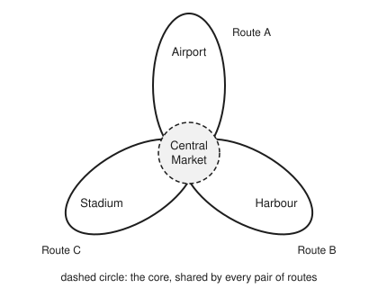

# Sunflowers and union-closed families: two set-system problems with recent progress

[Syllabus](../../../SYLLABUS.md) → [Frontier](../README.md) → [Geometry and Combinatorics](../README.md#s04) → Sunflowers and union-closed families

---

## General Overview

A city runs three bus routes, each calling at three stops.

- Route A: Central, Market, Airport.
- Route B: Central, Market, Harbour.
- Route C: Central, Market, Stadium.

Any two routes share exactly Central and Market, and nothing else. Every pair overlaps in the same place. That shape is a **sunflower**: a group of sets whose pairwise overlaps are all one and the same set. The shared part (Central, Market) is the **core**. What each set has on its own (Airport, Harbour, Stadium) is a **petal**. The routes only illustrate the definition: no timetable needs a sunflower. The shape matters in proofs about circuits and about random networks (Where you meet it in real life).

In 1960 Paul Erdős and Richard Rado proved that sunflowers cannot be avoided. Draw enough routes of three stops each and three of them always form a sunflower. Their bound for three-stop routes is 48: any 49 routes contain one. They also conjectured that the true threshold grows far more slowly than their bound. That **sunflower conjecture** is still open. In 2019 Ryan Alweiss, Shachar Lovett, Kewen Wu and Jiapeng Zhang moved it further than anyone in 60 years.

The second problem uses the same routes. Run any non-empty selection of them, and list the stops served. That gives 7 lists, and the union (the merged list) of any two lists is again on the list: the family is **union-closed**. Central appears in all 7 lists. Péter Frankl conjectured in 1979 that every union-closed family has some point in at least half of its sets. In 2022 Justin Gilmer proved "at least 1%". Within a week, three groups raised it to about 38.2%.

**Big families of sets are forced into structure: a large family of equal-size sets always contains a sunflower, and a union-closed family always has a point in a fixed share of its sets; the open questions ask how large and how big a share.**

**What kind of fact this is:** two conjectures, both open as of 2026-11-23, and the theorems that bound them. The Erdős–Rado lemma and the singleton rule are proved on this card. The Alweiss–Lovett–Wu–Zhang bound and Gilmer's constant are research proofs, outlined here with their sources. Two 2026 preprints sit nearby but do not settle the sunflower conjecture stated here. One claims a proof of a different conjecture, Erdős and Szemerédi's, about families of subsets of $`n`$ points ([arXiv:2610.26686](https://doi.org/10.48550/arXiv.2610.26686), 2026-10-19). The other claims the Erdős–Rado conjecture only for families of bounded VC-dimension: no large group of points has all its subsets cut out by the family ([arXiv:2609.18995](https://doi.org/10.48550/arXiv.2609.18995), 2026-07-17).

<p align="center"></p>

The figure is schematic: the loops are the three routes, and the dashed circle is the core they all share.

---

## The formula

Words first. A **family** is a set whose members are themselves sets, such as a list of routes. Bars count members: $`\lvert F\rvert`$ is the number of sets in the family $`F`$. A family of **$`w`$-sets** has exactly $`w`$ points in every member. A sunflower with $`p`$ **petals** is $`p`$ sets $`S_1, \dots, S_p`$ with one shared core $`K`$:

```math
S_i \cap S_j = K \quad \text{for every pair } i \ne j
```

**Read it aloud:** every two of the sets overlap in exactly the same set $`K`$, the core.

The core may be empty. Then the $`p`$ sets are **disjoint**: no two share a point.

The Erdős–Rado sunflower lemma says how big a family must be to force one:

```math
\lvert F\rvert > w!\,(p-1)^w \ \Longrightarrow\ F \text{ contains a sunflower with } p \text{ petals}
```

**Read it aloud:** if a family of $`w`$-sets has more than $`w`$ factorial times $`p - 1`$ to the power $`w`$ members, then $`p`$ of them form a sunflower.

For three-stop routes and three petals: $`3! \times 2^3 = 6 \times 8 = 48`$. The conjecture and its record bounds:

| Statement | Who and when | Bound on $`\lvert F\rvert`$ that forces $`p`$ petals | Status on 2026-11-23 |
| --- | --- | --- | --- |
| Sunflower lemma | Erdős and Rado, 1960 | $`w!\,(p-1)^w`$ | proved |
| Sunflower conjecture | Erdős and Rado, 1960 | $`C^w`$, with $`C`$ depending only on $`p`$ | open |
| Improved lemma | Alweiss, Lovett, Wu, Zhang; arXiv 2019, *Annals of Mathematics* 2021 | $`(C\,p^3 \log w \, \log\log w)^w`$ | proved |
| Shorter proof, sharper form | Anup Rao, *Discrete Analysis* 2020 | $`(C\,p\,\log(pw))^w`$ | proved |
| The record: $`\log(pw)`$ cut to $`\log w`$ | Bell, Chueluecha, Warnke; *Discrete Mathematics* 2021 ([doi:10.1016/j.disc.2021.112367](https://doi.org/10.1016/j.disc.2021.112367)) | $`(C\,p\,\log w)^w`$ | proved |

Here $`C`$ is a fixed number the papers do not optimize, and $`\log`$ is the natural logarithm. The Erdős–Rado bound grows like $`w^w`$. The new bounds grow like $`(\log w)^w`$, much closer to the conjectured $`C^w`$, but still faster.

For union-closed families, write the best point's share of the sets:

```math
\max_x \ \frac{\lvert \{A \in F : x \in A\} \rvert}{\lvert F\rvert} \ \ge\ c
```

**Read it aloud:** some point $`x`$ lies in at least a fraction $`c`$ of the sets of $`F`$.

| Constant $`c`$ | Who and when | Status on 2026-11-23 |
| --- | --- | --- |
| $`1/2`$ | Frankl's union-closed conjecture, 1979 | open |
| $`0.01`$ | Gilmer, arXiv, 2022-11-16 | proved: re-proved and improved by three independent groups within a week |
| $`(3-\sqrt5)/2 \approx 0.38197`$ | Alweiss, Huang, Sellke; Chase and Lovett; Sawin; arXiv, 2022-11-21 | proved: refereed (Alweiss, Huang and Sellke, *Electronic Journal of Combinatorics*, 2024) |
| about 0.38234, slightly above 0.38197 | Sawin's sketch, arXiv, 2022-11-21; Yu, *Entropy*, 2023-05-08 ([doi:10.3390/e25050767](https://doi.org/10.3390/e25050767)); Cambie ([arXiv:2212.12500](https://doi.org/10.48550/arXiv.2212.12500)) | proved: refereed (Yu 2023); the constant comes from numerical optimization |
| above 0.3823455 | Liu, Conference on Information Sciences and Systems, 2024 ([doi:10.1109/CISS59072.2024.10480167](https://doi.org/10.1109/CISS59072.2024.10480167)) | proved: refereed conference paper; the digits as Costa and Sadhu quote them |
| at least 0.3828852549667978 | Costa and Sadhu, arXiv, 2026-10-01 ([arXiv:2610.02295](https://doi.org/10.48550/arXiv.2610.02295)) | claimed |

This card checks none of the digits after 0.38197.

| Symbol | Plain meaning | In our example | Push it up and the answer… |
| --- | --- | --- | --- |
| $`F`$ | a family: a set of sets | the 3 routes, or the 7 route combinations | — |
| $`\lvert F\rvert`$ | how many sets the family holds | 3 routes; 7 combinations | a sunflower becomes harder to avoid |
| $`w`$ | the number of points in each set | 3 stops per route | the forcing bound grows fast |
| $`p`$ | how many petals the sunflower needs | 3 | the forcing bound grows |
| $`S_i`$, $`A`$, $`B`$ | one set of the family | Route A | — |
| $`r`$, $`Z`$ | the spread limit in the 2019 proof, and a small set of points tested against it | about $`p \log(pw)`$ | a weaker bound |
| $`K`$ | the core: the overlap every pair shares | Central, Market | — |
| $`w!`$ | $`w \times (w-1) \times \dots \times 1`$ | $`3! = 6`$ | — |
| $`C`$ | a fixed number, depending only on $`p`$ | not known | — |
| $`x`$, $`y`$ | a point of the ground set (all the points in play); $`y`$ is the crowded point the proof peels off | Central | — |
| $`c`$ | the guaranteed share for the best point | Frankl asks $`1/2`$ | a stronger theorem |
| $`H(q)`$ | binary entropy: the uncertainty, in bits, of a yes-or-no event with probability $`q`$ | $`H(0.382) \approx 0.959`$ | largest at $`q = 1/2`$ |

### When it holds

- **Every set in the family has the same size $`w`$.** With mixed sizes the lemma still holds for sets of size at most $`w`$, but with no cap on size there is no bound: a chain of sets, each inside the next, has no sunflower with 3 petals however long it runs.
- **The sets are distinct.** Repeat Route A three times and the copies "share" everything, a fake sunflower with no petals.
- **The overlap must be exactly the core.** Three sets that all contain Central but overlap in different places are not a sunflower (see What breaks).
- **Union-closed means every pair's union is in the family.** Drop it and a point can sit in only a third of the sets.
- **The family must contain a non-empty set.** The family holding only the empty set has no point in any of its sets.

---

## Why it works

### Step 0: a big family must crowd somewhere

Either a big family holds many sets that touch nothing in common, or its sets keep meeting. If they keep meeting, the meetings must pile onto a few points. That pile-up is the pigeonhole principle: spread $`n`$ items over $`k`$ boxes and some box holds at least $`n/k`$ of them ([Pigeonhole, extended](../../04-Combinatorics%20and%20graphs/04-Inclusion-Exclusion%20and%20Pigeonhole/05-pigeonhole-extended.md)). Both the 1960 proof and the 2019 proof are this choice, made carefully.

### Step 1: the Erdős–Rado proof, by peeling off one point

Take a family of $`w`$-sets with more than $`w!\,(p-1)^w`$ members.

1. Pick sets that are pairwise disjoint, one at a time, until no more fit. If $`p`$ of them fit, they form a sunflower with an empty core. Done.
2. Otherwise at most $`p - 1`$ fit. Their points number at most $`(p-1)w`$. Every other set meets one of these points, or it could have been added.
3. Pigeonhole: some point $`y`$ lies in at least $`\lvert F\rvert / ((p-1)w)`$ sets, which is more than $`(w-1)!\,(p-1)^{w-1}`$.
4. Delete $`y`$ from those sets. They become $`(w-1)`$-sets, enough of them to force a sunflower by the same argument one size down.
5. Put $`y`$ back into each. The overlaps all gain $`y`$, so they stay equal. The result is a sunflower whose core contains $`y`$.

<details>
<summary>Detailed proof: induction on the set size w</summary>

Write $`f(w)`$ for $`w!\,(p-1)^w`$. The claim is that more than $`f(w)`$ distinct $`w`$-sets contain a $`p`$-petal sunflower.

Base case, $`w = 1`$. More than $`p - 1`$ distinct one-point sets are at least $`p`$ disjoint sets: a sunflower with empty core.

Step. Let $`D`$ be a largest collection of pairwise disjoint sets in $`F`$. If $`\lvert D\rvert \ge p`$, done. Otherwise let $`Y`$ be the union of $`D`$, so $`\lvert Y\rvert \le (p-1)w`$. Every set of $`F`$ meets $`Y`$, or $`D`$ was not largest. Count pairs (set, point of $`Y`$ in it): each set gives at least one, so some $`y \in Y`$ lies in at least $`\lvert F\rvert/\lvert Y\rvert`$ sets.

$`\displaystyle \frac{\lvert F\rvert}{(p-1)w} > \frac{w!\,(p-1)^w}{(p-1)w} = (w-1)!\,(p-1)^{w-1} = f(w-1)`$

Remove $`y`$ from each of those sets. They stay distinct and now have $`w - 1`$ points, and there are more than $`f(w-1)`$ of them. By induction, $`p`$ of them form a sunflower with core $`K'`$. Adding $`y`$ back gives $`p`$ sets whose pairwise overlaps all equal $`K' \cup \{y\}`$: a sunflower.

</details>

### Step 2: the smallest case exactly, two-stop routes

A route of two stops is a link between two stops, so a family of 2-sets is a network of links. A 3-petal sunflower is then one of two shapes:

- three links from one stop (core: that stop), or
- three links with no stop in common (empty core).

Avoid both. No stop has three links, so the network breaks into paths and loops. No three links are disjoint, so the pieces together hold at most two disjoint links. A triangle gives 3 links for 1 disjoint link, the best rate any piece achieves. So the most is $`2 \times 3 = 6`$ links: two separate triangles. Erdős–Rado allows up to 8. The code confirms 6 by searching every network on up to 7 stops.

### Step 3: what changed in 2019, in outline

This is an outline of a research proof, with key steps and source; the full proof is in the papers.

1. **Spread families.** Call a family spread if no small set $`Z`$ of points lies inside too many members: at most $`r^{w - \lvert Z\rvert}`$ of them, for a chosen number $`r`$.
2. **Not spread: recurse.** Some $`Z`$ sits in many members. Remove $`Z`$ from them and look one size down, as Erdős and Rado did with one point.
3. **Spread: use randomness.** Split all the points at random into $`p`$ parts. The key lemma says a random part of a spread family's ground set very likely contains a whole member. Then each of the $`p`$ parts holds a member, and those $`p`$ members are disjoint: a sunflower with empty core.
4. **The price.** The lemma needs $`r`$ about $`p \log(pw)`$ in Rao's version. That $`r`$ becomes the base of the bound: $`(C\,p\,\log(pw))^w`$. Bell, Chueluecha and Warnke (2021) cut $`r`$ to about $`p \log w`$, giving the record $`(C\,p\,\log w)^w`$.

The sunflower conjecture asks for $`r`$ independent of $`w`$. Rao's paper notes that a strengthening of his lemma with $`r`$ of size about $`p`$ would prove the conjecture.

### Step 4: union-closed families, the case a proof reaches easily

If the family contains a one-point set $`\{x\}`$, then $`x`$ is in at least half the sets. Pair each set $`A`$ without $`x`$ with $`A \cup \{x\}`$. That union is in the family, because the family is union-closed. It contains $`x`$. Different sets $`A`$ give different partners, since removing $`x`$ recovers $`A`$. So the sets with $`x`$ are at least as many as the sets without it.

The code checks this rule in every union-closed family on up to 4 points that contains a one-point set: 4,126 families on 4 points.

### Step 5: Gilmer's idea, in outline

This is also an outline, with source. **Entropy** measures how spread out a random choice is, in bits. Picking uniformly from $`N`$ sets gives the largest possible entropy over those sets, $`\log_2 N`$.

1. Pick two sets $`A`$ and $`B`$ from $`F`$, independently and uniformly.
2. Their union $`A \cup B`$ is in $`F`$, so its entropy is at most that of the uniform choice: at most $`H(A)`$.
3. Gilmer proved that if every point is in fewer than 1% of the sets, then $`A \cup B`$ has strictly more entropy than $`A`$. That contradicts step 2. So some point is in at least 1% of the sets.

Why the method stalls near 38%: let each point join a set independently with probability $`q`$ (a new letter, since $`p`$ already counts petals). A union of two such sets then holds the point with probability $`2q - q^2`$. The union stops gaining entropy when

```math
H(2q - q^2) = H(q), \quad\text{that is}\quad 2q - q^2 = 1 - q, \quad\text{so}\quad q = \frac{3 - \sqrt5}{2} \approx 0.381966
```

Gilmer's paper notes this example: any method that compares $`A \cup B`$ with $`A`$ in this way cannot pass $`(3-\sqrt5)/2`$. Reaching $`1/2`$ needs a new idea.

---

## Worked numbers, by hand

| Step | Arithmetic | Value |
| --- | --- | --- |
| Overlap of Routes A and B | {Central, Market, Airport} ∩ {Central, Market, Harbour} | {Central, Market} |
| Overlaps A–C and B–C | same reading | {Central, Market}, both |
| Erdős–Rado bound, 3 stops, 3 petals | $`3! \times 2^3 = 6 \times 8`$ | 48 |
| Erdős–Rado bound, 2 stops, 3 petals | $`2! \times 2^2 = 2 \times 4`$ | 8 |
| True largest sunflower-free family of 2-stop routes | two triangles, $`2 \times 3`$ | 6 |
| Route combinations | non-empty subsets of 3 routes: $`2^3 - 1`$ | 7 |
| Combinations containing Central; containing Airport | every one; those that run Route A: $`2^2`$ | 7; 4 |
| Gilmer's barrier | smaller root of $`q^2 - 3q + 1 = 0`$: $`(3 - \sqrt5)/2`$ | 0.381966 |
| **Answer** | the three routes form a 3-petal sunflower; Central lies in 7 of 7 combinations | **core {Central, Market}; share 7/7** |

The routes are a sunflower, and the route combinations meet Frankl's demand easily: Central is in every one, and even Airport is in 4 of 7, more than half.

The 7 combinations are the non-empty subsets of the 3 routes, counted as in [Subsets and the power set](../../01-Foundations/07-Sets/02-subsets-and-power-set.md): $`2^3 = 8`$, minus the empty one.

How far apart the known bounds are, for 3 petals. The left column is the size of the best sunflower-free family built here, $`6^{w/2}`$, from copies of the two triangles. The right is the Erdős–Rado bound $`w!\,2^w`$. Both are in log10, so each character is a factor of about 1.6:

```
w = 2   built          6 (0.778)  ####
        bound          8 (0.903)  #####
w = 4   built         36 (1.556)  ########
        bound        384 (2.584)  #############
w = 6   built        216 (2.334)  ############
        bound      46080 (4.664)  #######################
w = 8   built       1296 (3.113)  ################
        bound   10321920 (7.014)  ###################################
w = 10  built       7776 (3.891)  ###################
        bound 3715891200 (9.570)  ################################################
```

The truth for each $`w`$ lies between the two bars. The conjecture says the right bar can be pulled down to a straight-line rate.

### What breaks if you drop a piece

| Mistake | Comes out at | What went wrong |
| --- | --- | --- |
| Call three sets a sunflower because all contain point 1: {1,2,3}, {1,2,4}, {1,3,4} | overlaps {1,2}, {1,3}, {1,4}: not a sunflower | the pairwise overlaps must be one identical set, not merely all contain a point |
| Drop union-closed: the family {1}, {2}, {3} | best share 1/3 = 0.333333 | the union {1,2} is missing, and with it the pull toward one point |
| Allow the family holding only the empty set | best share 0/1 | Frankl's statement needs a non-empty set |
| Read the Erdős–Rado bound 8 as the truth for 2-stop routes | true largest is 6 | the lemma is an upper bound, not the exact threshold |

---

## Code, from first principles, and it actually runs

The code stores each set as a bitmask (a number whose binary digits mark which points are in) and writes every search out. It reaches its answers by **independent roads**. The largest sunflower-free family of 2-stop routes comes from checking every set of links on up to 6 stops, and separately from a growing search up to 7 stops. The product family of 36 sets is checked against all 7,140 triples. Union-closed families are counted by testing every family on up to 4 points, and the count with the empty set is matched against the count without it. Gilmer's barrier comes from bisection (repeated halving of an interval) on the entropy equation, and from the closed form.

### Python

```python
# Sunflowers and union-closed families -- the check behind the card.
# Standard library only. Sets are bitmasks: bit k set means point k is in.
# Every search is written out; asserts check instances and two roads agreeing.
import math
from itertools import combinations

def pts(m):                                  # the points of a bitmask, from 1
    return [k + 1 for k in range(31) if m >> k & 1]

def bits(*ks):
    return sum(1 << (k - 1) for k in ks)

def flower(a, b, c):                         # three sets, one shared core
    return a & b == a & c == b & c

# ---- the three bus routes: 1 Central, 2 Market, 3 Airport, 4 Harbour, 5 Stadium
A, B, C = bits(1, 2, 3), bits(1, 2, 4), bits(1, 2, 5)
print("routes", pts(A), pts(B), pts(C), "cores", pts(A & B), pts(A & C), pts(B & C), "sunflower", flower(A, B, C))
X, Y, Z = bits(1, 2, 3), bits(1, 2, 4), bits(1, 3, 4)
print("near miss", pts(X), pts(Y), pts(Z), "cores", pts(X & Y), pts(X & Z), pts(Y & Z), "sunflower", flower(X, Y, Z))
assert flower(A, B, C) and not flower(X, Y, Z) and X & Y & Z == bits(1)

# ---- Erdos-Rado bound w!(p-1)^w for p = 3 petals
er = [math.factorial(w) * 2 ** w for w in range(1, 5)]
print("Erdos-Rado bound, p=3, w=1..4:", er)
assert er == [2, 8, 48, 384]

# ---- two-stop routes are edges; largest family with no 3 petals, two roads
def edges(n):
    return [bits(i, j) for i, j in combinations(range(1, n + 1), 2)]

def brute(n):                                # road 1: every set of edges
    E = edges(n)
    bad = [(1 << i) | (1 << j) | (1 << k) for i, j, k in combinations(range(len(E)), 3)
           if flower(E[i], E[j], E[k])]
    return max(bin(s).count("1") for s in range(1 << len(E)) if all(s & t != t for t in bad))

def search(n):                               # road 2: grow sunflower-free sets
    E, best = edges(n), [0]
    def grow(chosen, start):
        best[0] = max(best[0], len(chosen))
        for i in range(start, len(E)):
            if len(chosen) + len(E) - i <= best[0]:
                return
            if all(not flower(a, b, E[i]) for a, b in combinations(chosen, 2)):
                grow(chosen + [E[i]], i + 1)
    grow([], 0)
    return best[0]

bf = [brute(n) for n in range(3, 7)]
se = [search(n) for n in range(3, 8)]
print("largest 3-sunflower-free graph, brute force, n=3..6:", bf)
print("largest 3-sunflower-free graph, search, n=3..7:", se)
assert bf == se[:4] and se == [3, 4, 5, 6, 6]

T = [bits(1, 2), bits(1, 3), bits(2, 3), bits(4, 5), bits(4, 6), bits(5, 6)]
extra = [e for e in edges(6) if e not in T]
hits = [e for e in extra if any(flower(a, b, e) for a, b in combinations(T, 2))]
star = [pts(t) for t in T if t & bits(1, 4) == bits(1)][:2]
print("two triangles:", len(T), "edges; missing edges that force a sunflower:", len(hits), "of", len(extra))
print("seventh edge [1, 4] with", star, "core [1]")
assert len(hits) == len(extra) == 9

P = [a | b << 6 for a in T for b in T]       # product: triangle pair x triangle pair
trip = sum(1 for a, b, c in combinations(P, 3) if flower(a, b, c))
print("product family, w=4:", len(P), "sets,", math.comb(len(P), 3), "triples, sunflowers among them:", trip)
assert len(P) == 36 and trip == 0

print("log10 bars, p=3: w, construction 6^(w/2), Erdos-Rado w!2^w")
for w in range(2, 11, 2):
    lo, hi = 6 ** (w // 2), math.factorial(w) * 2 ** w
    print(f"w={w:2d} {lo:6d} {math.log10(lo):.3f} {hi:11d} {math.log10(hi):.3f}")

# ---- union-closed: the stops served by any non-empty set of running routes
U = sorted({x | y | z for x in (0, A) for y in (0, B) for z in (0, C)} - {0})
cnt = [sum(1 for s in U if s >> k & 1) for k in range(5)]
print("route combinations:", len(U), "sets; stop counts 1..5:", cnt)
assert all(a | b in U for a in U for b in U) and cnt == [7, 7, 4, 4, 4]

def share(F, n):                             # best element: (its count, |F|)
    return max(sum(1 for s in F if s >> k & 1) for k in range(n)), len(F)

def closed_families(n):                      # every family of subsets of n points
    for f in range(1 << (1 << n)):
        F = [s for s in range(1 << n) if f >> s & 1]
        if all(f >> (a | b) & 1 for a in F for b in F):
            yield F

for n in range(1, 5):
    fams = list(closed_families(n))
    withe = sum(1 for F in fams if 0 in F)
    worst = min((share(F, n) for F in fams if any(F)), key=lambda t: t[0] / t[1])
    sing = [F for F in fams if any(bin(s).count("1") == 1 for s in F)]
    ok = all(2 * sum(1 for s in F if s & x) >= len(F) for F in sing
             for x in F if bin(x).count("1") == 1)
    print(f"n={n}: union-closed families {len(fams)}, with empty set {withe},"
          f" lowest best share {worst[0]}/{worst[1]}, singleton rule holds in {len(sing)}: {ok}")
    assert 2 * withe == len(fams) and 2 * worst[0] == worst[1] and ok

for F in ([bits(1), bits(2), bits(3)], [0]):
    c, m = share(F, 3)
    print("breaks:", [pts(s) for s in F], f"best share {c}/{m} = {c / m:.6f}")

# ---- Gilmer's barrier: H(2p - p^2) = H(p), solved two ways
def H(q):                                    # binary entropy, in bits
    return -q * math.log2(q) - (1 - q) * math.log2(1 - q)

lo, hi = 0.1, 0.45                           # H(2p-p^2) - H(p): + at 0.1, - at 0.45
for _ in range(60):
    mid = (lo + hi) / 2
    lo, hi = (mid, hi) if H(2 * mid - mid * mid) > H(mid) else (lo, mid)
exact = (3 - math.sqrt(5)) / 2
print(f"entropy crossing: bisection {lo:.12f}, closed form (3-sqrt5)/2 {exact:.12f}, H there {H(exact):.12f}")
assert abs(lo - exact) < 1e-12 and abs(2 * exact - exact ** 2 - (1 - exact)) < 1e-15
print(f"Gilmer 0.01, a week later {exact:.5f}, Frankl asks 0.5")
ang = [270, 30, 150]                         # the figure: petal centres 75 px out
cen = " ".join(f"({210 + 75 * math.cos(math.radians(d)):.1f},{170 + 75 * math.sin(math.radians(d)):.1f})" for d in ang)
print("figure, centre (210,170), core radius 34, petal centres 75 px out:", cen)
print("ALL CHECKS PASS")
```

**Ran 2026-11-23 on macOS, Python 3.14.10, standard library only. All checks passed. Output, pasted from the run:**

```
routes [1, 2, 3] [1, 2, 4] [1, 2, 5] cores [1, 2] [1, 2] [1, 2] sunflower True
near miss [1, 2, 3] [1, 2, 4] [1, 3, 4] cores [1, 2] [1, 3] [1, 4] sunflower False
Erdos-Rado bound, p=3, w=1..4: [2, 8, 48, 384]
largest 3-sunflower-free graph, brute force, n=3..6: [3, 4, 5, 6]
largest 3-sunflower-free graph, search, n=3..7: [3, 4, 5, 6, 6]
two triangles: 6 edges; missing edges that force a sunflower: 9 of 9
seventh edge [1, 4] with [[1, 2], [1, 3]] core [1]
product family, w=4: 36 sets, 7140 triples, sunflowers among them: 0
log10 bars, p=3: w, construction 6^(w/2), Erdos-Rado w!2^w
w= 2      6 0.778           8 0.903
w= 4     36 1.556         384 2.584
w= 6    216 2.334       46080 4.664
w= 8   1296 3.113    10321920 7.014
w=10   7776 3.891  3715891200 9.570
route combinations: 7 sets; stop counts 1..5: [7, 7, 4, 4, 4]
n=1: union-closed families 4, with empty set 2, lowest best share 1/2, singleton rule holds in 2: True
n=2: union-closed families 14, with empty set 7, lowest best share 1/2, singleton rule holds in 10: True
n=3: union-closed families 122, with empty set 61, lowest best share 1/2, singleton rule holds in 98: True
n=4: union-closed families 4960, with empty set 2480, lowest best share 1/2, singleton rule holds in 4126: True
breaks: [[1], [2], [3]] best share 1/3 = 0.333333
breaks: [[]] best share 0/1 = 0.000000
entropy crossing: bisection 0.381966011250, closed form (3-sqrt5)/2 0.381966011250, H there 0.959418728223
Gilmer 0.01, a week later 0.38197, Frankl asks 0.5
figure, centre (210,170), core radius 34, petal centres 75 px out: (210.0,95.0) (275.0,207.5) (145.0,207.5)
ALL CHECKS PASS
```

### Rust

```rust
// Sunflowers and union-closed families -- the check behind the card.
// std only. Sets are bitmasks: bit k set means point k is in.
// Every search is written out; asserts check instances and two roads agreeing.

fn pts(m: u64) -> String {                   // the points of a bitmask, from 1
    let v: Vec<String> = (0..31).filter(|k| m >> k & 1 == 1).map(|k| (k + 1).to_string()).collect();
    format!("[{}]", v.join(", "))
}
fn bits(ks: &[u64]) -> u64 { ks.iter().map(|k| 1u64 << (k - 1)).sum() }
fn flower(a: u64, b: u64, c: u64) -> bool { a & b == a & c && a & c == b & c }
fn py(b: bool) -> &'static str { if b { "True" } else { "False" } }
fn list(v: &[u64]) -> String {
    format!("[{}]", v.iter().map(|x| x.to_string()).collect::<Vec<_>>().join(", "))
}
fn fact(n: u64) -> u64 { (1..=n).product() }
fn edges(n: u64) -> Vec<u64> {
    let mut e = vec![];
    for i in 1..=n { for j in i + 1..=n { e.push(bits(&[i, j])); } }
    e
}
fn brute(n: u64) -> u64 {                    // road 1: every set of edges
    let e = edges(n);
    let m = e.len();
    let mut bad = vec![];
    for i in 0..m { for j in i + 1..m { for k in j + 1..m {
        if flower(e[i], e[j], e[k]) { bad.push((1u64 << i) | (1 << j) | (1 << k)); }
    } } }
    (0..1u64 << m).filter(|s| bad.iter().all(|t| s & t != *t)).map(|s| s.count_ones() as u64).max().unwrap()
}
fn grow(e: &[u64], chosen: &mut Vec<u64>, start: usize, best: &mut usize) {
    *best = (*best).max(chosen.len());
    for i in start..e.len() {
        if chosen.len() + e.len() - i <= *best { return; }
        let mut ok = true;
        for a in 0..chosen.len() { for b in a + 1..chosen.len() {
            if flower(chosen[a], chosen[b], e[i]) { ok = false; }
        } }
        if ok { chosen.push(e[i]); grow(e, chosen, i + 1, best); chosen.pop(); }
    }
}
fn search(n: u64) -> u64 {                   // road 2: grow sunflower-free sets
    let e = edges(n);
    let mut best = 0;
    grow(&e, &mut vec![], 0, &mut best);
    best as u64
}
fn share(f: &[u64], n: u64) -> (u64, u64) {  // best element: (its count, |F|)
    let c = (0..n).map(|k| f.iter().filter(|s| *s >> k & 1 == 1).count() as u64).max().unwrap();
    (c, f.len() as u64)
}
fn h(q: f64) -> f64 { -q * q.log2() - (1.0 - q) * (1.0 - q).log2() }

fn main() {
    let (a, b, c) = (bits(&[1, 2, 3]), bits(&[1, 2, 4]), bits(&[1, 2, 5]));
    println!("routes {} {} {} cores {} {} {} sunflower {}", pts(a), pts(b), pts(c), pts(a & b), pts(a & c), pts(b & c), py(flower(a, b, c)));
    let (x, y, z) = (bits(&[1, 2, 3]), bits(&[1, 2, 4]), bits(&[1, 3, 4]));
    println!("near miss {} {} {} cores {} {} {} sunflower {}", pts(x), pts(y), pts(z), pts(x & y), pts(x & z), pts(y & z), py(flower(x, y, z)));
    assert!(flower(a, b, c) && !flower(x, y, z) && x & y & z == bits(&[1]));

    let er: Vec<u64> = (1..5).map(|w| fact(w) * (1u64 << w)).collect();
    println!("Erdos-Rado bound, p=3, w=1..4: {}", list(&er));
    assert_eq!(er, vec![2, 8, 48, 384]);

    let bf: Vec<u64> = (3..7).map(brute).collect();
    let se: Vec<u64> = (3..8).map(search).collect();
    println!("largest 3-sunflower-free graph, brute force, n=3..6: {}", list(&bf));
    println!("largest 3-sunflower-free graph, search, n=3..7: {}", list(&se));
    assert!(bf[..] == se[..4] && se == vec![3, 4, 5, 6, 6]);

    let t: Vec<u64> = [[1, 2], [1, 3], [2, 3], [4, 5], [4, 6], [5, 6]].iter().map(|p| bits(p)).collect();
    let extra: Vec<u64> = edges(6).into_iter().filter(|e| !t.contains(e)).collect();
    let mut hits = 0;
    for &e in &extra {
        let mut hit = false;
        for i in 0..t.len() { for j in i + 1..t.len() { if flower(t[i], t[j], e) { hit = true; } } }
        if hit { hits += 1; }
    }
    let star: Vec<String> = t.iter().filter(|&&s| s & bits(&[1, 4]) == bits(&[1])).take(2).map(|&s| pts(s)).collect();
    println!("two triangles: {} edges; missing edges that force a sunflower: {} of {}", t.len(), hits, extra.len());
    println!("seventh edge [1, 4] with [{}] core [1]", star.join(", "));
    assert!(hits == extra.len() && hits == 9);

    let mut p = vec![];
    for &u in &t { for &v in &t { p.push(u | v << 6); } }
    let (mut triples, mut trip) = (0u64, 0u64);
    for i in 0..p.len() { for j in i + 1..p.len() { for k in j + 1..p.len() {
        triples += 1;
        if flower(p[i], p[j], p[k]) { trip += 1; }
    } } }
    println!("product family, w=4: {} sets, {} triples, sunflowers among them: {}", p.len(), triples, trip);
    assert!(p.len() == 36 && trip == 0);

    println!("log10 bars, p=3: w, construction 6^(w/2), Erdos-Rado w!2^w");
    for w in (2..11).step_by(2) {
        let (lo, hi) = (6u64.pow(w as u32 / 2), fact(w) * (1u64 << w));
        println!("w={:2} {:6} {:.3} {:11} {:.3}", w, lo, (lo as f64).log10(), hi, (hi as f64).log10());
    }

    let mut u = vec![];
    for &x in &[0, a] { for &y in &[0, b] { for &z in &[0, c] {
        let s = x | y | z;
        if s != 0 && !u.contains(&s) { u.push(s); }
    } } }
    let cnt: Vec<u64> = (0..5).map(|k| u.iter().filter(|s| *s >> k & 1 == 1).count() as u64).collect();
    println!("route combinations: {} sets; stop counts 1..5: {}", u.len(), list(&cnt));
    assert!(u.iter().all(|x| u.iter().all(|y| u.contains(&(x | y)))) && cnt == vec![7, 7, 4, 4, 4]);

    for n in 1..5u64 {
        let (mut total, mut withe, mut sing, mut ok) = (0, 0, 0, true);
        let mut worst = (1u64, 1u64);
        for f in 0..1u64 << (1 << n) {
            let fam: Vec<u64> = (0..1u64 << n).filter(|s| f >> s & 1 == 1).collect();
            if !fam.iter().all(|x| fam.iter().all(|y| f >> (x | y) & 1 == 1)) { continue; }
            total += 1;
            if fam.contains(&0) { withe += 1; }
            if fam.iter().any(|&s| s != 0) {
                let sh = share(&fam, n);
                if sh.0 * worst.1 < worst.0 * sh.1 { worst = sh; }
            }
            if fam.iter().any(|s| s.count_ones() == 1) {
                sing += 1;
                for &x in fam.iter().filter(|s| s.count_ones() == 1) {
                    if 2 * fam.iter().filter(|&&s| s & x != 0).count() < fam.len() { ok = false; }
                }
            }
        }
        println!("n={}: union-closed families {}, with empty set {}, lowest best share {}/{}, singleton rule holds in {}: {}",
                 n, total, withe, worst.0, worst.1, sing, py(ok));
        assert!(2 * withe == total && 2 * worst.0 == worst.1 && ok);
    }

    for f in [vec![bits(&[1]), bits(&[2]), bits(&[3])], vec![0]] {
        let (c, m) = share(&f, 3);
        let shown: Vec<String> = f.iter().map(|&s| pts(s)).collect();
        println!("breaks: [{}] best share {}/{} = {:.6}", shown.join(", "), c, m, c as f64 / m as f64);
    }

    let (mut lo, mut hi) = (0.1f64, 0.45f64);  // H(2p-p^2) - H(p): + at 0.1, - at 0.45
    for _ in 0..60 {
        let mid = (lo + hi) / 2.0;
        if h(2.0 * mid - mid * mid) > h(mid) { lo = mid; } else { hi = mid; }
    }
    let exact = (3.0 - 5f64.sqrt()) / 2.0;
    println!("entropy crossing: bisection {:.12}, closed form (3-sqrt5)/2 {:.12}, H there {:.12}", lo, exact, h(exact));
    assert!((lo - exact).abs() < 1e-12 && (2.0 * exact - exact * exact - (1.0 - exact)).abs() < 1e-15);
    println!("Gilmer 0.01, a week later {:.5}, Frankl asks 0.5", exact);
    let cen: Vec<String> = [270.0f64, 30.0, 150.0].iter()   // the figure: petal centres 75 px out
        .map(|d| format!("({:.1},{:.1})", 210.0 + 75.0 * d.to_radians().cos(), 170.0 + 75.0 * d.to_radians().sin())).collect();
    println!("figure, centre (210,170), core radius 34, petal centres 75 px out: {}", cen.join(" "));
    println!("ALL CHECKS PASS");
}
```

**Ran 2026-11-23 on macOS, rustc 1.98.1, no crates. All checks passed. Output, pasted from the run:**

```
routes [1, 2, 3] [1, 2, 4] [1, 2, 5] cores [1, 2] [1, 2] [1, 2] sunflower True
near miss [1, 2, 3] [1, 2, 4] [1, 3, 4] cores [1, 2] [1, 3] [1, 4] sunflower False
Erdos-Rado bound, p=3, w=1..4: [2, 8, 48, 384]
largest 3-sunflower-free graph, brute force, n=3..6: [3, 4, 5, 6]
largest 3-sunflower-free graph, search, n=3..7: [3, 4, 5, 6, 6]
two triangles: 6 edges; missing edges that force a sunflower: 9 of 9
seventh edge [1, 4] with [[1, 2], [1, 3]] core [1]
product family, w=4: 36 sets, 7140 triples, sunflowers among them: 0
log10 bars, p=3: w, construction 6^(w/2), Erdos-Rado w!2^w
w= 2      6 0.778           8 0.903
w= 4     36 1.556         384 2.584
w= 6    216 2.334       46080 4.664
w= 8   1296 3.113    10321920 7.014
w=10   7776 3.891  3715891200 9.570
route combinations: 7 sets; stop counts 1..5: [7, 7, 4, 4, 4]
n=1: union-closed families 4, with empty set 2, lowest best share 1/2, singleton rule holds in 2: True
n=2: union-closed families 14, with empty set 7, lowest best share 1/2, singleton rule holds in 10: True
n=3: union-closed families 122, with empty set 61, lowest best share 1/2, singleton rule holds in 98: True
n=4: union-closed families 4960, with empty set 2480, lowest best share 1/2, singleton rule holds in 4126: True
breaks: [[1], [2], [3]] best share 1/3 = 0.333333
breaks: [[]] best share 0/1 = 0.000000
entropy crossing: bisection 0.381966011250, closed form (3-sqrt5)/2 0.381966011250, H there 0.959418728223
Gilmer 0.01, a week later 0.38197, Frankl asks 0.5
figure, centre (210,170), core radius 34, petal centres 75 px out: (210.0,95.0) (275.0,207.5) (145.0,207.5)
ALL CHECKS PASS
```

### Lean

Lean proves the Erdős–Rado lemma and the singleton rule for every finite family, finds Gilmer's barrier exactly, and checks the worked numbers.

- Take a family of distinct $`w`$-sets with more than $`w!\,(p-1)^w`$ members. Then $`p`$ of them form a sunflower.
- Take a union-closed family that contains a one-point set $`\{x\}`$. Then $`x`$ lies in at least half of its sets.
- Take $`q`$ strictly between 0 and 1. Then $`H(2q - q^2) = H(q)`$ exactly when $`q = (3-\sqrt5)/2`$. The base of the logarithm does not change this.
- Take $`q = (3-\sqrt5)/2`$, Gilmer's barrier. Then $`q^2 - 3q + 1 = 0`$.
- Any two of the three routes overlap in exactly {Central, Market}.
- The near miss {1,2,3}, {1,2,4}, {1,3,4} has overlaps {1,2}, {1,3} and {1,4}, all different.
- Take 3 petals and $`w`$ from 1 to 4. Then the Erdős–Rado bound $`w!\,2^w`$ is 2, 8, 48 and 384.
- The two triangles give 6 two-stop routes, and no 3 of them form a sunflower.
- The 7 route combinations all contain Central, and 4 of them contain Airport.
- In the family {1}, {2}, {3}, which is not union-closed, each point lies in only 1 of the 3 sets.

The largest sunflower-free families, the union-closed counts on 4 points, the bisection and the log10 bars are left to the Python and Rust checks.

```lean
-- Sunflowers and union-closed families: more than w! (p - 1)^w distinct w-sets always contain a p-petal sunflower, a union-closed family with a one-point set {x} has x in at least half its sets, Gilmer's entropy barrier is (3 - sqrt 5)/2, and the card's whole-number examples are exact.
import Mathlib.Data.Finset.Powerset
import Mathlib.Data.Nat.Factorial.Basic
import Mathlib.Analysis.SpecialFunctions.BinaryEntropy
import Mathlib.Analysis.SpecialFunctions.Sqrt

open Real

/-- A family `S` of sets is a sunflower when every two different members overlap in one and
the same set `K`, the core. -/
def IsSunflower {α : Type*} [DecidableEq α] (S : Finset (Finset α)) : Prop :=
  ∃ K : Finset α, ∀ A ∈ S, ∀ B ∈ S, A ≠ B → A ∩ B = K

lemma binEntropy_eq_cases (x y : ℝ) (hx0 : 0 ≤ x) (hx1 : x ≤ 1) (hy0 : 0 ≤ y) (hy1 : y ≤ 1)
    (h : binEntropy x = binEntropy y) : x = y ∨ x = 1 - y := by
  rcases le_or_gt x 2⁻¹ with hx | hx <;> rcases le_or_gt y 2⁻¹ with hy | hy
  · left
    exact binEntropy_strictMonoOn.injOn ⟨hx0, hx⟩ ⟨hy0, hy⟩ h
  · right
    rw [← binEntropy_one_sub y] at h
    exact binEntropy_strictMonoOn.injOn ⟨hx0, hx⟩ ⟨by linarith, by linarith⟩ h
  · right
    rw [← binEntropy_one_sub x] at h
    have := binEntropy_strictMonoOn.injOn (⟨by linarith, by linarith⟩ : 1 - x ∈ Set.Icc (0:ℝ) 2⁻¹)
      ⟨hy0, hy⟩ h
    linarith
  · left
    exact binEntropy_strictAntiOn.injOn ⟨hx.le, hx1⟩ ⟨hy.le, hy1⟩ h

#print axioms binEntropy_eq_cases

/-- Helper: induction for Erdős–Rado. -/
lemma erdos_rado_aux {α : Type*} [DecidableEq α] (p : ℕ) :
    ∀ (w : ℕ) (F : Finset (Finset α)), (∀ A ∈ F, A.card = w) →
      w.factorial * (p - 1) ^ w < F.card → ∃ S ⊆ F, S.card = p ∧ IsSunflower S := by
  intro w
  induction w with
  | zero =>
    intro F hw hbig
    exfalso
    have : F ⊆ {∅} := by
      intro A hA
      simpa [Finset.card_eq_zero] using hw A hA
    have := Finset.card_le_card this
    simp at hbig this
    omega
  | succ w ih =>
    intro F hw hbig
    classical
    let D := F.powerset.filter (fun M => ∀ A ∈ M, ∀ B ∈ M, A ≠ B → Disjoint A B)
    have hDne : D.Nonempty := ⟨∅, by simp [D]⟩
    obtain ⟨M, hMD, hMmax⟩ := Finset.exists_max_image D Finset.card hDne
    simp only [D, Finset.mem_filter, Finset.mem_powerset] at hMD
    obtain ⟨hMF, hMdisj⟩ := hMD
    by_cases hMp : p ≤ M.card
    · obtain ⟨S, hSM, hSc⟩ := Finset.exists_subset_card_eq hMp
      refine ⟨S, hSM.trans hMF, hSc, ∅, ?_⟩
      intro A hA B hB hAB
      exact Finset.disjoint_iff_inter_eq_empty.mp (hMdisj A (hSM hA) B (hSM hB) hAB)
    · push Not at hMp
      let U := M.biUnion id
      -- every member of F meets U
      have hmeet : ∀ A ∈ F, ∃ x ∈ U, x ∈ A := by
        intro A hA
        by_contra hcon
        push Not at hcon
        have hAM : A ∉ M := by
          intro hAM
          have hpos : 0 < A.card := by rw [hw A hA]; omega
          obtain ⟨y, hy⟩ := Finset.card_pos.mp hpos
          exact hcon y (Finset.mem_biUnion.mpr ⟨A, hAM, hy⟩) hy
        have hin : insert A M ∈ D := by
          simp only [D, Finset.mem_filter, Finset.mem_powerset]
          refine ⟨Finset.insert_subset hA hMF, ?_⟩
          have hdA : ∀ B ∈ M, Disjoint A B := by
            intro B hB
            rw [Finset.disjoint_left]
            intro y hyA hyB
            exact hcon y (Finset.mem_biUnion.mpr ⟨B, hB, hyB⟩) hyA
          intro B hB C hC hBC
          rw [Finset.mem_insert] at hB hC
          rcases hB with rfl | hB <;> rcases hC with rfl | hC
          · exact absurd rfl hBC
          · exact hdA C hC
          · exact (hdA B hB).symm
          · exact hMdisj B hB C hC hBC
        have := hMmax _ hin
        rw [Finset.card_insert_of_notMem hAM] at this
        omega
      have hFsub : F ⊆ U.biUnion (fun x => F.filter (fun A => x ∈ A)) := by
        intro A hA
        obtain ⟨x, hxU, hxA⟩ := hmeet A hA
        exact Finset.mem_biUnion.mpr ⟨x, hxU, Finset.mem_filter.mpr ⟨hA, hxA⟩⟩
      have hUcard : U.card ≤ (p - 1) * (w + 1) := by
        calc U.card ≤ ∑ A ∈ M, (id A).card := Finset.card_biUnion_le
          _ = ∑ A ∈ M, (w + 1) := Finset.sum_congr rfl (fun A hA => hw A (hMF hA))
          _ = M.card * (w + 1) := by simp
          _ ≤ (p - 1) * (w + 1) := Nat.mul_le_mul_right _ (by omega)
      -- some point lies in many sets
      have hx : ∃ x ∈ U, w.factorial * (p - 1) ^ w < (F.filter (fun A => x ∈ A)).card := by
        by_contra hcon
        push Not at hcon
        have h1 := Finset.card_le_card hFsub
        have h2 : (U.biUnion (fun x => F.filter (fun A => x ∈ A))).card
            ≤ U.card * (w.factorial * (p - 1) ^ w) :=
          Finset.card_biUnion_le_card_mul _ _ _ hcon
        have h3 : U.card * (w.factorial * (p - 1) ^ w)
            ≤ (p - 1) * (w + 1) * (w.factorial * (p - 1) ^ w) := Nat.mul_le_mul_right _ hUcard
        have h4 : (p - 1) * (w + 1) * (w.factorial * (p - 1) ^ w)
            = (w + 1).factorial * (p - 1) ^ (w + 1) := by
          rw [Nat.factorial_succ, pow_succ]; ring
        omega
      obtain ⟨x, -, hxbig⟩ := hx
      let Fx := F.filter (fun A => x ∈ A)
      let G := Fx.image (fun A => A.erase x)
      have hGcard : G.card = Fx.card := by
        apply Finset.card_image_of_injOn
        intro A hA B hB hAB
        simp only [Fx, Finset.coe_filter, Set.mem_ofPred_eq] at hA hB
        have := congrArg (insert x) hAB
        simpa [Finset.insert_erase hA.2, Finset.insert_erase hB.2] using this
      have hGw : ∀ B ∈ G, B.card = w := by
        intro B hB
        obtain ⟨A, hA, rfl⟩ := Finset.mem_image.mp hB
        simp only [Fx, Finset.mem_filter] at hA
        rw [Finset.card_erase_of_mem hA.2, hw A hA.1]
        rfl
      have hGnx : ∀ B ∈ G, x ∉ B := by
        intro B hB
        obtain ⟨A, -, rfl⟩ := Finset.mem_image.mp hB
        exact Finset.notMem_erase x A
      obtain ⟨S', hS'G, hS'c, K, hK⟩ := ih G hGw (by rw [hGcard]; exact hxbig)
      refine ⟨S'.image (insert x), ?_, ?_, insert x K, ?_⟩
      · intro A hA
        obtain ⟨B, hB, rfl⟩ := Finset.mem_image.mp hA
        obtain ⟨A0, hA0, rfl⟩ := Finset.mem_image.mp (hS'G hB)
        simp only [Fx, Finset.mem_filter] at hA0
        rw [Finset.insert_erase hA0.2]
        exact hA0.1
      · rw [Finset.card_image_of_injOn, hS'c]
        intro B hB C hC hBC
        have hBx := hGnx B (hS'G hB)
        have hCx := hGnx C (hS'G hC)
        have := congrArg (fun D => D.erase x) hBC
        simpa [Finset.erase_insert hBx, Finset.erase_insert hCx] using this
      · intro A hA B hB hAB
        obtain ⟨A', hA', rfl⟩ := Finset.mem_image.mp hA
        obtain ⟨B', hB', rfl⟩ := Finset.mem_image.mp hB
        have hne : A' ≠ B' := fun h => hAB (h ▸ rfl)
        rw [← Finset.insert_inter_distrib, hK A' hA' B' hB' hne]

#print axioms erdos_rado_aux

/-- The Erdős–Rado sunflower lemma (1960): if a family of distinct sets, each with exactly
`w` points, has more than `w! · (p - 1)^w` members, then `p` of them form a sunflower. -/
theorem erdos_rado_sunflower_lemma {α : Type*} [DecidableEq α] (w p : ℕ)
    (F : Finset (Finset α)) (hw : ∀ A ∈ F, A.card = w)
    (hbig : w.factorial * (p - 1) ^ w < F.card) :
    ∃ S ⊆ F, S.card = p ∧ IsSunflower S := by
  exact erdos_rado_aux p w F hw hbig

/-- The singleton rule: if a family is union-closed (the union of any two members is a member)
and contains the one-point set `{x}`, then `x` lies in at least half of its sets. -/
theorem union_closed_singleton_in_half {α : Type*} [DecidableEq α]
    (F : Finset (Finset α)) (hU : ∀ A ∈ F, ∀ B ∈ F, A ∪ B ∈ F) (x : α) (hx : {x} ∈ F) :
    F.card ≤ 2 * (F.filter (fun A => x ∈ A)).card := by
  have hsplit := Finset.card_filter_add_card_filter_not (s := F) (fun A => x ∈ A)
  have hle : (F.filter (fun A => x ∉ A)).card ≤ (F.filter (fun A => x ∈ A)).card := by
    apply Finset.card_le_card_of_injOn (fun A => insert x A)
    · intro A hA
      simp only [Finset.coe_filter, Set.mem_ofPred_eq] at hA ⊢
      refine ⟨?_, Finset.mem_insert_self x A⟩
      have := hU A hA.1 {x} hx
      rwa [Finset.union_comm, ← Finset.insert_eq] at this
    · intro A hA B hB hAB
      simp only [Finset.coe_filter, Set.mem_ofPred_eq] at hA hB
      have := congrArg (fun C => C.erase x) hAB
      simpa [Finset.erase_insert hA.2, Finset.erase_insert hB.2] using this
  omega

/-- Gilmer's barrier: for a share `q` strictly between 0 and 1, the union of two independent
random sets (each point in with probability `q`, so in the union with probability `2q - q²`)
has the same binary entropy as one set exactly when `q = (3 - √5)/2 ≈ 0.381966`. -/
theorem gilmer_barrier_entropy_crossing (q : ℝ) (h0 : 0 < q) (h1 : q < 1) :
    binEntropy (2 * q - q ^ 2) = binEntropy q ↔ q = (3 - √5) / 2 := by
  have h5 : √5 ^ 2 = 5 := Real.sq_sqrt (by norm_num)
  have h5p : 0 < √5 := Real.sqrt_pos.mpr (by norm_num)
  constructor
  · intro h
    rcases binEntropy_eq_cases _ _ (by nlinarith) (by nlinarith) h0.le h1.le h with h' | h'
    · nlinarith
    · have hq : (q - (3 - √5) / 2) * (q - (3 + √5) / 2) = 0 := by nlinarith
      rcases mul_eq_zero.mp hq with h'' | h''
      · linarith
      · linarith
  · intro h
    have : 2 * q - q ^ 2 = 1 - q := by subst h; nlinarith
    rw [this, binEntropy_one_sub]

-- The three routes, 1 Central, 2 Market, 3 Airport, 4 Harbour, 5 Stadium:
-- every pair overlaps in exactly {Central, Market}.
example : ({1, 2, 3} ∩ {1, 2, 4} : Finset ℕ) = {1, 2} ∧ ({1, 2, 3} ∩ {1, 2, 5} : Finset ℕ) = {1, 2}
    ∧ ({1, 2, 4} ∩ {1, 2, 5} : Finset ℕ) = {1, 2} := by decide

-- The near miss {1,2,3}, {1,2,4}, {1,3,4}: overlaps {1,2}, {1,3}, {1,4}, all different.
example : ({1, 2, 3} ∩ {1, 2, 4} : Finset ℕ) = {1, 2} ∧ ({1, 2, 3} ∩ {1, 3, 4} : Finset ℕ) = {1, 3}
    ∧ ({1, 2, 4} ∩ {1, 3, 4} : Finset ℕ) = {1, 4} := by decide

-- The Erdős–Rado bound w! · 2^w for 3 petals, w = 1..4.
example : (Nat.factorial 1 * 2 ^ 1, Nat.factorial 2 * 2 ^ 2, Nat.factorial 3 * 2 ^ 3,
    Nat.factorial 4 * 2 ^ 4) = (2, 8, 48, 384) := by decide

-- Two triangles: 6 two-stop routes with no 3-petal sunflower.
example : ∀ A ∈ ({{1, 2}, {1, 3}, {2, 3}, {4, 5}, {4, 6}, {5, 6}} : Finset (Finset ℕ)),
    ∀ B ∈ ({{1, 2}, {1, 3}, {2, 3}, {4, 5}, {4, 6}, {5, 6}} : Finset (Finset ℕ)),
    ∀ C ∈ ({{1, 2}, {1, 3}, {2, 3}, {4, 5}, {4, 6}, {5, 6}} : Finset (Finset ℕ)),
    A ≠ B → A ≠ C → B ≠ C → ¬ (A ∩ B = A ∩ C ∧ A ∩ C = B ∩ C) := by decide

-- The route combinations: the unions of the non-empty selections of the 3 routes are 7 sets;
-- Central (1) is in all 7 and Airport (3) in 4.
example :
    let R : Finset (Finset ℕ) := {{1, 2, 3}, {1, 2, 4}, {1, 2, 5}}
    let U := (R.powerset.erase ∅).image (fun T => T.sup id)
    U.card = 7 ∧ (U.filter (fun A => 1 ∈ A)).card = 7 ∧ (U.filter (fun A => 3 ∈ A)).card = 4 := by
  decide

-- What breaks: {1}, {2}, {3} is not union-closed, and each point is in only 1 of the 3 sets.
example : ∀ x ∈ ({1, 2, 3} : Finset ℕ),
    ((({{1}, {2}, {3}} : Finset (Finset ℕ))).filter (fun A => x ∈ A)).card = 1 := by decide

-- Gilmer's barrier is the smaller root of q² - 3q + 1 = 0.
example : ((3 - √5) / 2) ^ 2 - 3 * ((3 - √5) / 2) + 1 = 0 := by
  linear_combination (1 / 4 : ℝ) * Real.sq_sqrt (show (0 : ℝ) ≤ 5 by norm_num)

#print axioms erdos_rado_sunflower_lemma
#print axioms union_closed_singleton_in_half
#print axioms gilmer_barrier_entropy_crossing
```

**Checked 2026-11-23 on macOS, Lean 4.36.0-rc2, Mathlib v4.36.0-rc2. Every proof is complete and uses only Lean's standard axioms. Output, pasted from the run:**

```
'binEntropy_eq_cases' depends on axioms: [propext, Classical.choice, Quot.sound]
'erdos_rado_aux' depends on axioms: [propext, Classical.choice, Quot.sound]
'erdos_rado_sunflower_lemma' depends on axioms: [propext, Classical.choice, Quot.sound]
'union_closed_singleton_in_half' depends on axioms: [propext, Classical.choice, Quot.sound]
'gilmer_barrier_entropy_crossing' depends on axioms: [propext, Classical.choice, Quot.sound]
```

> [!TIP]
> **Try changing**
> - Guess first: is the family still a sunflower if Route C becomes Central, Airport, Stadium? Set `C = bits(1, 3, 5)`. Answer: no. Routes A and C now overlap in {1, 3}, while A and B overlap in {1, 2}, and the first assert fails.
> - Guess first: run the search on 8 stops by changing `range(3, 8)` to `range(3, 9)`. Does an eighth stop allow a seventh route? Answer: no, the new entry is 6 again, as Step 2 proves for any number of stops. The label still reads n=3..7, and the assert pinned to n ≤ 7 then stops the run.
> - Guess first: drop the empty set from every union-closed family. How many remain on 4 points? Answer: 2,480, the "with empty set" count, because adding or removing the empty set never breaks union-closure.
> - Guess first: start the bisection at `lo, hi = 0.1, 0.49`. Answer: the same 0.381966011250, since the crossing is the only one in that interval.

---

## The usual mistake

> [!warning]
> **Calling sets a sunflower because they all share a point.** The rule is about pairs: every two sets must overlap in exactly the same set. The sets {1,2,3}, {1,2,4} and {1,3,4} all contain 1, yet their overlaps are {1,2}, {1,3} and {1,4}. No sunflower.
>
> Smaller traps:
> - **Reading the 2019 bound as a proof of the conjecture.** Even the 2021 record $`(C\,p\,\log w)^w`$ still grows faster than any $`C^w`$, because $`\log w`$ keeps growing. The conjecture is open.
> - **Reading 1% or 38% as a measured share.** They are proved lower bounds for every union-closed family. The conjecture's 1/2 is what is unproved. The code's lowest share, 1/2 on up to 4 points, is "checked for n ≤ 4" and proves nothing beyond.
> - **Forgetting the non-empty set.** The family holding only the empty set has best share 0/1; Frankl's statement excludes it.
> - **Taking the Erdős–Rado number as exact.** For 2-stop routes the bound is 8 and the truth is 6.

---

## Where you meet it in real life

- **Complexity theory.** Robust sunflowers, the tool behind the 2019 bound, were first studied by Benjamin Rossman for questions in complexity theory (the study of how much computation a task needs); the 2019 paper credits this origin.
- **Random graphs.** Frankston, Kahn, Narayanan and Park took the spread-family idea into the study of thresholds: how many random links a network needs before a given pattern almost surely appears ([*Annals of Mathematics*, 2021](https://doi.org/10.4007/annals.2021.194.2.2)). The same paper removed the $`\log\log w`$ factor from the 2019 sunflower bound, as Rao's journal page records.
- **Information theory.** Gilmer's proof is an entropy argument, the measure of uncertainty behind data compression. Rao's sunflower proof uses Shannon's coding theorem in reverse. Both problems moved once information-theory tools arrived.
- **Coverage planning.** Any system where services can be switched on together, such as bus routes, radio cells or software features, produces a union-closed family of coverage sets. Frankl's conjecture asks whether one point is always covered by at least half the options.

> **Say it back**
> A sunflower is a group of sets whose pairwise overlaps are all the same core. Erdős and Rado proved in 1960 that more than $`w!\,(p-1)^w`$ sets of size $`w`$ always contain one with $`p`$ petals, by peeling off a crowded point found by pigeonhole. Their conjecture, a bound like $`C^w`$, is open; the 2019 work cut the bound to about $`(\log w)^w`$ using spread families and random splits. A union-closed family contains the union of any two of its sets; Frankl conjectured that some point is in half of them. Gilmer proved 1% in 2022 by an entropy argument, now improved to about 38.2%, where that method stalls.

---

## What this builds on

- [Pigeonhole, extended](../../04-Combinatorics%20and%20graphs/04-Inclusion-Exclusion%20and%20Pigeonhole/05-pigeonhole-extended.md): items in boxes force a crowded box. It finds the point $`y`$ that the Erdős–Rado proof peels off.
- [Subsets and the power set](../../01-Foundations/07-Sets/02-subsets-and-power-set.md): subsets, unions and the $`2^n`$ count. A family is a collection of subsets, and the 7 route combinations are $`2^3`$ subsets minus the empty one.

## Where this goes next

- [Sphere packing, solved in dimensions 8 and 24](06-sphere-packing-and-viazovska.md): the next card on this shelf, where an open problem was closed outright in two dimensions.
- [Cycle double cover](04-cycle-double-cover-conjecture.md): another combinatorial conjecture with simple statements and stubborn proofs.
- [The unit-distance problem](01-unit-distance-problem.md): the shelf's house example, points and distances, where the bounds also leave a gap between construction and upper bound.
- [Kakeya](02-kakeya-and-restriction.md) and [Colouring the plane](03-hadwiger-nelson-chromatic-number-of-the-plane.md): the shelf's geometry problems, where sets of points and lines take the place of set families.

The question this card leaves open: can the $`\log w`$ in the sunflower bound be removed, and can any method push the union-closed share from 0.382 to 1/2?

---

## Sources

Verified 2026-11-23: every link below resolves to the publisher's page.

- Erdős, P., and R. Rado. "Intersection Theorems for Systems of Sets." *Journal of the London Mathematical Society* s1-35, no. 1 (1960): 85–90. [doi:10.1112/jlms/s1-35.1.85](https://doi.org/10.1112/jlms/s1-35.1.85). The sunflower lemma, its $`w!\,(p-1)^w`$ bound, and the conjecture.
- Alweiss, Ryan, Shachar Lovett, Kewen Wu, and Jiapeng Zhang. "Improved Bounds for the Sunflower Lemma." *Annals of Mathematics* 194, no. 3 (2021): 795–815. [doi:10.4007/annals.2021.194.3.5](https://doi.org/10.4007/annals.2021.194.3.5). The $`(C\,p^3 \log w \log\log w)^w`$ bound and robust sunflowers; first posted on arXiv in August 2019.
- Rao, Anup. "Coding for Sunflowers." *Discrete Analysis* 2020:2. [doi:10.19086/da.11887](https://doi.org/10.19086/da.11887). The short proof with spread families and the $`(C\,p\,\log(pw))^w`$ form used in Step 3.
- Gilmer, Justin. "A Constant Lower Bound for the Union-Closed Sets Conjecture." arXiv:2211.09055, 2022-11-16. [doi:10.48550/arXiv.2211.09055](https://doi.org/10.48550/arXiv.2211.09055). The 0.01 constant, the entropy argument, and the example that stalls at $`(3-\sqrt5)/2`$.
- Alweiss, Ryan, Brice Huang, and Mark Sellke. "Improved Lower Bound for Frankl's Union-Closed Sets Conjecture." *Electronic Journal of Combinatorics* 31, no. 3 (2024): P3.35. [doi:10.37236/12232](https://doi.org/10.37236/12232); first posted as arXiv:2211.11731 on 2022-11-21. The constant $`(3-\sqrt5)/2`$, found the same week by Chase and Lovett ([arXiv:2211.11689](https://doi.org/10.48550/arXiv.2211.11689)) and by Sawin ([arXiv:2211.11504](https://doi.org/10.48550/arXiv.2211.11504)).
