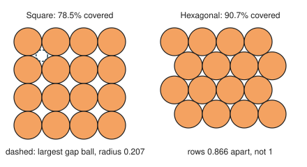
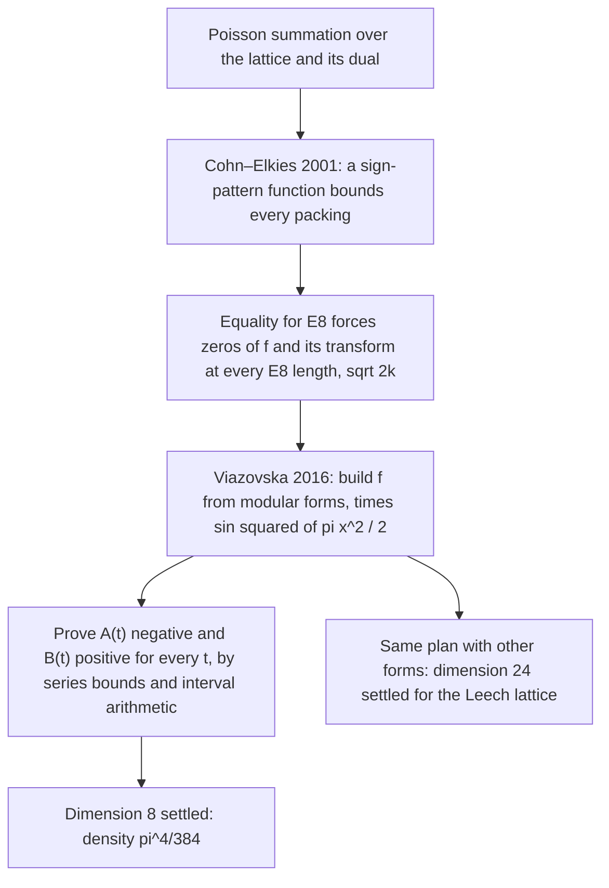

# Sphere packing, solved in dimensions 8 and 24: Viazovska's modular-form proof

[Syllabus](../../../SYLLABUS.md) → [Frontier](../README.md) → [Geometry and Combinatorics](../README.md#s04) → Sphere packing, solved in dimensions 8 and 24

---

## General Overview

A grocer stacks oranges 8 cm across in a pyramid: a square layer, then a layer sitting in the hollows of the one below. Johannes Kepler claimed in 1611 that no stacking of equal balls fills more of space. The pyramid fills a share of 0.740480; a plain cube-on-cube stack fills 0.523599. Thomas Hales proved Kepler right in 1998, and the proof was published in 2005.

That share is the **packing density**: the fraction of space the balls cover, measured over a region that grows without limit. The **sphere packing problem** asks for the largest density in each dimension $`d`$. Points in $`d`$ dimensions are lists of $`d`$ numbers, and distance is the usual square root of the sum of squares, so the question makes sense for any $`d`$.

In 2016 Maryna Viazovska settled dimension 8. The best packing puts ball centres at the points of the **E8 lattice**, and its density is $`\pi^4/384`$ = 0.253670. A week later she and four coauthors settled dimension 24 with the **Leech lattice**, density 0.0019295743. In both cases the hard part was an upper bound: a proof that nothing, regular or irregular, beats the lattice.

The bound comes from one special function, now called the **magic function**. Its sum over the lattice points can be computed in two ways by [Poisson summation and sampling](../../20-Harmonic%20analysis/02-The%20Fourier%20Transform/08-poisson-summation-and-sampling.md). Each way gives an inequality, and together they cap the density. Viazovska built the function from [Modular forms](../../21-Algebraic%20and%20analytic%20number%20theory/07-Diophantine%20and%20Modular/07-modular-forms-in-outline.md).

**One function with the right signs, never positive beyond the closest spacing and with a transform never negative, caps every packing's density; Viazovska built one from modular forms whose cap is exactly E8's density, and the same plan settles dimension 24.**

**What kind of fact this is:** a theorem in dimensions 8 and 24, proved (refereed, Annals of Mathematics, 2017). This card outlines the proof and does not prove it. The code counts lattice vectors exactly and samples the magic function on a grid, which is evidence, not proof.

### Status, as of 2026-11-23

| Dimension | Best packing | Status | Primary source |
| --- | --- | --- | --- |
| 1, 2 | the line of equal gaps; the hexagonal grid, density 0.906900 | proved (2: rigorous proof 1940s) | summarized in Viazovska (2017), Section 1 |
| 3 | the grocer's pyramid, density 0.740480 | proved, preprint 1998, published 2005 | Hales (2005) |
| 8 | E8, density 0.253670 | proved: preprint 2016-03-14, published 2017 | Viazovska (2017) |
| 24 | Leech lattice, density 0.0019295743 | proved: preprint 2016-03-21, published 2017 | Cohn, Kumar, Miller, Radchenko and Viazovska (2017) |
| 8, formal proof | the same theorem, checked in Lean | claimed: reported complete by the formalization team, February 2026; not rerun here | Hariharan and coauthors (2026) |
| every other dimension | best known packings only | open | — |

Cohn and Elkies had written in 2001: "We conjecture that our approach can be used to solve the sphere packing problem in dimensions 8 and 24." That approach is what Viazovska completed.

### The picture: why packings differ

<p align="center"></p>

To scale, 40 pixels per orange width; the numbers are the `figure,` line of both runs. In the square grid each gap holds a ball of radius 0.207107, too small for an orange: covered share 0.785398. Shifting alternate rows by half a step lets them sit 0.866025 apart, not 1, and the share rises to 0.906900. In the 8-dimensional checkerboard lattice the gap is big enough for a whole orange; that is where E8 comes from (next section).

### How E8 is built

Start with the **checkerboard lattice** D8: every list of 8 whole numbers whose sum is even. Its closest points are $`\sqrt 2`$ = 1.414214 apart, as from (0, …, 0) to (1, 1, 0, …, 0). Its volume per point is 2, because it keeps half the whole-number points.

Its biggest gap is at (½, ½, …, ½). The nearest D8 point is $`\sqrt{8}/2`$ = 1.414214 away: exactly the closest spacing. So a second copy of D8, shifted by (½, …, ½), fits without overlap. The union is E8. It has one point per unit of volume, double D8's density.

In 3 dimensions the same gap is only 0.866025 from the nearest point, so a shifted copy would overlap. Dimension 8 is the first where the gap reaches the spacing. The run finds the distances by search.

| Packing in 8 dimensions | Closest spacing | Volume per point | Density |
| --- | --- | --- | --- |
| whole-number grid $`\mathbb{Z}^8`$ | 1 | 1 | 0.015854 |
| checkerboard D8 | 1.414214 | 2 | 0.126835 |
| E8 = D8 plus its shifted copy | 1.414214 | 1 | 0.253670 |

Each E8 point touches 240 others, its **kissing number**: the number of balls touching one ball.

---

## The formula

**Density of a lattice packing.** A **lattice** $`\Lambda`$ is a grid of points closed under adding and subtracting. Put a ball of radius $`r/2`$ at every point, where $`r`$ is the closest spacing. One ball sits in each cell of volume $`V_\Lambda`$, so

```math
\text{density} = \frac{\mathrm{vol}\, B(r/2)}{V_\Lambda}, \qquad \mathrm{vol}\, B_8(R) = \frac{\pi^4}{24}R^8, \qquad \text{E8: } \frac{\pi^4}{24}\left(\frac{\sqrt2}{2}\right)^8 = \frac{\pi^4}{384}
```

**Read it aloud:** the density is one ball's volume divided by the room each lattice point owns.

**The Cohn–Elkies bound.** Let $`f`$ be a function on $`\mathbb{R}^d`$ that, with its Fourier transform $`\hat f`$, fades faster than $`|x|^{-d}`$. Suppose

```math
f(x) \le 0 \text{ for } |x| \ge r, \qquad \hat f(y) \ge 0 \text{ for all } y, \qquad f(0) = \hat f(0) > 0.
```

Then every packing of balls of radius $`r/2`$ in $`\mathbb{R}^d`$, lattice or not, has

```math
\text{density} \le \mathrm{vol}\, B(r/2).
```

**Read it aloud:** if a test function is never positive beyond distance r, its transform is never negative, and the two agree at the origin, then no packing beats one ball of radius r over 2 per unit of volume.

**The magic function.** For $`d = 8`$ and $`r = \sqrt2`$ the bound is $`\pi^4/384`$, E8's density. Viazovska's function $`g`$ meets all three conditions. For $`|x| > \sqrt 2`$, and for its transform at every $`|x| > 0`$:

```math
g(x) = \frac{\pi}{2160}\sin^2\!\Big(\frac{\pi |x|^2}{2}\Big) \int_0^\infty A(t)\, e^{-\pi |x|^2 t}\, dt, \qquad \hat g(x) = \frac{\pi}{2160}\sin^2\!\Big(\frac{\pi |x|^2}{2}\Big) \int_0^\infty B(t)\, e^{-\pi |x|^2 t}\, dt
```

with $`A(t) < 0`$ and $`B(t) > 0`$ for every $`t > 0`$, built from modular forms:

```math
A(t) = -t^2 \phi_0(i/t) - \frac{36}{\pi^2}\psi_I(it), \qquad B(t) = -t^2 \phi_0(i/t) + \frac{36}{\pi^2}\psi_I(it), \qquad \phi_0 = \frac{1728\,(E_2E_4 - E_6)^2}{E_4^3 - E_6^2}
```

**Read it aloud:** g is a squared sine, which vanishes at every E8 length, times a weighted average of Gaussians whose weights are all negative; its transform is the same squared sine times an average with all weights positive.

Here $`E_2, E_4, E_6`$ are the Eisenstein series of the modular-forms card, and $`\psi_I = 128\,\frac{\theta_{00}^4 + \theta_{01}^4}{\theta_{10}^8} + 128\,\frac{\theta_{01}^4 - \theta_{10}^4}{\theta_{00}^8}`$ is built from the three **Jacobi theta functions** $`\theta_{00}(z) = \sum_n e^{\pi i n^2 z}`$, $`\theta_{01}(z) = \sum_n (-1)^n e^{\pi i n^2 z}`$ and $`\theta_{10}(z) = \sum_n e^{\pi i (n + 1/2)^2 z}`$, sums over all whole numbers $`n`$.

| Symbol | Plain meaning | In our example | Push it up and the answer… |
| --- | --- | --- | --- |
| $`d`$ | the dimension: how many numbers fix a point | 8, and 24 | the best density falls |
| $`\Lambda`$; $`V_\Lambda`$ | a lattice; the volume each of its points owns | E8; 1 | larger $`V_\Lambda`$: lower density |
| $`\Lambda_{24}`$ | the Leech lattice in 24 dimensions: scaled up by $`\sqrt8`$, the lists of 24 whole numbers tied to the Golay code by Step 5's rules | 196,560 touching neighbours | — |
| $`r`$ | the closest spacing of ball centres | $`\sqrt2`$ = 1.414214 | larger $`r`$ means larger balls |
| $`\mathrm{vol}\, B(R)`$ | volume of a $`d`$-dimensional ball of radius $`R`$ | $`\pi^4/384`$ = 0.253670 at $`R = \sqrt2/2`$ | grows like $`R^d`$ |
| $`f`$, $`\hat f`$ | a test function and its Fourier transform | a Gaussian fails; $`g`$ works | — |
| $`x`$, $`y`$; $`k`$ | points of space; points of the dual lattice; the shell number, $`\lvert x\rvert^2 = 2k`$ | E8 vectors: 240 with $`k = 1`$ | — |
| $`\Lambda^*`$ | the dual lattice: all $`y`$ with $`x \cdot y`$ a whole number for every $`x`$ in $`\Lambda`$ | E8 is its own dual | — |
| $`g`$, $`\hat g`$; $`a`$, $`b`$ | Viazovska's magic function and its transform; its two parts, equal to plus and minus their own transforms | $`\hat g(0.02)`$ = 0.999400, $`g(\sqrt3)`$ = −0.000363 | — |
| $`t`$; $`A(t)`$, $`B(t)`$ | the averaging variable; the weights for $`g`$ and $`\hat g`$ | $`A(1)`$ = −3093.1, $`B(1)`$ = 928.29 | — |
| $`\phi_0`$, $`\psi_I`$, $`\psi_S`$; $`\theta_{00}, \theta_{01}, \theta_{10}`$; $`\Gamma(2)`$ | modular building blocks: from $`E_2, E_4, E_6`$; from the Jacobi theta functions; the matrix group $`\psi_I`$ respects | $`\phi_0(i/1.5)`$ = 19082.0071 | — |
| $`z`$, $`q`$; $`\sigma_3(n)`$; $`E_{12}`$ | a point of the upper half plane and $`q = e^{2\pi i z}`$; the sum of cubes of the divisors of $`n`$; the weight-12 Eisenstein series | $`E_4 = 1 + 240\sum \sigma_3(n) q^n`$ | — |

### When it holds

- **Equal balls, no overlap.** The bound is for congruent balls. Mixed sizes pack more densely, so the statement says nothing about them.
- **f never positive beyond r.** The Gaussian $`e^{-\pi|x|^2}`$ equals its own transform, so the transform condition holds. But it is positive everywhere, and its sum over E8 is 1.455763, above its value 1 at 0. The chain of inequalities in Why it works breaks at its first link.
- **Transform never negative.** This lets the dual-lattice sum be cut down to its single term at 0. A transform with negative values gives no lower bound for that sum.
- **The function must fade fast.** Poisson summation needs $`f`$ and $`\hat f`$ to shrink faster than $`|x|^{-d}`$; Viazovska's $`g`$ is a Schwartz function (it and every derivative fade faster than any power).
- **Sharp only where a lattice matches.** In dimensions 1, 8 and 24 the bound meets a known packing. In dimension 2 the computed bounds agree with the hexagonal grid to many decimal places, but no exact function is known. In other dimensions the best bounds found so far sit above every known packing, and whether they can be sharp is open.

---

## Why it works

### Step 0: sum one function over the lattice, two ways

Poisson summation says that summing $`f`$ over the lattice points gives the same total as summing $`\hat f`$ over the dual lattice, divided by $`V_\Lambda`$ ([Poisson summation and sampling](../../20-Harmonic%20analysis/02-The%20Fourier%20Transform/08-poisson-summation-and-sampling.md) proves it in one dimension; the $`d`$-dimensional proof is the same wrapping argument).

The signs do the rest. On the lattice side every term except $`f(0)`$ is at most 0, so the sum is at most $`f(0)`$. On the dual side every term is at least 0, so the sum is at least $`\hat f(0)/V_\Lambda`$. Then $`V_\Lambda \ge \hat f(0)/f(0)`$: the lattice cannot be crowded.



### Step 1: the bound for lattices

Put the two signs together and divide one ball's volume by $`V_\Lambda`$. The density is at most $`\mathrm{vol}\, B(r/2) \cdot f(0)/\hat f(0)`$, which is $`\mathrm{vol}\, B(r/2)`$ when $`f(0) = \hat f(0)`$.

<details>
<summary>Detailed proof: the Cohn–Elkies bound for a lattice packing</summary>

Let $`\Lambda`$ have closest spacing $`r`$ and let $`f`$ meet the three conditions. Poisson summation for a lattice reads

$`\displaystyle \sum_{x \in \Lambda} f(x) = \frac{1}{V_\Lambda} \sum_{y \in \Lambda^*} \hat f(y).`$

Every nonzero $`x`$ has $`|x| \ge r`$, so $`f(x) \le 0`$, and the left side is at most $`f(0)`$. Every $`\hat f(y) \ge 0`$, so the right side is at least $`\hat f(0)/V_\Lambda`$. Hence

$`\displaystyle f(0) \ge \frac{\hat f(0)}{V_\Lambda}, \qquad \text{density} = \frac{\mathrm{vol}\, B(r/2)}{V_\Lambda} \le \mathrm{vol}\, B(r/2)\, \frac{f(0)}{\hat f(0)}.`$

For a periodic packing (several shifted copies of one lattice) the same argument runs on a double sum over pairs of centres, with the transform side becoming a sum of squared sizes, still at least 0. Every packing is approached in density by periodic ones, which extends the bound to all packings. Both steps are in Cohn and Elkies (2003), Section 3 and Appendix A.

</details>

### Step 2: equality says exactly what the function must look like

For E8 the inequality must be an equality, so no slack is allowed. Every term other than $`f(0)`$ on the lattice side must be 0, and so must every term other than $`\hat f(0)`$ on the dual side.

E8 vectors have squared lengths 2, 4, 6, …, every even number. The run counts 240, 2,160 and 6,720 vectors of squared length 2, 4 and 6. So $`f`$ must vanish at every $`|x| = \sqrt{2k}`$, and since E8 is its own dual, so must $`\hat f`$. To vanish without changing sign, the zeros beyond $`\sqrt 2`$ must be double zeros, touching 0 and turning back. At $`\sqrt 2`$ itself $`f`$ has a single zero, where it turns from positive to negative.

Cohn and Elkies computed functions whose bounds came very close to E8's density, but found no exact one.

### Step 3: why modular forms are the right material

A Gaussian $`e^{-\pi t|x|^2}`$ in 8 dimensions has transform $`t^{-4} e^{-\pi|y|^2/t}`$. A weighted average of Gaussians is therefore transformed by replacing $`t`$ with $`1/t`$ and multiplying by a power of $`t`$. A function that is its own transform, up to sign, needs weights that survive $`t \mapsto 1/t`$ with a power-of-$`t`$ factor. That is the symmetry $`z \mapsto -1/z`$ of a modular form, read on the line $`z = it`$.

The same symmetry is visible in E8 itself. Its theta series $`\sum e^{\pi i |x|^2 z}`$ is the weight-4 form $`E_4`$: the run counts the vectors directly and matches $`240\,\sigma_3(n)`$ for squared lengths 2, 4 and 6. Poisson summation then says the Gaussian sum at $`t = 0.8`$ equals $`t^{-4}`$ times the sum at $`1/t`$. Both sides print 2.669664742, as Poisson summation predicts for a self-dual lattice with volume 1 per point.

<details>
<summary>Detailed step: an average of Gaussians and its transform</summary>

Let $`F(x) = \int_0^\infty \phi(t)\, e^{-\pi t |x|^2}\, dt`$ in $`\mathbb{R}^8`$. Transform under the integral, using the Gaussian rule in each of the 8 coordinates:

$`\displaystyle \hat F(y) = \int_0^\infty \phi(t)\, t^{-4} e^{-\pi |y|^2 / t}\, dt = \int_0^\infty s^2 \phi(1/s)\, e^{-\pi |y|^2 s}\, ds,`$

after putting $`s = 1/t`$, $`dt = ds/s^2`$. So $`\hat F = F`$ when $`s^2\phi(1/s) = \phi(s)`$, and $`\hat F = -F`$ when $`s^2 \phi(1/s) = -\phi(s)`$. The factor $`s^2`$ is a weight. Viazovska's construction (Section 4 of the paper) uses contour integrals of quasimodular and weakly holomorphic forms in the upper half plane; pieces of the contour shifted by $`\pm 1`$ bring the factor $`e^{\pi i |x|^2} - 2 + e^{-\pi i |x|^2} = -4\sin^2(\pi|x|^2/2)`$, which supplies the double zeros at every $`|x|^2 = 2k`$.

</details>

### Step 4: Viazovska's function and its signs

She built one function $`a`$ equal to its own transform from $`\phi_0`$, a quasimodular form (one that transforms like a modular form up to a correction term, through $`E_2`$). She built a second function $`b`$ equal to minus its own transform from $`\psi_I`$, a form for the smaller group $`\Gamma(2)`$ (the matrices congruent to the identity modulo 2) that may have poles at the cusps. The magic function is $`g = \frac{\pi i}{8640} a + \frac{i}{240\pi} b`$.

Then $`g(0) = \hat g(0) = 1`$, and the formulas above hold. The squared sine is never negative. So $`g \le 0`$ beyond $`\sqrt2`$ comes down to $`A(t) < 0`$, and $`\hat g \ge 0`$ to $`B(t) > 0`$, for every $`t > 0`$. The paper proves both by bounding the series for small and large $`t`$ and checking the middle with interval arithmetic (arithmetic on intervals that are guaranteed to contain the true value).

The run computes $`\phi_0(i/t)`$ two ways, directly and through $`z \mapsto -1/z`$: both give 19082.0071 at $`t = 1.5`$. It checks $`\psi_I(it) = -t^2\psi_S(i/t)`$: both 12494.9167. It finds $`A < 0`$ and $`B > 0`$ at every step of 0.01 from $`t = 0.25`$ to 4, and $`\hat g(0.02)`$ = 0.999400, close to $`\hat g(0) = 1`$.

### Step 5: dimension 24

The Leech lattice $`\Lambda_{24}`$ has volume 1 per point, no vectors of squared length 2, and closest spacing 2. Its theta series is the weight-12 form $`E_{12} - \frac{65520}{691}(E_4^3 - E_6^2)/1728`$, whose $`q^2`$ coefficient gives 196,560 shortest vectors.

The run counts them a second way, from the **binary Golay code**: 4096 words of length 24 with at least 8 ones in each nonzero word. The code also defines the lattice. Scaled up by $`\sqrt8`$, $`\Lambda_{24}`$ is every list of 24 whole numbers that meets three rules. The entries are all even or all odd. For each remainder on division by 4, the positions with that remainder form a code word. The sum is a multiple of 8 when the entries are even, and 4 more than a multiple of 8 when they are odd. Its shortest vectors, of squared length 32 at this scale and 4 at the true one, come in three shapes: ±2 on the 8 positions of a weight-8 word, with an even number of minus signs; one entry ±3 and 23 entries ±1, with the signs set by a code word; and ±4 in any 2 of the 24 positions. The run finds 759 words of weight 8, and the three shapes give $`759 \times 2^7 + 24 \times 2^{12} + 276 \times 4`$ = 196560.

The 2016 paper by Cohn, Kumar, Miller, Radchenko and Viazovska builds a magic function for $`r = 2`$ the same way, from forms of other weights. It has a single zero at 2, where it turns negative, and double zeros at every $`\sqrt{2k}`$ for $`k \ge 3`$; its transform has double zeros at every $`\sqrt{2k}`$ for $`k \ge 2`$. Its bound is $`\pi^{12}/12!`$ = 0.0019295743, the Leech density. The dimension-24 paper also proves that the Leech lattice is the only densest periodic packing.

---

## Worked numbers, by hand

| Step | Arithmetic | Value |
| --- | --- | --- |
| D8 closest spacing | from (0, …, 0) to (1, 1, 0, …, 0) | 1.414214 |
| D8 deep hole distance | $`\sqrt{8 \times (1/2)^2}`$ | 1.414214 |
| E8 volume per point | D8's 2, halved by the second copy | 1 |
| one ball's volume | $`(\pi^4/24) \times (\sqrt2/2)^8`$ | 0.253670 |
| shortest E8 vectors | $`240\,\sigma_3(1) = 240`$, and counted | 240 |
| next shell | $`240\,\sigma_3(2) = 240 \times 9`$ | 2160 |
| Cohn–Elkies bound with $`g`$ | $`\mathrm{vol}\, B(\sqrt2/2) \times g(0)/\hat g(0)`$ | **0.253670** |

**The bound equals the E8 density, so no packing in 8 dimensions covers more than 0.253670 of space.** The ball count backs the volume. Read from $`E_4`$'s coefficients (E8's theta series is $`E_4`$), E8 has 6,634,372,561 points with squared length at most 200, against a ball volume of 6,493,939,402.3, a ratio of 1.0216 that falls toward 1 as the ball grows.

### What breaks if you drop a piece

| Mistake | Comes out at | What went wrong |
| --- | --- | --- |
| Stop at the checkerboard D8 | density 0.126835 | the holes at distance 1.414214 stay empty; filling them doubles the density |
| Test with a Gaussian | sum over E8 of 1.455763, above $`f(0)`$ = 1 | $`f`$ is positive beyond $`\sqrt2`$, so the lattice side is not at most $`f(0)`$ |
| Shift a copy into the hole in 3 dimensions | hole 0.866025 from the lattice, spacing 1.414214 | the gap is too small; the copies overlap |
| Read density off a small crate | 40 cm crate: cube stack 125 oranges, pyramid 123 | density is a limit over growing regions; in an 80 cm crate the pyramid wins, 1,186 to 1,000 |

The code prints all four.

---

## Code, from first principles, and it actually runs

The script takes five independent roads. It counts E8 vectors by listing every candidate with small coordinates and matches them to $`E_4`$'s divisor sums. It checks volume 1 per point from $`E_4`$'s coefficients, since E8's theta series is $`E_4`$: a ball count up to squared length 200, and Poisson's $`t \mapsto 1/t`$ symmetry. Only the shells up to squared length 6 are enumerated. It counts the Leech lattice's shortest vectors from modular forms with exact fractions and again from the Golay code. It computes the magic function's building blocks two ways each, through the modular symmetry. It integrates $`A`$ and $`B`$ numerically to sample $`g`$ and $`\hat g`$. Nothing imported holds the answer: the series, theta functions and integrals are written out.

### Python

```python
# Sphere packing in dimensions 8 and 24 -- the check behind the card.  Standard
# library only.  Exact counts: E8 and Leech vectors by enumeration and by
# modular forms.  Floats: densities, oranges in a crate, and the magic function.
from fractions import Fraction
from itertools import product
from math import pi, sqrt, exp, sin, factorial, comb

def sigma(k, n): return sum(d ** k for d in range(1, n + 1) if n % d == 0)

def ball8(rad): return pi ** 4 / 24 * rad ** 8          # volume of an 8-dim ball

# 1. E8 = integer points with even sum, plus half-integer points with even sum
shells = {2: 0, 4: 0, 6: 0}
for v in product(range(-2, 3), repeat=8):                # whole-number coordinates
    n = sum(x * x for x in v)
    if n in shells and sum(v) % 2 == 0: shells[n] += 1
for v in product((-3, -1, 1, 3), repeat=8):              # coordinates v/2, v odd
    n = Fraction(sum(x * x for x in v), 4)
    if n in shells and sum(v) % 4 == 0: shells[n] += 1
e4 = {2 * m: 240 * sigma(3, m) for m in (1, 2, 3)}       # q-coefficients of E4
print("E8 vectors of squared length 2, 4, 6, counted:", [shells[n] for n in (2, 4, 6)])
print("the same from E4 = 1 + 240 sum sigma3(n) q^n:  ", [e4[n] for n in (2, 4, 6)])
hole = {d: min(sum((x - 0.5) ** 2 for x in v) for v in product((0, 1), repeat=d) if sum(v) % 2 == 0)
        for d in (3, 8)}                                 # nearest even-sum point to (1/2, ..., 1/2)
for d in (3, 8):
    print(f"dim {d}: hole (1/2,...,1/2) sits {sqrt(hole[d]):.6f} from the lattice; minimum distance {sqrt(2):.6f}")
N = 100
pts = 1 + sum(240 * sigma(3, m) for m in range(1, N + 1))
print(f"E8 points with squared length <= {2 * N}: {pts}; ball volume / covolume 1 = "
      f"{ball8(sqrt(2 * N)):.1f}; ratio {pts / ball8(sqrt(2 * N)):.4f}")
r = sqrt(2) / 2                                          # ball radius: half of sqrt 2
dens = {"Z8": ball8(0.5) / 1, "D8": ball8(r) / 2, "E8": ball8(r) / 1}
print("density Z8 %.6f, D8 %.6f, E8 %.6f = pi^4/384 %.6f" % (*dens.values(), pi ** 4 / 384))
def theta8(t): return 1 + sum(240 * sigma(3, m) * exp(-pi * t * 2 * m) for m in range(1, 40))
gauss = theta8(1)                                        # sum of exp(-pi t |x|^2) over E8 at t = 1
print(f"Poisson, covolume 1, self-dual: sum at t = 0.8 {theta8(0.8):.9f}; t^-4 x sum at 1/t {theta8(1.25) / 0.8 ** 4:.9f}")
print(f"Gaussian test exp(-pi x^2) summed over E8: {gauss:.6f}, above its value 1 at 0")

# 2. Leech lattice: theta = E12 - (65520/691) Delta, against the Golay code count
tau = [0] * 6; tau[1] = 1                                # Delta = q prod (1 - q^n)^24
for n in range(1, 6):
    for _ in range(24):
        for k in range(5, n - 1, -1): tau[k] -= tau[k - n]
leech = [Fraction(65520, 691) * (sigma(11, m) - tau[m]) for m in (1, 2, 3)]
print("Leech vectors of squared length 2, 4, 6 from modular forms:", [int(x) for x in leech])
g = [1, 0, 1, 0, 1, 1, 1, 0, 0, 0, 1, 1]                 # x^11+x^10+x^6+x^5+x^4+x^2+1
rows = [[0] * i + g + [0] * (11 - i) for i in range(12)] # cyclic code of length 23
words = []
for c in product((0, 1), repeat=12):
    w = [sum(c[i] * rows[i][j] for i in range(12)) % 2 for j in range(23)]
    words.append(w + [sum(w) % 2])                       # extend by a parity bit
wt = [sum(w) for w in words]
octads = wt.count(8)
print(f"Golay code: {len(words)} words, minimum weight {min(x for x in wt if x)}, {octads} octads")
kiss = octads * 2 ** 7 + 24 * 2 ** 12 + comb(24, 2) * 4
print(f"Leech shortest vectors from the code: {octads}*2^7 + 24*2^12 + 276*4 = {kiss}")
print(f"density Leech pi^12/12! {pi ** 12 / factorial(12):.10f}")

# 3. Oranges, 8 cm across, in a cube crate; densities in dimensions 2 and 3
for side in (40, 80):
    cubic = (side // 8) ** 3
    layers = int((side - 8) / (8 / sqrt(2))) + 1          # square layers, 5.657 cm apart
    m = side // 8
    pyr = sum(m * m if k % 2 == 0 else (m - 1) ** 2 for k in range(layers))
    print(f"crate {side} cm: cubic stacking {cubic} oranges, grocer's pyramid {pyr} ({layers} layers)")
print(f"density cubic {pi / 6:.6f}, pyramid pi/sqrt18 {pi / sqrt(18):.6f}, plane hexagonal {pi / sqrt(12):.6f}")
print(f"figure, unit 40 px, square hole radius {(sqrt(2) - 1) / 2:.6f}, hex row gap {sqrt(3) / 2:.6f}, square density {pi / 4:.6f}")

# 4. Viazovska's magic function g from phi0 (E2, E4, E6) and psi (theta functions)
def qsum(s, f):                                         # sum of f(n) q^n, q = exp(-2 pi s)
    q = exp(-2 * pi * s)
    return sum(f(n) * q ** n for n in range(1, 80))
def delta(s):                                            # E4^3 - E6^2 = 1728 q prod (1 - q^n)^24
    q, d = exp(-2 * pi * s), 1.0
    for n in range(1, 80): d *= (1 - q ** n) ** 24
    return 1728 * q * d
def phi0(s):                                             # 1728 (E2E4 - E6)^2 / (E4^3 - E6^2) at z = i s
    return 1728 * (720 * qsum(s, lambda n: n * sigma(3, n))) ** 2 / delta(s)
def phi0_inv(t):                                         # phi0(i/t): directly, or moved by z -> -1/z
    if t <= 1: return phi0(1 / t)
    e4 = 1 + 240 * qsum(t, lambda n: sigma(3, n))
    return 1728 * (720 * qsum(t, lambda n: n * sigma(3, n)) - 6 * e4 / (pi * t)) ** 2 / delta(t)
def theta(s):                                            # theta00, theta01, theta10 at i s
    a = 1 + 2 * sum(exp(-pi * s * n * n) for n in range(1, 40))
    b = 1 + 2 * sum((-1) ** n * exp(-pi * s * n * n) for n in range(1, 40))
    return a, b, 2 * sum(exp(-pi * s * (n + 0.5) ** 2) for n in range(40))
def psiI(s): a, b, c = theta(s); return 128 * (a**4 + b**4) / c**8 + 128 * (b**4 - c**4) / a**8
def psiS(s): a, b, c = theta(s); return -128 * (a**4 + c**4) / b**8 - 128 * (c**4 - b**4) / a**8
def expansion(t, sgn):                                   # large t: from the q-series' first terms
    return (sgn - 1) * 36 / pi**2 * exp(2 * pi * t) + 8640 * t / pi - (18144 - sgn * 5184) / pi**2
def AB(t, sgn, far=4):                                   # A (sgn -1) and B (sgn +1)
    if t < 0.25: return sgn * 368640 / pi**2 * t * t * exp(-pi / t)
    if t > far: return expansion(t, sgn)
    psi = psiI(t) if t >= 1 else -t * t * psiS(1 / t)
    return -t * t * phi0_inv(t) + sgn * 36 / pi**2 * psi
def simpson(f, lo, hi, m):
    h = (hi - lo) / m
    return h / 3 * sum((1 if k in (0, m) else 4 if k % 2 else 2) * f(lo + k * h) for k in range(m + 1))
def gval(r, sgn):                                        # g(r) (sgn -1, r > sqrt 2) or g-hat(r)
    c = pi * r * r
    body = simpson(lambda t: AB(t, sgn) * exp(-c * t) if t > 0 else 0.0, 0, 4, 3200)
    tail = (sgn - 1) * 36 / pi**2 * exp(8 * pi - 4 * c) / (c - 2 * pi) \
        + 8640 / pi * exp(-4 * c) * (4 / c + 1 / c**2) - (18144 - sgn * 5184) / pi**2 * exp(-4 * c) / c
    return pi / 2160 * sin(pi * r * r / 2) ** 2 * (body + tail)
t0 = 1.5
print(f"phi0(i/t) at t = 1.5: direct {phi0(1 / t0):.4f}, via z -> -1/z {phi0_inv(t0):.4f}")
print(f"psiI(i t) at t = 1.5: {psiI(t0):.4f}; -t^2 psiS(i/t): {-t0 * t0 * psiS(1 / t0):.4f}")
grid = [0.25, 0.5, 1, 2, 4]
print("t      :       0.25         0.5           1           2           4")
print("A(t)   :", "  ".join(f"{AB(t, -1):>11.4e}" for t in grid))
print("B(t)   :", "  ".join(f"{AB(t, 1):>11.4e}" for t in grid))
fine = [0.25 + k / 100 for k in range(376)]
print("checked on t = 0.25 to 4 in steps of 0.01: A < 0:", all(AB(t, -1) < 0 for t in fine),
      " B > 0:", all(AB(t, 1) > 0 for t in fine))
print(f"t = 4, A direct {AB(4, -1):.6e}, expansion {expansion(4, -1):.6e}; "
      f"B direct {AB(4, 1):.3f}, expansion {expansion(4, 1):.3f}")
print(f"g-hat(0.02) {gval(0.02, 1):.6f}; g-hat(0.05) {gval(0.05, 1):.6f}; g-hat(1) {gval(1, 1):.6f}; g-hat(sqrt3) {gval(sqrt(3), 1):.6f}")
print(f"g(sqrt3) {gval(sqrt(3), -1):.6f}; g(sqrt5) {gval(sqrt(5), -1):.7f}")

assert [shells[n] for n in (2, 4, 6)] == [e4[n] for n in (2, 4, 6)] == [240, 2160, 6720]
assert abs(pts / ball8(sqrt(2 * N)) - 1) < 0.05 and hole[8] == 2 and hole[3] < 2
assert abs(theta8(0.8) - theta8(1.25) / 0.8 ** 4) < 1e-9 and gauss > 1
assert [int(x) for x in leech] == [0, 196560, 16773120] == [0, kiss, 16773120]
assert octads == 759 and min(x for x in wt if x) == 8 and len(set(map(tuple, words))) == 4096
assert abs(phi0(1 / t0) / phi0_inv(t0) - 1) < 1e-9
assert abs(AB(4, 1) / expansion(4, 1) - 1) < 1e-4 and abs(AB(4, -1) / expansion(4, -1) - 1) < 1e-9
assert abs(psiI(t0) / (-t0 * t0 * psiS(1 / t0)) - 1) < 1e-9
assert all(AB(t, -1) < 0 < AB(t, 1) for t in fine) and abs(gval(0.02, 1) - 1) < 0.002
assert gval(sqrt(3), -1) < 0 < gval(sqrt(3), 1) and gval(sqrt(5), -1) < 0
print("ALL CHECKS PASS")
```

**Ran 2026-11-23 on macOS, Python 3.14.10, standard library only. All checks passed. Output, pasted from the run:**

```
E8 vectors of squared length 2, 4, 6, counted: [240, 2160, 6720]
the same from E4 = 1 + 240 sum sigma3(n) q^n:   [240, 2160, 6720]
dim 3: hole (1/2,...,1/2) sits 0.866025 from the lattice; minimum distance 1.414214
dim 8: hole (1/2,...,1/2) sits 1.414214 from the lattice; minimum distance 1.414214
E8 points with squared length <= 200: 6634372561; ball volume / covolume 1 = 6493939402.3; ratio 1.0216
density Z8 0.015854, D8 0.126835, E8 0.253670 = pi^4/384 0.253670
Poisson, covolume 1, self-dual: sum at t = 0.8 2.669664742; t^-4 x sum at 1/t 2.669664742
Gaussian test exp(-pi x^2) summed over E8: 1.455763, above its value 1 at 0
Leech vectors of squared length 2, 4, 6 from modular forms: [0, 196560, 16773120]
Golay code: 4096 words, minimum weight 8, 759 octads
Leech shortest vectors from the code: 759*2^7 + 24*2^12 + 276*4 = 196560
density Leech pi^12/12! 0.0019295743
crate 40 cm: cubic stacking 125 oranges, grocer's pyramid 123 (6 layers)
crate 80 cm: cubic stacking 1000 oranges, grocer's pyramid 1186 (13 layers)
density cubic 0.523599, pyramid pi/sqrt18 0.740480, plane hexagonal 0.906900
figure, unit 40 px, square hole radius 0.207107, hex row gap 0.866025, square density 0.785398
phi0(i/t) at t = 1.5: direct 19082.0071, via z -> -1/z 19082.0071
psiI(i t) at t = 1.5: 12494.9167; -t^2 psiS(i/t): 12494.9167
t      :       0.25         0.5           1           2           4
A(t)   : -8.1414e-03  -1.7897e+01  -3.0931e+03  -2.0887e+06  -5.9985e+11
B(t)   :  8.1406e-03   1.6993e+01   9.2829e+02   4.1505e+03   9.6876e+03
checked on t = 0.25 to 4 in steps of 0.01: A < 0: True  B > 0: True
t = 4, A direct -5.998513e+11, expansion -5.998513e+11; B direct 9687.601, expansion 9687.667
g-hat(0.02) 0.999400; g-hat(0.05) 0.996242; g-hat(1) 0.057328; g-hat(sqrt3) 0.000168
g(sqrt3) -0.000363; g(sqrt5) -0.0000038
ALL CHECKS PASS
```

### Rust

Same numbers, same labels, built with `rustc --edition 2021 -O`.

```rust
// Sphere packing in dimensions 8 and 24 -- the same check as the Python, in Rust.
// No crates.  Exact counts: E8 and Leech vectors by enumeration and by modular
// forms.  Floats: densities, oranges in a crate, and the magic function.
use std::f64::consts::PI;

fn sigma(k: u32, n: i64) -> i64 { (1..=n).filter(|d| n % d == 0).map(|d| d.pow(k)).sum() }
fn ball8(rad: f64) -> f64 { PI.powi(4) / 24.0 * rad.powi(8) } // volume of an 8-dim ball
fn sci(x: f64, p: usize) -> String {                           // Python-style 1.2345e+06
    let s = format!("{:.*e}", p, x);
    let (m, e) = s.split_once('e').unwrap();
    let e: i32 = e.parse().unwrap();
    format!("{}e{}{:02}", m, if e < 0 { '-' } else { '+' }, e.abs())
}
fn tf(b: bool) -> &'static str { if b { "True" } else { "False" } }
fn tuples(vals: &[i64], len: usize) -> Vec<Vec<i64>> {        // every list of len entries from vals
    let mut out = vec![vec![]];
    for _ in 0..len {
        out = out.iter().flat_map(|v| vals.iter().map(move |&x| { let mut w = v.clone(); w.push(x); w })).collect();
    }
    out
}
fn theta8(t: f64) -> f64 { 1.0 + (1..40).map(|m| 240.0 * sigma(3, m) as f64 * (-PI * t * 2.0 * m as f64).exp()).sum::<f64>() }

// Viazovska's magic function g from phi0 (E2, E4, E6) and psi (theta functions)
fn qsum(s: f64, f: &dyn Fn(i64) -> f64) -> f64 { let q = (-2.0 * PI * s).exp(); (1..80).map(|n| f(n) * q.powi(n as i32)).sum() }
fn delta(s: f64) -> f64 {
    let q = (-2.0 * PI * s).exp();
    let mut d = 1.0;
    for n in 1..80 { d *= (1.0 - q.powi(n)).powi(24) }
    1728.0 * q * d
}
fn phi0(s: f64) -> f64 { 1728.0 * (720.0 * qsum(s, &|n| (n * sigma(3, n)) as f64)).powi(2) / delta(s) }
fn phi0_inv(t: f64) -> f64 {
    if t <= 1.0 { return phi0(1.0 / t) }
    let e4 = 1.0 + 240.0 * qsum(t, &|n| sigma(3, n) as f64);
    1728.0 * (720.0 * qsum(t, &|n| (n * sigma(3, n)) as f64) - 6.0 * e4 / (PI * t)).powi(2) / delta(t)
}
fn theta(s: f64) -> (f64, f64, f64) {
    let a = 1.0 + 2.0 * (1..40).map(|n| (-PI * s * (n * n) as f64).exp()).sum::<f64>();
    let b = 1.0 + 2.0 * (1..40).map(|n| if n % 2 == 1 { -1.0 } else { 1.0 } * (-PI * s * (n * n) as f64).exp()).sum::<f64>();
    let c = 2.0 * (0..40).map(|n| (-PI * s * (n as f64 + 0.5).powi(2)).exp()).sum::<f64>();
    (a, b, c)
}
fn psi_i(s: f64) -> f64 { let (a, b, c) = theta(s); 128.0 * (a.powi(4) + b.powi(4)) / c.powi(8) + 128.0 * (b.powi(4) - c.powi(4)) / a.powi(8) }
fn psi_s(s: f64) -> f64 { let (a, b, c) = theta(s); -128.0 * (a.powi(4) + c.powi(4)) / b.powi(8) - 128.0 * (c.powi(4) - b.powi(4)) / a.powi(8) }
fn expansion(t: f64, sgn: f64) -> f64 {
    (sgn - 1.0) * 36.0 / (PI * PI) * (2.0 * PI * t).exp() + 8640.0 * t / PI - (18144.0 - sgn * 5184.0) / (PI * PI)
}
fn ab(t: f64, sgn: f64) -> f64 {                               // A (sgn -1) and B (sgn +1)
    if t < 0.25 { return sgn * 368640.0 / (PI * PI) * t * t * (-PI / t).exp() }
    if t > 4.0 { return expansion(t, sgn) }
    let psi = if t >= 1.0 { psi_i(t) } else { -t * t * psi_s(1.0 / t) };
    -t * t * phi0_inv(t) + sgn * 36.0 / (PI * PI) * psi
}
fn simpson(f: &dyn Fn(f64) -> f64, lo: f64, hi: f64, m: usize) -> f64 {
    let h = (hi - lo) / m as f64;
    h / 3.0 * (0..=m).map(|k| (if k == 0 || k == m { 1.0 } else if k % 2 == 1 { 4.0 } else { 2.0 }) * f(lo + k as f64 * h)).sum::<f64>()
}
fn gval(r: f64, sgn: f64) -> f64 {                             // g(r) (sgn -1, r > sqrt 2) or g-hat(r)
    let c = PI * r * r;
    let body = simpson(&|t| if t > 0.0 { ab(t, sgn) * (-c * t).exp() } else { 0.0 }, 0.0, 4.0, 3200);
    let tail = (sgn - 1.0) * 36.0 / (PI * PI) * (8.0 * PI - 4.0 * c).exp() / (c - 2.0 * PI)
        + 8640.0 / PI * (-4.0 * c).exp() * (4.0 / c + 1.0 / (c * c)) - (18144.0 - sgn * 5184.0) / (PI * PI) * (-4.0 * c).exp() / c;
    PI / 2160.0 * (PI * r * r / 2.0).sin().powi(2) * (body + tail)
}

fn main() {
    // 1. E8 = integer points with even sum, plus half-integer points with even sum
    let mut shells = [0i64; 7];
    for v in tuples(&[-2, -1, 0, 1, 2], 8) {
        let n: i64 = v.iter().map(|x| x * x).sum();
        if (n == 2 || n == 4 || n == 6) && v.iter().sum::<i64>().rem_euclid(2) == 0 { shells[n as usize] += 1 }
    }
    for v in tuples(&[-3, -1, 1, 3], 8) {                      // coordinates v/2, v odd
        let n4: i64 = v.iter().map(|x| x * x).sum();
        if n4 % 4 == 0 && [2, 4, 6].contains(&(n4 / 4)) && v.iter().sum::<i64>().rem_euclid(4) == 0 { shells[(n4 / 4) as usize] += 1 }
    }
    let counted = vec![shells[2], shells[4], shells[6]];
    let e4: Vec<i64> = (1..=3).map(|m| 240 * sigma(3, m)).collect();
    println!("E8 vectors of squared length 2, 4, 6, counted: {:?}", counted);
    println!("the same from E4 = 1 + 240 sum sigma3(n) q^n:   {:?}", e4);
    let hole = |d: usize| tuples(&[0, 1], d).iter().filter(|v| v.iter().sum::<i64>() % 2 == 0)
        .map(|v| v.iter().map(|&x| (x as f64 - 0.5).powi(2)).sum::<f64>()).fold(f64::INFINITY, f64::min);
    for d in [3, 8] {
        println!("dim {}: hole (1/2,...,1/2) sits {:.6} from the lattice; minimum distance {:.6}", d, hole(d).sqrt(), 2f64.sqrt());
    }
    let nn = 100;
    let pts: i64 = 1 + (1..=nn).map(|m| 240 * sigma(3, m)).sum::<i64>();
    let bv = ball8((2.0 * nn as f64).sqrt());
    println!("E8 points with squared length <= {}: {}; ball volume / covolume 1 = {:.1}; ratio {:.4}", 2 * nn, pts, bv, pts as f64 / bv);
    let r = 2f64.sqrt() / 2.0;
    println!("density Z8 {:.6}, D8 {:.6}, E8 {:.6} = pi^4/384 {:.6}", ball8(0.5), ball8(r) / 2.0, ball8(r), PI.powi(4) / 384.0);
    let gauss = theta8(1.0);
    println!("Poisson, covolume 1, self-dual: sum at t = 0.8 {:.9}; t^-4 x sum at 1/t {:.9}", theta8(0.8), theta8(1.25) / 0.8f64.powi(4));
    println!("Gaussian test exp(-pi x^2) summed over E8: {:.6}, above its value 1 at 0", gauss);

    // 2. Leech lattice: theta = E12 - (65520/691) Delta, against the Golay code count
    let mut tau = [0i64; 6];
    tau[1] = 1;
    for n in 1..6 { for _ in 0..24 { for k in (n..=5).rev() { tau[k] -= tau[k - n] } } }
    let leech: Vec<i64> = (1..=3).map(|m| { let x = 65520 * (sigma(11, m) - tau[m as usize]); assert!(x % 691 == 0); x / 691 }).collect();
    println!("Leech vectors of squared length 2, 4, 6 from modular forms: {:?}", leech);
    let g = [1, 0, 1, 0, 1, 1, 1, 0, 0, 0, 1, 1];               // x^11+x^10+x^6+x^5+x^4+x^2+1
    let mut words: Vec<Vec<i64>> = Vec::new();
    for c in tuples(&[0, 1], 12) {                             // cyclic code of length 23
        let mut w = vec![0i64; 23];
        for i in 0..12 { if c[i] == 1 { for j in 0..12 { w[i + j] ^= g[j] } } }
        let par = w.iter().sum::<i64>() % 2;
        w.push(par);                                           // extend by a parity bit
        words.push(w);
    }
    let wt: Vec<i64> = words.iter().map(|w| w.iter().sum()).collect();
    let octads = wt.iter().filter(|&&x| x == 8).count() as i64;
    let minw = *wt.iter().filter(|&&x| x > 0).min().unwrap();
    let mut distinct = words.clone();
    distinct.sort();
    distinct.dedup();
    println!("Golay code: {} words, minimum weight {}, {} octads", words.len(), minw, octads);
    let kiss = octads * 128 + 24 * 4096 + 276 * 4;
    println!("Leech shortest vectors from the code: {}*2^7 + 24*2^12 + 276*4 = {}", octads, kiss);
    let fact12: f64 = (1..=12).map(|k| k as f64).product();
    println!("density Leech pi^12/12! {:.10}", PI.powi(12) / fact12);

    // 3. Oranges, 8 cm across, in a cube crate; densities in dimensions 2 and 3
    for side in [40i64, 80] {
        let m = side / 8;
        let layers = ((side - 8) as f64 / (8.0 / 2f64.sqrt())) as i64 + 1; // square layers, 5.657 cm apart
        let pyr: i64 = (0..layers).map(|k| if k % 2 == 0 { m * m } else { (m - 1) * (m - 1) }).sum();
        println!("crate {} cm: cubic stacking {} oranges, grocer's pyramid {} ({} layers)", side, m * m * m, pyr, layers);
    }
    println!("density cubic {:.6}, pyramid pi/sqrt18 {:.6}, plane hexagonal {:.6}", PI / 6.0, PI / 18f64.sqrt(), PI / 12f64.sqrt());
    println!("figure, unit 40 px, square hole radius {:.6}, hex row gap {:.6}, square density {:.6}", (2f64.sqrt() - 1.0) / 2.0, 3f64.sqrt() / 2.0, PI / 4.0);

    // 4. The magic function
    let t0 = 1.5;
    println!("phi0(i/t) at t = 1.5: direct {:.4}, via z -> -1/z {:.4}", phi0(1.0 / t0), phi0_inv(t0));
    println!("psiI(i t) at t = 1.5: {:.4}; -t^2 psiS(i/t): {:.4}", psi_i(t0), -t0 * t0 * psi_s(1.0 / t0));
    let grid = [0.25, 0.5, 1.0, 2.0, 4.0];
    println!("t      :       0.25         0.5           1           2           4");
    println!("A(t)   : {}", grid.iter().map(|&t| format!("{:>11}", sci(ab(t, -1.0), 4))).collect::<Vec<_>>().join("  "));
    println!("B(t)   : {}", grid.iter().map(|&t| format!("{:>11}", sci(ab(t, 1.0), 4))).collect::<Vec<_>>().join("  "));
    let fine: Vec<f64> = (0..376).map(|k| 0.25 + k as f64 / 100.0).collect();
    println!("checked on t = 0.25 to 4 in steps of 0.01: A < 0: {}  B > 0: {}",
             tf(fine.iter().all(|&t| ab(t, -1.0) < 0.0)), tf(fine.iter().all(|&t| ab(t, 1.0) > 0.0)));
    println!("t = 4, A direct {}, expansion {}; B direct {:.3}, expansion {:.3}",
             sci(ab(4.0, -1.0), 6), sci(expansion(4.0, -1.0), 6), ab(4.0, 1.0), expansion(4.0, 1.0));
    let s3 = 3f64.sqrt();
    println!("g-hat(0.02) {:.6}; g-hat(0.05) {:.6}; g-hat(1) {:.6}; g-hat(sqrt3) {:.6}", gval(0.02, 1.0), gval(0.05, 1.0), gval(1.0, 1.0), gval(s3, 1.0));
    println!("g(sqrt3) {:.6}; g(sqrt5) {:.7}", gval(s3, -1.0), gval(5f64.sqrt(), -1.0));

    assert!(counted == e4 && e4 == vec![240, 2160, 6720]);
    assert!((pts as f64 / bv - 1.0).abs() < 0.05 && hole(8) == 2.0 && hole(3) < 2.0);
    assert!((theta8(0.8) - theta8(1.25) / 0.8f64.powi(4)).abs() < 1e-9 && gauss > 1.0);
    assert!(leech == vec![0, 196560, 16773120] && leech[1] == kiss);
    assert!(octads == 759 && minw == 8 && distinct.len() == 4096);
    assert!((phi0(1.0 / t0) / phi0_inv(t0) - 1.0).abs() < 1e-9);
    assert!((ab(4.0, 1.0) / expansion(4.0, 1.0) - 1.0).abs() < 1e-4 && (ab(4.0, -1.0) / expansion(4.0, -1.0) - 1.0).abs() < 1e-9);
    assert!((psi_i(t0) / (-t0 * t0 * psi_s(1.0 / t0)) - 1.0).abs() < 1e-9);
    assert!(fine.iter().all(|&t| ab(t, -1.0) < 0.0 && 0.0 < ab(t, 1.0)) && (gval(0.02, 1.0) - 1.0).abs() < 0.002);
    assert!(gval(s3, -1.0) < 0.0 && 0.0 < gval(s3, 1.0) && gval(5f64.sqrt(), -1.0) < 0.0);
    println!("ALL CHECKS PASS");
}
```

**Ran 2026-11-23 on macOS, rustc 1.98.1, no crates. All checks passed. Output, pasted from the run:**

```
E8 vectors of squared length 2, 4, 6, counted: [240, 2160, 6720]
the same from E4 = 1 + 240 sum sigma3(n) q^n:   [240, 2160, 6720]
dim 3: hole (1/2,...,1/2) sits 0.866025 from the lattice; minimum distance 1.414214
dim 8: hole (1/2,...,1/2) sits 1.414214 from the lattice; minimum distance 1.414214
E8 points with squared length <= 200: 6634372561; ball volume / covolume 1 = 6493939402.3; ratio 1.0216
density Z8 0.015854, D8 0.126835, E8 0.253670 = pi^4/384 0.253670
Poisson, covolume 1, self-dual: sum at t = 0.8 2.669664742; t^-4 x sum at 1/t 2.669664742
Gaussian test exp(-pi x^2) summed over E8: 1.455763, above its value 1 at 0
Leech vectors of squared length 2, 4, 6 from modular forms: [0, 196560, 16773120]
Golay code: 4096 words, minimum weight 8, 759 octads
Leech shortest vectors from the code: 759*2^7 + 24*2^12 + 276*4 = 196560
density Leech pi^12/12! 0.0019295743
crate 40 cm: cubic stacking 125 oranges, grocer's pyramid 123 (6 layers)
crate 80 cm: cubic stacking 1000 oranges, grocer's pyramid 1186 (13 layers)
density cubic 0.523599, pyramid pi/sqrt18 0.740480, plane hexagonal 0.906900
figure, unit 40 px, square hole radius 0.207107, hex row gap 0.866025, square density 0.785398
phi0(i/t) at t = 1.5: direct 19082.0071, via z -> -1/z 19082.0071
psiI(i t) at t = 1.5: 12494.9167; -t^2 psiS(i/t): 12494.9167
t      :       0.25         0.5           1           2           4
A(t)   : -8.1414e-03  -1.7897e+01  -3.0931e+03  -2.0887e+06  -5.9985e+11
B(t)   :  8.1406e-03   1.6993e+01   9.2829e+02   4.1505e+03   9.6876e+03
checked on t = 0.25 to 4 in steps of 0.01: A < 0: True  B > 0: True
t = 4, A direct -5.998513e+11, expansion -5.998513e+11; B direct 9687.601, expansion 9687.667
g-hat(0.02) 0.999400; g-hat(0.05) 0.996242; g-hat(1) 0.057328; g-hat(sqrt3) 0.000168
g(sqrt3) -0.000363; g(sqrt5) -0.0000038
ALL CHECKS PASS
```

The two outputs match line for line.

### Lean

Lean proves the Cohn–Elkies bound for every packing in every dimension, and checks the ball volume and the worked numbers.

- Take a continuous $`f`$ that, with $`\hat f`$, fades faster than $`|x|^{-d}`$. Suppose $`f(x) \le 0`$ for $`|x| \ge r`$, $`\hat f \ge 0`$, and $`f(0) = \hat f(0) > 0`$. Then every packing of balls of radius $`r/2`$, lattice or not, has density at most $`\mathrm{vol}\, B(r/2)`$.
- Take a lattice whose nonzero points all sit at least $`r`$ from 0, and the same $`f`$. Then $`\mathrm{vol}\, B(r/2)/V_\Lambda \le \mathrm{vol}\, B(r/2)`$.
- Take 8 dimensions and a radius $`R \ge 0`$. Then $`\mathrm{vol}\, B_8(R) = \frac{\pi^4}{24}R^8`$, and at $`R = \sqrt2/2`$ that is $`\pi^4/384`$.
- From $`E_4`$, $`240\,\sigma_3(n)`$ gives 240, 2,160 and 6,720 E8 vectors of squared length 2, 4 and 6.
- Read from $`E_4`$'s coefficients, E8 has 6,634,372,561 points with squared length at most 200.
- The hole (½, …, ½) sits at squared distance 2 from D8 in 8 dimensions, but only 3/4 in 3.
- The Leech lattice's modular form gives 0, 196,560 and 16,773,120 vectors of squared length 2, 4 and 6.
- The three Golay shapes give $`759 \times 2^7 + 24 \times 2^{12} + 276 \times 4`$ = 196,560 shortest Leech vectors.
- The Golay code has 4,096 words, and 12! = 479,001,600.
- A 40 cm crate holds 125 oranges cubed against 123 in a pyramid. At 80 cm it is 1,000 against 1,186; at 48 cm, 216 against 244.

The magic function's sampled signs, the vector counts by search, the Golay code itself and the decimal densities are left to the Python and Rust checks.

```lean
-- Sphere packing, solved in dimensions 8 and 24: a function that is never positive beyond the closest spacing r, has a transform never negative, and agrees with its transform at 0 caps the density of every packing of balls of radius r/2 at one such ball's volume, lattice or not, and in dimension 8 with r = √2 that cap is π^4/384.
import Mathlib.Analysis.Fourier.FourierTransform
import Mathlib.Analysis.InnerProductSpace.PiL2
import Mathlib.Algebra.Module.ZLattice.Covolume
import Mathlib.MeasureTheory.Measure.Lebesgue.VolumeOfBalls
import Mathlib.NumberTheory.ArithmeticFunction.Misc
import Mathlib.Order.LiminfLimsup
import Mathlib.Analysis.Fourier.Inversion

open MeasureTheory Metric Filter Real ArithmeticFunction
open scoped FourierTransform ComplexOrder

/-! Space is `EuclideanSpace ℝ (Fin d)`: lists of `d` real numbers with the usual distance.
The Fourier transform `𝓕` is Mathlib's, `𝓕 f (y) = ∫ f(x) e^(−2πi x·y) dx`, the convention of
Cohn and Elkies. A test function `f` is real-valued; its transform is taken of `x ↦ (f x : ℂ)`.
"Fades faster than |x|^(−d)" is read, as in Cohn and Elkies (2003), as: for some `C` and some
`δ > 0`, both `|f(x)|` and `|𝓕 f(x)|` are at most `C (1 + |x|)^(−d−δ)`. The card's functions are
continuous, so `f` is assumed continuous: without it, changing `f` at the single point 0 would
make the hypothesis `f(0) = 𝓕 f(0)` say nothing. A packing of balls of radius `r/2` is a set of
centres any two of which are at least `r` apart, and its density is the limit superior, as `R`
grows, of the share of the ball of radius `R` about 0 that the balls cover. -/

open scoped RealInnerProductSpace ComplexConjugate Topology Pointwise

/-- The plane wave `e^(2πi⟨ξ, x⟩)`. -/
noncomputable def ceWave {d : ℕ} (ξ x : EuclideanSpace ℝ (Fin d)) : ℂ :=
  Complex.exp (↑(2 * π * ⟪ξ, x⟫) * Complex.I)

lemma ceWave_norm {d : ℕ} (ξ x : EuclideanSpace ℝ (Fin d)) : ‖ceWave ξ x‖ = 1 :=
  Complex.norm_exp_ofReal_mul_I _

lemma ceWave_continuous (d : ℕ) :
    Continuous (fun p : EuclideanSpace ℝ (Fin d) × EuclideanSpace ℝ (Fin d) => ceWave p.1 p.2) := by
  unfold ceWave; fun_prop

lemma ceWave_continuous_right {d : ℕ} (ξ : EuclideanSpace ℝ (Fin d)) : Continuous (ceWave ξ) := by
  unfold ceWave; fun_prop

lemma ceWave_continuous_left {d : ℕ} (x : EuclideanSpace ℝ (Fin d)) :
    Continuous (fun ξ => ceWave ξ x) := by
  unfold ceWave; fun_prop

lemma ceWave_mul_conj {d : ℕ} (ξ x y : EuclideanSpace ℝ (Fin d)) :
    ceWave ξ x * conj (ceWave ξ y) = ceWave ξ (x - y) := by
  unfold ceWave
  rw [← Complex.exp_conj, ← Complex.exp_add]
  congr 1
  simp only [map_mul, Complex.conj_ofReal, Complex.conj_I, inner_sub_right]
  push_cast; ring

lemma ce_fourier_continuous {d : ℕ} (F : EuclideanSpace ℝ (Fin d) → ℂ) (hF : Integrable F) :
    Continuous (𝓕 F) :=
  VectorFourier.fourierIntegral_continuous Real.continuous_fourierChar
    (by exact continuous_inner) hF

lemma ce_inversion {d : ℕ} (f : EuclideanSpace ℝ (Fin d) → ℝ) (hcont : Continuous f)
    (hf : Integrable f) (hφ : Integrable (𝓕 (fun z => (f z : ℂ)))) (z : EuclideanSpace ℝ (Fin d)) :
    ∫ ξ, 𝓕 (fun z => (f z : ℂ)) ξ * ceWave ξ z = (f z : ℂ) := by
  have hc : Continuous (fun z => (f z : ℂ)) := by fun_prop
  have h := congrFun (hc.fourierInv_fourier_eq hf.ofReal hφ) z
  rw [Real.fourierInv_eq'] at h
  simpa [ceWave, mul_comm] using h

lemma ce_swap {d : ℕ} (f : EuclideanSpace ℝ (Fin d) → ℝ) (hcont : Continuous f)
    (hf : Integrable f) (hφ : Integrable (𝓕 (fun z => (f z : ℂ))))
    (ν : Measure (EuclideanSpace ℝ (Fin d))) [IsFiniteMeasure ν] :
    ∫ ξ, 𝓕 (fun z => (f z : ℂ)) ξ * ∫ y, ceWave ξ y ∂ν = ∫ y, (f y : ℂ) ∂ν := by
  set φ := 𝓕 (fun z => (f z : ℂ))
  have hφc : Continuous φ := ce_fourier_continuous _ hf.ofReal
  have hint : Integrable (Function.uncurry fun ξ y => φ ξ * ceWave ξ y) (volume.prod ν) := by
    refine Integrable.mono' (hφ.norm.mul_prod (integrable_const (1 : ℝ))) ?_ ?_
    · exact ((hφc.comp continuous_fst).mul (ceWave_continuous d)).aestronglyMeasurable
    · exact ae_of_all _ fun p => by
        obtain ⟨a, b⟩ := p
        simp [ceWave_norm]
  calc ∫ ξ, φ ξ * ∫ y, ceWave ξ y ∂ν = ∫ ξ, ∫ y, φ ξ * ceWave ξ y ∂ν := by
        congr 1; ext ξ; rw [integral_const_mul]
    _ = ∫ y, (∫ ξ, φ ξ * ceWave ξ y) ∂ν := integral_integral_swap hint
    _ = ∫ y, (f y : ℂ) ∂ν := by
        congr 1; ext y; exact ce_inversion f hcont hf hφ y

lemma ce_swap_int {d : ℕ} (φ : EuclideanSpace ℝ (Fin d) → ℂ) (hφc : Continuous φ)
    (hφ : Integrable φ) (ν : Measure (EuclideanSpace ℝ (Fin d))) [IsFiniteMeasure ν] :
    Integrable (fun ξ => φ ξ * ∫ y, ceWave ξ y ∂ν) := by
  have hint : Integrable (Function.uncurry fun ξ y => φ ξ * ceWave ξ y) (volume.prod ν) := by
    refine Integrable.mono' (hφ.norm.mul_prod (integrable_const (1 : ℝ))) ?_ ?_
    · exact ((hφc.comp continuous_fst).mul (ceWave_continuous d)).aestronglyMeasurable
    · exact ae_of_all _ fun p => by
        obtain ⟨a, b⟩ := p
        simp [ceWave_norm]
  refine hint.integral_prod_left.congr (ae_of_all _ fun ξ => ?_)
  simp only [Function.uncurry_apply_pair]
  rw [integral_const_mul]

lemma ce_I1 {d : ℕ} (f : EuclideanSpace ℝ (Fin d) → ℝ) (hcont : Continuous f)
    (hf : Integrable f) (hφ : Integrable (𝓕 (fun z => (f z : ℂ))))
    (S : Finset (EuclideanSpace ℝ (Fin d))) :
    ∫ ξ, 𝓕 (fun z => (f z : ℂ)) ξ * ((∑ x ∈ S, ceWave ξ x) * conj (∑ x ∈ S, ceWave ξ x)) =
      ((∑ x ∈ S, ∑ y ∈ S, f (x - y) : ℝ) : ℂ) := by
  have hwave : ∀ z, Integrable (fun ξ => 𝓕 (fun z => (f z : ℂ)) ξ * ceWave ξ z) := fun z =>
    hφ.mul_bdd (ceWave_continuous_left z).aestronglyMeasurable
      (ae_of_all _ fun ξ => (ceWave_norm ξ z).le)
  have h : ∀ ξ, 𝓕 (fun z => (f z : ℂ)) ξ * ((∑ x ∈ S, ceWave ξ x) * conj (∑ x ∈ S, ceWave ξ x))
      = ∑ x ∈ S, ∑ y ∈ S, 𝓕 (fun z => (f z : ℂ)) ξ * ceWave ξ (x - y) := by
    intro ξ
    rw [map_sum, Finset.sum_mul_sum, Finset.mul_sum]
    refine Finset.sum_congr rfl fun x _ => ?_
    rw [Finset.mul_sum]
    exact Finset.sum_congr rfl fun y _ => by rw [ceWave_mul_conj]
  rw [integral_congr_ae (ae_of_all _ h),
    integral_finsetSum _ fun x _ => integrable_finsetSum _ fun y _ => hwave _]
  push_cast
  refine Finset.sum_congr rfl fun x _ => ?_
  rw [integral_finsetSum _ fun y _ => hwave _]
  exact Finset.sum_congr rfl fun y _ => ce_inversion f hcont hf hφ _

lemma ce_I2 {d : ℕ} (f : EuclideanSpace ℝ (Fin d) → ℝ) (hcont : Continuous f)
    (hf : Integrable f) (hφ : Integrable (𝓕 (fun z => (f z : ℂ))))
    (S : Finset (EuclideanSpace ℝ (Fin d))) (μ : Measure (EuclideanSpace ℝ (Fin d)))
    [IsFiniteMeasure μ] :
    ∫ ξ, 𝓕 (fun z => (f z : ℂ)) ξ * ((∑ x ∈ S, ceWave ξ x) * conj (∫ y, ceWave ξ y ∂μ)) =
      ((∑ x ∈ S, ∫ y, f (x - y) ∂μ : ℝ) : ℂ) := by
  have hφc : Continuous (𝓕 (fun z => (f z : ℂ))) := ce_fourier_continuous _ hf.ofReal
  have h : ∀ ξ, 𝓕 (fun z => (f z : ℂ)) ξ * ((∑ x ∈ S, ceWave ξ x) * conj (∫ y, ceWave ξ y ∂μ))
      = ∑ x ∈ S, 𝓕 (fun z => (f z : ℂ)) ξ * ∫ z, ceWave ξ z ∂(μ.map (fun y => x - y)) := by
    intro ξ
    rw [Finset.sum_mul, Finset.mul_sum]
    refine Finset.sum_congr rfl fun x _ => ?_
    have hm : ∫ z, ceWave ξ z ∂(μ.map (fun y => x - y)) = ∫ y, ceWave ξ (x - y) ∂μ :=
      integral_map (measurable_const.sub measurable_id).aemeasurable
        (ceWave_continuous_right ξ).aestronglyMeasurable
    rw [hm, ← integral_conj, ← integral_const_mul]
    simp only [ceWave_mul_conj]
  rw [integral_congr_ae (ae_of_all _ h),
    integral_finsetSum _ fun x _ => ce_swap_int _ hφc hφ _]
  push_cast
  refine Finset.sum_congr rfl fun x _ => ?_
  have hm : ∫ z, (f z : ℂ) ∂(μ.map (fun y => x - y)) = ∫ y, (f (x - y) : ℂ) ∂μ :=
    integral_map (measurable_const.sub measurable_id).aemeasurable
      (by fun_prop : Continuous fun z => (f z : ℂ)).aestronglyMeasurable
  rw [ce_swap f hcont hf hφ, hm, integral_complex_ofReal]

lemma ce_I4 {d : ℕ} (f : EuclideanSpace ℝ (Fin d) → ℝ) (hcont : Continuous f)
    (hf : Integrable f) (hφ : Integrable (𝓕 (fun z => (f z : ℂ))))
    (μ : Measure (EuclideanSpace ℝ (Fin d))) [IsFiniteMeasure μ] :
    ∫ ξ, 𝓕 (fun z => (f z : ℂ)) ξ * ((∫ y, ceWave ξ y ∂μ) * conj (∫ y, ceWave ξ y ∂μ)) =
      ((∫ p, f (p.1 - p.2) ∂(μ.prod μ) : ℝ) : ℂ) := by
  have h : ∀ ξ, 𝓕 (fun z => (f z : ℂ)) ξ * ((∫ y, ceWave ξ y ∂μ) * conj (∫ y, ceWave ξ y ∂μ))
      = 𝓕 (fun z => (f z : ℂ)) ξ * ∫ z, ceWave ξ z ∂((μ.prod μ).map (fun p => p.1 - p.2)) := by
    intro ξ
    have hm : ∫ z, ceWave ξ z ∂((μ.prod μ).map (fun p => p.1 - p.2)) =
        ∫ p, ceWave ξ (p.1 - p.2) ∂(μ.prod μ) :=
      integral_map (measurable_fst.sub measurable_snd).aemeasurable
        (ceWave_continuous_right ξ).aestronglyMeasurable
    rw [hm, ← integral_conj, ← integral_prod_mul]
    simp only [ceWave_mul_conj]
  have hm : ∫ z, (f z : ℂ) ∂((μ.prod μ).map (fun p => p.1 - p.2)) =
      ∫ p, (f (p.1 - p.2) : ℂ) ∂(μ.prod μ) :=
    integral_map (measurable_fst.sub measurable_snd).aemeasurable
      (by fun_prop : Continuous fun z => (f z : ℂ)).aestronglyMeasurable
  rw [integral_congr_ae (ae_of_all _ h), ce_swap f hcont hf hφ, hm, integral_complex_ofReal]

lemma ce_posdef_core {d : ℕ} (φ : EuclideanSpace ℝ (Fin d) → ℂ) (hφ : Integrable φ)
    (hpos : ∀ ξ, 0 ≤ φ ξ) (P G : EuclideanSpace ℝ (Fin d) → ℂ) (hP : Continuous P)
    (hG : Continuous G) (KP KG : ℝ) (hKP : ∀ ξ, ‖P ξ‖ ≤ KP) (hKG : ∀ ξ, ‖G ξ‖ ≤ KG)
    (A B D c : ℝ) (I1 : ∫ ξ, φ ξ * (P ξ * conj (P ξ)) = (A : ℂ))
    (I2 : ∫ ξ, φ ξ * (P ξ * conj (G ξ)) = (B : ℂ))
    (I4 : ∫ ξ, φ ξ * (G ξ * conj (G ξ)) = (D : ℂ)) :
    0 ≤ A - 2 * c * B + c ^ 2 * D := by
  have hreal : ∀ ξ, φ ξ = ((φ ξ).re : ℂ) := fun ξ => by
    apply Complex.ext <;> simp [(Complex.nonneg_iff.1 (hpos ξ)).2.symm]
  have hprod : ∀ X Y : EuclideanSpace ℝ (Fin d) → ℂ, Continuous X → Continuous Y →
      ∀ KX KY : ℝ, (∀ ξ, ‖X ξ‖ ≤ KX) → (∀ ξ, ‖Y ξ‖ ≤ KY) →
      Integrable (fun ξ => φ ξ * (X ξ * conj (Y ξ))) := by
    intro X Y hX hY KX KY hKX hKY
    refine hφ.mul_bdd (hX.mul (Complex.continuous_conj.comp hY)).aestronglyMeasurable
      (ae_of_all _ fun ξ => ?_) (c := KX * KY)
    rw [norm_mul, Complex.norm_conj]
    exact mul_le_mul (hKX ξ) (hKY ξ) (norm_nonneg _) ((norm_nonneg _).trans (hKX ξ))
  have I3 : ∫ ξ, φ ξ * (G ξ * conj (P ξ)) = (B : ℂ) := by
    have h : ∀ ξ, φ ξ * (G ξ * conj (P ξ)) = conj (φ ξ * (P ξ * conj (G ξ))) := by
      intro ξ
      rw [hreal ξ]
      simp only [map_mul, Complex.conj_ofReal, Complex.conj_conj]
      ring
    rw [integral_congr_ae (ae_of_all _ h), integral_conj, I2, Complex.conj_ofReal]
  have i1 := hprod P P hP hP _ _ hKP hKP
  have i2 := hprod P G hP hG _ _ hKP hKG
  have i3 := hprod G P hG hP _ _ hKG hKP
  have i4 := hprod G G hG hG _ _ hKG hKG
  have hsplit : ∀ ξ, φ ξ * ((P ξ - (c : ℂ) * G ξ) * conj (P ξ - (c : ℂ) * G ξ)) =
      φ ξ * (P ξ * conj (P ξ)) - (c : ℂ) * (φ ξ * (P ξ * conj (G ξ)))
      - (c : ℂ) * (φ ξ * (G ξ * conj (P ξ))) + (c : ℂ) ^ 2 * (φ ξ * (G ξ * conj (G ξ))) := by
    intro ξ
    simp only [map_sub, map_mul, Complex.conj_ofReal]
    ring
  have key : ∫ ξ, φ ξ * ((P ξ - (c : ℂ) * G ξ) * conj (P ξ - (c : ℂ) * G ξ)) =
      ((A - 2 * c * B + c ^ 2 * D : ℝ) : ℂ) := by
    rw [integral_congr_ae (ae_of_all _ hsplit),
      integral_add (by exact (i1.sub (i2.const_mul _)).sub (i3.const_mul _))
        (by exact i4.const_mul _),
      integral_sub (by exact i1.sub (i2.const_mul _)) (by exact i3.const_mul _),
      integral_sub i1 (by exact i2.const_mul _), integral_const_mul, integral_const_mul,
      integral_const_mul, I1, I2, I3, I4]
    push_cast
    ring
  have hnn : ∫ ξ, φ ξ * ((P ξ - (c : ℂ) * G ξ) * conj (P ξ - (c : ℂ) * G ξ)) =
      ((∫ ξ, (φ ξ).re * Complex.normSq (P ξ - (c : ℂ) * G ξ) : ℝ) : ℂ) := by
    rw [← integral_complex_ofReal]
    refine integral_congr_ae (ae_of_all _ fun ξ => ?_)
    simp only
    rw [Complex.mul_conj, hreal ξ]
    push_cast
    simp
  rw [key] at hnn
  rw [Complex.ofReal_inj.1 hnn]
  exact integral_nonneg fun ξ =>
    mul_nonneg (Complex.nonneg_iff.1 (hpos ξ)).1 (Complex.normSq_nonneg _)

lemma ce_posdef {d : ℕ} (f : EuclideanSpace ℝ (Fin d) → ℝ) (hcont : Continuous f)
    (hf : Integrable f) (hφ : Integrable (𝓕 (fun z => (f z : ℂ))))
    (hfour : ∀ y, 0 ≤ 𝓕 (fun z => (f z : ℂ)) y)
    (S : Finset (EuclideanSpace ℝ (Fin d))) (μ : Measure (EuclideanSpace ℝ (Fin d)))
    [IsFiniteMeasure μ] (c : ℝ) :
    0 ≤ (∑ x ∈ S, ∑ y ∈ S, f (x - y)) - 2 * c * (∑ x ∈ S, ∫ y, f (x - y) ∂μ)
      + c ^ 2 * ∫ p, f (p.1 - p.2) ∂(μ.prod μ) := by
  refine ce_posdef_core _ hφ hfour (fun ξ => ∑ x ∈ S, ceWave ξ x) (fun ξ => ∫ y, ceWave ξ y ∂μ)
    (continuous_finsetSum _ fun x _ => ceWave_continuous_left x) ?_ S.card (1 * μ.real Set.univ)
    (fun ξ => ?_) (fun ξ => norm_integral_le_of_norm_le_const
      (ae_of_all _ fun y => (ceWave_norm ξ y).le)) _ _ _ c
    (ce_I1 f hcont hf hφ S) (ce_I2 f hcont hf hφ S μ) (ce_I4 f hcont hf hφ μ)
  · exact continuous_of_dominated (bound := fun _ => (1 : ℝ))
      (fun ξ => (ceWave_continuous_right ξ).aestronglyMeasurable)
      (fun ξ => ae_of_all _ fun y => (ceWave_norm ξ y).le) (integrable_const 1)
      (ae_of_all _ fun y => ceWave_continuous_left y)
  · calc ‖∑ x ∈ S, ceWave ξ x‖ ≤ ∑ x ∈ S, ‖ceWave ξ x‖ := norm_sum_le _ _
      _ = S.card := by simp [ceWave_norm]

lemma ce_tail_bound {d : ℕ} (f : EuclideanSpace ℝ (Fin d) → ℝ) (hf : Integrable f) (T R' : ℝ)
    (x : EuclideanSpace ℝ (Fin d)) (hx : ‖x‖ + T ≤ R') :
    |(∫ z, f z) - ∫ y in ball 0 R', f (x - y)| ≤
      ∫ z, Set.indicator {z | T ≤ ‖z‖} (fun z => |f z|) z := by
  have hg : Integrable (fun y => f (x - y)) := hf.comp_sub_left x
  have hmeas : MeasurableSet {z : EuclideanSpace ℝ (Fin d) | T ≤ ‖z‖} :=
    measurableSet_le measurable_const measurable_norm
  have hsplit : (∫ y in ball 0 R', f (x - y)) + ∫ y in (ball 0 R')ᶜ, f (x - y) =
      ∫ y, f (x - y) := integral_add_compl measurableSet_ball hg
  have e : ∫ y, f (x - y) = ∫ z, f z := integral_sub_left_eq_self _ _ _
  rw [show (∫ z, f z) - ∫ y in ball 0 R', f (x - y) = ∫ y in (ball 0 R')ᶜ, f (x - y) by
    linarith]
  calc |∫ y in (ball 0 R')ᶜ, f (x - y)| ≤ ∫ y in (ball 0 R')ᶜ, |f (x - y)| :=
        abs_integral_le_integral_abs
    _ = ∫ y, Set.indicator (ball 0 R')ᶜ (fun y => |f (x - y)|) y :=
        (integral_indicator measurableSet_ball.compl).symm
    _ ≤ ∫ y, Set.indicator {z | T ≤ ‖z‖} (fun z => |f z|) (x - y) := by
        refine integral_mono (hg.abs.indicator measurableSet_ball.compl)
          ((hf.abs.indicator hmeas).comp_sub_left x) fun y => ?_
        by_cases hy : y ∈ (ball (0 : EuclideanSpace ℝ (Fin d)) R')ᶜ
        · have h1 : R' ≤ ‖y‖ := by simpa using hy
          have h2 : T ≤ ‖x - y‖ := by
            have := norm_sub_norm_le y x
            rw [norm_sub_rev] at this
            linarith
          rw [Set.indicator_of_mem hy, Set.indicator_of_mem (show x - y ∈ {z | T ≤ ‖z‖} from h2)]
        · rw [Set.indicator_of_notMem hy]
          exact Set.indicator_nonneg (fun _ _ => abs_nonneg _) _
    _ = _ := integral_sub_left_eq_self _ _ _

lemma ce_count {d : ℕ} (f : EuclideanSpace ℝ (Fin d) → ℝ) (r K : ℝ) (hcont : Continuous f)
    (hf : Integrable f) (hK : ∀ x, |f x| ≤ K) (hφ : Integrable (𝓕 (fun z => (f z : ℂ))))
    (hfour : ∀ y, 0 ≤ 𝓕 (fun z => (f z : ℂ)) y)
    (hneg : ∀ x : EuclideanSpace ℝ (Fin d), r ≤ ‖x‖ → f x ≤ 0)
    (hF0 : ∫ x, f x = f 0) (hpos : 0 < f 0) (T R : ℝ) (hT : 0 ≤ T)
    (S : Finset (EuclideanSpace ℝ (Fin d))) (hSR : ∀ x ∈ S, ‖x‖ < R)
    (hsep : ∀ x ∈ S, ∀ y ∈ S, x ≠ y → r ≤ ‖x - y‖)
    (hτ : ∫ z, Set.indicator {z | T ≤ ‖z‖} (fun z => |f z|) z ≤ f 0) :
    (S.card : ℝ) * (f 0 - ∫ z, Set.indicator {z | T ≤ ‖z‖} (fun z => |f z|) z) ^ 2 ≤
      f 0 * (volume.real (ball (0 : EuclideanSpace ℝ (Fin d)) (R + T)) *
        (f 0 + ∫ z, Set.indicator {z | T ≤ ‖z‖} (fun z => |f z|) z) +
        (volume.real (ball (0 : EuclideanSpace ℝ (Fin d)) (R + T)) -
          volume.real (ball (0 : EuclideanSpace ℝ (Fin d)) R)) * ∫ x, |f x|) := by
  set τ := ∫ z, Set.indicator {z | T ≤ ‖z‖} (fun z => |f z|) z with hτdef
  set F0 := f 0 with hF0def
  set L1 := ∫ x, |f x| with hL1
  set μ := volume.restrict (ball (0 : EuclideanSpace ℝ (Fin d)) (R + T)) with hμ
  have : IsFiniteMeasure μ := isFiniteMeasure_restrict.mpr measure_ball_lt_top.ne
  have hτ0 : 0 ≤ τ := integral_nonneg fun z => Set.indicator_nonneg (fun _ _ => abs_nonneg _) _
  have hL0 : 0 ≤ L1 := integral_nonneg fun z => abs_nonneg _
  set h : EuclideanSpace ℝ (Fin d) → ℝ := fun x => ∫ y, f (x - y) ∂μ with hh
  -- the inner integral near the centre and everywhere
  have hnear : ∀ x : EuclideanSpace ℝ (Fin d), ‖x‖ < R → |F0 - h x| ≤ τ := by
    intro x hx
    have := ce_tail_bound f hf T (R + T) x (by linarith)
    rwa [hF0] at this
  have hfar : ∀ x, h x ≤ L1 := by
    intro x
    calc h x ≤ |h x| := le_abs_self _
      _ ≤ ∫ y, |f (x - y)| ∂μ := abs_integral_le_integral_abs
      _ ≤ ∫ y, |f (x - y)| := setIntegral_le_integral (hf.comp_sub_left x).abs
          (ae_of_all _ fun _ => abs_nonneg _)
      _ = L1 := integral_sub_left_eq_self (fun z => |f z|) _ x
  -- the three terms
  have hA : (∑ x ∈ S, ∑ y ∈ S, f (x - y)) ≤ S.card * F0 := by
    rw [← nsmul_eq_mul, ← Finset.sum_const]
    refine Finset.sum_le_sum fun x hx => ?_
    rw [← Finset.add_sum_erase _ _ hx, sub_self]
    have : ∑ y ∈ S.erase x, f (x - y) ≤ 0 := Finset.sum_nonpos fun y hy =>
      hneg _ (hsep x hx y (Finset.mem_of_mem_erase hy) (Finset.ne_of_mem_erase hy).symm)
    linarith
  have hB : S.card * (F0 - τ) ≤ ∑ x ∈ S, h x := by
    rw [← nsmul_eq_mul, ← Finset.sum_const]
    refine Finset.sum_le_sum fun x hx => ?_
    have := hnear x (hSR x hx)
    rw [abs_le] at this
    linarith
  have hprod_int : Integrable (fun p : EuclideanSpace ℝ (Fin d) × EuclideanSpace ℝ (Fin d) =>
      f (p.1 - p.2)) (μ.prod μ) :=
    Integrable.of_bound (by fun_prop : Continuous fun p : EuclideanSpace ℝ (Fin d) ×
      EuclideanSpace ℝ (Fin d) => f (p.1 - p.2)).aestronglyMeasurable K
      (ae_of_all _ fun p => by simpa using hK (p.1 - p.2))
  have hD : ∫ p, f (p.1 - p.2) ∂(μ.prod μ) ≤
      volume.real (ball (0 : EuclideanSpace ℝ (Fin d)) (R + T)) * (F0 + τ) +
        (volume.real (ball (0 : EuclideanSpace ℝ (Fin d)) (R + T)) -
          volume.real (ball (0 : EuclideanSpace ℝ (Fin d)) R)) * L1 := by
    rw [integral_prod _ hprod_int]
    have hhint : Integrable h μ := hprod_int.integral_prod_left
    have hmeasR : MeasurableSet (ball (0 : EuclideanSpace ℝ (Fin d)) R)ᶜ := measurableSet_ball.compl
    calc ∫ x, h x ∂μ ≤ ∫ x, ((F0 + τ) + Set.indicator (ball 0 R)ᶜ (fun _ => L1) x) ∂μ := by
          refine integral_mono hhint ((integrable_const _).add
            ((integrable_const L1).indicator hmeasR)) fun x => ?_
          by_cases hx : x ∈ (ball (0 : EuclideanSpace ℝ (Fin d)) R)ᶜ
          · rw [Set.indicator_of_mem hx]
            have := hfar x
            linarith
          · rw [Set.indicator_of_notMem hx]
            have hx' : ‖x‖ < R := by simpa using hx
            have := hnear x hx'
            rw [abs_le] at this
            linarith
      _ = _ := by
          rw [integral_add (integrable_const _) ((integrable_const L1).indicator hmeasR),
            integral_const, integral_indicator_const _ hmeasR, measureReal_restrict_apply_univ,
            measureReal_restrict_apply hmeasR, smul_eq_mul, smul_eq_mul]
          congr 2
          rw [Set.inter_comm, ← Set.sdiff_eq, measureReal_sdiff (ball_subset_ball (by linarith))
            measurableSet_ball]
  -- positivity of the quadratic form
  have hQ : ∀ c : ℝ, 0 ≤ (∫ p, f (p.1 - p.2) ∂(μ.prod μ)) * (c * c) +
      (-2 * ∑ x ∈ S, h x) * c + ∑ x ∈ S, ∑ y ∈ S, f (x - y) := by
    intro c
    have := ce_posdef f hcont hf hφ hfour S μ c
    simp only [h]
    linarith
  have hdisc := discrim_le_zero hQ
  rw [discrim] at hdisc
  have hD0 : 0 ≤ ∫ p, f (p.1 - p.2) ∂(μ.prod μ) := by
    have := ce_posdef f hcont hf hφ hfour ∅ μ 1
    simpa using this
  set A := ∑ x ∈ S, ∑ y ∈ S, f (x - y)
  set Bc := ∑ x ∈ S, h x
  set D := ∫ p, f (p.1 - p.2) ∂(μ.prod μ)
  set N : ℝ := (S.card : ℝ)
  have hN : 0 ≤ N := Nat.cast_nonneg _
  have h1 : 0 ≤ N * (F0 - τ) := mul_nonneg hN (by linarith)
  have h2 : (N * (F0 - τ)) ^ 2 ≤ Bc ^ 2 := pow_le_pow_left₀ h1 hB 2
  have h3 : Bc ^ 2 ≤ D * A := by nlinarith
  have h4 : D * A ≤ D * (N * F0) := mul_le_mul_of_nonneg_left hA hD0
  have h5 : D * (N * F0) ≤ (volume.real (ball (0 : EuclideanSpace ℝ (Fin d)) (R + T)) * (F0 + τ) +
        (volume.real (ball (0 : EuclideanSpace ℝ (Fin d)) (R + T)) -
          volume.real (ball (0 : EuclideanSpace ℝ (Fin d)) R)) * L1) * (N * F0) :=
    mul_le_mul_of_nonneg_right hD (mul_nonneg hN hpos.le)
  rcases hN.eq_or_lt with hN0 | hNpos
  · rw [← hN0, zero_mul]
    have hV : volume.real (ball (0 : EuclideanSpace ℝ (Fin d)) R) ≤
        volume.real (ball (0 : EuclideanSpace ℝ (Fin d)) (R + T)) :=
      measureReal_mono (ball_subset_ball (by linarith))
    exact mul_nonneg hpos.le (add_nonneg (mul_nonneg measureReal_nonneg (by linarith))
      (mul_nonneg (by linarith) hL0))
  · have : N * (N * (F0 - τ) ^ 2) ≤ N * (F0 * (volume.real (ball (0 : EuclideanSpace ℝ (Fin d)) (R + T)) * (F0 + τ) +
        (volume.real (ball (0 : EuclideanSpace ℝ (Fin d)) (R + T)) -
          volume.real (ball (0 : EuclideanSpace ℝ (Fin d)) R)) * L1)) := by nlinarith
    exact le_of_mul_le_mul_left this hNpos

lemma ce_integrable_of_decay {d : ℕ} {G : Type*} [NormedAddCommGroup G]
    (g : EuclideanSpace ℝ (Fin d) → G) (hg : Continuous g) (C δ : ℝ) (hδ : 0 < δ)
    (hb : ∀ x, ‖g x‖ ≤ C * (1 + ‖x‖) ^ (-((d : ℝ) + δ))) : Integrable g :=
  ((integrable_one_add_norm (by simp; linarith)).const_mul C).mono' hg.aestronglyMeasurable
    (ae_of_all _ hb)

lemma ce_vol_ball {d : ℕ} (R : ℝ) (hR : 0 < R) :
    volume.real (ball (0 : EuclideanSpace ℝ (Fin d)) R) =
      volume.real (ball (0 : EuclideanSpace ℝ (Fin d)) 1) * R ^ d := by
  rw [measureReal_def, Measure.addHaar_ball_of_pos volume 0 hR, ENNReal.toReal_mul,
    ENNReal.toReal_ofReal (by positivity), finrank_euclideanSpace_fin, measureReal_def, mul_comm]

lemma ce_tail_tendsto {d : ℕ} (f : EuclideanSpace ℝ (Fin d) → ℝ) (hf : Integrable f) :
    Tendsto (fun T : ℝ => ∫ z, Set.indicator {z | T ≤ ‖z‖} (fun z => |f z|) z) atTop (𝓝 0) := by
  have h := tendsto_integral_filter_of_dominated_convergence (l := atTop)
    (F := fun T : ℝ => fun z => Set.indicator {z | T ≤ ‖z‖} (fun z => |f z|) z)
    (f := fun _ => (0 : ℝ)) (fun z => |f z|)
    (Eventually.of_forall fun T => (hf.abs.indicator
      (measurableSet_le measurable_const measurable_norm)).aestronglyMeasurable)
    (Eventually.of_forall fun T => ae_of_all _ fun z => by
      rw [Real.norm_eq_abs, abs_of_nonneg (Set.indicator_nonneg (fun _ _ => abs_nonneg _) _)]
      exact Set.indicator_le_self' (fun _ _ => abs_nonneg _) z)
    hf.abs (ae_of_all _ fun z => by
      refine tendsto_const_nhds.congr' ?_
      filter_upwards [eventually_gt_atTop ‖z‖] with T hT
      rw [Set.indicator_of_notMem (by simpa using hT)])
  simpa using h

lemma ce_set_of_finset {d : ℕ} (S : Set (EuclideanSpace ℝ (Fin d))) (B : ℝ)
    (h : ∀ t : Finset (EuclideanSpace ℝ (Fin d)), ↑t ⊆ S → (t.card : ℝ) ≤ B) :
    S.Finite ∧ (Nat.card S : ℝ) ≤ B := by
  have hfin : S.Finite := by
    by_contra hinf
    obtain ⟨t, ht, hcard⟩ := Set.Infinite.exists_subset_card_eq hinf (⌊B⌋₊ + 1)
    have h1 := h t ht
    rw [hcard] at h1
    have h2 : 0 ≤ B := le_trans (by positivity) h1
    have h3 := Nat.lt_floor_add_one B
    push_cast at h1
    linarith
  refine ⟨hfin, ?_⟩
  rw [Nat.card_coe_set_eq, Set.ncard_eq_toFinset_card S hfin]
  exact h _ (by simp)

lemma ce_core {d : ℕ} (f : EuclideanSpace ℝ (Fin d) → ℝ) (r : ℝ)
    (hcont : Continuous f)
    (hdecay : ∃ C δ : ℝ, 0 < δ ∧ ∀ x : EuclideanSpace ℝ (Fin d),
      |f x| ≤ C * (1 + ‖x‖) ^ (-((d : ℝ) + δ)) ∧
      ‖𝓕 (fun z => (f z : ℂ)) x‖ ≤ C * (1 + ‖x‖) ^ (-((d : ℝ) + δ)))
    (hneg : ∀ x : EuclideanSpace ℝ (Fin d), r ≤ ‖x‖ → f x ≤ 0)
    (hfour : ∀ y : EuclideanSpace ℝ (Fin d), 0 ≤ 𝓕 (fun z => (f z : ℂ)) y)
    (hzero : 𝓕 (fun z => (f z : ℂ)) 0 = (f 0 : ℂ)) (hpos : 0 < f 0) :
    0 < r ∧ ∀ ε > 0, ∃ R0 : ℝ, ∀ R ≥ R0, 0 < R ∧ ∀ S : Set (EuclideanSpace ℝ (Fin d)),
      S ⊆ ball 0 R → (∀ x ∈ S, ∀ y ∈ S, x ≠ y → r ≤ dist x y) →
      S.Finite ∧ (Nat.card S : ℝ) ≤
        (1 + ε) * (volume.real (ball (0 : EuclideanSpace ℝ (Fin d)) 1) * R ^ d) := by
  have hr : 0 < r := by
    by_contra h
    have := hneg 0 (by simp; linarith)
    linarith
  refine ⟨hr, fun ε hε => ?_⟩
  obtain ⟨C, δ, hδ, hb⟩ := hdecay
  have hf : Integrable f := ce_integrable_of_decay f hcont C δ hδ fun x => (hb x).1
  have hφ : Integrable (𝓕 (fun z => (f z : ℂ))) :=
    ce_integrable_of_decay _ (ce_fourier_continuous _ hf.ofReal) C δ hδ fun x => (hb x).2
  have hK : ∀ x, |f x| ≤ C := by
    have hC : 0 ≤ C := by
      have := (hb 0).1
      simp at this
      linarith [abs_nonneg (f 0)]
    intro x
    refine (hb x).1.trans ?_
    calc C * (1 + ‖x‖) ^ (-((d : ℝ) + δ)) ≤ C * 1 := by
          gcongr
          exact Real.rpow_le_one_of_one_le_of_nonpos (by linarith [norm_nonneg x])
            (by linarith [(Nat.cast_nonneg d : (0 : ℝ) ≤ d)])
      _ = C := mul_one C
  have hF0 : ∫ x, f x = f 0 := by
    have h := hzero
    simp only [Real.fourier_eq, inner_zero_right, neg_zero, AddChar.map_zero_eq_one,
      one_smul] at h
    rw [integral_complex_ofReal] at h
    exact_mod_cast h
  set τ : ℝ → ℝ := fun T => ∫ z, Set.indicator {z | T ≤ ‖z‖} (fun z => |f z|) z with hτ
  set F0 := f 0 with hF0def
  set L1 := ∫ x, |f x| with hL1
  set ω := volume.real (ball (0 : EuclideanSpace ℝ (Fin d)) 1) with hω
  have ha : Tendsto (fun R : ℝ => √R / R) atTop (𝓝 0) := by
    have : (fun R : ℝ => √R / R) = fun R => (√R)⁻¹ := by
      ext R; rw [Real.sqrt_div_self', one_div]
    rw [this]
    exact tendsto_inv_atTop_zero.comp Real.tendsto_sqrt_atTop
  have hb' : Tendsto (fun R : ℝ => τ (√R)) atTop (𝓝 0) :=
    (ce_tail_tendsto f hf).comp Real.tendsto_sqrt_atTop
  have hg : Tendsto (fun R : ℝ => F0 * ((1 + √R / R) ^ d * (F0 + τ (√R)) +
      ((1 + √R / R) ^ d - 1) * L1) / (F0 - τ (√R)) ^ 2) atTop (𝓝 1) := by
    have h1 : Tendsto (fun R : ℝ => (1 + √R / R) ^ d) atTop (𝓝 ((1 + 0) ^ d)) :=
      (tendsto_const_nhds.add ha).pow d
    have h2 : Tendsto (fun R : ℝ => F0 + τ (√R)) atTop (𝓝 (F0 + 0)) :=
      tendsto_const_nhds.add hb'
    have h3 : Tendsto (fun R : ℝ => F0 - τ (√R)) atTop (𝓝 (F0 - 0)) :=
      tendsto_const_nhds.sub hb'
    have h4 := (tendsto_const_nhds (x := F0)).mul ((h1.mul h2).add
      ((h1.sub (tendsto_const_nhds (x := (1 : ℝ)))).mul (tendsto_const_nhds (x := L1))))
    have h5 := h4.div (h3.pow 2) (by simp; exact hpos.ne')
    convert h5 using 2
    simp only [add_zero, one_pow, sub_zero, sub_self, zero_mul, one_mul]
    field_simp
  obtain ⟨R0, hR0⟩ := eventually_atTop.1 ((hg.eventually (gt_mem_nhds (by linarith : (1 : ℝ) < 1 + ε))).and
    ((hb'.eventually (gt_mem_nhds hpos)).and (eventually_ge_atTop (1 : ℝ))))
  refine ⟨R0, fun R hR => ?_⟩
  obtain ⟨hgR, hτR, hR1⟩ := hR0 R hR
  have hRpos : 0 < R := by linarith
  refine ⟨hRpos, fun S hS hsep => ce_set_of_finset S _ fun t ht => ?_⟩
  have hcount := ce_count f r C hcont hf hK hφ hfour hneg hF0 hpos (√R) R (Real.sqrt_nonneg R) t
    (fun x hx => by simpa using hS (ht hx))
    (fun x hx y hy hxy => by rw [← dist_eq_norm]; exact hsep x (ht hx) y (ht hy) hxy) hτR.le
  rw [ce_vol_ball _ (by positivity), ce_vol_ball _ hRpos] at hcount
  have hsplit : (R + √R) ^ d = R ^ d * (1 + √R / R) ^ d := by
    rw [← mul_pow]; congr 1; field_simp
  rw [hsplit] at hcount
  have hpos2 : 0 < (F0 - τ (√R)) ^ 2 := by
    have : 0 < F0 - τ (√R) := by linarith
    positivity
  have hωR : 0 ≤ ω * R ^ d := mul_nonneg measureReal_nonneg (by positivity)
  have key : (t.card : ℝ) ≤ ω * R ^ d * (F0 * ((1 + √R / R) ^ d * (F0 + τ (√R)) +
      ((1 + √R / R) ^ d - 1) * L1) / (F0 - τ (√R)) ^ 2) := by
    rw [mul_div_assoc', le_div_iff₀ hpos2]
    calc (t.card : ℝ) * (F0 - τ (√R)) ^ 2 ≤ _ := hcount
      _ = _ := by ring
  calc (t.card : ℝ) ≤ _ := key
    _ ≤ ω * R ^ d * (1 + ε) := mul_le_mul_of_nonneg_left hgR.le hωR
    _ = _ := by ring

#print axioms ceWave_norm
#print axioms ceWave_continuous
#print axioms ceWave_continuous_right
#print axioms ceWave_continuous_left
#print axioms ceWave_mul_conj
#print axioms ce_fourier_continuous
#print axioms ce_inversion
#print axioms ce_swap
#print axioms ce_swap_int
#print axioms ce_I1
#print axioms ce_I2
#print axioms ce_I4
#print axioms ce_posdef_core
#print axioms ce_posdef
#print axioms ce_tail_bound
#print axioms ce_count
#print axioms ce_integrable_of_decay
#print axioms ce_vol_ball
#print axioms ce_tail_tendsto
#print axioms ce_set_of_finset
#print axioms ce_core

/-- The Cohn–Elkies bound. Let `f` be a continuous real function on `d`-dimensional space that,
with its Fourier transform, fades faster than `|x|^(−d)`. Suppose `f(x) ≤ 0` whenever
`|x| ≥ r`, the transform `𝓕 f(y)` is real and at least 0 for every `y`, and
`f(0) = 𝓕 f(0) > 0`. Then every packing of balls of radius `r/2` in `d`-dimensional space,
lattice or not, has density at most the volume of one ball of radius `r/2`. -/
theorem cohn_elkies_density_le_ball_volume (d : ℕ) (f : EuclideanSpace ℝ (Fin d) → ℝ) (r : ℝ)
    (hcont : Continuous f)
    (hdecay : ∃ C δ : ℝ, 0 < δ ∧ ∀ x : EuclideanSpace ℝ (Fin d),
      |f x| ≤ C * (1 + ‖x‖) ^ (-((d : ℝ) + δ)) ∧
      ‖𝓕 (fun z => (f z : ℂ)) x‖ ≤ C * (1 + ‖x‖) ^ (-((d : ℝ) + δ)))
    (hneg : ∀ x : EuclideanSpace ℝ (Fin d), r ≤ ‖x‖ → f x ≤ 0)
    (hfour : ∀ y : EuclideanSpace ℝ (Fin d), 0 ≤ 𝓕 (fun z => (f z : ℂ)) y)
    (hzero : 𝓕 (fun z => (f z : ℂ)) 0 = (f 0 : ℂ)) (hpos : 0 < f 0)
    (X : Set (EuclideanSpace ℝ (Fin d)))
    (hpack : ∀ x ∈ X, ∀ y ∈ X, x ≠ y → r ≤ dist x y) :
    limsup (fun R : ℝ => volume ((⋃ x ∈ X, ball x (r / 2)) ∩ ball 0 R) /
        volume (ball (0 : EuclideanSpace ℝ (Fin d)) R)) atTop ≤
      volume (ball (0 : EuclideanSpace ℝ (Fin d)) (r / 2)) := by
  obtain ⟨hr, hcore⟩ := ce_core f r hcont hdecay hneg hfour hzero hpos
  set ω := volume.real (ball (0 : EuclideanSpace ℝ (Fin d)) 1) with hω
  set Vr := volume (ball (0 : EuclideanSpace ℝ (Fin d)) (r / 2)) with hVrdef
  have hVr : Vr ≠ ⊤ := measure_ball_lt_top.ne
  have hωpos : 0 < ω := ENNReal.toReal_pos (measure_ball_pos volume _ one_pos).ne'
    measure_ball_lt_top.ne
  have hε : ∀ ε > 0, limsup (fun R : ℝ => volume ((⋃ x ∈ X, ball x (r / 2)) ∩ ball 0 R) /
      volume (ball (0 : EuclideanSpace ℝ (Fin d)) R)) atTop ≤ ENNReal.ofReal (1 + ε) * Vr := by
    intro ε hε
    obtain ⟨R0, hR0⟩ := hcore ε hε
    have hev : ∀ᶠ R : ℝ in atTop, volume ((⋃ x ∈ X, ball x (r / 2)) ∩ ball 0 R) /
        volume (ball (0 : EuclideanSpace ℝ (Fin d)) R) ≤
        ENNReal.ofReal ((1 + ε) * ((R + r / 2) / R) ^ d) * Vr := by
      filter_upwards [eventually_ge_atTop (max R0 1)] with R hR
      have hRpos : 0 < R := by linarith [le_max_right R0 1]
      obtain ⟨-, hS⟩ := hR0 (R + r / 2) (by linarith [le_max_left R0 1])
      obtain ⟨hfin, hcard⟩ := hS (X ∩ ball 0 (R + r / 2)) Set.inter_subset_right
        (fun x hx y hy hxy => hpack x hx.1 y hy.1 hxy)
      have hsub : (⋃ x ∈ X, ball x (r / 2)) ∩ ball 0 R ⊆ ⋃ x ∈ hfin.toFinset, ball x (r / 2) := by
        rintro z ⟨hz, hzR⟩
        simp only [Set.mem_iUnion] at hz
        obtain ⟨x, hxX, hzx⟩ := hz
        simp only [Set.mem_iUnion, Set.Finite.mem_toFinset]
        refine ⟨x, ⟨hxX, ?_⟩, hzx⟩
        rw [mem_ball] at hzx hzR ⊢
        calc dist x 0 ≤ dist x z + dist z 0 := dist_triangle _ _ _
          _ < R + r / 2 := by rw [dist_comm]; linarith
      have hmeas : volume ((⋃ x ∈ X, ball x (r / 2)) ∩ ball 0 R) ≤
          ENNReal.ofReal ((1 + ε) * (ω * (R + r / 2) ^ d)) * Vr := by
        calc _ ≤ volume (⋃ x ∈ hfin.toFinset, ball x (r / 2)) := measure_mono hsub
          _ ≤ ∑ x ∈ hfin.toFinset, volume (ball x (r / 2)) := measure_biUnion_finset_le _ _
          _ = ∑ x ∈ hfin.toFinset, Vr := Finset.sum_congr rfl fun x _ =>
              Measure.addHaar_ball_center _ _ _
          _ = (hfin.toFinset.card : ENNReal) * Vr := by rw [Finset.sum_const, nsmul_eq_mul]
          _ ≤ _ := by
              gcongr
              rw [← ENNReal.ofReal_natCast]
              apply ENNReal.ofReal_le_ofReal
              rw [← Set.ncard_eq_toFinset_card _ hfin, ← Nat.card_coe_set_eq]
              exact hcard
      have hball : volume (ball (0 : EuclideanSpace ℝ (Fin d)) R) = ENNReal.ofReal (ω * R ^ d) := by
        rw [← ce_vol_ball R hRpos, ofReal_measureReal]
      rw [hball]
      calc _ ≤ ENNReal.ofReal ((1 + ε) * (ω * (R + r / 2) ^ d)) * Vr /
            ENNReal.ofReal (ω * R ^ d) := by gcongr
        _ = ENNReal.ofReal ((1 + ε) * (ω * (R + r / 2) ^ d) / (ω * R ^ d)) * Vr := by
            rw [ENNReal.mul_div_right_comm, ENNReal.ofReal_div_of_pos (by positivity)]
        _ = _ := by
            congr 2
            rw [div_pow]
            field_simp
    have hβ : Tendsto (fun R : ℝ => (1 + ε) * ((R + r / 2) / R) ^ d) atTop
        (𝓝 ((1 + ε) * (1 + 0) ^ d)) := by
      refine tendsto_const_nhds.mul (Tendsto.pow ?_ d)
      have h0 : Tendsto (fun R : ℝ => 1 + r / 2 / R) atTop (𝓝 (1 + 0)) :=
        tendsto_const_nhds.add (tendsto_const_nhds.div_atTop tendsto_id)
      refine h0.congr' ?_
      filter_upwards [eventually_gt_atTop 0] with R hR
      field_simp
    have hlim : Tendsto (fun R : ℝ => ENNReal.ofReal ((1 + ε) * ((R + r / 2) / R) ^ d) * Vr)
        atTop (𝓝 (ENNReal.ofReal (1 + ε) * Vr)) := by
      have := ENNReal.Tendsto.mul_const (ENNReal.tendsto_ofReal hβ) (Or.inr hVr)
      simpa using this
    calc _ ≤ limsup (fun R : ℝ => ENNReal.ofReal ((1 + ε) * ((R + r / 2) / R) ^ d) * Vr) atTop :=
          limsup_le_limsup hev
      _ = _ := hlim.limsup_eq
  have hlim0 : Tendsto (fun ε : ℝ => ENNReal.ofReal (1 + ε) * Vr) (𝓝[>] 0)
      (𝓝 (ENNReal.ofReal (1 + 0) * Vr)) :=
    (ENNReal.Tendsto.mul_const (ENNReal.tendsto_ofReal (tendsto_const_nhds.add tendsto_id))
      (Or.inr hVr)).mono_left nhdsWithin_le_nhds
  have := ge_of_tendsto hlim0 (eventually_nhdsWithin_of_forall fun ε (hε' : 0 < ε) => hε ε hε')
  simpa using this

/-- The Cohn–Elkies bound for a lattice packing (the card's detailed proof). If a lattice `Λ`
in `d`-dimensional space has closest spacing at least `r`, and `f` meets the same conditions,
then the lattice packing's density, one ball's volume `vol B(r/2)` divided by the volume
`V_Λ` each lattice point owns, is at most `vol B(r/2)`. -/
theorem cohn_elkies_lattice_density_le (d : ℕ) (f : EuclideanSpace ℝ (Fin d) → ℝ) (r : ℝ)
    (hcont : Continuous f)
    (hdecay : ∃ C δ : ℝ, 0 < δ ∧ ∀ x : EuclideanSpace ℝ (Fin d),
      |f x| ≤ C * (1 + ‖x‖) ^ (-((d : ℝ) + δ)) ∧
      ‖𝓕 (fun z => (f z : ℂ)) x‖ ≤ C * (1 + ‖x‖) ^ (-((d : ℝ) + δ)))
    (hneg : ∀ x : EuclideanSpace ℝ (Fin d), r ≤ ‖x‖ → f x ≤ 0)
    (hfour : ∀ y : EuclideanSpace ℝ (Fin d), 0 ≤ 𝓕 (fun z => (f z : ℂ)) y)
    (hzero : 𝓕 (fun z => (f z : ℂ)) 0 = (f 0 : ℂ)) (hpos : 0 < f 0)
    (Λ : Submodule ℤ (EuclideanSpace ℝ (Fin d))) [DiscreteTopology Λ] [IsZLattice ℝ Λ]
    (hmin : ∀ x ∈ Λ, x ≠ 0 → r ≤ ‖x‖) :
    (volume (ball (0 : EuclideanSpace ℝ (Fin d)) (r / 2))).toReal / ZLattice.covolume Λ ≤
      (volume (ball (0 : EuclideanSpace ℝ (Fin d)) (r / 2))).toReal := by
  obtain ⟨hr, hcore⟩ := ce_core f r hcont hdecay hneg hfour hzero hpos
  set ω := volume.real (ball (0 : EuclideanSpace ℝ (Fin d)) 1) with hω
  have hωpos : 0 < ω := ENNReal.toReal_pos (measure_ball_pos volume _ one_pos).ne'
    measure_ball_lt_top.ne
  have hcov : 0 < ZLattice.covolume Λ := ZLattice.covolume_pos Λ
  have hfront : volume (frontier (ball (0 : EuclideanSpace ℝ (Fin d)) 1)) = 0 := by
    rw [frontier_ball _ one_ne_zero]
    rcases subsingleton_or_nontrivial (EuclideanSpace ℝ (Fin d)) with h | h
    · have : sphere (0 : EuclideanSpace ℝ (Fin d)) 1 = ∅ := by
        ext x; simp [Subsingleton.elim x 0]
      simp [this]
    · exact Measure.addHaar_sphere volume 0 1
  have hlim := ZLattice.covolume.tendsto_card_div_pow' Λ isBounded_ball measurableSet_ball hfront
  rw [finrank_euclideanSpace_fin] at hlim
  have key : ∀ ε > 0, ω / ZLattice.covolume Λ ≤ (1 + ε) * ω := by
    intro ε hε
    obtain ⟨R0, hR0⟩ := hcore ε hε
    refine le_of_tendsto hlim ?_
    filter_upwards [tendsto_natCast_atTop_atTop.eventually_ge_atTop (max R0 1)] with n hn
    have hnpos : (0 : ℝ) < n := by linarith [le_max_right R0 1]
    obtain ⟨-, hS⟩ := hR0 n (le_trans (le_max_left R0 1) hn)
    set A := ball (0 : EuclideanSpace ℝ (Fin d)) 1 ∩ (n : ℝ)⁻¹ • (Λ : Set (EuclideanSpace ℝ (Fin d))) with hA
    have hinj : Function.Injective (fun x : EuclideanSpace ℝ (Fin d) => (n : ℝ) • x) :=
      smul_right_injective _ hnpos.ne'
    have himg : Nat.card ((fun x => (n : ℝ) • x) '' A) = Nat.card A :=
      Nat.card_image_of_injective hinj _
    have hinΛ : ∀ z ∈ (fun x => (n : ℝ) • x) '' A, z ∈ Λ := by
      rintro z ⟨x, ⟨-, hx⟩, rfl⟩
      obtain ⟨l, hl, rfl⟩ := Set.mem_smul_set.1 hx
      simp only
      rw [smul_smul, mul_inv_cancel₀ hnpos.ne', one_smul]
      exact hl
    obtain ⟨-, hcard⟩ := hS ((fun x => (n : ℝ) • x) '' A)
      (by
        rintro z ⟨x, ⟨hx, -⟩, rfl⟩
        rw [mem_ball_zero_iff] at hx ⊢
        rw [norm_smul, Real.norm_eq_abs, abs_of_pos hnpos]
        calc (n : ℝ) * ‖x‖ < n * 1 := by gcongr
          _ = n := mul_one _)
      (fun x hx y hy hxy => by
        rw [dist_eq_norm]
        exact hmin _ (Submodule.sub_mem _ (hinΛ x hx) (hinΛ y hy)) (sub_ne_zero.2 hxy))
    rw [himg] at hcard
    rw [div_le_iff₀ (by positivity)]
    linarith
  have h1 : 1 ≤ ZLattice.covolume Λ := by
    refine le_of_forall_pos_le_add fun ε hε => ?_
    have := key (ε / ZLattice.covolume Λ) (div_pos hε hcov)
    rw [div_le_iff₀ hcov] at this
    have hc : ε / ZLattice.covolume Λ * ZLattice.covolume Λ = ε := div_mul_cancel₀ ε hcov.ne'
    have h3 : (1 + ε / ZLattice.covolume Λ) * ω * ZLattice.covolume Λ =
        ω * (ZLattice.covolume Λ + ε) := by linear_combination ω * hc
    rw [h3] at this
    exact le_of_mul_le_mul_left (by linarith : ω * 1 ≤ ω * (ZLattice.covolume Λ + ε)) hωpos
  exact div_le_self ENNReal.toReal_nonneg h1

/-- The cap in dimension 8. A ball of radius `R` in 8 dimensions has volume `(π^4/24) R^8`, so
with E8's closest spacing `r = √2` one ball of radius `√2/2` has volume `π^4/384`, the density
of E8 (volume 1 per point) and the Cohn–Elkies cap that Viazovska's magic function reaches. -/
theorem volume_ball_dim_eight (x : EuclideanSpace ℝ (Fin 8)) (R : ℝ) (hR : 0 ≤ R) :
    volume (ball x R) = ENNReal.ofReal (π ^ 4 / 24 * R ^ 8) ∧
      volume (ball x (√2 / 2)) = ENNReal.ofReal (π ^ 4 / 384) := by
  have key : ∀ s : ℝ, 0 ≤ s → volume (ball x s) = ENNReal.ofReal (π ^ 4 / 24 * s ^ 8) := by
    intro s hs
    rw [InnerProductSpace.volume_ball_of_dim_even (k := 4) (by simp) x s]
    rw [finrank_euclideanSpace_fin, ← ENNReal.ofReal_pow hs, ← ENNReal.ofReal_mul (by positivity)]
    congr 1
    norm_num [Nat.factorial]
    ring
  refine ⟨key R hR, ?_⟩
  rw [key _ (by positivity)]
  congr 1
  have h2 : (√2 : ℝ) ^ 2 = 2 := Real.sq_sqrt (by norm_num)
  have : (√2 / 2 : ℝ) ^ 8 = 1 / 16 := by
    rw [div_pow, show (8:ℕ) = 2 * 4 from rfl, pow_mul, h2]; norm_num
  rw [this]; ring

-- E8's shells from E4 = 1 + 240 Σ σ3(n) q^n: 240, 2,160 and 6,720 vectors of squared length 2, 4, 6.
example : 240 * sigma 3 1 = 240 ∧ 240 * sigma 3 2 = 2160 ∧ 240 * sigma 3 3 = 6720 := by decide
-- E8 points with squared length at most 200, read from E4's coefficients: 6,634,372,561.
example : 1 + ∑ m ∈ Finset.Icc 1 100, 240 * sigma 3 m = 6634372561 := by decide +kernel
-- D8's deep hole (1/2, ..., 1/2): squared distance 8 × (1/2)^2 = 2 in dimension 8, only 3/4 in dimension 3.
example : (8 : ℚ) * (1 / 2) ^ 2 = 2 ∧ (3 : ℚ) * (1 / 2) ^ 2 = 3 / 4 := by norm_num
-- Leech lattice from modular forms: (65520/691)(σ11(m) − τ(m)) with τ(1), τ(2), τ(3) = 1, −24, 252
-- gives 0, 196,560 and 16,773,120 vectors of squared length 2, 4, 6.
example : sigma 11 1 - 1 = 0 ∧ 65520 * (sigma 11 2 + 24) = 691 * 196560 ∧
    65520 * (sigma 11 3 - 252) = 691 * 16773120 := by decide
-- Leech shortest vectors from the Golay code: 759 × 2^7 + 24 × 2^12 + C(24, 2) × 4 = 196,560.
example : Nat.choose 24 2 = 276 ∧ 759 * 2 ^ 7 + 24 * 2 ^ 12 + 276 * 4 = 196560 := by decide
-- The Golay code has 2^12 = 4,096 words; the Leech density's denominator is 12! = 479,001,600.
example : 2 ^ 12 = 4096 ∧ Nat.factorial 12 = 479001600 := by decide
-- Oranges in a crate: 40 cm, cube stack 5^3 = 125, pyramid 3 × 25 + 3 × 16 = 123 in 6 layers;
-- 80 cm, cube stack 1,000, pyramid 7 × 100 + 6 × 81 = 1,186 in 13 layers.
example : 5 ^ 3 = 125 ∧ 3 * 5 ^ 2 + 3 * 4 ^ 2 = 123 ∧ 10 ^ 3 = 1000 ∧
    7 * 10 ^ 2 + 6 * 9 ^ 2 = 1186 := by decide
-- 48 cm crate: pyramid 4 × 36 + 4 × 25 = 244 in 8 layers, cube stack 6^3 = 216.
example : 4 * 6 ^ 2 + 4 * 5 ^ 2 = 244 ∧ 6 ^ 3 = 216 := by decide

#print axioms cohn_elkies_density_le_ball_volume
#print axioms cohn_elkies_lattice_density_le
#print axioms volume_ball_dim_eight
```

**Checked 2026-11-23 on macOS, Lean 4.36.0-rc2, Mathlib v4.36.0-rc2. Every proof is complete and uses only Lean's standard axioms. Output, pasted from the run:**

```
'ceWave_norm' depends on axioms: [propext, Classical.choice, Quot.sound]
'ceWave_continuous' depends on axioms: [propext, Classical.choice, Quot.sound]
'ceWave_continuous_right' depends on axioms: [propext, Classical.choice, Quot.sound]
'ceWave_continuous_left' depends on axioms: [propext, Classical.choice, Quot.sound]
'ceWave_mul_conj' depends on axioms: [propext, Classical.choice, Quot.sound]
'ce_fourier_continuous' depends on axioms: [propext, Classical.choice, Quot.sound]
'ce_inversion' depends on axioms: [propext, Classical.choice, Quot.sound]
'ce_swap' depends on axioms: [propext, Classical.choice, Quot.sound]
'ce_swap_int' depends on axioms: [propext, Classical.choice, Quot.sound]
'ce_I1' depends on axioms: [propext, Classical.choice, Quot.sound]
'ce_I2' depends on axioms: [propext, Classical.choice, Quot.sound]
'ce_I4' depends on axioms: [propext, Classical.choice, Quot.sound]
'ce_posdef_core' depends on axioms: [propext, Classical.choice, Quot.sound]
'ce_posdef' depends on axioms: [propext, Classical.choice, Quot.sound]
'ce_tail_bound' depends on axioms: [propext, Classical.choice, Quot.sound]
'ce_count' depends on axioms: [propext, Classical.choice, Quot.sound]
'ce_integrable_of_decay' depends on axioms: [propext, Classical.choice, Quot.sound]
'ce_vol_ball' depends on axioms: [propext, Classical.choice, Quot.sound]
'ce_tail_tendsto' depends on axioms: [propext, Classical.choice, Quot.sound]
'ce_set_of_finset' depends on axioms: [propext, Classical.choice, Quot.sound]
'ce_core' depends on axioms: [propext, Classical.choice, Quot.sound]
'cohn_elkies_density_le_ball_volume' depends on axioms: [propext, Classical.choice, Quot.sound]
'cohn_elkies_lattice_density_le' depends on axioms: [propext, Classical.choice, Quot.sound]
'volume_ball_dim_eight' depends on axioms: [propext, Classical.choice, Quot.sound]
```

> [!TIP]
> **Try changing**
> Guess first, then run it.
> - **A bigger crate.** Change `(40, 80)` to `(40, 48)`. Guess which stack wins at 48 cm. Answer: the pyramid, 244 oranges to the cube stack's 216.
> - **Another dimension's hole.** Change both `(3, 8)` to `(3, 4, 8)`. Guess the dimension-4 hole distance. Answer: 1.000000, still below 1.414214, so no second copy fits.
> - **The wrong weight.** Change both `0.8 ** 4` to `0.8 ** 3`. Guess whether the two sides still agree. Answer: no; the right side shrinks by a factor 0.8 and the third assert stops the run. The power is half the dimension.
> - **Land on an E8 length.** Change `gval(sqrt(5), -1)` to `gval(2, -1)` in the print and the last assert. Guess the value at length 2. Answer: −0.0000000. The squared sine vanishes at squared length 4, an E8 length, so $`g`$ has a double zero there; rounding leaves a speck below 0, and the run still passes.

---

## The usual mistake

> [!warning]
> **Reading the theorem as "E8 is the best lattice".** The theorem is not only about lattices. It covers every packing, regular or not, because the Cohn–Elkies bound holds for all packings. The proof never compares E8 with other arrangements; it caps them all at once.
>
> - **Kissing number for density.** Touching 240 neighbours does not by itself give density 0.253670. The density needs the volume per point, 1, and the bound needs the magic function.
> - **The grid as the proof.** The run finds $`A < 0`$ and $`B > 0`$ on a grid of $`t`$ from 0.25 to 4. That is evidence. The proof bounds every $`t > 0`$, with interval arithmetic in the middle range.
> - **A small box as the density.** In a 40 cm crate the cube stack holds 125 oranges against the pyramid's 123. Density is a limit over growing regions.
> - **A formal proof as a new proof.** The 2026 Lean formalization checks the 2016 argument by machine. It is reported by the team that built it, and adds no new mathematics.

---

## Where you meet it in real life

- **Grocers and cannonball stacks.** The pyramid of oranges is the face-centred cubic packing, density 0.740480, proved best by Hales.
- **Error-correcting codes.** A code for a noisy channel picks signal points far apart, so that noise of a given size cannot push one onto another: a sphere packing. The Golay code in the run is a classic example, and the Leech lattice is built from it.
- **Counting in number theory.** The theta series of E8 is the modular form $`E_4`$, so the number of E8 vectors of squared length $`2n`$ is $`240\,\sigma_3(n)`$. The run checks it for squared lengths 2, 4 and 6: 240, 2,160 and 6,720.

> **Say it back**
> The packing density is the share of space equal balls can cover. Cohn and Elkies showed that one function with the right sign pattern, never positive beyond the closest spacing and with a transform never negative, caps the density of every packing, by summing it over the lattice two ways with Poisson summation. To make the cap exact for E8 the function must vanish at every E8 length, and Viazovska built it in 2016 from modular forms, whose symmetry under z to minus one over z matches the Fourier transform of Gaussians. The cap is the E8 density, 0.253670, and the same plan gives the Leech lattice in dimension 24. Every other dimension above 3 is open.

---

## What this builds on

- [Modular forms](../../21-Algebraic%20and%20analytic%20number%20theory/07-Diophantine%20and%20Modular/07-modular-forms-in-outline.md): weight, level, q-expansions and the Eisenstein series $`E_2, E_4, E_6`$ from which $`\phi_0`$ is built.
- [Poisson summation and sampling](../../20-Harmonic%20analysis/02-The%20Fourier%20Transform/08-poisson-summation-and-sampling.md): the identity that sums a function over a lattice through its transform, the engine of the Cohn–Elkies bound.

## Where this goes next

- [The unit-distance problem](01-unit-distance-problem.md): the shelf's house question about points and the distances between them; here distances are kept apart, there one distance is made to repeat as often as possible.
- [Colouring the plane](03-hadwiger-nelson-chromatic-number-of-the-plane.md): another problem fixed by which distances points may have, still open in the plane.
- [Kakeya](02-kakeya-and-restriction.md): Fourier analysis meeting geometry again, where the open questions are about how small a set can be.
- [Cycle double cover](04-cycle-double-cover-conjecture.md) and [Sunflowers and union-closed families](05-sunflower-and-union-closed-conjectures.md): the shelf's combinatorial problems, rather than geometric ones.
- [The six-sphere](08-complex-structures-on-the-six-sphere.md): does S^6 carry a true complex structure, and the 2026 claims that it does.
- [The smooth Poincare conjecture in dimension four](11-smooth-four-dimensional-poincare-conjecture.md): the one case still open.

The question this card leaves open: in which other dimensions, if any, does a Cohn–Elkies function exist whose bound meets a real packing, and what is the densest packing in dimension 4?

---

## Sources

Verified 2026-11-23: every link below resolves to the publisher's page.

- Viazovska, Maryna. "The sphere packing problem in dimension 8." *Annals of Mathematics* 185, no. 3 (2017): 991–1015. [doi:10.4007/annals.2017.185.3.7](https://doi.org/10.4007/annals.2017.185.3.7). The theorem, the functions $`\phi_0`$, $`\psi_I`$, $`A`$ and $`B`$, and the sign proofs; preprint posted 2016-03-14.
- Cohn, Henry, Abhinav Kumar, Stephen D. Miller, Danylo Radchenko, and Maryna Viazovska. "The sphere packing problem in dimension 24." *Annals of Mathematics* 185, no. 3 (2017): 1017–1033. [doi:10.4007/annals.2017.185.3.8](https://doi.org/10.4007/annals.2017.185.3.8). The Leech lattice case and uniqueness among periodic packings; preprint posted 2016-03-21.
- Cohn, Henry, and Noam Elkies. "New upper bounds on sphere packings I." *Annals of Mathematics* 157, no. 2 (2003): 689–714. [doi:10.4007/annals.2003.157.689](https://doi.org/10.4007/annals.2003.157.689). The bound of The formula, its proof for all packings, and the 2001 conjecture about dimensions 8 and 24.
- Hales, Thomas C. "A proof of the Kepler conjecture." *Annals of Mathematics* 162, no. 3 (2005): 1065–1185. [doi:10.4007/annals.2005.162.1065](https://doi.org/10.4007/annals.2005.162.1065). Dimension 3: the grocer's pyramid is best.
- Hariharan, Sidharth, and six coauthors. "Progress in Formalizing Sphere Packing in Dimension 8." arXiv preprint, 2026. [doi:10.48550/arXiv.2604.23468](https://doi.org/10.48550/arXiv.2604.23468). Reports the Lean verification of the dimension-8 theorem, completed in February 2026, and the project's remaining goals.
