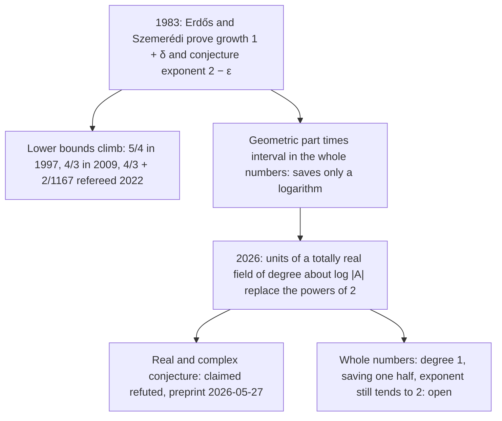

# The sum-product problem: false over the reals since May 2026, still open over the integers

[Syllabus](../../../SYLLABUS.md) → [Frontier](../README.md) → [Geometry and Combinatorics](../README.md#s04) → The sum-product problem

---

## General Overview

Take the whole numbers 1 to 10. Add every pair, a number to itself included: the totals fill 2 to 20, only **19** different values. Multiply every pair instead: **42** different values.

Now take the ten powers of 2, from 1 to 512. Their products are only **19** different values, because multiplying powers of 2 adds their exponents. Their sums are **55** different values, one for every pair.

Each set is small for one operation and large for the other. In 1983 Paul Erdős and Endre Szemerédi proved that no set of whole numbers is small for both. They also conjectured much more: the larger of the two counts is almost as big as the number of pairs, the set's size squared. [Sum-product](../../21-Algebraic%20and%20analytic%20number%20theory/08-Additive%20Combinatorics%20and%20Probabilistic%20Number%20Theory/06-sum-product-and-additive-energy.md) proves the counts above and the classical bounds. This card is about the status of that conjecture.

On 2026-05-27, Thomas Bloom, Will Sawin, Carl Schildkraut and Dmitrii Zhelezov posted a preprint titled "The sum-product conjecture is false for real numbers". Their sets are not whole numbers. They are **algebraic integers**: roots of polynomials with whole-number coefficients and leading coefficient 1. They live in number fields whose **degree** (how many fractions it takes to write one of their numbers) grows like the logarithm of the set's size.

Over the whole numbers, nothing has changed. A fixed degree buys only a fixed factor, and the integers are degree 1. The question Erdős and Szemerédi asked about whole numbers is still open.

**The sum-product conjecture says no finite set of numbers can add and multiply into far fewer than its size squared; a 2026 preprint claims to break it for real numbers with algebraic integers from fields of growing degree, a route closed to whole numbers, where the conjecture stays open.**

**What kind of fact this is:** a status card. The conjecture over the integers is open as of 2026-11-24. Over the real and complex numbers it is claimed refuted, by an unrefereed preprint. The card outlines the construction and does not prove it. The code counts small cases exactly. Those counts are theorems about single finite sets, and evidence for nothing beyond them.

### Status, as of 2026-11-24

| Statement | Kind | Status | Primary source |
| --- | --- | --- | --- |
| over the whole numbers, the larger count is at least a constant times $`\lvert A\rvert^{1+\delta}`$ | theorem | proved, 1983 | Erdős and Szemerédi (1983) |
| the same with exponent 4/3 + 2/1167 = 1.335047, for real numbers and so for whole numbers | theorem | proved, refereed 2022 | Rudnev and Stevens (2022) |
| exponent 4/3 + 10/4407 = 1.335602 | theorem | claimed: preprint 2025-12-15, revised 2026-01-29 | Cushman (2025) |
| the conjecture, over the whole numbers and the fractions | conjecture | open | Erdős problem 52, open in the database's data file, last changed 2026-05-28 |
| the conjecture, over the real and complex numbers | conjecture | claimed refuted: preprint 2026-05-27, not refereed | Bloom, Sawin, Schildkraut and Zhelezov (2026) |
| real sets with larger count at most $`\lvert A\rvert^{1.99999913}`$ | theorem | claimed, same preprint, Section 5 | Bloom, Sawin, Schildkraut and Zhelezov (2026) |

The kinds and status words follow [Kinds of claim](../01-How%20Research%20Works/02-theorem-conjecture-model-approximation.md). The two exponent rows hold up to a loss in the exponent that shrinks to 0 as the set grows. No published check of the 2026 preprint by people outside its author list was found as of 2026-11-24.

The same month brought a second refutation by the same tool. On 2026-05-20 [The unit-distance problem](01-unit-distance-problem.md), the shelf's house question about points and distances, fell to number fields of growing degree. Thomas Bloom and Will Sawin are authors on both.

### The picture: how close each set comes to its size squared

Each bar is the exponent $`e`$ with larger count $`= \lvert A\rvert^{e}`$. An exponent of 2 would mean every pair gives a new value. The code prints these bars.

```
  1..10           #########################                1.6232
  1, 2, ..., 512  ##############################           1.7404
  1..1000         ################################         1.7982
  1..2226         #################################        1.8140
  Z, 2^k x box    ############################             1.7019
  Q(sqrt2) model  #############################            1.7366
```

The runs 1 to n creep up toward 2 as n grows. The last two rows use one recipe, a geometric part times a box, at size 2,226: once in whole numbers, the older Balog–Wooley form (Why it works, Step 1), and once in a field of degree 2, the 2026 form (Step 2). At this size the whole-number version does better. The 2026 effect lives only at sizes where the degree is large.

---

## The formula

Notation first, in words. $`A`$ is a finite set of numbers and $`\lvert A\rvert`$ is how many it holds. The **sumset** $`A + A`$ is every sum $`a + b`$ with $`a`$ and $`b`$ in $`A`$, repeats counted once. The **product set** $`A \cdot A`$ is every product $`ab`$; the code writes it AA.

**The Erdős–Szemerédi conjecture (1983).** For every $`\varepsilon > 0`$ there is a constant $`c_\varepsilon > 0`$ such that every finite set $`A`$ of whole numbers has

```math
\max\big(\lvert A + A\rvert,\ \lvert A \cdot A\rvert\big) \;\ge\; c_\varepsilon\, \lvert A\rvert^{2-\varepsilon}
```

**Read it aloud:** however small a saving you name, no large set of whole numbers keeps both its sums and its products below its size squared by that power.

The same sentence with "real numbers" in place of "whole numbers" is the real conjecture. The 2026 preprint claims it is false.

**The 2026 claim (Theorem 1.1 of the preprint).** There is a fixed $`c > 0`$ and arbitrarily large finite sets $`A`$ of real numbers with

```math
\max\big(\lvert A + A\rvert,\ \lvert A \cdot A\rvert\big) \;\le\; \lvert A\rvert^{2-c}
```

**Read it aloud:** some huge sets of real numbers miss the size squared by a fixed power, and the preprint's explicit version gives $`c`$ at least 0.00000087.

**The engine (Theorem 1.2 of the preprint).** There is a fixed $`C`$ and infinitely many degrees $`d`$ with a **totally real** field $`K`$ of degree $`d`$: every way of placing $`K`$ inside the complex numbers lands on the real line. For every $`X \ge 1`$ there is a set $`A`$ of algebraic integers of $`K`$ with

```math
X^d \le \lvert A\rvert \le (CX)^d, \qquad \lvert A + A\rvert \le C^d \lvert A\rvert, \qquad \lvert A \cdot A\rvert \le 2^{-d}\lvert A\rvert^2
```

**Read it aloud:** the set adds almost like an interval, with sums only a factor $`C^d`$ more than its size, and it multiplies with a saving of one half for every degree of the field.

The middle inequality is **small doubling**: $`\lvert A + A\rvert \le K_0\lvert A\rvert`$ for a factor $`K_0`$ that does not grow with the set. Here $`K_0 = C^d`$, fixed once the field is fixed.

| Symbol | Plain meaning | In our example | Push it up and the answer… |
| --- | --- | --- | --- |
| $`A`$, $`\lvert A\rvert`$ | a finite set; how many it holds | 1 to 10; 10 | both counts grow |
| $`A + A`$, $`A \cdot A`$ | all sums; all products, repeats once | 19 and 42 for 1 to 10 | — |
| $`\varepsilon`$, $`c_\varepsilon`$ | the conjecture's small saving; its constant | — | a weaker conjecture |
| $`c`$ | the 2026 power saving below 2 | at least 0.00000087 | a stronger refutation |
| $`\delta`$ | the 1983 power gain above 1 | not explicit in 1983 | a stronger theorem |
| $`e`$, $`s`$ | measured exponent: log of the larger count over log of $`\lvert A\rvert`$; saving exponent: the factor $`2^{-d}`$ written as $`\lvert A\rvert^{-s}`$ | 1.6232 for 1 to 10; 0.0334 at a billion, degree 1 | closer to the conjecture's 2; a bigger saving |
| $`K`$, $`d`$ | a totally real number field; its degree | $`\mathbb{Q}(\sqrt2)`$, degree 2 | more room for units |
| $`C`$ | the preprint's fixed constant | not stated | weaker bounds |
| $`X`$ | the size scale of the box of algebraic integers | 30 in the model | bigger sets at one degree |
| $`G`$, $`P`$ | a set of units; a box of algebraic integers | 7 units, 318 box points | — |
| $`u`$, $`Y`$ | the unit $`1 + \sqrt2`$; the largest power used | $`u^{-3}`$ to $`u^3`$; 3 | more products shared |
| $`K_0`$ | a small-doubling factor | at most $`C^d`$ | — |

### When it holds

- **The same set on both sides.** With two sets, $`A + \{0\}`$ and $`A \cdot \{1\}`$ are both copies of $`A`$, so there is nothing to prove.
- **Ordinary numbers, not wrap-round ones.** In arithmetic modulo a prime $`p`$, the whole set of $`p`$ remainders has $`p`$ sums and $`p`$ products: no growth at all. Finite-field versions of the question need sets well short of all $`p`$ remainders.
- **Degree growing with the set.** At a fixed degree $`d`$, the saving $`2^{-d}`$ is a fixed factor. A fixed factor vanishes from the exponent as the set grows, so no fixed field gives a counterexample this way.
- **Real numbers, through one embedding.** A totally real field sits inside the real numbers in $`d`$ ways. Pick any one: the set becomes $`\lvert A\rvert`$ real numbers with the same sums and products.
- **Large sets only.** Both the conjecture and its refutation speak about sizes tending to infinity. No finite table can confirm or refute either.

---

## Why it works

### Step 0: the natural candidate is part run, part ratio

A run like 1 to 10 adds into few values. A geometric progression like 1, 2, 4, … multiplies into few values. The natural compromise is a product set $`A = G \cdot P`$: a short geometric part $`G`$ times an interval-like part $`P`$.

Products of $`A`$ lie in $`G \cdot G \cdot P \cdot P`$, and $`G \cdot G`$ is barely bigger than $`G`$. Sums of $`A`$ stay few only if multiplying $`P`$ by members of $`G`$ does not spread it out too much. Everything turns on that second condition.



### Step 1: in the whole numbers the geometric part spreads out

The only whole numbers with a whole-number inverse are 1 and −1. So the geometric part must be powers of some number, such as 2. The model takes $`2^k`$ times the run 318 to 635, for $`k`$ from 0 to 6: 2,226 numbers in all.

Each power of 2 doubles the spread, so sums of different layers rarely coincide. The preprint describes this earlier construction, due to Balog and Wooley, as saving only a logarithmic factor. At size 2,226 the run gives 42,548 sums and 498,071 products, exponent 1.7019. That beats the plain run 1 to 2,226 at 1.8140, but the advantage shrinks as sizes grow.

### Step 2: in a number field the units do not spread out

A **unit** of a field is an algebraic integer whose inverse is also one. In $`\mathbb{Q}(\sqrt2)`$, the field of numbers $`a + b\sqrt2`$ with fractions $`a`$ and $`b`$, the number $`u = 1 + \sqrt2`$ is a unit: $`(1 + \sqrt2)(-1 + \sqrt2) = 1`$.

$`\mathbb{Q}(\sqrt2)`$ is totally real. It sits in the real line two ways, sending $`\sqrt2`$ to $`+1.414\ldots`$ or to $`-1.414\ldots`$; call the two results a number's **real images**. Multiplying by $`u`$ multiplies the first image by 2.414 and the second by −0.414. The product of the two images, the **norm**, changes sign but keeps its size. A unit moves numbers around, but within a region of the same volume.

[The unit theorem](../../21-Algebraic%20and%20analytic%20number%20theory/06-Algebraic%20Numbers/07-dirichlets-unit-theorem.md) says a totally real field of degree $`d`$ has $`d - 1`$ independent units. So $`G`$ can be a $`(d-1)`$-dimensional box of units, many units that still multiply into few products.

The model, all exact on pairs $`(a, b)`$:

| Piece | Rule | Count |
| --- | --- | --- |
| $`P`$ | $`a + b\sqrt2`$ with both real images in [30, 60) | 318 |
| $`P + P`$ | every sum lies in the box [60, 120) | 1,253, which is 3.94 × 318 |
| $`G`$ | $`u^k`$ for $`k`$ from −3 to 3 | 7 |
| $`A = G \cdot P`$ | no two products coincide | 2,226 = 7 × 318 |
| $`A + A`$, $`A \cdot A`$ | counted exactly | 199,600 and 650,728 |

Doubling a box of side $`L`$ in each of the $`d`$ directions gives about $`2^d`$ times as many points: here 3.94, close to $`2^2 = 4`$. That is only the $`2^d`$ part of the $`C^d`$ in Theorem 1.2. The units stretch each image by up to a factor $`u^Y`$ and supply the rest: in the model $`\lvert A + A\rvert = 89.7 \times \lvert A\rvert`$.

### Step 3: from the engine to a power saving

The preprint chooses fields with tight whole numbers, from Martinet's class field towers: their **root discriminant**, the spread of the whole numbers per dimension, stays bounded as the degree grows. Then a box $`P`$ near size $`X`$ and a box $`G`$ of units with log-images at most $`Y`$ give Theorem 1.2. Multiplying by a unit stretches each image by at most $`\exp(Y)`$, which keeps $`A + A`$ small; small doubling of $`G`$ keeps $`A \cdot A`$ small.

The two size bounds tie $`d`$ to $`\lvert A\rvert`$: $`d`$ is about $`\log \lvert A\rvert / \log(CX)`$. So the factor $`2^{-d}`$ is a fixed power of $`\lvert A\rvert`$.

<details>
<summary>Detailed step: Theorem 1.2 gives exponent 2 − c</summary>

From $`X^d \le \lvert A\rvert`$, $`d \le \log\lvert A\rvert / \log X`$, so

$`\displaystyle \lvert A + A\rvert \le C^d \lvert A\rvert \le \lvert A\rvert^{1 + \log C/\log X}.`$

From $`\lvert A\rvert \le (CX)^d`$, $`d \ge \log\lvert A\rvert / \log(CX)`$, so

$`\displaystyle \lvert A \cdot A\rvert \le 2^{-d}\lvert A\rvert^2 \le \lvert A\rvert^{2 - \log 2/\log(CX)}.`$

Fix $`X`$ large: the first exponent is close to 1 and the second is $`2 - c`$ with $`c = \log 2/\log(CX) > 0`$, so the second is the larger. Infinitely many degrees $`d`$ give sets with $`\lvert A\rvert \ge X^d`$ as large as wanted. The preprint's Section 5 sketches an explicit run of this argument with $`c \ge 0.00000087`$, and says that value should not be taken too seriously.

</details>

The set is real by Step 2's embedding. A set of real numbers is also a set of complex numbers, so the complex conjecture falls with the real one.

### Step 4: why the integers are untouched

The field of fractions $`\mathbb{Q}`$ is the only field of degree 1. Its saving $`2^{-1}`$ is a fixed half. Written as a power, $`\lvert A\rvert^2/2 = \lvert A\rvert^{2 - s}`$ with saving exponent $`s = \log 2/\log\lvert A\rvert`$:

| $`\lvert A\rvert`$ | saving exponent $`s`$ at degree 1 | at degree 2 |
| --- | --- | --- |
| 1,000 | 0.1003 | 0.2007 |
| 1,000,000 | 0.0502 | 0.1003 |
| 1,000,000,000 | 0.0334 | 0.0669 |

Any fixed degree gives an $`s`$ that sinks to 0. Only a degree growing like $`\log\lvert A\rvert`$ keeps it fixed, and whole numbers have degree 1. The preprint says the conjecture may still be true in number fields of bounded degree, and in particular in the original setting of the integers.

Fractions add nothing. Multiply every member of a set of fractions by a common denominator $`D`$: sums are multiplied by $`D`$ and products by $`D^2`$, so neither count changes. The run checks this for 1/2, 1/3, 2/3, 3/4, 5/6 and 1, times 12: 14 sums and 18 products both ways.

### Step 5: what is proved from below

The proved floor is far from 2. Erdős and Szemerédi proved some gain $`1 + \delta`$. The real-number bounds since then apply to whole numbers too, since whole numbers are real. The best refereed bound in the sources checked here is Rudnev and Stevens's 4/3 + 2/1167 = 1.335047 (2022); a 2025 preprint by Adam Cushman claims 4/3 + 10/4407 = 1.335602.

So, as of 2026-11-24, the true exponent for real sets is claimed to sit between 1.3356 and 1.99999913. For whole numbers it sits between the same floor and 2, and the conjecture says 2.

---

## Worked numbers, by hand

| Step | Arithmetic | Value |
| --- | --- | --- |
| sums of 1 to 10 | totals 2 to 20 | 19 |
| products of 1 to 10 | multiplication table, repeats removed | 42 |
| products of 1, 2, …, 512 | exponents 0 to 18 | 19 |
| sums of 1, 2, …, 512 | one per pair, $`10 \times 11/2`$ | 55 |
| exponent for 1 to 10 | $`\log 42/\log 10`$ | 1.6232 |
| degree-1 saving at a billion | $`\log 2/\log 10^9`$ | 0.0334 |
| claimed real ceiling | $`2 - 0.00000087`$ | **1.99999913** |

For whole numbers the best a set can do is still believed to be about its size squared; for real numbers the preprint claims a fixed power less, 0.00000087 below 2.

### What breaks if you drop a piece

| Mistake | Comes out at | What went wrong |
| --- | --- | --- |
| Count ordered pairs as the sumset of 1 to 10 | 100, not 19 | $`a + b`$ and $`b + a`$ are one sum, and 3 + 7 = 4 + 6 |
| Keep the degree fixed at 1 | saving exponent 0.0502 at a million, 0.0334 at a billion | a fixed factor $`2^{-d}`$ vanishes from the exponent |
| Read the degree-2 model as a trend | 1.7366, worse than the whole-number recipe's 1.7019 | at size 2,226 nothing asymptotic shows |
| Treat fractions as a new case | 14 sums, 18 products, same as the whole numbers 4, 6, 8, 9, 10, 12 | clearing denominators changes neither count |

The code prints all four.

---

## Code, from first principles, and it actually runs

The code builds every sumset and product set as a set of values, and gets the small counts a second way: closed forms for the runs and powers, and a divisor test for each number up to $`n^2`$ for the multiplication tables. The field model works exactly on integer pairs $`(a, b)`$, with box tests by comparing squares, no square roots. It checks the norm is multiplied correctly, that every sum of the box lies in the doubled box, and that $`A`$ has exactly $`\lvert G\rvert \times \lvert P\rvert`$ members. Two independent roads meet at 19, 42, 55 and 2,906; fractions and whole numbers meet at 14 and 18.

### Python

```python
# The sum-product problem -- the check behind the card.  Standard library only.
# Road 1 builds each sumset and product set as a set of values.  Road 2 gets
# the same counts without the set: a closed form, or a divisor test per number.
# Then a model of the 2026 recipe A = G.P in the whole numbers of Q(sqrt 2),
# computed exactly on pairs (a, b) meaning a + b sqrt 2, and the 2026 bound
# read at fixed degree.  Nothing here proves the conjecture or its refutation.
import math
from fractions import Fraction

def sums(A): return {a + b for a in A for b in A}
def prods(A): return {a * b for a in A for b in A}

def products_by_test(n):              # road 2: k is a product when some a <= n divides it with k/a <= n
    return sum(1 for k in range(1, n * n + 1)
               if any(k % a == 0 and k // a <= n for a in range(1, n + 1)))

def expo(size, n): return math.log(size) / math.log(n)

def mul(x, y): return (x[0] * y[0] + 2 * x[1] * y[1], x[0] * y[1] + x[1] * y[0])
def norm(x): return x[0] * x[0] - 2 * x[1] * x[1]

def at_least(a, b, s, t):             # is a + s*b*sqrt2 >= t?  exact, no square roots
    r = t - a
    if s * b >= 0:
        return r <= 0 or 2 * b * b >= r * r
    return r < 0 and 2 * b * b <= r * r

def in_box(x, lo, hi):                # both real images, a + b sqrt2 and a - b sqrt2, in [lo, hi)
    return all(at_least(x[0], x[1], s, lo) and not at_least(x[0], x[1], s, hi) for s in (1, -1))

line = list(range(1, 11))
pow2 = [2 ** i for i in range(10)]
n = 10
s_line, p_line = len(sums(line)), len(prods(line))
s_pow, p_pow = len(sums(pow2)), len(prods(pow2))
print(f"A = 1..10:        |A+A| = {s_line} (closed form 2n-1 = {2 * n - 1}), |AA| = {p_line} (divisor test {products_by_test(10)})")
print(f"A = 1, 2, ..., 512: |A+A| = {s_pow} (closed form n(n+1)/2 = {n * (n + 1) // 2}), |AA| = {p_pow} (closed form 2n-1 = {2 * n - 1})")
print(f"ordered pairs 10 x 10 = {n * n}; distinct sums of 1..10 only {s_line}")
table = {}
for m in (10, 100, 1000):
    table[m] = len(prods(range(1, m + 1)))
    print(f"multiplication table 1..{m}: {table[m]} distinct products of {m * m}; exponent {expo(table[m], m):.4f}")
print(f"multiplication table 1..100 by divisor test: {products_by_test(100)}")

Q = [Fraction(1, 2), Fraction(1, 3), Fraction(2, 3), Fraction(3, 4), Fraction(5, 6), Fraction(1)]
D = 12                                # common denominator of the six fractions
Z = [int(q * D) for q in Q]
print(f"fractions {[str(q) for q in Q]} times {D} = {Z}")
print(f"  sums {len(sums(Q))} and {len(sums(Z))}; products {len(prods(Q))} and {len(prods(Z))}")

X, L, Y = 30, 30, 3                   # the box [X, X+L) for both images; units u^k with |k| <= Y
P = [(a, b) for a in range(0, 4 * X) for b in range(-3 * X, 3 * X) if in_box((a, b), X, X + L)]
G, g, h = [(1, 0)], (1, 0), (1, 0)
for _ in range(Y):
    g, h = mul(g, (1, 1)), mul(h, (-1, 1))   # 1 + sqrt2 and its inverse -1 + sqrt2
    G += [g, h]
A = {mul(u, p) for u in G for p in P}
PP = {(x[0] + y[0], x[1] + y[1]) for x in P for y in P}
SA = {(x[0] + y[0], x[1] + y[1]) for x in A for y in A}
MA = {mul(x, y) for x in A for y in A}
N = len(A)
inter = len(prods(range(1, N + 1)))
print(f"Q(sqrt2) model, box [{X}, {X + L}), units (1+sqrt2)^k for |k| <= {Y}:")
print(f"  |P| = {len(P)}, |G| = {len(G)}, |A| = |G||P| = {len(G) * len(P)}, counted {N}")
print(f"  |P+P| = {len(PP)} = {len(PP) / len(P):.2f} x |P|, all inside the box [{2 * X}, {2 * X + 2 * L}): "
      f"{all(in_box(x, 2 * X, 2 * X + 2 * L) for x in PP)}")
print(f"  |A+A| = {len(SA)} = {len(SA) / N:.1f} x |A|, |AA| = {len(MA)}; max exponent {expo(max(len(SA), len(MA)), N):.4f}")
print(f"  interval 1..{N}: |A+A| = {2 * N - 1}, |AA| = {inter}; max exponent {expo(inter, N):.4f}")
B = {2 ** k * p for k in range(2 * Y + 1) for p in range(len(P), 2 * len(P))}   # the same recipe in Z
SB, MB = len(sums(B)), len(prods(B))
print(f"  whole numbers 2^k x [{len(P)}, {2 * len(P)}), 0 <= k <= {2 * Y}: |A| = {len(B)}, |A+A| = {SB}, |AA| = {MB}; "
      f"max exponent {expo(max(SB, MB), len(B)):.4f}")
print("2026 bound |AA| <= 2^-d |A|^2, saving 2^-d written as |A|^-s:")
for k in (3, 6, 9):
    print(f"  |A| = 1e{k}: d = 1 gives s = {math.log(2) / math.log(10 ** k):.4f}, d = 2 gives s = {2 * math.log(2) / math.log(10 ** k):.4f}")
print(f"exponent windows: proved floor 4/3 + 2/1167 = {4 / 3 + 2 / 1167:.6f}; claimed floor 4/3 + 10/4407 = "
      f"{4 / 3 + 10 / 4407:.6f}; claimed ceiling over the reals 2 - 0.00000087 = {2 - 0.00000087:.8f}")
for name, e in (("1..10", expo(p_line, 10)), ("1, 2, ..., 512", expo(s_pow, 10)),
                ("1..1000", expo(table[1000], 1000)), (f"1..{N}", expo(inter, N)),
                ("Z, 2^k x box", expo(max(SB, MB), len(B))), ("Q(sqrt2) model", expo(max(len(SA), len(MA)), N))):
    print(f"  {name:<15} {'#' * round(40 * (e - 1)):<40} {e:.4f}")

assert (s_line, p_line, s_pow, p_pow) == (2 * n - 1, products_by_test(10), n * (n + 1) // 2, 2 * n - 1)
assert table[100] == products_by_test(100) == 2906
assert (len(sums(Q)), len(prods(Q))) == (len(sums(Z)), len(prods(Z)))
assert N == len(G) * len(P) and all(norm(mul(x, y)) == norm(x) * norm(y) for x in P[:40] for y in G)
assert all(in_box(x, 2 * X, 2 * X + 2 * L) for x in PP) and len(PP) <= 4 * len(P)
assert max(len(SA), len(MA)) < inter and len(B) == N
print("ALL CHECKS PASS")
```

**Ran 2026-11-24 on macOS, Python 3.14.10, standard library only. All checks passed. Output, pasted from the run:**

```
A = 1..10:        |A+A| = 19 (closed form 2n-1 = 19), |AA| = 42 (divisor test 42)
A = 1, 2, ..., 512: |A+A| = 55 (closed form n(n+1)/2 = 55), |AA| = 19 (closed form 2n-1 = 19)
ordered pairs 10 x 10 = 100; distinct sums of 1..10 only 19
multiplication table 1..10: 42 distinct products of 100; exponent 1.6232
multiplication table 1..100: 2906 distinct products of 10000; exponent 1.7316
multiplication table 1..1000: 248083 distinct products of 1000000; exponent 1.7982
multiplication table 1..100 by divisor test: 2906
fractions ['1/2', '1/3', '2/3', '3/4', '5/6', '1'] times 12 = [6, 4, 8, 9, 10, 12]
  sums 14 and 14; products 18 and 18
Q(sqrt2) model, box [30, 60), units (1+sqrt2)^k for |k| <= 3:
  |P| = 318, |G| = 7, |A| = |G||P| = 2226, counted 2226
  |P+P| = 1253 = 3.94 x |P|, all inside the box [60, 120): True
  |A+A| = 199600 = 89.7 x |A|, |AA| = 650728; max exponent 1.7366
  interval 1..2226: |A+A| = 4451, |AA| = 1181639; max exponent 1.8140
  whole numbers 2^k x [318, 636), 0 <= k <= 6: |A| = 2226, |A+A| = 42548, |AA| = 498071; max exponent 1.7019
2026 bound |AA| <= 2^-d |A|^2, saving 2^-d written as |A|^-s:
  |A| = 1e3: d = 1 gives s = 0.1003, d = 2 gives s = 0.2007
  |A| = 1e6: d = 1 gives s = 0.0502, d = 2 gives s = 0.1003
  |A| = 1e9: d = 1 gives s = 0.0334, d = 2 gives s = 0.0669
exponent windows: proved floor 4/3 + 2/1167 = 1.335047; claimed floor 4/3 + 10/4407 = 1.335602; claimed ceiling over the reals 2 - 0.00000087 = 1.99999913
  1..10           #########################                1.6232
  1, 2, ..., 512  ##############################           1.7404
  1..1000         ################################         1.7982
  1..2226         #################################        1.8140
  Z, 2^k x box    ############################             1.7019
  Q(sqrt2) model  #############################            1.7366
ALL CHECKS PASS
```

### Rust

Same numbers, same labels, built with `rustc --edition 2021 -O`.

```rust
// The sum-product problem -- the same check as the Python, in Rust.  No crates.
// Road 1 builds each sumset and product set as a set of values.  Road 2 gets
// the same counts without the set: a closed form, or a divisor test per number.
// Then a model of the 2026 recipe A = G.P in the whole numbers of Q(sqrt 2),
// computed exactly on pairs (a, b) meaning a + b sqrt 2, and the 2026 bound
// read at fixed degree.  Nothing here proves the conjecture or its refutation.
use std::collections::HashSet;

type Q2 = (i64, i64);

fn sums(a: &[i64]) -> usize { a.iter().flat_map(|x| a.iter().map(move |y| x + y)).collect::<HashSet<_>>().len() }
fn prods(a: &[i64]) -> usize { a.iter().flat_map(|x| a.iter().map(move |y| x * y)).collect::<HashSet<_>>().len() }

fn products_by_test(n: i64) -> usize {   // road 2: k is a product when some a <= n divides it with k/a <= n
    (1..=n * n).filter(|&k| (1..=n).any(|a| k % a == 0 && k / a <= n)).count()
}

fn expo(size: usize, n: usize) -> f64 { (size as f64).ln() / (n as f64).ln() }

fn mul(x: Q2, y: Q2) -> Q2 { (x.0 * y.0 + 2 * x.1 * y.1, x.0 * y.1 + x.1 * y.0) }
fn norm(x: Q2) -> i64 { x.0 * x.0 - 2 * x.1 * x.1 }

fn at_least(a: i64, b: i64, s: i64, t: i64) -> bool {   // is a + s*b*sqrt2 >= t?  exact
    let r = t - a;
    if s * b >= 0 { r <= 0 || 2 * b * b >= r * r } else { r < 0 && 2 * b * b <= r * r }
}

fn in_box(x: Q2, lo: i64, hi: i64) -> bool {   // both real images in [lo, hi)
    [1, -1].iter().all(|&s| at_least(x.0, x.1, s, lo) && !at_least(x.0, x.1, s, hi))
}

fn gcd(a: i64, b: i64) -> i64 { if b == 0 { a.abs() } else { gcd(b, a % b) } }
fn frac(n: i64, d: i64) -> Q2 { let g = gcd(n, d); (n / g, d / g) }
fn fsums(q: &[Q2]) -> usize { q.iter().flat_map(|x| q.iter().map(move |y| frac(x.0 * y.1 + y.0 * x.1, x.1 * y.1))).collect::<HashSet<_>>().len() }
fn fprods(q: &[Q2]) -> usize { q.iter().flat_map(|x| q.iter().map(move |y| frac(x.0 * y.0, x.1 * y.1))).collect::<HashSet<_>>().len() }
fn show(q: Q2) -> String { if q.1 == 1 { format!("'{}'", q.0) } else { format!("'{}/{}'", q.0, q.1) } }

fn main() {
    let line: Vec<i64> = (1..=10).collect();
    let pow2: Vec<i64> = (0..10).map(|i| 1i64 << i).collect();
    let n: usize = 10;
    let (s_line, p_line, s_pow, p_pow) = (sums(&line), prods(&line), sums(&pow2), prods(&pow2));
    println!("A = 1..10:        |A+A| = {} (closed form 2n-1 = {}), |AA| = {} (divisor test {})", s_line, 2 * n - 1, p_line, products_by_test(10));
    println!("A = 1, 2, ..., 512: |A+A| = {} (closed form n(n+1)/2 = {}), |AA| = {} (closed form 2n-1 = {})", s_pow, n * (n + 1) / 2, p_pow, 2 * n - 1);
    println!("ordered pairs 10 x 10 = {}; distinct sums of 1..10 only {}", n * n, s_line);
    let mut table = Vec::new();
    for m in [10usize, 100, 1000] {
        let r: Vec<i64> = (1..=m as i64).collect();
        let t = prods(&r);
        table.push(t);
        println!("multiplication table 1..{}: {} distinct products of {}; exponent {:.4}", m, t, m * m, expo(t, m));
    }
    let test100 = products_by_test(100);
    println!("multiplication table 1..100 by divisor test: {}", test100);

    let q: Vec<Q2> = vec![(1, 2), (1, 3), (2, 3), (3, 4), (5, 6), (1, 1)];
    let d = 12;   // common denominator of the six fractions
    let z: Vec<i64> = q.iter().map(|f| f.0 * d / f.1).collect();
    println!("fractions [{}] times {} = {:?}", q.iter().map(|&f| show(f)).collect::<Vec<_>>().join(", "), d, z);
    println!("  sums {} and {}; products {} and {}", fsums(&q), sums(&z), fprods(&q), prods(&z));

    let (x, l, y) = (30i64, 30i64, 3usize);   // the box [X, X+L) for both images; units u^k with |k| <= Y
    let mut p: Vec<Q2> = Vec::new();
    for a in 0..4 * x { for b in -3 * x..3 * x { if in_box((a, b), x, x + l) { p.push((a, b)) } } }
    let (mut g, mut h, mut units) = ((1i64, 0i64), (1i64, 0i64), vec![(1i64, 0i64)]);
    for _ in 0..y { g = mul(g, (1, 1)); h = mul(h, (-1, 1)); units.push(g); units.push(h); }
    let a_set: HashSet<Q2> = units.iter().flat_map(|&u| p.iter().map(move |&v| mul(u, v))).collect();
    let a: Vec<Q2> = a_set.iter().copied().collect();
    let pp: HashSet<Q2> = p.iter().flat_map(|u| p.iter().map(move |v| (u.0 + v.0, u.1 + v.1))).collect();
    let sa: HashSet<Q2> = a.iter().flat_map(|u| a.iter().map(move |v| (u.0 + v.0, u.1 + v.1))).collect();
    let ma: HashSet<Q2> = a.iter().flat_map(|&u| a.iter().map(move |&v| mul(u, v))).collect();
    let nn = a.len();
    let inter = prods(&(1..=nn as i64).collect::<Vec<_>>());
    let pp_in = pp.iter().all(|&v| in_box(v, 2 * x, 2 * x + 2 * l));
    println!("Q(sqrt2) model, box [{}, {}), units (1+sqrt2)^k for |k| <= {}:", x, x + l, y);
    println!("  |P| = {}, |G| = {}, |A| = |G||P| = {}, counted {}", p.len(), units.len(), units.len() * p.len(), nn);
    println!("  |P+P| = {} = {:.2} x |P|, all inside the box [{}, {}): {}", pp.len(), pp.len() as f64 / p.len() as f64, 2 * x, 2 * x + 2 * l,
             if pp_in { "True" } else { "False" });
    println!("  |A+A| = {} = {:.1} x |A|, |AA| = {}; max exponent {:.4}", sa.len(), sa.len() as f64 / nn as f64, ma.len(), expo(sa.len().max(ma.len()), nn));
    println!("  interval 1..{}: |A+A| = {}, |AA| = {}; max exponent {:.4}", nn, 2 * nn - 1, inter, expo(inter, nn));
    let np = p.len() as i64;   // the same recipe in Z
    let b: Vec<i64> = (0..=2 * y as u32).flat_map(|k| (np..2 * np).map(move |v| (1i64 << k) * v)).collect::<HashSet<_>>().into_iter().collect();
    let (sb, mb) = (sums(&b), prods(&b));
    println!("  whole numbers 2^k x [{}, {}), 0 <= k <= {}: |A| = {}, |A+A| = {}, |AA| = {}; max exponent {:.4}",
             np, 2 * np, 2 * y, b.len(), sb, mb, expo(sb.max(mb), b.len()));
    println!("2026 bound |AA| <= 2^-d |A|^2, saving 2^-d written as |A|^-s:");
    for k in [3i32, 6, 9] {
        let big = 10f64.powi(k).ln();
        println!("  |A| = 1e{}: d = 1 gives s = {:.4}, d = 2 gives s = {:.4}", k, 2f64.ln() / big, 2.0 * 2f64.ln() / big);
    }
    println!("exponent windows: proved floor 4/3 + 2/1167 = {:.6}; claimed floor 4/3 + 10/4407 = {:.6}; claimed ceiling over the reals 2 - 0.00000087 = {:.8}",
             4.0 / 3.0 + 2.0 / 1167.0, 4.0 / 3.0 + 10.0 / 4407.0, 2.0 - 0.00000087);
    let bars: Vec<(String, f64)> = vec![("1..10".into(), expo(p_line, 10)), ("1, 2, ..., 512".into(), expo(s_pow, 10)),
        ("1..1000".into(), expo(table[2], 1000)), (format!("1..{}", nn), expo(inter, nn)),
        ("Z, 2^k x box".into(), expo(sb.max(mb), b.len())), ("Q(sqrt2) model".into(), expo(sa.len().max(ma.len()), nn))];
    for (name, e) in &bars {
        println!("  {:<15} {:<40} {:.4}", name, "#".repeat((40.0 * (e - 1.0)).round() as usize), e);
    }

    assert!((s_line, p_line, s_pow, p_pow) == (2 * n - 1, products_by_test(10), n * (n + 1) / 2, 2 * n - 1));
    assert!(table[1] == test100 && test100 == 2906);
    assert!((fsums(&q), fprods(&q)) == (sums(&z), prods(&z)));
    assert!(nn == units.len() * p.len() && p[..40].iter().all(|&u| units.iter().all(|&v| norm(mul(u, v)) == norm(u) * norm(v))));
    assert!(pp_in && pp.len() <= 4 * p.len());
    assert!(sa.len().max(ma.len()) < inter && b.len() == nn);
    println!("ALL CHECKS PASS");
}
```

**Ran 2026-11-24 on macOS, rustc 1.98.1, no crates. All checks passed. Output, pasted from the run:**

```
A = 1..10:        |A+A| = 19 (closed form 2n-1 = 19), |AA| = 42 (divisor test 42)
A = 1, 2, ..., 512: |A+A| = 55 (closed form n(n+1)/2 = 55), |AA| = 19 (closed form 2n-1 = 19)
ordered pairs 10 x 10 = 100; distinct sums of 1..10 only 19
multiplication table 1..10: 42 distinct products of 100; exponent 1.6232
multiplication table 1..100: 2906 distinct products of 10000; exponent 1.7316
multiplication table 1..1000: 248083 distinct products of 1000000; exponent 1.7982
multiplication table 1..100 by divisor test: 2906
fractions ['1/2', '1/3', '2/3', '3/4', '5/6', '1'] times 12 = [6, 4, 8, 9, 10, 12]
  sums 14 and 14; products 18 and 18
Q(sqrt2) model, box [30, 60), units (1+sqrt2)^k for |k| <= 3:
  |P| = 318, |G| = 7, |A| = |G||P| = 2226, counted 2226
  |P+P| = 1253 = 3.94 x |P|, all inside the box [60, 120): True
  |A+A| = 199600 = 89.7 x |A|, |AA| = 650728; max exponent 1.7366
  interval 1..2226: |A+A| = 4451, |AA| = 1181639; max exponent 1.8140
  whole numbers 2^k x [318, 636), 0 <= k <= 6: |A| = 2226, |A+A| = 42548, |AA| = 498071; max exponent 1.7019
2026 bound |AA| <= 2^-d |A|^2, saving 2^-d written as |A|^-s:
  |A| = 1e3: d = 1 gives s = 0.1003, d = 2 gives s = 0.2007
  |A| = 1e6: d = 1 gives s = 0.0502, d = 2 gives s = 0.1003
  |A| = 1e9: d = 1 gives s = 0.0334, d = 2 gives s = 0.0669
exponent windows: proved floor 4/3 + 2/1167 = 1.335047; claimed floor 4/3 + 10/4407 = 1.335602; claimed ceiling over the reals 2 - 0.00000087 = 1.99999913
  1..10           #########################                1.6232
  1, 2, ..., 512  ##############################           1.7404
  1..1000         ################################         1.7982
  1..2226         #################################        1.8140
  Z, 2^k x box    ############################             1.7019
  Q(sqrt2) model  #############################            1.7366
ALL CHECKS PASS
```

The two outputs match line for line.

### Lean

Lean proves the counts for runs and powers of 2 of every length, the fraction and modulo-p facts, and the worked numbers.

- Take the run 1 to n. Then it has $`2n - 1`$ different sums.
- Take the n powers of 2 from 1 to $`2^{n-1}`$. Then they have $`2n - 1`$ different products and $`n(n + 1)/2`$ different sums.
- Take a finite set of fractions, and multiply every member by the same nonzero number D. Then neither the sum count nor the product count changes.
- Take arithmetic modulo a prime p. Then the whole set of p remainders has p sums and p products.
- The run 1 to 10 gives 19 sums and 42 products, from 100 ordered pairs.
- The powers 1, 2, …, 512 give 19 products and 55 sums.
- Multiplying 1/2, 1/3, 2/3, 3/4, 5/6 and 1 by 12 gives 6, 4, 8, 9, 10 and 12. Both sets have 14 sums and 18 products.
- Take $`u = 1 + \sqrt2`$. Then $`(1 + \sqrt2)(-1 + \sqrt2) = 1`$, and the norm of $`u`$ is −1.
- The model's size is 7 × 318 = 2,226, as arithmetic only.

The field model's counts, the larger multiplication tables and every exponent are left to the Python and Rust checks.

```lean
-- The sum-product problem: scaling a set of fractions by a common denominator keeps both its sum count and its product count, arithmetic modulo a prime gives no growth, and the runs 1 to n and 1, 2, 4, ..., 2^(n-1) have 2n - 1 sums, 2n - 1 products and n(n+1)/2 sums.
import Mathlib.Algebra.GroupWithZero.Action.Pointwise.Finset
import Mathlib.Algebra.Ring.Rat
import Mathlib.Data.Nat.Prime.Defs
import Mathlib.Data.ZMod.Defs
import Mathlib.NumberTheory.Zsqrtd.Basic
import Mathlib.Data.Finset.Sym

/-! Notation: for a finite set `A`, `A + A` and `A * A` are Mathlib's pointwise sumset and
product set (repeats counted once), `A.card` is `|A|`, and `D • A` is the set of all `D * a`
with `a` in `A`. The conjecture itself is open over the whole numbers and claimed refuted over
the reals, so it is not stated here as a theorem. -/

open scoped Pointwise

theorem two_pow_add_two_pow_ne_of_lt {a b c d : ℕ} (hab : a ≤ b) (hac : a < c) (hcd : c ≤ d) :
    2 ^ a + 2 ^ b ≠ 2 ^ c + 2 ^ d := by
  intro h
  obtain ⟨l, rfl⟩ := Nat.exists_eq_add_of_le hab
  obtain ⟨k, rfl⟩ := Nat.exists_eq_add_of_lt hac
  obtain ⟨m, rfl⟩ := Nat.exists_eq_add_of_le hcd
  have h2 : 1 + 2 ^ l = 2 * 2 ^ k + 2 * 2 ^ (k + m) := by
    have hpos : 0 < 2 ^ a := by positivity
    apply Nat.eq_of_mul_eq_mul_left hpos
    calc 2 ^ a * (1 + 2 ^ l) = 2 ^ a + 2 ^ (a + l) := by ring
      _ = 2 ^ (a + k + 1) + 2 ^ (a + k + 1 + m) := h
      _ = 2 ^ a * (2 * 2 ^ k + 2 * 2 ^ (k + m)) := by ring
  have hk : 0 < 2 ^ k := by positivity
  have hkm : 0 < 2 ^ (k + m) := by positivity
  rcases l with _ | l
  · simp at h2
    omega
  · rw [pow_succ] at h2
    omega

theorem two_pow_add_two_pow_inj_of_le {a b c d : ℕ} (hab : a ≤ b) (hcd : c ≤ d)
    (h : 2 ^ a + 2 ^ b = 2 ^ c + 2 ^ d) : a = c ∧ b = d := by
  rcases lt_trichotomy a c with hac | rfl | hca
  · exact absurd h (two_pow_add_two_pow_ne_of_lt hab hac hcd)
  · exact ⟨rfl, Nat.pow_right_injective le_rfl (Nat.add_left_cancel h)⟩
  · exact absurd h.symm (two_pow_add_two_pow_ne_of_lt hcd hca hab)

theorem two_pow_add_two_pow_inj {a b c d : ℕ} (h : 2 ^ a + 2 ^ b = 2 ^ c + 2 ^ d) :
    (a = c ∧ b = d) ∨ (a = d ∧ b = c) := by
  rcases le_total a b with hab | hba <;> rcases le_total c d with hcd | hdc
  · exact Or.inl (two_pow_add_two_pow_inj_of_le hab hcd h)
  · have := two_pow_add_two_pow_inj_of_le hab hdc (h.trans (add_comm _ _))
    exact Or.inr this
  · have := two_pow_add_two_pow_inj_of_le hba hcd ((add_comm _ _).trans h)
    exact Or.inr ⟨this.2, this.1⟩
  · have := two_pow_add_two_pow_inj_of_le hba hdc ((add_comm _ _).trans (h.trans (add_comm _ _)))
    exact Or.inl ⟨this.2, this.1⟩

#print axioms two_pow_add_two_pow_ne_of_lt
#print axioms two_pow_add_two_pow_inj_of_le
#print axioms two_pow_add_two_pow_inj

/-- **Fractions add nothing.** Multiply every member of a finite set `A` of fractions by a
nonzero number `D`, such as a common denominator: sums are multiplied by `D` and products by
`D²`, so the new set has exactly as many different sums and exactly as many different
products as `A`. -/
theorem card_add_and_card_mul_of_smul (A : Finset ℚ) (D : ℚ) (hD : D ≠ 0) :
    ((D • A) + (D • A)).card = (A + A).card ∧ ((D • A) * (D • A)).card = (A * A).card := by
  constructor
  · have h : (D • A) + (D • A) = (A + A).image (D * ·) := by
      ext x
      simp only [Finset.mem_add, Finset.mem_smul_finset, Finset.mem_image, smul_eq_mul]
      constructor
      · rintro ⟨_, ⟨a, ha, rfl⟩, _, ⟨b, hb, rfl⟩, rfl⟩
        exact ⟨a + b, ⟨a, ha, b, hb, rfl⟩, by ring⟩
      · rintro ⟨_, ⟨a, ha, b, hb, rfl⟩, rfl⟩
        exact ⟨_, ⟨a, ha, rfl⟩, _, ⟨b, hb, rfl⟩, by ring⟩
    rw [h, Finset.card_image_of_injective _ (mul_right_injective₀ hD)]
  · have h : (D • A) * (D • A) = (A * A).image (D * D * ·) := by
      ext x
      simp only [Finset.mem_mul, Finset.mem_smul_finset, Finset.mem_image, smul_eq_mul]
      constructor
      · rintro ⟨_, ⟨a, ha, rfl⟩, _, ⟨b, hb, rfl⟩, rfl⟩
        exact ⟨a * b, ⟨a, ha, b, hb, rfl⟩, by ring⟩
      · rintro ⟨_, ⟨a, ha, b, hb, rfl⟩, rfl⟩
        exact ⟨_, ⟨a, ha, rfl⟩, _, ⟨b, hb, rfl⟩, by ring⟩
    rw [h, Finset.card_image_of_injective _ (mul_right_injective₀ (mul_ne_zero hD hD))]

/-- **Wrap-round numbers do not grow.** In arithmetic modulo a prime `p`, the set of all `p`
remainders has exactly `p` different sums and exactly `p` different products. -/
theorem zmod_univ_card_add_and_card_mul (p : ℕ) [Fact p.Prime] :
    ((Finset.univ : Finset (ZMod p)) + Finset.univ).card = p ∧
      ((Finset.univ : Finset (ZMod p)) * Finset.univ).card = p := by
  have : NeZero p := ⟨(Fact.out : p.Prime).ne_zero⟩
  simp [Finset.univ_add_univ, Finset.univ_mul_univ, ZMod.card]

/-- **The two opening sets, for any length `n`.** The run `1, 2, …, n` has `2n − 1` different
sums. The `n` powers of 2, `1, 2, 4, …, 2^(n−1)`, have only `2n − 1` different products but
`n(n + 1)/2` different sums, one for every pair. -/
theorem run_and_powers_of_two_counts (n : ℕ) :
    (Finset.Icc 1 n + Finset.Icc 1 n : Finset ℕ).card = 2 * n - 1 ∧
      ((Finset.range n).image (2 ^ ·) * (Finset.range n).image (2 ^ ·) : Finset ℕ).card =
        2 * n - 1 ∧
      ((Finset.range n).image (2 ^ ·) + (Finset.range n).image (2 ^ ·) : Finset ℕ).card =
        n * (n + 1) / 2 := by
  refine ⟨?_, ?_, ?_⟩
  · have h : (Finset.Icc 1 n + Finset.Icc 1 n : Finset ℕ) = Finset.Icc 2 (2 * n) := by
      ext x
      simp only [Finset.mem_add, Finset.mem_Icc]
      constructor
      · rintro ⟨a, ha, b, hb, rfl⟩
        omega
      · intro hx
        exact ⟨min (x - 1) n, by omega, x - min (x - 1) n, by omega, by omega⟩
    rw [h, Nat.card_Icc]
    omega
  · have h : ((Finset.range n).image (2 ^ ·) * (Finset.range n).image (2 ^ ·) : Finset ℕ) =
        (Finset.range (2 * n - 1)).image (2 ^ ·) := by
      ext x
      simp only [Finset.mem_mul, Finset.mem_image, Finset.mem_range]
      constructor
      · rintro ⟨_, ⟨i, hi, rfl⟩, _, ⟨j, hj, rfl⟩, rfl⟩
        exact ⟨i + j, by omega, by rw [pow_add]⟩
      · rintro ⟨k, hk, rfl⟩
        refine ⟨_, ⟨min k (n - 1), by omega, rfl⟩, _, ⟨k - min k (n - 1), by omega, rfl⟩, ?_⟩
        rw [← pow_add]
        congr 1
        omega
    rw [h, Finset.card_image_of_injective _ (Nat.pow_right_injective le_rfl), Finset.card_range]
  · let f : Sym2 ℕ → ℕ := Sym2.lift ⟨fun i j => 2 ^ i + 2 ^ j, fun i j => add_comm _ _⟩
    have h : ((Finset.range n).image (2 ^ ·) + (Finset.range n).image (2 ^ ·) : Finset ℕ) =
        (Finset.range n).sym2.image f := by
      ext x
      simp only [Finset.mem_add, Finset.mem_image, Finset.mem_range]
      constructor
      · rintro ⟨_, ⟨i, hi, rfl⟩, _, ⟨j, hj, rfl⟩, rfl⟩
        exact ⟨s(i, j), Finset.mk_mem_sym2_iff.2 ⟨Finset.mem_range.2 hi, Finset.mem_range.2 hj⟩,
          rfl⟩
      · rintro ⟨z, hz, rfl⟩
        induction z using Sym2.ind with
        | h i j =>
          rw [Finset.mk_mem_sym2_iff, Finset.mem_range, Finset.mem_range] at hz
          exact ⟨_, ⟨i, hz.1, rfl⟩, _, ⟨j, hz.2, rfl⟩, rfl⟩
    have hinj : Function.Injective f := by
      intro z w hzw
      induction z using Sym2.ind with
      | h a b =>
        induction w using Sym2.ind with
        | h c d =>
          rw [Sym2.eq_iff]
          exact two_pow_add_two_pow_inj hzw
    rw [h, Finset.card_image_of_injective _ hinj, Finset.card_sym2, Finset.card_range,
      Nat.choose_two_right]
    congr 1
    rw [Nat.add_sub_cancel, Nat.mul_comm]

/-! The card's worked counts. -/

-- 1 to 10: 19 sums and 42 products.
example : (Finset.Icc 1 10 + Finset.Icc 1 10 : Finset ℕ).card = 19 := by decide +kernel
example : (Finset.Icc 1 10 * Finset.Icc 1 10 : Finset ℕ).card = 42 := by decide +kernel

-- 1, 2, 4, ..., 512: 19 products and 55 sums.
example : ((Finset.range 10).image (2 ^ ·) * (Finset.range 10).image (2 ^ ·) : Finset ℕ).card =
    19 := by decide +kernel
example : ((Finset.range 10).image (2 ^ ·) + (Finset.range 10).image (2 ^ ·) : Finset ℕ).card =
    55 := by decide +kernel

-- Ordered pairs from ten numbers: 100, not the 19 sums of 1 to 10.
example : ((Finset.Icc 1 10 : Finset ℕ) ×ˢ (Finset.Icc 1 10 : Finset ℕ)).card = 100 := by decide +kernel

-- Fractions 1/2, 1/3, 2/3, 3/4, 5/6, 1 times 12 give 6, 4, 8, 9, 10, 12;
-- both sets have 14 sums and 18 products.
example : (12 : ℚ) • ({1/2, 1/3, 2/3, 3/4, 5/6, 1} : Finset ℚ) = {6, 4, 8, 9, 10, 12} := by
  decide +kernel
example : (({1/2, 1/3, 2/3, 3/4, 5/6, 1} : Finset ℚ) + {1/2, 1/3, 2/3, 3/4, 5/6, 1}).card =
    14 := by decide +kernel
example : (({1/2, 1/3, 2/3, 3/4, 5/6, 1} : Finset ℚ) * {1/2, 1/3, 2/3, 3/4, 5/6, 1}).card =
    18 := by decide +kernel
example : (({6, 4, 8, 9, 10, 12} : Finset ℕ) + {6, 4, 8, 9, 10, 12}).card = 14 := by decide +kernel
example : (({6, 4, 8, 9, 10, 12} : Finset ℕ) * {6, 4, 8, 9, 10, 12}).card = 18 := by decide +kernel

-- The unit u = 1 + √2: (1 + √2)(−1 + √2) = 1, and its norm 1 − 2 = −1.
example : (⟨1, 1⟩ : ℤ√2) * ⟨-1, 1⟩ = 1 := by decide +kernel
example : Zsqrtd.norm (⟨1, 1⟩ : ℤ√2) = -1 := by decide +kernel

-- The model's set A = G · P has 7 × 318 = 2,226 members.
example : 7 * 318 = 2226 := by norm_num

#print axioms card_add_and_card_mul_of_smul
#print axioms zmod_univ_card_add_and_card_mul
#print axioms run_and_powers_of_two_counts
```

**Checked 2026-11-24 on macOS, Lean 4.36.0-rc2, Mathlib v4.36.0-rc2. Every proof is complete and uses only Lean's standard axioms. Output, pasted from the run:**

```
'two_pow_add_two_pow_ne_of_lt' depends on axioms: [propext, Classical.choice, Quot.sound]
'two_pow_add_two_pow_inj_of_le' depends on axioms: [propext, Classical.choice, Quot.sound]
'two_pow_add_two_pow_inj' depends on axioms: [propext, Classical.choice, Quot.sound]
'card_add_and_card_mul_of_smul' depends on axioms: [propext, Classical.choice, Quot.sound]
'zmod_univ_card_add_and_card_mul' depends on axioms: [propext, Classical.choice, Quot.sound]
'run_and_powers_of_two_counts' depends on axioms: [propext, Classical.choice, Quot.sound]
```

> [!TIP]
> **Try changing**
> Guess first, then run it. Some asserts are pinned to the card's sets, so expect some changes to stop the program.
> - **A longer run.** Change `(10, 100, 1000)` to `(10, 100, 1000, 2000)`. Guess the exponent of the table 1 to 2,000. Answer: 959,759 products, exponent 1.8122, still creeping toward 2.
> - **More units.** Set `Y` to 4. Guess whether the exponents fall. Answer: at size 2,862 the field model reads 1.7155 and the whole-number recipe 1.6817, and every assert passes. More units help both, and the whole numbers still lead at this size.
> - **Break the box test.** In `at_least`, change `2 * b * b >= r * r` to `2 * b * b > r * r + 1`. Guess what fails. Answer: the box takes in 322 points, some sums escape the doubled box, and the fifth assert stops the run.
> - **A fraction off the grid.** Add `Fraction(7, 5)` to `Q`. The common denominator 12 no longer clears it, and the third assert stops the run.

---

## The usual mistake

> [!warning]
> **Reading "false for real numbers" as "false for whole numbers".** The 2026 sets are algebraic integers in fields of degree about $`\log\lvert A\rvert`$. At degree 1 the same engine saves only a factor of one half, exponent 0.0334 at a billion members and falling. Over the whole numbers the conjecture is open as of 2026-11-24.
>
> - **Upgrading the status.** The refutation is a preprint of 2026-05-27, not refereed. It is "claimed", however strong the authors.
> - **Trusting small sizes.** At 2,226 members the degree-2 model reaches 1.7366 and the whole-number recipe 1.7019. Neither number says anything about the limit.
> - **Taking the saving as large.** The explicit $`c`$ is 0.00000087: a counterexample set must be astronomically large before it beats a run of whole numbers.
> - **Confusing the floor with the conjecture.** The proved floor is about 4/3, 1.335047 refereed. That does not make 4/3 the truth; it is the most anyone has proved.

---

## Where you meet it in real life

- **Randomness extraction.** The finite-field sum-product theorem of Bourgain, Katz and Tao (2004) underlies procedures that turn weak random sources into near-perfect random bits ([Sum-product](../../21-Algebraic%20and%20analytic%20number%20theory/08-Additive%20Combinatorics%20and%20Probabilistic%20Number%20Theory/06-sum-product-and-additive-energy.md)). The 2026 preprint also gives similar constructions in finite fields.
- **The multiplication table.** A 1,000 by 1,000 table holds 248,083 different products among 1,000,000 cells. That slow thinning, exponent 1.7982, is the integers' best simple example, and it still creeps toward 2.
- **Number-field constructions in geometry.** The same month, the unit-distance conjecture fell to fields of growing degree. Two old Erdős questions moved by one method.

> **Say it back**
> The sumset collects every sum of two members and the product set every product; 1 to 10 gives 19 and 42, the powers of 2 give 55 and 19. Erdős and Szemerédi conjectured in 1983 that no large set keeps both below its size squared by a fixed power. A preprint of 2026-05-27 claims this fails for real numbers, using algebraic integers whose units multiply into few products without spreading their sums. The trick needs fields whose degree grows like the logarithm of the set's size. Whole numbers have degree 1, so over the integers the conjecture is still open.

---

## What this builds on

- [Erdos problems](../03-Primes%20and%20Numbers/07-erdos-problems-selected.md): the database and its dated statuses; this problem is number 52, with a $250 prize.
- [Counterexamples](../01-How%20Research%20Works/03-how-a-counterexample-works.md): why one infinite family of sets refutes a claim about every set, and why finite tables cannot.
- [Sum-product](../../21-Algebraic%20and%20analytic%20number%20theory/08-Additive%20Combinatorics%20and%20Probabilistic%20Number%20Theory/06-sum-product-and-additive-energy.md): the counts 19, 42 and 55, additive energy, and Solymosi's 4/3 proof.
- [Small doubling](../../21-Algebraic%20and%20analytic%20number%20theory/08-Additive%20Combinatorics%20and%20Probabilistic%20Number%20Theory/10-plunnecke-ruzsa-and-freiman.md): sets with $`\lvert A + A\rvert \le K_0\lvert A\rvert`$, the condition Theorem 1.2 gives the 2026 sets.
- [Algebraic integers](../../21-Algebraic%20and%20analytic%20number%20theory/06-Algebraic%20Numbers/01-algebraic-integers-and-number-fields.md): number fields, their degree, and the algebraic integers the 2026 sets are made of.

## Where this goes next

- [Diagonal Ramsey numbers](10-diagonal-ramsey-numbers.md): another Erdős question where the answer is pinned between two exponents.

Other cards on this shelf: [The unit-distance problem](01-unit-distance-problem.md), the other Erdős conjecture refuted in May 2026 by number fields of growing degree; [Kakeya](02-kakeya-and-restriction.md), [Colouring the plane](03-hadwiger-nelson-chromatic-number-of-the-plane.md), [Cycle double cover](04-cycle-double-cover-conjecture.md), [Sunflowers and union-closed families](05-sunflower-and-union-closed-conjectures.md), [Sphere packing, solved in dimensions 8 and 24](06-sphere-packing-and-viazovska.md), [The six-sphere](08-complex-structures-on-the-six-sphere.md), [Caratheodory's conjecture](09-caratheodory-conjecture.md), [The smooth Poincare conjecture in dimension four](11-smooth-four-dimensional-poincare-conjecture.md), [Hadwiger's conjecture](12-hadwigers-conjecture.md), [Two shape puzzles settled](13-moving-sofa-and-ruperts-problem.md) and [The Hilbert-Smith conjecture](14-hilbert-smith-conjecture.md).

The question this card leaves open: is there a set of whole numbers, or of algebraic integers of bounded degree, that misses the size squared by a fixed power?

---

## Sources

Verified 2026-11-24: every link below resolves to the publisher's page.

- Erdős, Paul, and Endre Szemerédi. "On sums and products of integers." In *Studies in Pure Mathematics*, Birkhäuser, 1983, 213–218. [DOI 10.1007/978-3-0348-5438-2_19](https://doi.org/10.1007/978-3-0348-5438-2_19). The growth $`1 + \delta`$ and the conjecture.
- Rudnev, Misha, and Sophie Stevens. "An update on the sum-product problem." *Mathematical Proceedings of the Cambridge Philosophical Society* 173 (2022): 411–430. [DOI 10.1017/S0305004121000633](https://doi.org/10.1017/S0305004121000633). The refereed floor 4/3 + 2/1167.
- Cushman, Adam. "A Note on the Sum-Product Problem and the Convex Sumset Problem." arXiv preprint, 2025-12-15, revised 2026-01-29. [DOI 10.48550/arXiv.2512.13849](https://doi.org/10.48550/arXiv.2512.13849). The claimed floor 4/3 + 10/4407.
- Bloom, Thomas F., Will Sawin, Carl Schildkraut and Dmitrii Zhelezov. "The sum-product conjecture is false for real numbers." arXiv preprint, 2026-05-27. [DOI 10.48550/arXiv.2605.28781](https://doi.org/10.48550/arXiv.2605.28781). Theorems 1.1 and 1.2, the sketch of the construction, the explicit $`c \ge 0.00000087`$, and the remark on bounded degree and the integers.
- Bloom, Thomas F. *Erdős Problems*, problem 52, in the database's [data file](https://github.com/teorth/erdosproblems), accessed 2026-11-24. The $250 prize and the status "open", last changed 2026-05-28.
